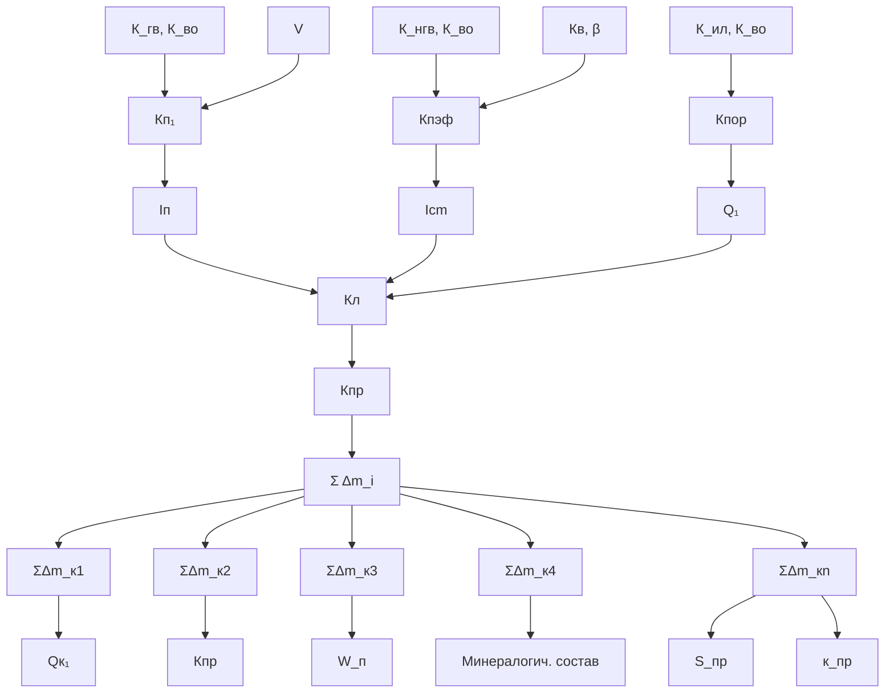

# Латышова - Практическое руководство по интерпретации диаграмм геофизических исследований скважин - 1

<!-- page 1 -->
М. Г. Латышова

# ПРАКТИЧЕСКОЕ РУКОВОДСТВО ПО ИНТЕРПРЕ-ТАЦИИ ДИАГРАММ ГЕОФИЗИЧЕСКИХ ИССЛЕДОВА-НИЙ СКВАЖИН

3-Е ИЗДАНИЕ, ПЕРЕРАБОТАННОЕ И ДОПОЛНЕННОЕ

Допущено Государственным комитетом СССР по народному образованию в качестве учебного пособия для студентов ВУЗов, обучающихся по специальностям «Геология нефти и газа» и «Геофизические методы поисков и разведки»
<!-- page 2 -->
Москва «НЕДРА» 1991
<!-- page 3 -->
# ПРЕДИСЛОВИЕ

Настоящая работа является третьим изданием учебного пособия для практических работ по курсу «Интерпретация результатов геофизических исследований скважин» по специальности «Геофизические методы поисков и разведки» и «Геология нефти и газа».

Некоторые материалы, изложенные в практикуме, могут представлять интерес также для работников интерпретационной службы производственных и научно-исследовательских организаций. Пособие не претендует на полное изложение курса интерпретации данных геофизических исследований скважин (ГИС); оно посвящено главным образом детальному изучению разрезов нефтяных и газовых скважин. Особое внимание уделяется вопросам количественной интерпретации данных отдельных геофизических методов стандартного комплекса, применяемого в данное время в нефтяной и газовой промышленности.

Для прохождения практикума требуется предварительное ознакомление с основной литературой [3-5, 9], в которой дается подробное изложение изучаемого предмета. При изучении разделов, посвященных методам определения удельного электрического сопротивления пород и комплексной интерпретации диаграмм, необходимо использовать комплекты соответствующих палеток и номограмм [1, 7, 8, 11, 12].
<!-- page 4 -->
# Глава I

# ИНТЕРПРЕТАЦИЯ ДИАГРАММ ЭЛЕКТРИЧЕСКИХ МЕТОДОВ

# § 1. УДЕЛЬНОЕ ЭЛЕКТРИЧЕСКОЕ СОПРОТИВЛЕНИЕ ПЛАСТОВЫХ ВОД, БУРОВЫХ РАСТВОРОВ И ГОРНЫХ ПОРОД, НАСЫЩЕННЫХ ВОДОЙ, НЕФТЬЮ И ГАЗОМ

# Способы изображения химического состава пластовых вод и оценка их удельного сопротивления

Электропроводность и удельное электрическое сопротивление осадочных горных пород определяется наличием в поровом пространстве породы природной воды. Поскольку твердая часть пород — главные породообразующие минералы - практически не проводят тока, удельное¹ электрическое сопротивление пород при прочих равных условиях пропорционально удельному сопротивлению поровой или пластовой воды ρв.

Пластовые воды нефтяных и газовых месторождений представляют собой сложные растворы электролитов. Наиболее распространенными солями, встречающимися в пластовых водах большинства нефтяных месторождений, являются хлориды натрия, кальция и магния. Реже встречаются сульфатионатриевые воды и еще реже гидрокарбонатионатриевые. В последних, кроме NaCl, в значительном количестве присутствует Na₂SO₄, либо NaHCO₃.

Химический состав вод изображается в весовой ионной форме, основанной на предположении, что все соли, растворенные в воде, полностью диссоциируют на ионы. При анализе определяется содержание (число миллиграммов) каждого вида ионов в 100 см³ пробы воды. Кроме весовой чаще используется эквивалентная форма представления анализа. В этом случае находится число миллиграмм-эквивалентов каждого вида ионов в 100 см³ пробы воды (табл. 1).

Данные химических анализов используются для определения удельного сопротивления вод, если отсутствуют непосредственные измерения. Сопротивление в этом случае оценивается приближенными методами с разной степенью точности. Если в воде преобладает соль NaCl (до 90 %), оценка осуществляется по общей концентрации солей C в кг/м³ или Cв в кг-экв/м³ при использовании графиков зависимости ρв = f(C, t) = f(Cв, t) (рис. 1), полученных для соли NaCl. Общая концентрация в этом случае

$$\begin{array}{l} C_{в} = 0,01 \Sigma C_{в1} = 0,01 \Sigma C_{К1}, \\ \text{или} \\ C = 0,01(\Sigma A_{в}C_{в} + \Sigma A_{в}C_{К1}). \end{array}$$

Здесь Cв и Cв - концентрации анионов и катионов, мг-экв/100 см³; Cв - общая концентрация солей в пластовой воде, кг-экв/м³; Aв и Aк - массы грамм-эквивалентов отдельных анионов и катионов; 0,01 - переводной коэффициент для выражения концентрации раствора в кг/м³ или кг-экв/м³.

С помощью общей концентрации можно определить удельное сопротивление вод при низкой концентрации солей с точностью 1 % и при высокой концентрации (4—5 н) – 5 - 8 %. Для этого используют графики (см. рис. 1), по которым находят удельное сопротивление пластовой воды при заданной температуре t.

Если ионный состав солей в воде сложен и катионы более чем на 1/3 представлены кальцием и магнием или анионы содержат ион HCO₃⁻,

$$\rho_{в} = (\Sigma \Lambda_{ц} C_{в})^{-1}, \tag{1}$$

где Cв - эквивалентная концентрация (в кг-экв/м³) i-й соли; Λц - эквивалентная электропроводность (в Ом⁻¹·м²) раствора i-й соли, соответствующая суммарной эквивалентной концентрации CΣв солей в растворе. Эквивалентная электропроводность Λ = u + v электролита (соли) равна сумме подвижностей его катиона u и аниона v. Величины Λ, u, v зависят от суммарной концентрации раствора, поэтому значения Λц определяются по экспериментальным кривым Λ = f(CΣ) (рис. 2) для заданной величины. Поскольку здесь приведены кривые Λ = f(CΣ) для t = 20 °C, то, подставляя значения Λ, определенные по этим кривым, в формулу (1), получают значение ρв при t = 20°C. Для расчета ρв при температуре пласта t и известном значении ρв20 используют зависимости ρв = f(C) для различных t = const (см. рис. 1).

Приведем примеры определения суммарной концентрации солей в пластовой воде по данным химических анализов и оценки по ним удельного сопротивления вод.

¹ Для сокращения текста в дальнейшем слово "электрическое" опускаем.
<!-- page 5 -->
Данные анализов вод по нефтяным и газовым месторождениям.

|  Месторождение или тип разреза | Возраст по- род | Плотность воды, 10^{3} кг/м^{3} | Концентрация ионов, мг*экв/100см^{3} |   |   |   |   |   | С, кг/м^{3} | Тип воды | t, °С | ρ_{п} Ом*м  |
| --- | --- | --- | --- | --- | --- | --- | --- | --- | --- | --- | --- | --- |
|   |   |   |  Cl^{-} | SO_{4}^{2-} | HCO_{3}^{-} | Na^{+}+K^{+} | Ca^{2+} | Mg^{2+}  |   |   |   |   |
|  Северо-Ставрополь- ское | Хадумский горизонт | - | 37,683 | 0,497 | 1,452 | 38,680 | 0,515 | 0,437 | - | Гидрокар- бонатно- натриевый |  |   |
|  Соколовогорское | Средний де- вон | 1,19 | 508,21 | 0,808 | 0,100 | 346,238 | 124,85 | 38,03 | - | Хлоркаль- циевый |  |   |
|  *Башкирия и Татария*  |   |   |   |   |   |   |   |   |   |   |   |   |
|  Туймазинское | Яснополян- ский подъ- ярус | 1,172 | 440,18 | 0,26 | 0,02 | 333,79 | 58,89 | 47,78 | - | Хлоркаль- циевый | 20 |   |
|  Ромашкинское | Турнейский ярус | 1,149 | 411,79 | 2,15 | - | 317,45 | 60,12 | 36,37 | - | То же | 20-25 |   |
|  Ромашкинское | Девон | 1,186 | 472,86 | - | 0,02 | 325,85 | 115,86 | 31,07 | - | -//- | 35-40 |   |
|  Туймазинское | Девон | 1,196 | 490,36 | 0,1 | - | 308,67 | 139,93 | 41,86 | - | -//- | 35-40 |   |
|  Шкаповское | Девон | 1,192 | 463,69 | 0,05 | - | 256,32 | 180,00 | 27,42 | - | -//- | 40 |   |
|  *Ставропольский край*  |   |   |   |   |   |   |   |   |   |   |   |   |
|  Александровское | Эоцен | - | 47,76 | 0,339 | 2,113 | 48,85 | 0,71 | 0,352 | - | Гидрокар- бонатно- натриевый | 50-60 |   |
|  Александровское | Палеоген | - | 0,513 | 0,003 | 0,34 | 0,73 | 0,056 | 0,07 | - | То же | 50 |   |
|  *Терско-Дагестанская область*  |   |   |   |   |   |   |   |   |   |   |   |   |
|  Озек-Суатское | Нижний мел | - | 187,101 | 0,048 | 0,280 | 131,721 | 51,794 | 3,914 | - | Хлоркаль- циевый | 140-150 |   |
|  Старогрозненское | Верхний мел | - | 8,16 | 2,6 | 2,4 | 11,65 | 1,35 | 0,16 | - | Гидрокар- бонатно- натриевый | 85 |   |
|  Карабулак | Нижний мел | - | 116,91 | 1,02 | 0,24 | 106,16 | 9,36 | 2,65 | - | То же | 90 |   |
|  *Тюменская область*  |   |   |   |   |   |   |   |   |   |   |   |   |
|  Нижневартовский | Нижний мел | - | - | - | - | - | - | - | 17-36 | -//- | 60-70 |   |
|   |  | - | 42 | - | 0,44 | 34,42 | 7,76 | 0,26 | - |  | 60-70 |   |
<!-- page 6 -->
|  Сургутский | Нижний мел | - | - | - | - | - | - | - | 15-36,2 | -//- | 50-60 |   |
| --- | --- | --- | --- | --- | --- | --- | --- | --- | --- | --- | --- | --- |
|   | Юра | - | 26,97 | 0,28 | 6,91 | 32,01 | 1,85 | 0,3 | - |  | 60-70 |   |
|  Усть-Балыкский | Нижний мел | - | - | - | - | - | - | - | 13,1-19,7 | -//- | 50-70 |   |
|  Шаимский | Юра | - | - | - | - | - | - | - | 15-29,5 | -//- | 50-70 |   |

Примечание. Последняя графа таблицы заполняется при решении задачи.
<!-- page 7 -->

----
━━━ FORMAT 7: NOMOGRAM / ПАЛЕТКА ━━━

Палетка (номограмма) для определения удельного сопротивления раствора/воды (ρв) в зависимости от концентрации соли (С) и плотности раствора (δ), представлена семейством кривых.

Оси:
- Ось ординат (вертикальная, левая): ρв, Ом·м — логарифмическая шкала, диапазон от 0,01 до 90 (метки: 0,01; 0,02; 0,03; 0,04; 0,05...0,1; 0,2; 0,3; 0,4; 0,5...1; 2; 3; 4; 5; 6; 7; 8; 9; 10; 20; 30; 40; 50; 60; 70; 80; 90).
- Ось абсцисс (горизонтальная, нижняя, две шкалы одна под другой):
  1) С, г/л — логарифмическая шкала, диапазон от 0,1 до 300 (метки: 0,1; 0,2; 0,3; 0,4; 0,5; 0,6; 0,8; 1; 2; 3; 4; 5; 6; 8; 10; 20; 30; 40; 50; 60; 80; 100; 200; 300).
  2) С, г/м³ (нижняя подшкала) — логарифмическая, диапазон от 0,001 до 0,7 (метки: 0,001; 0,005; 0,01; 0,05; 0,1; 0,2; 0,4; 0,6; 0,7).
- Дополнительная (правая) шкала: δ²⁰ − 1, г/см³ — логарифмическая, диапазон от 1 до 120 (метки: 1; 2; 3; 4; 5; 6; 8; 10; 20; 30; 40; 60; 80; 100; 120).

Семейство кривых: множество близко расположенных наклонных линий, идущих слева-сверху вниз-направо, соответствующих различным значениям параметра (подписи на отдельных кривых неразборчивы, видны отдельные подписи вида "0,1", "20", "40" рядом с кривыми, а также подпись "t°" у одной из верхних кривых — вероятно указывающая на температуру как параметр семейства). Точные числовые значения параметра каждой кривой не читаются полностью — [нрзб] для большинства меток внутри пучка кривых.

Порядок считывания: по оси абсцисс (С, г/л или г/м³, либо по правой шкале δ²⁰−1) находится точка, соответствующая известной концентрации/плотности раствора; по соответствующей кривой семейства (в зависимости от температуры или иного параметра) снимается значение ρв на оси ординат.

Опорные точки (снято с графика, приблизительно):
- При С ≈ 1 г/л, ρв ≈ 5–6 Ом·м (верхняя кривая пучка).
- При С ≈ 10 г/л, ρв ≈ 0,6–0,8 Ом·м (средняя часть пучка).
- При С ≈ 100 г/л, ρв ≈ 0,06–0,08 Ом·м (нижняя часть пучка).
- Крайняя нижняя кривая пучка при С ≈ 300 г/л выходит на ρв ≈ 0,03 Ом·м.

KEYWORDS: ρв, удельное сопротивление раствора, минерализация, палетка, номограмма, концентрация соли, плотность раствора, каротаж, петрофизика
----

Рис. 1. Зависимость удельного электрического сопротивления пластовых вод от концентрации и плотности раствора NaCl.
Шифр кривых — t, С

----
━━━ FORMAT 6: XY PLOT / CHART WITH DATA ━━━

**Оси:**
- Ось Y: Л, Ом⁻¹·м² — линейная шкала, диапазон от 3 до 13, деления через 1 (3,4,5,6,7,8,9,10,11,12,13)
- Ось X: С_в, кг-экв/м³ — логарифмическая шкала, диапазон от 0,001 до 5, размеченные значения: 0,001; 0,005; 0,01; 0,05; 0,1; 0,5; 1; 2; 3; 4; 5

**Кривые:**
На графике представлено 5 кривых, обозначенных номерами 1–5, идущих сверху вниз в порядке убывания значений Л при больших С_в. Линии различаются по стилю (сплошные, штриховые, штрихпунктирные — точное соответствие номера и стиля не читается уверенно на изображении).

Общий характер всех кривых: начинаются в левой части графика (при малых С_в) с относительно высоких значений Л (в диапазоне примерно 8–11,5), затем с ростом С_в (движение вправо по логарithmической оси) все кривые монотонно снижаются, сходясь в правой части графика (при С_в от ~1 до 5) к значениям в диапазоне примерно 3–7.

Приблизительные опорные точки (снято с графика, приблизительно):
- Кривая 5 (верхняя): начинается при С_в≈0,001 на уровне Л≈11; слабо снижается до Л≈10,5 при С_в≈0,1; далее плавно снижается до Л≈7 при С_в≈5.
- Кривая 1: начинается при С_в≈0,001 на уровне Л≈11; снижается до Л≈9,5 при С_в≈0,5; далее резко падает до Л≈5,5 при С_в≈3-5.
- Кривая 2: начинается при С_в≈0,001 на уровне Л≈11; ход близок к кривой 1, но чуть ниже; падает до Л≈5 при С_в≈3-5.
- Кривая 3: начинается при С_в≈0,001 на уровне Л≈9; снижается до Л≈4,5 при С_в≈3-5.
- Кривая 4 (нижняя): начинается при С_в≈0,001 на уровне Л≈8; снижается наиболее резко, достигая Л≈3 при С_в≈2-3.

Подписи номеров кривых расположены у правого конца каждой линии (1, 2, 3, 4, 5).

Легенда, поясняющая физический смысл кривых 1–5 (например, зависимость от глинистости, пористости или иного параметра), внутри изображения отсутствует.

> Тренд: с увеличением минерализации пластовой воды (С_в) параметр Л (удельная электропроводность породы, приведённая к единичному объёму) монотонно убывает для всех представленных кривых, при этом кривые расходятся в области малых С_в и сближаются в области больших С_в.

KEYWORDS: удельная электропроводность, минерализация пластовой воды, кг-экв/м³, петрофизическая зависимость, логарифмическая шкала, электрические свойства пород, каротаж сопротивления
----

Рис. 2. Зависимость эквивалентной электропроводности от концентрации раствора для различных солей: 1 - NaCl; 2 - CaCl₂; 3 : MgCl₂; 4 - NaHCO₃; 5 - KCl

Пример 1. Определить суммарную концентрацию С (в г·экв/л) по данным анализа, приведенным в табл. 1:
Cₙ = 0,01(37,683 + 0,497 + 1,452) = 0,01(38,680 + 0,515 + 0,437) = 0,39632 г·экв/л ≈ 0,4 г·экв/л = 0,4 кг·экв/м³.

Пример 2. Определить суммарную концентрацию С (в кг/м³) по данным анализа, приведенным в табл. 1:
C = (35,5·508,21 + 48,0·0,808 + 61,0·0,1 + 24·347,238 + 20,04·124,85 + 12,16·38,03)·0,01 = 180,5 + 0,39 + 0,06 + 83,2 + 25,0 + 4,56 = 293,71 г/л или кг/м³.
<!-- page 8 -->
Пример 3. Определить удельное сопротивление пластовых вод по данным анализов, приведенным в табл. 1, при разных температурах.

1) Общая минерализация  \( C_{n}=0,4\ кг\cdot экв/м^{3};\rho_{n18}=0,3\ Ом\cdot м. \)
2) Общая минерализация  \( C = 293,7 \, кг/м^{3} \) ;  \( \rho_{n18} = 0,037 \, Ом \cdot м \) ;  \( \rho_{n45} = 0,028 \, Ом \cdot м \) .

Для приближенной оценки удельного сопротивления в ряде районов используют плотность при 20 °C ( \( \delta_{n20} \) ).

Пример 4. Пластовая вода имеет плотность 1,598 г/см³ при t = 20 °C. Для нахождения ρn 20 воспользуемся кривой 5 и нижней шкалой графика рис. 1, на которой откладывается значение плотности за вычетом единицы. Удельное сопротивление воды определяется по ординате точки указанной кривой с абсциссой δn20 - 1 = 0,1598 и равно 0,042 Ом·м.

Пример 5. Вода некоторого горизонта имеет плотность \(\delta_{\mathrm{n}} = 1,008\mathrm{r / cm}^{3}\) при \(t = 20^{\circ}\mathrm{C}\). Пользуясь соответствующей кривой рис. 1, получим сопротивление воды, равное \(0,46\mathrm{OM}\cdot \mathrm{M}\). Если требуется найти сопротивление этой воды при температуре, отличной от \(20^{\circ}\mathrm{C}\), например, при \(50^{\circ}\mathrm{C}\), следует воспользоваться кривыми \(\rho_{\mathrm{e}} = f(\mathrm{C},t)\) для NaCl. Выбираем кривую \(\rho_{\mathrm{n}} = f(\mathrm{C})\) для \(t = 20^{\circ}\mathrm{C}\) и находим точку, соответствующую ординате 0,46, затем спускаемся до кривой \(t = 50^{\circ}\mathrm{C}\) и на оси берем отсчет \(\rho_{\mathrm{n}50} = 0,27\mathrm{OM}\cdot \mathrm{M}\).

Пример 6. По данным химического анализа пластовая вода содержит 150 кг/м³ NaCl, 80 кг/м³ CaCl₂. Рассчитать ρ, при температуре пласта t = 70°C.

1. Вычислим значение  \( \rho_{n} \)  приближенным способом, полагая, что пластовая вода является раствором NaCl с концентрацией, равной суммарной концентрации  \( C_{\Sigma} \)  (в кг/м \( ^{3} \) ) всех солей, присутствующих в пластовой воде. Находим  \( C_{\Sigma} = C_{NaCl} + C_{CaCl_{2}} = 230 \)  кг/м \( ^{3} \) . По кривой  \( \rho_{n} = f(C) \)  для  \( t = 70^{\circ}C \)  (см. рис. 1) для  \( C_{n} = 230 \)  кг/м \( ^{3} \) , получаем  \( \rho_{n} = 0,022 \)  Ом·м.
2. Рассчитаем значение  \( \rho_{n} \)  по формуле (1). Зная эквивалентную массу солей NaCl - 58,5 кг,  \( CaCl_{2} \)  — 55,5 кг, вычислим их эквивалентные концентрации  \( C_{1} = 2,57 \)  кг·экв/м³ (NaCl) и  \( C_{2} = 1,44 \)  кг·экв/м³ ( \( CaCl_{2} \) ) и суммарную концентрацию  \( C_{\Sigma} = C_{1} + C_{2} = 4,01 \)  кг·экв/м³. По графикам на рис. 2 находим  \( \Lambda_{1\Sigma} = 5,05 \)  Ом⁻¹ м²;  \( \Lambda_{2\Sigma} = 4,33 \)  Ом⁻¹ м². Подставляя полученные значения  \( C_{1}, C_{2}, \Lambda_{1}, \Lambda_{2} \)  в формулу (1), получим  \( \rho_{n20} = 0,052 \)  Ом·м. Для найденного  \( \rho_{n20} \)  и  \( t = 70^{\circ}C \)  по кривым рис. 1 получим  \( \rho_{n70} = 0,024 \)  Ом·м.

### Удельное сопротивление промывочных жидкостей

Геофизические исследования обычно проводятся в скважинах, заполненных промывочной жидкостью или глинистым раствором, представляющим собой суспензию твердых глинистых частиц в воде. Различают удельное сопротивление глинистого раствора  \( \rho_{p} \) , находящегося в скважине, и удельное сопротивление его фильтрата  \( \rho_{\phi} \)  в зоне проникновения. Обычно удельное сопротивление последнего отличается от сопротивления раствора. Для нахождения  \( \rho_{\phi} \)  по  \( \rho_{p} \)  используют график, приведенный на рис. 3, а, если плотность раствора не превышает  \( 1,3\cdot10^{3} \)  кг/м \( ^{3} \) , а в случае утяжеленных растворов — график, представленный на рис. 3, б. Для введения температурных поправок в значения  \( \rho_{\phi} \)  и в первом приближении в значения  \( \rho_{n} \)  можно пользоваться зависимостями на рис. 1.

Пример 7. Определить удельное сопротивление фильтрата бурового раствора, если его плотность  \( 1,2 \cdot 10^{3} \)  кг/м \( ^{3} \) , удельное сопротивление бурового раствора  \( \rho_{p} = 1,6 \)  Ом·м и температура в исследуемом интервале t - 36 °C. Для определения  \( \rho_{\phi} \)  выбираем соответствующую кривую на рис. 3, а. Для заданных условий  \( \rho_{\phi} = 1,2 \)  Ом·м.

#### Задачи

1. Определить удельное сопротивление пластовых вод по некоторым районам, используя данные анализов вод и возможные значения пластовых температур, приведенные в табл. 1.
2. Найти удельное сопротивление пластовой воды, если ее плотность  \( 1,18 \, r/cm^{3} \)  при температуре  \( t = 20 \, ^{\circ}C \) .

Привести удельное сопротивление этой воды к пластовым условиям при  \( t = 65^{\circ}C \) .

3. Найти пределы изменения удельного сопротивления пластовой воды для свиты медистых песчаников месторождения Шебелинка, если плотность воды в среднем равна  \( 1,17 \cdot 10^{3} \)  кг/м \( ^{3} \) , а пластовая температура варьирует от 50 до 75 °C.
4. Привести удельное сопротивление глинистого раствора к условиям  \( t = 18^{\circ}C \) , если по данным поверхностного резистивиметра его удельное сопротивление при  \( t = 7^{\circ}C \)  равно 2,6 Ом·м.
5. Определить удельное сопротивление раствора и его фильтрата в скважине для условий задачи 4, если температура против пласта  \( 82^{\circ}C \) ,  \( \delta_{p} = 1,3 \cdot 10^{3} \)  кг/м \( ^{3} \) .
6. Установить величину удельного сопротивления фильтрата глинистого раствора  \( \rho_{\phi} \) , если  \( \rho_{p}=2,2 \)  Ом·м при f=18 °C. Плотность раствора  \( 1,26\cdot10^{3} \)  кг/м \( ^{-1} \) , температура пласта 53 °C.
7. Определить удельное сопротивление фильтрата, если плотность раствора, утяжеленного 30% гематита, равна  \( 1,7 \cdot 10^{3} \)  кг/м \( ^{3} \) , удельное сопротивление раствора 0,8 Ом·м, температура в исследуемом пласте 48 °C
<!-- page 9 -->
### Удельное сопротивление водоносных пород и его оценка для заданного разреза

Удельное сопротивление горных пород в общем случае зависит от состава породообразующих минералов и характера жидкостей, заполняющих норовое пространство. Главными породообразующими минералами большинства пород осадочного комплекса являются: кварц, полевой шпат, слюда, кальцит. Их удельное электрическое сопротивление изменяется в пределах  \( 10^{7} - 10^{15} \)  Ом·м, что соответствует хорошим и первоклассным техническим изоляторам. Исходя из этого считается, что удельное сопротивление кристаллического скелета осадочных пород в целом бесконечно велико и влиянием его минерального состава можно пренебречь.

При прохождении электрического тока через такие породы основную роль играет поровая вода, содержащая растворенные соли. Поэтому удельное сопротивление породы пропорционально удельному сопротивлению поровой воды.

Поровое пространство пород в естественном залегании в большинстве случаев предельно насыщено водой. Исключение составляют породы, залегающие выше горизонта грунтовых вод, а также нефтяные и газовые коллекторы.

Удельное сопротивление породы  \( \rho_{m} \) , обладающей межзерновой пористостью, при 100%-м заполнении пор водой удельного сопротивления  \( \rho_{a} \) , оценивается соотношением:

\[
\rho_ {\mathrm{m}} = \mathrm{P} _ {\mathrm{n}} \rho_ {\mathrm{a}} \tag {2}
\]

Здесь  \( P_{n} \)  — параметр пористости, связанный с общей пористостью породы  \( K_{n} \)  эмпирической зависимостью

\[
\mathrm{P} _ {\mathrm{n}} = \mathrm{a} _ {\mathrm{m}} / \mathrm{k} _ {\mathrm{n}} ^ {\mathrm{m}}, \tag {3}
\]

где  \( a_{m} \)  и m — константы для данного узкого типа пород.

Для разных типов отложений  \( a_{m} \)  изменяется в пределах 0,4—1,0, m = 1,3+2,2. Структурный показатель m, характеризующий крутизну кривой, зависит от степени цементации и ряда других факторов, связанных с изменением типа, возраста и условий залегания горных пород [4] (рис. 4).

----
━━━ FORMAT 7: NOMOGRAM / ПАЛЕТКА ━━━
Панель "а". Палетка (номограмма) представляет собой семейство кривых, веерообразно расходящихся от начала координат к верхнему правому углу графика, с диагональной штриховкой между кривыми в средней части поля.

Оси:
- Ось абсцисс (горизонтальная, нижняя): обозначена как $ρ_{в}$, лог/см³ (подпись неразборчива, вероятно ρв, г/см³), шкала логарифмическая, диапазон примерно от 0,01 до 1.
- Ось ординат (вертикальная, левая): обозначена как ρп, Ом·м (шкала логарифмическая), с делениями 0,5; 1; 2; 3 (сверху вниз или снизу вверх — цифры видны: 3, 2, 1, 0,5).

Параметр семейства кривых: на кривых у их основания подписаны числовые значения (различимы фрагменты подписей вида "t = 130°C" и ряд мелких цифр вдоль нижних кривых, точно не читаются).

Внутри веера кривых расположена зона с диагональной штриховкой (наклонные линии), назначение которой не поясняется в пределах изображения (легенда отсутствует).

Процедура считывания: по осям абсцисс и ординат для заданного параметра семейства (подписанного на соответствующей кривой) определяется точка пересечения, дающая искомое значение.

Ориентировочные опорные точки (сняты с графика приблизительно):
- нижняя кривая семейства проходит вблизи начала координат и идёт почти по диагонали графика;
- верхняя кривая семейства расположена выше остальных, ближе к верхней границе поля.

Точные числовые значения кривых и подписи большей части параметров неразборчивы: [нрзб].

KEYWORDS: номограмма, палетка, удельное сопротивление, ρв, ρп, минерализация, температура, каротаж, петрофизика
----

Рис. 3. Зависимость \(\rho_{\phi}\) от \(\rho_{\mathrm{p}}\) и \(t\) при \(\delta_{\mathrm{p}} < 1,3 \cdot 10^{3} \mathrm{kr} / \mathrm{m}^{3}\) (a) и \(\eta = \rho_{\phi} / \rho_{\mathrm{p}}\) от \(\delta_{\mathrm{p}}\) для тяжелых растворов (b): 1 - чистая глина; 2 - то же, +20% барита или 23 % гематита; 3 - то же, +40 % барита или 46 % гематита; 4 - то же, +60% барита или 70% гематита; 5 - то же, +90% барита
<!-- page 10 -->

----
━━━ FORMAT 6: XY PLOT / CHART WITH DATA ━━━

Оси:
- Ось Y (вертикальная, слева): Рп, шкала логарифмическая, диапазон значений от 2 до 1000, подписанные деления: 2, 5, 10, 20, 50, 100, 200, 500, 1000.
- Ось X (горизонтальная, нижняя): Кп, % (подпись "Кп,%"), шкала логарифмическая, диапазон значений от 2 до 50, подписанные деления: 2, 5, 10, 20, 50.

Кривые:
Изображено семейство из четырёх монотонно убывающих кривых (Рп убывает с ростом Кп), идущих слева-сверху вниз-вправо, с номерами-метками у верхних концов кривых:
- Кривая с меткой "6" — крайняя правая (наибольшие значения Рп при заданном Кп), начинается примерно от Рп≈1000 при Кп≈8-10%.
- Кривая с меткой "4,5" (объединённая метка для двух близких кривых) — левее кривой 6, начинается примерно от Рп≈300-500 при Кп≈5-8%.
- Кривая с меткой "2,3" (объединённая метка для двух близких кривых) — ещё левее, начинается примерно от Рп≈50-100 при Кп≈8-10%.
- Кривая с меткой "1" — крайняя левая/нижняя, начинается примерно от Рп≈10-20 при Кп≈15-20%, идёт до Рп≈2 при Кп≈40-50%.

Все кривые сходятся в область правого нижнего угла графика при больших Кп (около 40-60%) и малых Рп (около 2-5).

Анкерные точки (приблизительно, снято с графика):
- Кривая 6: (Кп≈8%, Рп≈1000); (Кп≈50%, Рп≈5) — приблизительно, снято с графика.
- Кривые 4,5: (Кп≈6%, Рп≈400); (Кп≈45%, Рп≈3) — приблизительно, снято с графика.
- Кривые 2,3: (Кп≈9%, Рп≈70); (Кп≈40%, Рп≈2) — приблизительно, снято с графика.
- Кривая 1: (Кп≈17%, Рп≈15); (Кп≈40%, Рп≈2) — приблизительно, снято с графика.

Легенда (нумерация кривых 1–6) внутри изображения не расшифрована — вероятно, соответствует разным образцам/группам пород, но пояснение отсутствует в самом изображении.

> Тренд: с увеличением коэффициента пористости Кп параметр пористости Рп монотонно убывает; при одном и том же значении Кп разные кривые (1–6) дают разные значения Рп, что отражает зависимость Рп от Кп для разных групп образцов/пород.

KEYWORDS: параметр пористости, Рп, Кп, коэффициент пористости, логарифмическая шкала, петрофизическая зависимость, каротаж, электрическое сопротивление
----

----
━━━ FORMAT 7: NOMOGRAM / ПАЛЕТКА ━━━
Название палетки не подписано (нет номера или наименования на изображении).

Оси:
- Ось абсцисс (горизонтальная, снизу): ρ_в, Ом·м — логарифмическая шкала, диапазон от 0,05 до 5 (подписаны значения 0,05; 0,1; 0,2; 0,5; 1; 2; 5).
- Ось ординат (вертикальная): П — логарифмическая шкала, диапазон от ~0,2 до 1 (подписаны деления 0,2; 0,5; 1; сетка с делениями).

Семейство кривых: пучок кривых, расходящихся от одной точки в левом верхнем углу графика (вблизи П=1, ρв=0,05) и веерообразно расходящихся вниз-вправо к правому краю графика. Каждая кривая подписана значением параметра семейства справа, значения (сверху вниз): 10, 15, 20, 25, 30, 35, 40, 45, 50 (подписи расположены по правому краю, но точная привязка каждого числа к своей кривой не всегда разборчива — часть значений: 10, 15, 20, 25, 30, 40, 50 — [нрзб] для отдельных промежуточных подписей).

Порядок считывания (предполагаемый по построению палетки): по оси абсцисс откладывается значение ρв, Ом·м; по кривой, соответствующей заданному значению параметра (число, подписанное справа), находится точка пересечения, и по оси ординат снимается значение П.

Ориентировочные опорные точки для крайних кривых ("снято с графика, приблизительно"):
- Верхняя (левая) кривая семейства (параметр ≈10): начинается в точке (0,05; ~1,0), проходит через (0,5; ~0,9), заканчивается в районе (5; ~0,75).
- Нижняя (правая) кривая семейства (параметр ≈50): начинается в точке (0,05; ~1,0), проходит через (0,5; ~0,5), заканчивается в районе (5; ~0,2).

Все кривые исходят из единой точки в левой верхней части графика (примерно П=1 при ρв=0,05) и расходятся веером к правому краю, где расположены подписи параметра семейства.

KEYWORDS: палетка, номограмма, удельное сопротивление, ρв, параметр пористости П, семейство кривых, логарифмическая шкала

----

Рис. 5. Зависимость коэффициента поверхностной проводимости П от удельного сопротивления поровых вод ρв и глинистости Cгл, % (шифр кривых)

Рис. 4. Зависимость параметра пористости Pп = ρвн/ρв от коэффициента пористости kn для терригенных и карбонатных пород: 1 — пески; 2 — слабосцементированные песчаники; 3 — ракушники и глинистые известняки; 4 - среднесцементированные песчаники; 5 - известняки и доломиты крупнокристаллические средней уплотненности; 6 — известняки и доломиты плотные, тонкокристаллические

На удельное сопротивление глинистых пород существенно влияет их адсорбционная способность. На поверхности твердой фазы концентрируется большое число ионов, имеющих подвижности, отличные от их подвижностей в свободном растворе [3, 5]. Повышение содержания тонкодисперсного глинистого материала увеличивает удельную поверхность и адсорбционную способность пород, а следовательно, изменяет и их поверхностную проводимость. В качестве параметра поверхностной проводимости условно принимается отношение параметра пористости Pп.пресн при данном сопротивлении поровой воды к параметру пористости при заполнении пор насыщенным раствором Pп.нас = Pп¹:

$$\Pi = P_{п.пресн}/P_{п} ; \quad P_{п.пресн} = \Pi P_{п} \tag{4}$$

Коэффициент поверхностной проводимости П зависит от содержания глинистого материала в породе Cгл и удельного сопротивления поровой воды ρв (рис. 5). Влияние поверхностной проводимости особенно значительно при уменьшении минерализации поровых вод, поскольку концентрация ионов в адсорбционном слое при этом практически не изменяется.

По данным, представленным на рис. 4 и 5, можно оценить величины удельного сопротивления породы, если известны ее тип и условия залегания.

Пример 8. Оценить пределы изменения удельного сопротивления ρвн водонасыщенных песчаников девона одного из месторождений Башкирии, если известно, что пластовые воды имеют удельное сопротивление 0,046 Ом·м при t = 18 °С, а коэффициент пористости kn изменяется от 17 до 20 %. Коллектор по типу относится к среднесцементированным. В пластовых условиях t = 35 °С.

Для подсчета воспользуемся формулой (2). По графику рис. 1 найдем ρв = 0,033 Ом·м; Pп для среднесцементированных коллекторов колеблется от 31 до 16,5. Следовательно, удельное сопротивление песчаников варьирует в следующих пределах:

$$\rho_{вн} = (31 \div 16,5) \cdot 0,033 = 1,0 \div 0,55 \text{ Ом} \cdot \text{м}.$$

Пример 9. Оценить величину удельного сопротивления коллектора, представленного слабосцементированным песчаником с пористостью 28—30%, при насыщении его водой с общей минерализацией 54 кг/м³.

¹ При нахождении статистической связи Pп и Kn (см. рис. 4) чаще всего соблюдается именно это условие.
<!-- page 11 -->
Температура пласта 68 °C; ρв = 0,06 Ом·м; Рв = 7,6÷6,7.

Удельное сопротивление коллектора оценивается по формуле (2):

$$\rho_{вп} = (7,6 \div 6,7) \cdot 0,06 \text{ Ом} \cdot \text{м} = 0,5 \div 0,4 \text{ Ом} \cdot \text{м}.$$

Пример 10. Оценить пределы изменения удельного сопротивления коллектора в зоне проникновения ρзп, если известно, что удельное сопротивление пласта за зоной проникновения ρвп = 0,62 Ом·м, пластовой воды при температуре пласта ρв = 0,05 Ом·м, фильтрата глинистого раствора, проникающего в пласт, 2,4 Ом·м, а глинистость Cсх = 0÷15%.

Зная ρв и ρв, находим параметр пористости при насыщении породы водой высокой минерализации из формулы (2):

$$P_в = \rho_{вп} / \rho_в = 0,62 / 0,05 = 12,4.$$

Для вычисления удельного сопротивления промытой части пласта в зоне проникновения глинистого песчаника следует использовать параметр пористости Рп, пресн, измененный за счет поверхностной проводимости согласно формуле (4):

$$\rho_{зп} \le \rho_{вп} = P_{п, пресн} \rho_ф = \Pi P_в \rho_ф$$

При изменении глинистости от 0 до 15 % и ρф = 2,4 Ом·м Π = 1 ÷ 0,65 и, следовательно,

$$\rho_{вп} = 12,4(1 \div 0,65)2,4 = 29,8 \cdot 49,3 \text{ (Ом·м)}.$$

В сложных карбонатных коллекторах кроме межзерновых пор (kп мт) присутствуют также трещины, каверны и крупные пустоты выщелачивания, которые часто называются вторичными порами. Кроме карбонатов, к породам со сложным (смешанным) типом пористости относятся некоторые терригенные и вулканогенные породы. Коэффициент общей пористости таких пород

$$k_{побщ} = k_{пмз} (1 - k_{пвт}) + k_{пвт}, \tag{5}$$

а коэффициент вторичной пористости kпвт является суммой коэффициентов трещиной kпт и каверновой kпв пористости. В породе со смешанным типом пористости различают блоки с межзерновыми порами и систему вторичных пор.

Простейшей породой со смешанной пористостью является трещинно-межзерновая порода с пористостью блоков kпбл = kпмз и коэффициентом трещиноватости kпт. Параметр пористости Рпт и ρвпт такой породы при насыщении трещин и блоков водой с удельным сопротивлением ρв определяется формулой:

$$P_{пт} = \rho_{впт} / \rho_в = P_{пбл} / (P_{пбл} k_{пт} A + 1), \tag{6}$$

где Pпбл — параметр пористости блоков, рассчитываемый по формуле (2) для заданной межзерновой пористости блоков kпбл = kпвт; A — коэффициент, величина которого зависит от ориентации трещин относительно направления, в котором измеряется удельное сопротивление (табл. 2).

Присутствие в породе трещин резко снижает значения Рпт и ρвпт (рис. 6) по сравнению с породами с аналогичной межзерновой пористостью, поскольку трещины являются порами с идеально простой геометрией. Наибольшее снижение отмечается в области низких значений kп. Ориентация трещин максимальное влияние оказывает на модель б.

# Таблица 2

Значения коэффициента А для трещинных пород с различными направлениями трещиноватости [3]

|  Модель трещинно-межзерновой породы | A  |
| --- | --- |
|  а) Все трещины расположены перпендикулярно к направлению измерения ρвпт = ρвпбл | 0  |
|  б) Все трещины расположены перпендикулярно направлению измерения ρвп | 1  |
|  в) Трещины образуют две системы, величина kпт разделена между ними поровну; одна система ориентирована параллельно измерению ρвпт, другая - перпендикулярно | 1/2  |
|  г) Трещины образуют три взаимно перпендикулярные системы с распределением между ними значения kпт равными долями | 2/3  |
<!-- page 12 -->

----
━━━ FORMAT 7: NOMOGRAM / ПАЛЕТКА ━━━

**Панель а**

Оси: вертикальная ось Рп (логарифмическая шкала), значения подписаны: 20, 100, 200, 500, 1000, 2000, 5000, 10000 (сверху вниз возрастание). Горизонтальная ось — Кп·%/х (подпись частично видна: "50 Кп·%/х"), логарифмическая, значения по семейству кривых: 1, 3, 5, 10.
Семейство кривых подписано числами у верхних точек: 1, 3, 5, 10 (параметр семейства).
Дополнительные подписанные значения слева на кривых: 0,1; 0,3; 0,5; 1,0 — вероятно, значения параметра насыщенности или другого коэффициента, соответствующие отдельным кривым семейства.
Кривые расходятся веером от левой верхней точки (значение Рп≈5000 при Кп≈1) вниз-направо, при увеличении Кп значения Рп падают.

**Панель б (δ)**

Оси: вертикальная ось Рв (подпись частично видна как "Рδ"/"Рв"), логарифмическая шкала, подписанные значения: 20, 100, 200, 500, 1000, 2000, 5000, 10000.
Горизонтальная ось — тот же параметр "50 Кп·%/х", логарифмическая.
Семейство кривых с подписями: 1, 3, 5, 10 (сверху), и дополнительные значения на кривых: 0,1; 0,3; 0,5; 1,0.
В нижней части панели помещена легенда (не встроенная в график, а в отдельном блоке справа):
1 — штриховка сплошная тонкая (обозначение типа линии/объекта №1);
2 — штриховка точечная (обозначение №2);
3 — штриховка штрихпунктирная (обозначение №3).
Точная расшифровка легенды не читается полностью — элементы легенды переданы как условные графические обозначения (три горизонтальные полосы с разной штриховкой, пронумерованные 1, 2, 3), их смысловое значение не подписано текстом внутри изображения.

Обе панели представляют собой семейства палеточных кривых для графического определения параметра (вероятно Рп/Рв в зависимости от Кп) при разных значениях параметра семейства (0,1; 0,3; 0,5; 1,0; 1; 3; 5; 10). Порядок считывания: по горизонтальной оси откладывается значение Кп (в %), по соответствующей кривой семейства снимается значение Рп (или Рв) на вертикальной логарифмической оси.

Ориентировочные опорные точки (сняты с графика, приблизительно):
- Панель а, кривая "1": (Кп≈1, Рп≈5000) → (Кп≈20, Рп≈20)
- Панель а, кривая "10": (Кп≈1, Рп≈5000) → (Кп≈20, Рп≈100)
- Панель б, кривая "1": (Кп≈1, Рв≈5000) → (Кп≈20, Рв≈20)
- Панель б, кривая "10": (Кп≈1, Рв≈5000) → (Кп≈20, Рв≈100)

KEYWORDS: палетка, Рп, Рв, Кп, номограмма, логарифмическая шкала, параметр пористости, семейство кривых, каротаж
----

Рис. 6. Зависимости параметра пористости трещинных и кавернозных пород от коэффициента общей по- ристости:

а – все поры заполнены пластовой водой ρв; б – трещины и каверны заполнены водой ρф = 10ρв, а межзер- новые поры – водой ρв; кривые для коллекторов: 1 – межзерновых, 2 - трещинных (шифр кривых - kпт), 3 – кавернозных (шифр кривых - kпк)

Хаотическое расположение трещин лучше всего описывает модель ε; ее чаще всего принимают для описания трещинно-межзерновой породы, если нет точных данных об ориентации трещин.

Кавернозно-межзерновую породу представляют матрицей с межзерновой пористостью kпнт и хаотически рассеянными в ее объеме сферическими кавернами, суммарная емкость которых характеризуется коэффициентом кавернозности kпк.

Параметр пористости Pпк и удельное сопротивление такой породы ρвпк при 100%-м насыщении межзерно- вых пор матрицы и каверн водой с удельным сопротивлением ρв определяются приближенным выражением:

$$P_{пк} = \rho_{впк}/\rho_в \approx [(1 - k_{пк})/(1+2k_{пк})] \cdot P_{обл}$$ (7)

Расчетные кривые Pпк = f (kв), полученные путем сопоставления Pпк с соответствующими значениями общей пористости, даны на рис. 6, а (верхняя группа кривых). Наличие каверн мало изменяет величину па- раметра пористости породы, но общая пористость в данном случае существенно возрастает. В связи с этим кри- вые Pпк = f (kв) смещаются в сторону более высоких значений пористости тем больше, чем больше kпк и меньше kпнт. Выражение (7) используют при описании связи между Pпк и kпк для пород, содержащих каверны не толь- ко сферической, но любой более сложной формы.

При наличии в породе каверн и трещин параметр пористости

$$P_{птк} = [(1 - k_{пк})/(1+2k_{пк})] \cdot P_{пт},$$ (8)

где Pпт — параметр пористости трещинно-межзерновой породы, рассчитываемый по формуле (6). Одновремен- ное присутствие в породе каверн и трещин снижает влияние каждого из этих видов пор на удельное сопротив- ление и параметр пористости, приближая зависимость Pптк = f (kв) к зависимости для межзерновых пород (см. рис. 6). Степень влияния трещин и каверн на величину Pптк зависит от kпк/kпт. При kпк/kпт < 2 преоб- ладает влияние трещин, а при kпк/kпт > 10 - каверн; в области 2 < kпк/kпт < 10 зависимость Pптк = f (kв) аналогична таковой для межзерновой породы.

При образовании в трещинной породе зоны проникновения фильтрата промывочной жидкости с удель- ным сопротивлением ρф, отличным от удельного сопротивления воды в порах блоков ρв, удельное сопро- тивление зоны проникновения

$$P_{пт} = (P_{обл}\rho_в)/(Ak_{пт}P_{обл}\rho_в/\rho_ф + 1)$$ (9)

Из этого выражения следует, что при заполнении трещин пресным фильтратом и малой межзерновой по
<!-- page 13 -->
ристости  \( \rho_{зпт} \rightarrow P_{пбл} \) . В этом случае трещинная порода мало отличается от вмещающих ее плотных разностей.

Для трещинно-кавернозно-межзерновой породы по данным работы [3] при наличии в сообщающейся системе трещин и каверн жидкости с удельным сопротивлением  \( \rho_{ф} > \rho_{в} \)  влияние вторичных пор на величину  \( \rho_{зпт} \)  еще меньше.

Пример 11. Оценить, как изменится сопротивление трещинной породы по сравнению с монолитной, если трещинная пористость ее составляет 1—0,4 %, а пористость блоков в среднем 4 %. Порода насыщена пластовой водой с  \( \rho_{в} = 0,05 \)  Ом·м.

Для ненарушенной трещинами породы при  \( k_{пбл} = 0,04 \rho_{впбл} = P_{пбл} \rho_{в} = 650 \cdot 0,05 = 32,5 \)  Ом·м. Здесь  \( P_{пбл} \)  определяется по кривой 5, на рис. 4 или кривой 1 на рис. 6. Сопротивление той же породы при наличии трещин найдем, воспользовавшись рис. 6. Для этого вычислим общую пористость по формуле (5):  \( k_{п1} = k_{пм1} (1 - k_{п1}) = 0,04 (1 - 0,01) + 0,01 = 0,0396 + 0,01 = 0,0496 \approx 0,05; k_{п2} = 0,04 (1 - 0,004) + 0,004 = 0,044. \)

При  \( k_{п} = 5 + 4,4\% \)   \( P_{пт} = 85 + 180 \) , а  \( \rho_{впт} = (85 + 180) \cdot 0,05 = 4,25 + 9 \)  Ом·м. Полученные цифры показывают, что удельное сопротивление трещинной породы заметно понижается по сравнению с удельным сопротивлением плотных разностей практически той же пористости.

Пример 12. Оценить удельное сопротивление кавернозной породы, если  \( k_{пк} = 3 + 10\% \) ;  \( k_{пмз} = 4\% \) ,  \( \rho_{к} = 0,05 \)  Ом·м.

Как и в предыдущем случае, по формуле (5)  \( k_{п1} = k_{побщ} = 0,04 (1 - 0,03) + 0,03 = 0,0688 \) ;  \( k_{п2} = 0,04 (1 - 0,10) + 0,10 = 0,136 \) ;  \( k_{п} = 6,9 + 13,6\% \) ,  \( \rho_{впк} = (500 + 300) \cdot 0,05 = 25 + 15 \)  Ом·м.

Удельное сопротивление породы с каверновой пористостью при тех же характеристиках матрицы и пластовой воды значительно меньше отличается от удельного сопротивления плотных разностей, хотя пористость породы заметно возрастает.

Пример 13. Оценить удельное сопротивление трещинной породы, рассмотренной в примере 11, в зоне проникновения фильтрата промывочной жидкости \(\rho_{\phi} = 2\) Ом·м), если он проник только в трещины. В соответствии с выражением (9) при \(k_{\text{пт}} = 1 + 0,4\%\), \(\rho'_{\text{зпт}} = \rho_{\text{впбл}} / (\text{Ak}_{\text{пт}} \rho_{\text{впбл}} / \rho_{\phi} + 1) = 32,5 / (0,68 \cdot 0,01 \cdot 32,5 / 2 + 1) = 32,5 / 1,11 = 29,3\) Ом·м; \(\rho''_{\text{зпт}} = 32,5 / (0,68 \cdot 0,004 \cdot 32,5 / 2 + 1) \approx 32,5\) Ом·м.

Расчеты в примерах 11-13 показывают, что влияние трещин заметно изменяет удельное сопротивление коллекторов по сравнению с неколлекторами только при условии заполнения всех пор породы высокомине-разизованной пластовой водой.

### Задачи

8. Оценить пределы изменения удельного сопротивления пород по одной из площадей Башкирии (табл. 3). Данные о пластовых водах и температурах следует взять из табл. 1. Расчетные данные и результаты занести в соответствующие графы табл. 3.

Таблица 3.

Данные к задаче 8.

|  Породы | Возраст породы | \( \rho_{в} \) (при температуре пла-ста), Ом·м | \( k_{п} \), % | \( P_{п} \) | \( \rho_{вп} \), Ом·м  |
| --- | --- | --- | --- | --- | --- |
|  1 | 2 | 3 | 4 | 5 | 6  |
|  Глины и сильно глинистые алевролиты | девон |  | 6–8,5 |  |   |
|  Алевролиты среднесцементированные | То же |  | 5–15 |  |   |
|  Песчаники мелкозернистые алевритистые | - |  | 10–17 |  |   |
|  Песчаники хорошо отсортированные среднесцементированные | - |  | 17–24 |  |   |
|  Известняки плотные сцементированные | - |  | 1,0 |  |   |
|  Известняки плотные с меж-зерновой пористостью | Турнейский ярус |  | 5–15 |  |   |

Примечание. Графы 3, 5 и 6 заполняются при решении задач.

9. Оценить величины удельных сопротивлений водоносных коллекторов по различным районам, сведения о которых приведены в табл. 4. Расчетные данные и результаты поместить в соответствующие графы табл. 4.
<!-- page 14 -->
Таблица 4.

Данные к задаче 9.

|  Месторожде- ние | коллектор | Возраст по- род или го- ризонт | Примерное зна- чение пласто- вой темпера- туры, °С | ρ_{в}, Ом·м | k_{п}, % | P_{в} | ρ_{нн}, Ом·м  |
| --- | --- | --- | --- | --- | --- | --- | --- |
|  1 | 2 | 3 | 4 | 5 | 6 | 7 | 8  |
|  Ромашкинское | Песчаники сред- несцементирован- ные | девон | 35 |  | 17 - 23 |  |   |
|  Коробковское | Известняки с меж- зерновой пористо- стью | нижнебаш- кирский ярус | 50 |  | 9 - 18 |  |   |
|  Анастасиевско- Троицкое | Пески и песчаники | Меотис, IV горизонт | 50 |  | 20 –32 |  |   |
|  Шебелинское | Песчаники и алевролиты сред- несцементирован- ные | Свита меди- стых песча- ников | 60 |  | 5 – 24 |  |   |
|  Озек-Суатское | Песчаники с кар- бонатным цемен- том | Мел, IX пласт | 140 |  | 16 –18 |  |   |
|  Арланское | Среднесцементи- рованные песчани- ки и алевролиты | Карбон | 20 | 0,05 | 18 - 26 |  |   |
|  Самотлорское | Песчаники слабос- цементированные То же Песчаники глини- стые | A_{4-5} | 60 |  | 24 –28 |  |   |
|   |   |  B_{8} | 70 |  | 22 –26 |  |   |
|   |   |  A_{1} | 60 |  | 17 - 22 |  |   |

Примечание. Графы 5, 7 и 8 заполняются при решении задачи.

10. OueHHTb yIeJIbHOe 3JIeKTPnueCKoe COpOTnBJIeHne IpoJIOeHHORO cKBaJINHOI IJaCTa-KoJIIEKTopa, IpeCTaBJIeHHORO cpeIHeCIIeMeHTnpOBaHHbIM IecuaHHKOM, ecJIH N3BeCTHbI npaMeTpbl: \(\rho_{\mathrm{R}} = 0,04\mathrm{OM}\cdot \mathrm{M},\mathrm{k}_{\mathrm{B}} = 20\%\) \(\rho_{\mathrm{p}} = 3\) OM·M, \(\delta_{\mathrm{p}} = 1,2\cdot 10^{3}\mathrm{kr / M}^{3}\) , rJIHHCTOCTb IIaCTa \(C_{\mathrm{ro}} = 8\%\) .ΦHJIbTpA rJIHHCTO rpaCTbopa IIpoHHkaet B IIaCT.
11. OueHHTb IpeJIbI H3MeHeHn yIeJIbHO rO cOpOTnBJIeHn H3BeCTHЯKOB C MeK3epHOBoI NOpHCTOCTbIO IO OJHOI H3 HefTHaIIbIX IIIOIIaIeI TaTAPIN, ecJIH OHN BcKpbITbI cKBaJINHO, 3aIOJIHeHHOI rJIHHCTbIM paCTBOPOM yIeJIbHO rO cOpOTnBJIeHn 1,2 OM·M; IopHCTOCTb H3BeCTHЯKOB H3MeHЯETcR O T 5 Do 8%, yIeJIbHOe CO- npOTnBJIeHne IlaCTOBOI BOIbI 0,045 OM·M IIpH t = 20 °C. ΦHJIbTpA rJIHHCTO rO paCTBOPa IpoHHaet B IIaCT.
12. OueHHTb yIeJIbHOe 3JIeKTPnueCKoe COpOTnBJIeHne Kap6oHaTHoro KOJIIEKTopa TpeuHHo-IOpOBOrO TnHa 3a 3OHOI pOHHKHOBeHH, ecJIH N3BeCTHO, YTO Ko3ΦΦHIIeHT NOpHCTOCTH 6JIOKOB \(\mathrm{k}_{\mathrm{H}3\mathrm{H}} = 3\%\) , Ko3ΦΦHIIeHTb TpeuHHoI NOpHCTOCTH 0,1; 0,5; \(1\%\) , yIeJIbHOe COpOTnBJIeHne BOIbI pHi IlaCTOBOI TeMIIepaType 0,12; 0,04 OM·M.
13. OueHHTb yIeJIbHOe COpOTnBJIeHne IlaCTa, paccMaTpHbAeMOrO B 3aJaue 12, B 3OHe IpoHHKHOBeHH, ecJIHΦHJIbTpA TpOHHK B TpeuHHb; \(\rho^{\prime}_{\mathrm{p}} = 3\) OM·M; \(\rho^{\prime \prime}_{\mathrm{p}} = 1\) OM·M; \(\delta_{\mathrm{p}} = 1,2\cdot 10^{3}\) Kr/M³.
14. OIIpeJIeJIHTb IIpeJIeJIbI IapaMeTPOB rJIHHCTO rpaCTBopa, IIpeJIeJIbHbIe 3HaueHnI TpeIHHHO H MeK3epHOBOI IopHCTOCTH, IIpi KOTOpbIX IIpaKTTHueCKn HcYe3aET pa3JIuHne MeKdy yIeJIbHbIMN COIIpOTHBJIeHHaMn IIOTTHbIX IopOД n KOJIIEKTOPOB TpeIHHHOrO (KaBepHOBOrO) TnIa IIpi HaJIuHnI rIy6OKOrO IpoHHKHOBeHH.
15. OIIpeJIeJIHTb ycIOBbI BcKpbITn KaJIIEKTOPOB, IIpi KOTOpbIX HaII6OJIee cyIeCTBeHHO pa3JIuHne MeJy IIOT-HbIMN HIN TpeIHHbIMN (KaBepHOBbIMN) IIOPOdAMN.
<!-- page 15 -->
### Удельное сопротивление нефтегазоносных пород и его оценка для заданных типов коллекторов

В породах-коллекторах \( ^{1} \) часть объема пор может быть насыщена нефтью или газом. Поскольку нефть и газ практически не проводят электрический ток, удельное сопротивление нефтегазоносной породы \( \rho_{пп} \) возрастает в \( P_{n} \) раз по сравнению с ее удельным сопротивлением при полной водонасыщенности \( \rho_{пп} \):

\[
\mathrm{P} _ {\mathrm{n}} = \rho_ {\mathrm{пп}} / \rho_ {\mathrm{пп}}; \quad \mathrm{P} _ {\mathrm{пп}} = \mathrm{P} _ {\mathrm{n}} \rho_ {\mathrm{пп}}. \tag {10}
\]

Величину  \( P_{n} \)  называют параметром насыщения. Он связан с коэффициентом водонасыщенности породы  \( k_{n} \)  соотношением:

\[
\mathrm{P} _ {\mathrm{n}} = \mathrm{a} _ {\mathrm{n}} / \mathrm{k} _ {\mathrm{n}} ^ {*}, \tag {11}
\]

где  \( a_{n} \)  и n — эмпирические постоянные, величины которых зависят от структуры порового пространства, глинистости пород и избирательной смачиваемости поверхности пор водой и углеводородами.

Для чистых межзерновых гидрофильных коллекторов  \( n = 1,8+2 \) , для глинистых гидрофильных  \( n < 1,6 \) , причем чем выше глинистость, тем n меньше. Для частично гидрофобных межзерновых коллекторов, часть поверхности пор которых смачивается углеводородами,  \( n > 2 \)  и достигает значений 3-10, причем чем больше степень гидрофобизации поверхности, тем выше n.

Коэффициент нефтегазонасыщенности

\[
\mathrm{k} _ {\mathrm{nr}} = 1 - \mathrm{k} _ {\mathrm{n}}.
\]

Усредненные связи параметра насыщения  \( P_{n} \)  с  \( k_{n} \)  ( \( k_{nr} \) ) иллюстрируются на рис. 7, а.

Величина  \( k_{n} \) , зависящая от степени насыщенности порового пространства углеводородами, для определенного типа коллектора (например, глинистого) изменяется в ограниченном диапазоне  \( 1 > k_{n} > k_{n,cn} \) , где  \( k_{n,cn} \)  соответствует минимальной (неснижаемой) для данного коллектора водонасыщенности, когда вся вода в порах является связанной, неподвижной. Значение  \( k_{n} = k_{n,cn} \)  соответствует предельно нефте- или газонасыщенному коллектору, когда значение  \( k_{nr} \)  становится максимальным для данной породы. От литологии породы зависит  \( k_{n,cn} \)  и возрастает с увеличением глинистости и уменьшением среднего радиуса пор и проницаемости коллектора. Полностью водонасыщенному коллектору соответствует  \( k_{n} = 1 \) . Промежуточные значения  \( k_{n} \)  характеризуют такие водонасыщения порового пространства, при которых из коллектора может быть получена чистая нефть или газ ( \( k_{n,cn} < k_{n} < k_{n}^{*} \) ): нефть (газ) с водой ( \( k_{n}^{*} < k_{n} < k_{n}^{**} \) ), чистая вода ( \( k_{n}^{**} < k_{n} < 1 \) ). Граничные значения  \( k_{n}^{*} \)  и  \( k_{n}^{**} \) , отделяющие зоны соответственно однофазного и двухфазного течений жидкостей в порах, связаны с определенными значениями параметров насыщения  \( P_{n}^{*} \)  и  \( P_{n}^{**} \) .

Таким образом, в координатах  \( P_{n} \)  и  \( k_{n} \)  (рис. 7, б) могут быть выделены связи  \( P_{n} = f(k_{n}) \)  для близких по свойствам коллекторов, представляющих собой прямые в билогарифмической системе координат и проходящие через точки с координатами  \( P_{n,cn} \) ,  \( k_{n,cn} \)  и  \( P_{n} = 1 \) ,  \( k_{n} = 1 \) . Прямые имеют тем меньший наклон, чем больше глинистость коллектора. Эта группа кривых характеризует коллекторы в переходных зонах и зонах недонасыщения, где из коллекторов могут быть получены чистая нефть (газ), нефть с водой и чистая вода.

----
━━━ FORMAT 7: NOMOGRAM / ПАЛЕТКА ━━━

Панель «а»:
- Ось ординат: Рп (обозначено как "Рп" в верхней части, шкала логарифмическая), значения подписаны: 1000, 500, 200, 100, 50, 20, 10, 5, 2, 1.
- Ось абсцисс: Кп, % — линейная шкала, диапазон примерно 0–100, подписаны значения 2, 4, 10, 20, 40, 100.
- Семейство кривых: пронумеровано 1, 2, 3, 4 (четыре кривые), сходящиеся к правому нижнему углу (при Кп→100, Рп→1).
- Кривые расходятся в верхней части графика (при малых Кп значения Рп различаются в зависимости от номера кривой).
- Порядок кривых сверху вниз при малых Кп: 1, 2, 3, 4.
- Процедура считывания: по оси абсцисс откладывается Кп, %, по соответствующей кривой (параметр семейства — номер кривой, вероятно тип породы или коэффициент цементации) снимается значение Рп на логарифмической оси ординат.
- Ориентировочные опорные точки (сняты с графика, приблизительно):
  - кривая 1: при Кп≈2%, Рп≈500; при Кп≈100%, Рп≈1
  - кривая 4: при Кп≈2%, Рп≈100; при Кп≈100%, Рп≈1

Панель «б»:
- Ось ординат: Рн — линейная (или полулогарифмическая) шкала, подписаны значения: 1; 0,8; 0,6; 0,4; 0,2 (сверху вниз убывающие, судя по расположению подписей 1, 0,8, 0,6, 0,4).
- Ось абсцисс: Кв, % — линейная шкала, подписаны значения 20, 40, 60, 80, 100.
- Семейство кривых: обозначены римскими и арабскими символами — просматриваются метки "I", "2", "3", "II", "III" рядом с кривыми (нечётко).
- Кривые расходятся от верхнего левого угла (при малых Кв, Рн≈1) и сходятся к правому нижнему углу (при Кв→100, Рн→низкие значения).
- Процедура считывания: по оси абсцисс откладывается Кв, %, по соответствующей кривой семейства снимается значение Рн (или обратной величины параметра насыщения) на оси ординат.
- Ориентировочные опорные точки (сняты с графика, приблизительно):
  - кривая I: при Кв≈20%, Рн≈1; при Кв≈100%, Рн≈0,2
  - кривая III: при Кв≈20%, Рн≈1; при Кв≈100%, Рн≈0,4

Примечание: подписи и часть цифровых меток на изображении нечёткие (мелкий шрифт, низкое разрешение скана), часть обозначений [нрзб].

KEYWORDS: параметр пористости, параметр насыщения, Кп, Кв, Рп, Рн, палетка, нефтенасыщенность, петрофизическая зависимость
----

Рис. 7. Зависимости параметра насыщения  \( P_{n} = \rho_{пп}/\rho_{пп} \)  от коэффициента водонасыщения  \( k_{n} \)  порового пространства:

a — кривые для коллекторов: 1 — гидрофильных, 2, 3 — слабогидрофобных и гидрофобных песчано-глинистых соответственно; 4 — карбонатные породы; 6 — кривые для разных показателей глинистости  \( a_{cn} \)  (шифр кривых):  \( 1 - P_{n,np} = f(k_{n,cn}) \) ,  \( 2 - P_{n}^{*} = f(k_{n}^{*}) \) ,  \( 3 - P_{n,np} = f(k_{n,np}) \) ,  \( 4 - P_{n}^{**} = f(k_{n}^{**}) \) ; I – III – области соответственно однофазного (нефть); двухфазного (нефть с водой) и однофазного (вода) течения жидкости

\( ^{1} \)  В дальнейшем слово "порода" опускаем.
<!-- page 16 -->
Кроме этих кривых различают также кривую $P_{\text{плр}} = f(k_{\text{вск}})$, описывающую коллекторы в зоне предельного насыщения, и кривые $P_{\text{п}}^* = f(k_{\text{в}}^*)$ и $P_{\text{п}}^{**} = f(k_{\text{в}}^{**})$, разделяющие координатное поле на зоны, соответствующие однофазному течению нефти или газа (зона I), двухфазному течению жидкостей (зона II) и однофазному течению воды (зона III). Пользуясь зависимостями параметра насыщения от коэффициентов водо- и нефтенасыщения, можно оценить величины и пределы изменения удельного сопротивления продуктивных коллекторов по их заданным характеристикам.

Пример 14. Оценить удельное сопротивление нефтенасыщенного коллектора, представленного кварцевым среднесцементированным песчаником с пористостью 24 %, если удельное сопротивление поровой воды 0,05 Ом·м, а коэффициент нефтенасыщенности изменяется от 70 до 93 %. Коллектор гидрофильный. При $k_{\text{н}} = 70+93 \%$, $P_{\text{н}} = 9+230$ (см. рис. 7,а), откуда $\rho_{\text{нн}} = P_{\text{н}}P_{\text{н}}\rho_{\text{в}} = (9+230)\cdot15\cdot0,05 = 6,7+172$ Ом·м.

Пример 15. Оценить удельное сопротивление в промытой зоне нефтенасыщенного неглинистого песчаника, рассматриваемого в примере 14, если он вскрыт скважиной, заполненной промывочной жидкостью плотностью $1,3\cdot10^3$ кг/м³ и удельным сопротивлением 1,05 Ом·м, а остаточная нефтенасыщенность $k_{\text{нн}}$ в промытой зоне изменяется от 18 до 35%. При этих условиях $\rho_{\text{нн}} = P_{\text{нн}}P_{\text{н}}\rho_{\text{ф}} = (1,4+2,0)\cdot15\cdot1,05\cdot0,81 = 17,8+25,5$ Ом·м.

Здесь $P_{\text{нн, нн}}$ - параметр остаточного насыщения, найденный по кривой 1 на рис. 7, а; $\rho_{\text{ф}} = \eta_{\text{р}}\rho_{\text{р}} = 1,05\cdot0,81 = 0,85$ Ом·м.

# Задачи

16. Оценить пределы изменения истинного удельного сопротивления в нефтенасыщенных коллекторах, сведения о которых приведены в табл. 5. Расчетные данные и результаты занести в соответствующие графы указанной таблицы.

Таблица 5.

Данные к задаче 16.

|  Месторождение, возраст пород | Коллектор | $\rho_{\text{нн}}$, Ом·м | $k_{\text{н}}$, % | $P_{\text{н}}$ | $\rho_{\text{нн}}$, Ом·м  |
| --- | --- | --- | --- | --- | --- |
|  1 | 2 | 3 | 4 | 5 | 6  |
|  Туймазинское, девон | Песчаники среднесцементированные | 0,7 | 80 – 94 |  |   |
|  Анастасиевско-троицкое, меотис, IV горизонт | Пески и слабосцементированные песчаники | 0,9 | 70 – 85 |  |   |
|  Озек-Суатское | Песчаники среднесцементированные | 0,3 | 80 |  |   |
|  Арланское, карбон | То же | 0,5 - 1 | 80 - 90 |  |   |

Примечание. Графы 5 и 6 таблицы заполняются при решении задач.

17. Оценить пределы изменения удельного сопротивления зоны проникновения и глубинных частей пласта, если известно, что коллектор представлен среднесцементированным песчаником с коэффициентом пористости 16-22%, удельное сопротивление пластовой воды $\rho_{\text{в}} = 0,06$ Ом·м, коэффициент нефтенасыщенности за зоной проникновения $k_{\text{в}} = 65+87\%$, удельное сопротивление фильтрата глинистого раствора $\rho_{\text{ф}} = 1,6$ Ом·м, коэффициент остаточного нефтенасыщения в зоне проникновения $k_{\text{нн}} = 20+40 \%$. Пласт неглинистый.

# § 2. ХАРАКТЕРИСТИКА ОБЪЕКТОВ ИССЛЕДОВАНИЯ В СКВАЖИНАХ

При проходке скважины диаметром $d_c$ различные горные породы изменяются на контакте с буровым раствором (промывочной жидкостью) неодинаково.

При разбуривании плотных, монолитных с минимальной пористостью пород, не претерпевших изменения, буровой раствор контактирует со средой, физические свойства которой не изменены. Если породы хрупкие, на контакте со скважиной может образоваться слой с частично нарушенной структурой пласта и как бы образованной вблизи скважины зоной искусственной трещиноватости. Глинистые породы на контакте с буровым раствором, как правило, набухают, размываются и выносятся буровым раствором, в результате чего диаметр скважины в таких интервалах может значительно увеличиться, а на контакте глины с раствором образуется небольшой глубины зона набухшей либо растрескавшейся чешуйками глины.

Наибольшее изменение обычно наблюдается в пластах-коллекторах, способных отфильтровывать либо поглощать буровой раствор. В связи с этим объект исследования при поисках нефти и газа оказывается весьма сложным и требует знания его особенностей.
<!-- page 17 -->
Вскрытие коллекторов всегда ведется при условии, что давление в скважине превышает пластовое. Это вызывает фильтрацию жидкости из скважины в пласт (рис. 8). При этом, если поровые каналы в коллекторе достаточно тонки и представляют собой сетку, как в фильтре, на стенке скважины образуется глинистая корка с удельным сопротивлением  \( \rho_{rk} \) , а фильтрат бурового раствора проникает в пласт, создавая зону, где свойства коллектора значительно изменены. Вблизи стенки скважины поры породы наиболее сильно промыты фильтратом бурового раствора. Эта зона называется промытым пластом с удельным сопротивлением  \( \rho_{m} \) . Между промытой и неизмененной частями пласта расположена промежуточная зона, где пластовые жидкости смешиваются с фильтратом бурового раствора, а коэффициент нефте- или газонасыщения изменяется от минимального ( \( k_{m} \) ) до максимального в неизмененной части пласта ( \( k_{n} \) ) значения. Промытая часть пласта вместе с промежуточной зоной образует зону проникновения ( \( \rho_{m} \) ).

Неизмененная часть пласта удельного сопротивления ( \( \rho_{m} \)  или  \( \rho_{m} \) ), где свойства коллектора сохраняются такими же, как до его вскрытия, часто оказывается достаточно далеко от стенки скважины, что определяется глубиной зоны проникновения D.

Рис. 8. Характеристика объекта исследования в скважине (коллектор с межзерновой пористостью): a - изменение  \( k_{nr} \)  и  \( k_{n} \)  по радиусу от оси скважины в глубинную часть пласта; б - изменение удельного сопротивления проводящей фазы в изучаемой части среды ( \( \rho_{\phi}, \rho_{n\phi}, \rho_{n} \) ) при условии  \( \rho_{\phi} > \rho_{n} \) .

----
━━━ FORMAT 6: XY PLOT WITH DATA ━━━

**Панель а**
- Ось Y: величина не подписана буквенно (виден символ "к" сверху слева), линейная шкала, отмечены уровни 0,5 и 1,0; отдельно на кривой отмечено значение 0,9.
- Ось X: подписана символом, похожим на "Кв" (плохо читается, возможно "κв"), шкала немонотонная — на ней отмечены не числовые деления, а обозначения зон/границ (слева направо): ρс, ρвп, ρзп, ρзп,ρвм (соответствуют границам зон сопротивления из панели б).
- На графике: две вертикальные пунктирные линии в положениях ρс и ρвп.
- Область между отметками ρвп и ρзп заштрихована косой штриховкой (крап), кривая в этой области монотонно возрастает от низких значений к уровню, близкому к 0,9.
- После отметки ρзп,ρвм кривая выходит на пологое плато (значение около 0,9–1,0), область продолжает быть заштрихована точечным/косым крапом до правого края графика.
- Численные координаты точек перегиба не подписаны; форма кривой — S-образная (плавный рост от низких значений к плато) — снято с графика, приблизительно.

> Тренд (панель а): по мере перехода через зоны ρс → ρвп → ρзп → ρзп,ρвм показанная величина монотонно возрастает от близких к нулю значений до плато около 0,9–1,0.

**Панель б**
- Ось Y: подписана "ρ, Ом·м" (буква перед запятой читается как "р" с индексом, возможно "рк"), логарифмическая шкала; отмеченные деления сверху вниз: 100; 50; 10; 5; 1; 0,5; 0,1; 0,05.
- Ось X: подписана "r" (радиус), линейная шкала; отмеченные положения слева направо: rc, hпп, hзп, rзп(rзп/r3n — нижняя подпись плохо читается), r3м (крайняя правая отметка, обозначена как "r3м" или похоже).
- Горизонтальные пунктирные линии проведены на уровнях, соответствующих подписям ρс, ρвп (или ρзп) и ρвм (пунктирные ориентиры).
- Форма кривой: начинается на уровне, близком к отметке ρс (левый край, у rc), далее кривая понижается, образуя минимум (провал) в интервале между rc и границей hзп/rзп, после чего плавно поднимается и выходит на пологое плато на уровне, близком к отметке ρвм, сохраняющееся до правого края графика (r3м).
- Численные значения точек минимума и участков подъёма не подписаны — форма и положение сняты с графика приблизительно.

> Тренд (панель б): кажущееся сопротивление ρ с удалением от скважины (рост r) сначала снижается от значения у стенки скважины (ρс) до минимума в переходной зоне (между rc и rзп/hзп), а затем возрастает и стабилизируется на уровне ρвм (сопротивление невозмущённой части пласта) при больших r.

Замечание: буквенные подписи осей и отметок частично нечитаемы из-за качества скана; воспроизведены в максимально близком к оригиналу виде, неуверенные символы отмечены как «плохо читается».

KEYWORDS: зона проникновения, кажущееся сопротивление, ρс, ρвп, ρзп, ρвм, радиус скважины, БКЗ, палетка, промытая зона, переходная зона
----

Неоднородность пласта в радиальном направлении r называется радиальной характеристикой среды. Изучение радиальной характеристики необходимо, поскольку само существование изменения сопротивления по радиусу указывает на то, что исследуемый пласт является коллектором.

Для объяснения видов радиальных характеристик используем рис. 8, показывающий, какие зоны выделяются в коллекторе и от каких свойств зависит удельное сопротивление этих зон. На радиальной характеристике разреза скважины выделяются четыре границы, определяющие пять зон: скважина, заполненная буровым раствором ( \( \rho_{p} \) ), глинистая корка, представляющая собой уплотненный буровой раствор ( \( \rho_{rk} \) ), промытая зона ( \( \rho_{m} \) ), где пластовые жидкости почти полностью заменены фильтратом бурового раствора и доля нефти и газа равна остаточной ( \( k_{m} \) ), зона постепенного возрастания коэффициента нефтегазонасыщенности от  \( k_{m} \)  до начального насыщения продуктивной части пласта  \( k_{nr} \) , в которой проводящим флюидом является постепенно изменяющаяся смесь фильтрата с водой ( \( \rho_{n\phi} \) ), неизмененная часть пласта, представленная начальным насыщением коллектора ( \( \rho_{m} \) ,  \( \rho_{n} \) ). Изменения удельного сопротивления в виде скачков существуют на границах скважина - глинистая корка и глинистая корка — промытая зона. Внутри пласта границы между промытым пластом и переходным сопротивлением в зоне, а также между зоной и неизмененной частью пласта размыты в связи со смешением флюидов в порах коллектора.

На границах "скважина — глинистая корка" и "глинистая корка - промытый пласт" проводящим флюидом является фильтрат бурового раствора, поэтому скачки удельного сопротивления определяются только изменением объемного содержания воды в среде.

Удельное сопротивление раствора  \( \rho_{\mathrm{p}} = (1/\eta)\rho_{\phi} \)  (см. рис. 3), где отношение  \( 1/\eta \)  как бы изображает параметр пористости среды. Удельное сопротивление глинистой корки и промытого пласта без учета поверхностей проводимости соответственно:  \( \rho_{rk} = P_{nrk}\rho_{\phi} \)  и  \( \rho_{m} = P_{mm} P_{n}\rho_{\phi} \) .

Отсюда скачки удельного сопротивления определяются выражениями:  \( \rho_{rk}/\rho_{p}=P_{nm}/(1/\eta)\approx P_{nm}/P_{np} \)  и  \( \rho_{nm}/\rho_{rk} \) . Поскольку параметр пористости в первом приближении есть  \( 1/k_{n}^{2} \) , то для первой границы скачок соответственно определяется отношением  \( (k_{n\rho}/k_{nr\kappa})^{2} \) , а для второй (примерно) -  \( (k_{nr\kappa}/k_{n})^{2} \) . Изменения удельного сопротивления на границах "раствор - глинистая корка — коллектор" определяются изменением долей объемов проводящей фазы  \( \rho_{\phi} \)  в объеме среды  \( (k_{n}=w) \) , где w— объемное содержание воды или фильтрата).

Границы между промытым пластом, промежуточной зоной, неизмененным пластом размыты. Поэтому
<!-- page 18 -->
имеет смысл оценивать отношение ρин/ρн, где ρн = ρин - в продуктивном коллекторе и ρн = ρин - в водонасыщенном. Для нефтегазонасыщенного коллектора полное изменение удельного сопротивления в зоне проникновения есть отношение ρин/ρин. Если пористость в коллекторе по направлению радиуса не изменяется,

$$\rho_{\text{ин}}/\rho_{\text{ин}} = P_{\text{ин}}/P_{\text{н}} \cdot \rho_{\text{ф}}/\rho_{\text{н}}. \tag{12}$$

Отсюда следует, что в нефтегазонасыщенных коллекторах наблюдаются три вида радиальных характеристик:

1) понижающее проникновение ρин < ρин при Pинн/Pн < 1 и ρф ≥ ρн
2) нейтральное проникновение ρин = ρин при Pинн /Pнρф/ρр = 1; это условие соответствует случаю (kк/kин)², который часто наблюдается при вскрытии коллекторов на пресных растворах;
3) повышающее проникновение ρин > ρин при Pинн/Pн > 1 и ρф » ρн, что также очень часто наблюдается в нефтегазоносных пластах; это условие соответствует случаю (kк/kин)² < ρн/ρф.

Из формулы (12) также следует, что водонасыщенные коллекторы (kк = 100 %, Pн = 1) могут быть встречены чаще всего либо при условии повышающего, либо отсутствующем проникновении. Здесь ρин/ρин = Pнρф/Pнρн = ρф/ρн и, следовательно, ρин/ρин ≥ 1 при ρф/ρн > 1.

Действительные радиальные характеристики пластов-коллекторов могут быть и более сложными: в процессе бурения возникает зона кольматации, во времени могут быть сильные изменения бурового раствора (ρф ≠ const), в пласте существовать окаймляющая зона, насыщенная более соленой водой, чем фильтрат, и др. Однако описанные выше характеристики зон проникновения типичны и встречаются чаще всего.

Наличие радиального изменения удельного сопротивления в коллекторе требует проведения исследований скважин зондами, позволяющими изучать отдельные участки пласта. Различают три группы зондов. Микрозонды рассчитаны на изучение самой близкой к стенке скважины части коллектора. Здесь главную роль играют глинистая корка и промытая зона пласта (ρпх и ρпп). Зонды среднего радиуса исследования предназначены для изучения промытой зоны и зоны проникновения (ρпп, ρзп). Для получения характеристики коллектора в его неизмененной части требуется применение наиболее глубинных зондов, показания которых в основном определяются средой с удельным сопротивлением ρн = ρзп или ρвп, но часто не свободны от влияния зоны проникновения. Глубина зоны проникновения заранее не известна, поэтому при решении главной задачи определения (или оценки) величины ρн требуется изучение коллектора не одним, а серией зондов разной глубинности (теоретически не менее трех) для получения трех характеристик (ρп, ρзп, D), описывающих коллектор.

# Задачи

18. Определить характеристику зон проникновения в коллекторах, вскрываемых на соленых и пресных промывочных жидкостях, задаваясь условиями задачи 17 (использовать данные рис. 8).
19. Определить пределы изменения удельного сопротивления нефтенасыщенных коллекторов одного из месторождений Тюменской области, если в разрезе встречаются чистые, слабоглинистые и глинистые песчаники, пористость которых соответственно изменяется в пределах 25—24%, 25-22%, 22-16%, а удельное сопротивление воды составляет в пластовых условиях 0,14 Ом·м. Воспользоваться данными графика на рис. 7, б.
20. Оценить пределы изменения удельных сопротивлений этих коллекторов в зоне предельного насыщения.
21. Оценить пределы изменения удельных сопротивлений зоны проникновения (промытого пласта) этих коллекторов, если они вскрываются на буровых растворах удельного сопротивления ρр = 2,8+1 Ом·м при δр = 1,2 г/см³.
22. Для коллекторов задачи 19 определить условия, при которых удельное сопротивление зоны проникновения в нефтеносном пласте не отличается от удельного сопротивления неизмененной части пласта.
23. Для тех же коллекторов определить условия, при которых в нефтенасыщенном коллекторе наблюдаются зоны проникновения, понижающего и повышающего сопротивление пласта.

# § 3. КАЖУЩЕЕСЯ УДЕЛЬНОЕ СОПРОТИВЛЕНИЕ, РЕГИСТРИРУЕМОЕ В СКВАЖИНЕ

Для изучения разрезов скважин методами кажущегося (или эффективного) сопротивления требуется применение разноглубинных измерительных установок, поскольку в объеме исследования коллекторе в большинстве случаев имеет место существенное изменение удельного сопротивления по радиусу. Наличие промытой зоны ρпп, зоны проникновения ρзп и неизмененной части пласта ρп требует применения измерительных устройств, имеющих разную глубину исследования. Применяемые в практике ГИС зонды делятся на две группы - стандартные нефокусированные трехэлектродные и фокусированные индукционные и экранированные зонды. Для изучения наиболее измененной части пласта - промытой зоны - используются зонды с минимальной глубиной исследования — микрозонды также в двух вариантах — трехэлектродные нефокусированные и фокусированные (двухэлектродные экранированные).

Кроме радиальной неоднородности в пластах-коллекторах в разрезах скважин существует осевая макро- и
<!-- page 19 -->
микронеоднородность — наличие разных по толщине и удельному сопротивлению пластов. Для построения колонки пройденных скважиной пластов по диаграммам различных зондов требуется определение границ пластов и их физических свойств. Способы решения этих задач зависят от типа применяемых зондов и вида используемой аппаратуры, к настоящему времени представленных в промышленности в довольно большом разнообразии (табл. 6).

Кажущееся сопротивление для всех видов измерительных устройств со средним и большим радиусом исследования зависит от ρn; ρp и dc; ρso и D; ρnn и h, т.е. от удельных сопротивлений и геометрии отдельных сред, заполняющих изучаемое зондом пространство.

Для выделения границ пластов используются сведения о формах кривых ρк против пластов ограниченной толщины h при ρn > ρnn и ρn < ρnn

Для определения истинных удельных сопротивлений по кажущимся используют результаты решения прямых задач для моделей, приближенно описывающих изучаемые среды, представленные цилиндрическими границами раздела (ρp - ρso; ρm - ρn).

Таблица 6

Современное аппаратурное обеспечение методов электрометрии [2]

|  Аппаратура | Зонды | d_{н}, мм | Допустимые  |   |
| --- | --- | --- | --- | --- |
|   |   |   |  t, °C | P, МПа  |
|  КСП-3 | Стандартные зонды БЭЗ: А0,4М0,1N; А1М0,1N; А2М0,5N; А4М0,6N; А8М1N; N0,5М2А; А0,5М8N; СП | 73 | 150 | 100  |
|  АБК-3 | А,1,6А,0,15 | 70 | 100 | 50  |
|  ТБК | А,1,6А,0,15 | 70 | 200 | 100  |
|  АБКТ | Стандартные зонды БЭЗ; А,1,6А,0,15 | 73 | 150 | 100  |
|  БКС-2 | Разноглубинные зонды БК | 121 | 150 | 100  |
|  ПИК | 4Ф0,75 | 73 | 120 | 60  |
|  ПИК-1М | 4И1  |   |   |   |
|  АИК-М | 6Ф1 | 73 | 150 | 100  |
|  АИК-3 | 6Ф1, АМ = 0,5м | 73 | 150 | 100  |
|  АИК-4 | Зонды БЭЗ, 8И1,4 | 105 | 150 | 100  |
|  БИК-2 | Разноглубинный зонды БК; 7И0,6 и 6И1 | 100 | 150 | 100  |
|  Э1 | Стандартные зонды БЭЗ и БК-3, А,1,6А,0,15 | 73 | 200 | 120  |
|  Э2 | А0,025М0,025N, А0,05М; двухэлектродный экранированный микрозонд | 100 | 200 | 120  |
|  Э3 | 6Э1; АМ = 0,5м | 73 | 200 | 100  |
|  Э4 | А,1,6А,0,15 | 73 | 250 | 150  |
|  Э6 | 6Э1; 8Э0,9; А,1,5А,0,15 | 73 | 150 | 100  |
|  Э7 | АМ = 0,5м; два градиент-зонда разной длины; А,1,5А,0,15 | 54 | 200 | 120  |
|  Э9 | Три экранированных зонда разной глубинности: БК_{М}, БК_{С}, БК_{Б} и СП | 73 | 200 | 120  |

# Кажущееся удельное сопротивление для нефокусированных градиент-и потенциал-зондов

Формы кривых для нефокусированных потенциал- и градиент-зондов сложны (особенно для градиент-зондов) в значительной степени отличаются по виду от распределения истинных удельных сопротивлений в разрезе за счет экранных эффектов. Характер кривых в этом случае изучался на модели пласта с плоскими границами без влияния скважины с помощью теоретических расчетов. На основании этих расчетов выведены основные правила определения границ, которыми и пользуются на практике [4]. Более точные решения для
<!-- page 20 -->
моделей, содержащих как плоские, так и цилиндрические границы (скважина, зона проникновения), были получены с помощью сеточного моделирования. Однако эти решения не изменили правил определения границ пластов. Модель среды с плоскими границами позволяет довольно наглядно и в большинстве случаев просто по физическому смыслу объяснить ход кривых кажущегося сопротивления исходя из таких характеристик поля, как плотность тока i или потенциал U в данной точке среды, и удельного электрического сопротивления ρМН или ρМ∞ между измерительными электродами применяемого зонда.

Для градиент-зонда

$$\rho_{\mathrm{k}} = (\mathrm{j} / \mathrm{j}_{0}) \rho_{\mathrm{MN}} \tag{13}$$

Здесь j и j₀ – соответственно плотности тока в точке, где расположены измерительные электроды M и N зонда в случае неоднородной и однородной сред.

Для потенциал-зонда

$$\rho_{\mathrm{k}} = (\mathrm{U} / \mathrm{U}_{0}) \rho_{\mathrm{M}} \text{ или } \rho_{\mathrm{k}} = (\mathrm{j} / \mathrm{j}_{0}) \rho_{\mathrm{P}} \rho_{\mathrm{M} \infty}, \tag{14}$$

где U и U₀ – соответственно потенциалы в точке расположения электрода зонда M в случае неоднородной и однородной сред; (j/j₀) εр – среднее отношение плотности тока в неоднородной и однородной средах в направлении M∞, ρМ∞ - среднее удельное сопротивление на участке M∞.

Решение задачи о связи кажущегося удельного сопротивления с истинным при наличии скважины конечного диаметра имеется для следующих случаев:

1. Двухслойные палетки БЭЗ [8]. Одна цилиндрическая граница раздела. Двухслойная среда состоит из породы удельным сопротивлением ρп и скважины диаметром dс, заполненной раствором удельного сопротивления ρр. Толщина пласта бесконечно велика. Решение представлено в виде семейств двухслойных кривых для потенциал- и градиент-зондов ρп/ρр = f (AM/dс) или ρк/ρр = f (AO/dс), собранных в виде соответствующих палеток. Модулем каждой кривой является отношение ρп/ρр = μ.

2. Трехслойные палетки БЭЗ [8]. Две коаксиальные цилиндрические границы раздела. Трехслойная среда представляет собой породу с удельным сопротивлением ρп, зону проникновения с диаметром D и удельным сопротивлением ρзн, а также скважину диаметром dс, заполненную раствором удельного сопротивления ρр (ρк). Толщина пласта бесконечно велика. Решение представлено в виде семейств трехслойных кривых ρк/ρр = f (AM/dс) или ρк/ρр = f (AO/dс), сгруппированных на соответствующих палетках. Модулем каждой кривой является отношение ρп/ρр, а модулями палеток – ρзн/ρр (ρз/ρк) и D/dс.

3. Палетки ЭКЗ [8]. Пласт ограниченной толщины, пересеченный скважиной конечного диаметра. Данная неоднородная среда состоит из пласта удельного сопротивления ρп толщиной h, вмещающих пласт пород удельным сопротивлением ρмн и скважины диаметром dс, заполненной глинистым раствором сопротивлением ρр (ρк). Зона проникновения отсутствует. Решение представлено в виде семейств кривых ρкнн/ρр = f (AO/dс) с модулями ρп/ρр. Модулями палеток являются отношения h/dс и ρкн/ρп.

На основании перечисленных расчетных данных решается обратная задача перехода от кажущегося сопротивления к удельному сопротивлению пласта и зоны проникновения. По этим же данным оценивается ожидаемая величина кажущихся сопротивлений в разрезе заданного типа.

### Задачи¹

24. Определить возможные величины кажущегося удельного сопротивления мощных пластов, имеющие удельные сопротивления 250, 25 и 2 Ом·м, при наличии скважины, пробуренной долотом диаметром 215 мм и заполненной промывочной жидкостью удельного сопротивления 2,5 Ом·м, если запись кривых ρк ведется стандартными зондами; A2M0,5N; A8M1N.

25. Определить величины кажущегося сопротивления против середины мощных пластов ангидрита и каменной соли, если скважина пробурена долотом 298 мм; диаметр скважины против пласта соли в 2,5 раза больше номинального, а против пласта ангидрита - равен номинальному. Удельное сопротивление промывочной жидкости 0,05 Ом·м. Диаграмма ρк записана зондами A4M0,5N и A1M0,1N.

26. Какого размера потребуется градиент-зонд, чтобы зарегистрировать против мощного пласта глин кажущееся сопротивление, близкое к истинному удельному сопротивлению? Диаметр скважины в интервале пласта 0,5 м, удельное сопротивление промывочной жидкости 1,2 Ом·м, а пласта 5 Ом·м.

27. Каких размеров потребуются градиент- и потенциал-зонды, чтобы против водоносных песчаников были зарегистрированы кажущиеся сопротивления, близкие к истинным, если значение ρзн варьирует в пределах 10-20 Ом·м, а ρп = 0,5÷0,8 Ом·м? Диаметр зоны проникновения 0,85 м, диаметр скважины 0,25 м.

¹ Для решения этих задач необходимо располагать палетками бокового электрического градиент- и потенциал-зондирования [7, 8].
<!-- page 21 -->
28. Каких размеров потребуются градиент-зонды, чтобы получить кажущиеся сопротивления, близкие к истинным, в мощных пластах карбонатных коллекторов, если ρn = 20 Ом·м; ρin = 240 Ом··м; dc = 0,25 м; ρp = 1,6 Ом·м; D=0,4, 1 и 2 м?

29. Определить кажущиеся сопротивления пластов песчаников, залегающих в глинах. Толщины пластов составляют 0,2; 0,5; 1 и 2 м; ρb = 0,5 Ом·м; ρn = 10, 20 Ом·м; удельное сопротивление глин 2,5 Ом·м; dc = 0,3 м. Диаграммы записаны зондами М0,4А0,1В; М2,0 А0,25В; М4А0,25 В. Зона проникновения отсутствует.

30. Подсчитать, во сколько раз кажущееся сопротивление пласта отличается от истинного (ρn = 100 Ом·м), если удельное сопротивление раствора 1 Ом·м, вмещающих пласт пород 2,0 Ом·м, диаметр скважины - 0,2 м, толщина пласта 1,8 м. Диаграммы записаны зондами В0,1А0,5 М и В0,25А4М.

## Кажущееся удельное сопротивление для фокусированных зондов (экранированных и индукционных)

Кажущееся удельное сопротивление, получаемое с фокусированными зондами в неоднородной среде, изучалось методами физического и математического моделирования. При этом одновременно решались две задачи: выбор оптимальной конструкции зонда и получение палеток и номограмм, с помощью которых показания этого зонда смогут быть использованы при определении удельного сопротивления пласта-коллектора.

С трехэлектродным или многоэлектродным экранированным зондом (БК) изучается поле основного или центрального электрода An. Участок среды, где распределяется поле в первом приближении, представляет собой диск, центр которого совпадает с осью зонда. Токовые линии в этом диске расходятся по радиусам от поверхности электрода. Изучаемый зондом объем представлен набором элементарных последовательно включенных колец, где длиной проводника служит толщина, а сечением — цилиндрическая поверхность элементарного кольца.

При изучении разрезов скважин с индукционными зондами наблюдаются вихревые токи, индуцируемые генераторной катушкой в окружающей зонд среде. Поскольку ось катушки практически совпадает с осью скважины, индуцированные токи текут в пласте по кольцевым траекториям в плоскости, перпендикулярной к оси зонда. В этом случае изучаемая среда сложена из элементарных, включенных параллельно колец.

Основной особенностью полей фокусированных зондов является то, что текущие в изучаемой среде токи не пересекают плоских границ. Это практически освобождает диаграммы ρ, или σк фокусированных зондов от влияния экранных эффектов и резко упрощает способы определения границ пластов. Кроме этой особенности отметим вторую. Токовые линии поля, создаваемого индукционным зондом, не пересекают цилиндрических границ скважины и зоны проникновения. Это позволяет складывать эффекты влияния проводимости отдельных кольцевых проводников, независимых друг от друга. Токовые линии в поле, создаваемом центральным электродом зонда БК, пересекают цилиндрические поверхности по нормали. Это позволяет складывать сопротивления отдельных зон среды — скважины, зоны проникновения, пласта, — включенных последовательно и составляющих полное сопротивление заземления центрального электрода зонда. Однако сложение проводимостей и сопротивлений проводников требует знания их геометрии, характеристики их сечения и длины этих проводников. Для этой цели в приближенной теории фокусированных методов введено понятие геометрических факторов пространства. Поскольку форма части пространства, которая изучается каким-либо зондом, зависит от размещения и числа его фокусирующих элементов, геометрические факторы разных зондов различны и являются главной их характеристикой.

Для однородной среды ρn = Gρn = ρn; σк = В σn = σn, поэтому ΣGi = G = 1 и ΣBi = B = 1 – суммарные геометрические факторы полного пространства, изучаемого соответственно экранированным и индукционным зондами.

В неоднородной среде по радиусу среды для фокусированных зондов

$$\rho_{\mathrm{k}} = \mathrm{G}_{\mathrm{c}} \rho_{\mathrm{k}} + \mathrm{G}_{\mathrm{m}} \rho_{\mathrm{m}} + \mathrm{G}_{\mathrm{n}} \rho_{\mathrm{p}}, \tag{15}$$

$$\mathrm{G}_{\mathrm{c}} + \mathrm{G}_{\mathrm{m}} + \mathrm{G}_{\mathrm{n}} = 1,$$

$$\sigma_{\mathrm{k}} = \mathrm{B}_{\mathrm{c}} \sigma_{\mathrm{k}} + \mathrm{B}_{\mathrm{m}} \sigma_{\mathrm{m}} + \mathrm{B}_{\mathrm{n}} \sigma_{\mathrm{n}}, \tag{16}$$

$$\mathrm{B}_{\mathrm{c}} + \mathrm{B}_{\mathrm{m}} + \mathrm{B}_{\mathrm{n}} = 1,$$

где Gc и Bc, Gm и Bm, Gn и Bn – геометрические факторы скважины, зоны проникновения и пласта для соответствующих типов зондов.

Геометрические факторы зондов могут быть сформированы по-разному в зависимости от того, как набираются элементарные объемы пространства: по направлению оси скважины – осевой Gx, Bx, по радиусу – радиальный геометрический фактор Gc, Bc. Осевой геометрический фактор определяет степень влияния границ и толщины исследуемого пласта. Поскольку это влияние по сравнению с нефокусирован-

¹ Естественно, что оба эти условия справедливы для тех случаев, когда скважина пересекает границы пластов под прямым или близким к прямому углом.
<!-- page 22 -->
ными зондами не очень велико, оно обычно учитывается путем введения поправок за толщину пласта и приведения показаний зондов к условиям неограниченной толщины (h → ∞). Поэтому главной характеристикой зонда является радиальный геометрический фактор. Он играет важную роль, поскольку с его помощью оценивается глубинность фокусированных зондов и их чувствительность к параметрам пласта (ρn, σn) и зоны проникновения (ρsn, σsn, D).

Пример радиальных характеристик некоторых фокусированных зондов, позволяющих оценить их глубинность, приведен на рис. 9. На этом же рисунке показано, что радиальные геометрические факторы фокусированных зондов различаются не только в зависимости от их типов, но и в связи с влиянием толщины пласта и типа проникновения.

----
━━━ FORMAT 7: NOMOGRAM / ПАЛЕТКА ━━━

Название палетки не указано (номер/индекс на изображении отсутствует).

**Оси:**
- Ось ординат (общая для всех кривых): θ_р; θ_н — относительный геометрический фактор (безразмерная величина), линейная шкала от 0 до 1,0 с делениями 0,2; 0,4; 0,6; 0,8; 1,0.
- Слева от основной оси нанесены дополнительные фигурные скобки-обозначения (сверху вниз): θ_із, θ_нэ2, θ_іп — вспомогательные отметки уровней (соответствуют примерным значениям 0,6; 0,4; 0,2 по оси ординат), предположительно иллюстрирующие пример графического снятия величины.
- Ось абсцисс — двойная (комбинированная шкала):
  - верхняя шкала: r_м (радиус, м) — линейная, от 0 до 2 с делениями 0,4; 0,8; 1,2; 1,6; 2,0;
  - нижняя шкала: d_с, 2d_м (относительный диаметр скважины / зонда) — линейная, от 0 до 4,2 с делениями 0,4; (отметка «3» между 0,4 и 1,2); 1,2; 2,8; 3,6; 4,2.

**Семейство кривых (параметр семейства — тип зонда/метода):**
- Кривая 1 — штрихпунктирная, самая верхняя, наиболее быстро выходит на насыщение (θ→~1,0 уже при r_м ≈ 1,2–1,6).
- Кривая 2 — подписана «БК(Иб)», сплошная линия, идёт немного ниже кривой 1, также приближается к θ≈1,0 в правой части графика.
- Кривые 3, 4, 6 — расположены компактной группой в средней части поля; кривая 4 подписана «БФ1». Кривые 3 и 6 не имеют дополнительной подписи метода.
- Кривая 5 — подписана (неразборчиво, предположительно «ЧИ1» или аналогичное обозначение), самая нижняя кривая, растёт медленнее остальных, к правому краю графика (r_м≈2) не достигает значений выше ≈0,6–0,7 (снято приблизительно).

**Порядок считывания:** по горизонтальной оси (r_м или d_с/2d_м) для заданного расстояния от оси скважины (или относительного диаметра) находится точка на нужной кривой семейства (зонда/метода), соответствующая ей ордината даёт значение относительного геометрического фактора θ_р (θ_н).

**Опорные точки (приблизительно, снято с графика):**
- Кривая 1: (r_м≈0,4; θ≈0,3), (r_м≈0,8; θ≈0,65), (r_м≈1,2; θ≈0,85), (r_м≈2,0; θ≈0,95) — ориентировочно.
- Кривая 5 (нижняя): (r_м≈0,4; θ≈0,05), (r_м≈0,8; θ≈0,2), (r_м≈1,2; θ≈0,35), (r_м≈2,0; θ≈0,55) — ориентировочно.

Все числовые считывания отмечены как приблизительные; точные значения по кривым не подписаны на изображении.

KEYWORDS: геометрический фактор, боковой каротаж, БК, БКЗ, палетка, радиальная характеристика зонда, относительный диаметр скважины, номограмма, петрофизика, каротаж

Рис. 9. Радиальные характеристики фокусированных зондов:

БК (Э6) – 1 – ρn<ρsn, 2 – ρn>ρsn; 6Ф1 и 4И1 – 3,5 – h = 1м, 4, 6 – h = ∞

Пример 16. Оценить влияние скважины, зоны проникновения и пласта большой толщины на кажущееся сопротивление и электропроводность зондов БК (Э6) и 4И1 при

условиях: dc = 0,2м; ρp = 1,3 Ом·м; ρsn = 25 Ом·м; ρn1 = 0,6 Ом·м; ρn2 = 45 Ом·м; D = 0,8м. Для пласта 1: Gc1 = 0,1; Gsn1 = 0,46; Gn1 = 0,44. Для пласта 2: Gc2 = 0,8; Gsn2 = 0,36; Gn2 = 0,56.

Решение: ρk1 = 0,1·1,3 + 0,46·25 + 0,44·45 = 11,9 Ом·м;

ρk2 = 0,08·1,3 + 0,36·25 + 0,56·45 = 35,2 Ом·м.

При измерениях зондами 6Ф1 и 4И1 (h → ∞)¹

σk1 = 0·770 + 0,07·40 + 0,97·1660 = 1627,8 м Сим/м;

σk2 = 0·770 + 0,07·40 + 0,97·22,3 = 23,4 мСим/м;

при h → ∞ для зондов 6Ф1 и 4И1 ρk1 = 0,610 Ом·м, ρk2 = 43 Ом·м.

Если толщина пласта уменьшается до 1 м, вклады пласта в показания и того, и другого зонда уменьшаются, причем для зонда 4И1 значительнее, чем для 6Ф1.

# Задачи

31. Вычислить значения ρk, получаемые с зондом БК (Э6) для набора параметров: D/dc = 2; 4; 8; 16; 32 при dc = 0,2м и ρn = 0,5; 1; 5; 10; 20; 50; 100 Ом·м; ρsn = 20 Ом·м, ρp = 0,5 ÷ 2 Ом·м.
32. Вычислить ρk зонда БК (Э6) для dc = 0,2÷0,25 м; ρp = 0,05Ом·м; ρn = 0,5÷100Ом·м, ρsn = 0,5÷5,0 Ом·м.
33. Вычислить значения ρk, регистрируемые зондами 4И1 и 6Ф1 в условиях задачи 31. Показать, как изменится ρk, если пласты-коллекторы окажутся тонкими (h → 1 м).
32. Вычислить значения ρk, регистрируемые с зондами 4И1 и 6Ф1 в условиях задачи 32. Показать, как изменится ρk при h → 1 м.

¹ Для вычисления σp, σsn, σn в мСим/м через ρ в Ом·м используем соотношение σ = 1000/ρ [мСим/м].
<!-- page 23 -->
## §4. ОПРЕДЕЛЕНИЕ ГРАНИЦ ПЛАСТОВ ПО ДИАГРАММАМ КАЖУЩЕГОСЯ СОПРОТИВЛЕНИЯ.

Диаграммы кажущегося сопротивления служат средством расчленения разрезов исследуемых скважин. Способы определения границ и толщин пластов по диаграммам  \( \rho_{k} \)  основаны на знании форм кривых кажущегося сопротивления против одиночных пластов и их пачек. Для освоения этих способов следует детально изучить соответствующие разделы теоретического курса, изложенного в работе [4].

Рассмотрим лишь правила определения границ пластов высокого сопротивления, так как границы пластов низкого сопротивления являются одновременно кровлей или подошвой пластов высокого сопротивления и правила их определения аналогичны.

Толщины пластов в каждом приведенном случае могут быть установлены по известным глубинам границ пластов (подошвы и кровли).

### Определение границ пластов по диаграммам потенциал-зондов

На кривых кажущегося сопротивления, записанных потенциал-зондами, пласт ограниченной мощности при малом различии сопротивлений вмещающих пород выделяется аномалией, симметричной относительно середины пласта. В связи с этим правила определения положения кровли и подошвы пласта по кривой  \( \rho_{k} \)  потенциал-зонда одинаковы.

Определение границ мощных пластов  \( \{AM < h \gg d_{s}\} \)  высокого сопротивления производится по следующим правилам.

1. Если  \( \rho_{nm} \approx \rho_{p} \) , границы устанавливаются по точкам  \( \rho_{k,rp} = 4\rho_{p} \) .
2. Если  \( \rho_{nm} > \rho_{p}, p_{k,rp} = (2\rho_{k,nm}\rho_{kmax})/(\rho_{k,nm} + \rho_{k,max}) \)  или, если  \( \rho_{kmax} \gg \rho_{k,nm}, \rho_{k,nm}, \rho_{k,rp} \approx 2\rho_{k,nm} \)

3. С достаточной для практических работ точностью можно также пользоваться правилом, согласно которому точки кривой  \( \rho_{k} \)  потенциал-зонда, соответствующие границам пласта, смещены на расстояние AM/2 от начала крутого подъема кривой относительно оси глубин против пласта в сторону вмещающих пород низкого сопротивления.

При определении границ пластов малой и средней толщины диаграммы потенциал-зондов используются редко.

----
━━━ FORMAT 2: WELL LOG / КАРОТАЖНАЯ ДИАГРАММА ━━━

Диапазон глубин: 1116–1124 м (глубина возрастает вниз). Подписаны отметки глубин: 1116, 1120, 1124 м.

Треки слева→справа:
1. **Глубина, м** — шкала глубин с делениями 1116, 1120, 1124.
2. **Место отбора керна** — служебная колонка с символами (крестики «х», точки), рядом с отметкой ~1120–1121 м подписана цифра «2» и стрелка вверх (↑); показаны точки, обозначенные буквами «А» и «М» (вверху и внизу колонки), соединённые пунктирными горизонтальными линиями с кривыми зондирования.
3. **B 7,5A0,75M** — кривая КС (зонд градиент-микрозонда типа БКЗ), шкала оси абсцисс: 0, 10, 20, 30 (Ом·м, единицы измерения не подписаны явно на этой шкале, но соответствуют ρк). Кривая имеет форму колоколообразного пика (максимум) в интервале примерно 1117–1119 м, с точками «А» (наверху) и «М» (в области пика), соединёнными пунктирной линией.
4. **B 20A2,5M** — кривая КС (второй зонд БКЗ), шкала оси абсцисс: 0, 2, 4, …, 20, подпись оси «ρк, Ом·м». Кривая также образует колоколообразный пик в том же интервале глубин, с точками «А» и «М», аналогично соединёнными пунктиром; рядом отметка «2» и стрелка вверх (↑) на глубине около 1120–1121 м.

Отбивки/особенности:
- В интервале ~1117–1119 м обе кривые (B7,5A0,75M и B20A2,5M) показывают синхронный максимум показаний КС (аномалия повышенного сопротивления).
- Пунктирные линии связывают точки «А» и «М» между треком отбора керна и кривыми зондирования — вероятно, отметка положения электродов зонда (А — токовый электрод, М — измерительный электрод) на соответствующей глубине.
- В интервале около 1120–1121 м в колонке «Место отбора керна» отмечен интервал (цифра «2», крестики) со стрелкой вверх — вероятно, обозначение интервала отбора образца керна №2.

Интерпретация в виде подписей на диаграмме не приведена; литологическая колонка внутри изображения отсутствует (без штриховки пород), поэтому литология не определяется без легенды.

| Интервал, м | Литология (по колонке) | Кривые: поведение | Интерпретация (если подписана) |
|---|---|---|---|
| 1116–1117 | не определяется без легенды | обе кривые (B7,5A0,75M и B20A2,5M) — фон, низкие показания | не подписана |
| 1117–1119 | не определяется без легенды | максимум (пик) показаний ρк на обоих зондах, отметки «А», «М» | не подписана |
| 1119–1121 | не определяется без легенды | снижение показаний, отметка «2» и стрелка ↑ в колонке отбора керна | не подписана (вероятно точка отбора керна) |
| 1121–1124 | не определяется без легенды | показания стабилизируются на фоновом уровне | не подписана |

KEYWORDS: БКЗ, боковое каротажное зондирование, кажущееся сопротивление, ρк, градиент-зонд, керн, глубина, электрокаротаж, отбивка

Рис. 10. Пример определения границ пласта высокого сопротивления по диаграммам потенциал-зондов.

Пример 17. Найти границы пласта высокого сопротивления по диаграммам \(\rho_{\mathrm{k}}\) потенциал-зондов на рис. 10. Диаграммы записаны с зондами B7,5A0,75M и B20A2,5M. Удельное сопротивление глинистого раствора \(\rho_{\mathrm{p}} = 1,4\mathrm{OM}\cdot \mathrm{M}\); \(\rho_{\mathrm{nm}} = 4,5\mathrm{OM}\cdot \mathrm{M}\).

Так как  \( \rho_{nm} > \rho_{p} \) , следует воспользоваться правилами, изложенными в п. 2 и 3. Точки  \( \rho_{k,rp} \) , соответствующие границам пласта, отмечены на диаграммах крестиками. Заштрихованная область – пласт высокого сопротивления.

### Определение границ пластов по диаграммам градиент-зондов

На диаграммах кажущегося сопротивления, записанных градиент-зондами, в большинстве случаев границы пластов совпадают с экстремальными значениями  \( \rho_{k} \) .

Пласты большой и средней толщины  \( \{AO < h \gg d_{s}\} \) .

1. На диаграммах  \( \rho_{k} \)  последовательных градиент-зондов подошва и кровля пласта высокого сопротивления находятся по точкам, расположенным на расстояниях MN/2 (AB/2) ниже точек  \( \rho_{kmax} \)  и  \( \rho_{kmin} \) . Если рас-
<!-- page 24 -->
стояние $MN$ невелико (0,1-0,25м) и в данном масштабе глубин диаграммы это смещение не имеет значения, то
<!-- page 25 -->
подошва и кровля пласта определяются по точкам  \( \rho_{emax} \)  и  \( \rho_{emin} \) . Если размер зонда велик и во много раз превышает диаметр скважины, то на кривой  \( \rho_{e} \)  вблизи кровли пласта высокого сопротивления наблюдается участок с пониженным кажущимся сопротивлением (на теоретических кривых он равен размеру зонда AO), а точка  \( \rho_{emin} \)  в кровле пласта практически не отмечается. В этих случаях кровля находится на расстоянии, равном размеру зонда, выше точки a (рис. 11).

2. На диаграммах  \( \rho_{e} \)  обращенных градиент-зондов подошва и кровля пласта высокого сопротивления находятся по точкам, смещенным на MN/2 (AB/2) вверх от точек  \( \rho_{emax} \)  и  \( \rho_{emin} \) . Это смещение учитывается лишь при крупных масштабах глубин или больших MN. При использовании зондов больших размеров подошва пласта устанавливается способом, аналогичным изложенному в п. 1 для кровли пласта.

----
━━━ FORMAT 2: WELL LOG / КАРОТАЖНАЯ ДИАГРАММА ━━━

Тип: боковое каротажное зондирование (БКЗ), два зонда сопоставлены на одном планшете.

Глубина: 2060–2088 м, шкала слева, глубина увеличивается вниз.

Колонка литологии (слева от кривых, узкая полоса "Масса пор колонки"): показаны интервалы штриховкой (см. условные обозначения ниже), без легенды-подписи внутри трека — соответствие цифрам 1–3 дано в общей легенде под планшетом.

Треки (слева направо):

1. Трек кривой М0,8А0,1В: шкала Рк, Ом·м, ось сверху, значения 10, 20 (нижняя подшкала) и 50, 100 (верхняя подшкала) — двойная логарифмическая/раздвоенная шкала.
2. Трек кривой М2А0,5В: шкала Рк, Ом·м, значения 0, 50, 100 (нижняя подшкала) и 100, 250, 500 (верхняя подшкала).

Внутри правого трека отмечена буква "а" рядом с одним из пиков кривой (около глубины 2064–2066 м).

Отбивки/интервалы:
- Около глубины 2064 м — отметка "×" в кружке (символ 3) на границе, обозначающая отбитый уровень или точку замера.
- Штриховая горизонтальная линия на глубине ~2064 м пересекает оба трека — вероятно отбивка границы пласта.
- Интервал 2064–2068 м в литологической колонке выделен сплошной штриховкой (символ 1).
- Выше и ниже — интервалы с другой штриховкой (символ 2) и без штриховки.

Поведение кривых:
- На левом треке (М0,8А0,1В) в интервале 2060–2064 м кривая показывает несколько чередующихся пиков повышения-понижения сопротивления.
- Около глубины 2064–2066 м на обоих треках наблюдается выраженный максимум сопротивления (пик, отмеченный "а" на правом треке).
- Ниже 2066 м до 2088 м кривые снижаются и выходят на более пологие значения с отдельными локальными пиками.

Легенда (под планшетом):
1 — косая штриховка (наклонные линии) — обозначение не определяется без дополнительной легенды (литология не определяется без легенды).
2 — горизонтальная штриховка (линии) — обозначение не определяется без дополнительной легенды.
3 — символ "×" в рамке — точка/отметка на диаграмме (значение не подписано).

KEYWORDS: БКЗ, боковое каротажное зондирование, кажущееся сопротивление, Рк, Ом·м, каротажная диаграмма, глубина, отбивка пласта, литологическая колонка

----

Рис. 11. Пример определения границ пласта высокого сопротивления по диаграммам градиент-зондов:

1 – пласт высокого сопротивления; 2 – зона пониженного кажущегося сопротивления; 3 – границы пласта.

Пласты малой толщины (h ≤ AO). Для определения границ тонких пластов по диаграммам градиент-зондов больших размеров имеются лишь приближенные способы [4]. В данном случае границы пластов лучше выделять по диаграммам микрозондов, экранированного зонда, а иногда и каверномера.

Изложенные выше правила справедливы для установления границ однородных пластов. Если они нечеткие и имеет место постепенное изменение литологических и физических свойств при переходе от одного пласта к другому, формы кривых кажущегося сопротивления и способы определения границ усложняются. В этих случаях следует выделять переходные зоны.

При выделении пластов и составлении разреза важно учитывать известные формы кривых  \( \rho_{e} \)  для разных пластов и зондов, влияние эффектов экранирования одного пласта другим и уметь находить интервалы, где кажущееся сопротивление в значительной степени искажено влиянием соседних пластов. В этих интервалах кривая  \( \rho_{e} \)  не отражает распределения истинных удельных сопротивлений пластов в разрезе. Интервалы, где наблюдается экранирование, по возможности, следует исключить из рассмотрения или выбирать диаграммы таких зондов, на которых данный участок разреза не попадает в интервал экранирования.

Пример 18. Найти границы пластов высокого и низкого сопротивлений по диаграммам градиент-зондов (см. рис. 11). Отметить интервалы, где кажущееся сопротивление особенно сильно отличается от истинного в результате влияние соседнего пласта. Диаграммы зарегистрированы последовательными градиент-зондами M 0,8A0,1B и M2A0,5B.

Границы пластов находят по точкам  \( \rho_{emax} \)  и  \( \rho_{emin} \) . Величина поправки AB/2 для первого зонда ничтожно мала, а для второго при мае штабе глубин диаграммы 1:200 она составляет 1,25 мм. Интервал резкого снижения кажущегося сопротивления на диаграмме большего зонда равен длине зонда и расположен со стороны минимума  \( \rho_{e} \)  в кровле пласта (см. рис. 11).

Пример 19. Найти границы пластов высокого и низкого сопротивлений по диаграммам  \( \rho_{e} \)  (рис. 12). Выделить переходные зоны (зона постепенного изменения сопротивления).

На диаграммах последовательных градиент-зондов A2M0,5N и A4M0,5N пласт в интервале 2036-2051,6 м определяется аномалией, не характерной для градиент-зондов. Отсутствуют максимумы  \( \rho_{emax} \)  в его подошве. Это свидетельствует о постепенном уменьшении сопротивления к подошве пласта. Такую же характеристику дает и потенциал-зонд B0,75A0,75M. По началу переходной зоны с учетом показаний других геофизических методов подошва пласта находится на глубине 2051,6 м.
<!-- page 26 -->

----
━━━ FORMAT 2: WELL LOG / КАРОТАЖНАЯ ДИАГРАММА ━━━

Глубина, м — от 2035 до 2069 м, глубина увеличивается вниз.

Слева — колонка «Место взятия образца» (литологическая колонка) с крапом на интервалах примерно 2035–2044, 2044–2052 (штриховка), 2052–2060, 2060–2069, с отметками крестиком («х», условное обозначение 3) в отдельных точках колонки.

Треки кажущегося сопротивления (ρк, Ом·м) — три зонда градиент/потенциал-зонда:

Трек 1: зонд А7,5А0,75М — шкала 0–35 (Ом·м, деления при 0 и 35).
Трек 2: зонд А2,0М0,5N — шкала 0–50–100–150 (Ом·м).
Трек 3: зонд А4,0М0,5N — шкала 0–25–50 (Ом·м), обозначено «ρк, Ом·м».

По каждому треку изображена кривая КС без цифровых отметок отбивок пластов; отмечены общие интервалы глубин линиями сетки: 2035, 2044, 2052, 2060, 2069 м (горизонтальные линии-отбивки).

Качественное поведение кривых:
- Интервал 2035–2044 м: кривые всех трёх зондов относительно монотонны, без резких аномалий.
- Интервал 2044–2052 м: на треке 2 (А2,0М0,5N) и треке 3 (А4,0М0,5N) наблюдается плавное повышение показаний с максимумом около середины интервала.
- Интервал 2052–2060 м: на треке 1 отмечен резкий пик (повышенные показания КС), на треке 2 и 3 также присутствуют локальные максимумы; в литологической колонке здесь показан крап с крестиками (условный знак 3).
- Интервал 2060–2069 м: показания снижаются, кривые более плавные, ближе к минимальным значениям шкалы.

Легенда (внизу изображения):
1 — [крап типа "точечный/крап штриховкой", вертикальная штриховка] — литология не определяется без легенды (условный знак с заливкой сплошным крапом);
2 — [диагональная штриховка] — литология не определяется без легенды;
3 — «х» (крестик) — точка взятия образца / отметка на колонке (условное обозначение не расшифровано подписью, кроме символа).

Результаты интерпретации (Кп, Кн, Кпр, эфф. толщина) на изображении не приведены.

KEYWORDS: каротажная диаграмма, кажущееся сопротивление, КС, зонд БКЗ, литологическая колонка, глубина, Ом·м, отбор образцов, электрокаротаж

----

Рис. 12. Пример определения границ неоднородного по сопротивлению пласта по диаграммам комплекса зондов:

1 – пласт высокого сопротивления; 2 – переходная зона; 3 – границы пласта.

Пример 20. Определить границы пластов высокого и низкого сопротивлений по диаграммам  \( \rho_{k} \)  (рис. 13). Отметить интервалы, где кажущееся сопротивление значительно изменено из-за влияния соседних пластов. На диаграмме последовательного градиент-зонда M0,8A0,1B, размер которого  \( AO(MO) = 0,85 \, \text{м} \) , границы пластов выделяются по точкам  \( \rho_{max} \)  и  \( \rho_{min} \) , поскольку их толщины  \( h > AO \) .

На диаграмме зонда M2A0,5B с AO = 2,25 м пласт II отмечается как тонкий. Под ним выделяются экранные минимум и максимум. Точка m не соответствует кровле пласта I, а отмечает момент выхода электрода A (M) в верхний пласт низкого сопротивления (выше пласта II). Кровля пласта I может быть найдена на расстоянии AO = 2,25м выше точки a.

На диаграмме градиент-зонда M4A0,5B, когда AO = 4,25 м, превышает мощности обоих пластов, экранный минимум под пластом II увеличивается и кровля пласта I не определяется.

На диаграмме, записанной градиент-зондом M7,5A0,75B (AO = 7,87м), пласт I не может быть выделен, поскольку весь он попадет в зону экранного минимума от пласта II.

На диаграмме, записанной обращенным градиент-зондом B0,5A4M (AO = 4,25 м), экранные максимум и минимум пласта II размещаются выше его кровли, поэтому кровля пласта I отчетливо выделяется значением  \( \rho_{max} \) . Подошва пласта I не отмечается величиной  \( \rho_{min} \)  поскольку AO > h.

На диаграмме, зарегистрированной потенциал-зондом B20A2,5M размером AM = 2,5 м, пласт I выделяется резко суженной аномалией, поскольку размер зонда близок к толщине пласта, а пласт II, для которого AM > h, отмечается минимальным значением  \( \rho_{k} \) , что свидетельствует об очень высоком его сопротивлении. Под пластом II и над ним регистрируются экранные максимумы (отмечены звездочками). Границы пласта находятся на расстоянии AM/2 от экранных максимумов к ого середине.

#### Задачи

35. Найти границы и выделить пласты высокого и низкого сопротивлений по диаграммам  \( \rho_{k} \)  зондов N7,5M 0,75A (см. рис. 68) и B7,5A0,75M (см. рис. 67).
36. Найти границы и определить толщины пластов высокого и низкого сопротивлений по диаграммам  \( \rho_{k} \) , записанным с зондами A0,4M0,1N; A0,8M0,1N; A2M0,5N; N0,5M4A; A4M0,5 N; M7,5A0,75B (см. рис.24, а, б). Отметить, какие границы пластов высокого и низкого сопротивлений по диаграммам, изображенным на рис. 24, в. Обратить внимание на участки диаграмм, где кажущееся сопротивление резко снижено за счет влияния соседних пластов. Отметить интервалы, где расположены зоны экранирования.
<!-- page 27 -->

----
━━━ FORMAT 2: WELL LOG / КАРОТАЖНАЯ ДИАГРАММА ━━━

Глубина: 1750–1790 м, ось глубин направлена вниз (подписи 1750, 1770, 1790 м).

Слева — колонка «Глубина, м» и колонка «Место для отметки» с обозначениями горизонтов «II» и «I» (заштрихованные интервалы примерно 1755–1765 м и 1770–1778 м).

Треки (слева→справа), каждый — кажущееся сопротивление КС (зонд БКЗ) с шкалой 0–10–50 (Ом·м), последний трек — шкала 0–10–50 ρк, Ом·м:
1. Зонд М0,4А0,1В — шкала 0 10 50
2. Зонд М2А0,5В — шкала 0 10 50
3. Зонд М4А0,5В — шкала 0 10 50
4. Зонд М7,5А0,75В — шкала 0 10 50
5. Зонд В0,5А4М — шкала 0 10 50
6. Зонд В20А2,5М — шкала 0 10 50 ρк, Ом·м

На каждой кривой отмечены точки маркерами «А» и «О» (и в последнем треке дополнительно «Ам/О» и «М») — вероятно, отметки границ пластов/точек снятия показаний.

Легенда внизу (условные обозначения):
1 — штриховка мелкой точечной сеткой (крап) — литология не определяется без легенды (недостаточно данных о значении внутри этого изображения, показан лишь орнамент);
2 — «кирпичная» штриховка (диагональная клетка) — литология не определяется без легенды;
3 — символ «звёздочка (*)» — отдельная маркировка точек на кривых (значение не подписано).

Кривые демонстрируют характерные для БКЗ формы аномалий (пики и провалы) в интервале 1750–1790 м с выделением двух отбитых интервалов (II и I) в средней части разреза; точные численные значения ρк по кривым не подписаны, кроме шкальных делений 0, 10, 50.

| Интервал, м | Литология (по колонке) | Кривые: поведение | Интерпретация (если подписана) |
|---|---|---|---|
| ~1750–1755 | не определена (штриховка 1/2, легенда неполная) | плавные показания КС по всем зондам, маркеры А/О у начала кривых | не подписана |
| ~1755–1765 (горизонт II) | заштрихованный интервал (тип штриховки не идентифицирован без легенды) | резкий рост/пик КС на большинстве зондов, максимум на зонде В0,5А4М и В20А2,5М | отмечен как горизонт «II» |
| ~1770–1778 (горизонт I) | заштрихованный интервал | повторный пик КС, менее выражен на коротких зондах, выражен на длинных | отмечен как горизонт «I» |
| ~1778–1790 | не определена | снижение и стабилизация показаний КС | не подписана |

KEYWORDS: БКЗ, кажущееся сопротивление, каротаж, зонд КС, ρк, отбивка пласта, глубина скважины, горизонт, литологическая колонка

Рис. 13. Пример определения границ пластов при наличии экранирования одного пласта другим: 1 – пласты высокого сопротивления; 2, 3 – зоны экранных минимумов и максимумов соответствен-

но

### Определение границ и оценка характера пластов по диаграммам нефокусированных микрозондов.

При изучении разрезов скважин с помощью микрозондов измеряется кажущееся сопротивление в очень малом объеме пород вблизи стенки скважины. Исследование проводится двумя зондами A0,025M0,025N и A0,05M, именуемыми соответственно градиент- и потенциал-микрозонд. Поскольку их размеры очень малы, границы пластов по диаграммам  \( \rho_{к} \)  находят по крутым подъемам кривых с большой точностью.

Показания микрозондов в значительной степени зависят от условий прилегания их электродов к стенке скважины. В связи с тем, что эти условия различны против пластов, имеющих разный литологический состав, по диаграммам микрозондов расчленяют разрез и выделяют некоторые группы пород.

В каверне при относительно низком сопротивлении окружающих пород (глин) и условии, что башмак микрозонда не касается стенки скважины, регистрируется обычно кажущееся сопротивление, близкое к сопротивлению глинистого раствора (\( \rho_{\text{к}} = \rho_{\text{р}} \)).

В плотных, а также в трещиноватых породах высокого сопротивления показания микрозондов зависят от условий прилегания башмака к неровной стенке скважины. Поскольку башмак микрозонда отделен от плотной породы очень неравномерным по толщине слоем глинистого раствора, то регистрируются резко дифференцированные кривые при достаточно высоких показаниях на диаграммах обоих зондов. Аналогично отмечаются пористые, но слабопроницаемые и неразрушающиеся разности (глинистые песчаники, глинистые алевролиты). Они отличаются от плотных пород только несколько меньшими значениями  \( \rho_{к} \) .

Фильтрующие пласты, на поверхности которых образуется глинистая корка, отмечаются несовпадающими средними показаниями обоих микрозондов ( \( \rho_{кгм3} < \rho_{кпм3} \) ). Показания  \( \rho_{кгм3} \)  градиент-микрозонда, имеющего меньшую глубину исследования, определяются удельным сопротивлением глинистой корки  \( \rho_{гк} \) , с которой соприкасается башмак микрозонда. Значение  \( \rho_{гк} \)  обычно несколько больше или близко к  \( \rho_{р} \)  и кажущееся сопротивление градиент-микрозонда бывает несколько выше, чем  \( \rho_{к} \)  в каверне. Показания  \( \rho_{кпм3} \)  потенциал-микрозонда, обладающего относительно большей глубиной исследования, зависят от сопротивления промытой части пласта-коллектора  \( \rho_{зн} \)  (см. §2). В связи с этим  \( \rho_{кпм3} \)  в обычных условиях больше, чем  \( \rho_{кгм3} \) . Это соотношение может нарушиться, если глинистая корка имеет большую толщину или отсутствует. Тогда показания обоих микрозондов практически совпадают.

### Определение границ пластов по диаграммам экранированных зондов

Экранированные зонды обеспечивают образование фокусированного пучка токовых линий, исходящих из центрального электрода  \( A_{o} \)  зонда преимущественно в радиальном направлении, перпендикулярном к оси скважины. Этим в значительной мере исключается влияние на результаты измерений промывочной жидкости в скважине и вмещающих пласт пород.

Экранированные зонды (БК) используются в вариантах трех-, семи- и девятиэлектродных. Наиболее распространенным является трехэлектродный зонд БК-3 с объемными электродами, длиной центрального электрода 0,15 м и общей длиной 3,2 м. Аналогичны этому фокусированные зонды (три зонда) аппаратуры Э9 с центральным электродом длиной 0,3 м. Секционированные экранные электроды позволяют изменять форму токо-
<!-- page 28 -->
вого пучка от основного электрода \(A_{\text{on}}\) что дает возможность изменять фокусировку, и, следовательно, глубинность зонда. Регулируемыми являются также экранированные зонды аппаратуры БКС (три зонда) вида \(L_{\text{A}}4,2q6\) (семиэлектродный) и \(L_{\text{B}}5L_{\text{A}}1,2q1\) (девятиэлектродный или зонд с малой глубинностью). Здесь \(L_{\text{B}} = 5\) м, \(L_{\text{A}} = 1,2\) м – соответственно расстояния ВВ' и АА'; \(q = (L_{\text{A}} - L)L\), где \(L\) - длина центрального электрода.

В перечисленных выше зондах регистрируемое кажущееся сопротивление определяется средами, в которых течет ток от центрального электрода. Поскольку длина  \( L_{A} = 0,15 + 0,30 \)  м, экранированные зонды обладают высокой расчленяющей способностью. Переходный процесс на границе имеет малую протяженность, и границы пластов находятся по точкам, соответствующим началу крутого подъема кривой по отношению к оси глубин. При определении границ пластов по диаграммам семи- и девятиэлектродных зондов от этих точек следует отступить на расстояние  \( A_{0}O_{1} \)  вверх и вниз в сторону пластов низкого сопротивления. Поскольку диаграммы  \( \rho_{k} \)  экранированных зондов практически свободны от экранных эффектов, по ним можно расчленять разрез с большой достоверностью даже при условии частых чередований тонких прослоев.

Этот же тип зондов используется в микроварианте (аппаратура Э2). В данном случае центральный электрод \(A_{0}\) имеет еще меньшие размеры, поэтому границы пластов определяются еще проще тем же способом по началу крутого подъема (см. пример 21).

### Определение границ пластов по диаграммам кажущейся электропроводности индукционных зондов

Индукционный метод [4, 7] является одним из электрических методов, предназначенных для исследования сухих скважин, скважин, заполненных нефтью, раствором на нефтяной основе или раствором низкой минерализации. Применение других методов электрометрии в указанных условиях невозможно или ограничено.

Индукционные зонды, как и экранированные, относятся к установкам с фокусирующими устройствами, что позволяет улучшать разрешающую способность зондов по толщине и увеличивать глубинность исследования изучаемой среды по радиусу. Индукционными зондами измеряют кажущуюся электропроводность пространства (в мСим/м). Шкала диаграммы - линейная относительно кажущейся электропроводности и гиперболическая относительно кажущегося удельного сопротивления.

Кривые кажущейся электропроводности в пластах ограниченной толщины практически симметричны относительно середины пласта, если подстилающие и покрывающие пласты имеют одинаковую электропроводность. Переходный процесс на границах занимает существенно больший интервал глубин, чем на диаграммах экранированных зондов, и ветви аномалии против пласта более пологи. В большинстве случаев границы пластов можно определить по точкам перегиба на кривых  \( \sigma_{k} \)  или по величине средней электропроводности. Если диаграмма  \( \sigma_{k} \)  записана в нескольких масштабах, средняя электропроводность или точка перегиба определяются на том участке диаграммы, где изменение  \( \sigma_{k} \)  против границы записано полностью.

Пример 21. По данным комплекса диаграмм, приведенных на рис. 14, определить границы пластов, выделить коллекторы, глины и плотные пласты.

Используя диаграммы комплекса фокусированных зондов и микрозонда, выделяем плотный пласт по максимуму кажущегося сопротивления и минимальной электропроводности (пласт 5). Находим пласт глин с каверной по минимальному \(\rho_{\mathrm{k}}\) (пласт 1) и пласты-коллекторы, \(\rho_{\mathrm{kDM3}} > \rho_{\mathrm{kDM3}}\) (пласты 2—4). Отмечаем, что коллекторы обладают разными характеристиками кажущегося сопротивления по данным индукционного 6Ф 1, экранированного (БК-3) и микроэкранированного (МБК) зондов. Обратим внимание на особенности разреза: малые толщины пластов, большой диапазон изменения сопротивления в них, практическое отсутствие однородных пластов. Разрез относится по типу к сложнопостроенным. В связи с этими особенностями изучать характеристики пластов-коллекторов необходимо только с помощью комплекса фокусированных зондов.

#### Задачи

38. Построить полную литологическую колонку на основании комплекса диаграмм рис. 14. Отметить точки, по которым определяются границы пластов по диаграммам разных зондов. Сделать вывод о том, какие диаграммы дают наибольшую точность определения границ. Определить толщины коллекторов.

39. Отметить, как выделяются отдельные участки коллекторов на диаграммах микро- и макрозондов. Объяснить качественно причины такого разнообразия (см. рис. 14).
<!-- page 29 -->

----
━━━ FORMAT 2: WELL LOG / КАРОТАЖНАЯ ДИАГРАММА ━━━

Общий вид планшета: многодорожечная каротажная диаграмма без указания абсолютных значений глубины по вертикальной оси (шкала глубин слева обозначена как "Шкала для колонок" с пронумерованными интервалами 1, 2, 3, 4, 5, условные метки — 19,19; 3/1 и др., точные глубины не подписаны). Глубина возрастает вниз (сверху вниз по планшету).

Дорожки слева направо:

1. **Литологическая колонка** — узкая полоса слева с крапом (штриховка/точки), пронумерована интервалами (1–5 и промежуточные), легенда ornament внутри изображения отсутствует, литология не определяется без легенды.

2. **Микрозонды** (Микрокаротаж):
   - Кривая "А0,025М0,025N" — сплошная линия
   - Кривая "А0,05М" — штриховая линия
   - Шкала: 0, 4, 8 Ом·м (Rк, Ом·м)

3. **Индукционный зонд 6Ф1**:
   - Шкала (нижняя ось, слева часть трека): деления 40, 20, 10, 8, 6, 4 (мС/м либо Ом·м, единицы не читаются полностью)
   - Верхняя шкала того же трека: 2, 3, 4, 5, 6, 8, 10, 20, 30, 40 60 80100
   - Кривая показывает изрезанный профиль с несколькими пиками

4. **Экранированный зонд БК-3**:
   - Шкала: 2, 3, 4, 5, 6, 8, 10, 20, 30, 40 60 80100 (Ом·м)
   - Кривая с выраженными пиками повышенных и пониженных значений по интервалам

5. **Экранированный микрозонд (двухэлектродный)**:
   - Шкала: 0, 50, 100, 150, 200 и отдельная логарифмическая шкала 0, 10, 20 Ом·м
   - Кривая также с чередующимися пиками

Горизонтальные пунктирные линии на всех дорожках отмечают границы интервалов (отбивки пластов), соответствующие делениям 1, 2, 3, 4, 5 в литологической колонке слева.

Числовые отметки глубин, границы пластов, интервалы перфорации и подписанная интерпретация (Кп, Кн, Кпр и т.п.) на изображении отсутствуют — только форма кривых и деления шкал сопротивления.

| Интервал (по колонке) | Литология (по колонке) | Кривые: поведение | Интерпретация (если подписана) |
|---|---|---|---|
| 1 | не определяется без легенды | микрозонды — низкие значения, БК-3 — умеренные пики | нет подписи |
| 2 | не определяется без легенды | ИК 6Ф1 — резкий пик, экран. зонды — повышенные показания | нет подписи |
| 3 | не определяется без легенды | все кривые — чередование пиков и спадов | нет подписи |
| 4 | не определяется без легенды | микрозонд двухэлектродный — высокая изрезанность | нет подписи |
| 5 | не определяется без легенды | относительно спокойный характер кривых | нет подписи |

KEYWORDS: микрозонд, индукционный зонд, экранированный зонд, БК-3, каротажная диаграмма, удельное сопротивление, отбивка пластов, ИК, БК, литологическая колонка

----

Рис. 14. Комплекс диаграмм, зарегистрированных фокусированными зондами и микрозондами в сложно-построенном карбонатном разрезе.

Пласты: 1 – глина; 2-4 – коллекторы с межзерновой пористостью; 5 – плотная порода.

# § 5. ОПРЕДЕЛЕНИЕ УДЕЛЬНОГО СОПРОТИВЛЕНИЯ ПЛАСТОВ ПО ДАННЫМ БОКОВОГО ЭЛЕКТРИЧЕСКОГО ЗОНДИРОВАНИЯ (БЭЗ)

Боковое электрическое зондирование [4, 8] представляет собой исследование скважины серией зондов, имеющих различные размеры от которых зависит глубина исследования. Будем рассматривать методику интерпретации данных БЭЗ, выполненных серией градиент-зондов.

Размер наименьшего градиент-зонда выбирается близким к диаметру скважины, а каждый последующий зонд должен быть в 2 - 2,5 раза больше предыдущего. Размер наибольшего градиент-зонда обычно не превышает 8 м. Для лучшего определения границ пластов в боковое зондирование, проводимое последовательными градиент-зондами включается один обращенный градиент-зонд, и наоборот.

# Первичная обработка данных БЭЗ. Выделение объектов интерпретации

Первичная обработка данных БЭЗ заключается в выделении наиболее однородных пластов, для которых возможна количественная интерпретация. Границы пластов определяются обычным способом по диаграммам ρк стандартных и малых зондов БЭЗ. В сложных случаях границы уточняются по сочетанию диаграмм последовательного и обращенного зондов, микрозондов, каверномера, потенциалов собственной поляризации и других методов. По результатам интерпретации диаграмм всего применяемого комплекса геофизических методов делают заключение о литологических особенностях пород разреза и выявляют объекты, представляющие интерес для количественной интерпретации данных БЭЗ.

# Построение фактической кривой зависимости ρк = f(AO)

При интерпретации данных бокового электрического зондирования для каждого исследуемого пласта строится фактическая кривая зависимости кажущегося сопротивления от размера зонда.
<!-- page 30 -->

----
━━━ FORMAT 2: WELL LOG / КАРОТАЖНАЯ ДИАГРАММА ━━━

Глубинная шкала и единицы глубины не показаны; направление вниз по планшету соответствует увеличению глубины.

Шкала кривой: $\rho_{к}$, Ом·м; 0, 5, 10, 25.

Слева направо:
1. Литологическая колонка: участки без крапа, с горизонтальной штриховкой и с плотной косой штриховкой; литология не определяется без легенды.
2. Кривая $\rho_{к}$ — сплошная линия.
3. Интерпретационные линии и заштрихованные площади.

Подписи на диаграмме:
- $\rho_{к}$ max.
- $\rho_{к}$ ср.
- [нрзб].
- $\rho_{к}$ отн.
- $\rho_{к}$ min.

| Интервал, м | Литология (по колонке) | Кривые: поведение | Интерпретация (если подписана) |
|---|---|---|---|
| Верхняя часть | Без крапа; тонкий прослой с горизонтальной штриховкой | $\rho_{к}$ возрастает вправо до максимума, затем снижается | $\rho_{к}$ max |
| Средняя часть | Плотная косая штриховка | Кривая $\rho_{к}$ имеет пониженные значения; показана горизонтальная линия $\rho_{к}$ ср | [нрзб] |
| Средняя—нижняя часть | Без крапа | Кривая $\rho_{к}$ резко отклоняется вправо; показана линия $\rho_{к}$ отн и заштрихованная треугольная площадь | $\rho_{к}$ отн |
| Нижняя часть | Плотная косая штриховка | $\rho_{к}$ имеет минимум, затем повышается вправо с локальным максимумом | $\rho_{к}$ min |

KEYWORDS: каротаж, $\rho_{к}$, кажущееся сопротивление, Ом·м, литологическая колонка, интерпретация каротажа
----

Рис. 15. Примеры снятия с диаграммы оптимального, среднего и экстремальных значений кажущегося сопротивления.

Таблица 7. Данные к примерам интерпретации БЭЗ.

|  Номер примера | h, м | \( d_c \), м | \( ρ_p \), Ом·м | \( ρ_{k,m} \), Ом·м | Кажущееся сопротивление \( ρ_{k,om} \) или \( ρ_{k,mcm} \) (в Ом·м) для АО, м  |   |   |   |   |   |   |   |   |   |   |   |   |
| --- | --- | --- | --- | --- | --- | --- | --- | --- | --- | --- | --- | --- | --- | --- | --- | --- | --- |
|   |   |   |   |   |  0,3 | 0,45 | 0,55 | 0,65 | 0,85 | 1,05 | 1,3 | 2,12 | 2,25 | 2,67 | 4,24 | 7,87 | 8,25  |
|  22 | 12,6 | 0,25 | 2,2 | - | - | 31 | - | - | 71 | - | - | - | 140 | - | 130 | 94 | -  |
|  23 | 7,6 | 0,3 | 1,6 | - | - | 9 | - | - | 13 | - | - | - | 4,3 | - | 1,5 | 1,0 | -  |
|  24 | 10,8 | 0,25 | 2,8 | - | 12 | - | - | 24 | - | - | 22 | - | - | 6,2 | 2,4 | - | 1,4  |
|  25 | 14,2 | 0,3 | 3,2 | - | - | - | 29 | - | - | 50 | - | 30 | - | - | 6,5 | - | 2,0  |
|  26 | 14,0 | 0,2 | 1,3 | - | - | 20 | - | - | 55 | - | - | - | 185 | - | 280 | 280 | 210  |
|  27 | 1,2 | 0,2 | 2,7 | 4 | 31* | - | - | 70* | - | - | 16* | - | - | 8,0* | 8,0* | - | 68  |

Продолжение таблицы 7.

|  Номер примера | \( \rho_{n} \), \( O_{M} \cdot M \) | U | \( \rho_{m} \), \( O_{M} \cdot M \) | D, M  |
| --- | --- | --- | --- | --- |
|  22 | 88 | - | - | -  |
|  23 | 1,2 | - | 16 | 1,2  |
|  24 | 1,6 | - | 28 | 1,5  |
|  25 | 2,0 | 28 | - | -  |
|  26 | 210 | - | 52 | 1,05  |
|  27 | 68 | - | 11 | -  |

Значения  \( \rho_{k} \)  снимаются с диаграмм, записанных с разными зондами БЭЗ. При этом следует придерживаться правил, учитывающих влияние на величину  \( \rho_{k} \)  удельного сопротивления пласта  \( \rho_{n} \)  и вмещающих пород  \( \rho_{nm} \) , а также толщины пласта h, диаметра скважины  \( d_{c} \)  и размера градиент-зонда АО (рис. 15).

1. При  \( \rho_{n} > \rho_{nm} \)  и  \( h/d_{c} > 16+25 \)  наиболее целесообразно снимать оптимальные значения  \( \rho_{k,om} \) . Для этого определяют среднее кажущееся сопротивление в интервале пласта, равном (h - АО). Интервал, соответствующий длине зонда, вычитается из толщины пласта со стороны минимума (от кровли пласта при последовательном градиент-зонде, от подошвы — при обращенном).
2. При  \( \rho_{n} \) , мало отличающемся от сопротивления вмещающих пород,  \( h/d_{c} > 16+25 \)  следует снимать средние значения кажущегося сопротивления  \( \rho_{k,cp} \)  в средней части пласта.
3. При  \( h < 16 \, d_{c} \)  (3 - 5 м) целесообразно снимать экстремальные значения  \( \rho_{kmax} \) , если  \( \rho_{n} > \rho_{nm} \)  и  \( \rho_{n-min} \) , если  \( \rho_{n} < \rho_{nm} \) . Данные БЭЗ по объектам интерпретации вносятся в таблицу типа табл. 7.

### Установление типа фактической кривой зондирования

При интерпретации данных БЭЗ используется прием совмещения фактической кривой зондирования с палеточными (расчетными) кривыми, подходящими для интерпретируемого случая. Чтобы выбрать соответст-
<!-- page 31 -->
вующую палетку, необходимо установить тип фактической кривой зондирования. В некоторых случаях тип кривой и нужную палетку устанавливают по ряду явных признаков, а если их бывает недостаточно, то тип кривой определяют только после сопоставления фактической кривой зондирования с двухслойной палеткой. Рассмотрим распространенные типы кривых зондирования (рис. 16).

1. Двухслойные кривые наблюдаются в плотных породах, в коллекторах с глубокой зоной проникновения (D»d\( _{c} \)), в коллекторах, где ρ\( _{зн} \) = ρ\( _{n} \) при некотором сочетании удельного сопротивления фильтрата промывочной жидкости и остаточной нефтенасыщенности, когда (P\( _{n,зн} \) / P\( _{n} \)) (ρ\( _{ф} \)/ρ\( _{n} \)) ≈ 1 (см. решение задачи 18) и скачок на контакте зоны проникновения и неизменной части пласта отсутствует.

----
━━━ FORMAT 7: NOMOGRAM / ПАЛЕТКА ━━━

Панель а:
- Ось ординат: $P$, кг/см²; логарифмическая шкала, значения: 0,5; 1; 2; 5; 10; 20; 40; 100; 200.
- Ось абсцисс: $R$, м; логарифмическая шкала, значения: 0,2; 0,5; 1; 2; 5; 10; 20.
- Семейства кривых имеют подписи: 100; 50; 20; 10; 5; [нрзб].
- Нумерованные области: 1; 2; 3.
- Подписи у кривых: $R^* = R_0$; [нрзб].
- Ориентировочно: крайние восходящие кривые проходят от $P \approx 1$ кг/см² при $R \approx 0,2$ м до $P \approx 200$ кг/см² при $R \approx 5$ м.

Панель б:
- Ось ординат: $P$, кг/см²; логарифмическая шкала, значения: 0,5; 1; 2; 5; 10; 20; 50; 100.
- Ось абсцисс: $R$, м; логарифмическая шкала, значения: 0,5; 1; 2; 5; 10; 20; 40.
- Семейства кривых имеют подписи: 40; 30; 20; 10; 5; 2,5; 1; [нрзб].
- Нумерованные области: 1; 2; 3.
- Подписи у кривых: $R^* = R_0$; [нрзб].
- Ориентировочно: верхняя кривая достигает $P \approx 100$ кг/см² при $R \approx 10$ м; нижние кривые в правой части диаграммы снижаются до $P \approx 1$–2 кг/см².

Условные обозначения:
- Сплошная линия — 1.
- Штриховая линия — 2.
- Линия с иным штриховым рисунком — 3.

Порядок пользования: по заданному значению $R$ на оси абсцисс и соответствующей параметрической кривой определяется значение $P$ по логарифмической оси ординат.

KEYWORDS: палетка, номограмма, давление P, радиус R, логарифмическая шкала, параметрические кривые
----

Рис. 16. Типы кривых бокового электрического зондирования:

\( a - h = \infty; \delta - h = 8d_{c}, \rho_{nn} = 10\rho_{p}; I - типичные кривые зондирования (цифры в кружках): 1 - двухслойные, 2 - \rho_{p} < \rho_{sn} > \rho_{n}; 3 - \rho_{p} < \rho_{sn} < \rho_{n}; II - двухслойные палеточные кривые; III - геометрическое место точек на палетке, где \( \rho_{k}/\rho_{p} = \rho_{n}/\rho_{p} \) (кривая АА)

При наложении на двухслойные палетки интерпретируемая кривая хорошо согласуется с палеточными (см. рис. 16, а, б, кривые 1).

2. Трехслойные кривые при наличии проникновения, повышающего сопротивление пласта ( \( \rho_{p} < \rho_{sn} > \rho_{n} \) ), наблюдаются чаще всего в водоносных коллекторах с межзерновой пористостью, когда  \( \rho_{\phi} > \rho_{n} \) , и в нефтеносных и газоносных пластах, если  \( (\mathrm{P}_{\mathrm{n},\mathrm{sn}}/\mathrm{P}_{\mathrm{n}})(\rho_{\phi}/\rho_{\mathrm{n}}) > 1 \) , что свойственно коллекторам с невысоким начальным нефте-, газонасыщением при вскрытии их на пресном буровом растворе (см. решение задачи 18).

Кривые второго типа при наложении на двухслойные палетки пересекают теоретические, переходя от кривых с высокими к кривым с более низкими модулями (см. рис. 16, а, б, кривые 2).

3. Трехслойные кривые при наличии проникновения, понижающего сопротивление пласта ( \( \rho_{p} < \rho_{sn} < \rho_{n} \) ), наблюдаются в продуктивных нефте-, газонасыщенных коллекторах при  \( (\mathrm{P}_{\mathrm{n},\mathrm{sn}}/\mathrm{P}_{\mathrm{n}})(\rho_{\phi}/\rho_{\mathrm{n}}) < 1 \) . Теоретически они также могут наблюдаться при условии  \( \rho_{\phi} < \rho_{n} \) , что встречается редко. При совмещении с двухслойными палетками отмечается, что правая ветвь кривой, а иногда и вся кривая, сечет теоретические, переходя от низких к высоким модулям (см. рис. 16, а, б, кривые 3).

Заметим, что для многих кривых зондирования, типы которых сводятся фактически лишь к трем, отмечается эффект резкого снижения кажущегося сопротивления в правой части, связанный как с типом радиальной характеристики  \( \rho_{p} < \rho_{sn} > \rho_{n} \) , так и с влиянием ограниченной толщины пласта. В связи с этим часто при интерпретации БЭЗ эффект влияния проникновения может быть выявлен только при правильном выборе палетки, точном учете влияния толщины пласта и вмещающих пласт пород.

Кривые зондирования могут быть иными, если радиальная характеристика изменяется. Так, при наличии в зоне проникновения окаймляющей зоны низкого сопротивления кривая зондирования может существенно измениться.

Кривые зондирования, получаемые в пластах ограниченной толщины высокого сопротивления при  \( \rho_{n} > \rho_{nw} \) , характеризуются резким спадом значений  \( \rho_{n} \)  в правой части кривой при размерах зонда, близких к толщине пласта. Это объясняется влиянием ответвления тока во вмещающие породы низкого сопротивления по мере приближения источника тока к границе пласта, а при зондах, размер которых больше толщины пласта, — экранированием тока пластом высокого сопротивления. Поскольку при построении кривой зондирования в этом случае невозможно снять оптимальные значения  \( \rho_{n,оп} \)  с диаграмм всех зондов (при AO≥h), такие кривые строятся по экстремальным значениям  \( \rho_{nmax} \)  или  \( \rho_{nmin} \) .

Для интерпретации кривой зондирования данного типа в правой части бланка строится дополнительный
<!-- page 32 -->
крест, образующийся в результате пересечения двух линий: AO = h и ρк = ρим.

### Интерпретация двухслойных кривых зондирования в пластах большой толщины (h > 5÷6 м)

Бланк билогарифмической бумаги с нанесенными на него точками фактической кривой зондирования, имеющими координаты AO и ρк (см. табл. 7), совмещается с палеткой двухслойных кривых. При этом используется преимущество логарифмической сетки, позволяющее отношение и произведение выражать через разность и сумму логарифмов соответствующих чисел. Кривая зондирования, построенная на логарифмическом бланке в системе координат lg ρк и lg AO, должна быть совмещена с одной из кривых палетки в системе координат lg(ρк/ρр) = lg ρк - lg ρр и lg(AO/dс) = lg AO - lg dс. Системы координат бланка и палетки различаются на величины отрезков lg ρр и lg dс. Следовательно, для совмещения кривой зондирования с палеточной кривой достаточно совместить точку с координатами ρр и dс, отмеченную на бланке и называемую крестом бланка или крестом фактической кривой зондирования, с крестом палетки, координаты которого ρк/ρр = 1 или ρк = ρр и AO/dс = 1 или AO = dс.

При совмещении крестов бланка и палетки точки фактической кривой зондирования либо совмещаются с одной из палеточных кривых, либо располагаются согласованно между двумя кривыми палетки. Удельное сопротивление пласта находится по пересечению фактической кривой зондирования с кривой АА палетки (рис.17), представляющей собой геометрическое место точек ρк/ρр = ρк/ρр на палетке и точек ρк = ρв на бланке.

----
━━━ FORMAT 7: НОМОГРАММА / ПАЛЕТКА ━━━

**Палетка кажущегося сопротивления БКЗ (зависимость ρк от размера зонда AO)**

Оси:
- Ось абсцисс: AO, м — логарифмическая шкала, диапазон от 0,1 до 10 (подписаны деления 0,1; 1; 10).
- Ось ординат: ρк, Ом·м — логарифмическая шкала, диапазон от 1 до 1000 (подписаны деления 1; 10; 100; 1000).

Семейство кривых:
- Кривая 1 (сплошная линия с кружками-маркерами) — экспериментальная/расчётная кривая ρк(AO), плавно нарастающая от нижних значений, проходящая через область ~10 Ом·м при малых AO и выходящая на плато/максимум порядка 100–200 Ом·м в диапазоне AO≈1–5 м, затем слегка снижающаяся к AO=10 м.
- Кривая 2 (пунктирная линия с квадратными маркерами) — параллельная кривая аналогичной формы, расположенная несколько ниже кривой 1, также с максимумом в области AO≈1–5 м.
- Диагональные прямые линии, подписанные "A" (две линии-асимптоты под углом, идущие из нижней левой части графика в верхнюю правую) — асимптотические линии однородной среды (соответствующие ρк=ρп при больших AO для двух значений сопротивления).

Подписанные вспомогательные величины:
- Горизонтальная пунктирная линия на уровне ρк≈880 Ом·м с подписью "ρк=ρп=880 Ом-м" — асимптотическое (истинное) сопротивление пласта.
- Горизонтальная линия/отметка на уровне ρк≈2,20 Ом·м с подписью "ρк=ρр=2,20 Ом-м" (обозначена кружком) — сопротивление промывочной жидкости (бурового раствора).
- Вертикальная пунктирная отметка вблизи начала координат с подписью "AO=dc=0,25м" — точка, где размер зонда AO равен диаметру скважины dc.
- На оси абсцисс отдельно отмечена точка "dc" (диаметр скважины) вблизи левого края шкалы (около AO=0,1–0,3 м).

Легенда:
1 — сплошная линия с кружками (кривая ρк для одного из параметров зонда/условий);
2 — пунктирная линия с квадратами (кривая ρк для второго параметра).

Порядок снятия показаний (описание процедуры): по оси абсцисс откладывается размер зонда AO (в метрах), по соответствующей кривой (1 или 2) снимается кажущееся сопротивление ρк на оси ординат; сопоставление кривой с асимптотическими линиями A и опорными горизонталями (ρп, ρс) позволяет оценить истинное сопротивление пласта.

Ориентировочные опорные точки (сняты с графика, приблизительно):
- при AO≈0,1 м: ρк (кривая 1) ≈ 3–5 Ом·м;
- при AO≈0,25 м (точка dc): ρк ≈ 2–3 Ом·м;
- при AO≈1 м: ρк (кривая 1) ≈ 50–100 Ом·м;
- при AO≈3–5 м: максимум кривой 1 ≈ 150–200 Ом·м;
- при AO≈10 м: ρк снижается до ≈100 Ом·м;
- асимптота A выходит на уровень ρп=880 Ом·м при больших AO.

Литология не определяется без легенды (график не содержит литологической колонки).

KEYWORDS: БКЗ, боковое каротажное зондирование, кажущееся сопротивление, ρк, ρп, ρс, AO, палетка, зонд, диаметр скважины, асимптота
----

Рис. 17. Пример интерпретации двухслойной кривой зондирования 1 – интерпретируемая кривая (ρк/ρр = 40); 2 - двухслойные палеточные кривые.
<!-- page 33 -->

----
━━━ FORMAT 6: XY PLOT / CHART WITH DATA ━━━

Пустой бланк логарифмической (лог-лог) координатной сетки без нанесённых данных, кривых, подписей осей или заголовка.

- Ось X (горизонтальная): логарифмическая шкала, диапазон от 0,1 до 10 (два логарифмических цикла), с делениями 2,3,4,5,6,7,8,9,1,0 внутри каждого цикла.
- Ось Y (вертикальная): логарифмическая шкала, диапазон от 1,0 до 4 (частично видно более двух циклов: нижний цикл от 1,0 до 10, верхний — от 10 до 4, т.е. график продолжается за пределы видимой области), с аналогичными промежуточными делениями 2,3,4,5,6,7,8,9.
- Данные, кривые, точки, подписи величин и единиц измерения отсутствуют.
- Легенда отсутствует.

Это чистый (незаполненный) шаблон двойной логарифмической сетки, предназначенный для построения графика вручную; никакой технической информации, кроме координатной разметки, не содержится.

KEYWORDS: логарифмическая сетка, бланк графика, двойной логарифмический масштаб, координатная сетка, пустой шаблон
----

Рис.18. Логарифмическая сетка для построения кривых зондирования.

Пример 22. Определить удельное сопротивление пласта по данным бокового электрического зондирования, если h = 12,6 м, dс = 0,25 м, ρр = 2,2 Ом·м. Оптимальные значения кажущихся сопротивлений, снятые с диаграмм последовательных градиент-зондов, приведены в табл. 7.

Интерпретация производится в следующем порядке.

1. Ha npo3paHbI 6JIaHK c IorapHΦmHueckHM moJyIeM 6,25 cm HAnocT ToUKN c KoopDHaTaMn ρK n AO (cm. pnc. 17) n KpeCT 6JIaHka KaK IpeceueHHe JInHnI ρK = ρp n AO = d.
EcIIIOIorapHΦmHueckn 6JIaHK c HxKhbIM MOyIeM OTCyTCTByeT, To MOxHO BOCIOJIb3OBaTcBcETKO, H3O6paJKeHHo Ha pnc. 18. IIOIocTpoEHnA \(\phi\) aKTUeCKo KpHBOI 3OHNpOBaHnHa CeTky HAKJIaIbBaETcKaJIbKa n OTMeaIOT ee KoOpDHaTHbIe OCH, ToUKN H KpeCT INHTepPteHpyEmo KpHBOI. B DaJIbHeIIeM Ha NaJIeTky HAKJIaIbBaIOT 3Ty KaJIbKy.
2. Бланк с точками совмшадот с палеткови по сблodeни паралеловости осей koopдинат. Кресбанka накладьот на крес палетки.
3. HcTHHHoe yIeJIbHoe coOpOTnBJIeHHe HaxoJrT IO ToUKe IpeceueHnA \(\phi\) aKTnuecko KpHBoi 3OHNpOBaHHc KpHBoi A NaJIeTKn: \(\rho_{\mathrm{K}} = \rho_{\mathrm{B}} = 88\mathrm{OM}\cdot \mathrm{M}\) . OpDHaTa NaJIeTKn, COOTBeTCTByIOuHa IpeceueHHo \(\phi\) aKTnuecko KpHBoi C KpHBoi A, Jaet \(\rho_{\mathrm{B}} / \rho_{\mathrm{P}} = \mu = 40\) .OTcIOJa \(\rho_{\mathrm{B}} = \mu \rho_{\mathrm{P}} = 40\cdot 2,2 = 88\mathrm{OM}\cdot \mathrm{M}\)
<!-- page 34 -->
### Интерпретация трехслойных кривых зондирования в случае проникновения, повышающего сопротивление пласта ( \( \rho_{p} < \rho_{m} > \rho_{n}; h > 5 \div 6m \) )

При интерпретации фактическую кривую зондирования условно делят на правую и левую ветви. Левую ветвь обычно отождествляют с точками  \( \rho_{n} \) , соответствующими малым зондам, характеризующим зону проникновения, а правую - со значениями  \( \rho_{n} \) , записанными большими зондами и определяемыми удельным сопротивлением пласта.

При совмещении фактической кривой зондирования с двухслойной палеткой находится модуль левой ветви или отношение  \( \rho_{m}/\rho_{p} \) . Последнее позволяет выбрать группу соответствующих палеток трехслойных кривых с таким же или близким модулем  \( \rho_{m}/\rho_{p} \) . Из данной группы по лучшему совпадению с фактической кривой зондирования подбирается палетка с наиболее близкими значениями модуля D/dc. Удельное сопротивление пласта находят по точке ( \( \rho_{n} = \rho_{n} \) ) пересечения фактической кривой зондирования с кривой A палетки.

Параметры зоны проникновения  \( \rho_{m} \)  и D определяют по соответствующим модулям выбранной палетки трехслойных кривых —  \( \rho_{m}/\rho_{p} \)  и D/dc или в результате интерполяции между двумя ближайшими палетками.

При определении параметров зоны проникновения такими способами  \( \rho_{m} \)  и D близки к действительным, если значения  \( D/d_{c} \)  и  \( \rho_{m}/\rho_{p} \)  выше, чем следующие:

|  \( \rho_{m}/\rho_{p} \)... | 8 | 20 | 60 | 100 | 200  |
| --- | --- | --- | --- | --- | --- |
|  \( D/d_{c} \)... | 2 | 3 | 5 | 6 | 8  |

Если значения  \( \rho_{m}/\rho_{p} \)  не превышают этих величин, наблюдается эквивалентность кривых зондирования, и параметры зоны проникновения, найденные по палеткам трехслойных кривых, могут не соответствовать действительным.

При неглубоком проникновении фильтрата глинистого раствора в пласт для интерпретации трехслойных кривых зондирования могут быть использованы палетки "U-эквивалентности". Такая палетка выбирается по отношению  \( \rho_{n}/\rho_{p} \)  правой ветви фактической кривой зондирования. Искомая величина  \( \rho_{n} \)  устанавливается по положению правой асимптоты. При совмещении левой ветви кривой зондирования с палеточной определяют параметр

\[
\mathrm{U} = \left[ \left(\rho_ {\mathrm{m}} - \rho_ {\mathrm{n}}\right) / \left(\rho_ {\mathrm{n}}\right) \right] / \left[ \ln \left(\mathrm{D} / \mathrm{d} _ {\mathrm{c}}\right) \right], \tag {17}
\]

по которому может быть вычислен диаметр зоны проникновения D, если известно удельное сопротивление зоны проникновения  \( \rho_{m} \) , полученное независимым способом (например, по диаграммам экранированных микрозондов).

Пример 23. Определить удельное сопротивление и параметры зоны проникновения для пласта песчаника, пройденного скважиной диаметром  \( d_{c} = 0,3 \)  м, заполненной раствором сопротивления  \( \rho_{p} = 1,6 \)  Ом·м (глинистая корка на поверхности пласта не учитывается, так как ее сопротивление мало отличается от  \( \rho_{p} \) ). Толщина пласта h = 7,6 м. Оптимальные значения кажущегося сопротивления приведены в табл. 7.

1. На прозрачном бланке двойной логарифмической бумаги (рис. 19) наносят точки кривой  \( \rho_{k}=f(\mathrm{AO}) \) .

2. Строят крест бланка с координатами  \( \rho_{k} = \rho_{p} = 1,6 \)  Ом·м и AO =  \( d_{c} = 0,3 \)  м.

3. Отмечают линию AO = h = 7,6 м. Она располагается значительно правее крутого спада интерпретируемой кривой. Следовательно, последняя является трехслойной кривой с зоной проникновения, повышающего сопротивление пласта.

4. Для выбора подходящей палетки интерпретируемую кривую совмещают с двухслойной палеткой. Определяют модуль левой ветви интерпретируемой кривой (точки малых зондов), который в данном случае берут равным отношению  \( \rho_{m}/\rho_{p}=10 \) . Соответствующую палетку трехслойных кривых выбирают из группы палеток для  \( \rho_{m}/\rho_{p} \)  или  \( (\rho_{n}/\rho_{p})=10 \) .

5. Устанавливают, что наиболее подходящим является лист палетки с  \( D/d_{c}=4 \) .

6. Интерпретируемую кривую совмещают с трехслойной палеткой ( \( \rho_{m}/\rho_{p}=10 \) ,  \( D/d_{c}=4 \) ) и по пересечению с кривой A находят  \( \rho_{n}=\rho_{n}=1,15 \)  Ом·м ≈ 1,2 Ом·м, а также  \( \rho_{m}/\rho_{p}=10 \) ,  \( \rho_{m}=10\cdot1,6=16 \)  Ом·м,  \( D/d_{c}=4 \) , D=1,2 м.

7. После сравнения полученных значений с предельными делают вывод, что условие эквивалентности для данной кривой не соблюдается, поэтому интерпретация на этом заканчивается.

Примечание. В этом примере наблюдается хорошее согласование интерпретируемой кривой с палеточными, поэтому требуется интерполяция только между кривыми.
<!-- page 35 -->

----
━━━ FORMAT 7: NOMOGRAM / ПАЛЕТКА ━━━

**Палетка БКЗ (боковое каротажное зондирование)**

Оси:
- Ось абсцисс: AO, м — логарифмическая шкала, диапазон от 0,1 до 10 (подписаны значения 0,1; 1; 10)
- Ось ординат: ρкс, Ом·м — логарифмическая шкала, диапазон от 0,1 до 100 (подписаны значения 0,1; 1; 10; 100)

Семейство кривых: сплошные линии (обозначение "1" в легенде) и штриховые линии (обозначение "2" в легенде), представляющие палетку зависимости кажущегося сопротивления от параметров зонда при разных соотношениях сопротивлений пласта и вмещающих пород.

Подписанные элементы на графике:
- Точка с подписью "ρк = ρр = 1,3" (обведена окружностью), расположена в области восходящей части кривых
- Подпись "ρк : ρр = 1,15 Ом·м" рядом с этой же точкой
- Обозначение "ρр" на оси ординат в нижней части (около значения 1)
- Обозначение "AO = dc = 0,1 м" в нижней левой части графика, с указателем на точку d₀ на оси абсцисс
- Наклонная подпись "AO = h = 20 м" вдоль правой части графика, рядом с кривыми, уходящими вверх (пунктирная линия помечена "A")
- Отдельная точка/маркер "A" в правой части графика на пересечении кривых

Легенда:
1 — сплошная линия (тип кривой)
2 — штриховая линия (тип кривой)

Порядок снятия показаний (качественно): по горизонтальной оси откладывается величина AO (длина зонда, м), по семейству кривых (параметризованных, вероятно, отношением сопротивлений пласта и вмещающих пород или мощностью пласта h) снимается соответствующее значение ρкс на вертикальной оси.

Ориентировочные опорные точки (сняты с графика, приблизительно):
- При AO ≈ 0,1 м кривые начинаются в диапазоне ρкс ≈ 1–2 Ом·м
- Максимум кривых семейства достигается в районе AO ≈ 1–2 м, ρкс ≈ 10–20 Ом·м
- При AO ≈ 10 м кривые расходятся веерообразно, снижаясь до ρкс ≈ 1–10 Ом·м

> Тренд: кажущееся сопротивление ρкс возрастает с увеличением длины зонда AO до некоторого максимума, затем убывает; форма и положение максимума зависят от параметра семейства кривых (соотношения сопротивлений и мощности пласта).

KEYWORDS: БКЗ, боковое каротажное зондирование, палетка, кажущееся сопротивление, ρкс, AO, зонд, сопротивление пласта, каротаж

----

Рис.19. Пример интерпретации трехслойной кривой зондирования:
1 – интерпретируемая кривая; 2 – палеточные кривые.

Пример 24. Проинтерпретировать данные БЭЗ, представленные в табл. 7. Диаметр скважины $d_c = 0,25$ м; $\rho_p = 2,8$ Ом·м; $h = 10,8$ м.

1. Стpoят точкн крвов \(\rho_{\mathrm{K}} = f(\mathrm{AO})\) на бланке (рис. 20).
2. YcTaHaBnBaIOT, YTO cIIaI IpaBoI BETBn HHTepIpeTpyEmo KpHBOI He CB3aH C BJIINHHeM TOJIINHbI IIaCTa (JIINHIA AO = h = 10,8 M paCIOJIOKeHa IpaBeE KpyTOrO cIIaJa KpHBOI 3OHINPOBaHHa).
3. JIeByIO YacTb HHTepIpeTpyEmo KpHBOI COBMeIaOT C IByXCIHOHIO IaTeKoI. HaxoJrT OTHOIIeHne \(\rho_{\mathrm{TH}} / \rho_{\mathrm{H}} = 10\) I BbIbpaIOT HxKHyIO rpyIIpy IaTeOK TpexCIOHbIX KpHBIX, IMeIOIIx \(\rho_{\mathrm{TH}} / \rho_{\mathrm{H}}(\rho_{\mathrm{X}} / \rho_{\mathrm{C}}) = 10\)
4. YcTaHaBnBaIOT, YTO HN C OJHO H3 HMeIOUHXcR YeTbIpx IaTeTOK KpHBaR He COBMeIaETcR, HO paCIOJIaRaTeC MeKdy KpHBbIMn IaTeTOK MoJyIeN D/dc = 4 n D/dc = 8.
5. IpaByIO BETBb HHTepIpeTpyEmo KpHBOI HAKJIaIbIbAOT IOOuepeJHO Ha IaTeTKn C MOyJIeM D/dc = 4, a 3aTeM D/dc = 8. Iprn COBMeIeHHN KpHBbIX C IaTeTKaMn OTMeaIOT IOJIOKeHne KpeCTOB IOcJIeIHNX Ha 6JIaHKe. OTHOIIeHne D/dc = 6 HaxOJrT HHTepIOJIaIeH NIOJIOKeHHN \(\phi\) aKTtueckoro KpeCTa MeKdy KpeCTaMn D/dc = 4 n D/dc = 8. 3KBHBAJIeHTHOCTb KpHBbIX He Na6JIIOJaETcR.
6. YdJIbHoe COIIpOTnBJIeHHe IIaCTa HaxOJIT IO IpeceueHHIO IpaBOI BETBn HHTepIpeTpyEmo KpHBOI C KpHBOI A IIaTeKN. IIOJIOKeHHe TOUKN IpeceueHHN OINHaKOBO IIpN COBMeIeHHN C O6eHMN yKa3aHHbIMN IIaTeTKAMN.
7. 3aIIINcIbAIOB B JxypHaJI cIeIyIOUIIe pe3yJIbTaIbI HHTepIIpeTaIIH: \(\rho_{\mathrm{H}} = 1,5\) OM·M; \(\rho_{\mathrm{TH}} = 10\) \(\rho_{\mathrm{P}} = 28\) OM·M; \(\mathrm{D} = 6\mathrm{d}_{\mathrm{C}} = 1,5\mathrm{M}\)

Примечание. В данном примере оказалась необходимой интерполяция не только между палеточными кривыми, но и между палетками.

----
━━━ FORMAT 7: NOMOGRAM / ПАЛЕТКА ━━━

Палетка для интерпретации кажущегося сопротивления по данным бокового каротажного зондирования (БКЗ или аналогичного электрического зондирования).

Оси:
- Ось абсцисс: AO, м; шкала логарифмическая; диапазон от 0,1 до 10 (видимые деления 0,1; 1; 10).
- Ось ординат: ρк, Ом·м; шкала логарифмическая; диапазон от 1 до 100.

Параметр семейства кривых: отношение D/dc (диаметр зоны проникновения к диаметру скважины); подписаны значения:
- D/dc = 4 (штриховая область слева)
- D/dc = 2 (штриховая область, ниже первой)

Дополнительная надпись на графике: "AO = dc = 0,25 м" — указывает точку начала кривой (соответствует диаметру скважины).

Отмеченные на графике точки/значения:
- ρк = ρп = 2,8 Ом·м (горизонтальная пунктирная линия с отметкой)
- ρк = ρн = 1,50 Ом·м (горизонтальная пунктирная линия с отметкой, ниже первой)
- Точка "А" отмечена на кривой в правой части графика (пересечение с восходящей ветвью, ближе к правому краю у AO ≈ 5–6 м)
- На графике отмечены окружности (кружки), вероятно обозначающие снятые/расчётные точки, вблизи левой части кривых у D/dc=2 и D/dc=4.

Легенда (внизу):
1 — [штриховая линия/значок, соответствует одному типу кривой]
2 — [штриховая линия другого типа]
(конкретное текстовое соответствие номеров 1 и 2 не расшифровано — символы легенды видны как разные типы линий/штриховки, но подписи к ним не даны отдельным текстом кроме номеров)

Процедура считывания (типовая для таких палеток): по оси абсцисс откладывается величина зонда AO, по кривой, соответствующей заданному отношению D/dc, снимается кажущееся сопротивление ρк на оси ординат; горизонтальные пунктирные линии показывают уровни ρп и ρн, использованные для определения параметров пласта.

Ориентировочные опорные точки кривых (сняты с графика, приблизительно):
- Кривая D/dc=4: начинается около (AO≈0,25; ρк≈1), поднимается к максимуму (AO≈1; ρк≈40-50), затем снижается к (AO≈10; ρк≈3)
- Кривая D/dc=2: начинается ниже первой, около (AO≈0,25; ρк≈0,7), также имеет пологий подъём и спад, максимум ниже первой кривой

> Тренд: кривые кажущегося сопротивления имеют колоколообразную форму — рост при увеличении длины зонда AO до максимума, затем спад; форма и высота максимума зависят от параметра D/dc.

KEYWORDS: БКЗ, кажущееся сопротивление, палетка, зонд AO, диаметр скважины dc, зона проникновения D/dc, ρп, ρн, электрический каротаж
----

Рис.20. Пример интерпретации трехслойной кривой зондирования (интерполяция между палетками $D/d_c = 4$ и $D/d_c = 8$):

1 - HHTepIpeTpyEmaK KpHBa;
2 - NaJIeTOUHbIe KpHbIe IIpH COBMeIeHHN C NaJIeTKaMn D/dc = 4 n D/dc = 8.
<!-- page 36 -->
Рис.21. Пример интерпретации трехслойной кривой зондирования по палеткам U-эквивалентности:

a, δ - совмещение с палетками соответственно левой и правой ветвей кривой зондирования;

1 - интерпретируемая кривая;
2 - палеточные кривые.

----
━━━ FORMAT 6: XY PLOT / CHART WITH DATA ━━━

**Панель а**
Оси: по горизонтали — АЗ, м (логарифмическая шкала, диапазон примерно 0,1–10); по вертикали — Р₀, Ом·м (линейная шкала, диапазон 0–100).
На графике семейство кривых, параметр семейства подписан как U=28 (значение указано у верхней кривой).
Отмечена точка/подпись: "Р₀=Рв=12 Ом·м" примерно в средней части графика (около начала координат кривых).
Кривые построены двумя типами линий (см. общую легенду ниже).
Форма кривых: каждая кривая возрастает от начала координат, достигает максимума в диапазоне АЗ примерно 0,3–1 м, затем плавно снижается с ростом АЗ (снято с графика, приблизительно).

**Панель б**
Оси: по горизонтали — АЗ, м (логарифмическая шкала, диапазон примерно 0,1–10); по вертикали — Р₀, Ом·м (линейная шкала, диапазон 0–100), рядом подписана дополнительная величина "ΔUпс, мВ" (шкала не расшифрована).
Параметр семейства кривых подписан U=28.
Отмечена подпись: "Р₀=Рв=2 Ом·м" в нижней части графика.
Форма кривых аналогична панели а: рост до максимума в районе АЗ≈0,3–1 м, затем спад (снято с графика, приблизительно).

**Общая легенда (под обоими графиками)**
1 — сплошная линия с кружком (□/○ маркер) — обозначение не расшифровано без подписи легенды полностью, вероятно: одна серия кривых;
2 — пунктирная линия — вторая серия кривых.
(Точная расшифровка обозначений 1 и 2 не приводится в легенде внутри изображения, кроме различия типа линии.)

> Тренд: сопротивление Р₀ (или кажущееся сопротивление) возрастает с увеличением разноса АЗ до некоторого максимума, затем снижается; форма кривых в обеих панелях подобна, различается лишь параметр Рв (12 Ом·м в панели а против 2 Ом·м в панели б) и, соответственно, амплитуда кривых.

KEYWORDS: кажущееся сопротивление, зонд, разнос АЗ, палетка сопротивлений, Рв, каротаж сопротивления, U-параметр, кривая зондирования

----

Пример 25. Проинтерпретировать данные БЭЗ, приведенные в табл. 7, если  \( d_{c}=0,3 \)  м,  \( \rho_{p}=3,2 \)  Ом·м, h=14,2 м.

1. Строят точки кривой  \( \rho_{x}=f(AO) \)  и проводят интерпретацию таким же образом, как в предыдущем примере. По выбранной группе палеток трехслойных кривых  \( \rho_{m}/\rho_{p}=20 \)  устанавливают, что интерпретируемая кривая совмещается с палеточными кривыми модуля  \( D/d_{c}=4 \) .
Полученные параметры зоны проникновения очень близки к тем, при которых наблюдается эквивалентность кривых зондирования. Это подтверждается достаточно хорошим совмещением палеточных кривых модулей  \( \rho_{m}/\rho_{p}=40 \)  и  \( D/d_{c}=2^{1} \)  с интерпретируемой кривой.
2. Для интерпретации используют палетку БКЗ-U. Вычисляют по величине  \( \rho_{x} \) , полученной с наибольшим зондом,  \( \rho_{x}/\rho_{p} = 0,63 \) . Выбирают палетку БКЗ-U-0,5.
3. Строят левую ветвь интерпретируемой кривой  \( \rho_{x}=f(AO) \)  и сопоставляют с палеточными кривыми (на рис. 21, а). Крест интерпретируемой кривой должен совпадать с крестом палетки. Находят U=28.
4. Бланк смещают до согласования правой ветви интерпретируемой кривой с палеточными кривыми (рис. 21,б) и интерпретируемую кривую достраивают. По положению правой асимптоты соответствующей пале-точной кривой, снесенной на бланк, находят  \( \rho_{x}=2\ O_{M}\cdot M \) .
5. Для определения диаметра зоны проникновения требуется независимо установить  \( \rho_{m} \)  по данным микрометодов или оценить его с помощью петрофизических данных, как это делалось в задачах 10, 11 и др. При известном значении  \( \rho_{m} \)  уравнение (17) разрешается относительно D.

### Интерпретация трехслойных кривых зондирования в случае проникновения, понижающего сопротивление пласта (ρp < ρm < ρn; h > 6*7m)

Кривую рассматриваемого типа сопоставляют с двухслойной палеткой. По точкам, соответствующим малым зондам, находят модуль левой ветви интерпретируемой кривой или примерное значение  \( \rho_{m}/\rho_{p} \) . По нему выбирают группу палеток трехслойных кривых с равным или близким модулем  \( \rho_{m}/\rho_{p} \)  ( \( \rho_{A}/\rho_{x} \) ). Из них последовательным сопоставлением определяют наиболее подходящую палетку (или две ближайшие палетки). Величину  \( \rho_{x} \)  находят по пересечению фактической кривой зондирования с кривой А палетки. Отношение D/d \( _{c} \)  устанавливают по модулю палетки, с которой совместилась интерпретируемая кривая, или интерполяцией между двумя ближайшими палетками (см. пример 25).

При неглубоких проникновениях и высоком сопротивлении пласта за зоной проникновения в этом случае, как и в предыдущем, отмечается эквивалентность кривых зондирования. В связи с этим для правильного определения параметров зон проникновения необходимо независимо выяснить ее сопротивление.

Для интерпретации кривых данного типа можно использовать сводную палетку двухслойных кривых, применяя ее только к правой ветви. В этом случае скважина и зона проникновения объединяются в фиктивную первую среду. Правая ветвь кривой зондирования рассматривается как эквивалентная двухслойная кривая для фиктивной первой среды с сопротивлением  \( \rho_{фик} \)  и второй среды с сопротивлением  \( \rho_{x} \) . Поскольку сопротивление первой среды в значительной степени зависит от зоны проникновения, то  \( \rho_{фик} > \rho_{p} \) ; диаметр фиктивной среды  \( d_{фик} \)  зависит от диаметра зоны проникновения D, поэтому  \( d_{фик} > d_{c} \) . Следовательно, при совмещении правой ветви кривой зондирования с двухслойной палеткой требуется использовать фиктивный крест, расположенный правее и выше действительного. Это эквивалентно смещению креста фактической кривой зондирования влево и вниз относительно креста палетки. Поле, в пределах которого смещается крест фактической кривой зондирования на сводной палетке, представляет собой палетку ЭК-2. Сплошные и пунктирные линии являются соответственно линиями равных значений  \( \rho_{m}/\rho_{p} \)  ( \( \rho_{A}/\rho_{x} \) ) и D/dc.

При использовании этой палетки следует сначала совместить фактический крест кривой зондирования с крестом двухслойной палетки и определить модуль палеточной кривой, проходящей через точки, соответствующие малым зондам. В первом приближении этот модуль принимают равным отношению  \( \rho_{m}/\rho_{p} \)  интерпретируемой кривой. Далее фактический крест смещают по той кривой палетки ЭК-2, которая имеет тот же модуль  \( \rho_{m}/\rho_{p} \) , до тех пор, пока правая ветвь кривой зондирования не согласуется с двухслойными кривыми палетки. Удельное сопротивление пласта определяют по пересечению правой ветви с кривой А палетки. Для более уверенного нахож-

\( ^{1} \)  Совмещение предлагается проделать обучающемуся самостоятельно. При этом необходимо найти значения  \( \rho_{x} \)  по обеим палеткам и убедиться, что они практически одинаковы.
<!-- page 37 -->
дения диаметра зоны проникновения необходимо независимо определить  \( \rho_{m}/\rho_{p} \) .

#### Рис.22. Пример интерпретации трехслойной кривой зондирования по сводной палетке.

Совмещение кривых: а – первое, б – второе;

1 – интерпретируемая кривая; 2 – палеточные кривые; цифры у кривых в круглых скобках –  \( \rho_{m}/\rho_{p} \) ; цифры у кривых в квадратных скобках – D/dc.

----
━━━ FORMAT 7: NOMOGRAM / ПАЛЕТКА ━━━

**Панель а**

Ось абсцисс: Кп/Кв (обозначено на графике, диапазон примерно 0,1–1,0 или аналогичный, логарифмическая шкала).
Ось ординат: Рп, Ом·м, логарифмическая шкала, диапазон от 1 до 1000.
Семейство кривых (пунктирные линии) веерообразно расходится от общей точки в нижней части графика, кривые растут слева вправо и сверху ограничены значением, подписанным на графике: ρв=ρп=1,0 Ом·м.
На графике нанесены отдельные точки (маркеры экспериментальных/расчётных данных), разбросанные вдоль кривых семейства.
Дополнительная подпись у одной из кривых: "Рп=..." (частично неразборчиво, читается как ρв=ρп=1,0 Ом·м).

Процедура считывания (предположительно): по оси абсцисс задаётся отношение Кп/Кв, по соответствующей кривой семейства снимается значение Рп по оси ординат.

Анкерные точки (ориентировочно, снято с графика):
- нижняя левая кривая семейства начинается около (0,1; ~2) и поднимается до (1,0; ~50) — ориентировочно;
- верхняя кривая семейства проходит от (0,1; ~10) до (1,0; ~1000) — ориентировочно.

**Панель б**

Ось абсцисс: К п/Кв (или ΔJγ — обозначение неразборчиво), линейная или логарифмическая шкала, диапазон примерно 0,1–1,0.
Ось ординат: Рп, Ом·м, логарифмическая шкала, диапазон от 1 до 1000.

На графике представлено два семейства кривых:
- Одно семейство (сплошные и штриховые линии), поднимающееся слева вверх, с подписанным значением на одной из линий: ρв=ρп=2·10 Ом·м (запись частично неразборчива, возможно "2·10" означает конкретное число, например 210 Ом·м).
- Второе семейство кривых, идущих в обратном направлении (падающих), с подписью на одной из линий: ρв=ρп=1,3 Ом·м.

В центральной части графика отмечены точки с номерными обозначениями в квадратных скобках: [4], [2], [3], [1] и др. — вероятно, номера образцов или кривых, соответствие не подписано в легенде видимой части изображения.

Легенда внизу под обеими панелями:
- условный знак "1" — линия (сплошная), обозначение не поясняется отдельно (лежит за пределами видимой части легенды).
- штриховой прямоугольный крап — обозначение неразборчиво без дополнительной легенды.

Процедура считывания: по оси абсцисс задаётся значение параметра насыщения/пористости, по кривой семейства (для заданного ρв) снимается значение Рп по оси ординат.

Общее примечание: числовые подписи на кривых частично неразборчивы ([нрзб] в отдельных местах), точная привязка кривых к параметрам семейства не может быть восстановлена без сопровождающего текста/легенды.

KEYWORDS: Рп, Кп, Кв, палетка, параметр пористости, удельное сопротивление, ρв, ρп, нефтенасыщенность, каротаж
----

Пример 26. Проинтерпретировать данные БЭЗ, приведенные в табл.7, для пласта нефтенасыщенного песчаника толщиной h = 14м;  \( d_{c} = 0,2м \) ;  \( \rho_{p} = 1,3 \)  Ом·м.

1. Строят точки интерпретируемой кривой и крест бланка совмещают с крестом двухслойной палетки (рис. 22, а). Интерпретируемая кривая сечет палеточные, перехода от низких к более высоким модулям. Это является признаком трехслойной кривой зондирования для случая \(\rho_{\mathrm{p}} < \rho_{\mathrm{m}} < \rho_{\mathrm{n}}\).
2. По данным малого зонда находят  \( \rho_{m}/\rho_{p} \approx 40 \) .
3. Для интерпретации используют сводную палетку. На палетке ЭК-2, построенной в левом нижнем углу сводной, выбирают кривую модуля  \( \rho_{m}/\rho_{p}=40 \) . Крест интерпретируемой кривой смещают по выбранной кривой палетки ЭК-2 вниз и влево до совмещения правой ветви с двухслойной палеткой (рис. 22, б).
4. В результате интерпретации получают следующие данные \( ^{1} \) :  \( \rho_{n}=210\ O\ M\cdot M \) ;  \( D/d_{c}\approx3,5 \) ;  \( D\approx1,05M \) ;

\[
\rho_ {m} / \rho_ {p} \approx 4 0; \rho_ {m} \approx 5 2 O M \cdot M.
\]

#### Интерпретация кривых зондирования в пластах ограниченной толщины

Кривые этого типа строят по экстремальным значениям  \( \rho_{kmax} \)  или  \( \rho_{kmin} \) , они имеют два креста: основной с координатами  \( \rho_{k} = \rho_{p} \)  и AO = h. Для интерпретации таких кривых могут использоваться палетки ЭКЗ.

По отношениям  \( h/d_{c} \)  и  \( \rho_{km}/\rho_{p} \)  интерпретируемой кривой подбирают палетку с такими же или ближайшими значениями модулей. Интерпретируемую кривую совмещают с палеткой сначала левым крестом. Определяют модуль палеточной кривой, проходящей через точки, соответствующие малым зондам. Для определения  \( \rho_{n} \)  на бланке, наложенном на левый крест палетки, отмечают значение модуля по шкале модулей палетки (шкала дается в правой части палеток ЭКЗ). Отсчет  \( \rho_{n} \)  в этой точке по шкале бланка представляют собой сумму отрезков:

\[
\lg \rho_ {\mathrm{n}} = \lg (\rho_ {\mathrm{n}} / \rho_ {\mathrm{p}}) - \lg \rho_ {\mathrm{p}} = \lg \rho_ {\mathrm{n}} \text {   или   } \rho_ {\mathrm{n}} = \rho_ {\mathrm{n}}.
\]

Для интерпретации правой ветви кривой зондирования совмещают дополнительные кресты палетки и бланка.

Удельное сопротивление пласта рассчитывают по формуле

\[
\rho_ {\mathrm{n}} = (\mu / \nu) \rho_ {\mathrm{nm}}, \tag {18}
\]

где μ - модуль палеточной кривой, с которой совпадает правая ветвь интерпретируемой кривой при совмещении дополнительных крестов; ν - отношение ρ\( _{nm} \)/ρ\( _{p} \) палетки.

Поскольку используемые в данном случае палетки составлены для пластов, не имеющих зоны проникновения, в результате интерпретации могут быть получены несовпадающие значения удельного сопротивления, найденного по левой и правой ветвям интерпретируемой кривой. Если  \( \rho_{n,n} = \rho_{n,np} \) , то зона проникновения отсутствует или очень велика. Если  \( \rho_{n,n} > \rho_{n,np} \)  или  \( \rho_{n,n} < \rho_{n,np} \) , то имеется зона проникновения, соответственно, повышающего или понижающего сопротивление пласта.

Пример 27. Проинтерпретировать данные БЭЗ, приведенные в табл. 7, для пласта толщиной h = 1,2 м;  \( d_{c} = 0,2 \)  м;  \( \rho_{p} = 2,7 \)  Ом·м;  \( \rho_{nm} = 4 \)  Ом·м.

1. На логарифмическом бланке строят точки кривой  \( \rho_{\mathrm{kmax}} = f(\mathrm{AO}) \)  и кресты с координатами d = 0,2 м;  \( \rho_{p} = 2,7 \)  Ом·м; h = 1,2м;  \( \rho_{nm} = 4 \)  Ом·м (рис. 23, в).
2. Для выбора палетки вычисляют отношения  \( h/d_{c}=1,2/0,2=6 \)  и  \( \rho_{nm}/\rho_{p}=4/2,7=1,48 \) . Наиболее подходящей бу-

\( ^{1} \)  Более точное определение D осуществляют по трехслойным палеткам.
<!-- page 38 -->
дет палетка ЭКЗ-6-1 с h/d\( _{c} \) = 6; ρ\( _{m} \)/ρ\( _{p} \) = 1.

3. Левый крест бланка совмещают с крестом палетки (рис. 23, а). Находят модуль левой ветви интерпретируемой кривой \(\rho_{\mathrm{n}} / \rho_{\mathrm{p}} = \mu = 25\). Это значение отмечают на шкале модулей в правой части палетки. На оси ординат бланка отсчитывают сопротивление пласта по левой ветви \(\rho_{\mathrm{n},\mathrm{s}} = 67\) Ом·м.
4. Правый крест бланка совмещают с соответствующим крестом палетки (рис. 23, б). При первом наложении эти кресты не совпадали, поскольку отношение  \( \rho_{m}/\rho_{p} \)  интерпретируемой кривой и палетки различаются. Вычисляют сопротивление пласта по правой ветви:

\[
\rho_ {\mathrm{n}, \mathrm{np}} = (\mu / \nu) _ {\mathrm{низ}} \rho_ {\mathrm{нн}} = (2, 7 5 / 1) \cdot 4 = 1 1 \mathrm{OM} \cdot \mathrm{M}.
\]

#### Рис.23. Интерпретация кривой зондирования в пласте ограниченной толщины.

Совмещение кривых: a – первое; b – второе;

1 – интерпретируемая кривая; 2 – палеточные кривые

----
━━━ FORMAT 7: NOMOGRAM / ПАЛЕТКА ━━━

Изображение представляет собой два сдвоенных графика-палетки (панели «а» и «б»), с семейством кривых, зависящих от параметра. Качество скана низкое, значительная часть подписей и цифровых отметок неразборчива.

Панель «а»:
- Ось Y: подпись частично читается как «Рп» (или «Рн»), отметки шкалы: 100, 200, 300 (шкала логарифмическая или полулогарифмическая — точно определить нельзя).
- Ось X: подпись неразборчива (предположительно «Кп» или «Δt»), отметки: 0,1; 0,2; 0,5; 1; 2 [нрзб — единица измерения].
- На графике несколько кривых с подписанными у концов значениями параметра семейства, часть цифр читается как «1,87 Ом·м», «2,7 Ом·м» — [нрзб, недостаточно чётко для точного значения].
- Точки данных обозначены разными символами (треугольники, кружки, ромбики) — предположительно соответствуют разным скважинам или образцам; расшифровка символов не приведена в самом изображении.

Панель «б»:
- Ось Y: аналогичная подпись «Рп/Рв» или «Рн/Рп» [нрзб], отметки шкалы: 10, 20, 30, 35 (последнее значение неразборчиво).
- Ось X: та же шкала, что и на панели «а»: 0,1; 0,2; 0,5; 1; 2 [нрзб — единица измерения].
- Видна кривая с подписью у пика «≈2,7 Ом·м» [нрзб, приблизительно].
- В правом нижнем углу — легендная рамка с диагональной штриховкой (косая штриховка), без подписи значения — «литология/содержание не определяется без легенды».

Общая структура: обе панели показывают рост параметра (Y) с увеличением X до максимума (пик примерно в районе X≈0,5–1), после чего наблюдается снижение или выход на плато — форма кривых указывает на немонотонную (куполообразную) зависимость параметра от аргумента, типичную для палеточных зависимостей типа "параметр насыщения/пористости — фильтрационно-ёмкостной параметр".

Точную методику считывания (по оси абсцисс — ..., по кривой заданного параметра — снимается значение по оси ординат) указать не удаётся из-за нечитаемости подписей осей и параметра семейства.

Анкерные точки (ориентировочно, снято с графика):
- Панель «а»: подъём кривых от ~X=0,1 (Y≈50–70) до пика при X≈0,5–1 (Y≈250–300), далее спад к X=2 (Y≈150–200) — приблизительно.
- Панель «б»: подъём от X=0,1 (Y≈5) до пика при X≈0,5–1 (Y≈30–35), далее спад к X=2 (Y≈15–20) — приблизительно.

KEYWORDS: палетка, параметр пористости, параметр насыщения, Ом·м, кроссплот, нефтепромысловая геофизика, зависимость Рп от Кп, семейство кривых
----

На шкале модулей  \( \rho_{n} = \rho_{n,np} = 11 \)  Ом·м.

5. Поскольку  \( \rho_{n,s} > \rho_{n,np} \) , делают заключение, что в пласте имеется зона проникновения. Результаты интерпретации следующие:  \( \rho_{n,s} \approx \rho_{m} = 67 \, Ом \cdot M \) ;  \( \rho_{n,np} \approx \rho_{n} = 11 \, Ом \cdot M \) .

#### Уточнение сопротивления глинистого раствора по данным БЭЗ

Для уверенной интерпретации данных бокового электрического зондирования требуется более точное значение сопротивления глинистого раствора  \( \rho_{p} \) , заполняющего скважину, которое должно измеряться с помощью скважинного резистивиметра в исследуемом интервале глубин. Уточнять  \( \rho_{p} \)  можно иногда по данным того же зондирования. В разрезе выбирают пласт, для которого фактическая кривая зондирования заведомо является двухслойной. Желательно также, чтобы толщина пласта была велика ( \( h/d_{c} > 16 \) ) и сопротивление существенно отличалось от сопротивления глинистого раствора.

На бланке логарифмической бумаги строят интерпретируемую кривую и наносят линию диаметра скважины, которую совмещают с линией диаметра двухслойной палетки. Бланк перемещают вверх или вниз по оси ординат палетки до тех пор, пока точки интерпретируемой кривой и главным образом левая ветвь не согласуются с палеточными кривыми. Уточненное сопротивление глинистого раствора определяется ординатой интерпретируемой кривой, снятой с бланка, находящейся против ординаты креста палетки  \( \rho_{n}/\rho_{p}=1 \) . Величину  \( \rho_{p} \)  отсчитывают на оси сопротивлений бланка, а  \( \rho_{n} \)  определяют как точку пересечения интерпретируемой кривой с кривой А палетки.

#### Определение удельного сопротивления пород по диаграммам одиночных оптимальных зондов

Для определения удельного сопротивления пород при благоприятных условиях могут использоваться диаграммы  \( \rho_{n} \)  одиночных оптимальных зондов.

1. В пластах-коллекторах, имеющих небольшую зону проникновения, определение  \( \rho_{n} \)  возможно по диаграммам зондов большого размера, особенно если  \( \rho_{m} > \rho_{n} \approx \rho_{nm} \) . При этих условиях, как следует из сопоставления фактических кривых с теоретическими трехслойными БЭЗ, кажущееся сопротивление правой ветви кривой зондирования стремится к истинному удельному сопротивлению пласта. В связи с этим, если размер зонда достаточно велик и зона проникновения не влияет, можно полагать, что при  \( AO \approx 4+8M \rho_{n} = \rho_{n} \) .
2. В пластах-коллекторах, имеющих зону проникновения средней и большой глубины (D = 4d\( _{c} \)), а также в плотных пластах, где наблюдается двухслойная кривая зондирования, по диаграммам малых зондов может быть определено \( \rho_{m} \) в первом случае и \( \rho_{n} \) — во втором. Для таких определений можно использовать палетки двухслойных кривых для потенциал- и градиент-зондов [7].

При определении  \( p_{m} \)  по палетке двухслойных кривых вычисляют отношения:  \( \rho_{n,ant}/\rho_{p} \)  и AO/d \( _{c} \)  для данного пласта. Наносят на палетку точку, соответствующую этим координатам, и находят модуль кривой  \( \mu \) , проходящей через эту точку, затем определяют сопротивление зоны проникновения  \( \rho_{m} = \mu\rho_{p} \)  или сопротивление пласта  \( \rho_{n} = \mu\rho_{p} \) .
<!-- page 39 -->
#### Задачи

40. Проинтерпретировать данные бокового электрического зондирования для различных пластов, приведенных в табл. 8. Дать обоснование выбора примененных палеток. По пластам 2 и 3 определить удельное сопротивление глинистого раствора  \( \rho_{p} \) , пользуясь данными БЭЗ.
41. Проинтерпретировать диаграммы БЭЗ (рис. 24, а) для плотного пласта высокого сопротивления; удельное сопротивление глинистого раствора найти по данным того же БЭЗ.
42. Привести интерпретацию диаграмм БЭЗ (рис. 24, б). Определить тип интерпретируемой кривой. Удельное сопротивление глинистого раствора в этой скважине 2,4 Ом·м; диаметр долота 298 мм.

Таблица 8.

Данные БЭЗ для разных пластов.

|  Номер пласта | Краткая характеристика пласта | h, м | \(d_{s}, \text{м}\) | \(\rho_{p}, \text{Ом} \cdot \text{м}\) | \(\rho_{\text{кн}}\) \(O\text{м} \cdot \text{м}\) | \(\rho_{\text{кот}}\) или \(\rho_{\text{к,max}}\) \(O\text{м} \cdot \text{м}\) для AO, м  |   |   |   |   |
| --- | --- | --- | --- | --- | --- | --- | --- | --- | --- | --- |
|   |   |   |   |   |   |  0,45 | 0,85 | 2,25 | 4,25 | 7,87  |
|  1 | Плотный | 20 | 0,3 | 1,5 | - | 16,5 | 42,0 | 100 | 100 | 75  |
|  2 | То же | 15 | 0,2 | - | - | 46 | 105 | 250 | 240 | 160  |
|  3 | - | 3,2 | 0,2 | - | 8 | 41* | 90* | 90* | 25* | 20*  |
|  4 | - | 1,6 | 0,2 | 1,0 | 5 | 41* | 85* | 30* | 22* | 23*  |
|  5 | Глина | 7,4 | 0,52 | 1,3 | - | 2,6 | 4,2 | 6,0 | 6,0 | 7,4  |
|  6 | Водоносный коллектор | 10 | 0,25 | 1,0 | 5 | 5,7 | 5,5 | 1,0 | 0,5 | 0,75  |
|  7 | То же | 14 | 0,25 | 2,4 | - | 21 | 30 | 8,0 | 2,5 | 2,0  |
|  8 | - | 11,3 | 0,3 | 1,7 | 4 | 11 | 23 | 9,0 | 1,7 | 1,0  |
|  9 | - | 4 | 0,2 | 1,2 | 2 | 6 | 3,4 | 0,8 | 0,8 | 0,8  |
|  10 | Газоносный коллектор | 28 | 0,25 | 0,5 | - | 8 | 16 | 50 | 90 | 120  |
|  11 | То же | 15 | 0,2 | 1,0 | - | 13 | 33 | 105 | 180 | 200  |
|  12 | Нефтеносный коллектор | 11 | 0,3 | 2,3 | - | 32 | 75 | 280 | 500 | 500  |
|  13 | То же | 12 | 0,2 | 1,4 | - | 31 | 75 | 180 | 190 | 140  |
|  14 | - | 3,2 | 0,2 | 1,2 | 6 | 26* | 50* | 55* | 25* | 20*  |
|  15 | - | 2 | 0,2 | 2,0 | 2 | 50* | 85* | 12,5* | 10* | 11,5*  |
|  16 | Соль (галит) | 40 | 0,72 | 0,1 | - | 0,35 | 1,15 | 8,0 | 25 | 100  |
|  17 | Ангидрит | 15,6 | 0,3 | 0,15 | - | 2,7 | 9,5 | 65 | 200 | 400  |

Примечание. Звездочкой отмечены значения  \( \rho_{кнн} \) .

----
━━━ FORMAT 2: WELL LOG / КАРОТАЖНАЯ ДИАГРАММА ━━━

Планшет каротажных диаграмм с несколькими зондами БКЗ. Глубина увеличивается вниз, единицы измерения — метры. Показаны три отдельных интервала записи (разделены разрывами): примерно 1776–1780 м, 1698–1719 м и 1902–1908 м (границы читаются приблизительно из-за низкого качества скана).

Треки слева направо:
1. **Глубина, м** — вертикальная шкала с подписанными отметками (1776, 1778, 1698, 1703, 1706, 1710, 1719, 1902, 1908 и др.).
2. **Литолог. колонка** — узкая колонка с крапом (косая штриховка/крап), легенда внутри изображения отсутствует; литология не определяется без легенды.
3. **Резистивиметр** — кривая ρ, шкала "20 Рк, Ом·м" сверху и "20 Рк, Ом·м" снизу, дополнительная отметка "Δ0=0,45м" и шкала "200".
4. **М 0,5А 0,1В** — зонд БКЗ, шкала 0–200 (верх) и 0–40 (низ), Ом·м.
5. **М 2А 0,5В** — зонд БКЗ, шкала 0–500 (верх) и 0–20 (низ), Ом·м.
6. **М 4А 0,5В** — зонд БКЗ, шкала 0–500 (верх) и 0–100 (низ), Ом·м.
7. **М 7,5А 0,75В** — зонд БКЗ, шкала 0–2000 (верх) и 0–20 (низ), Ом·м.
8. **В 0,5А 4М** — зонд БКЗ (обращённый), шкала 0–500 (верх) и 0–20 (низ), Ом·м.
9. **Кавернограмма** — шкала "d_c=0,2м", деления 0,2 / 0,4 d_cкв.

По каждому треку изображена одна каротажная кривая (сплошная линия), в интервале 1698–1719 м видна пунктирная вертикальная линия-отбивка на нескольких треках (предположительно граница пласта). Количественные значения кривых по глубине не приводятся (кривые не оцифровываются поточечно).

Интервалы записи и отметки:

| Интервал, м | Литология (по колонке) | Кривые: поведение | Интерпретация (если подписана) |
|---|---|---|---|
| ~1776–1780 | не определяется без легенды | плавные колебания на всех кривых БКЗ и резистивиметре | не подписана |
| ~1698–1719 | не определяется без легенды (виден крап) | резкие пики и перегибы на кривых М2А0,5В, М4А0,5В, М7,5А0,75В, В0,5А4М; вертикальная пунктирная отбивка около 1703–1719 м | не подписана |
| ~1902–1908 | не определяется без легенды | плавные слабо расчленённые кривые | не подписана |

KEYWORDS: БКЗ, резистивиметр, каротажная диаграмма, кавернограмма, зонд, Ом·м, глубина скважины, отбивка пласта, электрокаротаж
----

Рис.24. Диаграммы бокового электрического зондирования по трем участкам скважин: а, б – известняк и нефтеносный коллектор; в – нефтеносный коллектор под плотным тонким прослоем, ρp
<!-- page 40 -->
= 2,8 Ом·м.
<!-- page 41 -->
43. Проинтерпретировать данные БЭЗ коллектора малой мощности (рис. 24, в). Обратить внимание на искажения кривой зондирования за счет экранирования и отобрать для интерпретации наименее искаженные диаграммы:  \( d_{s} = 298 \, мм \) ;  \( \rho_{p} = 2,8 \, Ом \cdot м \) .

## § 6. ОПРЕДЕЛЕНИЕ УДЕЛЬНОГО СОПРОТИВЛЕНИЯ ПО ДИАГРАММАМ РАЗНОТИПНЫХ И РАЗНОГЛУБИННЫХ ЗОНДОВ

Задача определения удельного сопротивления пород заключается в нахождении неизвестных —  \( \rho_{n} \) ,  \( \rho_{m} \) , D, влияющих на показания как нефокусированных, так и фокусированных зондов. Поэтому для определения этих трех параметров возможно использование различных комплексов зондов, различающихся по глубине исследования, в количестве не менее трех (три уравнения для определения трех перечисленных неизвестных). Комплекс может быть составлен и из большего чем три числа зондов. Это позволяет лучше усреднить ошибки измерений и несколько повысить точность определений. В комплекс могут входить разные по типу зонды как нефокусированные - градиент- и потенциал-зонды, так и фокусированные - экранированные (БК) и индукционные. Такое комплексирование позволяет расширить возможности метода сопротивления в сложнопостроенных пластах и пластах небольшой 1-4 м толщины, где обычные нефокусированные потенциал- и градиент-зонды создают сложные экранные эффекты, не позволяющие использовать диаграммы  \( \rho_{k} \)  для определения искомых параметров.

К настоящему времени разработано много методик использования разноглубинных разнотипных и однотипных зондов для определения удельного сопротивления коллекторов. К ним относятся приемы использования сводных однозондовых, двухзондовых и трехзондовых палеток, а также изорезистивная методика, объединяющая комплекс градиент-зондов БЭЗ, стандартный потенциал-зонд АМ-0,5 м и фокусированные зонды.

### Предварительная обработка диаграмм фокусированных зондов

Предварительная обработка диаграмм фокусированных зондов включает снятие отсчетов, введение в эти отсчеты аппаратурных поправок, исключение влияния скважины, толщины пласта и удельного сопротивления вмещающих пласт пород. Системы перечисленных поправок вводят в строгом соответствии с типом использованной для регистрации диаграмм аппаратуры. Конечной целью этих преобразований является исключение влияния аппаратурных и скважинных условий и приведение показаний зондов к бесконечной толщине пласта и либо отсутствию либо стандартному влиянию скважины. В результате таких поправок получается величина  \( \rho_{k=0} \) , которая зависит только от главных характеристик пласта  \( \rho_{n} \) ,  \( \rho_{m} \)  и D. Это позволяет в последующей интерпретации использовать значение  \( \rho_{k=0} \)  совместно с данными других (двух или более) зондов.

### Экранированные зонды

Диаграммы экранированных зондов записываются в арифметическом либо в логарифмическом масштабах. Предварительную обработку осуществляют по схеме:  \( \rho_{k} \rightarrow k_{d}\rho_{k1} \rightarrow k_{h}\rho_{k2} = \rho_{k\infty} \)  - результаты преобразования отсчета  \( \rho_{k} \) , снятого с диаграммы;  \( k_{d} \)  и  \( k_{h} \)  – поправки за влияние скважины и толщины пласта.

----
━━━ FORMAT 7: NOMOGRAM / ПАЛЕТКА ━━━
Название палетки не указано (обозначена только через оси и семейство кривых).

Оси:
- Ось Y (ордината): К_д, диапазон от 1,0 до 1,6, шкала линейная (подписанные значения: 1, 1,1, 1,2, 1,3, 1,4, 1,5, 1,6).
- Ось X (абсцисса): Р_н/Р_в, диапазон от 1 до 1000 (и далее вправо, вероятно до значения за пределами видимой шкалы), шкала логарифмическая (подписанные деления: 1, 5, 10, 50, 100, 500, 1000).

Семейство параметр: d₀, м — подписанные значения кривых (сверху вниз при малых Р_н/Р_в): 0,5; 0,4; 0,3; 0,25; 0,2; 0,1.

Процедура считывания: по оси абсцисс откладывается отношение Р_н/Р_в, для кривой с заданным значением параметра d₀ снимается соответствующее значение К_д на оси ординат.

Общий характер кривых: все кривые начинаются от точки (1; 1,0) в левом нижнем углу, поднимаются до локального максимума в диапазоне Р_н/Р_в ≈ 5–20, затем плавно снижаются при увеличении Р_н/Р_в до 500–1000. Наибольший подъём и максимум показывает кривая d₀=0,5 (максимум К_д ≈ 1,57 при Р_н/Р_в ≈ 10, приблизительно, снято с графика), наименьший — кривая d₀=0,1 (максимум К_д ≈ 1,15, приблизительно, снято с графика).

Ориентировочные опорные точки (приблизительно, снято с графика):
- d₀=0,5: (1; 1,0) → (10; ~1,57) → (100; ~1,45) → (1000; ~1,3)
- d₀=0,4: (1; 1,0) → (10; ~1,5) → (100; ~1,38) → (1000; ~1,25)
- d₀=0,3: (1; 1,0) → (10; ~1,4) → (100; ~1,3) → (1000; ~1,18)
- d₀=0,25: (1; 1,0) → (10; ~1,33) → (100; ~1,25) → (1000; ~1,15)
- d₀=0,2: (1; 1,0) → (10; ~1,27) → (100; ~1,2) → (1000; ~1,1)
- d₀=0,1: (1; 1,0) → (10; ~1,15) → (100; ~1,1) → (1000; ~1,05)

KEYWORDS: палетка, номограмма, К_д, Р_н/Р_в, d₀, семейство кривых, логарифмическая шкала
----

Рис. 25. Номограмма для введения поправки за влияние скважины в показания зонда БК-3 (аппаратура АБК, АБК-Т, ТБК)
<!-- page 42 -->

----
━━━ FORMAT 7: NOMOGRAM / ПАЛЕТКА ━━━

Название палетки не указано (внизу подпись «64», вероятно номер рисунка/палетки в издании).

Оси:
- Ось Y (левая): Рк1/Рвм — логарифмическая шкала, диапазон от 0,3 до 300.
- Ось Y (правая, дублирующая): Рк2/Рвм — логарифмическая шкала, диапазон от 2 до 300 (метки: 300, 200, 100, 50, 20, 10, 5, 2).
- Ось X: h, м — логарифмическая шкала, диапазон от 0,1 (приблизительно) до 10, с отметками 0,5; 1; 2; 5; 10.
- Дополнительная малая ось внизу слева: dc — отметки 0,1; 0,2; 0,4; 0,8 (диаметр скважины или зонда, используется как вспомогательная шкала для входа в номограмму).

Семейство кривых: параметр семейства — значения, подписанные у правого края каждой кривой: 300, 200, 100, 50, 20, 10, 5, 2 (соответствуют шкале Рк2/Рвм).

Порядок построения кривых (сверху вниз): 300 → 200 → 100 → 50 → 20 → 10 → 5 → 2. Каждая кривая имеет вид резко возрастающей функции от малых h к h≈1–2 м, после чего выходит на пологое насыщение (плато) при h>2 м.

Внизу графика — область с косой штриховкой (наклонные линии), примыкающая к оси dc; литология/природа этой зоны не определяется без легенды, вероятно обозначает зону влияния диаметра скважины/зонда.

Процедура считывания (предположительно, по общему виду палетки): по оси абсцисс задаётся толщина пласта h, м; по выбранной кривой семейства (значение Рк2/Рвм или dc) снимается соответствующее значение Рк1/Рвм (или Рк2/Рвм) на оси ординат.

Ориентировочные опорные точки для крайних кривых (сняты с графика, приблизительно):
- Кривая "300": при h≈0,2 м — значение ≈30; при h≈1 м — значение ≈250; при h≈10 м — значение ≈300 (плато).
- Кривая "2": при h≈0,2 м — значение ≈1,5; при h≈1 м — значение ≈2; при h≈10 м — значение ≈2,2 (почти плоская кривая).

KEYWORDS: палетка, номограмма, Рк1/Рвм, Рк2/Рвм, h м, dc, логарифмическая шкала, каротаж, электрический зонд, кажущееся сопротивление
----

Рис.26. Номограмма для введения поправки за влияние вмещающих пород в показания зонда БК-3 (аппаратура АБК)

Отсчет существенных значений после выделения границ пласта производят в точках экстремумов  \( \rho_{kmax} \)  и  \( \rho_{kmin} \) , если пласт однороден, и в результате усреднения в логарифмическом масштабе, либо на расстоянии 1/3 от основания полосы разброса значений  \( \rho_{k} \)  в арифметическом масштабе \( ^{1} \) .

Снятое с диаграммы значение  \( \rho_{k} \)  исправляют сначала за влияние скважины по номограмме типа приведенной на рис. 25. Для получения исправленного значения после первой поправки ( \( \rho_{k1} \) ) необходимо знать  \( d_{c} \)  и  \( p_{p} \) . Величина поправки  \( k_{d} = \rho_{k1}/\rho_{k} = f(d_{c}, \rho_{k}/\rho_{p}) \) , поэтому  \( \rho_{k1} = k_{d}\rho_{k} \) . Вторая поправка за влияние толщины пласта  \( k_{h} = \rho_{k2}/\rho_{k1} = f(h, \rho_{km}) \) . Для вычисления  \( \rho_{k2} \)  определяют h,  \( \rho_{km} \) ,  \( \rho_{k1}/\rho_{km} \) . Находят по номограмме типа приведенной на рис. 26  \( k_{h} = \rho_{k2}/\rho_{km} \)  (или в других номограммах  \( k_{h} = \rho_{k2}/\rho_{k1} \) ), по которой находят  \( \rho_{k2} = \rho_{k\infty} \)  - кажущееся сопротивление, приведенное к бесконечной толщине пласта при отсутствии влияния скважины. Величина  \( \rho_{k\infty} = \rho_{m} \) , если зона проникновения отсутствует, или  \( \rho_{k\infty} = \rho_{m} \) , если она имеет диаметр D, превышающий зону чувствительности зонда к неизмененной части пласта. Если диаметр зоны не слишком велик,  \( \rho_{k\infty} = j\rho_{m} + (1 - j)\rho_{n} \)  – есть уравнение, содержащее три неизвестных, величины которых могут быть найдены лишь с привлечением других данных (рис. 27). Здесь j — псевдогеометрический фактор зоны проникновения  \( j = G_{m}/(G_{m} + G_{n}) \)  [1].

\( ^{1} \)  Этот способ снятия значений приближает отсчет  \( p_{k} \)  к продольному кажущемуся сопротивлению, к чему стремятся показания других зондов в слоистых средах.

Рис.27. Зависимость псевдогеометрического фактора j от диаметра зоны проникновения D (зонды БК-3 и 6Ф1).

----
━━━ FORMAT 7: NOMOGRAM / ПАЛЕТКА ━━━

Название палетки на изображении не подписано (только обозначения кривых БК-3 и БК-1).

Оси:
- Ось абсцисс (горизонтальная): D, м — линейная шкала, диапазон от 0 до 4,0 м, подписанные деления: 0,8; 1,6; 2,4; 3,2; 4,0.
- Ось ординат (вертикальная): безразмерный параметр (обозначен буквой, предположительно η) — линейная шкала, диапазон от 0 до 1,0, подписанные деления: 0,2; 0,4; 0,6; 0,8; 1,0.

Семейство кривых (параметр семейства — тип зонда БК):
- Кривая «БК-3» — нижняя кривая семейства.
- Кривая «БК-1» — верхняя кривая семейства (расположена выше и левее БК-3, быстрее приближается к асимптоте).
- Две штриховые наклонные прямые, идущие от начала координат вверх-вправо, подписаны:
  - «Рзп=Рп» (нижняя штриховая прямая),
  - «Рзп>Рп» (верхняя штриховая прямая, идёт выше первой).

Вспомогательные построения:
- В левой нижней части палетки показан пунктирный «ступенчатый» построительный элемент (вертикальная и горизонтальная пунктирные линии), иллюстрирующий графическое снятие значения: от точки на оси D (около 0,8 м) вертикальная линия поднимается до пересечения с кривой БК-3, затем горизонтальная линия идёт к оси ординат, показывая снимаемое значение (ориентировочно 0,58).

Порядок считывания (по аналогии с типовыми палетками БК): по оси абсцисс откладывается диаметр (D, м), по кривой заданного типа зонда (БК-1 или БК-3) находится соответствующее значение параметра на оси ординат; штриховые линии Рзп=Рп и Рзп>Рп служат опорными (предельными) прямыми для сопоставления с расчётными случаями отсутствия/наличия различия удельных сопротивлений зоны проникновения и пласта.

Приблизительные опорные точки кривых (сняты с графика, приблизительно):
- БК-3: при D≈0,8 м значение ≈0,3; при D≈1,6 м значение ≈0,5; при D≈2,4 м значение ≈0,58; при D≈3,2 м значение ≈0,65; при D≈4,0 м значение ≈0,7 (кривая продолжает плавно расти, не достигая 1,0 в пределах показанного диапазона).
- БК-1: при D≈0,8 м значение ≈0,45; при D≈1,6 м значение ≈0,65; при D≈2,4 м значение ≈0,75; при D≈3,2 м значение ≈0,8; при D≈4,0 м значение ≈0,85.

Иллюстративный (построительный) пример на графике: при D≈0,8 м снятое значение по кривой БК-3 составляет ≈0,58 (показано пунктирными линиями-указателями).

KEYWORDS: боковой каротаж, БК-1, БК-3, зона проникновения, Рзп, Рп, палетка, номограмма, кажущееся сопротивление, диаметр скважины
----

#### Индукционные зонды

В отличие от всех предыдущих методов сопротивления, диаграммы индукционных зондов записываются в масштабе кажущихся электропроводностей  \( \sigma_{k} \)  мСим/м в линейном масштабе. Поэтому последовательность обработки диаграмм индукционного метода осуществляется по следующим схемам:
<!-- page 43 -->
1) \(\sigma_{\kappa}\rightarrow \sigma_{\kappa 1}\rightarrow \rho_{\kappa 1}\rightarrow \rho_{\kappa 2}\rightarrow \rho_{\kappa \kappa};\)
2) \(\sigma_{\kappa}\rightarrow \rho_{\kappa}\rightarrow \rho_{\kappa 1}\rightarrow \rho_{\kappa 2}\rightarrow \rho_{\kappa \kappa};\)

Масштабы регистрации  \( \sigma_{\kappa} \)  для основного гальванометра выбирают в зависимости от электропроводности пластов в разрезе, но обычно не крупнее, чем 20-25 мСим/м в 1 см шкалы. Это дает значение  \( \rho_{\kappa} \)  на расстоянии 1 см от нулевой линии электропроводности 50-40 Ом·м, а нулевая линия электропроводности — значение  \( \rho_{\kappa} = \infty \) . Таким образом, масштаб диаграммы в пересчете на  \( \rho_{\kappa} \)  в первом сантиметре шкалы соответствует изменению удельного сопротивления от 50—40 Ом·м до  \( \infty \) . Такое загрубление масштаба составляет существенный недостаток индукционного метода, ограничивающий его применение верхним пределом  \( \rho_{\kappa} = 40 \div 50 \)  Ом·м (на практике даже ниже).

В соответствии с первой схемой обработка диаграмм индукционного метода осуществляется в следующем порядке.

1. После выделения границ пластов снимают существенные значения, характеризующие пласты —  \( \sigma_{\kappa max} \)  или  \( \sigma_{\kappa min} \) .
2. Вносят поправку за влияние скважины в соответствии с выражением (16). Для этого определяют вклад скважины в общем сигнале по формуле  \( \Delta\sigma_{c}=B_{c}\sigma_{p}=B_{c}(1000/\rho_{p}) \)  [мСим/м]. Эта поправка вычитается из  \( \sigma_{\kappa},\sigma_{\kappa1}=\sigma_{\kappa}-\Delta\sigma_{c} \)  [8]. Геометрический фактор скважины  \( B_{c} \)  определяют в зависимости от типа зонда по кривым  \( B_{c}=f(d_{c},\epsilon) \)  (пример для зонда 6 Ф 1 на рис. 28). Здесь  \( \epsilon \)  — эксцентриситет размещения зонда в скважине, численно равный расстоянию между осями прибора и скважины, отнесенному к радиусу скважины, т.е.  \( \epsilon=(d_{c}-d_{0})/d_{0} \) .
3. Следующим преобразованием является переход от электропроводности  \( \sigma_{\kappa1} \)  к кажущемуся сопротивлению  \( \rho_{\kappa1} \) . Для этого шкала  \( \sigma_{\kappa1} \)  трансформируется в гиперболическую шкалу  \( \rho_{\kappa1} \)  с учетом скин-эффекта (отклонения от закона обратной величины  \( 1/\sigma_{\kappa} \) ). Эта поправка зависит от вида применяемого зонда (рис. 29).

Рис. 28. Зависимость геометрического фактора скважины (B\( _{c} \)) от ее диаметра d\( _{c} \) и эксцентриситета ε (шифр кривых) для зонда 6Ф1.

----
━━━ FORMAT 7: NOMOGRAM / ПАЛЕТКА ━━━
Название палетки/номер: не указан (в нижней части листа стоит "66" — вероятно, номер страницы или рисунка).

Оси:
- Ось абсцисс: dс, м — линейная шкала, диапазон приблизительно от 0 до 0,4 (подписаны деления 0,2 и 0,3; левый край около 0).
- Ось ординат: Вс·10⁻³ — линейная шкала, диапазон от −10 до +5 (подписаны деления −10, −8, −6, −4, −2, 0, 2, 4).

Параметр семейства кривых: числовые значения (вероятно, безразмерный параметр, возможно Кп или иная величина) со значениями, подписанными у правого края каждой кривой сверху вниз:
0,8; 0,7; 0,6; 0,5; 0,4; 0,3; 0,2; 0,1; 0.

Процедура считывания (в общем виде): по оси абсцисс откладывается dс, м; по кривой, соответствующей заданному значению параметра (0–0,8), снимается значение Вс·10⁻³ на оси ординат.

Опорные точки для крайних кривых (снято с графика, ориентировочно):
- Кривая "0,8" (верхняя): начинается около (0; 0), поднимается и выполаживается, достигая примерно (0,3; 4,5)–(0,4; 5) — ориентировочно.
- Кривая "0,7": начинается около (0; 0), плавно растёт до примерно (0,3; 2,5) и выходит на плато — ориентировочно.
- Кривая "0" (нижняя): начинается около (0; −2), резко падает до минимума примерно (0,15; −9,5), затем немного возрастает к (0,4; −8) — ориентировочно.
- Кривая "0,1": аналогичная форма, минимум примерно на уровне (0,15; −9) — ориентировочно.

Общий характер: кривые с параметром 0,6–0,8 монотонно возрастают от отрицательных/нулевых значений к положительным и выходят на насыщение; кривые с параметром 0–0,5 сначала резко падают (минимум в районе dс≈0,15–0,2), затем слабо восстанавливаются, оставаясь в отрицательной области.

KEYWORDS: номограмма, палетка, Вс, dс, семейство кривых, интерпретационный график, петрофизика

----

Рис.29. Зависимость  \( \sigma_{\kappa}=f(\rho_{\kappa}) \)  для учета влияния скин-эффекта.
Зонды: 1 – 4Ф0,75 и 4И1; 2 – 6Ф1 и 8И1,4; 3 – 8Э0,9; 4 – 6Э1; 5 – 5Ф1,2; 6 – кривая  \( \rho_{\kappa}=1000/\sigma_{\kappa} \) .

----
━━━ FORMAT 7: NOMOGRAM / ПАЛЕТКА ━━━
Оси:
- Ось абсцисс (горизонтальная): ρк, Ом·м — логарифмическая шкала, диапазон приблизительно от 0,3 до 30 (отмечены значения 0,3; 1; 3; 10; 30).
- Ось ординат (вертикальная): Uк, мСм/м (подписано как "Uк, мСм/м" — верхняя надпись частично неразборчива) — логарифмическая шкала, диапазон приблизительно от 100 до 2000 (отмечены значения 100, 300, 1000, 2000).

Семейство кривых: пучок наклонных прямых/полос, пересекающих поле графика по диагонали слева-сверху направо-вниз, что соответствует обратной зависимости между величинами по осям. Кривые подписаны номерами, различимые метки: 1, 2, 3, 4, 5, 6, 7, 8, 9 — расположены последовательно вдоль пучка линий (параметр семейства не определяется без легенды, так как подписи номеров кривых видны, но их физический смысл в самом изображении не указан).

Сетка: логарифмическая по обеим осям, с основными и вспомогательными линиями сетки.

Процедура считывания (предположительно, по общей структуре палетки): по оси абсцисс откладывается значение ρк, по соответствующей кривой семейства (в зависимости от параметра, не подписанного в легенде) находится точка пересечения, по которой на оси ординат снимается значение Uк.

Ориентировочные опорные точки для крайних кривых пучка (сняты с графика, приблизительно):
- Кривая 1 (крайняя левая/верхняя): при ρк ≈ 0,3 значение Uк ≈ 2000; при ρк ≈ 10 значение Uк ≈ 100.
- Кривая 9 (крайняя правая/нижняя): при ρк ≈ 1 значение Uк ≈ 2000; при ρк ≈ 30 значение Uк ≈ 100.

Название палетки и её индекс в изображении не указаны.

KEYWORDS: палетка, номограмма, ρк, Uк, логарифмическая шкала, семейство кривых, каротаж, интерпретационная палетка
----

<!-- page 44 -->
Пример 28. Для удобства проведения послойной обработки диаграммы перечисленные выше этапы осуществляются так: поправка \(\Delta\sigma_{\mathrm{c}}\) при неизменном диаметре скважины постоянна и может реализоваться как смещение нулевой линии проводимости; поправка за влияние скин-эффекта осуществляется преобразованием шкалы а в неравномерную (близкую к гиперболической) шкалу \(\rho_{\mathrm{k1}}\) (рис. 30) по кривой соответствующего зонда рис. 29; после этого с диаграммы снимают отсчеты \(\rho_{\mathrm{k1}}\). Если \(d_{\mathrm{c}} \neq \mathrm{const}\) или \(\Delta\sigma_{\mathrm{c}} \neq 0\), такой способ применять нельзя.

Рис.30. Пример построения шкалы  \( \rho_{k} \)  по шкале  \( \sigma_{k} \)  с учетом скин-эффекта

4. Последний шаг обработки — это введение поправки за влияние толщины пласта h и удельного сопротивления вмещающих пород  \( \rho_{m} \) . Номограммы, позволяющие приводить показания к условию бесконечной толщины пласта, весьма разнообразны, но содержат всегда набор искомого  \( \rho_{k2} \) , исправляемого  \( \rho_{k1} \)  и влияющих параметров h и  \( \rho_{m} \) . Пример номограмм этого типа для зонда 6Ф1 приведен на рис.31.

Рис.31. Номограмма для введения поправки за влияние вмещающих пород в показания зонда 6Ф1:
 \( a - \rho_{km} = 2 \, Ом \cdot м; \delta - \rho_{km} = 20 \, Ом \cdot м \)

----
━━━ FORMAT 7: NOMOGRAM / ПАЛЕТКА ━━━

Два панели (а, б) — палетки семейства кривых для определения параметра сопротивления в зависимости от мощности пласта.

**Панель а:**
- Ось абсцисс (нижняя): h, м — логарифмическая шкала, подписанные значения: 0,8; 1; 2; 3; 4; 5; 7; 10; 14; 20.
- Левая ось ординат: подпись плохо читается, предположительно "Рп/Рвп" [нрзб — точная подпись не читается], логарифмическая шкала, подписанные значения (снизу вверх): 0,07; 0,1; 0,14; 0,2; 0,4; 0,7; 1; 1,4; 2; 3; 4; 7; 10; 14; 20; 40; 70.
- Правая ось ординат: подпись "Рп/Рпп" [нрзб — часть символов неразличима], логарифмическая шкала, подписанные значения: 0,4; 0,7; 1; 1,4; 2; 3; 4; 7; 10; 14; 20; 40.
- На поле палетки — семейство из примерно 5–7 неподписанных кривых (номера/параметр кривых не читаются), каждая монотонно возрастающая с локальным минимумом в области h≈2–3 м, далее плавно растущая к h=20 м.
- Числовые метки у отдельных кривых (слева, у начала координат) частично видны — предположительно ряд значений 0,4; 0,6; 1; 1,4; 2; 3; 5; 7; 10 — [нрзб, снято приблизительно].

**Панель б:**
- Ось абсцисс: h, м — та же шкала и те же подписанные значения: 0,8; 1; 2; 3; 4; 5; 7; 10; 14; 20.
- Левая ось ординат: та же подпись, что и на панели а [нрзб], логарифмическая шкала, подписанные значения: 0,07; 0,1; 0,2; 0,4; 0,7; 1; 2; 4; 7; 10.
- Правая ось ординат: подпись "Рп/Рпп" [нрзб], значения: 0,4; 0,7; 1; 2; 4; 7; 10.
- Семейство кривых аналогичной формы (минимум в средней части шкалы h, рост к краям диапазона), количество и параметрические подписи кривых не читаются.

Процедура чтения (предполагаемая, по общей конструкции палетки): по оси абсцисс откладывается мощность пласта h, м; по соответствующей кривой семейства снимается значение параметра сопротивления на одной из вертикальных шкал (левой или правой, в зависимости от определяемого отношения).

Ориентировочные опорные точки (сняты с графика, приблизительно):
- Панель а: при h≈1 м — нижние кривые семейства ≈0,1–0,3 (лев. шкала); при h≈20 м — те же кривые ≈10–40.
- Панель б: при h≈1 м — кривые ≈0,1–0,3; при h≈20 м — ≈4–10.

Легенда, номера кривых и точные подписи осей внутри изображения не читаются полностью; конкретные числовые параметры кривых не приводятся во избежание искажения данных.

KEYWORDS: палетка, номограмма, Рп, мощность пласта, h м, логарифмическая шкала, поправочный график, каротаж, электрический каротаж
----

Таблица 9.
Таблица обработки показаний фокусированных зондов

|  Номер интервала | Признак пласта | \( d_c \) | Зонд БК-3  |   |   |   |   |   |   |
| --- | --- | --- | --- | --- | --- | --- | --- | --- | --- |
|   |   |   |  \( ρ_{k} \) | \( k_d \) | \( ρ_{k1} \) | \( (\rho_{k1}/\rho)d \) | h | \( ρ_{k2}/\rho_{k1}/\rho \) | \( ρ_{k2}=\rho_{k0} \)  |
|  2 | коллектор | 0,19 | 14 | 1,23 | 17,2 | 4,7 | 1,8 | 3,4 | 18,8  |
|  3 | коллектор | 0,19 | 8-13 | 1,2 | 9,7-15,8 | 48 | 2 | 0,165-0,29 | 9,6-15,4  |
|  4 | коллектор | 0,19 | 3,8 | 1,18 | 4,5 | 15 | 1 | 0,25 | 3,8  |

Продолжение таблицы 9.

|  Номер интервала | Зонд 6Ф1  |   |   |   |   |
| --- | --- | --- | --- | --- | --- |
|   |  \( \rho_{k1} \) | \( \rho_{k0}/\rho \) | \( \rho_{k1}/\rho_{k0}/\rho \) | h | \( \rho_{k2}=\rho_{k0} \)  |
|  2 | 12 | 2 | 6 | 2 | 30  |
|  3 | 9 | 35 | 0,26 | 1,2 | 10,5  |
|  4 | 2,1 | 11,5 | 0,18 | 3,4 | 2,1  |

Примечание. Значение удельных сопротивлений даны в омметрах, диаметра скважин и толщин пластов – в метрах.

В результате всех преобразований величина  \( \rho_{k2} = \rho_{k0} \)  представляет собой выражение:

\[
\sigma_ {k 2} = j \sigma_ {m} + (1 - j) \sigma_ {n} \text {   или   } 1 / \rho_ {k 0} = j (1 / \rho_ {m}) + (1 - j) (1 / \rho_ {n}),
\]

содержащее три главных неизвестных –  \( \rho_{n} \) ,  \( \rho_{m} \)  и D. Здесь  \( j = f(D) \)  – псевдогеометрический фактор (см. рис. 27) зоны проникновения, получаемый из радиальной характеристики зонда  \( B_{r} \) .

Если зона проникновения мала и  \( j_{D}=0 \) , величина  \( \rho_{k0}=\rho_{n} \) . Если зона очень велика ( \( j_{D}\rightarrow1 \) ), то  \( \rho_{k0}=\rho_{m} \) . В общем случае, когда влияют все три параметра, значение  \( \rho_{k0} \)  не позволяет определить эти параметры без использования дополнительной информации (результатов измерений другими зондами).

Вторая схема обработки диаграмм используется для индукционных зондов серии Э. Здесь этапы перехода от  \( \sigma_{k} \)  к  \( \rho_{k} \)  и введение поправки за влияние скважины меняются местами. Вклад скважины учитывается с помо-
<!-- page 45 -->
щью поправки $k_d = \rho_{el}/\rho_e = f(\rho_e/\rho_p, d_c)$. Для исключения сильного влияния эксцентриситета номограммы такого
<!-- page 46 -->
типа даются для случая, когда зонд лежит на стенке скважины и когда  \( \rho_{e} \)  регистрируется со стандартным отклонителем.

Пример 29. Для пластов 2 и 3 рис.14 определить величины \(\rho_{\mathrm{ex}}\) по результатам измерений с зондами БК-3 и 6Ф1; \(\rho_{\mathrm{p}} = 1\) Ом·м, \(d_{\mathrm{e}} = 0,19\mathrm{M}\).

Составим таблицу 9.

Отсчет  \( \rho_{e} \)  при данных  \( d_{e} \)  и  \( \rho_{p} \)  преобразуется в  \( \rho_{e1} \) . Для учета влияния толщины h пласта требуется знать  \( \rho_{em} \) , поэтому величину  \( \rho_{e} \)  выше и ниже пласта исправляют таким же образом и берут среднее значение  \( (\rho_{\mathrm{em}})_{\mathrm{d}} \) . По номограмме рис.26 для  \( \rho_{n} > \rho_{em}^{1} \)  определяют  \( \rho_{e2} \) .

Для обработки отсчетов, снимаемых с диаграммы зонда 6Ф1, используем первую схему. Вычислим вклад скважины для всех пластов, за исключением тех, где \( d_{e} > d_{0} = 0,19 \) м: \( \Delta\sigma_{e} = B_{e} \sigma_{p} \) (см. рис. 28) при \( \sigma_{p} = 1000/\rho_{p} = 1000 \) мСим/м и \( e = (d_{e} - d_{0})/d_{e} = (0,19 - 0,073)/0,19 = 0,62 \); \( B_{e} = 0,0005 \); \( \Delta\sigma_{e} = 0,5 \) мСим/м. Поправка мала и не учитывается. Далее перестроим шкалы диаграммы \( \sigma_{e} \) в нелинейные шкалы \( \rho_{e1} \) с помощью рис. 29 (учет скин-эффекта). По номограммам рис. 31 определим \( \rho_{e2} = \rho_{e\infty} \), зная действующую толщину пласта и \( \rho_{e\infty} \). В пласте 2 разноглубинные зонды дают существенно различающиеся значения -18,8 и 30 Ом·м. Это пласт, насыщенный нефтью. В водоносном пласте-коллекторе различие в значениях \( \rho_{e\infty} \) разных зондов не очень существенно. Отметим также, что преобразование кажущегося сопротивления зонда БК-3 при \( \rho_{n} < \rho_{em} \) практически не изменяет снимаемого с диаграмм исходного значения \( \rho_{e} \).

Пример 30. Определить \(\rho_{\mathrm{ex}}\) в пласте-коллекторе 4 (см. табл. 9). Особенностью этого интервала является действующая толщина пласта h, равная \(3,4\mathrm{~m}\) для зонда 6Ф1 и \(1\mathrm{~m}\) - для БК-3. При обработке этого интервала \(\rho_{\mathrm{ex}}\) не отличается от \(\rho_{\mathrm{e}}\), что существенно ускоряет и облегчает процесс обработки БК.

#### Задачи

44. Определить  \( \rho_{ex} \)  по диаграммам фокусированных зондов по всем интервалам коллекторов (см. рис. 14).
45. Оценить величины  \( \rho_{ex} \)  для интервалов плотных пластов. Сравните результаты, полученные для разных зондов. Объясните существование расхождений (см. рис. 14).
46. Для зонда 6Ф1 определить условия, при которых нельзя пренебречь поправками за влияние скважины. Задаться значениями  \( d_{e} \) , равными 0,2; 0,3; 0,4 м и  \( \rho_{p}=1 \)  и 0,1 Ом·м.

#### Определение удельного сопротивления зоны проникновения  \( \rho_{m} \)  (промытого пласта  \( \rho_{m} \) ) [7]

Для дальнейшей интерпретации комплекса разноглубинных зондов часто требуется исключить влияние одной из неизвестных (использование сводных или двухзондовых палеток). Поскольку определить  \( \rho_{n} \)  и D никакими способами практически не представляется возможным, исключается значение  \( \rho_{m} \) . Для этой цели применяются зонды малого размера или экранированные микрозонды.

Для определения  \( \rho_{m} \)  по диаграммам малых зондов (AO = 0,45 или 0,85 м) по координатам точки  \( \{AO/d_{e}; \rho_{e}/\rho_{p}\} \)  находят модуль кривой  \( \mu = \rho_{n}/\rho_{p} \approx \rho_{m}/\rho_{p} \) , проходящей через эту точку на двухслойной палетке ( \( \rho_{m} = \mu\rho_{p} \) ).

С помощью экранированных микрозондов изучается участок среды, в котором глинистая корка включена последовательно с промытой частью пласта (коллектора), поэтому она оказывает меньшее влияние на диаграмму, чем при использовании нефокусированных микрозондов.

Рис.32. Зависимость  \( \rho_{e}/\rho_{re} = f(\rho_{em}/\rho_{re}) \)  для двухэлектродного экранированного микрозонда:

\( A_{e} - 200 \times 200, \text{ мм}; A_{0} - 15 \times 70, \text{ мм}; B \text{ и } N \text{ включены на корпус} \)

Прибора; шифр кривых – \( h_{i,eq} \) мм

Регистрируемое экранированным микрозондом кажущееся сопротивление в большой мере зависит от удельного сопротивления промытой зоны пласта в коллекторе. Для определения сопротивления промытой зоны используется зависимость  \( \rho_{e}/\rho_{re}=f(\rho_{em}/\rho_{re}) \)  (рис.32). Шифром кривых является толщина глинистой корки, поэтому при проведении количественной интерпретации диаграмма экранированного микрозонда должна комплексироваться с диаграммами приборов, дающих возможность определить толщину глинистой корки с достаточно высокой точностью. Наилучшими из таких приборов считаются микрокаверномер или коркомер; обычные каверно-

\( ^{1} \)  Для обработки пластов 3 и 4 при  \( \rho_{n} < \rho_{em} \)  требуется другая номограмма [1].
<!-- page 47 -->
граммы дают низкую точность при таком определении.
<!-- page 48 -->
#### Определение  \( \rho_{n} \)  и D по однозондовым сводным палеткам [7]

Сводные палетки представляют собой собранные на один лист группы однозондовых палеток вида  \( \rho_{n}/\rho_{p}=f(\rho_{n}/\rho_{p}) \)  с общей осью ординат  \( \rho_{n}/\rho_{p} \)  и фиксированными значениями  \( d_{c} \)  и  \( \rho_{m}/\rho_{p} \)  (рис. 33). Последние являются входными модулями палетки. Отношение  \( \rho_{m}/\rho_{p} \)  оценивается независимым способом.

При определении  \( \rho_{n}/\rho_{p} \)  и D по рекомендуемой методике используются значения  \( \rho \) , полученные в результате предварительной обработки диаграмм того набора зондов, который выбирается интерпретатором произвольно. Последовательность действий дана ниже.

1. На кальке, наложенной на палетку, откладывают значения  \( \rho_{n1} \)  на участках оси абсцисс ( \( \rho_{n1}/\rho_{p} \) ) соответствующих каждому из выбранных зондов ( \( \rho_{n1}, \rho_{n2}, \ldots \) )
2. Чтобы привести для всех зондов ось  \( \rho_{n1} \)  кальки в соответствие с осью  \( \rho_{n1}/\rho_{p} \)  палетки, в координатах  \( \rho_{n1}/\rho_{p} \)  первого зонда откладывают значение  \( \rho_{n1} = \rho_{p} \) .

#### Рис.33. Пример интерпретации данных фокусированных зондов по сводной палетке [7]:

\( d_{c}=0,2m;\rho_{m}/\rho_{p}=20; \)  Кривые 1-5 для D/d \( _{c} \) , равных соответственно 1, 2, 4, 8, 16; шифр кривых -  \( \rho_{p} \) , Ом·м; интерпретация по a, b, c, d, e.

Сдвинув кальку по оси абсцисс до совмещения точки  \( \rho_{n1} = \rho_{p} \)  (калька) с точкой  \( \rho_{n1}/\rho_{p} = 1 \)  (палетка), получаем соответствие осей палетки и кальки.

3. Перемещая кальку вверх по оси ординат, останавливаемся при условии, что все точки попали на кривые (или разместились между ними) с одинаковым модулем D/d\( _{c} \).

4. Значение  \( \rho_{n}/\rho_{p} \) , при котором это получилось, дает величину  \( \rho_{n} = (\rho_{n}/\rho_{p})_{\text{на} \phi \rho_{p}} \) .

На определение  \( \rho_{n} \)  таким и любым другим способом обязательно влияет погрешность исходных данных  \( \Delta\rho_{n} \) . В методике учитывают эту погрешность, откладывая величину  \( \rho_{n} \pm 10\% \) . Поскольку уровень ошибок при ГИС в каждом случае измерения не определяется, и они могут достигать больших величин, для усреднения погрешностей рекомендуется использование максимально возможного числа измерений зондами разных типов (больше необходимых двух). Полученное определение  \( \rho_{n} \)  в этом случае дают не одной цифрой, а интервалом значений от  \( \rho_{\text{шир.}} \)  до  \( \rho_{\text{шип.}} \) .

Пример 31. Определить удельное сопротивление пласта при условиях:  \( d_{c} = 0,2 \)  м;  \( \rho_{p} = 2,5 \)  Ом·м. Кажущиеся сопротивления  \( \rho_{n} \) , снятые с диаграмм зондов 4И1, БК-3, АО = 1,05 м, соответственно равны 8,3; 25; 55 Ом·м. Предварительное определение удельного сопротивления зоны проникновения по микрозондам и малым зондам дает значение 45+48 Ом·м.

Выбираем сводную палетку, определив отношение  \( \rho_{m}/\rho_{p}=18+19,2\approx20 \)  (см. рис. 33). Наложив на нее кальку, откладываем значения  \( \rho_{n} \) , выбранных зондов в соответствующих участках оси абсцисс и  \( \rho_{n}=\rho_{p}=2,5 \)  Ом·м в координатах зонда 4И1. Передвигаем бланк влево до совмещения точки  \( \rho_{n}=\rho_{p} \)  с точкой {1} на палетке и затем, перемещая ее вверх, считываем в точке e значение  \( \rho_{n}/\rho_{p}=2,1 \) . Получаем  \( \rho_{n}=5,3 \)  Ом·м.

#### Задачи

47. Определить пределы изменения  \( \rho_{n} \)  при условии, что значения  \( \rho_{n} \)  измерены с точностью 10 %.

#### Определение  \( \rho_{n} \)  и D по двухзондовым палеткам [7]

Двухзондовые палетки представляют собой семейства кривых зависимости показаний одного зонда от показаний другого при общей характеристике модели среды. Такие палетки существуют для разных сочетаний фокусированных зондов, например для 4И1 и БК-3 (рис. 34).

#### Рис.34. Двухзондовая палетка (4И1, БК-3):

\( \rho_{m}=10\ \text{Ом}\cdot\text{м};\ d_{c}=0,2\text{м};\ шифры\ кривых-(\rho_{n}/\rho_{m})/\rho_{n};\ D,\text{м}. \)

<!-- page 49 -->
Координаты палетки изображаются двумя шкалами  \( \rho_{\mathrm{IK}} = f(\rho_{\mathrm{IK}}) \)  и  \( \rho_{\mathrm{IIK}}/\rho_{\mathrm{3n}} = f(\rho_{\mathrm{IK}}/\rho=3n) \) . Относительные значения второй системы координат облегчают интерполяцию между палетками. Правила работы с палеткой следующие.

1. Снятые с диаграмм зондов 4И1 и БК-3 отсчеты предварительно обрабатывают по одной из схем, изложенных выше, до получения значений \((\rho_{\mathrm{ex}})_{4\mathrm{И1}} = \rho_{\mathrm{IK}}\) и \((\rho_{\mathrm{ex}})_{\mathrm{IK-3}} = \rho_{\mathrm{IK}}\).
2. Определяют каким-либо методом значение  \( \rho_{m} \)  в изучаемом пласте и выбирают палетку с ближайшим значением.
3. В координатах палетки ставится точка, соответствующая  \( (\rho_{\mathrm{ex}})_{4\mathrm{И1}} \)  и  \( (\rho_{\mathrm{ex}})_{\mathrm{IK-3}} \) . По положению этой точки определяют  \( \rho_{n} \)  и D интерполяцией между соответствующими кривыми палетки.

Если  \( \rho_{m} \)  не точно соответствует палеточному значению, всю процедуру определений делают в относительных координатах. В этом случае  \( \rho_{n} = (\rho_{n}/\rho_{m})_{\mathrm{em}}\rho_{m} \) .

#### Определение  \( \rho_{m} \) ,  \( \rho_{m} \) , D по трехзондовым палеткам [1]

Для определения параметров пласта  \( \rho_{m} \) ,  \( \rho_{m} \)  и D - существуют комплекты аппаратуры, позволяющие получать сразу три уравнения. В этом случае в скважинном приборе монтируются три зонда с разной радиальной характеристикой, а следовательно, и разной глубинностью (приборы БИК-2, Э6, Э9).

Рис.35. Трехзондовая палетка для прибора Э9:

\( \rho_{n}<\rho_{m}; \)  Интерпретация по a, b, c

----
━━━ FORMAT 7: NOMOGRAM / ПАЛЕТКА ━━━

**Название палетки:** не указано (шифр не читается)

**Оси:**
- Ось абсцисс (нижняя, подписана "a"): $P_2/P_1$, линейная шкала, диапазон от 1,0 до 2,0 (подписаны значения 1,0; 1,1; ...; 1,5; ...; 2,0 — деления неравномерно читаемы)
- Ось ординат (левая, подписана "Р₂₀/Р₀"): линейная шкала, диапазон от 1 до 20 (подписаны деления 1, 2, 5, 10, 20)
- Верхняя дополнительная ось: $P_1/P_0$, диапазон от 1,0 до 0,7 (подписаны значения 0,95; 0,9; 0,8; 0,7)
- Дополнительная внутренняя подпись: "$P_1/P_m$"
- Правая дополнительная шкала: диапазон значений 0,7; 0,6; 0,5 (подписана рядом с кружком "б")

**Семейство кривых:**
Кривые пронумерованы: 1, 2, 3, 4, 5, 10, 30, 70 (значения параметра семейства, физический смысл не подписан в теле изображения).
Также присутствуют отдельные точки, обведённые кружком с номерами: 1, 2, 3, 4 (расположены в верхней части графика, вероятно опорные/реперные кривые).

**Порядок считывания:**
Судя по конфигурации осей, по оси абсцисс снимается отношение давлений $P_2/P_1$ (или $P_1/P_0$ по верхней шкале), по кривой заданного параметра (1–70) снимается значение $P_{20}/P_0$ по оси ординат. Точная методика считывания не подписана в пределах изображения.

**Опорные точки (приблизительно, снято с графика):**
- Кривая "1": начинается в точке (1,0; 1) и идёт практически горизонтально до (2,0; ~1) — приблизительно
- Кривая "70": идёт от (1,0; 1) резко вверх к (1,3; ~20) — приблизительно
- Кривая "10": проходит через точку около (1,3; 10) — приблизительно

Легенда и точные подписи параметра семейства кривых отсутствуют в пределах видимого фрагмента изображения.

KEYWORDS: номограмма, палетка, отношение давлений, семейство кривых, безразмерные параметры, интерпретационный график

----

В приборе Э6 имеется набор разнотипных и разноглубинных зондов 6Э1 (Б), 8Э0,9 (С), БК-3 (М) — соответственно большой, средний и малый. Второй прибор Э9 имеет три однотипных зонда БК\( _{Б} \), БК\( _{Г} \), БК\( _{М} \) с разными параметрами фокусировки.

Прибор Э6 снабжен трехзондовыми палетками (рис. 35). В этом случае все значения \(\rho_{\mathrm{k}}\) преобразуют в \(\rho_{\mathrm{ex}}\). Затем по отношениям \(\rho_{\mathrm{M}} / \rho_{\mathrm{B}}\) и \(\rho_{\mathrm{C}} / \rho_{\mathrm{B}}\) по трем семействам кривых находят \(\rho_{\mathrm{3n}}\), \(\rho_{\mathrm{3m}}\), D. Такие определения возможны лишь для случая повышающего проникновения. Объясняется это ограничениями в разрешающей способности индукционных зондов по сопротивлению и экранированных зондов по глубинности.

Аналогичные палетки существуют для зондов прибора Э9, но в комплексе с зондом 6Э1, (Э6).

#### Определение  \( \rho_{m} \) ,  \( \rho_{m} \)  и D по изорезистивной методике [8]

Изорезистивная методика объединяет теоретические расчетные данные, используемые в методе бокового градиент-зондирования, с данными, получаемыми стандартным потенциал-зондом АМ-0,5 м, индукционными зондами 4И1, 6Ф1 и получившим широкое применение зондом БК-3. Для интерпретации используются приемы, изложенные в методе бокового зондирования, с добавлением в известные уже палетки информации, получаемой от других зондов. Пример такой палетки и способ ее использования приведены на рис. 36. Главная особенность этой палетки - дополнительные линии, соединяющие те точки на кривых \(\rho_{\mathrm{k}} / \rho_{\mathrm{p}} = f(\mathrm{AO} / \mathrm{d}_{\mathrm{c}})\), где \((\rho_{\mathrm{k}} / \rho_{\mathrm{p}})_{\mathrm{ГЗ}} = (\rho_{\mathrm{k}} / \rho_{\mathrm{p}})_{\mathrm{БК-3}}, (\rho_{\mathrm{k}} / \rho_{\mathrm{p}})_{\mathrm{ГЗ}} = (\rho_{\mathrm{k}} / \rho_{\mathrm{p}})_{\mathrm{6Ф1}}\) и т.д.

Здесь  \( \rho_{k}/\rho_{p} \)  фокусированных зондов вычислены для тех же моделей, что и для градиент-зондов ( \( \rho_{m} \) ,  \( \rho_{m} \) , D). Эти кривые названы изорезистами [13].

Использование таких палеток осуществляется следующим образом. Значения  \( \rho_{k} \)  фокусированных зондов, приведенные к условиям стандартной скважины ( \( d_{c}=0,2~m \) ) и бесконечной толщины пласта, наносят на бланк БЭЗ вместе с кривой  \( \rho_{k}=f(\mathrm{AO}) \)  в виде прямых  \( \rho_{k}=(\rho_{\mathrm{ex}})_{6\Phi1} \)  и (или)  \( \rho_{k}=(\rho_{\mathrm{ex}})_{6\mathrm{K}-3} \)  и др. пересечения этих прямых с соответствующими изорезистами, определяющими геометрические места точек для фокусированных зондов, используют как дополнительную точку кривой зондирования. Если толщина исследуемого пласта мала и оптимальное сопротивление с диаграмм больших градиент-зондов не может быть снято, эти
<!-- page 50 -->
дополнительные точки расширяют возможности бокового зондирования.

Пример 32 (см. рис. 36). Определить удельное сопротивление коллектора (пласт 4, рис. 14, табл. 9) по данным комплекса зондов БЭЗ и фокусированных, используя изорезистивную методику [13]. Данные для интерпретации: \(\rho_{\mathrm{p}} = 1\) Ом·м, \(d_{\mathrm{c}} = 0,19\) м; \(\rho_{\mathrm{s}}\) градиент-зондов с АО = 0,45 и 0,85м соответственно равно 7,5 и 7 Ом·м; \(\rho_{\mathrm{sBK-3}} = 3,8\) Ом·м, \(\rho_{\mathrm{s6Ф1}} = 2,1\) Ом·м; h = 1м; \(h_{\mathrm{общ}} = 3,4\) м.

#### Рис.36. Пример интерпретации данных БЭЗ совместно с фокусированными зондами (изорезистивная методика) [7]:

1 – интерпретируемая кривая; 2 – кривые палетки БЭЗ (шифр  \( \rho_{u}/\rho_{p} \) ); 3 – изорезисты зонда БК-3; 4 – изорезисты зонда 6Ф1; 5 – точка пересечения прямой  \( \rho_{sBK-3} \)  с изорезистой этого же зонда; 6 – точка пересечения прямой  \( \rho_{s6Ф1} \)  с изорезистой этого же зонда.

----
━━━ FORMAT 7: NOMOGRAM / ПАЛЕТКА ━━━

Название палетки не указано в теле изображения (видны лишь оси и подписи).

Оси:
- Ось Y (вертикальная, левая): Rп/Rc (согласно надписи "Rп/Rc" в верхнем левом углу), линейная шкала, диапазон приблизительно от 0 до 20 (подписаны деления 5, 10, 15, 20).
- Ось X (горизонтальная, нижняя): подпись "Rпс/Rc" (обозначено как отношение сопротивлений), линейная шкала, диапазон приблизительно от 0 до 5 (подписаны деления 1, 2, 3, 4, 5).

Семейство кривых: расходящийся веер кривых из общей области у начала координат, часть кривых показана штриховыми линиями (крутые, растущие быстро вверх), часть — сплошными линиями с более пологим ростом и последующим выполаживанием/загибом вниз при увеличении X.

Подписанные параметры семейства (значения диаметра скважины или зонда, судя по обозначениям d=... м):
- "d = 0,2 м" — отмечено у одной из кривых слева.
- "d = 1,0 м" — отмечено у пересечения кривых в средней части.
- "d = 2,0 м" — отмечено у одной из кривых правее.

Дополнительная подпись "Rзп = 0" рядом с точкой начала координат семейства штриховых кривых.

Внизу под графиком расположены схематические изображения (пиктограммы) зондов/каверн — пять малых прямоугольных схем, подписанных буквами (различимо: Б, В, Г, Д — часть подписей неразборчива), иллюстрирующих, по-видимому, различные геометрические конфигурации скважины/зонда, соответствующие кривым на графике.

Кривые не пронумерованы полностью — читаемы лишь отдельные метки у линий: "5", "2" (или похожие цифры) у нескольких кривых в правой части графика.

Процедура считывания (предположительно, по общей логике подобных палеток БКЗ/КС): по горизонтальной оси откладывается отношение кажущегося сопротивления к сопротивлению скважины (Rпс/Rc), по кривой, соответствующей заданному диаметру скважины/зоны проникновения d, снимается значение Rп/Rc на вертикальной оси.

Ориентировочные опорные точки (сняты с графика, приблизительно):
- Кривая "d = 0,2 м": начинается около (X≈0,5; Y≈1) и резко возрастает почти вертикально до Y≈20 при X≈1.
- Кривая "d = 1,0 м": проходит через точку пересечения семейства кривых около (X≈1,5; Y≈2), далее полого поднимается.
- Кривая "d = 2,0 м": более пологая, проходит через (X≈3; Y≈1) и слабо возрастает к (X≈5; Y≈2).

Из-за низкого качества скана часть подписей осей и кривых нечитаема; надёжно распознаваемые числовые значения приведены выше, остальное — [нрзб].

KEYWORDS: палетка, БКЗ, кажущееся сопротивление, диаметр скважины, зона проникновения, каротаж сопротивления, номограмма, интерпретация ГИС
----

В этом случае использование  \( \rho_{c} \)  больших зондов БЭЗ невозможно. На бланк БЭЗ наносятся линии  \( \rho_{s} = \rho_{sBK-3} \)  и  \( \rho_{s} = \rho_{s6Ф1} \) . При наложении на палетку  \( \rho_{su}/\rho_{p} = 8 \)  и  \( D/d_{c} = 6 \)  проводим теоретическую кривую БЭЗ по четырем точкам: две точки градиент-зондов и точки пересечения изорезист фокусированных зондов с соответствующими линиями фокусированных зондов. Результат интерпретации:  \( \rho_{u} = 1,3 \)  Ом·м;  \( \rho_{su}/\rho_{p} = 8 \) ;  \( D/d_{c} = 6 \) .

#### Задачи

48. Определить удельное сопротивление коллекторов по данным табл. 10. Дать обоснование выбора применяемых палеток. (Во всех случаях толщина пластов не позволяет использовать большие зонды БЭЗ для определения  \( \rho_{n} \) ).

Таблица 10.

Данные предварительной обработки комплекса разнотипных зондов для определения рп коллекторов по изорезистивной методике ( \( d_{c}=0,2m \) )

|  №№пп | \( \rho_{p} \)Ом·м | \( \rho_{c} \)Ом·м |   |   | \( \rho_{c6} \)Ом·м |   |   | Результаты интерпретации |   |   | Модули палетки  |
| --- | --- | --- | --- | --- | --- | --- | --- | --- | --- | --- | --- |
|   |   |  Зонды БЭЗ (\( AO_{c} \)м) |   |   | Потен-циал-зонд | БК-3 | 6Ф1 | \( \rho_{n} \)Ом·м | \( \rho_{m} \)Ом·м | D, м  |   |
|   |   |  0,45 | 1,05 | 2,25  |   |   |   |   |   |   |   |
|  1 | 1 | 12 | 15 | 7 | 12 | 7,5 | - |  |  |  |   |
|  2 | 1 | 12 | 14,5 | 5,5 | 10 | 6,5 | 3 |  |  |  |   |
|  3 | 1 | 13,5 | 21 | 13 | 12 | 9 | 7,5 |  |  |  |   |
|  4 | 1,2 | 14,5 | 18 | - | 14 | 9 | - |  |  |  |   |
|  5 | 1,3 | 15,6 | 19 | 7 | - | 8,5 | 4 |  |  |  |   |
|  6 | 0,8 | 11 | 17 | 10 | - | 7,2 | 6 |  |  |  |   |
|  7 | 1,6 | 27 | 77 | - | - | 250 | - |  |  |  |   |
|  8 | 0,4 | 6,8 | 19 | - | - | 65 | - |  |  |  |   |
|  9 | 0,9 | 22,5 | 80 | - | - | 230 | - |  |  |  |   |
|  10 | 0,2 | 5 | 18 | - | - | 50 | - |  |  |  |   |

## §7. МЕТОД ДИЭЛЕКТРИЧЕСКОЙ ПРОНИЦАЕМОСТИ [9]

Диэлектрическая проницаемость с наряду с удельным электрическим сопротивлением ρ и магнитной проницаемостью μ является физическим свойством породы, определяющим характер электромагнитного поля. Абсолютная диэлектрическая проницаемость определяется соотношением  \( \epsilon_{a} = D/E \) , показывающим, во сколько раз напряженность электрического поля E в данном диэлектрике меньше напряженности поля индукции D в вакууме. Чаще пользуются не абсолютной  \( \epsilon_{a} \) , а относительной е диэлектрической проницаемостью \( ^{1} \)   \( \epsilon = \epsilon_{a}/\epsilon_{n} \) , характеризующей отношение величины  \( \epsilon_{a} \)  данной среды к значению  \( \epsilon_{0} \)  абсолютной диэлектрической проницаемости в вакууме.

Величина  \( \epsilon_{n} \)  всегда больше единицы вследствие поляризации диэлектрика в электрическом поле. Для

\( ^{1} \)  В дальнейшем изложении приводятся относительные значения с
<!-- page 51 -->
большинства минералов осадочных пород типична поляризация смещения ($\varepsilon = 4+10$).
<!-- page 52 -->
Ориентационная поляризация характерна для воды ( \( \epsilon = 81 \) ) и нефти ( \( \epsilon = 2+3 \) ). Величина  \( \epsilon_{n} \)  осадочных пород определяется в основном их влажностью w, возрастая с увеличением w, поскольку значение  \( \epsilon_{n} \)  для воды на порядок выше, чем для минерального скелета.

Для мономинеральной полностью водонасыщенной осадочной породы

\[
\epsilon_ {\mathrm{m}} = \mathrm{k} _ {\mathrm{n}} \epsilon_ {\mathrm{a}} + (1 - \mathrm{k} _ {\mathrm{n}}) \epsilon_ {\mathrm{ex}}, \tag {19}
\]

где  \( \epsilon_{ex} \)  - диэлектрическая проницаемость минерального скелета породы. Значение  \( \epsilon_{ex} \)  для некоторых наиболее распространенных породообразующих минералов: кварц - 4,7; кальцит - 8,1; доломит - 9,8. Для нефте-, газонасыщенного мономинерального коллектора

\[
\epsilon_ {\mathrm{n}} = \mathrm{k} _ {\mathrm{n}} \epsilon_ {\mathrm{ф} \mathrm{n}} + (1 - \mathrm{k} _ {\mathrm{n}}) \epsilon_ {\mathrm{ex}}, \tag {20}
\]

где  \( \epsilon_{\phi n} \)  - диэлектрическая проницаемость жидкости, заполняющей поры. В неизмененной части нефтеносного коллектора  \( \epsilon_{\phi n} = k_{n}\epsilon_{n} + (1 - k_{n})\epsilon_{n} \) , газоносного коллектора  \( -\epsilon_{\phi n} = k_{n}\epsilon_{n} + (1 - k_{n})\epsilon_{r} \) . В промытой зоне нефтеносного коллектора выражения аналогичны, но  \( k_{n} = k_{min} \) . Здесь  \( \epsilon_{n}, \epsilon_{r} \)  — соответственно значения диэлектрической проницаемости для нефти и газа в пластовых условиях.

В глинах  \( \epsilon_{n} \)  также определяется выражением (19), где  \( \epsilon_{ex} \)  есть значение  \( \epsilon_{rs} \)  сухой глины. Соотношение значений  \( \epsilon_{n} \)  продуктивных и водоносных коллекторов, а также неколлекторов для геологического объекта с мономинеральным составом пород иллюстрирует рис.37.

На нем две главные линии 1 и 2 характеризуют соответственно связи: для полностью водонасыщенных пород-коллекторов и неколлекторов \(\epsilon_{\mathrm{m}} = f(\mathrm{k}_{\mathrm{n}})\); для предельно насыщенных нефтью или газом продуктивных коллекторов \(\epsilon_{\mathrm{m}} = f(\mathrm{k}_{\mathrm{n}})\). Пересечение графика \(\epsilon_{\mathrm{m}} = f(\mathrm{k}_{\mathrm{n}})\) с осью ординат дает значение \(\epsilon_{\mathrm{ex}}\); абсцесса пересечения графика \(\epsilon_{\mathrm{m}} = f(\mathrm{k}_{\mathrm{n}})\) с линией \(\epsilon_{\mathrm{m}} = f(\mathrm{k}_{\mathrm{n}})\) соответствует значению \(\mathrm{k}_{\mathrm{n,sp}}\) для границы коллектор-неколлектор. Область между графиками 1, 2 соответствует породам-коллекторам с различным содержанием нефти (газа). Используя коэффициент относительного водонасыщения

\[
\mathrm{k} _ {\mathrm{n}} = \left(\mathrm{k} _ {\mathrm{n}} - \mathrm{k} _ {\mathrm{n}, \mathrm{n}}\right) / \left(1 - \mathrm{k} _ {\mathrm{n}, \mathrm{n}}\right), \tag {21}
\]

где  \( k_{n} \)  - остаточное (неснижаемое) водонасыщение коллектора, можно построить семейство кривых  \( \epsilon_{n} = f(k_{n}) \)  с различными  \( k_{n} = const \) . Значение  \( k_{n} \) , характеризующее содержание в породе подвижной воды, изменяется от 0 до 1, от предельно насыщенного до водоносного коллектора. На рис. 37 выделены также область коллекторов, дающих при испытании чистый продукт ( \( k_{n} = 0 + 0,3 \) ), воду ( \( k_{n} > 0,7 \) ) и нефть (или газ) с водой ( \( 0,3 < k_{n} < 0,7 \) ).

Петрофизические основы метода диэлектрической проницаемости определяющего возможности при решении задач: 1) разделения коллекторов на продуктивные и водоносные при незначительной их глинистости; 2) дифференциации разреза, представленного слабоглинистыми и неглинистыми продуктивными коллекторами, по пористости; 3) лито-логического расчленения терригенного разреза в его продуктивной или водоносной части по глинистости.

Для исследования разрезов скважин методом диэлектрической проницаемости (ДМ) используют прибор, основными элементами которого являются генераторная катушка Г, создающая электромагнитное поле с частотой в десятки мегагерц, и приемные катушки  \( \Pi_{1} \) ,  \( \Pi_{2} \) , используемые для измерения модуля напряженности электромагнитного поля  \( h_{e} \)  и фазы вектора напряженности  \( \varphi \) .

#### Рис.37. Зависимость  \( \epsilon_{n}=f(k_{n}) \) :

I, II, III – зоны, соответствующие воде, двухфазному потоку, притоку безводной нефти; кривые:

\[
1 - \epsilon_ {\mathrm{n}} = f (\mathrm{k} _ {\mathrm{n}}); 2 - \epsilon_ {\mathrm{m}} = f (\mathrm{k} _ {\mathrm{n}}); 3 - \epsilon_ {\mathrm{n,sp}} = f (\mathrm{k} _ {\mathrm{n}});
\]

4 – граница «коллектор - неколлектор»; шифр кривых - k\( _{n} \)

----
━━━ FORMAT 6: XY PLOT / CHART WITH DATA ━━━

Оси:
- Ось абсцисс (нижняя, общая для верхнего и нижнего графика): Кп, % — линейная шкала, отметки видны у значений 10 и 30.
- Ось ординат (левая, верхний график): εп — линейная шкала, диапазон от 5 до 30, с отметками 5, 15, 30 (подписано также «εк=8» и «4» на нижней части оси).
- Ось ординат (правая, верхний график): К̄в (со знаком черты сверху) — линейная шкала, диапазон от 0,2 до 1,0, с подписанными значениями 0,2; 0,4; 0,6; 0,8; 1,0.
- Внутри графика справа обозначена величина «εп.кр» рядом с отметкой 0,2 на правой оси.

Кривые/зоны:
- Веерообразный пучок прямых линий (радиально расходящихся от одной точки на оси εп при малых значениях Кп), заштрихованный косой штриховкой между крайними линиями — линии выходят из общей точки на пересечении с осью εп (примерно εп=8, обозначено «εк=8») и расходятся вверх-вправо к правому краю графика, где они пересекают отметки правой оси К̄в от 0,2 до 1,0.
- Отдельная кривая «1», проведённая наиболее верхней (крутой) линией пучка.
- Вертикальная штрихпунктирная линия, проведённая от оси Кп (от точки, обозначенной «Кдгр») вверх через весь верхний график — граница диапазона.

Нижняя часть рисунка — горизонтальная шкала-полоса, разбитая на три сектора по оси Кп, %:
- Сектор I — заштрихован вертикальной штриховкой (литология не определяется без легенды).
- Сектор II — залит точечным крапом (литология не определяется без легенды).
- Сектор III — залит косой штриховкой (литология не определяется без легенды).
Под шкалой подписаны деления: 10, 20, 30 (Кп, %). На шкале обозначена точка «Кдгр» вблизи границы секторов I и II.

Обозначения на графике (нумерация видимых элементов):
1 — верхняя (крутая) линия пучка;
2, 3 — промежуточные линии пучка (просматриваются внутри заштрихованного веера);
I, II, III — секторы нижней шкалы, соответствующие диапазонам Кп.

Легенда внутри изображения отсутствует (расшифровка штриховок I, II, III не приведена) — литология/тип пород не определяется без легенды.

> Тренд: с ростом Кп (по горизонтальной оси) увеличивается расходимость веера линий εп, при этом каждая линия пучка соответствует определённому значению К̄в (от 0,2 до 1,0); чем выше линия в пучке, тем выше соответствующее значение К̄в. График иллюстрирует зависимость параметра εп от пористости Кп для разных значений водонасыщенности К̄в, с выделением критического значения εп.кр и граничного значения Кдгр по оси пористости.

KEYWORDS: Кп, εп, Кв, εп.кр, Кдгр, пористость, водонасыщенность, палетка, граничные значения, нефтенасыщенность
----

Значения  \( h_{n1} \) ,  \( h_{n2} \)  и  \( \varphi_{1} \) ,  \( \varphi_{2} \) , измеренные приемными катушками, несут информацию о диэлектрической про- нищаемости  \( \epsilon \)  и удельном сопротивлении  \( \rho \)  изучаемой среды.

В настоящее время в промышленности используют модификацию ДМ - волновой диэлектрический метод (ВДМ), применяемый в двух вариантах. Аппаратура АДК-1 регистрирует функцию разности фаз \(\Delta\varphi = \varphi_{1} - \varphi_{2}\) поля в точках \(1(\varphi_{1})\) и \(2(\varphi_{2}) - \cos\Delta\varphi\). Аппаратура ДК1-713 измеряет \(\sin\Delta\varphi/2\), отношение вертикальных составляющих
<!-- page 53 -->
амплитуд $|h_{z1}|/|h_{z2}|$ и величину $(|h_{z1}| - |h_{z2}|)/|h_{z2}|$ при частоте поля 43 МГц. Все три измеряемые величины зависят от
<!-- page 54 -->
параметров ε и ρ среды; в наименьшей степени зависит от ρ величина Δφ [2].

Исследования ВДМ проводят в необсаженных скважинах, заполненных РВО с ρp > 0,7÷0,8 Ом·м или РНО. С увеличением удельного сопротивления промывочной жидкости и пород изучаемого разреза (ρn »5 Ом·м) эффективность метода возрастает.

В пластах ограниченной толщины формы кривых ВДМ cos Δφ, sin (Δφ/2) и отношения амплитуд симметричны относительно середины пласта, начиная с h > 0,5 м. Границы пластов выделяют по точкам перегиба кривых (половине аномалии).

Рис.38. Палетка для определения εn по данным индукционного зонда аппаратуры АДК-1 (по С. Б. Денисову)

Глубинность метода 0,6÷0,8 м. Скважина с dc = 0,3 м, заполненная пресным раствором (ρp > 0,7÷0,8 Ом·м), не влияет на результаты измерений. Влиянием скважины с dc >0,3 м при ρp < 0,7÷0,8 Ом·м можно пренебречь только в разрезе высокого сопротивления. Зона проникновения с D < 0,6÷0,8 м (D = 4dc) практически не влияет на показания ВДМ. При D > 0,6÷0,8 м зона проникновения влияет на результаты исследований ВДМ тем интенсивнее, чем больше D и чем сильнее различие параметров ε и ρ зоны и неизмененной части пласта. Количественная интерпретация материалов ВДМ с целью определения параметров εn и ρn целесообразна в скважинах, пробуренных на РНО, или в скважинах с РВО для объектов с D < 0,6 м.

Для интерпретации диаграммы cosΔφ, получаемой аппаратурой АДК-1, используют палетку (рис. 38) для условий, указанных выше. На диаграмме помещают линейную шкалу параметра cosΔφ, значение которого меняется от 0,8 до -0,8 при изменении ε от 1 (воздух) до 80 (вода) для среды с ρ = ∞ (рис. 39). По этой причине на диаграмме обычно не помещают шкалу ε, поскольку ε ≈ εn с некоторым приближением только при ρn > 80 Ом·м. Поэтому εn определяют в каждом пласте по палетке, представленной на рис. 38. Для этого каким-либо способом (чаще по диаграммам фокусированных зондов) находят величину ρn и по точке с координатами {ρn, cosΔφ} определяют искомое εn.

Рис.39. Пример использования волнового диэлектрического метода для изучения терригенного разреза, вскрытого на РНО:

1- коллектор; 2 – неколлектор.

----
━━━ FORMAT 2: WELL LOG / КАРОТАЖНАЯ ДИАГРАММА ━━━

Депth range: примерно от 1200 до 1248 м, глубина возрастает вниз (шкала слева, подписаны отметки 1200, 1212, 1224, 1236, 1248).

Треки слева направо:
1. Литологическая колонка (узкий столбец рядом со шкалой глубин) — показаны условные знаки (точечный крап и косая штриховка), расшифровка дана мелким условным блоком внизу изображения (2 знака), но текстовые пояснения нечитаемы; литология не определяется без легенды.
2. Трек с кривыми АРСТ-3 (или АРСТ-Э) и ГМ — надписи "НГК-70" и "ГМ" в заголовке, шкала "0,8 4,0 8,0 12" (значения нечёткие, [нрзб]).
3. Трек с кривой (подпись "ПОБ" или похожая, неразборчиво) и шкала "мЗв/ч" рядом.
4. Трек "ВДК" — шкала "0,2 0 -0,2 п.е.р" (значения приблизительные, частично нечитаемы).
5. Трек "ГГМ-П" — шкала "2,2 2,0 1,8 г/см³".

Кривые во всех треках представляют собой изрезанные полулогарифмические/линейные диаграммы без подписанных отбивок пластов, границ или интервалов перфорации. Числовые значения на шкалах заголовков частично нечитаемы из-за качества скана.

Результаты интерпретации (Кп, Кн, Кпр, эффективная толщина) на изображении не приведены.

| Интервал, м | Литология (по колонке) | Кривые: поведение | Интерпретация (если подписана) |
|---|---|---|---|
| 1200–1248 | не определяется без легенды | изрезанные кривые во всех треках, без подписанных отбивок | не подписана |

KEYWORDS: каротаж, ГИС, ГМ, ГГМ-П, ВДК, НГК, глубина, литологическая колонка, интерпретация скважины
----

Более надежным считается определение εn по диаграммам аппаратуры ДК1-713, поскольку этот зонд дает два уравнения sinΔφ/2 = f(ε, ρn) и hz2/hz1 = f(ε, ρn) для определения двух неизвестных εn и ρn.

Геологическую интерпретацию диаграмм ВДМ для некоторых ситуаций при решении различных задач рассмотрим на примерах.

Пример 33. В скважине, пробуренной на РНО, исследован терригенный разрез, содержащий газоносные полимиктовые песчаники и алевролиты. При заполнении скважины РНО выполнены исследования индукционным зондом 6Ф1, ВДМ (аппаратурой АДК-1), нейтронными (НГМ, ННМ-Т) и плотностным методами (ГГМ-П). После замены РНО на РВО выполнен стандартный комплекс электрометрии с регистрацией диаграмм БЭЗ, БК, СП.
<!-- page 55 -->
В этих условиях диаграмма ВДМ, представленная кривой  \( \cos\Delta\varphi \) , -прежде всего средство литологического расчленения разреза по глинистости, которая в изучаемых отложениях контролирует способность породы быть коллектором, а для коллекторов является фактором, контролирующим их пористость  \( k_{n} \)  и объемную влажность  \( w = k = k_{n}k_{s} \)  (см. рис. 39). Наиболее высокие показания ВДМ (значения  \( \cos\Delta\varphi \)  до -0,6) соответствуют глинам и глинистым алевролитам, значения  \( \epsilon_{n} \)  которых достигают 30-40. Низкие показания ВДМ (до значений  \( \cos\Delta\varphi = 0,42+0,6 \) ) относятся к наименее глинистым газоносным коллекторам - песчаникам и алевролитам, для которых  \( \epsilon_{n} \)  составляет 5-10. Границе коллектор - неколлектор соответствуют значения  \( \cos\Delta\varphi = 0+-0,1 \) , а им соответственно  \( \epsilon_{n} \)  до 20.

Характерно сходство форм кривых ВДМ и СП, по минимумам которых выделяют в разрезе газоносные коллекторы (при более высокой дифференцирующей способности ВДМ). Расчленяющая способность ГМ в этих условиях значительно уступает таковой у ВДМ и СП, поскольку коллекторы полимиктовые.

Пример 34 (рис. 40). В скважине, вскрывшей продуктивный карбонатный разрез с РНО, выполнен комплекс ГИС, в том числе исследования ВДМ. Затем раствор заменен на РВО, после чего выполнен обычный комплекс ГИС, дополненный ВДМ.

Сопоставление кривых ВДМ, полученных при заполнении скважины РНО и после замены РНО на РВО, позволяет определить ВНК на глубине. 1870 м. Выше ВНК продуктивные коллекторы отмечаются участками расхождения показаний ВДМ, поскольку при заполнении скважины РНО метод фиксирует низкие значения  \( \epsilon_{n} \)  (до 15), характерные для нефтенасыщенных межзерновых коллекторов. После замены на РВО ВДМ, обладая небольшой глубинностью, исследует в коллекторах зону проникновения, при этом значения  \( \epsilon_{n} \)  возрастают до 20-30. В неколлекторах и водоносных коллекторах показания ВДМ с РНО и РВО практически совпадают. В водоносной части разреза показания ВДМ контролируются только пористостью.

Об этом говорит сходство кривых ВДМ и интервального времени  \( \Delta T \)  акустического метода. В продуктивной части разреза коллектору, выделенному по материалам ВДМ, отвечают значения  \( k_{n} \) , установленные по  \( \Delta T \) , выше граничного  \( k_{n,гр} = 6\% \) .

Рис.40. Пример использования волнового диэлектрического метода для изучения коллекторов в карбонатном разрезе со сменой промывочной жидкости:

I, II – кривые ВДМ, полученные соответственно при заполнении скважины РНО и после замены РНО на РВО; 1 – нефтенасыщенные коллекторы; 2 – водонасыщенные коллекторы; 3 – преимущественно плотные породы.

----
━━━ FORMAT 2: WELL LOG / КАРОТАЖНАЯ ДИАГРАММА ━━━

Глубина: показана слева, интервал ориентировочно от ~1600 до ~1880 м (подписаны отметки 1600, 1770, 1880), глубина возрастает вниз.

Треки слева направо:
1. Трек "Литология" — колонка с условными знаками (кирпичный крап, точечный крап и др.), привязана к шкале глубин.
2. Трек "БДМ, АДК-1" — шкала εз, отн.ед. сверху: 10, 15, 20, 25. Показаны две кривые (обозначены римскими цифрами I и II на графике), извилистые ломаные линии по всему интервалу глубин.
3. Трек "АМ" — шкала ΔТ, мкс/м сверху: 160, 160, 10, 15 (подписи неровные, вероятно две шкалы: 160–160 и 10–15 εз,отн.ед.), одна извилистая кривая.

Отметка ВНК подписана горизонтальной пунктирной линией на глубине около 1770 м, пересекающей все треки.

Легенда внизу (условные обозначения, пронумерованы):
1 — штриховой квадратный крап (тип орнамента показан значком "1")
2 — вертикальная штриховка (значок "2")
3 — сплошная чёрная заливка (значок "3")
Литология не определяется без легенды (пояснения к номерам легенды в изображении не расшифрованы текстом).

Интервальная таблица:
| Интервал, м | Литология (по колонке) | Кривые: поведение | Интерпретация (если подписана) |
|---|---|---|---|
| ~1600–1770 | чередование орнаментов 1/2/3 (без расшифровки) | кривые БДМ/АДК-1 (I, II) — высокоамплитудные колебания; АМ — колебания среднего размаха | выше ВНК |
| ~1770 (отметка) | — | горизонтальная пунктирная линия на всех треках | подписано: ВНК |
| ~1770–1880 | чередование орнаментов 1/2/3 (без расшифровки) | кривые БДМ/АДК-1 — колебания меньшей регулярности; АМ — колебания с отдельными пиками | ниже ВНК |

KEYWORDS: каротаж, БДМ, АДК-1, АМ, ВНК, литологическая колонка, глубина, диэлектрический каротаж, акустический каротаж, интерпретация ГИС

#### Задачи

49. В карбонатном разрезе, представленном известняками, выделен продуктивный коллектор с  \( k_{n} = 15 \% \) . Определите коэффициент нефтенасыщения коллектора, если установленное по диаграмме ВДМ, зарегистрированной при вскрытии разреза на РНО,  \( \epsilon_{n} = 9 \) . Используйте значение  \( \epsilon_{n} = 2 \) .

50. Оцените пределы изменений величины  \( \epsilon_{n} \)  в кварцевом песчанике при насыщении его нефтью и водой, если  \( k_{n} = 25\% \) , содержание остаточной воды в продуктивном коллекторе  \( k_{n} = 0,1 \)  а в водоносном коллекторе поры полностью насыщены водой. Используйте  \( \epsilon_{n} = 2 \) .

### Глава II

### ИНТЕРПРЕТАЦИЯ ДИАГРАММ МЕТОДА ПОТЕНЦИАЛОВ СОБСТВЕННОЙ ПОЛЯРИЗАЦИИ

Естественное электрическое поле в скважинах, изучаемое методом потенциалов собственной поляризации, создается благодаря электрохимической активности горных пород, которая зависит от их минералогического состава и структуры, а также от минерализации насыщающих породы вод. В скважинах создаются диффузионно-адсорбционные, окислительно-восстановительные и фильтрационные потенциалы, величины и знаки которых определяются соответствующими видами электрохимической активности [4].
<!-- page 56 -->
## § 8. ВЕЛИЧИНА СТАТИЧЕСКОЙ АМПЛИТУДЫ СП ДЛЯ ЗАДАННЫХ СВОЙСТВ ПОРОД И УСЛОВИЙ В СКВАЖИНЕ

### Диффузионная компонента СП

Основной причиной возникновения естественного электрического поля в скважинах является диффузия ионов на границах двух сред, содержащих растворы электролитов различной концентрации. Для большинства пород осадочного комплекса, представляющих собой дисперсные пористые среды, поры которых заполнены пластовой водой, скачки потенциалов на границах определяются также их адсорбционной способностью. В связи с этим ниже рассматриваются главным образом диффузионно-адсорбционные потенциалы  \( E_{in} \) .¹

На контакте породы с нулевой адсорбционной способностью и фильтрата промывочной жидкости возникает скачок потенциала, близкий к диффузионному  \( E_{\lambda} \) . Для соли NaCl при  \( t = 18^{\circ}C \)   \( E_{in\ min} = E_{\lambda} = -11,6lg (\rho_{\phi}/\rho_{e}) \)  [мВ].

На контакте раствора с идеальной адсорбирующей средой (коллоидной мембраной), где все отрицательные ионы выполняют внутреннюю обкладку двойного электрического слоя,  \( E_{\text{ланах}} = 58 \lg (\rho_{\phi}/\rho_{e}) \) .

Для реальных горных пород, обладающих промежуточной адсорбционной способностью, величина скачков  \( E_{in} \)  на границе с фильтратом промывочной жидкости выражается формулой:

\[
\mathrm{E} _ {\text {in}} = \mathrm{k} _ {\text {in}} \lg \left(\rho_ {\phi} / \rho_ {\mathrm{e}}\right), \tag {22}
\]

где  \( k_{in} \)  – коэффициент, изменяющийся от -11,6 до 58 и зависящий от адсорбционной способности породы и концентрации контактирующих растворов.

----
━━━ FORMAT 7: НОМОГРАММА (панель а) ━━━
Название палетки не подписано (буква "а" — левая часть составной палетки).

Оси:
- Левая ось ординат: E_ДА, мВ, линейная шкала, диапазон от −20 до 120 (отметки: −20, 0, 20, 40, 60, 80, 100, 120).
- Правая ось ординат: η_max, логарифмическая шкала, отметки: 0,1; 0,2; 0,3(?); 0,4; 0,6; 1; 2.
- Нижняя ось абсцисс: ρ_р/ρ_в, логарифмическая шкала, отметки: 1, 2, 3, 4, 5, 6, 8, 10, 20, 30, 40, 60, 100.
- Дополнительная ось (под нижней): ρ_в, Ом·м, логарифмическая шкала, отметки: 0,05; 0,1; 0,2; 0,3; 0,4; 0,6; 1; 2; 3; 4; 5; 6; 10; 20; 30; 40; 60; 100.

Параметр семейства кривых:
- Указано значение R_в = 0,045 Ом·м (подписано у одной из кривых семейства).
- На графике приведены две формульные надписи (частично неразборчивы):
  "Е_дп = 9 lg ρ_в/ρ_р" (приблизительно, часть символов неразборчива)
  "Е_дп = −11,6 lg ρ_в/ρ_р" (приблизительно, часть символов неразборчива)

Семейство кривых: несколько монотонно возрастающих кривых (веерообразный пучок), выходящих из области малых значений ρ_р/ρ_в и E_ДА≈0, расходящихся вправо-вверх; количество кривых в пучке — порядка 8–10, индивидуальные параметрические значения не все читаемы.

Порядок считывания (по аналогии с типовыми палетками ПС/ДА): по оси абсцисс задаётся отношение ρ_р/ρ_в (или ρ_в, Ом·м), по соответствующей кривой семейства (параметр — вероятно η_max или R_в) снимается значение E_ДА, мВ, на левой оси ординат, либо η_max — на правой.

Ориентировочные опорные точки (сняты с графика, приблизительно):
- нижняя кривая семейства: (ρ_р/ρ_в ≈ 1; E_ДА ≈ 0) → (ρ_р/ρ_в ≈ 100; E_ДА ≈ 20)
- верхняя кривая семейства: (ρ_р/ρ_в ≈ 1; E_ДА ≈ 0) → (ρ_р/ρ_в ≈ 100; E_ДА ≈ 120)

KEYWORDS: диффузионно-адсорбционный потенциал, Е_ДА, палетка, ρ_р/ρ_в, ρ_в, η_max, номограмма, минерализация
----

----
━━━ FORMAT 7: НОМОГРАММА (панель б) ━━━
Название палетки не подписано (буква "б" — правая часть составной палетки).

Оси:
- Левая ось ординат: α_сп, линейная шкала, диапазон 0–1,0 (отметки: 0,2; 0,4; 0,6; 0,8; 1,0), возрастает вверх.
- Правая ось ординат: A_ДА, линейная шкала, диапазон 0–1,0, но подписана в обратном направлении (0 сверху, 1,0 снизу).
- Ось абсцисс: η_гл, линейная шкала, диапазон 0–1,0 (отметки: 0,2; 0,4; 0,6; 0,8; 1,0).

Семейство кривых:
- Кривые подписаны номерами 1, 2, 3 (сплошные и одна штрихпунктирная — кривая 3), ниже, судя по расположению подписей, присутствуют дополнительные кривые с номерами 4, 5, 6, но их трассы плохо различимы на изображении.
- Кривые нисходящие: начинаются от α_сп ≈ 1,0 при η_гл ≈ 0 и монотонно снижаются к α_сп ≈ 0 при η_гл ≈ 1,0 (веерообразное семейство).

Порядок считывания: по оси абсцисс задаётся η_гл (относительная глинистость), по кривой заданного номера (параметр семейства не идентифицирован в легенде на изображении) снимается α_сп на левой оси ординат, либо A_ДА — на правой оси.

Ориентировочные опорные точки (сняты с графика, приблизительно):
- кривая 1: (η_гл ≈ 0; α_сп ≈ 1,0) → (η_гл ≈ 1,0; α_сп ≈ 0,05)
- кривая 3 (штрихпунктирная): (η_гл ≈ 0; α_сп ≈ 1,0) → (η_гл ≈ 0,6; α_сп ≈ 0,1)

Легенда семейства (номера кривых → параметр) в самом изображении отсутствует — соответствие номеров конкретным значениям параметра не определяется без дополнительной подписи/легенды.

KEYWORDS: α_сп, η_гл, A_ДА, глинистость, номограмма, потенциал самопроизвольной поляризации
----

Рис.41. Зависимость диффузионно-адсорбционных потенциалов от свойств пород и растворов:

\(a - E_{in} = f(\rho_{\phi}/\rho_{e})\) (раствор NaCl), шифр кривых - q; \(\delta - a_{\text{сп}} = f(\eta_{\text{сл}})\); 1 - Узень (юра); 2 - Трехозерное (юра); 3 - широтное Приобье (юра); 4,5 - Сахалин (триас); 6 - степной Крым (верхний мел).

Предельные кривые для диффузионного и диффузионно-адсорбционного потенциалов, а также зависимости  \( E_{in} \)  от  \( \rho_{\phi}/\rho_{e} \)  для пород различной адсорбционной способности q приведены на рис. 41, a [3]. Величина q выражена числом миллиграмм-эквивалентов обменных катионов двойного слоя в 1 см \( ^{3} \)  объема порового пространства.

Если скважина пересекает границу двух пород с разными адсорбционными способностями  \( q_{1} \)  и  \( q_{2}^{2} \)  при некотором  \( \rho_{\phi}/\rho_{e} \) , то на границах этих пород со скважиной возникают скачки потенциалов  \( E_{in1} \)  и  \( E_{in2} \)  (рис. 42, a). Поскольку на диаграмме СП невозможно провести действительную нулевую линию  \( 00^{3} \) , в качестве условной используется «линия глин».

В этом случае амплитуда СП представляет собой разность скачков потенциалов  \( E_{in2} \)  и  \( E_{in1} \) . Эта амплитуда, называемая статической амплитудой СП, может быть выражена равенством:

\[
\Delta \mathrm{E} = - \left(\mathrm{E} _ {\text {in2}} - \mathrm{E} _ {\text {in1}}\right) = - \left(\mathrm{k} _ {\text {in2}} - \mathrm{k} _ {\text {in1}}\right) \lg \left(\rho_ {\phi} / \rho_ {\mathrm{e}}\right) = - \mathrm{k} _ {\text {СП}} \lg \left(\rho_ {\phi} / \rho_ {\mathrm{e}}\right). \tag {23}
\]

\( ^{1} \)  Потенциалы этой природы именуются также мембранными.

\( ^{2} \)  К таким породам относятся как песчано-глинистые, так и карбонатные. Для последних величина  \( E_{in} \)  в значительной степени зависит от относительной глинистости или степени заполнения пор глинистым материалом

\( ^{3} \)  Причинами этого являются отсутствие электрода сравнения с нулевым электродным потенциалом и наличие в цепи MN сторонних разностей потенциалов.
<!-- page 57 -->

----
━━━ FORMAT 7: НОМОГРАММА / ПАЛЕТКА (панель а) ━━━

Палетка для интерпретации диаграмм СП (метод потенциалов собственной поляризации), связывающая амплитуду ПС (Е, мВ) с параметром q и отношением сопротивлений Рп/Рв (ρп/ρв).

Оси:
- Горизонтальная ось: Е_АА, мВ (амплитуда ЭДС/ПС), линейная шкала, диапазон от −20 до 100 мВ, отмеченные значения: −20, −10, 0, 10, 20, 40, 60, 80, 100.
- Вертикальная ось: значения Е (мВ), линейная шкала, отмеченные деления: −20, −10, 0, 10, 20 (приблизительно, часть подписей неразборчива).

Семейство кривых (радиальные линии из начала координат), параметр — q:
- q = 0
- q = 0,1
- q = 0,2
- q = q max
- отмечены углы наклона лучей: 30°, 45°, 120° (примерно)
- рядом с лучами подписано отношение Рп/Рв (ρп/ρв)

Дополнительные обозначения на графике:
- Е_АА1, Е_АА2 — отмеченные точки/уровни ЭДС на горизонтальной оси
- ΔЕ, ΔЕ max — отрезки, показывающие разность между Е_АА1 и Е_АА2 (или между текущим значением и максимумом)
- подпись "линия ПС" (предположительно, надпись частично неразборчива — читается как "линия одна") проведена как наклонная линия, соответствующая q = q max

Порядок снятия показаний (в общих чертах): по горизонтальной оси откладывается измеренная амплитуда Е_АА, по построенному на диаграмме отношению Рп/Рв и семейству лучей q находится соответствующее значение параметра q, используемое далее для определения глинистости/пористости.

Ориентировочные опорные точки крайних лучей (сняты с графика приблизительно):
- луч q = 0: проходит через начало координат под углом ≈45°
- луч q = q max: проходит под углом ≈120°, соответствует линии "линия ПС"

Часть подписей на осях и внутри палетки нечитаема: [нрзб].

KEYWORDS: ПС, СП, ЭДС, Рп/Рв, палетка, номограмма, амплитуда ПС, q-параметр, интерпретация каротажа

----

━━━ FORMAT 9: ТЕХНИЧЕСКАЯ СХЕМА (панель б) ━━━

Схема иллюстрирует формирование разности потенциалов (ЭДС, Е) на границе двух пластов с разной литологией, обозначенных крапом.

Компоненты:
- Слева и справа — два вертикальных прямоугольных блока (пласта), разделённые линией контакта.
- Левый (верхний по разрезу) блок заштрихован крапом типа 4 (косая штриховка), справа обозначен знаками "+" внутри области — соответствует зоне с потенциалом Е2.
- Ниже — блок с крапом типа 3 (точечный крап), также со знаками "+" — соответствует зоне с потенциалом Е1.
- По горизонтали для каждого блока отложена шкала от 0 вправо, обозначающая, по-видимому, амплитуду потенциала.
- Пунктирная горизонтальная линия обозначена как "линия ЭДС" — линия 1 (тип 1 в легенде).
- Показаны величины: Е2, Е1, Е21 (обозначено также как Е₂₁), и разность ΔЕ между уровнями Е2 и Е21 (либо между линиями "линия ЭДС" и границей блока).
- 0 отмечен как начало отсчёта потенциала для каждого блока.

Нумерованные подписи легенды (внизу схемы):
1 — пунктирная горизонтальная линия — «линия ЭДС»
2 — незакрашенный прямоугольник с контуром — литология не определяется без легенды (условно "порода 2")
3 — точечный крап — литология не определяется без легенды (условно "порода 3")
4 — косая (диагональная) штриховка — литология не определяется без легенды (условно "порода 4")

Схема демонстрирует принцип определения разности потенциалов ΔЕ между слоями с разными электрическими свойствами (интерпретационная модель для метода ПС/СП), без указания конкретной литологии (типы пород обозначены только условными крапами 2–4, легенда не расшифровывает их вещественный состав).

KEYWORDS: ЭДС, ПС, потенциал, разность потенциалов, литологический крап, легенда, интерпретация, каротаж СП

----

----
━━━ FORMAT 7: NOMOGRAM / ПАЛЕТКА ━━━

Номограмма (палетка) для определения глинистости/параметра q по данным ΔЕ и Едл, мВ. Палетка построена в виде набора прямых, исходящих из общей точки на оси ординат, с семейством параметра q (относительное содержание, доли единицы: 0, 0,1, 0,2 ... 1,0).

Оси и структура:
- Горизонтальная ось (правая часть, верхний квадрант): Едл, мВ — линейная шкала, подписаны значения 0, 20, 40, 60.
- Вертикальная ось (левая, верхний квадрант): δ — обозначена в левом верхнем углу, шкала не оцифрована (кроме отметки 50).
- Правый верхний угол: точка Рв, ниже — Рн (вероятно, опорные точки на кривых).
- Из общей точки на оси δ (ордината, отметка «50») исходит веер прямых линий к точкам на оси Едл, каждая подписана значением параметра q: q₂=0,1; q₁=0,1 (левее верхних меток), далее вправо — q=0,4; q=0,6; q=0,8; и крайняя правая линия подписана «q₃ 9max».
- Справа от веера, у верхней прямой — отметка «Рв», ниже — «Рн».
- Под верхней частью — ступенчатая линия (лестница), идущая по горизонтали и вертикали, с обозначенными отрезками ΔЕ*ᵢmax (справа сверху), ΔЕ*₂ (в середине), ΔЕ*₁=0 и ΔЕ*ₓ=0 — подписи у нижних ступеней слева.
- Слева от ступенчатой конструкции расположены отметки параметра q в порядке убывания сверху вниз: q₃=0,8; q₂=0,6 (или 0,8?); q₂=0,4; q₂=0,1... — построчно, с подписью «линия равного q» (частично видна надпись «... равного q» рядом со ступенчатой линией).
- Нижняя горизонтальная ось подписана «0» слева.

Семейство параметра: q (значения по считываемым меткам): 0; 0,1; 0,4; 0,6; 0,8; далее до q₃ 9max (максимальное значение).

Процедура считывания (реконструкция по построению): по горизонтальной оси Едл, мВ откладывается измеренное значение потенциала, из него восстанавливается перпендикуляр до пересечения с лучом, соответствующим известному/интерполируемому значению q; далее через ступенчатую систему линий (палетку сравнения) определяется соответствующее значение ΔЕ* (ΔЕ*₁, ΔЕ*₂, ΔЕ*ᵢmax) и значение δ по левой оси.

Значения на осях, доступные для считывания (приблизительно, ориентировочно):
- Едл: 0, 20, 40, 60 мВ.
- δ: отметка 50 (единственная оцифрованная точка), начало координат 0.
- q: 0; 0,1; 0,4; 0,6; 0,8; qmax (обозначено как «q₃ 9max», предположительно опечатка/сокращение оригинала — воспроизведено как на изображении).

Из-за низкого качества скана часть подписей у ступенчатых линий (ΔЕ*₁, ΔЕ*₂, ΔЕ*ᵢmax) читается частично, отдельные цифровые индексы неразличимы [нрзб].

KEYWORDS: палетка, номограмма, потенциал ПС, Едл, глинистость q, δ, ΔЕ*, интерпретационный график, каротаж
----

Рис.42. Построение статической амплитуды СП:

a – контакт песчаника с глиной: 1 – q₂ = 0,2 и

q₁ = 0,1; 2 – q = qₘₐₓ и q = 0; 3 – песчаники; 4 – глина;

δ – контакты нескольких пород с различной адсорбцион-

ной

способностью q; в – контакт песчаника, насыщенного

слабоминерализованной водой, и глины.

В частном случае на границе чистого песчаника с тонкодисперсными глинами, близкими к коллоидным, когда kₐₐ₂ ≈ 58, а kₐₐ₁ ≈ -11,6, будет наблюдаться максимальная статическая амплитуда СП

$$\Delta E_{\max} = - [58 - (-11,6)]lg(\rho_\phi/\rho_s) \approx -70lg(\rho_\phi/\rho_s) \tag{24}$$

На границе двух пластов с равными адсорбционными способностями ΔEₘᵢₙ = 0. Таким образом, величина kсц изменяется в пределах 0-70 мВ.

Как видно из рис. 42, a, положение условной нулевой линии, проводимой по "линии глин", зависит от адсорбционной способности выбранных глин. Следовательно, чтобы положение этой линии было стандартным для района, необходимо выбирать в разрезах исследуемых скважин глины одного и того же стратиграфического горизонта с максимальной или, еще лучше, известной адсорбционной способностью. Знак минус в формуле (23) показывает, что при ρᵥ/ρₛ > 1 амплитуда СП против песчаника отрицательна.

Известен также способ проведения условной нулевой линии на диаграмме СП по линии пород с нулевой адсорбционной способностью (чистые крупнодисперсные разности)¹. В этом случае статическая амплитуда СП отсчитывается от "линии песчаников" и выражается равенством:

$$\Delta E^* = |E_л| + E_{лв} = (|k_л| + k_{лв})lg(\rho_\phi/\rho_s) = A_{лв}lg(\rho_\phi/\rho_s), \tag{25}$$

где Aₐₐ — диффузионно-адсорбционная активность горных пород [4].

Величина ΔE* отражает изменение диффузионно-адсорбционной способности пород и растет с увеличением q (см. рис. 42, б). В породах, имеющих q = qₘₐₓ величина ΔE* максимальна; в породах, где q = 0 ΔE* = 0.

Таким образом, величина статической амплитуды может быть выражена с помощью трех характеристик: kₐₐₓ kсц и Aₐₐ, использование которых зависит от способа проведения условной нулевой линии, от которой

¹ Такой способ проведения нулевой линии СП неудобен в разрезах с переменной минерализацией пластовых вод в песчаниках.
<!-- page 58 -->
отсчитывается амплитуда. Параметр  \( k_{in} \)  применяется в случае, если бы было известно положение нулевой линии для скачков потенциалов на границах пластов и скважины, что при исследовании скважин определить невозможно, а параметры  \( k_{CII} \)  и  \( A_{in} \)  — при проведении нулевой линии соответственно по глинам или чистым песчаникам — породам с максимальной или нулевой адсорбционной способностью. Поскольку адсорбционная активность определяется содержанием глины в породе, перечисленные коэффициенты могут использоваться для изображения связи диффузионно-адсорбционных потенциалов с глинистостью. По данным петрофизических исследований наиболее тесной является связь  \( A_{in} \)  с относительной глинистостью  \( \eta_{\mathrm{rn}} = k_{\mathrm{rn}} / (k_{\mathrm{n}} + k_{\mathrm{rn}}) \)  (долей объема пор скелета породы, которая заполнена глинистым цементом).

Вид этих связей (см. рис. 41,б) определяется адсорбционной активностью глинистой компоненты, неодинаковой для разных районов.

На рис. 41, б, кроме шкалы Ада справа, слева дана шкала αСП - относительное изменение амплитуды СП, нормированное на величину максимального отклонения:

\[
\alpha_ {\mathrm{CII}} = \Delta \mathrm{E} / \Delta \mathrm{E} _ {\max} = \mathrm{k} _ {\mathrm{CII}} / \mathrm{k} _ {\mathrm{CII} \max} = 1 - \mathrm{A} _ {\mathrm{in}} / \mathrm{A} _ {\text {inmax}} \tag {26}
\]

Статическая амплитуда ΔE убывает по абсолютной величине: а) при увеличении глинистости коллектора, контактирующего с глиной; б) при уменьшении адсорбционной способности глин, по которым проводится условная нулевая линия; в) при уменьшении разницы в концентрациях солей в фильтрате промывочной жидкости и в пластовой воде.

Величина статической амплитуды СП зависит также от температуры. При температуре пласта t, отличной от 18 °C, статическая амплитуда

\[
\Delta \mathrm{E} _ {\mathrm{t}} = \Delta \mathrm{E} _ {1 8} (\mathrm{t} + 2 7 3) / 2 9 1
\]

При переменной минерализации пластовых вод в разрезе статическая амплитуда СП складывается из большего числа скачков потенциалов. При опреснении вод в пластах-коллекторах, сообщающихся с источниками питания пресной водой, на границе песчаного пласта с глиной также образуется перепад концентраций и возникает скачок потенциала.

Ниже приводится пример вычисления \(\Delta E\) для контакта чистого песчаника и тонкодисперсной глины, если \(\rho_{\mathrm{k,ra}} < \rho_{\mathrm{k,nech}} < \rho_{\phi}\) (см. рис. 42, в). На чертеже стрелками показано направление диффузии ионов и нанесены знаки полярности скачков потенциалов на границах. Величины скачков потенциалов \(E_1\), \(E_2\) и \(E_{21}\) находятся по кривым, представленным на рис. 41. Величины статической амплитуды СП вычисляются по формуле

\[
\Delta \mathrm{E} = \mathrm{E} _ {2} - (\mathrm{E} _ {1} - \mathrm{E} _ {2 1}) = 5 8 \lg (\rho_ {\phi} / \rho_ {\mathrm{k}, \mathrm{rn}}) - [ - 1 1, 6 \lg (\rho_ {\phi} / \rho_ {\mathrm{k}, \mathrm{nech}}) + 5 8 \lg (\rho_ {\mathrm{k}, \mathrm{nech}} / \rho_ {\mathrm{k}, \mathrm{rn}}) ] = 5 8 \lg (\rho_ {\phi} / \rho_ {\mathrm{k}, \mathrm{nech}}) \approx 7 0 \lg (\rho_ {\phi} / \rho_ {\mathrm{k}, \mathrm{nech}})
\]

Отсчитанная от "линии глин" статическая амплитуда СП против песчаника отрицательна, поэтому

\[
\Delta \mathrm{E} _ {\max} = - 7 0 \lg (\rho_ {\phi} / \rho_ {\mathrm{k}, \mathrm{nech}})
\]

Таким образом, в случае чистых песчаников, залегающих среди чистых глин, статическая амплитуда СП выражается универсальным уравнением (24), и в частном случае, когда  \( \rho_{\phi} = \rho_{k} \) ,  \( \Delta E = 0 \) .

Пользуясь уравнениями для  \( E_{\lambda} \)  и  \( E_{\lambda_{max}} \)  и графиками, представленными на рис. 41, можно вычислить статические амплитуды СП для заданных пластовых и скважинных условий.

Пример 35. Вычислить и построить статическую амплитуду СП для чистого песчаника, залегающего в глинах с максимальной адсорбционной способностью \( q = q_{\text{max}} \), если произошло обводнение средней части пласта (\( \rho_k' = 0,5 \) Ом·м). Указать стрелками направление диффузии и полярность скачков потенциалов на границах: \( \rho_k = 0,045 \) Ом·м; \( \rho_\phi = 1 \) Ом·м.

Отмечаются направление диффузии и полярность скачков потенциалов (рис. 43). С помощью кривых на рис. 41 определяются:

\[
\mathrm{E} _ {2} = 5 8 \lg (1 / 0, 0 4 5) = 8 0 \mathrm{mB};
\]

\[
\mathrm{E} _ {1} = - 1 1, 6 \lg (1 / 0, 0 4 5) = - 1 6 \mathrm{mB};
\]

\[
\mathrm{E} _ {1} = - 1 2, 5 \mathrm{mB}; \mathrm{E} ^ {\prime \prime} = - 3, 5 \mathrm{mB}.
\]

При построении статической амплитуды скачки потенциала откладываются от нулевой линии;  \( \Delta E = 80 - (-16) = 98 \)  мВ (расчет производится при температуре 18 °C). Аномалия в месте прорыва воды отсутствует.

#### Задачи

51. Построить диаграмму статических амплитуд СП в разрезе с постоянной минерализацией пластовых вод, если  \( \rho_{b}=0,045\ Ом\cdot м \) ,  \( \rho_{\phi}=1\ u\ 0,5\ Ом\cdot м \) .

0,5 Омм. Скважиной вскрыт пласт чистого крупнозернистого песчаника, залегающего среди тонкодисперсных, близких к коллоидным глин. При построении диаграммы задаться произвольными значениями толщины пласта. На чертеже показать полярность скачков потенциалов, возникающих на границах.

52. Построить диаграмму статических амплитуд СП для пластов чистых песчаников, залегающих в чистых глинах, если минерализация пластовых вод в породах постепенно убывает к поверхности. В нижней части разреза  \( \rho_{a1}=0,07\ Ом\cdot м \) ,  \( t=60\ ^{\circ}C \) ; в средней -  \( \rho_{a2}=0,20\ Ом\cdot м \) ,  \( t=30\ ^{\circ}C \) ; вблизи поверхности  \( \rho_{a3}=1,8\ Ом\cdot м \) ,  \( t=18\ ^{\circ}C \) . Скважина заполнена раствором, сопротивление которого при  \( 18\ ^{\circ}C \)  равно  \( 2,2\ Ом\cdot м \) , а плотность  \( \delta_{p}=1,2\cdot10^{3}\ кг/м^{3} \) . Отметить причину смещения "линии глин" на общей диаграмме СП и вычислить величину этого смещения.
<!-- page 59 -->
Рис. 43. Пример построения статической амплитуды СП в пласте с прорывом более пресной воды в средней его части.

53. Построить диаграмму статических амплитуд СП в разрезе с постоянной минерализацией пластовых вод в глинах и меняющейся минерализацией вод в песчаниках:  \( \rho_{k,rs} = 0,05 \)  Ом·м;  \( \rho_{k1} = 0,05 \)  Ом·м;  \( \rho_{k2} = 0,05 \)  Ом·м;  \( \rho_{k3} = 1 \)  Ом·м при пластовых температурах t, равных 28, 79 и 100 °C, Скважина заполнена раствором с удельными сопротивлениями фильтрата  \( \rho_{k18} = 2,5 \) ; 1,0 или 0,5 Ом·м. Показать скачки потенциалов на границах различных сред. Мощности пластов задать произвольно.
54. Построить диаграмму статической амплитуды СП для пласта-коллектора, вскрытого скважиной, заполненной раствором с сопротивлением фильтрата  \( \rho_{\phi}=0,5 \)  или 2 Ом·м. В средней части пласта произошел прорыв пресной воды удельного сопротивления 0,5 Ом·м. Вода в пласте и вмещающих глинах имеет сопротивление 0,05 Ом·м. Показать скачки потенциалов на границах. Сделать вывод о возможностях обнаружения прорыва пресной воды по диаграммам СП в пластах песчаника.
55. Построить диаграмму статической амплитуды СП в пласте песчаника, если в нижней его части произошел прорыв пресной воды;  \( \rho_{\theta} == 0,05 \)  Ом·м;  \( \rho_{\phi} = 1 \)  Ом·м;  \( \rho_{\theta}' = 1 \)  или 0,5 Ом·м.
56. Построить диаграмму статических амплитуд СП в разрезе, представленном пластами с различной адсорбционной способностью:  \( q_{1} = q_{max} \) ;  \( q_{2} = 0 \) ;  \( q_{3} = 0,2 \) ;  \( q_{4} = 0,6 \) ;  \( q_{5} = q_{max} \) ;  \( \rho_{\theta} = 0,1 \)  Ом·м;  \( \rho_{\phi} = 1,8 \)  Ом·м.

### Фильтрационная компонента СП

При фильтрации водных растворов солей через горную породу возникает разность потенциалов (ЭДС) фильтрации

\[
\mathrm{E} _ {\phi} = \mathrm{A} _ {\phi} \rho_ {\theta} \Delta \mathrm{p}, \tag {28}
\]

где  \( A_{\phi} \)  — фильтрационная электрохимическая активность породы;  \( \Delta p \)  – перепад давлений, благодаря которому происходит фильтрация.

Величина  \( A_{\phi} \)  зависит от электрокинетического  \( \zeta \) -потенциала поверхности твердой фазы, структуры пор, вязкости раствора. Численно  \( A_{\phi} \)  определяется величиной фильтрационной ЭДС, при фильтрации раствора с  \( \rho_{\theta}=1~O~m~m \) ,  \( \Delta p=0,1~MIIa \) . Значение  \( A_{\phi} \)  для глин составляет  \( 0,1\div0,2 \) , для глинистых корок —  \( 0,2\div0,5 \) , для коллекторов —  \( 0,5\div1 \)  и более.

Для большинства осадочных пород ζ-потенциал отрицательный, поэтому при входе жидкости в пористую среду потенциал ниже, чем на выходе.

При фильтрации через две последовательно расположенные среды суммарная ЭДС

\[
\mathrm{E} _ {\phi} = \mathrm{A} _ {\phi} ^ {\prime} \rho_ {\theta} \Delta \mathrm{p} ^ {\prime} + \mathrm{A} _ {\phi} ^ {\prime \prime} \rho_ {\theta} \Delta \mathrm{p} ^ {\prime \prime}, \tag {29}
\]

где —  \( A_{\phi}^{\prime} \) ,  \( A_{\phi}^{\prime\prime} \)  — фильтрационные активности;  \( \Delta p^{\prime} \) ,  \( \Delta p^{\prime\prime} \)  — перепады давления, соответствующие первому и второму участку среды. При одинаковой длине пути значения  \( \Delta p^{\prime} \)  и  \( \Delta p^{\prime\prime} \)  тем больше, чем меньше проницаемости сред. Поэтому при последовательном расположении глинистой корки и коллектора суммарная фильтрационная компонента  \( E_{\phi} \approx A_{\phi,rs}\rho_{\theta}\Delta p \) , поскольку проницаемость корки на два-три порядка ниже проницаемости коллектора.

Фильтрационная компонента  \( \Delta E_{\phi} \)  статической аномалии СП в пласте-коллекторе определяется алгебраической разностью ЭДС глинистой корки  \( E_{\phi,rs} \)  и вмещающих глин  \( E_{\phi,rs} \) :

\[
\mathrm{E} _ {\phi} = \mathrm{E} _ {\phi , \mathrm{rs}} - \mathrm{E} _ {\phi , \mathrm{rs}}.
\]

Принимая значение  \( E_{\phi,rs} = C \)  для широкого диапазона условий постоянным в пределах 10 - 20 мВ, получим для оценки величины  \( \Delta E_{\phi} \)  формулу:

\[
\Delta \mathrm{E} _ {\phi} = \mathrm{E} _ {\phi , \mathrm{rs}} - \mathrm{C}, \tag {30}
\]

где  \( E_{\phi,rs} = A_{\phi,rs}\rho_{\phi}\Delta p \) ;  \( \rho_{\phi} \)  - удельное сопротивление фильтрата бурового раствора. Величина  \( A_{\phi,rs} \)  при прочих равных условиях зависит от водоотдачи глинистого раствора. При низкой водоотдаче (до 5 см \( ^{3} \) /30 мин)  \( A_{\phi,rs} = 0,2 \div 0,5 \) ; при высокой (выше 5 см \( ^{3} \) /30 мин) - 0,5÷1 и более. Максимальные значения  \( A_{\phi,rs} \)  соответствуют условиям бурения на технической воде.

Фильтрационная компонента СП  \( \Delta E_{\phi} \)  обычно имеет знак "-", поэтому значение отрицательной аномалии СП увеличивается. Это должно учитываться при количественной интерпретации диаграмм СП.

Примечание. Величина  \( \Delta E_{\phi} \)  в межзерновых коллекторах в скважинах, пробуренных с хорошим глинистым раствором, обычно не превышает 20-30 мВ. При бурении на глинистом растворе низкого качества и с большими репрессиями  \( \Delta E_{\phi} = 50мВ \)  и более. В трещинных коллекторах при интенсивном поглощении величина  \( \Delta E_{\phi} \)  может составить 100мВ и более. Во времени  \( \Delta E_{\phi} \)  обычно уменьшается.
<!-- page 60 -->
Задача

57. Оцените пределы изменения фильтрационной компоненты СП  \( \Delta E_{\phi} \)  при  \( E_{\phi,rs} = 10 \)  мВ для  \( A_{\phi,rs} = 0,5 \) , если  \( \rho_{\phi} \)  изменяется от 0,5 до 3 Ом·м при фиксированных значениях репрессии ( \( \Delta p = p_{c} - p_{ns} \) ) 10 и 30 ат.

## § 9. ТЕОРЕТИЧЕСКИЕ КРИВЫЕ СП

На диаграммах собственной поляризации, записанных в скважинах, против границ пластов отмечается плавное изменение потенциалов без резких скачков. Это объясняется тем, что двойные электрические слои, образующие статические амплитуды СП, распределены в проводящем пространстве и являются источниками тока СП, текущего вблизи границ пластов.

Расчет кривых СП против одной границы раздела для среды с условиями  \( \rho_{1} = \rho_{2} = \rho_{n}; \rho_{n} > \rho_{p} \)  приведен в работе [4]. Из этих кривых (рис. 44, а) можно получить теоретические кривые СП для пластов ограниченной толщины, суммируя потенциалы, создаваемые верхней и нижней границами порознь. В более сложных условиях суммируются кривые от всех границ либо от отдельных пропластков, кривые для которых получены заранее.

Пример 36. Построить кривую СП против пласта, создающего статическую амплитуду \(\Delta E\), если толщина пласта \(h = 5d_{c}\), а \(\rho_{n} = 50\rho_{p}\).

Выбирают соответствующую кривую СП для одной границы раздела и  \( \rho_{n}/\rho_{p}=50 \)  (см. рис. 44, а). Строят кривую СП для верхней I и нижней II границ раздела (см. рис. 44, б). Суммируют потенциалы  \( U_{1} \)  и  \( U_{2} \)  и получают кривую СП для пласта ограниченной толщины с амплитудой аномалии  \( \Delta U_{СП}=0,54\Delta E \) .

Задачи

58. Рассчитать форму кривой СП для одной границы раздела и однородной среды, задаваясь значениями  \( Z_{d} = Z/d_{c} \)  выше и ниже границы раздела. Построить кривые изменения  \( \Delta U_{СП}/\Delta E \)  против одной границы раздела, если  \( d_{c} \)  равен 030; 0,25; 0,2 м [4].

59. Построить кривые изменения  \( \Delta U_{СП}/\Delta E \)  для пластов при  \( h/d_{c} \) , равных 50, 10, 5, 2 и 1, если глины, вмещающие пласт, одинаковы по адсорбционной способности;  \( d_{c}=0,3 \) ; 0,2 м;  \( \rho_{n}=\rho_{nm}=\rho_{p} \) .

60. Построить кривые изменения  \( \Delta U_{СП}/\Delta E \) , если вмещающие пласт породы имеют различную адсорбционную способность и статическая амплитуда для подошвы пласта вдвое больше, чем для кровли.

61. Построить кривые изменения  \( \Delta U_{СП}/\Delta E \)  для сложного разреза, изображенного на рисунке 42, б.

Мощность каждого прослоя, залегающего в кровле пласта,  \( h = 5d_{c} \)  и  \( h = d_{c} \) ; а) среда однородна по сопротивлению; б)  \( \rho_{n}/\rho_{nm} = 1 \) ;  \( \rho_{n}/\rho_{p} = 100 \) .

62. Сделать выводы о способах определения границ пластов во всех рассмотренных выше случаях.

63. Построить кривые СП против пласта высокого сопротивления, используя условия задачи 59 и данные рис. 44. Сделать выводы о способах определения границ пласта высокого сопротивления по диаграмме СП.

## § 10. КАЧЕСТВЕННАЯ И КОЛИЧЕСТВЕННАЯ ИНТЕРПРЕТАЦИЯ ДИАГРАММ СП

Первичная интерпретация диаграмм СП сводится к определению границ и оценке литологической характеристики пластов. Чаще всего интерпретация диаграмм СП ведется в комплексе с данными других электрических методов.

Когда среда по сопротивлению близка к однородной, точки кривой СП, соответствующие границам пластов, определяются амплитудой = ΔE/2. Следовательно, для нахождения границ пласта большой мощности невысокого сопротивления, где  \( \Delta U_{СП} \approx \Delta E \) , достаточно разделить ветви аномалии СП в кровле и подошве пласта пополам и против точек, где  \( \Delta U_{гр} = \Delta U/2 \) , найти границы пласта (рис.45).

----
━━━ FORMAT 7: NOMOGRAM / ПАЛЕТКА (панель «а») ━━━
Палетка представляет собой четырёхквадрантный график (комбинация двух связанных номограмм, расположенных крест-накрест).
- Верхний правый квадрант: ось абсцисс подписана «рв», с делениями «0» и «0,2» (диапазон линейный, малый); ось ординат — верхняя часть общей вертикальной шкалы (значения не читаются, [нрзб]).
- Верхний левый квадрант: ось абсцисс подписана «Рп/Рп» (диапазон и деления неразличимы, [нрзб]); внутри — семейство расходящихся кривых.
- Нижний левый квадрант: вертикальная ось подписана «Рп» (шкала направлена вниз, значения не читаются, [нрзб]); в квадранте — веерное семейство кривых, часть подписей у кривых неразличима ([нрзб], похоже на обозначения типа «12», «3к», но уверенно не читается).
- Нижний правый квадрант: горизонтальная ось подписана «dK» (единицы не указаны/не читаются); в квадранте — плотное семейство кривых, расходящихся из общего центра координат.
Общий центр (начало координат) один для всех четырёх квадрантов — типичная конструкция сдвоенной интерпретационной палетки, где значение, снятое в одном квадранте по кривой, переносится через общий центр в соседний квадрант для получения искомого параметра.
Параметр семейства кривых и его подписанные значения не читаются из-за низкого качества изображения.
Порядок считывания (в общих чертах, по типу таких палеток): по одной оси откладывается измеренная величина, по соответствующей кривой семейства переходят в соседний квадрант и снимают искомый параметр на другой оси. Точные числовые отметки кривых не приводятся, так как они нечитаемы.

KEYWORDS: палетка, номограмма, четырёхквадрантный график, Рп, рв, dK, интерпретационная зависимость

----
━━━ FORMAT 7: NOMOGRAM / ПАЛЕТКА (панель «б») ━━━
Правая часть изображения — отдельный график с вертикальной осью (шкала без подписанных числовых значений, деления от нижней точки «Рп» вверх к верхней подписи «JK» с правой стороны) и горизонтальной протяжённостью, на которой расположены две пересекающиеся кривые.
- Кривые обозначены U₁ (левая/верхняя) и U₂ (правая/нижняя), сходящиеся в точке пересечения.
- Точка пересечения кривых подписана «Рабочая точка».
- В средней части графика отмечены малые интервалы ΔI и ΔU (показаны стрелками у оси, обозначающими приращения тока и напряжения соответственно) — вероятно, иллюстрируют графическое определение рабочей точки по пересечению вольт-амперных характеристик.
- Верхняя точка шкалы подписана E₃ (или похожим индексом, [нрзб] из-за качества скана), нижняя — некоторым индексом типа E₁/E₂ ([нрзб]).
Числовые значения делений шкал не читаются. Общий смысл графика — определение рабочей точки как пересечения двух характеристик (например, тока и напряжения) — сохранён, но точные величины не могут быть извлечены без более чёткого изображения.

KEYWORDS: рабочая точка, вольт-амперная характеристика, ΔI, ΔU, U1, U2, номограмма

----
━━━ FORMAT 9: TECHNICAL SCHEMATIC / ТЕХНИЧЕСКАЯ СХЕМА (панели «в», «г») ━━━
В нижней правой части изображения расположены два одинаковых по построению прямоугольных схематических элемента (обозначены буквами «в» и «г» под ними), каждый в виде горизонтального прямоугольника, разделённого на три сегмента.
Callout-подписи внутри/под сегментами:
1 — левый сегмент прямоугольника;
2 — средний сегмент прямоугольника;
3 — правый сегмент прямоугольника.
Никаких размеров, диаметров или иных числовых подписей не приведено. По характеру построения (три последовательных сегмента в линию) схема может изображать упрощённую компоновку электродов или элементов зонда, но легенда с точным назначением элементов в самом изображении отсутствует, поэтому назначение сегментов не определяется.

KEYWORDS: схема, электроды, сегменты, зонд, компоновка

----

Рис.44. Формы кривых СП в неоднородной по сопротивлению среде:

a – против одной границы раздела:  \( \rho_{n} = \rho_{nm} \geq \rho_{p} \) , шифр кривых  \( \rho_{n}/\rho_{p} \) ; b – против пласта ограниченной толщины:  \( h = 5d_{c} \) ,  \( \rho_{n} = \rho_{nm} = 50\rho_{p} \) ; Кривые  \( U_{СП} \) : 1,2 – против границ I и II соответственно, 3 – против пласта.
<!-- page 61 -->
Для пластов ограниченной толщины высокого сопротивления при  \( \rho_{0} = \rho_{m} \)  или  \( \rho_{m} > \rho_{p} \)  определение толщины и границ пластов следует производить по палеткам, приведенным в работе [8].

Рис.45. Пример совместной интерпретации диаграмм СП и КС по участку разреза скважины (терригенно-карбонатный разрез): 1 – глина; 2 – песчаник; 3- известияк; 4 – глинистый песчаник; 5 – нефть; 6 – вода; 7 – точки перегиба кривой СП;  \( d_{t} = 0,3м \) ;  \( \rho_{p} = 5 Ом\cdot м \) .

----
━━━ FORMAT 2: WELL LOG / КАРОТАЖНАЯ ДИАГРАММА ━━━

Три отдельных панели (I, II, III), каждая — литологическая колонка + кривые КС и СП по глубине, глубина возрастает вниз.

Общая шкала кривых (верх листа): КС (В 7,5 А 0,75 М) — ось от 0 до 200, деления 0, 50, 100, 150, 200 (Р к, Ом·м); также шкала СП — от 0 до 0,5 (условные деления сверху).

Панель I (глубины 2106–2126 м):
- Ось глубин слева: отметки 2106, 2110, 2114, 2118, 2122, 2126 м.
- Литологическая колонка справа от шкалы глубин с разными видами штриховки/крапа (номера соответствуют легенде 1–7, легенда приведена ниже).
- Кривые: сплошная линия — КС, штрихпунктирная — СП (согласно верхней подписи "КС (В7,5А0,75М)" и "СП").
- Подписи на графике: "25 мВ" (масштабная метка амплитуды СП), "ΔUсп≈ΔЕ", "ΔUсп", "ΔUдпс,ПС" — отмеченные аномалии кривой СП.
- Справа обозначен пласт "Пласт бС9-1" (подпись у литологической колонки, частично).
- Форма кривой КС в интервале — с максимумом около середины интервала (снято с графика, приблизительно).

Панель II (глубины 1884–1892 м, метки: 1884, 1888, 1892):
- Ось глубин слева: 1884, 1888, 1892 м.
- Кривая СП показана в виде симметричной аномалии (минимум в середине интервала) — форма кривой воспроизведена схематично, без цифровых отметок кроме подписанных глубин.
- Литологическая колонка справа с крапом.

Панель III (глубины 1990–2006 м, метки: 1990, 1994, 1998, 2002, 2006):
- Ось глубин слева: 1990, 1994, 1998, 2002, 2006 м.
- Кривая СП с несколькими экстремумами (два максимума и промежуточный минимум — снято с графика, приблизительно).
- Подписи: "ΔUсп", "ΔUдпгл п" (аномалии на кривой СП).
- Литологическая колонка справа с крапом (условные обозначения 1–7, см. ниже).
- Внизу панели — шкала "0,5" (повторение шкалы СП).

**Легенда (условные обозначения) — общая для всех трёх колонок:**
1 — [белый/светлый фон без штриховки]
2 — [сетчатая штриховка]
3 — [точечный крап]
4 — [диагональная штриховка]
5 — [штриховая линия/тонкие горизонтальные линии]
6 — [кружок с точкой в центре]
7 — [волнистая горизонтальная штриховка]

Литология по данным легенды не определяется без текстовой расшифровки (в изображении присутствуют только номера 1–7 без словесных подписей типов пород).

| Интервал, м | Литология (по колонке) | Кривые: поведение | Интерпретация (если подписана) |
|---|---|---|---|
| 2106–2126 (панель I) | крап типов 1–7, не подписан текстом | КС — плавная кривая с максимумом в средней части; СП — аномалия ΔUсп≈ΔЕ, отмечена метка 25 мВ | Отмечены ΔUсп, ΔUдпс,ПС |
| 1884–1892 (панель II) | крап, не подписан текстом | СП — симметричная одиночная аномалия (минимум) | не подписана |
| 1990–2006 (панель III) | крап, не подписан текстом | СП — сложная многоэкстремальная кривая, отмечены ΔUсп и ΔUдпгл п | не подписана |

KEYWORDS: каротаж КС, каротаж СП, метод сопротивления, самопроизвольная поляризация, литологическая колонка, отбивка пластов, глубина скважины, аномалия ПС, легенда крапа

----

Таблица 11.

Признаки определения основных типов пород по диаграммам КС и СП (при  \( \rho_{\phi} > \rho_{s} \) )

|  Кажущееся сопротивление | Потенциал \( U_{СП} \) | Литологическая характеристика пласта  |
| --- | --- | --- |
|  Минимальное | Максимальный | Глины, сильно глинистые алевролиты  |
|  Минимальное | Минимальный | Пески, песчаники водонасыщенные  |
|  Среднее и максимальное | Минимальный | Пески, песчаники нефте- или газонасыщенные  |
|  Максимальное | От максимального до минимального | Плотные карбонатные породы слабоглинистые и не-глинистые  |

Во всех остальных случаях границы пластов можно находить приближенно по точкам перегиба кривой СП.

Литологическую характеристику пластов в терригенном разрезе можно установить, исходя из следующих со-ображений.

1. При постоянстве минерализации и химического состава пластовых вод  \( \Delta U_{\mathrm{CII}} \approx \Delta E = -k_{\mathrm{CII}} \lg(\rho_{\phi}/\rho_{s}) \) . Если раствор в скважине однороден, то  \( \lg(\rho_{\phi}/\rho_{s}) = \text{const} \) , и амплитуда аномалии СП против пласта будет зависеть только от адсорбционной способности и распределения глинистого материала в объеме пород. Литологическая характеристика пласта может быть определена в результате комплексной интерпретации диаграмм СП и КС по характерным признакам (табл. 11).
Пользуясь таким простейшим определителем, следует помнить, что в нем даны характеристики только наиболее ясно выраженных типов пород. В разрезах же могут быть встречены литологические разности с промежуточными физическими свойствами, которые будут характеризоваться также промежуточными величинами  \( \rho_{s} \)  и  \( U_{СП} \) .
2. При переменной минерализации пластовых вод амплитуда СП будет зависеть от  \( \lg(\rho_{\phi}/\rho_{s}) \) . Для пластов чистых песчаников большой толщины при  \( \rho_{\phi} > \rho_{s} \)  амплитуда  \( \Delta U_{СП} < 0 \) ; при  \( \rho_{\phi} < \rho_{s} U_{СП} > 0 \) , а при  \( \rho_{\phi} = \rho_{s} \Delta U_{СП} \Delta U_{СП} = 0 \) . Если, кроме того, изменяется еще и адсорбционная способность (глинистость) песчаников, то качественная интерпретация диаграмм СП без учета данных других методов затруднена.
<!-- page 62 -->
Количественная интерпретация диаграмм СП заключается в определении статической амплитуды ΔE по величине наблюденной амплитуды  \( \Delta U_{СП} \) . В пластах ограниченной толщины и особенно при высоком их сопротивлении  \( \Delta U_{СП} < \Delta E \) . В общем случае неоднородной среды  \( \Delta U_{СП}/\Delta E = v_{СП} = f(h/d_{s}; \rho_{n}/\rho_{p}; \rho_{nm}/\rho_{p}; \rho_{sn}/\rho_{p}; D/d_{s}) \) .

Функция  \( v_{СП} \)  – коэффициент убывания амплитуды – для неодинаковых условий получена разными путями [4]. Имеются следующие решения:

1)  \( v_{\mathrm{CII}} = f(\mathrm{h}/\mathrm{d}_{\mathrm{s}}) \)  для  \( \rho_{n}/\rho_{p} = const \)  и  \( \rho_{n} = \rho_{nm} \) ;
2)  \( v_{\mathrm{CII}} = f(\mathrm{h}/\mathrm{d}_{\mathrm{s}}) \)  для  \( \rho_{n}/\rho_{p} = const \)  и  \( \rho_{nm}/\rho_{p} = 1 \)  и 5;
3)  \( v_{\mathrm{CII}} = f(\mathrm{h}/\mathrm{d}_{\mathrm{s}}) \)  для  \( \rho_{n}/\rho_{p} = const \)  и  \( \rho_{nm}/\rho_{p} = 1 \)  и 5;

\( D/d_{s}=2;4;6;\rho_{m}/\rho_{p}=10,20,50,100 \)  и др.

Пример кривых зависимостей  \( v_{\mathrm{CII}} = f(\mathrm{h}/\mathrm{d}_{\mathrm{s}}) \)  приведен на ри.46.

Для определения ΔE по  \( \Delta U_{СП} \)  находят параметры пласта и вмещающих его пород:  \( \rho_{nm}/\rho_{p} \) ;  \( \rho_{sn}/\rho_{p} \) ; h/ds;  \( \rho_{n}/\rho_{p} \)  и D/ds. По величинам первых трех модулей подбирают ближайшую палетку  \( v_{СП} = f(h/d_{s}) \)  и по данным  \( \rho_{n}/\rho_{p} \)  и h/ds находят  \( v_{СП} \) . Статическую амплитуду вычисляют по формуле:

\[
\Delta \mathrm{E} = \Delta \mathrm{U} _ {\mathrm{CII}} / v _ {\mathrm{CII}} \tag {31}
\]

Следует подчеркнуть, что  \( v_{CII} \)  – это поправка амплитудная и должна вводиться в амплитуду, отсчитываемую от вмещающих пласт пород. Если при обработке кривой отсчет  \( \Delta U_{CII} \)  амплитуд ведут от «линии глин», исправленное статическое значение  \( \Delta E \) , отсчитываемое также от «линии глин», вычисляют по формуле:

\[
\Delta \mathrm{E} = \left(\Delta \mathrm{U} _ {\mathrm{CII}} - \Delta \mathrm{E} _ {\mathrm{ms}}\right) / v _ {\mathrm{CII}} + \Delta \mathrm{E} _ {\mathrm{ms}} = (1 / v _ {\mathrm{CII}}) \Delta \mathrm{U} _ {\mathrm{CII}} - (1 - v _ {\mathrm{CII}}) / v _ {\mathrm{CII}} \cdot \Delta \mathrm{E} _ {\mathrm{ms}}. \tag {32}
\]

Абсолютная величина амплитуды на диаграмме СП может быть зарегистрирована с погрешностью, связанной с неточностью в установке масштаба.

Рис.46. Пример зависимости  \( v_{\mathrm{CII}} = f(\mathrm{h}/\mathrm{d}_{\mathrm{s}}) \) :

\[
\rho_ {\mathrm{nm}} / \rho_ {\mathrm{p}} = 1; \mathrm{D} / \mathrm{d} _ {\mathrm{s}} = 2; \rho_ {\mathrm{m}} / \rho_ {\mathrm{p}} = 1 0;
\]

шифр кривых –  \( \rho_{n}/\rho_{p} \) .

----
━━━ FORMAT 7: NOMOGRAM / ПАЛЕТКА ━━━
Палетка семейства кривых.

- Ось абсцисс: $h/d$; диапазон подписанных значений 2–20; масштаб логарифмический.
- Ось ординат: $v$; диапазон 0–1; масштаб линейный.
- Параметр семейства кривых: 0,1; 5; 10; 20; 40; 60; 100; 150.
- По оси абсцисс выбирают значение $h/d$, проводят линию до кривой заданного параметра и снимают значение $v$ по оси ординат.
- Крайняя верхняя кривая (0,1): при $h/d \approx 2$ — $v \approx 0,40$; при $h/d \approx 4$ — $v \approx 0,75$; при $h/d \approx 10$ — $v \approx 0,95$; при $h/d \approx 20$ — $v \approx 1,0$ (ориентировочно).
- Крайняя нижняя кривая (150): при $h/d \approx 5$ — $v \approx 0,20$; при $h/d \approx 8$ — $v \approx 0,35$; при $h/d \approx 10$ — $v \approx 0,45$; при $h/d \approx 20$ — $v \approx 0,78$ (ориентировочно).

KEYWORDS: палетка, номограмма, параметрические кривые, h/d, v, логарифмическая шкала
----

В связи с этим для повышения точности в разрезах, где  \( \rho_{n}=const \) , часто используют относительную амплитуду  \( \alpha_{\mathrm{CII}}=\Delta E/\Delta E_{\mathrm{OII}}=[-k_{\mathrm{CII}}\lg(\rho_{\mathrm{p}}/\rho_{\mathrm{s}})][-k_{\mathrm{CII}\mathrm{on}}\lg(\rho_{\mathrm{p}}/\rho_{\mathrm{s}})]=k_{\mathrm{CII}}/k_{\mathrm{CII}\mathrm{on}}. \)  (33)

В качестве  \( \Delta E_{01} \)  обычно принимают  \( \Delta E_{max} \)  [см. формулу (24)] -максимальную амплитуду между линиями чистых глин и чистых песчаников. В этом случае выражение для  \( \alpha_{CII} \)  обращается в формулу (26) и  \( 0 < \alpha_{CII} < 1 \) .

Поправка v может вводиться в  \( \alpha_{CII} \)  вычисления относительной амплитуды. Такое преобразование диаграммы имеет смысл, если разрез сложен преимущественно пластами большой толщины, поскольку для этих условий  \( v\rightarrow1 \) . В этом случае на диаграмме СП можно строить шкалу относительных амплитуд  \( \alpha_{CII} \)  (см. рис. 45). Для удобства построения такой шкалы используют масштабный треугольник (см. рис. 57).

Пример 37. Совместно проинтерпретировать диаграммы СП и КС, представленные на рис. 45. Определить величину статической амплитуды СП для пластов I и II;  \( d_{s} = 0,3 \)  м;  \( \rho_{p} = 5 \)  Ом·м;  \( \rho_{nm} = 5 \)  Ом·м.

Обработку осуществляем в следующем порядке:

1. Подошву пласта I находим по точке  \( \Delta U_{CIIrp} = \Delta U_{CII}/2 \) , поскольку удельные сопротивления пласта и вмещающих пород отличаются мало.

2. Границы пласта II находим по точкам перегиба кривой СП, поскольку ρп > ρвм.

3. Литологическую характеристику пород приближенно определяем по табл. 12.

4. Подошву пласта III находим по точке  \( \Delta U_{CII}/2\left(\rho_{n}\approx\rho_{nm}\right) \) . Кровли пластов I и III и прилегающие к ним заглинизированные интервалы находим по точкам перегиба, поскольку  \( \rho_{n}>\rho_{nm} \) .

5. Статическую амплитуду водонасыщенного коллектора I определяем из соотношения  \( \Delta E = \Delta U_{CII}/v \) . Для нахождения v требуется знать параметры зоны проникновения и сопротивления пласта.

По данным интерпретации БЭЗ  \( \rho_{m}/\rho_{p}=5 \) ; D/dc<2,  \( \rho_{n}=0,5 \)  Ом·м. Вычислим отношение  \( h/d_{s}=9/0,3=30 \)  для нижней части пласта I и  \( \rho_{n}/\rho_{p}=0,5/5=0,1 \) . По палетке (см. рис. 46) находим v=1. Следовательно,  \( \Delta E=\Delta U_{CII}=115 \)  мВ при отсчете от "линии глин" и 95 мВ — при отсчете от глин, залегающих в подошве пласта.
<!-- page 63 -->
6. Статическую амплитуду СП для пласта известняка II определим таким же способом. По диаграмме стандартного потенциал-зонда В7,5АО,75М определим отношения: ρᵥ/ρₚ = 250/5 = 50; AM/dₑ = 0,75/0,3 = 2,5; h/dₑ = 4,8/0,3 =16.

По палетке потенциал-зонда для пластов ограниченной мощности находим ρᵥ/ρₚ = 60. По палетке αСП = f (h/dₑ) определим ν = 0,71. При ΔUСП = 57 мВ искомая статическая амплитуда ΔE = 57/0,71 = 80 мВ.

7. Шкалу αСП строим между линией глин и линией чистых песчаников (минимальные показания кривой СП). Для этого на полоску бумаги снимаем длину этой шкалы, которая делится равномерно с нужной подробностью в относительных единицах от 0 на линии глин до 1 на линии чистых песчаников. С помощью такой подвижной шкалы, которую можно сделать также из прозрачной пленки, с диаграммы снимают отсчеты непосредственно в αСП. Если для данного района известен вид связи относительной амплитуды с относительной глинистостью αСП = f (ηᵢₛ) (см. рис. 41,б), шкала αСП в свою очередь может быть трансформирована в шкалу ηᵢₛ.

# Задачи

64. Определить границы пластов и построить литологическую колонку по диаграммам стандартной электрометрии, изображенным на рис. 68. Сделать вывод о соотношении минерализации (удельных сопротивлений) пластовых вод и бурового раствора. Отметить стрелками направление диффузии и знаки скачков потенциалов на границах пластов и скважины, если известно, что воды по разрезу имеют постоянный химический состав и минерализацию. Определить значения статических амплитуд СП и αСП, пользуясь приближенным методом оценки ρᵥ.

Рис.47. Диаграммы СП и КС в терригенном разрезе:

ρₚ₁₈ = 1,76 Ом·м; dₑ = 298 мм.

----
━━━ FORMAT 2: WELL LOG / КАРОТАЖНАЯ ДИАГРАММА ━━━

**Тип диаграммы:** каротажная диаграмма (два разрозненных по глубине интервала одной скважины), глубина возрастает вниз.

**Ось глубин:** "Глубина, м", подписаны отметки через 5–10 м:
- Верхний фрагмент: 920, 930, 940, 950, 960, 970, 980, 990, 1000, 1010, 1020
- Нижний фрагмент: 1165, 1170, 1175, 1180, 1190, 1195, 1200, 1205, 1210, 1215, 1220, 1230, 1240, 1250

**Треки (слева направо):**
1. Единственный трек, совмещающий две кривые:
   - Кривая КС (кажущееся сопротивление), зонд обозначен как "КС(О0,25А1,25М)", шкала сверху: 10, 20 ... 50, 100 (Ом·м), линия сплошная, извилистая.
   - Пунктирная кривая (вероятно ПС), со шкалой отклонения, обозначенной масштабным отрезком "25 мВ" (показан вертикальный масштабный штрих у верхней части трека).

**Отмеченные интервалы (римские цифры справа от кривых):**
- I — примерно 928–950 м (верхний фрагмент)
- II — примерно 955–1000 м (верхний фрагмент)
- IV — примерно 1005–1020 м (верхний фрагмент, у нижней границы показанного интервала)
- III — примерно 1180–1215 м (нижний фрагмент)

**Таблица интервалов:**

| Интервал, м | Литология (по колонке) | Кривые: поведение | Интерпретация (если подписана) |
|---|---|---|---|
| ~928–950 | не определяется без легенды | кривая КС — колебания малой амплитуды, пунктир ПС — слабое отклонение | обозначено "I" |
| ~955–1000 | не определяется без легенды | кривая КС — резкие пики повышенных значений (несколько острых максимумов), пунктир ПС — умеренные отклонения | обозначено "II" |
| ~1005–1020 | не определяется без легенды | кривая КС — острый пик высокого сопротивления у нижней части интервала | обозначено "IV" |
| ~1165–1180 | не определяется без легенды | кривые без явных аномалий, монотонные колебания | не подписано |
| ~1180–1215 | не определяется без легенды | кривая КС — серия зубчатых пиков повышенного сопротивления, пунктир — слабые отклонения | обозначено "III" |
| ~1215–1250 | не определяется без легенды | кривые слабоволнистые, без выраженных аномалий | не подписано |

Литология по разрезу не определяется — колонка литологии/крапа в изображении отсутствует.

KEYWORDS: каротаж, КС, кажущееся сопротивление, ПС, самопроизвольная поляризация, глубина скважины, интерпретация ГИС, отбивка пластов
----

Обратить внимание на трудность разделения плотных пород и нефтенасыщенных песчаников по данным стандартной электрометрии (КС и СП). Продолжить составление табл. 11, внеся в нее показания микрозондов. Определить статическую амплитуду СП ΔE в нефтяном и плотном пластах.

65. По стандартной диаграмме, приведенной на рис. 47, построить литологическую колонку, отметить пласты, где минерализация пластовой воды выше, ниже и равна минерализации бурового раствора. Отметить интервалы, где качественная интерпретация диаграмм стандартной электрометрии может оказаться неоднозначной. Предложить способы, позволяющие исключить эту неоднозначность. Определить величину статической амплитуды СП для пластов I—IV.

Примечание. Разрез рассматриваемой скважины представлен песчаниками и глинами. Диаграмма СП записана в обратной полярности, что отмечено на "масштабной стрелке".
<!-- page 64 -->
66. Определить границы пластов и построить литологическую колонку по данным комплекса электрических методов (см. рис. 74).

### Глава III

### ИНТЕРПРЕТАЦИЯ ДИАГРАММ РАДИОМЕТРИИ СКВАЖИН

### § 11. ПРЕДВАРИТЕЛЬНАЯ ОБРАБОТКА ДИАГРАММ

Теоретические кривые интенсивности излучения, против пластов ограниченной толщины для всех методов радиометрии практически симметричны относительно середины пласта, если подстилающие и покрывающие породы обладают одинаковыми свойствами [4]. При регистрации диаграмм интенсивности излучения I в скважинах наблюдаются искажения теоретических форм кривых в пластах ограниченной толщины за счет инерционности измерительного канала.

В связи с этим на форму кривой интенсивности I против тонкого пласта влияют скорость регистрации диаграммы v и постоянная времени интегрирующей ячейки τ, включенной на выходе измерительного канала. Для учета влияния этих факторов на амплитуду аномалии и форму кривой используются расчетные зависимости  \( v = \Delta I / \Delta I_{\infty} = f(h, v, \tau) \) (рис. 48). Здесь  \( \Delta I_{\infty} = I_{\infty} - I_{nm} \)  - амплитуда, полученная при неограниченной толщине пласта, либо при бесконечно малой скорости перемещения скважинного снаряда;  \( \Delta I = I - I_{nm} \)  - регистрируемая амплитуда.

С удовлетворительной для практики точностью определяют границы пластов по данным радиометрии по точкам, соответствующим началу подъема и началу спада кривой против пласта повышенной интенсивности излучения (рис. 49).

----
━━━ FORMAT 7: NOMOGRAM / ПАЛЕТКА ━━━
Название палетки на изображении не указано.

Оси:
- Ось абсцисс (горизонтальная): h, м — логарифмическая шкала, диапазон от 0,1 до 10 (метки: 0,1; 0,2; 0,4; 0,6; 0,8; 1; 2; 4; 6; 8; 10).
- Ось ординат (вертикальная): v — линейная шкала, диапазон от 0 до 1,0 (метки: 0,2; 0,4; 0,6; 0,8; 1,0).

Семейство кривых: параметр семейства не подписан явно (вероятно, некая величина, связанная с расстоянием/дебитом/др. — не читается из подписи), значения параметра, подписанные у кривых (сверху вниз/слева направо): 0; 500; 1000; 1500; 2000; 3000; 4000; 8000; 9000; 10000.

Порядок кривых (слева/сверху вправо/вниз): кривая «0» расположена выше и левее (нарастает быстрее), далее кривые 500, 1000, 1500, 2000, 3000, 4000, 8000, 9000, 10000 — каждая последующая кривая смещена вправо и вниз, то есть с ростом параметра кривая требует большего значения h для достижения того же уровня v.

Общий вид кривых: S-образные (сигмоидальные) кривые, возрастающие от near 0 при малых h к 1,0 при больших h.

Порядок считывания: по оси абсцисс отмечается значение h (м), далее по кривой, соответствующей заданному значению параметра (0, 500, 1000 и т.д.), считывается величина v на оси ординат.

Опорные точки для крайних кривых (снято с графика, приблизительно):
- Кривая «0»: при h≈0,1 v≈0,1; при h≈0,3 v≈0,3; при h≈0,6 v≈0,55; при h≈1 v≈0,75; при h≈2 v≈0,9; при h≈4 v≈0,97 (ориентировочно).
- Кривая «10000»: при h≈0,1 v≈0,02; при h≈1 v≈0,05; при h≈4 v≈0,3; при h≈8 v≈0,55; при h≈10 v≈0,6 (ориентировочно).

KEYWORDS: палетка, номограмма, семейство кривых, логарифмическая шкала, h, v, интерпретационный график

----

Рис.48. Кривые зависимостей v = f(h).

Шифр кривых – vτ.

----
━━━ FORMAT 9: TECHNICAL SCHEMATIC / ТЕХНИЧЕСКАЯ СХЕМА ━━━

Схема, иллюстрирующая изменение показаний гамма-каротажа (γ-излучения) вблизи стенки (например, обсадной колонны или экрана) в зависимости от расстояния z от источника/границы.

Компоновка:
- Слева изображена вертикальная стена, выполненная штриховкой типа "кирпичная кладка" (обозначение 1).
- Справа от стены показан график (кривая) убывающей функции ΔIγ от расстояния.
- По вертикальной оси справа отмечена высота h = 2,5 м (отрезок, отмеченный стрелками сверху вниз вдоль стены).
- На кривой отмечена точка на глубине/расстоянии z = 0,58 м, с указанием значения z ≈ 2Ю (частично неразборчиво, вероятно z ≈ 2·[неразборчивое обозначение]).
- В верхней части графика указано значение ΔIγ = 580 ф/А/кг (значение при максимуме/у стены).
- В нижней части графика указано асимптотическое значение ΔIγ(h→∞) = 740 ф/А/кг.
- Кривая показывает монотонное убывание от значения у стены к асимптотическому значению по мере удаления/увеличения z.

Легенда (в нижней части рисунка):
1 — кирпичная штриховка (стена) — литология/материал не определяется без легенды, показано условно как ограждающая конструкция;
2 — прямоугольная сетка (крап) — материал/литология не определяется без легенды.

Обозначения:
- ΔIγ — приращение (интенсивность) гамма-излучения, ф·А/кг (фрагмент единицы, возможно "мкА/кг" — приведено как на изображении);
- z — расстояние (глубина), м;
- h — высота интервала, м.

Диаграмма демонстрирует характер изменения интенсивности гамма-излучения (ΔIγ) в зависимости от расстояния z от стенки (экрана), с указанием характерных значений вблизи стены (580 ф/А/кг) и на большом расстоянии (740 ф/А/кг при h→∞), а также характерного расстояния z = 0,58 м.

KEYWORDS: гамма-каротаж, ΔIγ, интенсивность излучения, расстояние z, экранирование, стена, кирпичная кладка, номограмма, каротаж скважин
----

Рис.49. Примерная форма аномалии на диаграмме ГМ против пласта повышенной радиоактивности:

vτ = 4800, м/ч·с; 1 – глина (пласт повышенной радиоактивности); 2 – известник (пласты пониженной радиоактивности)

Поправка v, позволяющая привести показания против пласта к условиям бесконечной толщины (или бесконечно малой скорости регистрации диаграммы), является амплитудной поправкой, поэтому ее вводят в амплитуду  \( \Delta I = I - I_{nm} \) , где в качестве  \( I_{nm} \)  берут показания против нижнего пласта, поскольку регистрация диаграмм осуществляется при движении скважинного снаряда снизу вверх. Если отклонения кривой отсчитываются от нулевой линии (или какой-либо условной нулевой линии), исправленную интенсивность излучения рассчитывают по формуле

\[
\mathrm{I} _ {\infty} = (\mathrm{I} - \mathrm{I} _ {\mathrm{nm}}) / \mathrm{v} + \mathrm{I} _ {\mathrm{nm}} = \mathrm{I} / \mathrm{v} - \mathrm{I} _ {\mathrm{nm}} (1 - \mathrm{v}) / \mathrm{v}.
\]

(34)

Пример 38. Вычислить величину наблюденной амплитуды \(\Delta I\gamma\) и начертить примерную форму кривой \(I\gamma\). против пласта глин, залегающего в известняках, если \(I_{\infty} = 7,4 \cdot 10^{3}\) фА/кг, толщина пласта h = 2,5м, постоянная времени интегрирующей ячейки τ = 12с, скорость регистрации диаграммы v = 400м/ч, vτ = 400·12 = 4800м/ч·с.
<!-- page 65 -->
На основании рис. 48 для h = 2,5м и v = 0,8;  \( h_{\phi} \)  = 2,7 м; z = 0,56 м. Примерная форма кривой Iγ для данных условий изображена на рис. 49 ( \( h_{\phi} \)  и Z по данным [4]).

При непрерывной регистрации на диаграммах радиометрии отмечаются мелкие аномалии (изубренность), созданные статистическими флуктуациями. При этом рассмотренная выше интенсивность Iγ, характеризующая пласт, будет представлять собой среднее значение, отклонения от которого составляют "дорожку" статистических флуктуации. Ширина этой "дорожки" определяется величиной среднеквадратичного отклонения при данных параметрах регистрирующей аппаратуры и скорости регистрации [4]. Интерпретации подлежат аномалии, амплитуды которых не менее чем в два раза превышают ширину "дорожки" статистических флуктуации.

## § 12. МЕТОД ЕСТЕСТВЕННОГО ГАММА-ИЗЛУЧЕНИЯ ГМ

### Естественная радиоактивность осадочных пород и промывочных жидкостей

Разрезы нефтяных и газовых скважин обычно бывают представлены горными породами осадочного комплекса. Их радиоактивность обусловлена наличием весьма малых количеств радиоактивных элементов — урана, тория, актиния, продуктов их распада, а также изотопа калия  \( {}^{40} \) K. Эти элементы находятся в осадочных породах в рассеянном состоянии.

Общая концентрация q различных радиоактивных элементов в породах измеряется числом пикограмм-эквивалента радия или урана на 1 г породы (1 пг-экв-Ra/r). Кроме весового выражения концентрации радиоактивных элементов используется объемная концентрация  \( k_{7} = q_{7}\delta_{n} \)  [пг-экв Ra/r).

В табл. 12 приведена радиоактивность q некоторых пород, слагающих разрезы нефтяных и газовых скважин, по данным [4, 5]. Из всех осадочных пород наиболее радиоактивными являются глины, поэтому величина радиоактивности других, менее активных пород достаточно тесно связана с их глинистостью [5]. Исключение составляют лишь аномальные скопления радиоактивных элементов.

Регистрация диаграмм радиометрии обычно производится в скважинах, заполненных промывочной жидкостью. Оценка радиоактивности глинистого раствора может быть произведена, если известна радиоактивность глин, из которых готовится раствор. Очевидно, что при размешивании глины в воде концентрация радиоактивных элементов снизится во столько раз, во сколько уменьшится доля объема, занимаемого глинистым материалом в растворе, по сравнению с глиной.

Таблица 12.

Радиоактивность некоторых горных пород осадочного комплекса.

|  Порода | \( q_{7} \), \( nr-экв \) \( Ra/r \)  |
| --- | --- |
|  Глина глубоководная | 10,0 – 50,0  |
|  Глина темная с органическими остатками, битуминозная | 4,1 – 11,0  |
|  Глина светлая песчанистая | 2,6 – 5,0  |
|  Песчаник | 0,7 – 1,5  |
|  Алевролит | 1,1 – 1,9  |
|  Известняк | 0,6 – 1,9  |
|  Каменная соль | 0,5 – 2,0  |
|  Ангидрит | 0,5  |

Обычно для определения радиоактивности промывочной жидкости нет необходимых данных, поэтому предложенный путь дает лишь приближенную оценку.

### Связь интенсивности естественного гамма-излучения, регистрируемого в скважине, с радиоактивностью горных пород

Интенсивность естественного гамма-излучения, регистрируемого прибором, помещенным в изучаемую однородную и безграничную среду, пропорциональна ее объемной радиоактивности  \( k_{7} \)  и обратно пропорциональна коэффициенту поглощения гамма-квантов породой  \( I_{7} = C' k_{7}/\mu \) . При выражении радиоактивности пород в весовой форме  \( q_{7} = k_{7}/\delta_{n} \) , где  \( \delta_{n} \)  — плотность породе кг/м³. Поскольку коэффициент поглощения пропорционален плотности пород,  \( I_{7} = C k_{7}/\delta_{n} \) . Если измерения ведутся в среде с мало меняющейся плотностью, например, для осадочных пород  \( \delta_{n} = (2,4-2,7)10^{3} \)  кг/м³, интенсивность  \( I_{7} \)  пропорциональна объемной радиоактивности.

Постоянные C' и C зависят от особенностей измерительного прибора и типа применяемых индикаторов.

Кроме излучения, приходящего от окружающего пространства, прибором регистрируется фоновое излучение  \( I_{\phi} \)  (прибора и космического фона). Поэтому

\[
\mathrm{I} _ {7} = \mathrm{Cq} _ {7} + \mathrm{I} _ {\phi}
\]

(35)

Измеряемая в скважинах интенсивность естественного гамма-излучения зависит от свойств сред, окружающих скважинный прибор (промывочная жидкость, колонна, цемент, породы), от их радиоактивностей  \( q_{n} \) , объемов
<!-- page 66 -->
(толщина кольца \(\Delta i\)), коэффициентов поглощения \(\mu_{i}\) и расположения этих сред относительно прибора. Вид функции \(I_{\gamma} = f(q_{\gamma}, d_{\epsilon}, \Delta, \mu)\) изучен только для некоторых частных случаев, не охватывающих всех параметров, влияющих на излучение в скважине.

В общем случае, когда изучается неоднородная среда, измеряемая в необсаженной скважине интенсивность гамма-излучения с некоторой степенью приближения представляется суммой излучений от отдельных частей пространства:

\[
\mathrm{I} _ {\gamma} = \mathrm{C} \left(\mathrm{F} _ {\mathrm{p}} \mathrm{q} _ {\mathrm{p}} + \mathrm{F} _ {\mathrm{rx}} \mathrm{q} _ {\mathrm{rx}} + \mathrm{F} _ {\mathrm{n}} \mathrm{q} _ {\mathrm{n}}\right) \tag {36}
\]

Здесь  \( F_{p} \) ,  \( F_{rx} \) ,  \( F_{n} \)  — геометрические факторы соответствующих сред — раствора, глинистой корки, породы;  \( q_{p} \) ,  \( q_{rx} \) ,  \( q_{p} \)  - их радиоактивности. Для обсаженных скважин выражение аналогично формуле (36), но включает еще зависимости от параметров колонны и цементного кольца, что усложняет зависимость. Поскольку общего решения для связи интенсивности излучения, регистрируемого нецентрированным прибором в скважине произвольной конструкции, не имеется, для решения обратной задачи при интерпретации диаграмм ГМ используются различные способы введения эмпирических поправок, учитывающих влияние отдельных факторов с разной степенью достоверности [9]. Введением этих поправок стремятся привести влияние сред, отделяющих прибор от пласта, к одинаковым условиям. В результате учета всех влияний показания метода против исследуемого пласта приводятся к условию стандартной скважины одинакового диаметра  \( d_{\epsilon} = d_{n} \) , и тогда в формуле (36) первый и второй члены вместе с фоном являются для всех пластов константой. В последнем случае формула (36) приобретает вид

\[
\mathrm{I} _ {\gamma} = \mathrm{CF} _ {\mathrm{n}} \mathrm{q} _ {\mathrm{n}} + \text { const } = \mathrm{C} ^ {*} \mathrm{q} _ {\mathrm{n}} + \text { const }. \tag {37}
\]

Поскольку вклад скважины в регистрируемое излучение при таком учете оказывается некоторым постоянным, полученная в результате исправленная интенсивность излучения отражает изменение радиоактивности пород  \( q_{rn} \) , которая и определяется в процессе интерпретации.

Поправки, вводимые в  \( I_{\gamma} \) , обычно обозначаются символом  \( \eta \)  с индексом, указывающим, влияние какого параметра учитывается данной, поправкой. Они могут вводиться постепенно либо в виде одной комплексной поправки. Величина  \( \eta_{\gamma} \)  представляет собой отношение интенсивности, получаемой в стандартных условиях, к интенсивности, еще не подвергнутой исправлению  \( \eta_{\gamma} = I_{\text{испр}}/I_{\text{рег}} \) . Например,

\[
\eta_ {d} = \mathrm{I} _ {\mathrm{n}} \mathrm{d} _ {\mathrm{n}} / \mathrm{I} _ {\gamma}; \eta_ {\mathrm{rx}} = \mathrm{I} _ {\mathrm{rx0}} / \mathrm{I} _ {\gamma};
\]

\[
\eta_ {\mathrm{r}} = \mathrm{I} _ {\mathrm{r} 0} / \mathrm{I} _ {\gamma}; \eta_ {\gamma} = \eta_ {\mathrm{d}} \eta_ {\mathrm{rx}} \eta_ {\mathrm{n}}. \tag {38}
\]

Иногда поправка  \( \eta_{d} \)  заменяется использованием формулы (36) для вычисления радиоактивности  \( q_{n} \)  с предварительным определением  \( F_{p} \) ,  \( F_{rx} \) ,  \( F_{n} \)  по зависимостям вида  \( F = f(r) \)  [9, 4].

### Схема интерпретации диаграмм метода естественной радиоактивности

Конечной целью интерпретации данных гамма-метода является определение радиоактивности  \( q_{r} \)  горных пород. Однако в большинстве случаев определение радиоактивности мало интересно для изучения осадочных горных пород в разрезах нефтяных и газовых скважин. В связи с этим данные гамма-метода используются для определения свойств пород, которые связаны корреляционными зависимостями с радиоактивностью. К таким свойствам относятся глинистость в терригенных разрезах, содержание нерастворимого остатка карбонатных пород и в некоторых случаях проницаемость коллекторов. Поэтому в действительности конечной целью интерпретации диаграмм ГМ является определение глинистости  \( C_{\mathrm{co}}(\mathrm{k}_{\mathrm{co}}) \) , нерастворимого остатка  \( k_{n,o} \)  (иногда проницаемости  \( k_{op} \) ).

Имеется два подхода к интерпретации диаграмм гамма-метода. Первый - это метод относительной интенсивности, второй - относительной амплитуды.

Схема интерпретации диаграмм методом относительной интенсивности [4] достаточно сложна и в настоящее время не реализуется. Причинами являются малая надежность эталонировки аппаратуры [10] и отсутствие многих необходимых параметров, не определяемых в практике ГИС, таких как  \( q_{p} \) ,  \( q_{rx} \) ,  \( q_{n1} \) ,  \( q_{n2} \) . — радиоактивности соответственно

бурового раствора, глинистой корки, опорных пластов.

Схема интерпретации диаграмм ГМ методом относительной амплитуды (рис. 50) включает следующие этапы.

1. Регистрируемая интенсивность приводится к условиям бесконечной толщины пласта с помощью поправки v. Для введения поправки необходимо знать h пласта; скорости регистрации диаграммы v и постоянной времени регистрирующей аппаратуры τ [формула (32) и номограммы на рис. 48].
2. Полученная в результате интенсивность  \( I_{c} \)  приводится к стандартным скважинным условиям  \( I_{c} \)  с помощью поправок  \( \eta \) . Для этого требуется знание  \( d_{c} \) , отношения  \( q_{p}/q_{p} = n \approx I_{n}/I_{\min}(\eta_{d}) \) ;  \( h_{cx} \) ;  \( \delta_{cx} \)  или  \( q_{rx}/q_{p}(\eta_{rx}) \)  и  \( \epsilon = (d_{c} - d_{n})/d_{c}(\eta_{r}) \)  [4, 1].

Рис.50. Блок-схема интерпретации диаграмм гамма-метода

<!-- page 67 -->
Рис.51. Зависимость ηᵣ = f(dₑ)
Шифр кривых qₑ/qₚ

----
━━━ FORMAT 7: NOMOGRAM / ПАЛЕТКА ━━━
Название палетки не указано (обозначения осей: γ_г — на обеих вертикальных осях, d_c, см — на горизонтальной оси).

Оси:
- Ось абсцисс: d_c, см (диаметр скважины в сантиметрах), линейная шкала, диапазон от 0 до 50 (с делениями 0, 10, 20, 30, 40, 50).
- Левая ось ординат: γ_г, линейная шкала, диапазон приблизительно от 0,2 до 1,5 (отметки: 0,2; 0,4; 0,6; 0,8; 1,0; 1,2; 1,5).
- Правая ось ординат: тот же параметр γ_г в другом масштабе, диапазон от 0,2 до 200 (отметки: 0,2; 0,4; 0,6; 0,8; 1,0; 1,5; 2; 3; 4; 6; 8; 10; 15; 20; 200).

Семейство кривых: множество кривых, выходящих из одной общей точки на оси ординат при d_c = 0 (значение γ_г ≈ 1,0), и расходящихся с увеличением d_c — часть кривых идёт вверх (к значениям 2, 3, 4, 6, 8, 10, 15, 20, 200 на правой шкале), часть идёт вниз (к значениям 0,8; 0,6; 0,4; 0,2 на обеих шкалах). Параметр семейства — подписанные значения кривых на правой оси: 200, 20, 15, 10, 8, 6, 4, 3, 2 (верхние кривые) и 1,5, 1,0, 0,8, 0,6, 0,4, 0,2 (нижние кривые).

Процедура считывания (предположительно): по оси абсцисс откладывается диаметр скважины d_c, по кривой, соответствующей заданному значению параметра (подписанному справа), снимается значение γ_г на левой или правой оси ординат.

Опорные точки для крайних кривых (снято с графика, ориентировочно):
- Верхняя кривая (200): при d_c = 0, γ_г ≈ 1,0; при d_c = 50, γ_г ≈ 200 (выходит за пределы видимой сетки, стремится к верхней границе шкалы).
- Нижняя кривая (0,2): при d_c = 0, γ_г ≈ 1,0; при d_c = 50, γ_г ≈ 0,2.

Легенда и подписи значений семейства кривых внутри изображения присутствуют только как числовые метки у правого края графика; отдельного текстового блока легенды нет.

KEYWORDS: палетка, номограмма, диаметр скважины, γ_г, каротаж, интерпретационная кривая, семейство кривых
----

Требуется также знание Iφ - аппаратурного и космического фона. Поправка ηᵣ (рис. 51) вводится в показания без фона по формуле

$$I_{cr} = (I - I_\phi)\eta_r + I_\phi \tag{39}$$

В результате введения всех этих поправок будут получены показания Icr, приведенные к стандартной скважине при dₑ = dₛ. Это означает, что исправляются только те интервалы, где есть отклонения диаметра скважины от номинального, т.е. пласты с глинистой коркой и кавернами. Результат такого преобразования приводит интенсивность излучения против всего изучаемого разреза к формуле (37).

3. Полученная в результате двух предыдущих преобразований диаграмма просматривается с целью выделения на ней двух опорных пластов, разность показаний в которых дает величину опорной амплитуды ΔIоп = Iop2 - Ion1. В любом интерпретируемом пласте, интенсивность излучения которого I, также вычисляется амплитуда ΔI = I - Ion1. Заметим, что при вычитании интенсивностей взаимно уничтожается вклад Iφ + const [см. формулу (37)], постоянные по интерпретируемому участку скважины.

4. Вычисляется относительная амплитуда интенсивности излучения

$$\Delta J_\gamma = \Delta I / \Delta I_{\text{оп}} = (I - I_{\text{оп1}}) / (I_{\text{оп2}} - I_{\text{оп1}}) \tag{40}$$

----
━━━ FORMAT 6: XY PLOT / CHART WITH DATA ━━━

Оси:
- Ось X (нижняя, внутри графика): Сгл1, % — от 0 до значения "Сгл2=90%" (линейная шкала, диапазон примерно 0–90 %).
- Ось X (верхняя, дублирующая, обратное направление): Сгл, % — подписана справа налево, от Сгл1=0 до 100%.
- Ось Y (левая): ΔJ'γ — от 0 до 1,0, с делениями 0,2; 0,4; 0,6; 0,8; 1,0.
- Ось Y (правая, дублирующая): ΔJγ — та же шкала 0–1,0.

Кривые:
- Кривая 1 и кривая 2 — обе возрастающие монотонные функции, начинаются от начала координат (0;0) и сходятся к точке (100%; 1,0) в верхнем правом углу графика (отмечено пунктирными линиями).
- Кривая 2 расположена выше кривой 1 на всём промежуточном участке (более крутой рост при малых значениях Сгл1), кривая 1 — более плавная, вогнутая.

Ориентировочные точки, снятые с графика (приблизительно):
- Кривая 1: (0; 0), (20; 0,2), (40; 0,4), (60; 0,55), (80; 0,75), (100; 1,0)
- Кривая 2: (0; 0), (20; 0,45), (40; 0,65), (60; 0,8), (80; 0,9), (100; 1,0)

Подписанные значения на осях: Сгл1=0 (начало координат по нижней оси), Сгл2=90% (отметка у правого края по нижней оси, пунктирная линия проведена до пересечения кривых с уровнем ΔJ'γ=1,0).

> Тренд: обе кривые показывают монотонное возрастание нормированного параметра ΔJ'γ (ΔJγ) от 0 до 1,0 по мере роста глинистости Сгл1 (Сгл) от 0 до 90–100%; кривая 2 нарастает быстрее кривой 1 в начальной и средней части диапазона, обе сходятся к 1,0 при максимальной глинистости.

KEYWORDS: глинистость, Сгл, ΔJγ, гамма-каротаж, нормированный параметр, палетка, петрофизическая зависимость
----

Рис.52. Зависимость относительной амплитуды ΔJᵣ от глинистости Crs: 1 – палеозойские отложения Волго-Уральской провинции; 2 – мезозойские отложения южных районов; ΔJᵣ' – опорная амплитуда.

Величина ΔJᵣ свободна от влияния трудно учитываемого постоянного члена Iφ + const в формуле (37), с которым суммируется еще сдвиг кривой за счет аппаратурного фактора (аддитивная погрешность). Относительная амплитуда свободна также от линейного искажения масштаба регистрации (мультипликативная погрешность).

5. По величине относительной амплитуды и эмпирической зависимости ΔJᵣ = f(Crs) (или от krs) определяется Crs (или krs). Для этого надо знать глинистости опорных пластов Crs1 и Crs2 (рис. 52).

Такой способ ручной интерпретации удобен с той точки зрения, что диаграмма интенсивностей излучения Icr + Iφ после введения поправок υ и η может быть представлена графически в виде ступенчатой диаграммы Icr, для которой простейшим способом составляют шкалу окончательного параметра Crs или krs, если вид связи ΔJᵣ = f(Crs) [или ΔJᵣ = f(krs)] известен.

Пример 39. Провести обработку диаграммы ГМ, входящей в комплекс геофизических методов
<!-- page 68 -->
(рис. 53). Диаграмма записана аппаратурой ДРСТ, для которой  \( I_{\phi} = 0,5 \cdot 10^{2} \)  фА/кг, с постоянной времени интегрирующей ячейки  \( \tau = 12c \) , скоростью  \( v = 400 \, м/ч \) , в необсаженной скважине  \( d_{v} = 192 \, мм \) , при  \( \delta_{p} = 1,2 \cdot 10^{3} \, кг/м^{3} \) . Кроме радиометрии в скважине проведены исследования стандартным зондом, СП, кавериометром и микрозондами.

Обработка диаграммы ГМ начинается с ее просмотра и определения границ пластов. В разрезе выделяются пласты, соответствующие низким показаниям ГМ, средним и очень высоким (пласт 1). Границы определяются по началу подъема кривой в подошве и началу спада - в кровле (пласты повышенной радиоактивности). Границы по ГМ достаточно хорошо согласуются с границами по данным других методов. Справа от диаграммы показана разбивка разреза по ГМ и цифрами выделены особые интервалы, которые будут рассмотрены ниже.

----
━━━ FORMAT 2: WELL LOG / КАРОТАЖНАЯ ДИАГРАММА ━━━

Изображение представляет собой планшет каротажных диаграмм низкого разрешения (скан нечёткий, мелкий текст неразличим). Глубина увеличивается вниз, точная шкала глубин не читается из-за низкого качества изображения.

Треки слева направо (насколько можно различить):
1. Литологическая колонка — штриховая/точечная орнаментика, легенда внутри изображения отсутствует, литология не определяется без легенды.
2. Кривая ПС (потенциал самопроизвольной поляризации) — показана волнистой линией с несколькими отрицательными и положительными отклонениями (аномалиями), масштаб не читается.
3. Кривая, предположительно КС (кажущееся сопротивление) или другая кривая сопротивления — с резкими пикообразными отклонениями в средней и нижней частях интервала, масштаб не читается.
4. Кривая, предположительно ГК или НГК (радиоактивный метод) — с плавными вариациями, масштаб не читается.
5. Правый трек — по виду похож на резистивиметрию или ПС с высокоамплитудными пикообразными выбросами в верхней и средней части.

Присутствуют вертикальные пунктирные линии-отбивки, разделяющие интервалы, и мелкие подписи у отдельных пиков (нечитаемы). В нижней части изображения — подпись мелким шрифтом, предположительно название месторождения/скважины и типа диаграммы, текст не читается ([нрзб]).

Из-за качества скана невозможно надёжно извлечь численные значения шкал, глубины кровли/подошвы пластов, интервалы перфорации или интерпретационные подписи. Конкретные цифровые отметки на осях и подписи кривых не разборчивы.

KEYWORDS: каротажная диаграмма, ПС, КС, ГК, литологическая колонка, отбивки пластов, скважина, интерпретация ГИС
----

Рис.53. Комплекс диаграмм методов ГИС и результаты их интерпретации в терригенно-карбонатном разрезе:

1 – известняк; 2 – глина; 3 – песчаник; 4 – глинистый алевролит; 5 - битум

Поскольку конечной целью обработки диаграммы является оценка глинистости, следует рассмотреть диаграмму с точки зрения выделения пластов. По данным комплекса методов, знакомых учащемуся из предыдущего изложения, в разрезе выделяются плотные породы (здесь известняки), глины и коллекторы. Поскольку глины и чистые известняки обычно являются опорными пластами, выделим и оценим их. Пласты глин (максимальная радиоактивность) могут быть выделены в интервалах 1—4. Однако интервал 1 обладает очень высокой радиоактивностью, и только в верхней части по другим методам может быть принят за глинистый. Такая высокая радиоактивность возможно связана с биту-минозностью, присутствие которой в этой части разреза известно. Из этого следует, что в качестве опорных глин в разрезе должны быть приняты пласты 2 — 4. Наиболее чистый известняк выделяется в верхней части разреза (пласт 5).

Поскольку, как чаще всего и бывает, в нашем распоряжении нет сведений о  \( q_{p} \) ,  \( q_{re} \)  и многих других, воспользуемся для обработки способом относительной амплитуды. Произведем обработку по схеме, представленной на рис. 50.

1. Введем поправку за влияние инерционности измерительного канала на примере пласта 2. Произведение \( v_{\mathrm{r}} = 400 - 12 = 4800 \, \mathrm{M / v \cdot c} \), толщина пласта \( 2,8\mathrm{M} \), \( v = 0,85 \) (см. рис. 48). Для удобства обработки построим на отдельной полоске бумаги шкалу \( I_{\mathrm{r}} \). Отсчитаем от нижних вмещающих пород амплитуду \( I - I_{\mathrm{aw}} \). Вычислим амплитуды при бесконечной мощности пласта \( (I - I_{\mathrm{aw}}) / v = I_{\mathrm{w}} - I_{\mathrm{aw}} \). Отложим эту амплитуду от \( I_{\mathrm{aw}} \) на диаграмме, получим \( I_{\mathrm{w}} \), как это показано на рис. 53. Амплитуду \( I - I_{\mathrm{aw}} \) при этом можно снимать в любом масштабе (имп/мин, фА/кг, мм).

Введем поправки за влияние скважинных условий, отметив при этом, что всюду, где диаметр скважины близок к номинальному, поправка не вводится. Влиянием глинистой корки также следует пренебречь, поскольку величина  \( h_{re} \)  мала. Таким образом, следует использовать только поправку  \( \eta_{d} \)  в тех участках разреза, где образовались каверны. Поскольку  \( \eta_{d} \)  вводится в показания за вычетом фона, сделаем графическое преобразование шкалы  \( I_{r} \)  в шкалу  \( I - I_{\phi} \) . Фон прибора  \( 0,5 - 10^{2} \)   \( \phi A/kr \)  при масштабе  \( 1 \cdot 10^{2} \)   \( \phi A/kr \)  на 1 см шкалы равен 250 имп/мин. Шкала показаний  \( I - I_{\phi} \)  изображена внизу. Сделаем отсчет по этой шкале для введения поправки в пласты 2 и 5, чтобы найти

\[
n = q _ {\mathrm{n}} / q _ {\mathrm{p}} \approx (I - I _ {\phi}) / (I - I _ {\phi}) _ {\min} = (5 5 0 0 - 2 5 0) / (7 0 0 - 2 5 0) = (5 2 5 0 / 4 5 0) = 1 1, 6.
\]

По кавернограмме  \( d_{v} \)  против пласта 2 равен 0,4м,  \( d_{n}=0,2м \) . Найдем  \( \eta_{d}=(\eta_{d-0,4})/(\eta_{d-0,2})=1,48/1,32=1,1 \) . Определим  \( I_{cr}=(I-I_{\phi})\eta_{d}+I_{\phi}=5250\cdot1,1+250=6050 \)  имп/мин.
<!-- page 69 -->
Отложим на диаграмме полученное значение. В результате послойной обработки получается ступенчатая диаграмма (см. рис. 53). Отметим особенности обработки тонкого пласта 6, где велико влияние толщины (h = 0,6 м, v = 0,3) и величина  \( I_{m} - I_{nm} \)  резко отличается от I -  \( I_{nm} \) . В тонком пласте 7 из-за введения поправки v интенсивность снижается, а при учете поправки  \( \eta_{d} \)  повышается, так как она вводится не в амплитуду, а в интенсивность излучения.

3. Ступенчатую диаграмму ГМ далее переводим в диаграмму  \( \Delta J = (I - I_{on1})/(I_{on2} - I_{on1}) \) . В качестве опорных пластов выбираем  \( I_{on1} = I_{min} \)  (пласт 5);  \( I_{on2} = I_{rs} \)  (среднее значение против пластов 2-4). На диаграмме проведем две опорные линии  \( I_{on1} = I_{min} \)  и  \( I_{on2} = I_{rs} \) . Расстояние между этими линиями равно  \( \Delta I_{on} \)  в знаменателе выражения (40). Числителю соответствует расстояние от линии  \( I_{rmin} \)  до любой точки ступенчатой диаграммы ГМ. Вверху построена шкала  \( \Delta J_{y} \) , где нуль находится на линии  \( I_{min} \) , а единица - на линии  \( I_{rs} \) , промежуточные значения получены равномерным делением шкалы на десять равных частей.

4. Шкалу \(\Delta J_{y}\) — относительной амплитуды заменим шкалой \(C_{rs}\) (в верхней части диаграммы), которую строим, используя зависимость \(\Delta J_{y} = f(C_{rs})\) (см. рис. 52). Для такого перехода требуется значение \(C_{rs}\) опорных пластов, которое может быть установлено на основании их петрографического изучения. Если известно, что в выбранных глинах \(C_{rs} \approx 0,9\), а известняк (пласт 5) является чистым (\(C_{rs} = 0\)), кривую на рис. 52 используем следующим образом. На шкале \(C_{rs}\) найдем точки \(C_{rs1} = 0\) и \(C_{rs2} = 90\%\). Отметим на шкале \(\Delta J_{y}\) соответствующие им значения \(\Delta J_{y1} = 0\) и \(\Delta J_{y2}\). Отрезок шкалы \(\Delta J_{y2}\) — \(\Delta J_{y1}\) разделим равномерно на девять частей, получим новую шкалу \(\Delta J_{y}\) с опорными пластами 0 и 90%. По кривой 1 (для восточных районов) построим шкалу \(C_{rs}\) от 0 до 90% между линиями опорных пластов \(I_{min}\) и \(I_{rs}\). Полученная на полоске плотной бумаги шкала используется для снятия \(C_{rs}\) в любом пласте со ступенчатой диаграммы ГМ.

Такие отсчеты можно делать во всех точках диаграммы за исключением участков с высокой битуминозностью.

#### Задачи

67. Вычислить величину амплитуды изменения интенсивности для пласта глины толщиной 3,8 м, залегающего среди известняков. Скорости регистрации диаграммы 300, 500 и 800 м/ч, τ = 12 с. Амплитуда при бесконечной толщине пласта ΔI\( _{m} \) = 10-10\( ^{2} \) фА/кг.

Построить примерные формы аномалии на диаграмме ГМ, полученной для условий, указанных выше.

68. Вычислить величину наблюдаемой амплитуды аномалии кривой ГМ против прослоя песчаника толщиной 1,6 м, залегающего среди глин, если  \( \Delta I_{m}=4,6\cdot10^{2}\ \phi A/kr \) . Регистрация ведется со скоростью 200м/ч,  \( \tau=12 \)  и 6с.

69. Вычислить минимальную толщину глинистого пласта, при которой возможно его выделить в песчаниках, если амплитуда  \( \Delta I_{m} = 410 \)  имп/мин, скорость регистрации диаграммы ГМ  \( \nu = 400 \)  м/ч,  \( \tau = 12 \)  с, ширина "дорожки" статистических флуктуации определяется разбросом  \( \sigma = \pm 32 \)  имп/мин.

70. Произвести интерпретацию диаграммы ГМ, изображенной на рис. 68. Определить границы пластов, построить диаграмму ГМ, приведенную к номинальному диаметру скважины. Регистрация диаграммы произведена со скоростью \(\nu = 150\) м/ч; \(\tau = 12\) с, \(I_{\mathrm{min}} = 1,8\cdot 10^{2}\) фА/кг, \(d_{c} = 0,2\) м, \(\delta_{p} = 1,2\cdot 10^{3}\) кг/м³. Скважина необсаженная.

71. Провести интерпретацию диаграммы ГМ (см. рис. 58). Определить границы пластов, привести показания к единым скважинным условиям. Скорость записи диаграммы  \( \nu = 220 \, м/ч \) ;  \( \tau = 6 \, с \) .

## § 13. МЕТОД РАССЕЯННОГО ГАММА-ИЗЛУЧЕНИЯ ГТМ-П

В методе рассеянного гамма-излучения или гамма-гамма методе [4] измеряется интенсивность вторичного гамма-излучения  \( I_{yy} \) , возникающего при облучении породы потоком гамма-квантов. Различают плотностной ГГМ-П и селективный ГГМ-С варианты метода. Для изучения разрезов нефтяных и газовых скважин используют плотностной вариант, в котором порода облучается потоком жестких гаммаквантов с энергией  \( E_{yy} \approx 1 \)  МэВ.

Регистрируемое значение рассеянного γ-излучения определяется электронной плотностью породы δ\( _{n} \).

Электронная  \( \delta_{n} \)  и объемная  \( \delta \)  плотности среды, представленной одинаковыми атомами, связаны соотношением:

\[
\delta_ {n} / \delta = 2 Z / M, \tag {41}
\]

где Z — атомный номер; M— относительная атомная масса. Поскольку для основных породообразующих минералов осадочных пород величина 2Z/M близка к единице,  \( \delta_{n} = \delta_{n} \)  и, следовательно, регистрируемая величина  \( I_{yy} \)  характеризует объемную плотность породы  \( \delta_{n} \) . В отличие от других элементов для водорода отношение  \( \delta_{n}/\delta = 2 \) . В связи с этим в высокопористых породах при заполнении пор водой, нефтью и газом  \( \delta_{n} \)  отличается от  \( \delta_{n} \)  (табл. 13).
<!-- page 70 -->
Для полиминеральных горных пород электронная плотность определяется уравнением среднего:

\[
\delta_ {\mathrm{n}} = \Sigma_ {\mathrm{ki}} \delta_ {\mathrm{ni}} \text {   или   } \delta_ {\mathrm{n}} = \Sigma_ {\mathrm{ki}} \delta_ {\mathrm{ni}} \tag {42}
\]

где  \( k_{i} \)  и  \( \delta_{ni} \)  или  \( \delta_{ni} \)  - объемное содержание и электронная плотность (или плотность) i-го минерала.

Таблица 13.

Плотность δ и электронная плотность δ\( _{n} \) некоторых минералов [3, 9]

|  Минерал | \( \delta \cdot 10^{3} \), \( \kappa r/m^{3} \) | \( \delta_{r} \cdot 10^{3} \), \( \kappa r/m^{3} \) | \( \delta_{n}/\delta \)  |
| --- | --- | --- | --- |
|  Кварц | 2,65 | 2,647 | 0,9988  |
|  Кальцит | 2,71 | 2,709 | 0,9991  |
|  Доломит | 2,85 | 2,844 | 0,9978  |
|  Ангидрит | 2,95 | 2,949 | 0,9994  |
|  Гипс | 2,32 | 2,37 | 1,022  |
|  Галит | 2,18 | 2,09 | 0,959  |
|  Ортоклаз, микроклин | 2,57 | 2,55 | 0,9916  |
|  Каолинит | 2,65 | 2,63 | 1,0078  |
|  Монтмориллонит без межпакетной воды | 3,36 | 3,26 | 1,001  |
|  Монтмориллонит с массовым содержанием воды 26% | 2,2 | 2,255 | 1,025  |
|  Гидромусковит | 2,78 | 2,78 | 1,0006  |
|  Вода (пресная) | 1 | 1,11 | 1,11  |
|  Нефть | - | - | 1,14  |
|  Газ – метан \( CH_{4} \) | - | - | 1,245  |

Объемная плотность полностью водонасыщенной породы  \( \delta_{n} \)  связана с коэффициентом пористости  \( k_{n} \)  соотношением:

\[
\delta_ {\mathrm{n}} = \mathrm{k} _ {\mathrm{n}} \delta_ {\mathrm{n}} + (1 - \mathrm{k} _ {\mathrm{n}}) \delta_ {\mathrm{ox}}, \tag {43}
\]

где  \( \delta_{ox} \) ,  \( \delta_{n} \)  - плотности минерального скелета породы и воды, насыщающей поры, кг/м. При сложном составе скелета, содержащего n компонент,  \( \delta_{ox} \)  рассчитывают по формуле (42).

При наличии в порах, кроме воды, нефти и газа плотность флюида, состоящего из смеси воды, нефти и газа  \( \delta_{\phi_{1}} = k_{n}\delta_{n} + k_{n}\delta_{n} + k_{r}\delta_{r} \) , (44)

где  \( \delta_{n} \) ,  \( \delta_{r} \)  и  \( k_{n} \) ,  \( k_{r} \)  – соответственно плотности и объемное содержание нефти и газа в порах.

Величину  \( \delta_{ox} \)  при известном минеральном составе породы берут из табл. 14. Для большинства породообразующих минералов значения  \( \delta \)  и  \( \delta_{r} \)  отличаются незначительно. Для этих минералов при мономинеральном составе скелета  \( \delta_{ox} = \delta_{r} \) . Исключение составляют гипс, галит и некоторые глинистые минералы, для которых в качестве  \( \delta_{ox} \)  берут значение электронной плотности  \( \delta_{n} \) .

Для исследования необсаженных нефтяных и газовых скважин применяются двухзондовые приборы с автоматической обработкой измерений (см. табл. 14).

Использование двух зондов размерами 15—40 см с прижимным устройством позволяет практически полностью исключить влияние скважины, как среды, сильно отличающейся от изучаемых пород по плотности.

Таблица 14.

Основные характеристики двухзондовой аппаратуры плотностного гамма-гамма метода [2].

|  Прибор | Комплекс исследований | Диапазон измерения плотности \( \delta \cdot 10^{3} \), \( \kappa r/m^{3} \) | \( d_{n} \), мм | \( p \), МПа | \( t \), °C  |
| --- | --- | --- | --- | --- | --- |
|  РГП-2 | \( ГГМ_{M} + ГГМ_{E} \), ГМ | 1,8 – 2,7 | 125 | 80 | 135  |
|  РКС-1 | \( ГГМ_{M} + ГГМ_{E} \) | 2 – 3 | 128 | 60 | 120  |
|  ПК1-941 | \( ГГМ_{M} + ГГМ_{E} \); ГМ | 1,8 – 3,0 | 102 | 100 | 200  |

Такое устройство прибора не снимает влияние промежуточного слоя низкой плотности — глинистой корки, которое на зондах, больших 10 см, приводит к увеличению рассеянного γ-излучения. Наличие в приборе двух зондов исключает этот эффект.
<!-- page 71 -->
Для получения масштаба плотности аппаратура ГГМ калибруется на поверхности с помощью эталонных сред. Для проверки калибровки в скважинах используют показания ГГМ в пластах с известной плотностью. В качестве эталонных сред и опорных пластов в скважинах используют материалы и породы, плотности которых приведены в табл. 15.

Двухзондовые приборы обеспечивают получение диаграмм плотности в автоматическом режиме. Во всех алгоритмах, специфичных для каждого прибора, исходными данными являются показания двух зондов $I_M$ и $I_B$,
<!-- page 72 -->
результаты калибровки каналов и измерения в эталонных средах  \( I_{M3} \)  и  \( I_{E3} \) . Например, основой алгоритма получения диаграммы плотности с аппаратурой РГП-2 является выражение

\[
\mathrm{F} (\delta) = \mathrm{K} _ {1} \left(\mathrm{I} _ {\mathrm{E}} / \mathrm{I} _ {\mathrm{M}}\right) - \mathrm{K} _ {2} \mathrm{I} _ {\mathrm{M}},
\]

(45)

где  \( K_{1} \)  находится по отношению  \( I_{M3}/I_{E3} \) , а  \( K_{2}=0,6/I_{M3} \) .  \( K_{1} \)  и  \( K_{2} \)  - метрологические характеристики прибора. Вид регистрируемой аппаратурой функции  \( F(\delta) \)  приведен на рис. 54. Поскольку  \( F(\delta) \)  нелинейно зависит от плотности, шкала плотности нелинейна. Если регистрация диаграммы осуществляется в двух масштабах (гальванометрами 1/1 и 1/5), второй масштаб представляет малые плотности, а первый — большие (см. рис. 58).

Таблица 15.

Плотности эталонных сред и опорных пластов

|  Материал | \( \delta_{n} \cdot 10^{3}, \text{ кг/м}^{3} \) | \( \delta_{r} = \delta_{\text{max}} \cdot 10^{3}, \text{ кг/м}^{3} \)  |
| --- | --- | --- |
|  Эталонные среды  |   |   |
|  Алюминий | 2,7 | 2,61  |
|  Мрамор | 2,7 | 2,7  |
|  Сера | 1,96 | 1,91  |
|  Опорные пласты  |   |   |
|  Плотный известняк (\( k_{n} < 1\% \)) | 2,7 | 2,7  |
|  Плотный доломит | 2,8 | 2,8  |
|  Ангидрит | 2,95 | 2,95  |

Правила определения границ пластов и отсчета значений  \( \delta_{n} \)  в пределах аномалии ГТМ те же, что при интерпретации диаграмм всех методов радиометрии.

Конечной целью интерпретации диаграммы плотностного метода является обычно определение не плотности  \( \delta_{n} \) , а связанной с ней пористости пород. Эти определения основываются на использовании выражений (43) и (44), которые содержат в общем случае достаточно большое число неизвестных — плотности компонент и доли их объемов в изучаемой породе. Из этих же выражений вытекают возможности метода.

1. В низкопористых разрезах типа гидрохимических отложений, где  \( k_{n} \rightarrow 0 \) ;  \( \delta_{n} \rightarrow \delta_{ox} \) . В этом случае в соответствии с табл. 14 плотностной метод служит для определения литологического состава пород (соль, ангидрит, известняк, гипс).
2. В разрезах с известным мономинеральным скелетом пород при насыщении пор водой  \( \delta_{n} \)  (или фильтратом  \( \delta_{0} \)  в зоне исследования метода 10-15 см) выражение (41) содержит только одну неизвестную величину — пористость, которую достаточно надежно определяют по формулам:

\[
\mathrm{k} _ {\mathrm{n}} = \left(\delta_ {\mathrm{ox}} - \delta_ {\mathrm{n}}\right) / \left(\delta_ {\mathrm{ox}} - \delta_ {\mathrm{n}}\right) \text { или } \mathrm{k} _ {\mathrm{n}} = \left(\delta_ {\mathrm{ox}} - \delta_ {\mathrm{n}}\right) / \left(\delta_ {\mathrm{ox}} - \delta_ {\mathrm{фn}}\right)
\]

(46)

Рис.54. Вид функции F(δn) для аппаратуры РГП-2 (по данным ВНИИГИК)

3. При исследовании нефтяных и газовых коллекторов значение  \( \delta_{фл} \)  можно найти по формуле (44). Однако ее использование требует знания  \( \delta_{ф} \) ,  \( \delta_{n} \)  или  \( \delta_{r} \)  и таких коэффициентов, как  \( k_{n} = k_{n,nn} \)  или  \( k_{r} = k_{r,nn} \) , что достаточно трудно. Обычно эти значения подбираются как средние, характеризующие данный коллектор, либо устанавливаются в процессе итерационного подбора.
4. В случае, когда скелет породы представлен несколькими минералами, формула (42) используется также с некоторым приближением. Здесь обычно находится средняя характеристика скелета  \( \delta_{ox,cp} \) , определяемая на основании обобщения данных керна или в комплексе с другими геофизическими методами (НМ, АК), способами, рассматриваемыми в главе, посвященной комплексной интерпретации.

Пример 40. Найти пористость  \( k_{n} \)  ГМ-П в интервале 2832—2842 м разреза (см. рис. 58);  \( \delta_{n}=2,32\ r/cm^{3} \) . Если поро-

\( ^{1} \)  В качестве эталонной среды используется метрологический образец плотности (МОП)  \( \delta_{n}=2,58\ r/cm^{3} \) . Интерпретация диаграмм ГГМ-П аппаратуры РКС-1 основана на алгоритме  \( I_{M3}/I_{E3}=f(I_{M}/I_{M3}) \)
<!-- page 73 -->
ды представлены переслаиванием кварцевых песчаников и глин, в коллекторе δсц = 2,65 г/см³. При этом
<!-- page 74 -->
условии, если скважина заполнена раствором с ρр18 = 8Ом·м и δр = 1,19 г/см³, ρф = 3,2 Ом·м и δф = 1 г/см³. Отсюда

$$k_0 = (\delta_{\text{ск}} - \delta_0)/(\delta_{\text{ск}} - \delta_0) = (2,65 - 2,32)/(2,61 - 1) = 0,2.$$

Следовательно, неоткорректированная пористость по данным плотности метода, если скелет породы кварцевый, составляет 0,2 (20 %). Это значение справедливо, если в порах коллектора преобладает фильтрат бурового раствора с плотностью 1 г/см³. Если же имеет место остаточный газ или нефть, полученное значение также нуждается в корректировке.

Задача 72. По диаграмме плотностного метода (см. рис. 58) произвести послойное определение пористости k0 ггм-п. Определить диапазоны значений этого параметра в коллекторах, глинах, плотных породах. Определить, какая дополнительная информация необходима для получения откорректированных значений пористости по этим данным.

# § 14. НЕЙТРОННЫЕ МЕТОДЫ НГМ, ННМ-Т

Нейтронные методы исследования скважин основаны на различной способности горных пород рассеивать и поглощать нейтроны. Нейтроны высоких энергий по выходе из источника замедляются до тепловых. Наиболее интенсивный замедлитель в породах — водород. Медленные или тепловые нейтроны характеризуются большой вероятностью захвата их ядрами атомов элементов той среды, в которой происходит замедление. В породах типичного осадочного комплекса наиболее вероятной реакцией при захвате нейтрона является nγ-реакция радиационного захвата.

В результате nγ-реакции возникает радиационное гамма-излучение, которое является измеряемым параметром в нейтронном гамма-методе (первая модификация). Во второй модификации нейтронных методов измеряется плотность нейтронов в некотором удалении от источника. Если изучается плотность нейтронов тепловых энергий, метод именуется нейтрон-нейтронным по тепловым нейтронам (ННМ-Т), если надтепловых - нейтрон-нейтронным по надтепловым нейтронам (ННМ-НТ).

Кроме радиационного γ-излучения (НГМ) и плотности нейтронов (ННМ), изучается пространственный декремент затухания плотности тепловых нейтронов.

Существуют приборы двух типов, позволяющие производить измерения в скважинах — однозондовые и двухзондовые. Последние по сравнению с однозондовыми менее подвержены влиянию скважинных условий и поэтому позволяют повысить точность и надежность исследований. Скважинный прибор нейтронных методов имеет источник и один или два индикатора того или иного излучения. Расстояние от источника до середины индикатора есть длина зонда.

Нейтронные свойства пород характеризуются длиной замедления и длиной диффузии. Длина замедления уменьшается с увеличением суммарного водородсодержания среды. Наименьшие длины замедления наблюдаются в породах с большим водородсодержанием. Диффузионная длина убывает с увеличением водородсодержания и содержания в породах элементов с аномально высокими ядерными сечениями захвата. В осадочных породах и пластовых водах наиболее распространенным из этих элементов является хлор. Длина замедления и диффузионная длина зависят также от минерального и химического состава скелета породы. Плотность тепловых нейтронов по мере удаления от источника нейтронов в однородных средах с разным водородсодержанием снижается по разным законам. В среде с высоким водородсодержанием, где малы длина замедления и диффузионная длина, плотность тепловых нейтронов на малых расстояниях значительна и быстро убывает по мере удаления от источника. В среде с меньшим водородсодержанием плотность тепловых нейтронов вблизи источника меньше и снижается с удалением от него медленнее, чем в первом случае.

Область пересечения кривых, выражающих указанные зависимости, именуется областью инверсионных зондов и соответствует длинам зондов 15-30 см. При длинах нейтронных зондов, больших инверсионных, плотность тепловых нейтронов в среде, окружающей индикатор, убывает с увеличением водородсодержания. Такие зонды используются на практике. Зонды НГМ чаще всего имеют размер 60 см, ННМ-Т - 40-50 см. При изучении декремента затухания плотности тепловых нейтронов используются два или несколько зондов, имеющих разные размеры.
<!-- page 75 -->
Таблица 16.

Основные характеристики аппаратуры для исследования разрезов скважин нейтронным и гамма-методом [2].

|  Скважинный прибор | Комплекс исследований | Тип прибора | Регистрируемые величины | d_{н}, мм | p, МПа | t, °C  |
| --- | --- | --- | --- | --- | --- | --- |
|  ДРСТ-2 | ГМ, НГМ или ННМ | Однозондовый | Интегральные величины n- и γ- излучений | 65 | 70 | 120  |
|  ДРСТ-3 | ГМ, НГМ или ННМ | Однозондовый | Интегральные величины n- и γ- излучений | 60,90 | 60,100 | 120  |
|  МНК-2 (МНК, К-7) | ГМ, ННМ | Многозондовый | Мощность экспозиционной дозы γ-излучения и декремент пространственного затухания плотности нейтронов | - | 100 | 135  |
|  РКС-2 | ГМ, ННМ | Двухзондовый | Мощность экспозиционной дозы γ-излучения и пористость пород | 128 | 80 | 120  |
|  РКС-2 (К4-823) | ГМ, ННМ | Двухзондовый | Мощность экспозиционной дозы γ-излучения и объемное влагосодержание | 90 | 40,80 | 120  |
|  РК4-841 | ГМ, ННМ | Двухзондовый | Мощность экспозиционной дозы γ-излучения и объемное влагосодержание | 90 | 100 | 200  |

В табл. 16 приведены краткие сведения о приборах стационарных нейтронных$^{1}$ методов.

#### Водородсодержание осадочных горных пород

В осадочных горных породах, поры которых насыщены водой или водой, нефтью и газом, общее содержание водорода оценивается водородным индексом, который равен отношению объемной концентрации атома водорода в данной среде к его концентрации в пресной воде при нормальных условиях. В горных породах эту величину именуют эквивалентной влажностью $w$. Таким образом, водородный индекс для пресной воды $w_a = 1$. Объемная атомная концентрация водорода в нефтях близка к характеристике воды. Поэтому эквивалентная влажность нефти $w_a \approx w_a = 1$.

Водородный индекс чистых, не содержащих химически связанной воды пород, насыщенных водой или нефтью с водой,

$$w_{m} \approx w_{m} = k_n w_a = k_n. \quad (47)$$

Поэтому водородный индекс (эквивалентная влажность) чистых пород численно равен их пористости. Для газонасыщенных пород

$$w_{m} = k_n (k_n w_a + k_n w_a + k_n w_r) = k_n (1 - k_r) + k_n k_r w_r. \quad (48)$$

Поскольку за счет низкой плотности газа по сравнению с водой и нефтью $w_r < w_a \approx w_a$, эквивалентная влажность газонасыщенных коллекторов меньше, чем водо- и нефтенасыщенных.

В глинистых коллекторах, скелет которых содержит кристаллизационную $w_{m}$ (химически связанную) воду (табл. 17)

$$w_{m} \approx w_{m} = k_n + k_{m} w_{m} \quad (49)$$

К таким же породам относится гипс.

Таблица 17.

Содержание связанной воды в некоторых минералах и породах [3].

|  Минерал | $w_{m}, \text{м}^3/\text{м}^3$ | Порода | $w_{m}, \text{м}^3/\text{м}^3$  |
| --- | --- | --- | --- |
|  Каолинит | 0,34 | Гипс | 0,49  |
|  Хлорид магнезиальный | 0,34 | Глина Волго-Уральской провинции, гидрослюдистая | 0,25  |
|  Гидромусковит | 0,17 | Глина Западной Сибири | 0,2  |
|  Монтмориллонит | 0,13  |   |   |

$^{1}$ Кроме стационарных методов в практике НМ используются также импульсные, которые вместо ампульного источника имеют импульсный генератор нейтронов. Область применения этих исследований чаще всего относится к контролю разработки месторождений.
<!-- page 76 -->
### Интерпретация диаграмм, полученных однозондовыми нейтронными приборами

При исследовании скважин нейтронными методами регистрируется кривая изменения интенсивности излучения (гамма-излучения или плотности нейтронов) с глубиной, выражаемой либо скоростью счета (имп/мин), либо в условных единицах (аналогичных водородному индексу), представляющих собой отношение интенсивности в данной точке разреза к интенсивности излучения в баке с пресной водой  \( I/I_{a} \) .

Связь интенсивности излучения с эквивалентной влажностью горных пород. Связь интенсивности излучения с эквивалентной влажностью различных горных пород весьма сложна и изучена в основном с помощью моделирования некоторых частных случаев. Вид связи зависит от большого числа факторов (рис. 55). При измерениях в неоднородной среде, окружающей скважинный прибор, на его показания влияет не только изучаемый пласт, но и скважина, глинистая корка, хлорсодержание в скважине и породе, конструкция скважины и прибора и т.д. В связи с этим при получении зависимости  \( I/I_{a} = f(w) \)  моделирование производилось в стандартных условиях, отклонение от которых изменяет величину регистрируемой интенсивности.

----
━━━ FORMAT 6: XY PLOT / CHART WITH DATA ━━━

Оси и структура графика:
- Левая ось ординат (двойная шкала, направлена вниз от точки A): верхняя подпись "kвнз %" со значениями 0,2 / 0,4 / 0,6 / 0,8 / 1,0 (сверху вниз до точки B), нижняя подпись "kвнз" со значениями 0,2 / 0,4 / 0,6 / 0,8 / 1,0 (продолжение шкалы от B вниз до C: значения 10, 20, 30, 40 подписаны у нижней части оси).
- Верхняя ось (горизонтальная сверху, обозначена "ΔJγ"): деления не подписаны числами, только точка отсчёта A вверху слева.
- Нижняя ось абсцисс (справа снизу, обозначена "α или Кпэф"): без явных числовых делений, конечная точка справа обозначена.
- Начало координат — точка A (верхний левый угол), промежуточная точка B на левой оси, точка C — нижний левый угол.

Кривые и подписанные точки:
- Пучок кривых, исходящих из верхней левой области (точка A) и расходящихся вправо-вниз, сходящихся в правой части графика.
- У кривых читаемые подписи (номера кривых/интервалов): "150-214", "235-269" — у верхних кривых в средней части графика.
- В правой нижней части графика подписаны номера отдельных кривых: "165", "286", "242", "295" — сгруппированы у точки схождения справа.
- Все кривые демонстрируют монотонно убывающий (вогнутый) характер зависимости от верхнего левого угла (высокие значения по левой оси) к правой части графика (низкие значения).

Примечание: числовые значения по горизонтальной оси не подписаны, что не позволяет точно оцифровать кривые; координаты точек пересечения кривых с осями сняты приблизительно по сетке.

> Тренд: с ростом параметра по горизонтальной оси (α или Кпэф) значения kвнз (%) монотонно убывают, кривые для разных интервалов (150-214, 235-269, 165, 286, 242, 295) сближаются в правой части графика, образуя единый пучок при высоких значениях абсциссы.

KEYWORDS: kвнз, ΔJγ, Кпэф, палетка, петрофизическая зависимость, коэффициент водонасыщенности, каротаж, интерпретационный график
----

Рис.55. Зависимость  \( \Delta J_{ny} = f(w) \)  для известняков (по данным ВНИИЯГТ).

Шифр кривых –  \( d_{s} \) , мм;  \( \Delta J_{ny}^{*} \)  – опорная амплитуда.
<!-- page 77 -->
Это требует в свою очередь при решении обратной задачи приведения показаний к тем же условиям, для которых были получены зависимости  \( I/I_{n}=f(w) \) .

Эквивалентная влажность пород w — главный параметр, который определяется при интерпретации диаграмм нейтронных методов; ее часто именуют нейтронной пористостью knn, по величине которой определяют общую пористость пород.

Факторы, влияющие на отклонение изучаемой в скважине интенсивности излучения от стандартной, делятся на две группы. К первой относится влияние скважинных условий: диаметр скважины, плотность раствора, толщина глинистой корки, хлорсодержание раствора, пластовой воды и др. Ко второй группе относятся петрофизические факторы: наличие минералов с большим содержанием связанной воды (глины, гипса); различие в химических составах скелета пород и сред, в которых произведено моделирование; изменение плотности и газосодержания пород, влияние температуры и давления и др.

Все эти факторы необходимо учитывать при интерпретации.

Схема интерпретации диаграмм нейтронных методов (рис. 56). Первым предварительным этапом обработки, отличающим нейтронный гамма-метод от остальных нейтронных методов, является вычитание гамма-фона из показаний, записанных при регистрации НГМ в скважине. В дальнейшей интерпретации под величиной I подразумевается разность  \( I_{\text{стрег}} - kI_{\gamma} \) . Здесь  \( I_{\gamma} \)  - показания кривой ГМ; k - коэффициент, учитывающий разницу в чувствительностях γ-индикаторов, стоящих в каналах ГМ и НГМ.

----
━━━ FORMAT 11: FLOW / PROCESS DIAGRAM ━━━

Примечание: диаграмма представляет собой блок-схему взаимосвязей петрофизических параметров керна (обозначения К_гв, К_нгв, К_ил, К_во, Кв, β, V, Кп₁, Кпэф, Кпор, Iп, Icm, Q₁, Кл, Кпр, Σ Δm_i и производных величин ΔmК с индексами 1–n, Qк₁, W_п, минералогический состав, S_пр, к_пр). Из-за низкого качества скана часть мелких обозначений и связей неразличима — они помечены как [нрзб] там, где текст не читается. Структура и порядок блоков (сверху вниз, с ветвлением в нижней части на несколько частных параметров) сохранены в соответствии с изображением.

KEYWORDS: петрофизика, керн, коэффициент пористости, коэффициент проницаемости, коэффициент водонасыщенности, блок-схема, минералогический состав, структурная схема параметров
----

Рис.56. Блок-схема интерпретации диаграмм нейтронных методов.

Для аппаратуры ДРСТ-3 k = 0,15, для ДРСТ-1 k = 0,3+0,35. Нейтрон-нейтронные методы в такой поправке не нуждаются.

Второй этап обработки одинаков со всеми остальными методами радиометрии и заключается в приведении показаний к условиям бесконечной мощности  \( I_{n} \)  (или бесконечно малой скорости записи диаграммы).

Дальнейшая схема интерпретации нейтронных методов аналогична схеме обработки диаграмм ГМ. В практике используется только метод относительных амплитуд, основанный на вычислении относительной амплитуды

\[
\Delta \mathrm{J} = (\mathrm{I} - \mathrm{I} _ {1}) / (\mathrm{I} _ {2} - \mathrm{I} _ {1}),
\]

где  \( I_{2} - I_{1} \)  — опорная амплитуда, равная разности показаний кривой нейтронного метода в двух пластах с известными значениями эквивалентной влажности или нейтронной пористости  \( k_{in} \) . Для опорных пластов с  \( I_{1} \)  и  \( I_{2} \)  должны быть известны пористости, глинистости и скважинные условия. Интенсивности излучения в опорных пластах либо приводятся к условиям, для которых была получена зависимость  \( \Delta J = f(w) \) , либо значения кажущейся влажности  \( w_{k} \) , полученные при отклонении этих условий от модели, приводятся затем к стандартным с помощью поправок, вводимых в значение  \( k_{in} \) .

Существуют два подхода к дальнейшей обработке. Первый подход [4] разделяет поправки, вводимые в интенсивность излучения или \(\Delta J\) для приведения к стандартным скважинным условиям, и петрофизические поправки, вводимые в \(k_{\mathrm{an}}\) (см. рис. 56). В этом случае переход от \(\Delta J\) к \(k_{\mathrm{an}}\) осуществляется по кривым \(\Delta J = f(w)\), полученным для заданных \(d_{\mathrm{e}}, C_{\mathrm{e}}\) и \(C_{\mathrm{p}} \cdot h_{\mathrm{re}}\) [7]. При переходе от \(k_{\mathrm{an}}\) к \(k_{\mathrm{n}}\) вводятся петрофизические поправки в виде постепенного вычитания \(\Delta w_{\mathrm{re}}, \Delta w_{\mathrm{int}}, \Delta w_{\mathrm{in}}, \Delta w_{\mathrm{p},1}\) — поправок соответственно на глинистость, разницу в литологическом составе, плотности, давление и температуру опорных и исследуемых пластов. Второй подход [12] предусматривает введение части поправок, связанных с влиянием скважинных условий также в \(k_{\mathrm{in}}\). Это поправки \(\Delta w_{\mathrm{cl}}, \Delta w_{\mathrm{re}}\), учитывающие влияние хлорсодержания (\(C_{\mathrm{a}}, C_{\mathrm{p}}\)) в пласте и скважине и толщины глинистой корки (\(h_{\mathrm{re}}\)). В схеме эти поправки показаны пунктиром.

В результате учета всех влияющих факторов по данным нейтронных методов находят коэффициент пористости пород. Заметим, что в общем случае для определения пористости по диаграммам нейтронных методов интерпретатор должен располагать большой исходной информацией. Схема интерпретации заметно упрощается, если скважинные условия опорных и исследуемых пластов одинаковы, литологический состав, концентрация солей в водах и растворе постоянны, температура и давление практически неизменны.

В этих случаях из всех перечисленных в схеме требуется учет только небольшого числа факторов, и диаграмма нейтронного метода может быть перестроена в диаграмму  \( k_{in} \) , а если разрез представлен чистыми известняками, — в диаграмму  \( k_{a} \) .
<!-- page 78 -->
Средства преобразования показаний нейтронных методов и условия применения поправок.

1. Для получения \(\Delta J\) требуется иметь в разрезе опорные пласты, с помощью которых скважинные измерения привязываются к результатам моделирования. Опорными пластами служат глины и плотные породы с предельными значениями эквивалентной влажности, либо любые пласты известных пористости и состава.

1) Глины с каверной ( \( d_{c} > 40 \)  см);  \( l_{a} > l_{up} \)  — прибор лежит на стенке скважины;  \( k_{ax} \)  опорного пласта вычисляется как средняя величина  \( k_{a} \)  глин и  \( w_{p} \)  раствора. Часто используется среднестатистическое значение  \( k_{uv} - 40\% \)  (иногда 60% в глинах молодого возраста).

2)Плотные породы - чистые известняки, ангидриты;  \( k_{uv} = 1 + 2\% \) .

3) Если плотные пласты содержат глинистые примеси, для них вычисляется  \( k_{ax} \) , исходя из пористости, глинистости и скважинных условий.

Разность показаний  \( I_{2}-I_{1} \)  дает опорную амплитуду. Если разрез карбонатный и глинистость отсутствует, шкала  \( \Delta J=f(w) \)  может быть построена прямо на диаграмме  \( I_{xy} \)  или  \( I_{ax} \) .

2. Переход от \(\Delta J\) к \(k_{uv}\) с одновременным учетом влияния \(d_{c}\), \(h_{cx}\), \(C_{a}\) и \(C_{\phi}\) осуществляется путем использования зависимостей \(\Delta J = f(w)\) для тех же значений \(d_{c}, C_{B}\), \(C_{\phi}\) и \(h_{cx}\) [7], или введением поправок \(\Delta w_{ct}\) и \(\Delta w_{ct}\) в величину \(k_{ax}\), найденную без учета хлорсодержания и глинистой корки. Шкала \(k_{ax}\) может быть построена графически аналогично тому, как это было показано при определении глинистости по ГМ (см. пример 39).

3. Введение поправки на влияние глинистости осуществляется вычитанием избытка эквивалентной влажности  \( \Delta w_{ct} \)  по формуле (49), где  \( \Delta w_{ct} = k_{ct}w_{ct} \) . Количество связанной с глинистыми минералами воды (см. табл. 18) должно быть определено для данного района в результате соответствующих исследований [1,3].

4. Поправка на отклонение литологического состава от условий моделирования не вводится, если опорные и изучаемые пласты одинаковы по химическому составу минералов скелета, поскольку изменение относительной амплитуды \(\Delta J\) с водородсодержанием мало чувствительно к минеральному составу скелета пород. Эта поправка учитывается лишь в том случае, когда опорный пласт с максимальными показаниями отличается от изучаемых. Например, если он представлен известняком, а пористость определяется для песчаников, или опорный пласт - ангидрит, а \(k_{a}\) устанавливается для известняков или доломитов. В этих случаях поправка может вводиться двумя способами: либо пересчетом интенсивности излучения против опорного пласта на другую литологию, либо введением литологической поправки \(\Delta w_{\mathrm{ant}}\) в величину \(k_{\mathrm{ax}}\).

В последнем случае в интервале пористостей — 10 - 24 % можно использовать следующие соотношения:

\[
\mathrm{k} _ {\text { n   .   n   e   c   v }} \approx \mathrm{k} _ {\text { n   a   n   i   s   a }} + 0, 0 2 5;
\]

\[
\mathrm{k} _ {\text { n   .   d   o   z }} \approx \mathrm{k} _ {\text { n   a   n   i   s   a }} + 0, 0 2 5 (\mathrm{HFM});
\]

\[
\mathrm{k} _ {\text { n   .   d   o   z }} \approx \mathrm{k} _ {\text { n   a   n   i   s   a }} + 0, 0 3 5 (\mathrm{HHM-T});
\]

Для более точного учета следует пользоваться данными [12] и других исследователей.

5. Поправки на влияние плотности глин и газонасыщения порового пространства требуют знания плотности глинистых минералов и коэффициента газонасыщения пор  \( k_{r} \) , что затрудняет процедуру их использования [3].

6. Поправки на температуру и давление [3] вводят только в том случае, когда для опорных и исследуемых пластов эти параметры существенно различаются.

Пример 41. Обработать диаграмму нейтронного гамма-метода, записанную прибором ДРСТ-1 (см. рис. 53). Измерения проведены в открытом стволе;  \( d_{c} = 0,2 \)  м;  \( \rho_{p} = 1,9 \)  Ом·м; скорость регистрации диаграммы 400 м/ч;  \( \tau = 12 \)  с.

1. Просматриваем диаграмму, определяем границы пластов по правилам, общим для всех методов радиометрии. Находим пласты с максимальным водородсодержанием, которым соответствует  \( I_{rymax} \) , убеждаемся, что это глины с кавернами. Находим пласты с минимальным водородсодержанием — пласты наиболее чистых известняков имеют  \( I_{rymax} \) . Все остальные пласты с промежуточной интенсивностью излучения обладают промежуточным водородсодержанием.

2. В кривую НГМ вводим поправку 0, исключающую влияние скорости регистрации и инерционности аппаратуры. Получается ступенчатая кривая (в пластах 2-5 изображена пунктиром).

3. Из ступенчатой диаграммы вычитаем значение гамма-фона, информацию о котором получаем по кривой ГМ. Величина поправки определяется, исходя из типа примененного индикатора. Индикатор в канале ГМ — кристалл размером 30х70, в канале НГМ — 30х30. Поправочный коэффициент k = 0,5 (определен опытным путем). Следовательно, поправка  \( I_{\tau\phi} = 0,5I_{\tau} \) . Она существенна только в тех пластах, где велики показания ГМ, т.е. для перечисленных пластов в интервалах 2 — 4 и некоторых участках пласта 5. Введение этой поправки смещает показания ступенчатой диаграммы в сторону меньших значений (показано в виде смещения от пунктирной прямой на величину  \( kI_{t} \) ).

4. В результате предварительной обработки получаем ступенчатую диаграмму  \( I_{ry} \) , приведенную во всех точках к пластам бесконечной толщины и без гамма-фона. На этой диаграмме выделяем опорные пласты: чистый известняк (1) -  \( I_{rymax} \)  и глины с каверной (2, 3, 4) -  \( I_{rymin} \) .
<!-- page 79 -->
На диаграмме проводим линии  \( I_{nynx} \)  и  \( I_{nynin} \)  расстояние между которыми равно опорной амплитуде  \( I_{2}-I_{1}=I_{nynx}-I_{nynin}=\Delta I_{nynn} \) .

5. На отдельной полоске бумаги построим шкалу относительной амплитуды

\[
\Delta \mathrm{J} _ {\text {ny}} = \left(\mathrm{I} _ {\text {ny}} - \mathrm{I} _ {\text {nynin}}\right) / \left(\mathrm{I} _ {\text {nynx}} - \mathrm{I} _ {\text {nynin}}\right), \tag {50}
\]

которая показана в верхней части диаграммы. Для этого снимем опорную амплитуду на полоску бумаги и разделим ее равномерно на десять частей от 0 до 1.

6. Для перевода шкалы  \( \Delta J \)  в  \( k_{nn} \)  соберем информацию о характере опорных пластов. Глины с каверной  \( d_{e} > 40 \)  см часто заменяют эквивалентной пористостью  \( k_{nn} = 40\% \) ; чистые известняки в данном разрезе имеют пористость  \( k_{nn} = 2\% \)  и нулевую глинистость. Таким образом  \( (k_{nn})_{1} = 40\% \) ,  \( (k_{nn})_{2} = 2\% \) . Показания против этих пластов  \( I_{nynx} \)  и  \( I_{nynin} \) .
7. Построим новую шкалу относительной амплитуды с учетом опорных пластов, отличающихся от используемых при изображении основной зависимости (см. рис. 55).
8. Перестроим шкалу относительной амплитуды диаграммы в шкалу  \( k_{nn} \)  (шкала диаграммы НГМ на рис. 53). Для этого можно воспользоваться следующими приемами.

Перестроить шкалу  \( \Delta J_{ny} \)  палетки с учетом новой опорной амплитуды в шкалу  \( k_{nn} \)  графически. Для этого найдем на рис. 55 значения  \( (k_{nn})_{1} \)  и  \( (k_{nn})_{2} \)  опорных пластов и снимем на полоску бумаги или прозрачной пленки отрезок  \( \Delta I_{nynn} = I_{ny2} - I_{ny1} \) , равный опорной амплитуде в масштабе палетки. Перемещая этот отрезок на полоске бумаги или пленки параллельно оси ординат, не сдвигая по вертикали, в точках  \( k_{nn} = 3, 5, 10, \ldots, \% \) , отметим соответствующие им значения  \( \Delta J \)  на строящейся шкале, а против этих штрихов поставим значения  \( k_{nn} \) . Поскольку масштаб полученной шкалы  \( k_{nn} \)  не соответствует масштабу диаграммы, приведем ее к величине опорной амплитуды в масштабе диаграммы. Воспользуемся вспомогательным треугольником (рис. 57). Для этого на вторую полоску бумаги снимем опорную амплитуду в масштабе диаграммы. Положим обе полоски на основания двух подобных треугольников сетки и перенесем штрихи  \( k_{nn} \)  с одной шкалы на другую.

9. Полученная шкала  \( k_{nn} \)  в масштабе диаграммы НГМ позволяет снять значение  \( k_{nn} \)  для любого пласта. Так, например, для пласта 5 сверху вниз отсчитываем  \( k_{nn} \) , равный 10; 13,5; 15; 17; ...%; для пластов 6-8 соответственно 3,7; 5,1; 5,3%. Отмечаем, что из поправок  \( \Sigma\Delta w_{i} \)  требуются лишь поправки  \( \Delta w_{in} \)  и  \( \Delta w_{int} \) . Последняя вводится лишь в пределах пласта 5, поскольку он является песчаником, а опорный пласт 1 - известняком.

----
━━━ FORMAT 7: NOMOGRAM / ПАЛЕТКА ━━━
Изображение представляет собой номограмму (палетку) в виде плотной сетки пересекающихся линий, образующих несколько семейств кривых, сходящихся к точкам за пределами видимого поля (эффект "веера"). Часть линий помечена числовыми значениями, читаемыми по краям поля, однако из-за низкого качества скана и мелкого шрифта большинство подписей неразличимы.

Название палетки не указано. Оси координат не имеют явных подписей величин и единиц измерения — видны только числовые метки вдоль левого, верхнего и правого краёв сетки, часть из которых читается ([нрзб] для нечитаемых):
- левый край (сверху вниз): 25, 30 (или похожее значение), далее ряд нечитаемых меток;
- верхний край: значения не читаются;
- правый край: видны отдельные фрагменты цифр, включая "5" в нижней части и ряд промежуточных отметок, разобрать полностью не удаётся.

Внутри сетки по диагонали проходит выделенная (более тёмная/жирная) линия с рядом подписанных вдоль неё чисел — предположительно опорная или "рабочая" кривая палетки, но конкретные значения из-за качества изображения не читаются достоверно.

Поскольку легенда, название осей, единицы измерения и параметр семейства кривых отсутствуют или нечитаемы, восстановить процедуру считывания и семейство параметров невозможно. Не приводятся числовые опорные точки, так как их достоверное считывание с изображения невозможно.

KEYWORDS: номограмма, палетка, семейство кривых, интерпретационный график, сетка линий, [нрзб]
----

Рис.57. Масштабные треугольники для построения шкал на диаграммах с различной длиной опорных амплитуд.
<!-- page 80 -->
В связи с этим ряд отсчетов $k_{nn}$ в пределах пласта 5 после поправки за литологию даст значения $k_{nn} + 2,5 \%$. Поправка на глинистость вводится, исходя из $C_{rs}$ по ГМ. Так, для пласта 5 определяется величина $k_{rs} \approx C_{rs} (1 - k_{nn}) = 0,24(1 - 0,10) = 0,24 \cdot 0,9 = 0,21$; $\Delta w_{rs} = k_{rs} w_{cs} = 0,21 \cdot 0,2 = 0,042$ или $4,2 \%$. Таким образом, в кровле пласта 5 первый пласт имеет пористость $k_n = k_{nn} + \Delta w_{nn} - \Delta w_{rs} = 10 + 2,5 - 4,2 = 8,3 \%$. В интервале $7k_{nn} = 3,7 \%$; $\Delta w_{rs} = k_{rs} w_{cs} = C_{rs} (1 - k_{nn}) w_{cs} = 0,07(1 - 0,037) \cdot 0,1 = 0,07 \cdot 0,963 \cdot 0,1 = 0,0067$ или $0,67 \%$; $k_n = 3,7 - 0,67 = 3 \%$. В интервалах 7 и 8, где глинистость практически равна нулю, $k_n = k_{nn}^1$

# Задачи

73. OueHHTb IpeJIbI H3MeHHeH N KBAHJIeHTHO B BIAKHOCTN B IeCuaHbIX KOJIIEKTopax OJHO r H eTTHbIX MeCTOpOKeHHI TaTAPHH, ecJIH Ko3ΦΦHHeHT NOPHCTOCTN K H3MeHReTcR OT 15 Do 23 %, a rHHHCTOCTb C r — or 0 do 12%; WCB = 0,2.
74. OueHHTb IpeJIbI H3MeHHeH N KBAHJIeHTHO BBAJHOCTH rHHHCTO rncuaHka, eCJH erO npHCTOCTb H3MeHReTcB BpeJIeax 11-29%, a rHHHCTOCTb - 10-40%. CJIeJIaTb BbIOBbO b BO3MOJHOCTX H3yueHHraHHCTb KJIIEKTOPOB IO daHHbH HeITPOHHORo rAMMa-MeToDa; \(w_{\mathrm{ck}} = 0,3\)
75. OueHHTb IpeJIbI H3MeHHeH N KBAHJIeHTHO BBAJHOCTH B KAPBOHaTHbIX OTOJIOKeHHX DeBOHa OJHOro H3 HeTHaHbIX MeCTOpOKeHHI BaIIKHPHH, ecJH IOPHCTO b IO pa3pe3y H3MeHReTcR OT 8 Do 17%; HepactBOPHMbI OCTaTOK K, H3MeHReTcR OT 0 Do 17%; \(w_{\mathrm{ck}} = 0,1\)
76. OueHHTb IpeJIbI H3MeHHeH N KBAHJIeHTHO BBAJHOCTH Ra3OHaCbIeHHORO IeCuaHOrO KOJIIEKTopa C IopHCTOCTbIO 26 %, ra3OHaCbIeHHOCTbIO B 3OHe IPOHKnHOBeHH 35 %, a IocJIe paCΦOpMHPOBaHH 3OHy IPOHKnHOBeHH —80%.
77. OueHHTb 3KBHJIeHTHyIO BIAKHOCTb OIOpHbIX IIACTOB Hepa3MbITbIX rHH, ecJIH rIy6HHa 3aJIeAHn Hx H3MeHHeTcR OT 1000 Do 3000 M (cM. Ta6I. 20), a coOpEHHcB3aHHo BOIb WcB = 0,25 M³/M³.
78. IocpoHTb ⅢaJy k, ⅡaJraPAMMb HHM-T, ecJH BeJIuHHa OOpHO aMIIHTyIb Ha ⅡaIraPAMMe coCTABJIeT 156 MM. OOpHbIMn ABJIAOTc IIACT pa3MbITbIX rHH c \(d_{c} = 0.32\mathrm{M}, k_{n} = 12\%\) \(w_{cB} = 0.28\) H3BecTHK IOPHCTOCTbIO 1; 2; 5,5; \(d_{c} = 0.2\mathrm{M}\)
79. IocpoHTb ⅢaJy k, ⅡaJraPAMMb HHM-T-40, eCJH OTKIOHHe KpHBOI OT IIACTa Hepa3MbIbIX rHH do OIOpHOrO IIACTa IIeCuaHka COCTABJIeT 11 cm; I, cooTBeCTByET IIACTy rHH Hepa3MbIbIX; \(\mathrm{d_c} = \mathrm{d_n} =\) \(0,24\mathrm{M}\) . BTOpHM OIOpHbIM IIACTOM CJyKHT IIeCuaHck C MaIO H3MeHIOUeCpeHHe IIOpHCTOCTbIO \(24\%\) . 3aIINcB IIOpeHena 3OHOM HHM-T-40; \(\rho_{\mathrm{p}} = 2,5\mathrm{OM}\cdot \mathrm{M};\delta_{\mathrm{p}} = 1,22\cdot 10^{3}\mathrm{kr / M}^{3}\) ; yJeJIbHOe COITPOTHBHe HIIACTOBOI BOIb \(\rho_{\mathrm{p}} =\) \(0,12\mathrm{OM}\cdot \mathrm{M}\)
80. IpoBecTHn 6pa6oTKy HHTepnpaTHIO HnApaM HFM n FM, n3o6paKeHHbIX Ha pnc. 53. OnpeJeHTb BeJIuHHy HeITPOHHOI NOPHCTOCTH. HnApaMMI 3apeHCTpnpOBaHbI pnp6opom JPCT-1; \(\mathrm{d_c} = 197~\mathrm{MM}\) \(\delta_{\mathrm{p}} = 1,2\cdot 10^{3}\) \(\mathrm{kr / M^3}\) \(\rho_{\mathrm{p}} = 0,85\) OM·M; cKOpocTB peHCTpaHH \(\nu = 350~\mathrm{M / V};\tau = 12\) c. CBeHeHH o6 oIopHbIX IIACTax: rHHbI cpeo6JIaHaHem rHIOPOCIIHO - \(\mathrm{k_{rs}} = 80\%\) \(w_{\mathrm{ck}} = 0.25\) ; HBeCTHKn YHCTbE - \(\mathrm{k_n} = 2 + 3\%\) \(\mathrm{k_{rs}} = 0\) . KpHCTaJIbI b KaHaJIax FM n HFM cooTBeCTBeHHO 30x70 n 30x30 MM.

# Интерпретация диаграмм, полученных двухзондовыми нейтронными приборами [11, 12]

При интерпретации диаграмм НМ, полученных с двухзондовыми или многозондовыми нейтронными приборами, коэффициент нейтронной пористости находится через декремент пространственного затухания плотности тепловых нейтронов $\alpha$ или определяющую его величину А:

$$\alpha = \ln(I_M/I_B)/\Delta L = \ln A/\Delta L,$$

где $I_M$ и $I_B$ - интенсивности излучения, регистрируемые на расстояниях $L_M$ и $L_B$ от источника излучения; $\Delta L = L_B - L_M$. Интенсивности излучения $I_M$ и $I_B$ выражаются в условных единицах (или имп/мин), т.е. калибруются по пресной воде. Перед получением отношения А величины интенсивностей подлежат приведению к бесконечной толщине пласта путем введения обычной поправки $v_\tau = f(v, \tau, h)$.

Для аппаратуры МНК-2 схема интерпретации, таким образом, выглядит так:

$$\begin{array}{l} I_M \rightarrow I_{M\infty} \\ \rightarrow A \rightarrow \alpha \rightarrow (k_{nn}) \rightarrow k_n \\ I_B \rightarrow I_{B\infty} \end{array}$$

Переход от $\alpha$ к $k_{nn}$ требует использования кривой, соответствующей скважинным условиям ($d_c$). Величина $k_{nn}$ подлежит последующей корректировке, если условия измерений не соответствуют модели, для которой получена зависимость $\alpha = f(k_{nn})$. Перед интерпретацией диаграммы МНК-2 проходят многократный контроль качества, обеспечиваемый возможностями аппаратуры (наличие дополнительных большого и малого зондов, проверка стабильности работы аппаратуры в отдельных точках интервала записи и др.). Это обеспечивает увеличение надежности получаемых данных.

Пример 42. Произвести интерпретацию диаграмм НМ, записанных аппаратурой МНК, в интервале скважины (рис. 58). Выделим в заданном интервале участок коллектора на глубине 2839 – 2842м.

Снимем отсчеты (в имп/мин): $I_M = 10\ 000$, $I_B = 7250$; получим $A = 1,38$. Вычислить из этого отношения величину $\alpha$, м$^{-1}$ по формуле (50) нельзя, так как чувствительности каналов к излучению различны. Используем переход от А к $\alpha$, учитывающий этот фактор (рис. 59). Найдем $\alpha = 11$ м$^{-1}$ и по этой величине по данным рис. 59

1 Значения $w_{cs} = 0,2$ для глин и $w_{cs} = 0,1$ для известняков взяты на основании специальных исследований.
<!-- page 81 -->
найдем  \( (k_{\mathrm{on}})_{\mathrm{n}} = 14 \% \) ,  \( \Delta k_{0,\mathrm{int}} = 1 \%^{1} \) ,  \( k_{0} = 15 \% \) .

Задача 81. Произвести послойное определение  \( (k_{\mathrm{on}})_{\mathrm{n}} \)  на участке разреза (рис. 58). Отметить диапазоны изменения  \( (k_{\mathrm{on}})_{\mathrm{n}} \)  в коллекторах, плотных и глинистых разностях. Объяснить, какая необходима информация для перехода от  \( (k_{\mathrm{on}})_{\mathrm{n}} \)  к  \( k_{n} \) .

----
━━━ FORMAT 2: WELL LOG / КАРОТАЖНАЯ ДИАГРАММА ━━━

Изображение представляет собой сопоставление нескольких каротажных диаграмм (планшетов), обозначенных римскими цифрами I и II сверху, с разными приборами/методами. Качество скана низкое (мелкий шрифт, размытость), часть подписей нечитаема.

Глубина: вертикальная шкала слева, ориентировочно от ~2000 до ~2500 (единицы не читаются, предположительно метры), глубина возрастает вниз (указано "Глубина" в заголовке колонки слева).

Треки (слева направо):

1. Трек I — подпись "СП" (ИК(0,25)) — шкала указана нечётко, значения "100 200 300" читаются в верхней части шкалы; кривая ПС (СП).
2. Трек II — подпись "СП", "ГМ" — шкала "2 4 6 Ом·м" (сопротивление); рядом отметки глубин "20 40" на боковой шкале.
3. Трек — подпись "Микрозонды", "А0,25М" — шкала "5 10 Ом·м", рядом "А0,25М0,05М" — вероятно микрозондирование (МКЗ).
4. Трек — подпись "ИК-НЗ" (или аналог), значения "3 4,5 6 7,5", вероятно шкала сопротивления в Ом·м; кривая индукционного каротажа.
5. Трек — подпись "ГК", "ГГК-П" (не уверенно), значения "3,7 12,5 3,3" — плотностной/гамма-каротаж.

Между треками помещены графические кривые с изрезанной формой (зигзагообразные линии), характерные для интервалов чередования пород; отдельные пики отмечены пунктирными горизонтальными линиями, предположительно обозначающими границы пластов (отбивки), но подписи глубин не читаются.

Из-за низкого разрешения точные числовые отметки шкал, единицы измерения и границы интервалов не могут быть достоверно извлечены. Часть текста в заголовках колонок нечитаема — отмечено как [нрзб].

Интервалы (по видимой глубинной шкале, без точных отметок кровли/подошвы):
| Интервал, м | Литология (по колонке) | Кривые: поведение | Интерпретация (если подписана) |
|---|---|---|---|
| ~2000–2500 (шкала нечитаема точно) | литология не определяется без легенды | кривые всех треков показывают резкие знакопеременные колебания (пики и провалы), характерные для чередования пропластков | подписи интерпретации отсутствуют или нечитаемы |

Результаты интерпретации (Кп, Кн, Кпр, эффективная толщина) на изображении не приведены.

KEYWORDS: каротажная диаграмма, ПС, ГК, микрозонды, индукционный каротаж, сопротивление, глубина скважины, корреляция разрезов, отбивка пластов
----

Рис.58. Комплекс диаграмм ГИС по участку терригенного разреза:

\( I - \rho_{pt} = 3,2 \text{ Ом·м}, t = 70^{\circ}\text{C}, \delta_{p} = 1,14 \text{ г/см}^{3}; \text{II} - \nu = 220\text{м/ч}, \tau = 6\text{с}, \delta_{p} = 1,14 \text{ г/см}^{3}; \text{III} - \nu = 200\text{м/ч}, \tau = 6\text{с}, d_{n} = 0,146\text{м}, \rho_{pt} = 3,2 \text{ Ом·м}, \delta_{p} = 1,12 - 1,14 \text{ г/см}^{3}; \text{IV} - \nu = 200\text{м/ч}, \tau = 6\text{с}, \delta_{p} = 1,19 \text{ г/см}^{3}; \text{коллекторы} - \text{газонасыщенные полимиктовые песчаники}. \)

----
━━━ FORMAT 6: XY PLOT / CHART WITH DATA ━━━

Комбинированный график с общей вертикальной осью αс, м⁻¹ (диапазон 6–14, линейная шкала, деления через 2 единицы) и двумя горизонтальными шкалами:
- левая часть графика — ось «А», нелинейная (неравномерная) шкала со значениями 0,6; 1,0; 1,5; 2,5 (возрастающими интервалами между соседними метками, что указывает на нелинейный, вероятно обратный масштаб);
- правая часть графика — ось «w, %», линейная шкала со значениями 0; 10; 20; 30; 40.

На графике изображены:
1. Одна кривая (без номера) в левой части, построенная в координатах αс(А) — крутой подъём от нижнего левого угла (А≈0,6; αс≈6) до верхней границы графика (А≈2,5; αс≈14). Форма — резко выпуклая, почти вертикальная в правой части.
   Приблизительные опорные точки (сняты с графика, приблизительно):
   - (А=0,6; αс≈6)
   - (А=1,0; αс≈7)
   - (А=1,5; αс≈9)
   - (А=2,0; αс≈11)
   - (А=2,5; αс≈14)

2. Три кривые, обозначенные цифрами 1, 2, 3, построенные в координатах αс(w,%), расположенные в правой части графика и сходящиеся друг с другом при увеличении w. Порядок расположения кривых снизу вверх: 1 (нижняя), 2 (средняя), 3 (верхняя).

Приблизительные опорные точки (сняты с графика, приблизительно):

Кривая 1:
- (w=0; αс≈7)
- (w=10; αс≈9)
- (w=20; αс≈10,5)
- (w=30; αс≈12)
- (w=40; αс≈13)

Кривая 2:
- (w=0; αс≈7,5)
- (w=10; αс≈9,5)
- (w=20; αс≈11)
- (w=30; αс≈12,5)
- (w=40; αс≈13,5)

Кривая 3:
- (w=0; αс≈8)
- (w=10; αс≈10)
- (w=20; αс≈11,5)
- (w=30; αс≈13)
- (w=40; αс≈14)

Легенда, поясняющая физический смысл величин А, w, αс и различие кривых 1, 2, 3, в изображении отсутствует — расшифровка обозначений недоступна без сопровождающего текста.

> Тренд: величина αс, м⁻¹ монотонно возрастает как с увеличением параметра А (левая шкала), так и с увеличением w, % (правая шкала); при малых значениях w кривые 1–3 расходятся, при больших w (≈30–40 %) практически сливаются в одну линию, стремясь к значению αс≈13–14 м⁻¹.

KEYWORDS: αс, коэффициент, нелинейная шкала, влажность w, параметр А, номограмма, петрофизическая зависимость, график зависимости

----

Рис.59. Кривые зависимостей A = f(a) и α = f(w) для определения  \( w_{n} = (k_{\mathrm{on}})_{n} \)  по данным НМ [11]:

\( d_{n}=0,19\ m \) ; известияк;  \( I-C_{p}=C_{n}<3\%\ NaCl \) ;  \( 2-C_{p}=C_{n}=170\%\ NaCl \) ; 3-скважина обсаженная,  \( d_{n,n}=0,146\ m \) .

## Глава IV

## ИНТЕРПРЕТАЦИЯ ДИАГРАММ МЕТОДОВ АКУСТИЧЕСКОГО И ЯДЕРНО-МАГНИТНОГО РЕЗО-
НАНСА

## § 15. АКУСТИЧЕСКИЙ МЕТОД

В акустическом методе [6, 9] исследуются скорость распространения и энергия упругих волн, возбуждаемых в скважине и породах. В отечественной практике применяются приборы для регистрации кинематических и динамических характеристик продольных и поперечных волн в широкополосном и узкополосном вариантах для изучения разрезов скважин и их технического состояния. В настоящем руководстве рассматриваются вопросы интерпретации диаграмм, получаемых серийной узкополосной аппаратурой типа СПАК и используемых для изучения разрезов скважин.

Различают продольные (P) и поперечные (S) упругие волны, при прохождении которых частицы среды перемещаются соответственно по направлению их распространения и перпендикулярно к нему. Скорости распространения продольных  \( v_{p} \)  и поперечных  \( v_{s} \)  волн связаны соотношением:  \( v_{p} = 1,73 v_{s} \) . Продольные волны распространяются в твердых, жидких и газообразных телах, поперечные — только в твердых.

\( ^{1} \)   \( \Delta k_{0,\mathrm{int}} \)

определяем по [11].
<!-- page 82 -->
Для регистрации диаграмм акустического метода используются трехэлементные акустические зонды, состоящие из двух источников ультразвуковых колебаний и одного приемника  \( H_{1}H_{2}II \) . Этот зонд эквивалентен зонду, состоящему из двух приемников и одного источника  \( H_{1}H_{2}II \) . Волновая картина, получаемая при помощи такого зонда в любой точке разреза, представляется в виде временных разверток, высвечиваемых на экране осциллографа для первого и второго приемников. Развертка для каждого приемника содержит шкалу с марками времени, аномалию, соответствующую возбуждающему импульсу, момент прихода головной продольной волны (первое вступление), серию гармонических колебаний затухающей продольной волны, цуг гармонических колебаний поперечной и других волн (рис.60)

#### Рис.60. Волновая картина, получаемая в одной точке разреза акустическим зондом:

1 – момент подачи упругого импульса; 2 – первое вступление продольной волны; 3 – первое вступление поперечной волны; 4 – марки времени;  \( T_{p1} \) ,  \( T_{p2} \) ,  \( T_{s1} \) ,  \( T_{s2} \)  – времена первого вступления продольной и поперечной волн;
 \( \Delta T_{p} = \Delta T_{p2} - \Delta T_{p1}; \Delta T_{s} = \Delta T_{s2} - \Delta T_{s1}. \)

----
━━━ FORMAT 12: CONCEPTUAL DIAGRAM / КОНЦЕПТУАЛЬНАЯ СХЕМА ━━━

Схема сопоставления двух сейсмических (волновых) трасс/записей с выделением временных интервалов между вступлениями волн.

Верхняя трасса:
- изображена волновая запись (осциллограмма) с колебаниями, амплитуда которых нарастает к правой части записи.
- Отмечены точки/номера вступлений: 1, 2, 3 (слева направо), обозначенные вертикальными штрихами вдоль записи.
- Над записью показаны горизонтальные отрезки со стрелками, обозначающие временные интервалы:
  - $T_{p1}$ — интервал от точки 1 до точки 2 (более короткий отрезок).
  - $T_{31}$ (обозначено как $T_{31}$ или $T_{S1}$, нечётко) — интервал от начала записи (точка 1) до точки 3, охватывающий более длинный отрезок записи (весь верхний интервал).

Нижняя трасса:
- аналогичная волновая запись, также с ростом амплитуды к правой части.
- Отмечены точки 1, 2, 3 и дополнительно точка 4 (справа, у основания, указана стрелкой на штриховку — волнистая линия, обозначающая, вероятно, границу/отражающий горизонт).
- Над записью показаны отрезки:
  - $T_{p2}$ — интервал от точки 1 до точки 2.
  - $T_{32}$ (или $T_{S2}$) — интервал от точки 1 до точки 3 (весь нижний интервал, аналогично верхней трассе).
- Между верхней и нижней частью показаны отрезки $\Delta T_{p}$ и $\Delta T_{3}$ (или $\Delta T_{S}$) — разности времён между соответствующими интервалами верхней и нижней трасс.
- В самом низу — волнистая горизонтальная штриховка (условный знак границы раздела сред), на которую указывает стрелка от точки 4.

Общая идея: рисунок иллюстрирует принцип определения разности времён прихода (вступления) волн ($\Delta T_{p}$, $\Delta T_{3}$/$\Delta T_{S}$) между двумя записями (трассами) сейсмических колебаний путём сопоставления характерных точек вступления (1, 2, 3) и измерения интервалов $T_{p1}$, $T_{31}$, $T_{p2}$, $T_{32}$ на каждой трассе.

Литология/среда не определяется без легенды.

KEYWORDS: сейсмическая трасса, вступление волны, время прихода, разность времён, годограф, отражающий горизонт, волновая запись, осциллограмма
----

Стандартная аппаратура типа СПАК (СПАК-2, СПАК-4) обеспечивает регистрацию отдельных параметров продольных волн (для упрощения индекс «р» в обозначениях снимаем): времен первого вступления  \( T_{1} \) ,  \( T_{2} \)  для первого и второго приемников; амплитуд  \( A_{1} \) ,  \( A_{2} \)  первого вступления для ближнего и дальнего приемников; производных величин – времени прохождения продольной волны в интервале между  \( \Pi_{1} \)  и  \( \Pi_{2} \)  на расстоянии, равном базе акустического зонда L

\[
\Delta \mathrm{T} _ {\mathrm{L}} = \mathrm{T} _ {2} - \mathrm{T} _ {1} \tag {51}
\]

и коэффициента ослабления (затухания) амплитуды, отнесенной к единице длины

\[
\alpha = \ln (A _ {2} / A _ {1}) / L \tag {52}
\]

Параметры  \( T_{1} \) ,  \( T_{2} \) ,  \( \Delta T_{L} \)  регистрируются в мкс;  \( A_{1} \) ,  \( A_{2} \)  – в условных единицах (например, мВ),  \( \alpha \)  – дБ/м. Аппаратура СПАК также позволяет регистрировать волновую картину при наличии специальной приставки для фотографирования на пленку временной развертки с экрана осциллографа.

Для количественной интерпретации данных акустического метода используют интервальное время  \( \Delta T \)  (в мкс/м), приведенное к стандартной базе зонда, равной 1м:

\[
\Delta \mathrm{T} = \Delta \mathrm{T} _ {\mathrm{L}} / \mathrm{L} \tag {53}
\]

Для качественной интерпретации при литологическом расчленении разреза используют также параметр α.

Величина  \( \Delta T \)  связана со скоростью распространения упругой волны v (в м/с):

\[
\Delta \mathrm{T} = 1 0 ^ {6} / \nu .
\]

Этот параметр, так же как и скорость, является важнейшей акустической константой среды, характеризующей ее кинематические свойства. Динамические свойства продольной упругой волны в среде характеризует величина а. Скорость распространения упругих волн v и акустическая константа  \( \Delta T \)  связаны с коэффициентом пористости горных пород, поскольку акустические свойства скелета пород и заполнителей порового пространства различны.

Связь между коэффициентом пористости  \( k_{n} \)  породы и  \( \Delta T \)  описывается уравнением среднего времени:

\[
\Delta \mathrm{T} = \mathrm{k} _ {\mathrm{n}} \Delta \mathrm{T} _ {\mathrm{ф} 1} + (1 - \mathrm{k} _ {\mathrm{n}}) \Delta \mathrm{T} _ {\mathrm{с} 1}, \tag {54}
\]

где  \( \Delta T_{ск} \)  и  \( \Delta T_{фл} \)  — интервальные времена пробега волны соответственно в минеральном скелете породы и жидкости (в более общем случае — смеси флюидов), заполняющей поры. Уравнение (54) справедливо для упрощенной модели породы, представленной чередованием участков, занимаемых мономинеральным скелетом и однофазной поровой жидкостью, в направлении пробега волны. При наличии в скелете породы m минеральных компонент и в объеме пор n различных фаз уравнение среднего времени имеет вид:

\[
\Delta \mathrm{T} = \mathrm{k} _ {\mathrm{n}} \Sigma \mathrm{k} _ {\mathrm{ж} 1} \Delta \mathrm{T} _ {\mathrm{ж} 1} + (1 - \mathrm{k} _ {\mathrm{n}}) \Sigma \mathrm{k} _ {\mathrm{н} 1} \Delta \mathrm{T} _ {\mathrm{н} 1}, \tag {55}
\]

\[
\mathrm{i} = 1 + \mathrm{n}, \mathrm{j} = 1 + \mathrm{m},
\]

где  \( k_{m1} \)  и  \( k_{m1} \)  соответственно относительное объемное содержание j-й минеральной компоненты в скелете и i-й фазы в объеме пор.

Если  \( \Delta T_{ск} \)  и  \( \Delta T_{ж} \)  известны,  \( k_{n} \)  в долях единицы может быть получен из уравнения (54):

\[
\mathrm{k} _ {\mathrm{n}} = \left(\Delta \mathrm{T} - \Delta \mathrm{T} _ {\mathrm{ск}}\right) / \left(\Delta \mathrm{T} _ {\mathrm{фл}} - \Delta \mathrm{T} _ {\mathrm{ск}}\right) \tag {56}
\]
<!-- page 83 -->
Величина  \( \Delta T_{ск} \)  зависит от минерального состава скелета и характеризуется значениями, приведенными в табл. 18 для наиболее распространенных породообразующих минералов.

Они соответствуют условиям распространения волны в монолитном массиве при атмосферных условиях. В реальных осадочных породах отсутствует идеальный акустический контакт между зернами скелета, поэтому значения  \( \Delta T_{ск} \)  выше приведенных в табл. 19. Хороший контакт существует лишь при регенерационном цементе в кварцевых песчаниках, в перекристаллизованных известняках и доломитах.

Таблица 18.

Значения ΔТск для некоторых минералов.

|  Минерал | \( \Delta T_{\text{ск}}, \text{мкс/м} \) | Минерал | \( \Delta T_{\text{ск}}, \text{мкс/м} \)  |
| --- | --- | --- | --- |
|  Кварц | 164 | Доломит | 143  |
|  Полевой шпат | 170 | Ангидрит | 164  |
|  Слюда | 178 | Гипс | 172  |
|  Кальцит | 155 | Каменная соль | 208  |

Таблица 19.

Значения  \( \Delta T_{гл} \)  и  \( k_{в,гл} \)  для различной глубины залегания глин

|  Глубина, м | \( k_{в,гл} \), % |   | \( \Delta T_{гл} \), мкс/м  |   |
| --- | --- | --- | --- | --- |
|   |  интервал | среднее | интервал | среднее  |
|  300 | 40-60 | 50 | 450-550 | 500  |
|  1000 | 25-35 | 30 | 360-430 | 400  |
|  2000 | 12-18 | 15 | 290-360 | 330  |
|  3000 | 8-12 | 10 | 260-330 | 90  |
|  4000 | 6-8 | 7 | 250-310 | 270  |
|  5000 | 4-8 | 5 | 230-290 | 260  |

Акустический контакт ухудшается с уменьшением диаметра зерен скелета и степени уплотнения породы (уменьшение эффективного давления), а также с увеличением содержания глинистого материала в терригенных породах и нерастворимого остатка в карбонатных. В связи с этим для песчаников  \( \Delta T_{ск} \)  изменяется от 170 до 180 мкс/м, а для известняков — от 150 до 160 мкс/м.

С ухудшением акустического контакта отмечается заметная потеря энергии упругой волны, уменьшение ее амплитуды. В связи с этим рыхлые, глинистые и сильно трещиноватые породы имеют наиболее высокие значения параметра а.

Величина \(\Delta T_{\phi x}\) зависит от состава флюидов, заполняющих поры, и термобарических условий. При полном насыщении пор водой значение \(\Delta T_{\phi x}\), равное \(\Delta T_{\alpha}\), определяется по номограмме (рис. 61) для заданных суммарной минерализации \(C_{\alpha}\), эффективном давлении \(p_{\alpha \phi}\) и температуре \(t\) в условиях естественного залегания. При наличии в зоне исследования акустическим методом наряду с водой нефти и газа величина \(\Delta T_{\phi x}\) зависит от количества их в поровом пространстве \(k_{n(1)} = 1 - k_{x}\):

\[
\Delta \mathrm{T} _ {\phi x} = \mathrm{k} _ {\mathrm{a}} \Delta \mathrm{T} _ {\mathrm{a}} + (1 - \mathrm{k} _ {\mathrm{a}}) \Delta \mathrm{T} _ {\mathrm{a} (1)}, \tag {57}
\]

где  \( \Delta T_{n(1)} \)  - интервальное время в нефти данного состава или газе при термобарических условиях пласта.

Рис.61. Номограмма для определения интервального времени  \( \Delta T_{\alpha} \)  скорости  \( v_{\alpha} \)  при заданных минерализации  \( C_{\alpha} \)  (в кг/м³), давлении  \( p_{\alpha\phi} \)  и температуре t (раствор NaCl) (по данным Герхард-Оуэн).

Пример использования: \(a, a', \delta\) – исходные данные; \(e, \varepsilon\) - перемещение по номограмме, \(\partial\) и \(\partial'\) – искомые значения \(\Delta T_{\phi}\) и \(\nu_{\phi}\).

----
━━━ FORMAT 6: XY PLOT / CHART WITH DATA ━━━

**Левая панель:** зависимость скорости распространения волны $V_м$, м/с от угла $\varphi$, °
- Ось Y (левая): $V_м$, м/с, линейная шкала, диапазон от 1400 до 1900
- Ось X (нижняя, левая часть): $\varphi$, °, линейная шкала, диапазон от 0 до 180 (с делениями 20, 40, 60, 80, 100, 120, 140, 160, 180)
- Семейство кривых, параметр — $С_в$ (в % или мг/л, обозначено "$С_в$=200 г/л" сверху), с подписанными значениями кривых: 200, 100, 50, 0 (числа расположены рядом с кривыми сверху вниз)
- Кривые имеют форму двух дуг ("седловидная" форма) с минимумом около φ=90°, минимум обозначен точкой "а"
- Слева отмечена горизонтальная пунктирная линия на уровне V_м≈1700 м/с, соответствующая точке "б"
- Справа от точки "б" область заштрихована наклонной штриховкой (литология штриховки не определяется без легенды)

**Правая панель:** зависимость $\Delta J_{тм}$, МНЕ/м (или аналогичного параметра) от давления
- Ось Y (правая): $\Delta J_{тм}$, МНЕ/м, линейная шкала, диапазон от 100 до 550 (деления через 150: 100, 250, 400, 550 — снято с графика, приблизительно)
- Ось X (нижняя, правая часть): $Р_{пл}$, МПа, линейная шкала, диапазон от 0 до 100 (деления 20, 40, 60, 80, 100)
- На графике отмечена точка "а'" в левой части и точка "б'" с диагональной штриховкой справа (заштрихованная зона, тип штриховки — наклонные линии, литология/природа заливки не определяется без легенды)
- Пунктирная горизонтальная линия соединяет уровень ~350 МНЕ/м с точкой на кривой

Обозначения точек: а, б (левая панель), а', б' (правая панель) — предположительно соответствующие друг другу характерные точки на двух графиках, точная интерпретация не подписана в изображении.

> Тренд: на левой панели скорость $V_м$ убывает с ростом угла φ от 0° до ~90°, достигая минимума, затем возрастает; при этом более высокие значения параметра $С_в$ соответствуют более высоким значениям $V_м$. На правой панели показана дополнительная зависимость от давления $Р_{пл}$ с выделенной заштрихованной областью повышенных значений.

KEYWORDS: скорость упругой волны, угол падения, минерализация, давление пластовое, петрофизическая зависимость, палетка, анизотропия
----

Величина  \( \Delta T_{n} \)  для нефтей составляет 715 – 770 мкс/м, для газа – от значений, близких к \( \Delta T_{n} \)  (при  \( p_{n} > 60MПа \) ) до 2100 мкс/м (метан) при атмосферных условиях.

В глинистых породах уравнение среднего времени имеет более сложный вид. Для пород с рассеянной глинистостью полагают, что
<!-- page 84 -->
\[
\Delta \mathrm{T} = \mathrm{k} _ {\mathrm{n}, \mathrm{э} \phi} \Delta \mathrm{T} _ {\mathrm{ф} \mathrm{n}} + \mathrm{k} _ {\mathrm{с} \mathrm{л}, \mathrm{n}} \Delta \mathrm{T} _ {\mathrm{гл}, \mathrm{n}} + (1 - \mathrm{k} _ {\mathrm{n}, \mathrm{э} \phi} - \mathrm{k} _ {\mathrm{n}, \mathrm{гл}}) \Delta \mathrm{T} _ {\mathrm{гл}}, \tag {58}
\]

где  \( k_{n,э\phi} \)  – эффективная пористость;  \( k_{гл,л} \)  – объемное содержание агрегатов рассеянной глины (с их внутренней пористостью) в породе;  \( \Delta T_{гл,л} \)  – интервальное время агрегатов глинистого цемента. Пористость глинистого цемента, а, следовательно, и интервальное время  \( \Delta T_{гл,л} \)  существенно выше  \( k_{n} \)  и  \( \Delta T_{гл} \)  в глинах, вмещающих глинистый коллектор, поэтому в уравнении (58) нельзя использовать в качестве  \( \Delta T_{гл,л} \)  величину  \( \Delta T_{гл} \)  для вмещающих глин.

Для слоистых глинистых коллекторов, содержащих глинистый материал в виде прослоев, чередующихся со слоями коллектора, величина  \( \Delta T \)  определяется выражением:

\[
\Delta \mathrm{T} = \chi_ {\mathrm{rn}} \Delta \mathrm{T} _ {\mathrm{rn}} + (1 - \chi_ {\mathrm{rn}}) \Delta \mathrm{T} _ {\mathrm{n}}, \tag {59}
\]

где  \( \Delta T_{n} \) ,  \( \Delta T_{гл} \)  – интервальные времена прослоев песчаника и глины;  \( \chi_{гл} \)  – относительное по толщине содержание глинистых прослоев в пачке. В этом случае величина  \( \Delta T_{гл} \)  близка к интервальному времени вмещающих пачку глин.

Наиболее вероятные значения  \( \Delta T_{гл} \)  для различной глубины залегания приведены в табл. 19. Она составлена на основе эмпирического закона уплотнения глины с глубиной. Интервал изменения  \( k_{n,гл} \)  и  \( \Delta T_{гл} \)  для каждой фиксированной глубины обусловлен изменчивостью минерального состава глин: минимальные значения соответствуют каолинитовым, максимальные — монтмориллонитовым глинам. Для агрегатов глинистого цемента, не уплотненного воздействием горного давления,  \( k_{n,гл} > 30\% \) , а  \( \Delta T_{гл,н} = 400 \div 550 \)  мкс/м. Для глинистых прослоев в слоистом песчано-глинистом коллекторе  \( \Delta T_{гл} \)  соответствует величине параметра во вмещающих глинах, характерной для глубины их залегания.

В трещинном коллекторе с системой трещин, разделяющих блоки с межзерновой пористостью, величина \(\Delta T\) породы практически равна интервальному времени блоков \(\Delta T_{\mathrm{бл}}\), если упругие волны распространяются вдоль трещин, и меньше \(\Delta T_{\mathrm{бл}}\), если направление пробега волн перпендикулярно к плоскости трещин. При этом чем больше густота и раскрытость поперечных трещин, тем больше снижение \(\Delta T\) по сравнению с \(\Delta T_{\mathrm{бл}}\). В кавернозно-карстовой породе с вторичными полостями величина \(\Delta T\) изменяется в пределах \(\Delta T_{\mathrm{общ}} > \Delta T > \Delta T_{\mathrm{м}}\). Здесь \(\Delta T_{\mathrm{общ}}\), \(\Delta T_{\mathrm{м}}\) — соответственно интервальные времена, вычисленные по уравнению (54) для данной породы (известняк, доломит) с учетом характерного значения \(\Delta T_{\mathrm{ск}}\) для коэффициентов пористости равных соответственно общей пористости породы \(k_{n} = k_{n,м} + k_{n,м}\) и межзерновой матрицы \(k_{n,м}\). Чем полости крупнее и больше удалены друг от друга, тем ближе интервальное время породы \(\Delta T\) к интервальному времени матрицы \(\Delta T_{\mathrm{м}}\).

В трещинно-кавернозном коллекторе при отсутствии в нем крупных полостей, хаотическом распределении трещин и небольших кавери расчет по формуле (55) дает значение общей пористости

\[
\mathrm{k} _ {\mathrm{n}} = \mathrm{k} _ {\mathrm{n}, \mathrm{м} \mathrm{t}} + \left(\mathrm{k} _ {\mathrm{n}, \mathrm{тр}} + \mathrm{k} _ {\mathrm{n}, \mathrm{в}}\right) (1 - \mathrm{k} _ {\mathrm{n}, \mathrm{м} \mathrm{t}}).
\]

### Интерпретация диаграмм акустического метода

Кривая интервального времени регистрируется в линейном масштабе так, что величина  \( \Delta T \)  растет слева направо. Кривая затухания регистрируется в линейном либо логарифмическом масштабе  \( \alpha \) . Таким образом, породы с высокой пористостью и повышенным ослаблением энергии волн отмечаются на фоне вмещающих пород максимумами на кривых  \( \Delta T \)  к  \( \alpha \) . Аномалии указанных параметров симметричны относительно середины пласта. Границы его при любом соотношении размера зонда L и толщины пласта h находят по точкам, смещенным на L/2 от основания аномалии к середине пласта (рис. 62).

Определение пористости по диаграммам  \( \Delta T \)  состоит из нескольких операций.

Рис.62. Теоретические формы аномалий и определение границ пластов по диаграммам акустического зонда:

\( \Delta L = L_{2} - L_{1} - \text{расстояние между приемниками (база зонда)} \)

----
━━━ FORMAT 7: NOМОГРАММА / ПАЛЕТКА ━━━

Изображение представляет собой набор из четырёх схематических диаграмм (палеток), демонстрирующих форму кривой АК (акустический каротаж, Δt, мкс/м) для пласта разной мощности h относительно длины зонда (базы) Δl.

Общие параметры для всех четырёх панелей:
- Ось абсцисс (горизонтальная, вверху): Δt, мкс/м, линейная шкала, подписанные значения: 150, 250, 350 (повторяются на каждой из 4 панелей).
- Ось ординат (вертикальная): глубина/положение по стволу (не оцифрована числами, обозначена условно, направление — сверху вниз, судя по типовому построению таких палеток).
- На каждой панели показан ступенчатый/пилообразный график, иллюстрирующий отклик кривой Δt при прохождении зонда через пласт мощностью h, выраженной через величину базы зонда Δl.

Панели (слева направо), каждая подписана снизу значением отношения мощности пласта к длине зонда:
1. h = 2Δl
2. h = Δl
3. h = 0,5Δl
4. h = 0,2Δl

На панелях присутствуют обозначения (буквенные метки сбоку графиков, частично неразборчивые): отмечены отрезки, обозначающие положение границ пласта и зонда, подписи вида "l₁", "l₂" или аналогичные (неразборчиво из-за качества скана) — [нрзб].

Процедура чтения (общий принцип для такого типа палеток): по форме кривой Δt на диаграмме, полученной при данном соотношении мощности пласта к длине зонда h/Δl, можно судить о степени искажения показаний акустического каротажа вблизи границ маломощных пластов — чем меньше отношение h/Δl, тем более сглаженной и менее выраженной становится аномалия на кривой (видно по прогрессивному "выполаживанию" формы кривой от первой панели к четвёртой).

Точные числовые значения формы кривых (положения перегибов) не читаются на приведённом разрешении — [нрзб].

KEYWORDS: акустический каротаж, АК, Δt, длина зонда, мощность пласта, палетка, номограмма, разрешающая способность каротажа
----

Оценка качества диаграмм. Диаграммы  \( \Delta T \) , пригодные для интерпретации, должны удовлетворять следующим условиям.

1. Кривые  \( T_{1} \) ,  \( T_{2} \)  короткого и длинного двухэлементных зондов в общих чертах повторяют друг друга.
2. Значения  \( \Delta T = T_{2} - T_{1} \)  в эталонных средах соответствуют характерным для них значениям (табл. 20).
3. Повторные кривые  \( T_{1} \)  и  \( T_{2} \)  отличаются от первоначальных не более чем на 1,5 %, а кривые Д T - не более чем на 3 %.
<!-- page 85 -->
Кривые  \( T_{1} \) ,  \( T_{2} \) ,  \( \Delta T \) , не удовлетворяющие одному из перечисленных требований, являются браком и интерпретации не подлежат. Наиболее серьезный недостаток кривой  \( \Delta T \)  — наличие ложных аномалий ("бросков" иногда выходящих за пределы интервала  \( \Delta T_{min} + \Delta T_{max} \) . Эти аномалии, вызванные проскальзыванием циклов, обычно соответствуют интервалам повышенного затухания и положительной аномалии на кривой  \( T_{2} \)  при отсутствии аномалии на кривой  \( T_{1} \) .

Определение границ пластов. Эта операция выполняется в соответствии с изложенным выше правилом для объектов, отмечаемых максимумом  \( \Delta T \) .

Таблица 20.

Характерные показания ΔТ в опорных средах.

|  Среда | \( \Delta T, \text{мкс/м} \) | Примечание  |
| --- | --- | --- |
|  Каверна большого диаметра | 580-600 | Максимальные показания  |
|  Плотные известняки (\( k_{n} < 1\% \)) | 155-160 | Минимальные показания  |
|  Плотные доломиты (\( k_{n} < 1\% \)) | 140-145 | То же  |
|  Незацементированная обсадная колонна | 185 | - “ -  |

Отсчет \(\Delta T\) в пределах аномалии проводят для участков разреза, отмечаемых номинальным диаметром \(d_{n}\) или \(d_{c} < d_{n}\) на кавернограмме; пласты, где \(d_{c} > d_{n}\) не интерпретируются. Поскольку во внимание не принимаются пласты толщиной \(h < L\), влияние вмещающих пород на \(\Delta T\) не учитывают. Влиянием скорости подъема \(v\) зонда и постоянной \(t\) интегрирующей ячейки на \(\Delta T\) пренебрегают при \(v < 1000\mathrm{m / v}\), \(t < 0.5c\).

Разделение пластов на группы по затуханию α. Все интервалы разреза, выбранные для интерпретации, делят на три группы - с низкими, средними и высокими α. Первая группа представлена терригенными и карбонатными породами с межзерновой пористостью и низкой глинистостью; вторая - породами со средней глинистостью, умеренной трещиноватостью и газонасыщенными коллекторами; третья - породами с высокой глинистостью, с интенсивной трещиноватостью по нормали к оси скважины высокопористыми рыхлыми коллекторами.

Определение пористости. Для слабоглинистых межзерновых терригенных и карбонатных коллекторов, залегающих на глубине от 1,5 до 3,5 км, величину  \( k_{n} \)  рассчитывают по формуле (55). Значение  \( \Delta T \)  определяют по диаграмме  \( \Delta T \) ,  \( \Delta T_{\phi n} \)  - по номограмме (см. рис. 61),  \( \Delta T_{\alpha} \)  выбирают в соответствии с известным минеральным составом скелета пород в исследуемом интервале.

Примечание. Если выбор  \( \Delta T_{cs} \)  затруднителен ввиду недостатка сведений о минеральном составе скелета, сопоставляют величины  \( \Delta T \)  и  \( p_{c}^{65} \)  по диаграмме экранированного зонда для различных пластов, охватывающих диапазон изменения этих параметров в разрезе. Строят график, усредняющий полученные точки до пересечения с осью  \( \Delta T \) , и находят значение  \( \Delta T_{cs} \) , соответствующее породе с  \( p_{c} \rightarrow \infty \) , имеющей нулевую пористость.

В глинистом коллекторе с рассеянной глинистостью исправленное значение  \( k_{n} \)  рассчитывают по формуле:

\[
\mathrm{k} _ {\mathrm{n}} \approx \mathrm{k} _ {\mathrm{n}, \phi} \cdot 1 / (2 - \alpha_ {\mathrm{cn}}),
\]

где  \( k_{n,\phi} \)  - пористость, вычисленная по формуле (55) и для глинистого пласта являющаяся фиктивной.

В слоистом глинистом коллекторе рассчитывают  \( \Delta T_{n} \) , решая уравнение (59), после чего вычисляют  \( k_{n} \)  песчаных прослоев по формуле (55), подставляя в нее  \( \Delta T = \Delta T_{n} \) .

В мономинеральной карбонатной породе расчет коэффициента пористости по формуле (55) дает значение  \( k_{n} = k_{n,ws} = k_{n,общ} \)  в межзерновом коллекторе. В трещинно-межзерновом коллекторе с продольной ориентацией трещин полученное  \( k_{n} \approx k_{n,ws} \) ; с поперечными трещинами -  \( k_{n} < k_{n,ws} \) . В трещинно-кавернозно-межзерновом коллекторе к лежит в пределах между  \( k_{n,общ} \)  и  \( k_{n,fs} \) .

При изменении глубины и, следовательно, термобарических условий залегания пород в широком диапазоне для изучаемых объектов рекомендуется определять  \( k_{n} \)  по диаграммам  \( \Delta T \)  с использованием экспериментальных зависимостей  \( \Delta T = f(k_{n}) \)  с учетом температуры и давления.

В продуктивных пластах в значения  \( k_{n} \) , установленные описанными выше способами, рекомендуется вводить поправку f, учитывающую влияние на  \( \Delta T_{\phi n} \)  частичного нефтегазонасыщения коллектора в зоне исследования акустическим методом [3].

Исправленное значение пористости

\[
\mathrm{k} _ {\mathrm{n}} ^ {\prime} = f \mathrm{k} _ {\mathrm{n}},
\]

где f принимается равным 0,9 в нефтеносных и 0,7-0,8 в газоносных коллекторах. Более правильно учитывать влияние углеводородов при определении пористости по  \( \Delta T \) , используя в формуле (55) величины  \( \Delta T_{\phi n} \) , вычисляемые по формуле (57).

Определение пористости по данным акустического метода нецелесообразно в разрезах с высокой пористостью ( \( k_{n} > 30\% \) ) и низкопористых породах с интенсивной трещиноватостью.

Пример 43. Определить \( k_{n} \) в интервале 2812-2816м разреза (рис 63) представленного доломитизированными известняками, если известно, что \( p_{\mathrm{sp}} = 15 \) мПа, \( t = 100^{\circ}\mathrm{C} \), \( \Delta T_{\mathrm{cs}} = 148 \) мкс/м, \( C_{\mathrm{s}} = 120 \) кг/м³, \( C_{\phi} = 20 \) кг/м³. В указанном интервале \( \Delta T = 179 \) мкс/м. Поскольку порода является неколлектором, находим \( \Delta T_{\phi} \) по номограмме, представленной на рис. 61, исходя из условий \( C_{\mathrm{s}} = 120 \) кг/м; \( \Delta T_{\phi} = 610 \) мкс/м. Подставляя значения \( \Delta T \), \( \Delta T_{\mathrm{cs}} \), \( \Delta T_{\phi} \) в формулу (56), рассчитываем \( k_{n} = 6,7\% \).

Пример 44. Определить  \( k_{n} \)  в интервале 2836-2842 м того же разреза (см. рис. 63) при тех же пластовых условиях, значениях  \( \Delta T_{cs} \) ,  \( C_{s} \) ,  \( C_{\phi} \) , что в примере 43. В указанном интервале  \( \Delta T - 253 \)  мкс/м.
<!-- page 86 -->
Учитывая, что в зоне исследования акустическим методом порода, которая является коллектором, насыщена смесью фильтрата и пластовой воды, принимаем  \( C_{\alpha\phi} = 40 \, кг/м^{3} \) , находим по палетке на рис. 61  \( \Delta T_{\phi} = 630 \, мкс/м \) . Подставляя  \( \Delta T \) ,  \( \Delta T_{ск} \) ,  \( \Delta T_{\phi} \)  в формулу (55), рассчитываем  \( k_{n} = 22 \% \) .

#### Задачи

82 Построить диаграмму акустического метода (ΔT) для следующего разреза - глина размытая, глина не-размытая, песчаник кварцевый чистый (\(k_{n} = 20+25\%\)), песчаник с рассеянной глинистостью \(k_{cz} = 10+15\%\), песчаник кварцевый со слоистой глинистостью \(\chi_{cz} = 10+25\%\). Глубина залегания пород 3500 м; \(p_{\alpha\phi} = 18\) мПа; \(C_{\alpha} = 240\) кг/м; \(p_{\phi} = 0,5\) Ом·м; \(t = 80+90\) °C. Показать пределы изменения ΔT в коллекторах, если их коэффициент пористости изменяется от 15 до 25 %.

83 Определить пределы изменения  \( \Delta T \)  на диаграмме акустического метода для карбонатного разреза, где встречаются плотные разности и коллекторы с межзерновой пористостью:  \( k_{n} \)  плотных пород 1-6%;  \( k_{n} \)  коллекторов 8-20%.

----
━━━ FORMAT 2: WELL LOG / КАРОТАЖНАЯ ДИАГРАММА ━━━

Диапазон глубин: 2820–2900 м, глубина увеличивается вниз (шкала слева "Глубина, м").

Треки слева направо:
1. **Глубина, м** — числовая шкала (2820, 2830, 2840, 2850, 2860, 2870, 2880, 2890, 2900).
2. **Место для описания** — пустая колонка (без подписей и заливки).
3. **Микрозонды** — трек Рк, Ом·м, шкала 0–4 (деления 0,1,2,3,4). Две кривые:
   - сплошная линия — А0,05М (микроградиент-зонд)
   - штриховая линия — А0,025М0,025N (микропотенциал-зонд)
   Поведение: в интервале примерно 2820–2860 м обе кривые имеют повышенные значения с сильной изрезанностью (пилообразный характер, расхождение кривых); в интервале около 2880–2895 м наблюдаются характерные пикообразные всплески (положительные приращения).
4. **Кавернограмма** — узкая колонка с надписью "Кавернограмма" (вертикальная подпись), кривая с малой амплитудой отклонений, положение отмечено пунктирной линией dc.
5. **Акустический метод** — трек ΔT, мкс/м, шкала 160–220 (деления 160, 180, 200, 220). Кривая изрезанная, с колебаниями в пределах шкалы на всём интервале 2820–2900 м, без резких аномалий.
6. **Рп, Ом·м** — колонка справа с отдельными значениями по интервалам глубин:
   - около 2820–2833 м: 190
   - около 2833–2850 м: 60
   - около 2850–2862 м: 32
   - около 2862–2875 м: 26
   - около 2875–2885 м: 29
   - около 2885–2900 м: 35

Интервальная таблица:

| Интервал, м | Литология (по колонке) | Кривые: поведение | Интерпретация (если подписана) |
|---|---|---|---|
| 2820–2833 | литология не определяется без легенды | микрозонды повышены и изрезаны; АК ~190 мкс/м | Рп = 190 Ом·м |
| 2833–2850 | литология не определяется без легенды | микрозонды повышены; АК умеренно изрезан | Рп = 60 Ом·м |
| 2850–2862 | литология не определяется без легенды | микрозонды снижаются; АК стабилен | Рп = 32 Ом·м |
| 2862–2875 | литология не определяется без легенды | микрозонды невысокие; АК изрезан | Рп = 26 Ом·м |
| 2875–2885 | литология не определяется без легенды | появляются пикообразные приращения на микрозондах | Рп = 29 Ом·м |
| 2885–2900 | литология не определяется без легенды | сильные пикообразные приращения микрозондов (расхождение А0,05М и А0,025М0,025N) | Рп = 35 Ом·м |

Результаты интерпретации Кп, Кн, Кпр в изображении не приведены — только колонка удельного сопротивления пласта Рп по интервалам.

KEYWORDS: микрозонд, акустический каротаж, кавернограмма, удельное сопротивление, Рп, ΔT, каротажная диаграмма, отбивка пластов
----

Рис.63. Диаграммы, полученные с помощью микрозондирования и акустического метода по участку карбонатного разреза.
<!-- page 87 -->
Глубина залегания пород 1000—2000 м; глинистые растворы пресные  \( \rho_{p}=1-1,5 \)  Ом·м;  \( p_{\phi}=10мПа \) ; пластовые воды содержат 250 кг/м \( ^{3} \)  солей; температура в пластовых условиях 20-40°C. Как изменятся показания против коллекторов, если разрез вскрывать на соленой воде, близкой по свойствам к пластовой?

84. Рассчитать значения коэффициента пористости в интервале коллекторов разреза, представленного на рис. 63, приняв  \( p_{\phi}=15,5 \)  мПа,  \( t=102^{\circ}C \) , а значения  \( \Delta T_{s} \)  и  \( C_{\phi} \)  те же, что в примере 44.

### Интерпретация результатов исследований широкополосной модификации акустического метода [6]

Широкополосная модификация акустического метода (АКш) реализуется при исследованиях аппаратурой АКН-1. В ней предусмотрено использование более широкого диапазона частот (4—20 кгц) импульсов, генерируемых излучателями, что позволяет повысить в 2—3 раза (при использовании низких частот 4—10 кГц) глубинность метода и обеспечивает изучение разрезов обсаженных скважин при условии качественного цементирования колонны. Главное преимущество АКш — возможность получения значительно большего объема информации, чем при стандартных акустических исследованиях.

При исследованиях методом АКш получают: а) фазокорреляционную диаграмму (ФКД); б) аналоговые кривые кинематических (\(\Delta T_{\text{p}}\), \(\Delta T_{\text{s}}\) и \(\Delta T_{\text{L}}\) — интервальное время волны Лэмба\(^{1}\)) и динамических (\(\alpha_{\text{p}}\), \(\alpha_{\text{s}}\) и \(\alpha_{\text{L}}\) - коэффициент поглощения волны Лэмба) параметров упругой волны (рис. 64); в) видеоизображение волновой картины, фиксируемое кинорегистратором в отдельных точках разреза, задаваемых оператором. Аналоговые кривые получают путем обработки на ЭВМ по специальным программам данных ФКД. Специальные программы дают возможность с помощью ЭВМ получить непрерывные кривые значений коэффициента Пуассона \(\sigma_{\text{n}}\) и сжимаемости \(\beta_{\text{n}}\) породы, которые при необходимости для отдельных пластов можно рассчитать по формулам:

\[
\sigma_ {n} = \left[ 0, 5 \left(\Delta T _ {s} / \Delta T _ {p}\right) ^ {2} - 1 \right] / \left[ \left(\Delta T _ {s} / \Delta T _ {p}\right) ^ {2} - 1 \right], \tag {60}
\]

\[
\beta_ {n} = \left[ 3 (1 - \sigma_ {n}) \Delta T _ {p} ^ {2} \right] / \left[ \delta_ {n} (1 - \sigma_ {n}) \right] \tag {61}
\]

Рис.64. Пример фазокорреляционной диаграммы (ФКД) и аналоговых кривых ДТ, полученных при исследовании скважины методом АКш.

----
━━━ FORMAT 2: WELL LOG / КАРОТАЖНАЯ ДИАГРАММА ━━━

Глубина: интервал от 2420 м до 2520 м (подписаны отметки 2420, 2440, 2460, 2480, 2500, 2520), глубина увеличивается вниз, единицы — метры.

Треки слева направо:
1. Трек «Глубина, м» — шкала глубин с подписанными значениями 2420–2520 м.
2. Трек «Aр, Аs, AL» — волновая картина (амплитудная запись), без числовой шкалы, показана как чередующиеся тёмные/светлые полосы (осциллограмма амплитуд).
3. Трек «ФКД» (фазокорреляционная диаграмма) — множество параллельных волнистых трасс, характерная сейсмо-акустическая корреляционная запись без цифровых значений на шкале.
4. Трек «ΔTp, мкс» — кривая продольной волны, шкала подписана значениями 380, 340 (слева) и 320, 370 (справа) — интервал времени в мкс.
5. Трек «ΔTs, мкс» — кривая поперечной волны, шкала подписана значениями 380 (слева) и 370 (справа) — интервал времени в мкс.

Кривые ΔTp и ΔTs представлены зубчатыми (осциллирующими) линиями без подписанных отбивок пластов или интерпретационных интервалов.

Литология по колонке не показана (легенда отсутствует в изображении) — литология не определяется без легенды.

Интервальная таблица:

| Интервал, м | Литология (по колонке) | Кривые: поведение | Интерпретация (если подписана) |
|---|---|---|---|
| 2420–2520 | не определяется без легенды | Ар,As,AL — чередующиеся тёмные/светлые полосы амплитуды; ФКД — регулярные волнистые трассы корреляции; ΔTp — колебания в диапазоне шкалы 320–380 мкс; ΔTs — колебания в диапазоне шкалы 370–380 мкс | не подписана |

Результаты интерпретации (Кп, Кн, Кпр, эфф. толщина) на изображении не приведены.

KEYWORDS: акустический каротаж, ΔTp, ΔTs, фазокорреляционная диаграмма, ФКД, волновая картина, амплитудная кривая, глубина скважины, скорость продольных волн, скорость поперечных волн
----

По данным АКш решаются следующие задачи.

1. Литологическое расчленение разреза, более детальное, чем по материалам стандартного акустического метода.

Выделение в разрезе участков, представленных трещинными и кавернозно-трещинными коллекторами с использованием характерного для каждой разновидности "звукового образа" на волновой картине, и прежде всего в участках разреза с интенсивным ослаблением амплитуды волны Лэмба —  \( \alpha_{L} \) , а также волн S и P —  \( \alpha_{s} \) ,  \( \alpha_{p} \)  (рис. 65).

Расчет величины коэффициента трещиноватости  \( k_{n,r} \)  в интервалах коллекторов трещинных и смешанного типа (кавернозно-трещинный, порово-трещинный) по формуле:

\[
k _ {n, r} = \left(\beta_ {n, r} - \beta_ {n}\right) / \beta_ {r}, \tag {62}
\]

где  \( \beta_{n,r} \) ,  \( \beta_{n} \) ,  \( \beta_{r} \)  - сжимаемости соответственно трещиноватой породы [вычисление по формуле (61)]; плотной матрицы (блоков) трещиноватой породы; трещин, которую определяют экспериментально или рассчитывают теоретически для конкретной модели трещины.

4. Получение информации об упругих свойствах разреза (акустическая жесткость, коэффициент Пуассона, модуль Юнга и др.), которая используется в комплексе с детальной сейсморазведкой, ВСП, данными наклономера и акустического телевизора для построения трехмерной модели изучаемого месторождения.

\( ^{1} \)  Волна Лэмба распространяется по столбу бурового раствора, имеет длину волны порядка диаметра скважины, характеризуется более низкой частотой колебаний и скоростью, чем волна S. При отсутствии влияния трещиноватости обычно  \( A_{L} > A_{s} > A_{p} \) .
<!-- page 88 -->
5. В обсаженной скважине с хорошим качеством цементирования по диаграммам АКш, полученным после полного расформирования зоны проникновения в коллекторах, устанавливают характер насыщения коллекторов по комплексу динамических и кинематических параметров волн Р и S.

Пример 45. Выделить трещиноватые участки разреза по материалам АКш и определить в зонах развития трещин коэффициент трещиноватости kп.г (рис. 66).

----
━━━ FORMAT 2: WELL LOG / КАРОТАЖНАЯ ДИАГРАММА ━━━

Глубина: от 3500 до приблизительно 3595 м, шкала слева, глубина увеличивается вниз. Подписаны отметки: 3500, 3520, 3540, 3560, 3580.

Крайняя левая колонка — литологическая колонка (штриховка/крап без легенды в изображении), подпись "Литологическая колонка" (обрезано как "Кодоо. лон.").

Треки слева направо:

1. ГМ — шкала Iγ, мкр/сут, диапазон 0–2.
2. НГТМ — шкала Iнгк, усл.ед, диапазон 0–5.
3. АМ — шкала ΔТ, мкс/м, диапазон 130–170.
4. αэ — диапазон 0–4 (безразмерная кривая).
5. α2 — диапазон 0–1 (безразмерная кривая).
6. αL — диапазон 0–4 мД/м, справа показана штриховка (заштрихованные интервалы на кривой).

Интервал таблица:

| Интервал, м | Литология (по колонке) | Кривые: поведение | Интерпретация (если подписана) |
|---|---|---|---|
| 3500–3510 | не определяется без легенды | ГМ — умеренные показания, НГТМ — плавная кривая, АМ — колебания в среднем диапазоне, αэ и α2 — слабая изменчивость, αL — низкие значения | не подписана |
| 3510–3530 | не определяется без легенды | НГТМ показывает выраженный пик (высокая амплитуда), АМ — слабые колебания, αэ — небольшие пики | не подписана |
| 3530–3550 | не определяется без легенды | ГМ и НГТМ — плавные тренды, АМ — резкие колебания с высокой амплитудой, αэ — резкий пик до максимума шкалы (~4), α2 — умеренные колебания | не подписана |
| 3550–3570 | не определяется без легенды | все кривые показывают повышенную изрезанность (высокочастотные колебания), αL — умеренная штриховка | не подписана |
| 3570–3595 | не определяется без легенды | АМ — сильные колебания, αэ и α2 — повышенная амплитуда, αL — выраженная штриховка (заштрихованная зона), возможно указывающая на выделенный интервал | не подписана, штриховка в колонке αL визуально выделяет нижнюю часть интервала (около 3580–3595 м) |

Примечание: без сопроводительной легенды точное значение штриховки в колонке αL и литологической колонке не определяется.

KEYWORDS: каротажная диаграмма, ГМ, НГТМ, АМ, гамма-метод, нейтронный гамма-каротаж, акустический метод, глубина скважины, литологическая колонка, интерпретация ГИС

----

Рис.65. Выделение трещинных зон (заштрихованы) в карбонатном разрезе по аномальным значениям αL в комплексе с другими методами.

----
━━━ FORMAT 2: WELL LOG / КАРОТАЖНАЯ ДИАГРАММА ━━━

Скважина: ЭХ-3 (подпись "ЭХ-3" в заголовке первого трека).
Глубина: ось "Глубина, м" слева, подписаны отметки 2380 (дважды, в верхней и нижней частях колонки — вероятно верх и низ показанного интервала); глубина возрастает вниз.

Треки слева направо:

1. Трек ρк, Ом·м — шкала 0–10–20 (линейная), показаны две кривые (обозначены цифрами 1 и 2 на графике), кривые изрезанные, с чередованием повышенных и пониженных значений по разрезу.

2. Трек АКН — шкала от 0,28 до 0,46 (подписаны значения 0,28 и 0,46, единица не указана явно, рядом обозначение δвд·10⁻¹²н·с⁻¹ [нрзб, частично неразборчиво]) — кривая сильно изрезанная (высокочастотные колебания) по всему интервалу.

3. Трек Кп.т — шкала 0 – 0,5 – 1 % (подписаны 0,5 и 1%), представлен ступенчатой гистограммой/столбчатым графиком (штриховые и сплошные прямоугольные блоки), в поле легенды справа обозначены номера 3 и 4 (соответствуют двум типам заливки — сплошная и штриховая), значения меняются ступенчато по глубине.

Легенда (частично видна в правом верхнем углу колонки Кп.т): цифры 3 и 4 обозначают, по-видимому, два типа кривых/заливки, но соответствие тип→значение не указано текстом внутри изображения (легенда неполная, символы 1 и 2 относятся к трек ρк).

Интервальная таблица:

| Интервал, м | Литология (по колонке) | Кривые: поведение | Интерпретация (если подписана) |
|---|---|---|---|
| верх показанного интервала (около первой отметки 2380) — до второй отметки 2380 | не показана (колонка литологии отсутствует) | ρк: чередование высоких и низких значений (кривые 1 и 2); АКН: высокочастотные колебания в диапазоне 0,28–0,46; Кп.т: ступенчатые изменения между 0 и 1% с чередованием заливок 3/4 | не подписана |

Примечание: литология не определяется без легенды; численные отбивки пластов, интервалы перфорации и подписанные интерпретационные заключения на изображении отсутствуют.

KEYWORDS: каротаж, ρк, АКН, Кп.т, кажущееся сопротивление, акустический каротаж, пористость, интерпретация ГИС, диаграмма
----

Рис.66. Определение kп.г по данным АКш в трещинном коллекторе (карбонатный разрез).

Кривые ρк: 1 - ρр = 0,5 Ом·м, 2 - ρр = 2,4 Ом·м; графики kп.г, построенные по данным методов: 3 – двух растворов, 4 – АКш (по В. А. Костериной)
<!-- page 89 -->
В интервале 2355 – 2378м выделяем зоны трещиноватости по признаку резкого увеличения коэффициентов поглощения  \( \alpha_{0} \) ,  \( \alpha_{L} \) . В указанном интервале выбираем участок 2370-2373м, в котором коэффициент сжимаемости  \( \beta_{0,1} \)  по кривой этого параметра равен  \( 0,46\cdot10^{-10}Па^{-1} \) . Значение  \( \beta_{u} \)  принимаем равным средней величине  \( \beta \)  в плотных нетрещиноватых породах (интервал 2383 – 2388м) –  \( 0,25\cdot10^{-10}Па^{-1} \) . Принимая сжимаемость трещин  \( \beta_{1}=0,26\cdot10^{-8}Па^{-1} \)  [9] и подставляя значения  \( \beta_{0,1} \) ,  \( \beta_{u} \) ,  \( \beta_{1} \)  в формулу (62), находим  \( k_{0,1}=0,8\% \) .

## § 16. МЕТОД ЯДЕРНО-МАГНИТНОГО РЕЗОНАНСА

В методе ядерно-магнитного резонанса (ЯМР) исследуют ядерно-магнитные свойства горных пород [9]. Их основа - явление ядерно-магнитного резонанса, которое состоит в следующем. Ядра некоторых элементов, в частности водорода, имеют механический и магнитный моменты, оси которых совпадают.

В постоянном магнитном поле Земли магнитные моменты ядер этих элементов стремятся принять направление внешнего поля, чему препятствует тепловое движение молекул. В результате магнитные моменты ядер прецессируют вокруг направления поля подобно оси вращающегося волчка. При одновременном воздействии на ядра переменного магнитного поля (наряду с постоянным внешним) происходит аномальное поглощение энергии этого поля ядрами элементов, у которых характерная для них частота прецессии совпадает с частотой переменного поля. Это и есть явление ядерно-магнитного резонанса.

В используемой для изучения разрезов нефтяных и газовых скважин модификации метода ЯМР изучают эффекты, характеризующие свободную прецессию ядер водорода, в частности сигнал свободной прецессии (ССП) ядер водорода E, пропорциональный величине вектора ядерной намагниченности, спустя различное время t после выключения внешнего переменного магнитного поля. Наибольший интерес представляет начальная амплитуда ССП U₀ соответствующая моменту выключения внешнего переменного поля. Величина U₀ пропорциональна числу ядер водорода, входящих в состав подвижных молекул воды, нефти и газа, заполняющих поры породы и, следовательно, содержанию в породе свободного флюида. Ядра водорода, входящие в состав неподвижных молекул физически и химически связанной воды, не оказывают никакого влияния на величину U₀. Следовательно, при наличии благоприятных условий амплитуда U₀ пропорциональна эффективной пористости породы k₀,φ, которую в методе ЯМР называют индексом свободного флюида (ИСФ). Неколлекторы и битуминозные породы, не содержащие подвижных флюидов, отмечаются нулевыми значениями ИСФ. Отличные от нулевых показания соответствуют коллекторам.

Таким образом, ЯМР в варианте ССП является методом выделения и определения эффективной пористости коллекторов.

### Интерпретация диаграмм ССП

Определение границ пластов. Однородный пласт на кривых ССП выделяется симметричной аномалией с максимумом в середине пласта. Его границы определяются точками перегиба кривой. Если ширина аномалии меньше длины L зонда ЯМР, границы пласта находят, откладывая внутрь аномалии от ее верхней и нижней границ отрезки длиной L.

Отсчет кажущегося  \( I_{сф,к} \)  и определение истинного  \( I_{сф,п} \)  значений индекса свободного флюида. Величину  \( I_{сф,к} \)  определяют на участке максимального отклонения кривой U в середине пласта, толщина которого больше размера зонда. Значение  \( I_{сф,п} \)  устанавливают по величинам  \( I_{сф,к} \), используя методику, изложенную в соответствующих руководствах, учитывая влияние скважины, глинистой корки и других факторов [9].

----
━━━ FORMAT 2: WELL LOG / КАРОТАЖНАЯ ДИАГРАММА ━━━

Глубина увеличивается вниз по шкале "Глубина, м" (левая колонка). Часть цифровых отметок глубины на шкале плохо читается (пропечатаны нечётко); различимы фрагменты подписей вида "5[нрзб]80", "5[нрзб]90", "5900", "5[нрзб]10" — точные значения не устанавливаются без более чёткого скана.

Порядок треков слева направо:

1. **Литколонка** — узкая колонка с крапом/штриховкой без легенды в самом изображении; литология не определяется без легенды.

2. **Трек КС(ВЭЗ,ОМ) / СП** — совмещены две кривые:
   - КС (ВЭЗ, ОМ): шкала сопротивления 0–500 Ом·м (подпись "0 500");
   - СП: отдельная шкала "100 0" (проценты/мВ, обратный ход).
   На кривой отмечена стрелкой-выноской величина "25 мВ" против локального пика/аномалии кривой СП в верхней части интервала.

3. **Трек «Микрозонды»** — шкала сопротивления 0–15 Ом·м (подпись "0 15"). В верхней части трека приведена внутренняя легенда:
   - А0,025 М0,025 — один зонд микрокаротажа (тип линии не различим отдельно от второго);
   - А0,05 М0,05 — второй зонд микрокаротажа.
   Обе кривые показывают колебательное поведение с несколькими локальными максимумами и минимумами по всему интервалу; конкретные значения по кривым не подписаны.

4. **Трек «ЯМР»** — шкала "4 8" в единицах "исф.усл.ед" (индекс свободного флюида, условные единицы). Кривая имеет извилистый характер с несколькими пиками и провалами по глубине; численные отбивки не подписаны.

Интервальная таблица (по характеру кривых, без цифровых отбивок, так как подписи глубин на изображении нечитаемы):

| Интервал, м | Литология (по колонке) | Кривые: поведение | Интерпретация (если подписана) |
|---|---|---|---|
| Верхняя часть показанного интервала | не определяется без легенды | КС/СП — локальная аномалия СП с подписанной амплитудой "25 мВ"; микрозонды — умеренные колебания 0–15 Ом·м; ЯМР — повышенные значения ближе к верхней части | не подписана |
| Средняя часть | не определяется без легенды | КС/СП — плавные вариации; микрозонды — несколько узких пиков; ЯМР — колебания в диапазоне шкалы | не подписана |
| Нижняя часть показанного интервала | не определяется без легенды | КС/СП — стабилизация показаний; микрозонды — снижение амплитуды колебаний; ЯМР — снижение значений | не подписана |

Результаты интерпретации (Кп, Кн, Кпр, эфф. толщина) на изображении не приведены.

KEYWORDS: каротаж, КС, ВЭЗ, СП, микрозонды, ЯМР, исф, сопротивление, глубина скважины, интерпретация ГИС

----

Рис.67. Диаграмма метода ЯИР в комплексе с микрозондами и радиометрией по участку карбонатного разреза (по данным ПГО «Татнефтегеофизика»)
<!-- page 90 -->
Выделение коллекторов и определение их эффективной пористости. Величина $I_{сф,в}$ близка к значению эффективной пористости коллектора $k_{п,эф}$, поэтому график $I_{сф}$ рассматривают как диаграмму параметра $k_{п,эф}$ и определяют его, полагая $k_{п,эф} = I_{сф,в}$. Коллекторами считают пласты, в которых $k_{п,эф} > 1\%$, учитывая, что значения $k_{п,эф} < 1\%$ могут соответствовать отклонениям кривых U, обусловленным аппаратурными помехами.

Задача

85. Выделить коллекторы по диаграмме ядерно-магнитного метода (рис.67). Определить интервалы их залегания и значения эффективной пористости.

# Глава V

# ПОСТРОЕНИЕ РАЗРЕЗОВ СКВАЖИН. ВЫДЕЛЕНИЕ КОЛЛЕКТОРОВ И ОЦЕНКА ИХ ПРОДУКТИВНОСТИ ПО ДАННЫМ МЕТОДОВ ГИС

Данные геофизических исследований поисковых, разведочных и эксплуатационных скважин на нефть и газ используются для составления литологического разреза скважины, выделения и оценки характера насыщения коллекторов в разрезе, определения эффективной толщины, коэффициентов пористости и нефтегазонасыщения, а также оценки коэффициентов проницаемости и глинистости продуктивных коллекторов.

Первая из перечисленных задач решается обычно методами качественной интерпретации путем применения признаков основных типов пород на главных диаграммах геофизического комплекса. Выделение, оценка характера насыщения коллекторов и определение их эффективной толщины проводятся для простейшего случая коллекторов с межзерновой пористостью также на основании качественной интерпретации, а для более сложных — методами количественной интерпретации через оценку коэффициентов пористости, глинистости, нефтегазонасыщения, либо параметра насыщения $P_п$. Промышленная оценка коллекторов базируется на количественных определениях пористости, нефтегазонасыщения, проницаемости, используемых при проведении подсчетов запасов и проектировании разработки месторождений.

По данным, полученным в эксплуатационных скважинах, кроме указанных задач, по геофизическим материалам устанавливается характер продвижения водонефтяного (ВНК) и газожидкостного (ГЖК) контактов в процессе разработки месторождения.

# § 17. УСЛОВИЯ ВСКРЫТИЯ РАЗРЕЗОВ СКВАЖИН И ИХ ВЛИЯНИЕ НА КОМПЛЕКС ГЕОФИЗИЧЕСКИХ ИССЛЕДОВАНИЙ

Для исследования скважин в данном районе и в пределах изучаемого геологического объекта должен применяться оптимальный, соответствующий условиям района комплекс геофизических исследований.

Состав методов оптимального комплекса зависит от особенностей разреза (терригенный, карбонатный, гидрохимический и др.). На комплекс применяемых методов и способы их интерпретации также существенно влияют условия бурения скважин и в первую очередь тип и параметры промывочной жидкости, которые в значительной степени определяют достоверность и качество получаемой по геофизическим данным информации. Промывочными жидкостями являются глинистые растворы, техническая вода и нефильтрующиеся растворы.

Глинистый раствор — наиболее широко применяемая в настоящее время промывочная жидкость, поэтому основные признаки выделения в разрезе литологических разностей, в том числе коллекторов, по геофизическим данным формулируются в расчете на применение глинистого раствора (см. рис. 21).

К особенностям вскрытия разрезов на глинистом растворе относятся образование в межзерновых коллекторах зон проникновения фильтрата раствора и глинистых корок на стенках скважины $d_c < d_a$. В плотных, сцементированных породах диаметр скважины остается равным номинальному ($d_c = d_a$). В глинах, глинистых сланцах, аргиллитах за счет разбухания глинистых частиц и вымывания их струей бурового раствора диаметр скважины увеличивается. В трещиноватых разрушенных породах, зонах развития карста и растворимых каменных и калийных солях диаметр скважины также может увеличиваться ($d_c > d_a$).

Проявление этих особенностей зависит от параметров раствора: водоотдачи, плотности, минерализации фильтрата. Водоотдача - основной показатель качества глинистого раствора; чем ниже водоотдача, тем лучше раствор. При оптимальной водоотдаче (4—8 см³/ч) условия изучения разреза геофизическими методами наиболее благоприятны, поскольку в этом случае глубина проникновения и толщина глинистой корки в коллекторах являются минимальными. Это обеспечивает надежное определение параметров неизмененной части коллектора методами электрометрии и коллекторских свойств пласта методами с высокой вертикальной разрешающей способностью и малой глубинностью (ГГМ, МБК, ЯМР). При высокой водоотдаче (20 см³/ч) условия изучения разреза и прежде всего коллекторов геофизическими методами становятся крайне неблагоприятными: глубокое проникновение не позволяет оценивать продуктивность коллектора наиболее глубинными методами электрометрии (индукционный зонд, большие потенциал- и градиент-зонды), а толстая глинистая корка делает коллектор недоступным для изучения методами с малой глубинностью (ГГМ, МБК, ЯМР).

Плотность $\delta_p$ глинистого раствора определяет величину давления в скважине $p$ и превышение его (репрессию) $\Delta p$ над пластовым $p_{пл}$ на заданной глубине ($\Delta p = p_c - p_{пл}$). Чем больше $\delta_p$, тем больше $p_c$ и $\Delta p$, и тем глубже происходит проникновение фильтрата глинистого раствора в коллекторы.
<!-- page 91 -->
Следовательно, увеличение $\delta_p$ раствора для промысловой геофизики означает примерно то же, что увеличение водоотдачи. Оптимальные условия для проведения геофизических исследований - бурение с минимальным $\Delta p$ или "на равновесии", когда $\Delta p \approx 0$.

Минерализация С фильтрата глинистого раствора, которую геофизики обычно связывают с удельным сопротивлением фильтрата $\rho_ф$, неоднозначно влияет на эффективность различных геофизических методов. Наиболее типично для большинства районов бурение на пресном глинистом растворе ($\rho_ф > \rho_п$), для которого характерно выделение коллекторов и пород с низкой глинистостью отрицательными аномалиями на диаграмме СП, и выделение коллекторов по положительным приращениям на диаграммах микрозондов. С ростом минерализации глинистого раствора и приближением величины $\rho_ф$ к величине $\rho_п$ резко снижается эффективность методов СП и микрозондов как средств выделения коллектора, а также существенно уменьшается эффективность индукционного метода для изучения разреза в целом.

Одновременно приближение $\rho_ф$, к $\rho_п$ создает более благоприятные условия для оценки продуктивности коллектора по комплексу разноглубинных методов электрометрии, поскольку при $\rho_ф = \rho_п$ в продуктивных коллекторах формируются зоны только понижающего проникновения ($\rho_п < \rho_пп$), а в водоносных — $\rho_п \approx \rho_пп$.

Техническая вода. Скважины, где большая часть разреза представлена плотными породами, бурятся на воде, минерализация которой в зависимости от конкретных условий района изменяется от низкой до минерализации пластовой воды. Если в разрезе есть глины и глинистые породы, при бурении на воде возникает подобие глинистого раствора с очень высокой водоотдачей. В этом случае в связи с образованием глубоких зон проникновения оценка характера насыщения коллекторов геофизическими методами, как правило, исключена, а эффективность микрозондов и каверномера как средств выделения коллектора крайне низка. Очевидно, что такие условия бурения чрезвычайно неблагоприятны для изучения разреза геофизическими методами и могут привести к невосполнимым потерям информации, прежде всего о коллекторах. Бурение на воде высокой минерализации, близкой к минерализации насыщенного раствора, оправдано только при наличии разреза с мощными пластами каменных и калийных солей, поскольку в этом случае предотвращается растворение последних и интенсивное кавернообразование, существенно снижающее проходимость скважины геофизическими приборами.

Нефильтрующийся раствор. Последние годы при бурении скважин все чаще применяют в качестве промывочной жидкости нефильтрующиеся растворы. Наиболее широкое применение получили растворы на непроводящей — углеводородной — основе: известково-битумные (ИБР) и инвертные водоэмульсионные (ВИЭР). Для ГИС важнейшими их особенностями являются огромное удельное сопротивление ($\rho_п \rightarrow \infty$, $\delta_p = 0$) и отсутствие (или очень малое) проникновения в коллекторы. Из этих особенностей растворов вытекают ограничения использования геофизического комплекса методов только теми, где не требуется прямого электрического контакта с породой. Из методов электрометрии применим только индукционный зонд. Отсутствие глинистых корок не позволяет использовать традиционные методы выделения коллекторов. В то же время создаются благоприятные условия для изучения характера насыщения последних геофизическими методами средней и малой глубинности (например, ядерными и акустическими).

## § 18. ТИПЫ ИЗУЧАЕМЫХ РАЗРЕЗОВ И КОЛЛЕКТОРОВ

В качестве основных типов разреза рассматривают терригенный, карбонатный и гидрохимический. Кроме того, встречаются разрезы смешанного типа: терригенно-карбонатные; карбонатно-гидрохимические; терригенно-гидрохимические; вулканогенные, которые по вещественному составу близки к терригенным, а по структуре порового пространства коллекторов — к карбонатным (за исключением карстовых образований).

По морфологии порового пространства коллекторы разделяют на межзерновые, трещинные, кавернозно-трещинные и смешанные типы. В последнем в свою очередь, выделяют трещинно-межзерновые, кавернозно-межзерново-трещинные, карстово-кавернозные и т.д. В терригенном разрезе преобладают межзерновые коллекторы, в карбонатном наряду с межзерновыми - кавернозно-трещинные и смешанные.

С геофизической точки зрения в терригенном разрезе среди межзерновых коллекторов выделяют высокопористые и низкопористые; чистые (слабоглинистые) и глинистые. Последние в свою очередь разделяют по характеру распределения глинистого материала на коллекторы с рассеянной, слоистой и гнездовидной глинистостью. Особую группу межзерновых коллекторов составляют породы с неактивным (карбонатным или силикатным) цементом. В карбонатном разрезе различают высокопористые и низкопористые межзерновые коллекторы. Высокопористые коллекторы часто бывают смешанного типа с присутствием значительной доли вторичных пор выщелачивания, перекристаллизации и т.д. Особую группу составляют высокопродуктивные трещинно-кавернозно-межзерновые коллекторы с наличием крупных пустот и полостей выщелачивания карстового типа. Трещинные коллекторы встречаются в карбонатных, терригенных и вулканогенных породах.

Современный стандартный комплекс геофизических методов, используемых для изучения разрезов скважин при большом разнообразии их физической сущности, по характеру решаемых задач можно разделить на группы методов: 1) выделения коллекторов (межзерновых); 2) определения пористости; 3) определения глинистости; 4) оценки продуктивности. В первую группу входят микрозонды и каверномер, позволяющие установить в разрезах скважин фильтрующие интервалы — коллекторы с межзерновой пористостью, на которых образуется глинистая корка при бурении на глинистом растворе. К этой же группе относится ядерно-магнитный метод, выделяющий в разрезе породы с эффективной пористостью. Группу методов пористости составляют гамма-гамма-метод, акустический и нейтронные методы; они в одинаковой степени применимы в скважинах, бурящихся на глинистом растворе, технической воде и нефильтрующихся растворах. К методам глинистости относятся методы собственных потенциалов (СП) и естественной радиоактивности (ГМ).
<!-- page 92 -->
Метод СП дифференцирует терригенный разрез по относительной глинистости ηг, карбонатный – по относительному содержанию нерастворимого остатка ηн; он применим в скважинах, бурящихся на глинистом растворе и воде при ρф > ρн.

Гамма-метод дифференцирует терригенный разрез по объемной глинистости kг, карбонатный - по объемному содержанию нерастворимого остатка kн; ГМ применим во всех скважинах, независимо от типа раствора, обсаженных и необсаженных.

Оценку продуктивности можно осуществить фактически по всем методам комплекса, что вытекает из главного петрофизического параметра Pн, связывающего геофизические свойства с коэффициентом нефтегазонасыщения порового пространства коллектора. Из формул (10), (11) следует, что нефте-, газосодержащей является порода, в которой Pн = ρн/ρн > 1. Оценка величины Pн = ρн/Рнρ, должна проводиться методами сопротивления (ρн - числитель выражения) и пористости при известном удельном сопротивлении воды (Рн ρн = ρн - знаменатель выражения). В связи с этим методами оценки продуктивности являются боковое электрическое зондирование, экранированные и индукционные зонды с разными радиусами исследования, позволяющие определить или при качественной интерпретации оценить удельное сопротивление неизмененной части пласта. Методы сопротивления должны комплексироваться с методами пористости для определения (или оценки) ρн. Все это также должно сочетаться с электрическими методами, позволяющими установить изменение удельного сопротивления в пласте по радиусу и характер проникновения фильтрата в коллектор.

Сфера применения каждого из перечисленных методов шире, чем это предусмотрено данной классификацией. Так, диаграмма ЯМР в терригенном и карбонатном разрезах, диаграммы СП, ГМ - в терригенном, несут информацию о пористости; методы пористости ГГМ, НМ, АК содержат сведения о глинистости, особенно при комплексном использовании диаграмм этих методов; практически все методы пористости и глинистости несут косвенную информацию о коллекторе (в условиях неглубокого проникновения диаграммы микрозондов дают сведения о продуктивности, диаграммы ГГМ и НМ - о газонасыщенности породы). При наличии глубоких проникновений геофизические измерения нейтронными методами проводят в виде повторных исследований после обсадки скважины. Это позволяет установить газонасыщенные интервалы по мере расформирования в них зоны проникновения.

Таким образом, для надежного построения литологического разреза по геофизическим данным требуется соблюдение оптимальных параметров промывочной жидкости, репрессий на пласты в процессе бурения и проведение в скважинах полного комплекса геофизических исследований, соответствующего изучаемому разрезу и типу бурового раствора.

# Задачи

86. Диаграммы каких методов геофизических исследований необходимо иметь, чтобы дать заключение о продуктивности коллекторов, выделяемых на основании рис. 14?
87. Какими геофизическими методами желательно дополнить комплекс диаграмм, приведенных на рис. 24 и 74? Какие задачи должны решать эти методы?
88. Какие методы геофизического комплекса требуется использовать, чтобы дать однозначное заключение об участке разреза, представленного на рис. 47?
89. Какими методами необходимо дополнить комплекс диаграмм, представленных на рис. 58, для однозначной характеристики выделенного участка разреза?

# § 19. СОСТАВЛЕНИЕ ЛИТОЛОГИЧЕСКОГО РАЗРЕЗА СКВАЖИНЫ ПО ДАННЫМ КОМПЛЕКСА ОСНОВНЫХ ГЕОФИЗИЧЕСКИХ МЕТОДОВ

Для построения разрезов скважин используется комплекс диаграмм различных геофизических методов. Построение разреза включает две операции: определение границ и толщин отдельных пластов и оценку литологической характеристики выделенных однородных интервалов.

Для определения границ и толщин пластов используются способы, рассмотренные выше, по диаграммам отдельных методов. Литологическую характеристику пород оценивают по сумме признаков, выявленных на диаграммах различных методов. Чем больше число признаков, характеризующих породу, установлено, тем точнее она может быть определена.

При комплексной геофизической интерпретации необходимо учитывать, что существующие методы дают физические признаки пород, часто являющиеся общими для разных отложений. В связи с этим в тех случаях, когда совершенно неизвестны ни минералогический состав, ни литологическая характеристика пород, следует строить условную колонку расчленения разреза по физическим признакам, которую затем уточняют по данным петрофизических исследований образцов, извлеченных в процессе бурения скважины или боковым грунтоносом.

Для оценки наиболее распространенных осадочных пород можно использовать ориентировочные данные (табл. 21). При этом необходимо учитывать, что в этой таблице даны признаки лишь наиболее ясно выраженных типов пород и коллекторов межзернового типа. В природных условиях могут встречаться также переходные разности от одного типа к другому. Например, увеличение песчанистости глины может привести к уменьшению ее пористости и вероятности образования против нее каверны, увеличению сопротивления, а увеличение пластичности - к тому, что вместо каверны против глины создается сужение диаметра скважины. Повышение содержания глинистого материала в нефтенасыщенном песчанике приводит к уменьшению амплитуды СП и значительному снижению сопротивления.
<!-- page 93 -->
Таблица 21.

**Основные признаки некоторых осадочных пород и коллекторов по данным геофизических методов (глинистый раствор).**

|  Породы и коллекторы | Методы сопротивления |   | Метод СП | Кавернограмма | Микрозонды | Гамма-метод | Нейтронные методы  |
| --- | --- | --- | --- | --- | --- | --- | --- |
|   |  $$\rho_n$$ | Характер зоны проникновения | $$U_{cn}$$ | $$d_c$$ | $$\rho_n$$ | $$I\gamma$$ | $$In\gamma, Inn$$  |
|  Глины | низкое | Отсутствие проникновения | максимальные | $$d_c > d_n$$ | Низкие, совпадающие для микрозондов разной длины | максимальные | Минимальные  |
|  Пески, песчаники, высокопористые карбонатные коллекторы с межзерновой пористостью, насыщенные высокоминерализованной водой | минимальное | $$\rho_p < \rho_m \geq \rho_n$$ | минимальные | $$d_c < d_n$$ | Средние, не совпадающие для микрозондов разной длины | средние | средние  |
|  Пески, песчаники, высокопористые, карбонатные коллекторы с межзерновой пористостью, насыщенные нефтью с небольшим содержанием связанной воды | среднее | $$\rho_p < \rho_m > \rho_n$$ $$\rho_p < \rho_m < \rho_n$$ $$\rho_p < \rho_m = \rho_n$$ | То же | То же | То же | То же | То же  |
|  Пески, песчаники, высокопористые, карбонатные коллекторы с межзерновой пористостью, насыщенные газом с небольшим содержанием связанной воды | То же | То же | - | - | - | - | максимальные  |
|  Коллекторы с межзерновой пористостью, насыщенные водой более пресной или такой же, как фильтрат бурового раствора | Среднее | $$\rho_p < \rho_m < \rho_n$$ $$\rho_p < \rho_m = \rho_n$$ | Показания СП выше, чем в глинах или как в глинах; $$\rho_p \leq \rho_n$$ | $$d_c = d_n$$ | - | - | средние  |
|  Низкопористые коллекторы в чистых карбонатных разностях. Характер насыщения порового про- | То же | Глубокое проникновение | Минимальные или фильтрата, кажущееся отсутствие проникновения | То же | - | минимальные | То же, но выше, чем в песчаных коллекторах  |
<!-- page 94 -->
|  странства установить трудно из-за глубокого проникновения. Могут обладать как межзерновой, так и трещиной пористостью |  |  |  |  |  |  |   |
| --- | --- | --- | --- | --- | --- | --- | --- |
|  Глинистые известняки, мергели. Могут обладать как межзерновой, так и трещиной пористостью | - | Отсутствие проникновения | максимальные | - | максимальные, резко меняющиеся | Средние или максимальные | Средние, но выше, чем в песчаных коллекторах  |
|  Ангидриты, чистые плотные кристаллические известняки | максимальное | Отсутствие проникновения | минимальные | d_{c} = d_{a} | То же | минимальные | Максимальные  |
|  Гипсы, сильно загипсованные породы | То же | То же | То же | То же | То же | То же | Минимальные  |
|  Галит (каменная соль) | - | - | - | d_{c} = d_{a} при предельном насыщении раствора солью | минимальные при d_{c} » d_{a}. | Очень низкие | Показания меняются с изменением диаметра скважины от средних до очень высоких  |
|  Калийные соли | - | - | - | То же | То же | Аномально высокие | То же  |
<!-- page 95 -->
При этом, если содержание глинистого материала велико, то могут резко измениться показания и других методов, что вызовет затруднение в выделении такого коллектора. Загипсованность пород приводит к уменьшению показаний НГМ. Все это в значительной степени затруднит построение разреза.

На основании табл. 21 приходим к выводу, что в некоторых случаях, когда разрезы представлены породами с ясно выраженными свойствами, литологическая колонка может быть вполне удовлетворительно составлена на основании данных небольшого числа методов. Например для терригенного разреза, в котором плотные, слабоглинистые карбонатные разности пород имеют подчиненное значение, задача может быть достаточно хорошо решена с помощью одних лишь электрических методов.

----
━━━ FORMAT 2: WELL LOG / КАРОТАЖНАЯ ДИАГРАММА ━━━

Глубина: 2190–2250 м; шкала глубины направлена вниз, глубина увеличивается вниз.

Каротажные кривые слева направо:
1. Глубина, м: 2190, 2210, 2230, 2250.
2. Кавернограмма: подписи шкалы [нрзб]; присутствует кривая изменения диаметра ствола.
3. СП: шкала 0, 25, 50, 75 [нрзб]; показана сплошной кривой.
4. [нрзб], Ом·м: показана пунктирной кривой; в заголовке читается «МКЗМ 0,75А».
5. Микрозонды:
   - A 0,05М;
   - A 0,025М;
   шкала: 48, 16, 0, 16, 48 Ом·м.
6. ГМ: шкала 1, 3, 5 [нрзб].
7. НГМ: шкала 1, 3, 4 [нрзб]; единицы: $I_{н\gamma}$, $10^{?}$ имп/мин [нрзб].

| Интервал, м | Литология (по колонке) | Кривые: поведение | Интерпретация (если подписана) |
|---|---|---|---|
| 2190–2210 | Литология не показана; литология не определяется без легенды | СП имеет плавное отклонение вправо в верхней части и резкое изменение около 2210 м. Микрозонды характеризуются частыми узкими пиками. ГМ и НГМ имеют широкие изменения показаний. | Не подписана |
| 2210–2230 | Литология не показана; литология не определяется без легенды | На СП и кривой [нрзб] выделяется зона изменчивых, местами ступенчатых показаний. Микрозонды имеют несколько интенсивных пачек пиков. На ГМ и НГМ присутствуют пунктирные участки кривых. | Не подписана |
| 2230–2250 | Литология не показана; литология не определяется без легенды | СП имеет выраженное изменение около 2240–2245 м и далее плавный ход. Микрозонды: в нижней части отмечается интенсивная пачка пиков. НГМ резко отклоняется вправо вблизи 2245–2250 м. | Не подписана |

Отбивки пластов и результаты интерпретации не подписаны.

KEYWORDS: каротажная диаграмма, кавернограмма, СП, микрозонды, ГМ, НГМ, глубина, Ом·м
----

Рис.68. Комплекс диаграмм методов ГИС по участку терригенно-карбонатного разреза:  \( d_{r}=0,25m \) ;  \( p_{p}=1,2 \)  Ом·м при температуре пласта

Однако, если в разрезе встречаются как терригенные, так и карбонатные породы с различными типами порового пространства, насыщенные водой разной минерализации, нефтью или газом, построение разреза и особенно выделение коллектора можно осуществить лишь на основании количественной интерпретации геофизических данных с привлечением геологических сведений о характере разреза.

При построении разрезов скважин, вскрывающих гидрохимические отложения, большую роль играют методы рассеянного гамма-излучения и акустический, которые позволяют выделить гипсы, ангидриты, известняки и соли по характерным для них константам (см. табл. 14, 16, 19).

#### Задачи

90. Построить литологическую колонку на основании диаграмм комплекса методов, приведенных на рис. 14, 58. Дать объяснение, какие группы методов дают информацию о границах плотных пород, коллекторов, глин. Какие методы позволяют выделить интервалы повышенной пористости? Какие методы дают возможность судить о продуктивности выделенных коллекторов? Какими исследованиями необходимо располагать, чтобы точно установить, имеются ли в разрезе газоносные коллекторы?
91. Построить литологическую колонку на основании диаграмм комплекса методов, изображенных на рис. 68. Отметить интервалы, в которых интерпретация не является однозначной.
<!-- page 96 -->
# § 20. ВЫДЕЛЕНИЕ, ОЦЕНКА ХАРАКТЕРА НАСЫЩЕНИЯ И ОПРЕДЕЛЕНИЕ ЭФФЕКТИВНОЙ ТОЛЩИНЫ МЕЖЗЕРНОВЫХ КОЛЛЕКТОРОВ

# Терригенный разрез

Выделение коллектора. Предпосылкой выделения коллектора геофизическими методами [3, 5] является его отличие от вмещающих пород-неколлекторов по проницаемости, пористости, глинистости. Признаки коллектора делятся на прямые качественные и косвенные количественные.

Прямые признаки указывают на возможность фильтрации в порах коллектора воды, нефти, газа и фильтрата бурового раствора. При бурении на качественном глинистом растворе с малой водоотдачей и невысокой минерализацией признаки коллектора устанавливают в соответствии с табл. 21: сужение диаметра за счет образования глинистой корки (dᵢ < dₙ); положительные приращения на диаграмме микрозондов (ρₙГМЗ < ρₙПМЗ) при невысоких значениях их показаний; наличие зоны проникновения или радиального градиента сопротивления в пласте по данным БЭЗ или диаграмм разноглубинных зондов. Последний признак не является обязательным, поскольку в продуктивных коллекторах могут создаваться условия, при которых ρₘ ≈ ρₘ.

При ухудшении качества глинистого раствора с увеличением его водоотдачи возрастает глинистая корка на поверхности коллектора (hᵣₓ ≤ 1 см в хороших условиях и достигает 3-4 см при плохом растворе). При этом разница в показаниях микрозондов сначала возрастает, а потом убывает. При больших значениях толщины глинистой корки исключается возможность исследования промытой зоны микрометодами; тонкие прослои неколлекторов в коллекторе (глин и плотных пластов) перестают выделяться, так как корка покрывает и эти прослои. При возрастании минерализации раствора корки на стенках коллекторов образуются, но качественные диаграммы микрозондов практически не получаются. При бурении на технической воде признаки коллекторов на диаграммах микрозондов и кавернограммах обычно отсутствуют; лишь при значительном обогащении промывочной жидкости глиной из выбуренных пород появляются слабые признаки коллекторов на этих диаграммах.

Примеры выделения межзерновых коллекторов при бурении на качественном глинистом растворе приведены на рис. 14, 58, 68, 76.

Наличие радиального градиента сопротивления (повышающего или понижающего проникновения фильтрата глинистого раствора) устанавливают при интерпретации БЭЗ и диаграмм разноглубинных фокусированных зондов.

Радиальное изменение сопротивления четко устанавливают визуально по диаграммам экранированных зондов (микро- и трехэлектродного БК-3): при повышающем проникновении ρₙМБК > ρₙБК, при понижающем ρₙМБК < ρₙБК.

Отсутствие заметного градиента сопротивления не является признаком, отрицающим коллектор. Этот случай может соответствовать такому сочетанию коэффициентов насыщения в зоне проникновения и неизменной части пласта с отношением ρф/ρₙ, при котором по формуле(12) ρ₁₀/ρₙₙ = Pₙ₁₀ρф/Pₙρₙ.

Когда выделение коллектора на основании отдельных измерений по какой-либо из упомянутых выше причин оказывается невозможным, используются динамические методы их обнаружения. В этом случае проводят наблюдение процессов формирования или расформирования зоны проникновения во времени каким-нибудь одним методом (БЭЗ, комплекс фокусированных зондов) с неизменными условиями в скважине — метод повторных замеров — или при смене скважинных условий — метод двух растворов. Такие наблюдения в обсаженных скважинах с использованием нейтронных методов направлены на обнаружение газовых коллекторов в процессе расформирования зоны проникновения. Эти исследования широко применяются также и для выявления сложных коллекторов.

Кроме прямых качественных, используются также косвенные количественные признаки коллекторов.

К ним относятся критические значения проницаемости (kₚₚ), пористости (kₙ), глинистости (Cᵣₓ, kᵣₓ, ηᵣₓ) и геофизические параметры, отражающие изменение kₙ и kₚₚ (ΔJₙᵧ, ΔJᵧ, αCₙ и др.).

Основным критерием, позволяющим относить породу к классам "коллектор" и "неколлектор", является граничное или критическое значение коэффициента проницаемости kₚₚ = k*ₚₚ. Если kₚₚ > kₚₚ*, породу относят к классу "коллектор", если kₚₚ ≤ kₚₚ* - "неколлектор". Критическое значение проницаемости зависит от свойств флюидов и коллектора в пластовых условиях и от величины рентабельного дебита для данного района. Для нефтеносных коллекторов оно лежит в пределах (1-10) · 10³ мкм², для газовых - (0,1-1) · 10³ мкм².

Рентабельным считают дебит нефти Qₙ или газа Qᵣ, значение которого выше нижнего предела Qₙ, Qᵣ рентабельного дебита для данного района. Величины Qₙ, Qᵣ определяются особенностями геологии, экономики данного района и себестоимостью тонны нефти или кубометра газа. Дальнейшие определения осуществляют по следующей схеме.

1. По величине минимального рентабельного дебита Q (в м³/сут) определяют коэффициент продуктивности коллектора (в м³/Па·сут·м)

η = Qₙ/Δphₙφ,

где Δp — депрессия в Па, при которой получен дебит Qₙ; h - эффективная толщина коллектора, давшего этот приток (в м).
<!-- page 97 -->
2. Зная η, рассчитывают соответствующее значение

$$k^*_{\text{пр}} = (\mu\eta/2\pi)\ln(R_\text{к}/r_\text{с}),$$

где rс, Rк - соответственно радиусы скважины и контура питания скважины; μ - вязкость жидкости или газа в пластовых условиях.¹

Далее для определения эффективной толщины могут использоваться два пути - либо методы пористости, либо методы глинистости.

3. При использовании методов пористости требуется иметь корреляционные связи вида ΔJнт = f (kн), методов глинистости - kпр = f (kгл или ηгл), по которым находятся значения kн* либо ηгл* (kгл*), соответствующие kпр*.

4. Далее, используя упоминавшиеся ранее связи вида ΔJнт = f (kн), ΔТ = f (kн), αСП = (ηгл) и др., по величине kн находят ΔJнт*, ΔТ*, αСП* и т.д.

5. Отложив на диаграммах соответствующих методов ΔJнт*, ΔТ*, αСП*, получают уровень критических значений параметра, который разделяет распознаваемые пласты в разрезе на классы "коллектор" и "неколлектор".

Примечание. В терригенном разрезе, где пористость и проницаемость коллекторов зависят от глинистости, для определения hэф используют данные методов СП и ГМ (αСП* и ΔJ*). Если в таком разрезе имеются пласты, содержащие неактивный силикатный или карбонатный цемент, для определения hэф необходимо использовать методы пористости (ΔJнт*, ΔТ*, δн*). Для однозначного выделения эффективной мощности целесообразно также применять метод ЯМР по величине значений ИСФ более 1 %.

Определение характера насыщения коллектора. При определении характера насыщения коллектора используют параметр насыщения Pн, связанный с коэффициентом водонасыщения пор, или показания геофизического метода, дающего представление об изменении в коллекторах его величины. Из формул (10) и (11) следует, что Pн = ρн/ρвн = ρн/Pнρв, где в числителе стоит значение удельного сопротивления неизмененной части пласта, в знаменателе — удельное сопротивление того же пласта в водонасыщенном состоянии. Последнее получают косвенным путем по известной пористости, переведенной в соответствии с выражением (3) в параметр пористости и затем - в ρвн = Pнρв. Таким образом, в общем случае для оценки характера насыщения требуется комплекс, включающий метод сопротивления, который дает информацию об удельном сопротивлении неизмененной части пласта ρн, метод пористости, позволяющий оценивать величину Pн, и метод, который давал бы информацию о качестве воды, насыщающей пласт. Соотношение (10) связывает все методы геофизического комплекса в единое уравнение, разрешаемое количественно для получения коэффициента водонасыщения коллектора, либо качественно для установления характера насыщения коллекторов в разрезе скважины.

Чистые, высокопористые межзерновые коллекторы характеризуются высокими значениями коэффициентов нефте-, газонасыщения. В этом случае из соотношения (11) следует, что характер насыщения можно оценить по величине удельного сопротивления неизмененной части пласта и даже значениям кажущегося сопротивления, зарегистрированным оптимальными зондами, если коэффициент пористости, а следовательно, и Pн изменяются в нешироких пределах, а пластовые воды одинаковы для всего изучаемого разреза (ρн = const). При этом ρвн = Pнρв имеет малый диапазон изменения, а ρвн = PнPнρв из-за высокого коэффициента нефте- или газонасыщения значительно отличается от ρвн водонасыщенных коллекторов. При условии ρвн > ρвн оценка характера насыщения коллекторов возможна в соответствии с табл. 21 просто по величине кажущегося сопротивления.

В межзерновых коллекторах при больших изменениях пористости, а следовательно, и значений ρвн при невысоких или сильно колеблющихся значениях коэффициента нефте-, газонасыщения диапазоны изменения ρвн и ρвн могут в значительной степени перекрываться. В связи с этим для оценки характера насыщения таких коллекторов требуется использовать величину параметра насыщения. В этом случае процедура определения характера насыщения базируется на сопоставлении диаграмм методов сопротивления и пористости, которое проводят разными способами: 1) сопоставлением значений ρн и kн в координатах ρн = f (kн); 2) либо значений ρв и показаний методов пористости в координатах ρн = f (ΔJнт) (ΔТ, δн, ρвн); 3) совмещением диаграмм ρв ≈ ρн с диаграммами методов пористости. Последняя методика носит название нормализации, или наложения диаграмм, для чего требуется предварительная их трансформация с целью приведения к единому масштабу.

Все три операции основаны на сравнении значений удельного сопротивления пласта с ρвн, информацию о котором дает метод пористости. При этом в разрезе выделяют пласты, имеющие ρн > ρвн, что свидетельствует о величине ρн/ρвн = Pн > 1 и, следовательно, о существовании для них условия kн < 1 (kн > 0).

Пример сопоставлений первых двух способов приведен на рис.69 [3]. Поле зависимостей ρн = f (kн) разделяется здесь на области неколлекторов (А) и коллекторов (Б) при kн* = 17%.

¹ Данный этап иногда минуют, получая корреляционную связь Qн непосредственно с kпр*.
<!-- page 98 -->

----
━━━ FORMAT 7: NOMOGRAM / ПАЛЕТКА ━━━

**Название палетки:** не подписано в пределах изображения.

**Легенда (верх графика):** три ячейки с орнаментом, обозначенные римскими цифрами I, II, III (косая штриховка разной густоты); внутри графика они образуют клиновидную веерную область, ограниченную сверху и снизу кривыми. Расшифровка орнаментов (что означают I, II, III) в самой легенде не указана — литология/тип кривых не определяется без дополнительного текста.

**Оси:**
- Левая ось (ордината): ρп, Ом·м — логарифмический масштаб, диапазон от 1 до 10 (подписаны деления 1 и 10, промежуточные деления не подписаны).
- Нижняя ось (абсцисса), верхний ряд подписей: Кп, % — линейный масштаб, подписаны значения 10, 20, 30, 40.
- Нижняя ось, второй (дополнительный) ряд подписей под Кп: числовой ряд 0,30; 0,35; …; 2,45; 2,35; 2,25 — назначение шкалы не подписано (возможно, плотностной или временной параметр), без легенды однозначно идентифицировать нельзя.
- Правая ось (дополнительная, вертикальная): значения 0,2; 0,4; 0,6; 0,8; 1,0 с подписями рядом — ΔJγ, δпс/Δt, дельта(нрзб)/сут — текст мелкий и частично неразборчив, приводится как [нрзб] в отдельных символах.

**Семейство кривых:**
- В поле графика показаны кривые, помеченные цифрами в кружках — (1), (2), (3) — расположенные на разных участках веерной области (верхняя часть графика — расходящийся веер, ограниченный кривыми с обозначениями II и III сверху и I внизу).
- В левой нижней части графика отдельно показана меньшая кривая-петля с точками, обозначенными буквами А, Б, В, Г (одна из точек — "А" в левой части, "Б"/др. — ближе к центру), назначение точек не подписано.

**Порядок считывания:** судя по построению (ось Кп по горизонтали, ось ρп по вертикали, веер кривых, ограниченных ornament-полями I/II/III), палетка предназначена для графического определения ρп по известному Кп (или обратной задачи) с использованием семейства кривых, различающихся, вероятно, дополнительным параметром (возможно, вынесенным на правую вспомогательную ось). Точная процедура считывания не подписана явно на изображении.

**Опорные точки (ориентировочно, снято с графика):**
- Верхняя граничная кривая веера (обозначение III) в точке Кп≈10% имеет ρп≈10 Ом·м (ориентировочно).
- Нижняя граничная кривая веера (обозначение I) в точке Кп≈40% имеет ρп≈1 Ом·м (ориентировочно).
- Кривая (1) проходит примерно через середину диапазона Кп=20–30% на уровне ρп≈2–3 Ом·м (ориентировочно).

Из-за низкого разрешения и мелкого шрифта часть подписей (правая ось, вторая шкала под Кп, буквенные точки А/Б/В/Г) не может быть прочитана уверенно и помечена как [нрзб].

KEYWORDS: палетка, нефтенасыщенность, пористость Кп, удельное сопротивление ρп, номограмма, каротаж, интерпретационный график, семейство кривых

----

Рис.69. Кривые зависимости ρn = f(kn), используемые для оценки продуктивности коллекторов.
Шифр кривых – kn; цифры в кружках: 1 – ρnmax = f(kn); 2 – ρno = f(kn); 3 – ρn* = f(kn) и ρn** = f(kn); 4 – граница «коллектор - неколлектор», соответствующая kn,cp; I – область безводной нефти; II – двухфазная область нефти с водой; III – область воды; IV – кривые ρn = f(kn) для коллекторов с разной глинистостью.

В области коллекторов расположено семейство графиков ρn = f(kn) для различных значений относительного водонасыщения пор

$$k_n = (k_n - k_{n,ca}) / (1 - k_{n,ca}),$$

изменяющегося от 0 до 1. Значение kn* = 0 соответствует предельно нефтегазонасыщенному коллектору (kn = kn,ca), а kn = 1 - водоносному (kn = 1). Промежуточные кривые для kn = const получены путем статистической обработки результатов петрофизических исследований. График 1 является зависимостью ρnmax = f(kn) предельно нефтегазонасыщенных коллекторов, содержащих только связанную воду. График 2 представляет зависимость ρno = f(kn) для полностью водоносных коллекторов, которая продолжается и в области А для неколлекторов. С уменьшением kn графики 1 и 2 сближаются и сливаются в единый ρno = f(kn) в области неколлекторов. В области Б приведены еще кривые 3 зависимостей ρn* = f(kn) и ρn** = f(kn), соответствующие значениям Pn*, kn* и Pn**, kn** на рис. 7, б. Эти графики ограничивают область двухфазного течения жидкости в порах коллекторов (см. рис. 7, б). Таким образом, область коллекторов, дающих приток чистой нефти (газа), ограничена кривыми ρnmax и ρn*; область коллекторов, из которых может быть получена нефть (газ) с водой, - кривыми ρn* и ρn**; область непродуктивных коллекторов - кривыми ρn* и ρno. Зависимости ρn* = f(kn) и ρn** = f(kn) построены на основе совместного анализа кривых Pn = f(kn) для разных классов коллекторов, характеризуемых интервалами значений kn, зависимостями фазовых проницаемостей по воде и нефти (см. рис. 7, б) для тех же классов коллекторов, зависимостью kn,cb = f(kn) для исследуемого геологического объекта, представленного совокупностью всех классов коллекторов и неколлекторами. Характер насыщения коллектора может быть определен нанесением точки с координатами ρn и kn на систему графиков, представленных на рис. 69, при этом область, в которой окажется точка, определяет характер насыщения распознаваемого пласта.

Пример 46. Определить характер насыщения коллектора в разрезе нефтяного месторождения, для которого ρn = 20 Ом·м, kn = 25 %. Построив точку с указанными координатами, определяем, что коллектор даст при испытании безводную нефть.

Пример 47. Установить, чем представлена порода, имеющая ρn = 10 Ом·м, при значениях kn: а) 15%; б) 20%; в) 25 %. Ответ: а) неколлектор; б) коллектор нефтеносный; в) коллектор, который при испытании даст нефть с водой.

Для ускорения процесса оценки характера насыщения графики рис. 69 могут быть использованы со шкалами ΔJm, ΔT, δn или ΔJno, а также ρno вместо шкалы пористости.

Методы нормализации или наложения диаграмм, которые основаны на обнаружении тех же эффектов, но без построения графиков ρn = f(kn), разбираются ниже в разделе, посвященном карбонатным коллекторам.

Кроме рассмотренного выше способа, для определения характера насыщения можно использовать значения параметра насыщения и коэффициента водонасыщения, рассчитываемые по формулам (10) и (11) или графически по данным рис. 7. Вычисленное для данного пласта значение Pn или соответствующее ему значение kn, установленное по зависимости Pn = f(kn) для изучаемого коллектора, сравнивают с критическими значениями этих параметров Pn,xp и kn,xp. Если Pn > Pn,xp и kn < kn,xp, коллектор считают продуктивным; при Pn < Pn,xp, kn > kn,xp - непродуктивным.
<!-- page 99 -->
Различают две разновидности критических значений  \( P_{n} \)  и  \( k_{n} \) : значения  \( P_{n}^{*} \) ,  \( k_{n}^{*} \) , соответствующие границе между коллекторами, дающими при испытании чистую нефть (газ), и прочими коллекторами, из которых при испытании получают нефть (газ) с водой или чистую воду; значения  \( P_{n,кр} \) ,  \( k_{n,кр} \) , разделяющие области коллекторов, дающих при испытании промышленный приток нефти (газа), в том числе с некоторым количеством воды, и коллекторов с непромышленным притоком (чистая вода или вода с небольшим содержанием углеводородов). При подсчете запасов чаще используют критерии  \( P_{n,кр} \)  и  \( k_{n,кр} \) .

Существуют два способа установления критических значений  \( P_{n} \) ,  \( k_{n} \) : а) статистический [3], в котором эти значения находят по пересечению распределений параметров  \( P_{n} \)  для продуктивных и непродуктивных объектов по данным опробования; б) петрофизический [4], в котором критические значения  \( P_{n} \) ,  \( k_{n} \)  находят, получая в лаборатории и сопоставляя связь  \( P_{n} = f(k_{n}) \)  и зависимость относительной фазовой проницаемости по нефти, воде и газу [3] от коэффициента водонасыщения  \( k_{n} \)  для изучаемого класса коллекторов (рис. 70). Первый способ применим на стадии завершения разведки месторождения, когда имеется большое число испытанных интервалов. Наряду с очевидным преимуществом этот способ имеет тот недостаток, что полученные статистически критические значения устанавливаются с опозданием и не могут обслуживать начало и процесс разведки, когда они особенно нужны. Второй способ требует отбора представительного керна из первых разведочных скважин на данном месторождении, что позволяет получать критические значения  \( P_{n} \) ,  \( k_{n} \)  в петрофизических лабораториях в начале разведки и использовать их на всех стадиях вплоть до подсчета запасов и проектирования разработки.

Пример 48. Установить критические параметры для выделения продуктивных коллекторов межзерно-вого типа с мало изменяющейся глинистостью.

В этом случае необходимо иметь одну зависимость  \( P_{n} = f(k_{n}) \)  две зависимости относительной фазовой проницаемости  \( k_{\mathrm{op,n}} = f(k_{n}) \)  и  \( k_{\mathrm{op,n}} = f(k_{n}) \)  для системы нефть – вода (либо системы газ - вода). На рис.70 приведены такие зависимости для чистого песчаного коллектора. По кривым выделятся три интервала значений  \( k_{n} \) : однофазного течения нефти  \( k_{n,ca} < k_{n} < k_{n}^{**} \) ; двухфазного течения нефти и воды  \( k_{n}^{*} < k_{n} < k_{n}^{**} \) ; однофазного течения воды  \( k_{n}^{**} < k_{n} \leq 1 \)  (см. рис. 70, а).

Рис.70. Зависимости  \( k_{\mathrm{op,n}} = f(k_n) \)  и  \( k_{\mathrm{op,n}} = f(k_n)(a) \) ;  \( P_n = f(k_n)(b) \) : 1, 2, 3 – области течения нефти, нефти с водой и воды соответственно.

----
━━━ FORMAT 6: XY PLOT / CHART WITH DATA ━━━

**Панель (а) — верхний график**
- Ось Y (вертикальная, левая): величина, обозначенная как R (единицы измерения не читаются), шкала линейная, размеченные значения по сетке: 40, 30, 20, 10 (сверху вниз).
- На оси Y отмечены точки с подписями (нечётко читаются): R*, а также обозначения вида R_нз, R_цб — [нрзб, точная форма индексов не читается].
- Ось X (горизонтальная, общая с нижней панелью): размечена точками с подписями x_кб, x₁, x₂, x_нз (обозначения приблизительны, часть индексов не читается — [нрзб]).
- Фигура представляет собой треугольную (клиновидную) область, ограниченную наклонной прямой линией, идущей от верхнего левого угла (значение ~40) к правому нижнему углу графика (к точке x_нз на оси X).
- Внутренняя часть треугольника заштрихована частой наклонной штриховкой (косые линии), обозначающей одну из закрашенных зон согласно легенде под графиком.
- Пунктирные вертикальные линии проведены от делений x_кб, x₁, x₂, x_нз вверх до наклонной линии, показывая соответствующие значения R на пересечении с диагональю.

**Панель (б) — нижний график**
- Ось Y (вертикальная): шкала от 0 до 1, с отметками 0,5 и 1.
- Ось X: та же горизонтальная шкала, что и на панели (а): x_кб, x₁, x₂, x_нз.
- На графике изображены две кривые, образующие V-образную (или U-образную) форму с минимумом в точке, обозначенной цифрой "3" (или похожим символом — [нрзб]) примерно в середине оси X.
- Левая ветвь кривой (от x_кб к минимуму) заштрихована косой штриховкой (та же, что и на панели а).
- Правая ветвь кривой (от минимума к x_нз) обозначена крапчатой (точечной/"кирпичной") штриховкой, отличной от левой.
- Обе кривые снижаются от высоких значений (близких к 1) к минимуму и затем возрастают снова к 1 у правого края — форма кривой приблизительная, снята с графика приблизительно.

> Тренд: обе панели показывают сопряжённые зависимости некоторой величины R (панель а) и относительной величины в диапазоне 0–1 (панель б) от одного и того же параметра по оси X (x_кб, x₁, x₂, x_нз); минимум нижней кривой соответствует, по-видимому, промежуточной зоне между x₁ и x₂.

----
━━━ FORMAT 13: LEGEND / УСЛОВНЫЕ ОБОЗНАЧЕНИЯ ━━━
Под нижней панелью расположены два условных знака без явного текстового пояснения (текст не читается / отсутствует в кадре):
1. Косая (наклонная) штриховка — значение не подписано в пределах изображения ([нрзб]).
2. Крапчатый ("кирпичный"/точечный) узор — значение не подписано в пределах изображения ([нрзб]).

Литология/физический смысл штриховок не определяется без полной легенды.

KEYWORDS: номограмма, палетка, зона проникновения, сопротивление, R, каротаж, петрофизика, штриховка, график зависимости, интерпретация ГИС
----

Критические значения  \( k_{n}^{*} \)  и  \( k_{n}^{**} \)  ограничивают область двухфазного насыщения или, с точки зрения промысловой геофизики, область неоднозначной оценки его характера.

Величинам  \( k_{n}^{*} \) ,  \( k_{n}^{**} \)  соответствуют критические значения  \( P_{n}^{*} \) ,  \( P_{n}^{**} \) , а минимальному водонасыщению коллектора  \( k_{n,ca} \)  - предельное для данного коллектора значение  \( P_{nmax} \) . При  \( P_{nmax} > P_{n} > P_{n}^{*} \)  коллектор дает чистую нефть, при  \( P_{n}^{*} > P_{n} > P_{n}^{**} \)  характер насыщения неопределенный, при  \( P_{n}^{**} > P_{n} \geq 1 \)  коллектор дает чистую воду. В качестве критерия второго рода можно использовать определенные значения  \( P_{n} \)  и  \( k_{n} \)  в интервалах  \( P_{n}^{*} - P_{n}^{**} \)  и  \( k_{n}^{*} - k_{n}^{**} \) , соответствующие заданному отношению  \( k_{op,n}/k_{op,n} \) , т.е. заданному соотношению нефти и воды в притоке жидкости, например, величине  \( k_{op,n}/k_{op,n} = 1 \) . В последнем случае значения  \( k_{n,кр} \)  и  \( P_{n,кр} \)  соответствуют точке пересечения кривых  \( k_{op,n} = f(k_{n}) \)  и  \( k_{op,n} = f(k_{n}) \)  (см. рис. 70).

Пример 49. Определить критические значения параметров  \( k_{n} \)  и  \( P_{n} \)  для коллектора, характеризуемого зависимостями на рис. 70. По кривым относительной фазовой проницаемости на рис. 70, б находим  \( k_{n}^{*} = 30\% \) ;  \( k_{n,кр} = 56\% \) ;  \( k_{n}^{**} = 80\% \) . По зависимости  \( P_{n} = f(k_{n}) \)  (см. рис. 70, а) находим соответственно установленным  \( k_{n}^{*} \) ,  \( k_{n,кр}^{*} \) ,  \( k_{n}^{**} \)  величины  \( P_{n}^{*} = 10 \) ,  \( P_{n,кр} = 3 \) ,  \( P_{n}^{**} = 1,5 \) .
<!-- page 100 -->
Пример 50. Оценить характер насыщения чистого коллектора ( \( \alpha_{СП} = 1 \) ), используя зависимость на рис. 70, а для значений  \( P_{n} = 35 \) ; 7; 2; 1,3. По кривой с модулем  \( \alpha_{СП} = 1 \)  устанавливаем, что коллектор при испытании даст соответственно: чистую нефть; нефть с небольшим количеством воды; воду с признаками нефти; чистую воду.

Пример 51. Оценить критические значения  \( P_{n} \)  и  \( k_{n} \)  и критерии для оценки характера насыщения межзерновых терригенных коллекторов с различной пористостью, проницаемостью, глинистостью.

В этом случае зависимости  \( P_{n}=f(k_{n}) \)  и кривые фазовых проницаемостей по нефти и воде типа изображенных на рис. 70, необходимо иметь для каждого класса коллекторов, в результате чего будет получено семейство зависимостей  \( P_{n}=f(k_{n}) \)  при различной глинистости. Пример такого семейства приведен на рис. 7, б. Каждому графику  \( P_{n}=f(k_{n}) \)  этого семейства соответствуют характерные для них значения  \( k_{n,cn}, k_{n}^{*}, k_{n}^{**} \) . Точки с координатами  \( P_{n}^{*}, k_{n}^{*} \)  и  \( P_{n}^{**}, k_{n}^{**} \)  на графиках  \( P_{n}=f(k_{n}) \)  для различных  \( \alpha_{СП}=const \)  образуют геометрические места точек, т.е. кривые  \( P_{n}^{*}=f(k_{n}) \)  и  \( P_{n}^{**}=f(k_{n}^{**}) \) , разделяющие области коллекторов, дающих при испытании нефть, нефть с водой и воду. Соединяя на графиках  \( P_{n}=f(k_{n}) \)  точки с координатами  \( P_{n,sp} \)  и  \( k_{n,sp} \) , получают кривую  \( P_{n,sp}=f(k_{n,sp}) \)  разделяющую области промышленно нефтеносных и непродуктивных коллекторов.

Если для оценки характера насыщения чистого коллектора достаточно знать величины  \( \rho_{n} \)  и  \( k_{n} \)  (или  \( \rho_{m} \) ), то для определения продуктивности глинистого коллектора необходимо располагать еще значением геофизического параметра глинистости (например  \( \alpha_{СП} \) ).

Таблица 22

Данные к примеру 52

|  \( a_{CII} \) | \( k_{n}^{*},\% \) | \( P_{n}^{*} \) | \( k_{n}^{**},\% \) | \( P_{n}^{**} \) | \( k_{n,sp},\% \) | \( P_{n,sp} \)  |
| --- | --- | --- | --- | --- | --- | --- |
|  1,0 | 30 | 10 | 80 | 1,6 | 58 | 2,9  |
|  0,9 | 37 | 5 | 77 | 1,6 | 58 | 2,5  |
|  0,8 | 42 | 3,1 | 74 | 1,55 | 59 | 2,1  |
|  0,7 | 50 | 2,1 | 68 | 1,5 | 59 | 1,8  |

Пример 52. Определить критические значения параметров  \( k_{n} \)  и  \( P_{n} \)  для различных классов терригенного коллектора, характеризуемого зависимостями  \( P_{n} = f(k_{n}) \)  для  \( \alpha_{СП} \)  равного 1; 0,9; 0,8; 0,7 (см. рис. 7, б). Используя значения  \( k_{n}^{*}, k_{n,sp}^{*}, k_{n}^{**} \) , установленные по кривым относительной фазовой проницаемости для рассматриваемых классов коллекторов, и графики  \( P_{n} = f(k_{n}) \)  для различных  \( \alpha_{СП} = const \) , находим пары значений  \( P_{n} \)  и  \( k_{n} \)  для каждой характерной границы, записывая их в табл. 22.

Значения  \( k_{n,sp} \)  и  \( P_{n} \)  установлены для условия  \( k_{n,sp} = k_{n,sp} \) , т.е. для коллекторов, дающих при испытании 50 % нефти, 50 % воды.

Пример 53. Установить характер насыщения коллектора, используя зависимости, приведенные на рис. 7, б для следующих значений параметров: а)  \( P_{n} = 10 \) ,  \( \alpha_{CII} = 0,9 \) ; б)  \( P_{n} = 5 \) ,  \( \alpha_{CII} = 0,8 \) ; в)  \( P_{n} = 5 \) ,  \( \alpha_{CII} = 0,95 \) ; г)  \( P_{n} = 3 \) ,  \( \alpha_{CII} = 0,7 \) ; д)  \( P_{n} = 3 \) ,  \( \alpha_{CII} = 0,9 \) ; е)  \( P_{n} = 2 \) ,  \( \alpha_{CII} = 0,9 \) . Для каждой пары значений  \( P_{n} \)  и  \( \alpha_{CII} \)  находим точку на рис. 7, б. По принадлежности получаемой точки к области I, II и III получаем ответы: а) коллектор нефтеносный; б) коллектор нефтеносный; в) коллектор при испытании даст нефть с небольшим количеством воды; г) коллектор предельно нефтенасыщенный; д) коллектор при испытании даст нефть с водой; е) коллектор даст воду с признаками нефти.

#### Задачи

92. Определить характер насыщения коллекторов, выделяемых на основании комплекса диаграмм, приведенных на рис. 67 и 76.

93. Определить характер насыщения коллекторов по диаграммам, представленным на рис. 14 и 68. Объяснить причины неоднозначностей сделанного заключения и способа их устранения.

94. Определить характер насыщения коллекторов, выделяемых на основании диаграмм рис. 58 и 46. Объяснить, какими методами устанавливается характеристика удельного сопротивления пластовых

вод и какую роль она играет при решении поставленной задачи.

95. Установить характер насыщения тонкослоистого коллектора, выделяемого на основании диаграмм, приведенных на рис. 73. Объяснить, в чем трудность определения положения продуктивных и водоносных коллекторов в разрезе исследуемой скважины.

Определение эффективной толщины  \( h_{\phi} \)  продуктивного коллектора.

1. Толщину однородного продуктивного пласта-коллектора определяют по диаграммам геофизических методов с учетом правил определения границ пласта, изложенных в соответствующих разделах данного руководства.

2. Толщину однородного по коллекторским свойствам, но неоднородного по насыщению коллектора устанавливают для интервала, который по характеру насыщения отнесен к продуктивному. К такому типу относят коллекторы, расположенные в зоне водонефтяного или газоводяного контактов. В этом случае продуктивной является часть коллектора, насыщенная нефтью или газом, а остальная часть, расположенная ниже контакта, представлена коллектором водоносным или содержащим непромышленную остаточную нефть или газ.
<!-- page 101 -->
Эффективная толщина таких объектов определяется интервалом между кровлей коллектора и уровнем ВНК или ГВК. В случае четкой границы воды с нефтью без переходной зоны контакт определяют как подошву пласта высокого сопротивления, которой является верхняя продуктивная часть коллектора.

При наличии переходной зоны ВНК выделяют следующим образом: 1) по диаграммам больших зондов БЭЗ или индукционного зонда определяют нижнюю границу зоны предельного нефтегазонасыщения (кровлю переходной зоны) и положение зеркала воды (подошву переходной зоны); 2) устанавливают удельные сопротивления зоны предельного нефтенасыщения ρншах и водоносной части коллектора ρвп; 3) полагая линейным закон изменения ρп в переходной зоне, проводят график ρп = f (Н), соединяющий точки с координатами ρп = ρншах, Н = Нк и ρп = ρвп, Н = Нп, где Нк, Нп – глубины кровли и подошвы переходной зоны; 4) на графике ρп = f (Н) в переходной зоне находят точку, в которой ρп = ρп* или ρп = ρп,пр (в зависимости от того, какой критерий принят для определения ВНК), и через эту точку проводят ВНК. Значения ρп*, кк* и ρп,пр, кв,пр для изучаемого объекта должны быть установлены одним из рассмотренных выше способов. При подсчете запасов в качестве критерия ВНК принимают значение ρп,пр; в этом случае при испытании выше ВНК дает промышленный приток нефти с некоторым количеством воды.

Положение ГНК устанавливают по диаграммам стационарных нейтронных методов, полученным при повторных замерах в обсаженной скважине (рис.71) или по данным однократных исследований стационарными или импульсными нейтронными методами в необсаженной скважине, пробуренной на нефильтрующемся растворе. Повторные замеры в обсаженной скважине проводят по специальной программе до стабилизации повышенных показаний НМ во времени, что является признаком завершения расформирования зоны проникновения.

----
━━━ FORMAT 2: WELL LOG / КАРОТАЖНАЯ ДИАГРАММА ━━━

Глубина: 1444–1478 м, ось глубин направлена вниз (возрастание вниз).

Треки слева направо:
1. «Глубина, м» — числовая шкала глубин (подписаны отметки 1444, 1450(?), 1452, 1458, 1462, 1468, 1478 — деления через ~4-6 м, читаются частично).
2. «Литология» — узкая колонка с крапом (условные знаки см. ниже, легенда внизу рисунка).
3. Трек КС/СП: две кривые —
   - сплошная линия: КС (А3,5М 0,25N), шкала 0–50 Ом·м (подписи 0, 5, 25, 50 Ом·м, шкала нелинейная — деления неравномерны, вероятно логарифмическая или ступенчатая);
   - пунктирная линия: СП (ПС), без отдельной численной шкалы, подписан пунктиром "----" в верхней части.
   На треке отмечена вертикальная пунктирная линия с подписью "ЮЖВ" и знаком "+" примерно на глубине 1452–1458 м (вероятно граница коллектора/ВНК или зона обсадки — подпись неразборчива полностью: "ЮЖВ +").
4. Трек «НГМ-60»: одна кривая, шкала внизу подписана значениями 1, 2, 3, 4, Jгк, усл.ед — вероятно кривая нейтронного гамма-метода (НГМ-60) в условных единицах интенсивности гамма-излучения.

Легенда внизу изображения (условные обозначения литологии/крапа), пронумерована:
1 — сплошная заливка (серый прямоугольник);
2 — штриховка косая (заштрихованный прямоугольник с "///");
3 — точечный знак (точка в квадрате);
4 — знак "3" в квадрате (треугольный/иной символ, неразборчиво).
Литология не определяется без легенды (расшифровка символов не приведена внутри изображения, кроме порядковых номеров).

Интервальная таблица:
| Интервал, м | Литология (по колонке) | Кривые: поведение | Интерпретация (если подписана) |
|---|---|---|---|
| 1444–1450 | крап типа 2 (штриховка) | КС — умеренные значения, СП — плавная кривая | не подписано |
| 1450–1458 | крап типа 3 (точечный) | КС — резкое повышение (пик), СП — отрицательная аномалия, отмечена линия "ЮЖВ +" | возможно граница по подписи "ЮЖВ" (не расшифровано в изображении) |
| 1458–1466 | крап типа 1 (сплошная заливка) | КС — снижение значений, НГМ-60 — рост показаний | не подписано |
| 1466–1478 | крап типа 4 и смешанный | КС — колебания, НГМ-60 — высокие показания в нижней части | не подписано |

Все численные значения глубин и шкал даны приблизительно по видимым делениям сетки, часть подписей неразборчива [нрзб].

KEYWORDS: каротаж, КС, ПС, НГМ-60, литологическая колонка, глубина скважины, электрокаротаж, нейтронный гамма-метод, интерпретация ГИС

----

Рис.71. Пример определения газонефтяного контакта по диаграммам НГМ в комплексе с данными других геофизических методов:

1 – глины; 2 – коллекторы; 3 – нефть; 4 - газ

Время, необходимое для полного расформирования зоны тем больше, чем меньше проницаемость коллектора и больше радиус зоны проникновения, сформировавшейся к моменту спуска колонны.

3. В мощном пласте коллектора, однородном по характеру насыщения, но содержащем прослои неколлектора, эффективная толщина h,ф определяется как разность толщин всего пласта h и суммы толщин прослоев неколлектора Σhпл: h,ф = h - Σhпл. Для терригенного разреза наиболее характерны три типа прослоев неколлектора: глины, плотные алевролиты и песчаники с глинистым цементом – выделяются повышенными показаниями микрозондов, низкими значениями kп < kп* при показаниях ГМ; плотные алевролиты и песчаники (неколлекторы с неактивным карбонатным или силикатным цементом) выделяются высокими значениями на диаграммах микрозондов и нейтронных методов и практически не прослеживаются на диаграммах СП и ГМ, за исключением случаев, когда наряду с неактивным в породе присутствует глинистый цемент.
4. В пачке, представленной чередованием тонких прослоев коллектора и глины (глинистый коллектор со слоистой глинистостью), отдельные прослои неколлекторов не выделяются даже по данным методов с максимальной разрешающей способностью по вертикали (микроэлектрические методы), поэтому суммарную эффективную толщину h,ф2 продуктивного коллектора в этом случае находят расчетным путем по интегральным характеристикам пачки в целом.
<!-- page 102 -->
a. Определяют удельное сопротивление пачки  \( \rho_{n} \)  по диаграммам БЭЗ или комплекса фокусированных методов, задают удельные сопротивления прослоев продуктивного коллектора  \( \rho_{nm} \)  и глины  \( \rho_{cn} \)  и рассчитывают относительную по толщине глинистость  \( \chi_{cn} \)  пачки, решая уравнение (63) относительно  \( \chi_{cn} \) :

\[
1 / \rho_ {\mathrm{n}} = \chi_ {\mathrm{cn}} / \rho_ {\mathrm{cn}} + (1 - \chi_ {\mathrm{cn}}) / \rho_ {\mathrm{nm}} \tag {63}
\]

Далее вычисляют эффективную толщину пачки

\[
\mathrm{h} _ {\mathrm{sp}} \Sigma = \mathrm{h} _ {\mathrm{n}} (1 - \chi_ {\mathrm{cn}}) (6 4) \tag {64}
\]

В качестве  \( \rho_{cn} \)  берут обычно удельное сопротивление глин, вмещающих пачку; величину  \( \rho_{nm} \)  рассчитывают по значениям параметров, измеренных по керну, или принимают в качестве нее удельное сопротивление наиболее чистых продуктивных коллекторов в разрезе.

б. Определяют  \( \chi_{cn} \)  по кривым  \( \alpha_{\mathrm{CII}_{\mathrm{cn}}} = f(\chi_{\mathrm{cn}}) \) . построенным по формулам Долля для фиксированных значений  \( \rho_{nm}/\rho_{cn} \)  и  \( \rho_{nm}/\rho_{sn} \) , где  \( \rho_{sn} \)  – удельное сопротивление зоны проникновения в прослоях продуктивного коллектора (рис.72).

Рис.72. Кривые зависимости  \( \alpha_{\mathrm{CII}} = f(\chi_{\mathrm{cn}}) \) 
при  \( \rho_{n}/\rho_{cn} = 10 \) . Шифр кривых –  \( \rho_{n}/\rho_{sn} \)

----
━━━ FORMAT 7: NOMOGRAM / ПАЛЕТКА ━━━
Название палетки не подписано (кроме номера страницы «165»).

Оси:
- Ось абсцисс: x_гл (обозначено как "хтл" — подпись частично неразборчива, вероятно относительный параметр глубины/проницаемого интервала), линейная шкала, диапазон от 0 до 1,0 (отметки 0,2; 0,4; 0,6; 0,8).
- Ось ординат: α_сп, линейная шкала, диапазон от 0 до 1,0 (отметки 0,2; 0,4; 0,6; 0,8).

Семейство кривых: параметр семейства подписан значениями (сверху вниз по порядку линий-указателей): 20, 10, 5, 2, 1, 0,5, 0,2. Физический смысл параметра на изображении не указан (нет легенды).

Все кривые исходят из точки на оси ординат при x=0 (значение около 0,8–0,85) и монотонно убывают к оси абсцисс, сходясь к нулю при x_гл→1. Кривые с большими значениями параметра (20, 10) убывают быстрее (более крутой начальный спад и более раннее приближение к нулю), кривые с меньшими значениями параметра (0,5; 0,2) убывают более полого, сохраняя более высокие значения α_сп в средней части диапазона.

Порядок процедуры считывания: по оси абсцисс задаётся значение x_гл, далее по кривой, соответствующей заданному значению параметра семейства (20, 10, 5, 2, 1, 0,5 или 0,2), снимается значение α_сп на оси ординат.

Опорные точки для крайних кривых (сняты с графика, ориентировочно):
- Кривая "20": (x_гл=0; α_сп≈0,85), (x_гл≈0,2; α_сп≈0,35), (x_гл≈0,4; α_сп≈0,15), (x_гл≈0,6; α_сп≈0,05), (x_гл≈1,0; α_сп≈0)
- Кривая "0,2": (x_гл=0; α_сп≈0,8), (x_гл≈0,2; α_сп≈0,75), (x_гл≈0,4; α_сп≈0,65), (x_гл≈0,6; α_сп≈0,5), (x_гл≈0,8; α_сп≈0,3), (x_гл≈1,0; α_сп≈0)

KEYWORDS: αпс, палетка, номограмма, семейство кривых, относительная амплитуда ПС, интерпретационный график

В качестве  \( \alpha_{CII} \)  берут отношение среднего значения аномалии СП в пачке  \( \Delta U_{CII} \)  к максимальной величине  \( \Delta E_{max} \)  в близлежащем чистом коллекторе. Как и в предыдущем случае, в качестве  \( \rho_{cn} \)  используют удельное сопротивление вмещающих глин, а в качестве  \( \rho_{nm} \) ,  \( \rho_{sn} \)  – соответствующие значения параметров чистого коллектора. Для определения  \( \chi_{cn} \)  выбирают палетку расчетных кривых  \( \alpha_{CII_{cn}} = f(\chi_{cn}) \) , шифр которой соответствует заданному  \( \rho_{nm}/\rho_{cn} \) , после чего находят  \( \chi_{cn} \)  для заданных значений  \( \rho_{nm}/\rho_{sn} \)  и  \( \alpha_{CII_{cn}} \) . После вычислений  \( \chi_{cn} \)  определяют  \( h_{sp\Sigma} \)  по формуле (64).

в. В пачке, где присутствуют тонкие прослои неколлектора двух типов (глинистые и плотные с неактивным цементом), связь между средним удельным сопротивлением пачки  \( \rho_{nav} \)  и удельными сопротивлениями прослоев коллектора  \( \rho_{nm} \) , глины  \( \rho_{cn} \)  и плотной породы выражается в виде:

\[
1 / \rho_ {\mathrm{nav}} ^ {\mathrm{sp}} = \chi_ {\mathrm{cn}} / \rho_ {\mathrm{cn}} + \chi_ {\mathrm{cn}} / \rho_ {\mathrm{ns}} + (1 - \chi_ {\mathrm{cn}} - \chi_ {\mathrm{ns}}) / \rho_ {\mathrm{nm}}, \tag {65}
\]

где  \( \chi_{cn} \)  относительное содержание по толщине плотных прослоев в пачке. Поскольку  \( \rho_{m} \) , обычно соизмеримо с  \( \rho_{nm} \) , присутствие плотных прослоев, в отличие от глинистых, на величину  \( \rho_{nm} \)  влияет слабо. На показания методов СП и ГМ плотные прослои с неактивным цементом также не влияют. В связи с этими возможными путями учета плотных неглинистых прослоев при расчете  \( h_{sp\Sigma} \)  могут быть выделение и расчет суммарной толщины  \( h_{sp\Sigma} \)  плотных прослоев микроэлектрическими методами; комплексирование методов сопротивления и потенциалов собственной поляризации с методами пористости; учет содержания плотных прослоев в пачке по данным изучения представительного керна.

#### Задачи

96. Привести примеры сложных продуктивных пластов с прослоями неколлекторов всех типов, пользуясь рисунками, приведенными в настоящем руководстве.
97. Определить эффективную толщину продуктивного коллектора с учетом прослоев неколлектора; дать характеристику прослоев неколлектора и признаков, по которым они выделяются на примере рис. 68, 73, 76.
98. Определить эффективную толщину тонкослоистого газоносного коллектора по диаграммам БЭЗ и СП (рис. 73). Выбрать интервалы для определения удельного сопротивления глин и чистого коллектора, максимальной статической амплитуды СП в данном разрезе. В связи с трудоемкостью обработки данных БЭЗ в слоистом коллекторе считать  \( \rho_{max} \equiv \rho_{sn} \) .
99. Рассчитать глинистость  \( \chi_{cn} \)  глинистого слоистого продуктивного коллектора, если  \( \rho_{cn}=2\;O\;m\cdot m \) , среднее удельное сопротивление пачки 4,4  \( O\cdot m \) , пористость наиболее чистых прослоев песчаника 26%, удельное сопротивление вод в пластовых условиях 0,03  \( O\cdot m \) , коэффициент газонасыщения достигает 88%. Определить
<!-- page 103 -->
эффективную толщину пласта, если общая толщина пачки 28м.
<!-- page 104 -->
Рис.73. Диаграммы комплекса геофизических методов по участку разреза хадумского газоносного горизонта: 00' – линия глин.

----
━━━ FORMAT 2: WELL LOG / КАРОТАЖНАЯ ДИАГРАММА ━━━

Общий вид: планшет каротажной диаграммы, разбитый на 4 сближенных фрагмента разреза (внутри одной скважины), разделённых горизонтальными линиями. Глубина возрастает вниз. По левому краю каждого фрагмента подписана шкала глубин (м): видны отметки около 700, 750 (подписано "750"), 800, 850. Точный верхний и нижний пределы всего интервала не читаются полностью — видимый диапазон приблизительно 700–870 м.

Заголовок в верхней части: "М 1:200 А 0/1В" (масштаб записи и, предположительно, зонд/условия записи), под ним обозначение "СП" (кривая ПС) и шкала "100" (условная шкала кривой СП/индукционного каротажа).

Треки (слева направо):
1. Трек глубин — подписи глубин в метрах (см. выше), возрастание вниз.
2. Трек кривой СП (ПС) — шкала обозначена значением "100" в верхней части; кривая показана сплошной линией, форма кривой не поддаётся точной оцифровке — прослеживаются отклонения (аномалии) на уровнях около 750, 800 и 850 м, но конкретные значения не подписаны, кроме масштабного деления "100".
3. Трек кривой ρк (Ом·м) — подписан как "ρк, Ом·м", кривая изрезанная, зубчатая, с несколькими выраженными пиками и спадами по всей длине интервала; шкала оси не читается полностью (числовые деления не разборчивы).
4. Справа от каждого фрагмента приведены отдельные числовые значения (по-видимому, результаты интерпретации по интервалам): "30", "20" — у верхнего фрагмента (около 750–770 м); "2,4" и дробь "2,4/2,2" — у среднего фрагмента (около 800–820 м); "1,6/1,7" — у нижнего фрагмента (около 850–870 м). Физический смысл этих чисел (Кп, Кнг, УЭС или иной параметр) не подписан явно и не может быть однозначно определён без легенды.

Интервальная таблица (по видимым фрагментам):

| Интервал, м | Литология (по колонке) | Кривые: поведение | Интерпретация (если подписана) |
|---|---|---|---|
| ~700–750 | не определяется без легенды | СП — плавная кривая, отклонения не оцифрованы; ρк — зубчатая, с пиками | [нрзб] |
| ~750–770 | не определяется без легенды | ρк — резкие пики и спады | подписаны числа "30", "20" (смысл не указан) |
| ~800–820 | не определяется без легенды | ρк — сильно изрезанная кривая с частыми пиками | подписаны числа "2,4", "2,4/2,2" (смысл не указан) |
| ~850–870 | не определяется без легенды | ρк — плавнее, невысокая амплитуда | подписаны числа "1,6/1,7" (смысл не указан) |

Отбивки пластов, границы, ВНК/ГНК, интервалы перфорации на изображении не подписаны и не показаны.

Литология не определяется без легенды (колонка литологии либо отсутствует, либо не читается).

KEYWORDS: каротажная диаграмма, ПС, СП, ρк, Ом·м, глубина, интерпретация, кривая КС, планшет каротажа

----

100. Определить эффективную толщину 18-метровой толщи продуктивного коллектора, содержащего прослои глин и плотных пород с неактивным цементом, если удельные сопротивления плотных разностей 38 Ом·м, глин 2,2 Ом·м, продуктивных коллекторов 25 Ом·м.

----
━━━ FORMAT 2: WELL LOG / КАРОТАЖНАЯ ДИАГРАММА ━━━

Глубина: интервал от 2110 до 2140 м (подписаны отметки 2110, 2120, 2130, 2140), глубина возрастает вниз. Слева — колонка «Глубина, место каротажа» (подпись частично неразборчива).

Треки слева направо:

1. Трек КС (кажущееся сопротивление):
   - Кривая БМК (сплошная линия) — шкала ρк, Ом·м: 10 – 100 – 1000 (логарифмическая шкала)
   - Кривая БК-3 (штриховая линия) — та же шкала 10 – 100 – 1000 Ом·м

2. Трек ГМ / НГМ (гамма-метод / нейтронный гамма-метод):
   - Кривая ГМ (штриховая линия) — шкала Jγ·10³ имп/кг: значения 5, 10, 15 (подписаны деления 1, 2, 3 условно)
   - Кривая НГМ (сплошная линия) — шкала Iпр, усл.ед.: 2, 3
   Обозначения шкал вверху: «5 10 15» и «2 3»

3. Трек АМ (акустический метод):
   - Кривая ΔТ, мкс/м — шкала: 160, 180, 200, 220 мкс/м (подписаны деления 160 180 | 200 220)

4. Трек «Гидродинамические исследования (ГДК)»:
   - Гистограмма (столбчатая диаграмма), шкала Кпр·10⁻³ мкм²: 1, 10, 100, 1000 (логарифмическая шкала)

Кривые не оцифровываются поточечно; отмечается только общий характер поведения:
- В интервале ~2110–2125 м кривые БМК и БК-3 показывают повышенные значения КС с несколькими локальными пиками.
- В интервале ~2125–2140 м наблюдается снижение значений КС с последующим новым повышением ближе к 2140 м.
- Кривая ГМ показывает волнообразные колебания по всему интервалу.
- Кривая НГМ демонстрирует более плавный ход с отдельными максимумами в средней части интервала.
- Кривая АМ (ΔТ) имеет неравномерный, зубчатый характер по всему разрезу.
- Гистограмма ГДК показывает отдельные интервалы с повышенными значениями проницаемости (высокие столбцы) на фоне низких фоновых значений.

Интервальная таблица:

| Интервал, м | Литология (по колонке) | Кривые: поведение | Интерпретация (если подписана) |
|---|---|---|---|
| 2110–2125 | литология не определяется без легенды | КС (БМК, БК-3) повышены с пиками; ГМ и НГМ колеблются | не подписана |
| 2125–2135 | литология не определяется без легенды | КС снижается; АМ (ΔТ) неравномерна; ГДК — единичные высокие столбцы | не подписана |
| 2135–2140 | литология не определяется без легенды | КС повышается к подошве интервала; НГМ локальный максимум | не подписана |

Результаты интерпретации (Кп, Кн, Кпр, эфф. толщина) на изображении не приведены.

KEYWORDS: каротаж, КС, БМК, БК-3, ГМ, НГМ, АМ, ΔТ, гидродинамические исследования, ГДК, проницаемость, кажущееся сопротивление
----

Рис.74. Материалы ГИС и ГДК для выделения в терригенном разрезе продуктивных коллекторов: δp = 1,16 – 1,18 г/см³; ρp = 0,049 Ом·м; dc = 0,19м.

Среднее удельное сопротивление пачки 7,3 Ом·м. По данным керновых определений плотные прослои составляют не более 20% от общей толщины.

101. OchoBbAcb Ha pe3yIbTaTax peHHeHH npeIbIyIeH 3aJaH, BbUHcJIHTb, KaKa OIIb6a B OIIpeJIeHHN 3ΦΦeKTHBHO TOnIIHHb NaKH 6yIeT dOnyIeHa, ecII np paCte He bΦ no BeJIuHHe cpeIHeRo COIIpOTHBJIeHHN II pH IcIOJIb3OBaHHN MoJIeN CIOHCTOrO rJIHHCTOrO KOJIeKTopa He yHTbBAOTcI IIOTbIe IIPOcJIoH.
102. B TeppHReHHOM pa3pe3e IIO MaTePhaJIaM ΓHC, IIpHBeIeHHbIM Ha pHc. 74, BbIeJIHTb KOJIeKTopbI, HcIIIOJIyB KaueCTBe OCHOBHbIX MeTOIOB KOMIIIEKC BK-MBK I dHaIpaMMy Ko3ΦΦHIIeHTa ΘΦΦeKTHBHOI IpoHIIaEMocTH, IIOJIyueHHyIO IIpH IINIDPOIHAMHueCKHX HCCJIeIOBAHHx. OIIpeJIeHTb rpaHHUHO 3NaueHHe \(\Delta T_{\mathrm{rp}}\) IJIa BbIeJIeHHN KOJIeKTOPOB IIO DaHHbIM akyCTHueCKoro MeToDA I COOTBeTCTBYIOIIee rpaHHUHO 3NaueHHe KII, HcIIIOJIyB CJIeIyIOIIe 3NaueHn KOnCTaHT B ypaBHeHHN cpeIHeRo BpeMeHH: \(\Delta T_{\mathrm{ex}} = 170\mathrm{MKC / M}; \Delta T_{\phi \mathrm{II}} = 580\) MKC/M.
<!-- page 105 -->
103. При граничном значении  \( k_{n,гр} = 9 \% \) , выделить в терригенном разрезе (рис. 75) коллекторы по диаграммам ГГМ и АК, используя следующие значения констант: для ГГМ  \( \delta_{ск} = 2,65 \, г/см^{3} \) ,  \( \delta_{фл} = 0,9 \) ; для  \( AK\Delta T_{ск} = 170 \, мкс/м \) ,  \( \Delta T_{ф} = 600 \, мкс/м \) .

----
━━━ FORMAT 2: WELL LOG / КАРОТАЖНАЯ ДИАГРАММА ━━━

Глубина: ось глубин расположена вертикально слева, подписи от «2900» в верхней части до «3020» в нижней части, глубина увеличивается вниз. Единицы измерения — метры (подпись «Глубина, м»; ось слева обозначена «Место для истории»/неразборчиво).

Треки слева направо:

1. Трек ГМ (гамма-метод) / НК(ВП):
   - Кривая ГМ: шкала 0–4 (единицы не указаны, вероятно мкР/ч или усл. ед.)
   - Кривая НК(ВП): шкала 0–1, ×10⁻³ А/м (подписано «61,10⁻³ А/м»)
   - Ниже шкала: 0 – 50 – 100, δк, мА·см/м

2. Трек АМ:
   - Кривая ΔТ, мкс/м: шкала 200–240–280

3. Трек ГГМ:
   - Кривая δп, г/см³: шкала 2,4–2,3–2,2–2,1–2,0

Кривые представлены только как волнистые линии без цифровых отметок пластов, границ или интервалов перфорации. Литологическая колонка справа не подписана легендой внутри изображения, поэтому литология не определяется без легенды.

Интервальная таблица:

| Интервал, м | Литология (по колонке) | Кривые: поведение | Интерпретация (если подписана) |
|---|---|---|---|
| 2900–2920 | не определяется без легенды | ГМ — умеренные показания, НК(ВП) — слабоволнистая кривая | не подписана |
| 2920–2960 | не определяется без легенды | АМ (ΔТ) — колебания в среднем диапазоне шкалы | не подписана |
| 2960–3000 | не определяется без легенды | ГГМ (δп) — повышенная изрезанность кривой | не подписана |
| 3000–3020 | не определяется без легенды | все кривые — плавное поведение к низу интервала | не подписана |

Результаты интерпретации (Кп, Кн, Кпр, эффективная толщина) на изображении не приведены.

KEYWORDS: гамма-метод, нейтронный каротаж, акустический метод, гамма-гамма метод, плотностной каротаж, ΔТ, δп, глубина скважины, каротажная диаграмма
----

Рис.75. Диаграммы ГИС для выделения в терригенном разрезе газоносных коллекторов:  \( \Delta T_{n} = 600 \)  мкс/м;  \( \Delta T_{ск} = 170 \)  мкс/м;  \( \delta_{n} = 1,1 \)  г/см \( ^{3} \) ,  \( \delta_{ск} = 2,65 \)  г/см \( ^{3} \) ,  \( \delta_{фл} = 0,9 \)  г/см \( ^{3} \)

#### Карбонатный разрез

Основные принципы выделения и оценки характера насыщения межзерновых карбонатных коллекторов те же, что и для терригенного разреза. Особенностями карбонатных коллекторов, существенно влияющими на геофизические способы их изучения, являются преобладание низкопористых разностей, широкий диапазон изменения пористости и структуры порового пространства в одном и том же горизонте, широкий диапазон изменения нижнего предела пористости коллектора, слабая связь коллекторских свойств с содержанием глинистого материала (нерастворимого остатка) при малой глинистости.

Первая особенность карбонатного разреза обусловливает формирование в карбонатных межзерновых коллекторах более глубокого по сравнению с терригенными проникновения фильтрата промывочной жидкости, поскольку с уменьшением пористости (до некоторого предела) глубина проникновения в коллекторы при прочих равных условиях растет. Эта же особенность — причина соизмеримости значений  \( \rho_{n} \)  в продуктивном коллекторе и неколлекторе.

----
━━━ FORMAT 2: WELL LOG / КАРОТАЖНАЯ ДИАГРАММА ━━━

Общий вид: планшет с двумя треками каротажных кривых, разделённых глубинной колонкой (шкала "Глубина, м" слева) и литологической колонкой (штриховой крап без легенды в самом изображении). Глубина возрастает вниз. Диапазон глубин не подписан числами кроме одной отметки "2740" рядом с одной из кривых слева.

Левый трек:
- Заголовок над треком: "коэффициент К..." (текст частично неразборчив) с масштабной шкалой сверху 0,2 / 0,4 / 0,6 / 0,8 (безразмерные доли, возможно Кп или Кв).
- Несколько кривых показаны разными линиями (сплошная, штриховая) в этом треке.
- Отметка "2740" подписана у одного из пиков кривой.
- Возле одной из кривых обозначение "Кв" (неразборчиво, вероятно Кво или Кв).

Правый трек:
- Заголовок над треком похож на "Кпр" или "мкД/см" (неразборчиво).
- Шкала сверху с отметками, включая значение "20" и другие деления.
- Кривая с высокоамплитудными частыми зубцами (типичное поведение кривой типа ПС или КС с сильной изрезанностью).

Из-за низкого качества сканирования (нечёткость текста заголовков, мелкий шрифт шкал) точные названия кривых, единицы измерения и числовые отметки шкал в большинстве случаев не читаются.

Интервальная таблица (данные по имеющимся отметкам):

| Интервал, м | Литология (по колонке) | Кривые: поведение | Интерпретация (если подписана) |
|---|---|---|---|
| около отметки 2740 | не определяется без легенды | локальный пик на левой кривой | не подписана |
| весь показанный интервал | не определяется без легенды | правая кривая — частые высокоамплитудные колебания; левые кривые — плавные с отдельными пиками | не подписана |

Числовые значения шкал и подписи кривых из-за качества изображения не могут быть точно извлечены; часть текста отмечена как [нрзб].

KEYWORDS: каротаж, скважина, глубина, Кп, Кв, Кпр, планшет, кривая ПС, кривая КС, литологическая колонка
----

----
━━━ FORMAT 2: WELL LOG / КАРОТАЖНАЯ ДИАГРАММА ━━━

Заголовки над треками (слева направо), частично неразборчивы из-за качества скана:

1. Первый трек: подпись "[нрзб]ый газ" (предположительно литологическая колонка/газовый показатель), шкала сверху: значения 2, 4, 6, ... в условных единицах Vг, м³/сут (подпись неразборчива).
2. Второй трек: подпись "ГК (γ-НГК)", шкала: 1,0  1,5  2,0, единицы Jγ, отн. ед. (частично неразборчиво).
3. Третий трек: подпись "НМ (ННК,БГК)", шкала: 1,0  1,5  2,0, единицы Jнгк/Jгк, отн. ед. (неразборчиво).
4. Четвёртый трек: подпись "ЯМ" (ядерно-магнитный метод), шкала: 20  30  50  100, единицы Δt, мкс/м (неразборчиво).

Кривые представляют собой непрерывные каротажные записи по глубине (глубина увеличивается вниз), без нанесённых цифровых отбивок пластов, границ или интервалов перфорации. Литологическая колонка слева от первого трека не имеет легенды в данном изображении, поэтому её ornament не интерпретируется.

Ввиду низкого качества скана точные числовые значения кривых и подписи осей местами не читаются: [нрзб].

Интервал глубин, единицы измерения глубины и отметки границ пластов на изображении не указаны/не читаются.

| Интервал, м | Литология (по колонке) | Кривые: поведение | Интерпретация (если подписана) |
|---|---|---|---|
| весь показанный интервал | не определяется без легенды | плавные волнообразные колебания всех четырёх кривых без резких аномалий | не подписана |

KEYWORDS: каротажная диаграмма, ГИС, НГК, ННК, ГК, ядерно-магнитный метод, литологическая колонка, промыслово-геофизические исследования

----

Рис.76. Комплекс диаграмм ГИС по участку скважины карбонатного разреза:
<!-- page 106 -->
$$\rho_{\mathrm{n}} = 0,05 \mathrm{OM} \cdot \mathrm{M}; t^{0} = 20^{\circ} \mathrm{C}; \rho_{\mathrm{p}} = 1,2 \div 1,3 \mathrm{OM} \cdot \mathrm{M}; \delta_{\mathrm{p}} = 1,2 \mathrm{t} / \mathrm{cm}^{3}$$
<!-- page 107 -->
Эти обстоятельства и влияние структуры порового пространства, а также широкий диапазон изменений  \( k_{n} \)  существенно затрудняют оценку характера насыщения коллектора. Отсутствие корреляции коллекторских свойств с глинистостью снижает эффективность методов СП и ГМ при изучении межзерновых коллекторов в карбонатном разрезе.

В дополнение к рассмотренным методам выделения и изучения коллекторов, которые применимы к карбонатному разрезу так же, как и к терригенному, используется способ нормализации или наложения диаграмм. Сущность способа заключается в графическом сопоставлении кривой  \( \rho_{n} \)  одного из фокусированных электрических методов большой глубинности с кривой одного из методов пористости — НМ, акустического или ГГМ (рис. 76). Сопоставление выполняют так, что кривые  \( \rho_{n} \)  и метода пористости совпадают в интервалах не-коллекторов и водоносных коллекторов, если глубинность электрического метода достаточна, чтобы захватить исследованием неизмененную часть водоносного коллектора. Для этого преобразуют шкалу одной из совмещаемых диаграмм. Так, при совмещении кривой  \( \rho_{n} \)  экранированного зонда с кривой НГМ или НМ преобразуют линейный масштаб в логарифмический с модулем, обеспечивающим совмещение кривых в неколлекторах и водоносных коллекторах (см. рис. 76). Расхождение кривых  \( \rho_{n} \)  и кривых какого-либо метода пористости является признаком продуктивного коллектора или, при наличии проникновения пресного фильтрата глинистого раствора, - коллектора.

С петрофизической точки зрения способ нормализации есть сопоставление значений  \( \rho_{n} \)  или близких к ним значений  \( \rho_{n} \)  с расчетным значением  \( \rho_{m} \)  непрерывно по исследуемому интервалу разреза. Преимуществами способа являются простота и наглядность, возможность выделения коллекторов при бурении на любом типе раствора и установлении продуктивности при бурении на глинистом и нефильтрующемся растворе. Способ также дает примерно одинаковую эффективность при различном граничном значении  \( k_{n}^{*} \)  и при наличии в исследуемом интервале разреза коллекторов, пористость и значение  \( k_{n}^{*} \)  которых существенно отличаются.

Наиболее четкие результаты способ нормализации дает при однородном минеральном составе пород в исследуемом разрезе.

Пример 54. Выделить интервалы нефтеносного межзернового коллектора в карбонатных отложениях; определить положение ВНК и величину  \( h_{\varphi} \)  продуктивных коллекторов (см. рис. 76).

Используем способ нормализации, сравнивая кривые  \( \rho_{n} \)  зонда БК-3 и НГМ,  \( \rho_{nHM} \)  индукционного метода и НГМ, приведенные к единому масштабу пористости. Устанавливаем, что продуктивна верхняя часть разреза, а нижняя является водоносной. Границу ВНК проводим на глубине 1083м, которой соответствует  \( P_{n,кр} \approx 2,5 \) , если принять  \( \rho_{nHM} \approx \rho_{n} \) . Кровля продуктивных отложений расположена на глубине.

### Рис.77. Кривые зависимости  \( k_{n,cn} = f(k_{n}) \)  для карбонатных коллекторов разных районов:

1 – крупнопористые рифовые отложения (Башкирия);
2 – крупнопористые коллекторы карбона (Башкирия);
3 – известняки карбона (Вуктыл); 4 – доломиты межсолевых отложений девона (Белоруссия);
5 – поровые коллекторы перми (Оренбург)

----
━━━ FORMAT 6: XY PLOT / CHART WITH DATA ━━━
Оси: горизонтальная — Кп, % (линейная шкала, диапазон примерно 0–25%); вертикальная — Кв.св, % (линейная шкала, диапазон примерно 0–90%).

На графике представлено семейство из пяти кривых (подписаны цифрами 1–5), убывающих от высоких значений Кв.св при малых Кп к низким значениям Кв.св при больших Кп. Точки данных нанесены разными символами (треугольники, кружки светлые и тёмные, звёздочки/кресты) — предположительно соответствуют разным образцам или группам пород.

Приблизительные (снято с графика) анкерные точки кривых:
- Кривая 1: (2, ~55) → (5, ~25) → (8, ~10) — самая нижняя и крутая кривая, ограничивает область малых Кв.св.
- Кривая 2: (2, ~65) → (5, ~35) → (10, ~15) → (15, ~5)
- Кривая 3: (2, ~75) → (5, ~50) → (10, ~25) → (15, ~10) → (20, ~5)
- Кривая 4: (2, ~85) → (5, ~65) → (10, ~40) → (15, ~20) → (20, ~10)
- Кривая 5: (5, ~80) → (10, ~55) → (15, ~35) → (20, ~20) → (25, ~10) — самая верхняя кривая.

Точки данных разбросаны в области выше и между кривых, наибольшая плотность — в диапазоне Кп от 10 до 25% и Кв.св от 20 до 60%, отдельные точки (кружки, звёздочки) расположены в верхней части графика (Кв.св 70–90%) при Кп 15–25%.

Подписи осей и легенда символов на изображении отсутствуют (кроме буквенных обозначений Кв.св и Кп на осях и номеров кривых 1–5).

> Тренд: с ростом пористости Кп (по горизонтали) остаточная водонасыщенность Кв.св (по вертикали) закономерно снижается; семейство кривых 1–5, по-видимому, отражает разные группы (классы) пород или проницаемости — чем выше номер кривой, тем выше уровень Кв.св при одинаковой пористости.

KEYWORDS: Кв.св, Кп, остаточная водонасыщенность, пористость, петрофизическая зависимость, семейство кривых, керн, корреляция Кп-Кв.св
----

Общая толщина продуктивных отложений составляет 13,5 м. Учитывая в интервале 1069,5 - 1083м прослои плотных пород неколлекторов, выделяемых по диаграмме микрозондов, а в отдельных случаях сближением нормализованных кривых НГМ и БК-3 и исключение из  \( h_{n} \)  суммарной толщины прослоев неколлектора  \( h_{n,гл} \) , находим, что  \( h_{\varphi} = 13,5 - 4,5 = 9м \) .

При выделении межзерновых карбонатных коллекторов по диаграммам методов пористости с использованием критического значения  \( k_{n}^{*} \)  учитывают, что в зависимости от структуры порового пространства  \( k_{n}^{*} \)  изменяется в широких пределах. Это наглядно иллюстрируют обобщенные зависимости между параметрами  \( k_{n,cn} \)  и  \( k_{n} \)  для различных типов межзерновых карбонатных коллекторов известных нефтяных и газовых месторождений СССР (рис. 77). По зависимости между  \( k_{n,cn} \)  и  \( k_{n} \)  можно оценить критическое значение  \( k_{n}^{*} \) .

Пример 55. Определить \( k_n^* \) для различных межзерновых карбонатных коллекторов, характеризуемых графиками \( k_{n,cn} = f(k_n) \) на рис. 77, принимая в качестве \( k_n^* \) значение \( k_n \), соответствующее \( k_{n,cn} = 70\% \).

Результаты определений оформляем в виде табл. 23.

На основании табл. 23 делаем заключение, что граничное значение \( k_n^* \) растет при переходе от крупнозернистых коллекторов с большими порами к тонкозернистым с малыми порами. Для большинства межзерновых карбонатных коллекторов, характерных для крупнейших нефтяных и газовых месторождений СССР, типичное значение \( k_n^* \) заключено в пределах 6-8 %.
<!-- page 108 -->
Очевидно, что правильный выбор $k_n^*$ обеспечивает надежное определение $h_{\text{эф}}$ в карбонатном разрезе и, напротив, использование значения $k_n^*$, не соответствующего изучаемым отложениям, приводит к серьезным погрешностям в установлении $h_{\text{эф}}$.

Способы нормализации для выделения продуктивных межзерновых коллекторов и критического $k_n^*$ для выделения коллекторов эффективны не только в карбонатном, но и в низкопористом слабоглинистом терригенном разрезе.

Таблица 23.

Значения $k_n^*$ для карбонатных межзерновых коллекторов.

|  Коллектор | $k_{n_0}^*$ %  |
| --- | --- |
|  Рифтовые отложения (Башкирия, пермь) | 1  |
|  Крупнозернистые известняки (Башкирия, Карбон) | 3  |
|  Крупнозернистые доломиты (Белоруссия, девон) | 3  |
|  Коллекторы Оренбургского газового месторождения (пермь) | 7  |
|  Мелоподобные известняки (АССР, верхний мел) | 13  |

# Задачи

104. Выделить коллекторы с межзерновой пористостью по диаграммам комплекса методов, приведенным на рис. 63.

105. Дать заключение об эффективной толщине коллекторов, выделяемых на основании комплекса диаграмм, приведенных на рис. 63, 58. Оценить характер насыщения этих коллекторов.

106. Дать заключение о наличии карбонатных коллекторов в разрезах скважин, приведенных на диаграммах рис. 14, 53, 68.

107. На основании диаграмм, приведенных на рис. 76, определить эффективную толщину коллекторов в карбонатном разрезе.

108. Дать заключение, в каком диапазоне меняется нижний предел пористости карбонатных коллекторов, рассмотренных в задачах 104-107. Сравнить полученные результаты с данными табл. 23.

# § 21. ВЫДЕЛЕНИЕ И ОЦЕНКА ХАРАКТЕРА НАСЫЩЕНИЯ СЛОЖНЫХ КОЛЛЕКТОРОВ

К сложным относят коллекторы, которые не выделяются в разрезах скважин по признакам, соответствующим межзерновым коллекторам. Для них характерны: сложное строение порового пространства, наличие, кроме межзерновых пор, трещин и каверн. К сложным относят также коллекторы со сложным минеральным составом скелета.

Существует множество классов сложных коллекторов - карбонатные, терригенные, эффузивные, смешанного состава. Рассмотрим наиболее типичные, играющие важную роль в нефтяной и газовой промышленности.

# Трещинный коллектор

Наиболее типичен для карбонатных и гидрохимических отложений, однако встречается также в вулканогенных, вулканогенно-обломочных и терригенных породах.

Трещинный коллектор приурочен обычно к низкопористым, плотным породам. Он состоит из блоков (матрицы) с низкой межзерновой ($k_{n,мз} < 5-10\%$) и нулевой эффективной ($k_{n,эф,мз} = 0$) пористостью, разделенных трещинами значительной протяженности, образующих одну, две и более системы с определенной ориентацией. Емкость трещин невелика, характеризуется коэффициентом трещиноватости $k_{n,т}$, обычно $k_{n,т} < 0,5\%$, редко достигая 1%. В то же время трещины -идеальные пути фильтрации флюидов, которые обеспечивают высокую проницаемость трещинного коллектора. Таким образом, при нулевой проницаемости блоков ($k_{n,мз} = 0$) трещинный коллектор имеет коэффициент проницаемости $k_{n,т}$ от долей до сотен микрометров в квадрате, обеспечивая нередко гигантскую продуктивность скважины. Величина $k_{n,т}$ тем больше, чем больше густота и, главное, раскрытость трещин. Последний фактор играет основную роль: одна трещина значительной раскрытости (более 100 мкм) обеспечивает дебит нефти более 100г/сут.

При проходке скважины методы, входящие в комплекс геолого-технологических исследований в процессе бурения (ГТИ) - фильтрационный и детальный механический методы - отмечают зоны трещиноватости аномалиями поглощения промывочной жидкости и снижением продолжительности проходки.

Стандартный комплекс ГИС не позволяет обнаружить трещинный коллектор, поскольку признаки межзернового коллектора, используемые при выделении его по материалам ГИС, не характерны для коллектора трещинного. Так, в карбонатном разрезе, где этот тип коллектора был впервые обнаружен и исследован, зонам трещиноватости соответствуют низкие значения $k_n$ на диаграммах методов пористости, номинальный или незначительно увеличенный диаметр скважины на кавернограмме или профилеграмме, высокие показания на диаграммах разноглубинных зондов при отсутствии признаков радиального градиента сопротивления, низкие показания на диаграммах СП и ГМ. Изменение показаний на диаграммах разных методов во времени в трещинном коллекторе иногда наблюдается, но в целом не является характерным.
<!-- page 109 -->
Можно отметить лишь следующие признаки трещинного коллектора на диаграммах стандартного комплекса ГИС, которых, однако, недостаточно для его надежного выделения:

повышение коэффициента поглощения  \( \alpha_{P} \)  энергии продольной волны на диаграмме акустического метода;

небольшое увеличение диаметра скважины  \( d_{c} > d_{n} \)  по сравнению с номинальным, растущее во времени на повторных кавернограммах;

увеличение по сравнению с расчетными значения аномалии СП, непостоянные во времени и достигающие иногда гигантских значений – до 200 мВ и более.

В зонах развития вертикальных и субвертикальных трещин признак повышения  \( \alpha_{P} \)  отсутствует. Признак  \( d_{c} > d_{n} \)  чаще отсутствует, также не всегда наблюдаются аномальные показания СП. Для обнаружения изменения показаний на кавернограмме или профилеграмме, на диаграмме СП необходимо иметь результаты повторных замеров, которые выполняются эпизодически в случайно выбранных участках разреза.

Для выделения трещинного коллектора необходимо проводить специальные ГИС, которые выполняют только в единичных параметрических (базовых) скважинах. Рассмотрим комплекс ГИС для выделения и изучения трещинных коллекторов и признаки, по которым выделяют зоны трещиноватости по данным этого комплекса.

1. Вскрытие разреза на минерализованном буровом растворе (минерализация фильтрата близка к минерализации пластовой воды), исследование комплексом обычных или фокусированных разноглубинных зондов. Зоны трещиноватости выделяются четкими минимумами удельного сопротивления на фоне вмещающих плотных пород. Объясняется это тем, что трещинный коллектор и вмещающие плотные породы имеют примерно одинаковую общую пористость, но удельное сопротивление трещинной породы существенно ниже удельного сопротивления породы с межзерновой пористостью, если трещины заполнены минерализованным раствором (см. гл. 1). Другой путь обнаружения трещинной зоны — совместная обработка диаграммы ρк БК и кривой метода пористости (АМ или НМ) способом нормализации, рассмотренным выше. Кривая ρк отметит трещинную зону и в этом случае понижением показаний по сравнению с показаниями на кривой метода пористости.

2. Вскрытие разреза на минерализованном растворе, регистрация диаграмм  \( \rho_{k} \)  фокусированных зондов, затем расширение ствола скважины в интервале изучаемых отложений с промывкой пресным раствором, регистрация диаграмм  \( \rho_{k} \)  теми же зондами. Исследования по такой программе назвали "метод двух растворов", сыгравший в свое время значительную роль в изучении трещинных коллекторов. Совмещая диаграммы одного и того же зонда, обычно БК, полученные при пресном и соленом растворе, трещинные зоны выделяют в интервалах четкого расхождения показаний при практическом совпадении их во вмещающих непроницаемых породах. Метод двух растворов эффективен при соблюдении всех тонкостей довольно сложной технологии его реализации, однако основной недостаток — громоздкость, необходимость длительного простоя скважины — ограничивают масштабы его применения на практике.

3. Исследование скважины широкополосной аппаратурой акустического метода (АКш).

По данным АКш трещинные зоны отмечаются следующими характерными признаками:

интенсивное ослабление амплитуды волны Лэмба-Стоунли и поперечной волны;

уменьшение яркости линий на фазокорреляционной диаграмме, иногда вплоть до полной потери изображения, особенно во временном интервале, соответствующем волне Лэмба-Стоунли;

появление характерной сетки на ФКД;

аномальное значение коэффициента Пуассона породы а, рассчитываемое по значениям интервальных времен  \( \Delta T_{p} \)  и  \( \Delta T_{s} \) , по сравнению с величиной а во вмещающих непроницаемых породах; это значение используется для расчета коэффициента трещиноватости.

4. Существенным дополнением АКш для выделения трещинных зон являются исследования скважинным акустическим телевизором (аппаратура САТ) в сочетании с пластовым наклономером. Видеоизображение стенок скважины, получаемое с помощью САТ, подтверждает наличие трещин различной ориентации в трещинных зонах, выделенных АКш. Наклономер четко выделяет трещинные зоны, в которых присутствуют трещины, вертикальные и субвертикальные, которые по ориентации существенно отличны от преобладающего напластования пород.

5. Полезную информацию для выделения трещинного коллектора можно получить, регистрируя повторные кривые СП при изменении репрессии на породы между измерениями. Трещинные зоны выделяют в интервалах заметных, иногда весьма значительных изменений потенциала СП благодаря изменению во времени фильтрационной компоненты СП.

### Кавернозно-трещинный коллектор

Отличие его от трещинного заключается в наличии, дополнительно к трещинам, вторичных пор формы, близкой к сферической, и пустот неправильной формы, размер которых изменяется от нескольких миллиметров до метров и десятков метров для закарстованных карбонатных пород. Матрица этих коллекторов, как и трещинных, является непроницаемой. Общая пористость такой породы

\[
\mathrm{k} _ {\mathrm{n}, \text { общ }} = \mathrm{k} _ {\mathrm{n}, \mathrm{м} 1} + \left(\mathrm{k} _ {\mathrm{n}, \mathrm{к}} + \mathrm{k} _ {\mathrm{n}, \mathrm{т}}\right) (1 - \mathrm{k} _ {\mathrm{n}, \mathrm{м} 1}),
\]

(66)
<!-- page 110 -->
где  \( k_{n,wt} \) ,  \( k_{n,x} \) ,  \( k_{n,y} \)  — коэффициенты соответственно пористости матрицы, кавернозности и трещиноватости. Обычно  \( k_{n,x} \)  в 5-10 раз и более превышает  \( k_{n,y} \) , поэтому, в отличие от трещинного кавернозного, трещинный коллектор обладает значительной емкостью.

Проницаемость кавернозно-трещинного коллектора по крайней мере не уступает проницаемости трещинного. Вторичную пористость такого коллектора характеризуют суммой  \( k_{n,wt} = k_{n,x} + k_{n,y} \) . Величину  \( k_{n,wt} \)  нередко рассматривают как эффективную пористость, полагая  \( k_{n,wt} \approx k_{n,ef} \) .

При проходке скважины кавернозно-трещинный коллектор отмечается более интенсивным поглощением бурового раствора и увеличением скорости (снижением продолжительности) проходки. Возможно полное поглощение промывочной жидкости до потери циркуляции и провалы бурового инструмента ("полеты") до нескольких метров, характерные для закарстованных зон.

По данным стандартного комплекса ГИС кавернозно-трещинный коллектор не отмечается, как и трещинный, характерными для межзернового коллектора показаниями на кавернограмме, профилеграмме и на диаграммах микрозондов. Существенными отличиями кавернозно-трещинного от трещинного коллектора являются: а) более высокая общая пористость, позволяющая выделить его по значению  \( k_{n,общ} \)  среди более плотных вмещающих пород; б) характерное отличие значения  \( k_{n,общ} \) , определяемого по данным НМ или ГГМ, и коэффициента пористости  \( k_{nAK} \)  по данным акустического метода. В таком коллекторе  \( k_{nAK} \)  близко к  \( k_{n,wt} \)  и существенно ниже  \( k_{n,общ} \) . Эта закономерность проявляется тем четче, чем больше размеры пустот и расстояние между ними. Сопоставляя значения в изучаемом разрезе, можно по данным стандартного комплекса методов пористости выделить кавернозно-трещинный коллектор по признаку  \( k_{n,общ} > k_{nAK} \)  (рис.78).

Все рассмотренные специальные ГИС и способы выделения трещинного коллектора применимы и для выделения кавернозно-трещинного. Кроме этого, для выделения и промышленной оценки кавернозно-трещинного коллектора проводят ГИС по программе "исследование — воздействие — исследование" ("каротаж — воздействие — каротаж"). Стержнем программы является идея повторных замеров, позволяющих зафиксировать изменение показаний какого-либо метода ГИС во времени, отражающее процесс формирования или расформирования зоны проникновения в интервале коллектора. Воздействие состоит: а) в изменении физических свойств промывочной жидкости (активации ее) между первым и последующим ГИС; б) в увеличении или уменьшении репрессии на породы перед повторным замером; в) в объединении приемов, указанных в пп. "а" и "б", что, как правило, дает максимальный эффект.

Примером варианта "а" является метод двух растворов, когда проводят повторные замеры методом сопротивлений, изменяя минерализацию, а следовательно, удельное сопротивление бурового раствора.

Для выделения кавернозно-трещинного коллектора более эффективны другие модификации метода двух растворов.

----
━━━ FORMAT 2: WELL LOG / КАРОТАЖНАЯ ДИАГРАММА ━━━

Депth range: примерно 2680–2710 м (по подписанным отметкам на шкале глубин), глубина возрастает вниз.

Треки слева направо:
1. «Глубина, м» — шкала глубин с подписанными отметками: 2680, 2690, 2700, 2710.
2. «Место отбора пробы» — узкая колонка с крапом (штриховка/крест-крап), литология не определяется без легенды.
3. АМ — кривая ΔТ, мкс/м, шкала 140–180–220.
4. dc, м — кривая диаметра скважины (по названию колонки), шкала 0,2–0,25.
5. НГМ — кривая, шкала 1,7 1,9 2,1 2,3 (подпись «I н.г, усл.ед»).
6. ГМ (пунктирная линия, обозначено «- - - ГМ») — двойная кривая: I γ ·10² Дж/кг, шкала 0 1 2 3.
7. k пНГМ (сплошная штрихованная гистограмма) и k пАМ (пунктирная линия) — шкала 0 5 10 15 20 %.

Легенда линий:
- НГМ — сплошная линия
- ГМ — пунктирная линия («- - -»)
- k пНГМ — сплошная гистограмма (заштрихованные столбцы)
- k пАМ — пунктирная линия («- - -»)

Поведение кривых по интервалам:
- Интервал 2680–2690 м: колонка «Место отбора пробы» показывает крап (заштрихованный блок), кривые АМ и dc относительно постоянны; НГМ и ГМ показывают плавные колебания в среднем диапазоне значений; гистограмма k пНГМ невысокая, k пАМ низкая.
- Интервал 2690–2700 м: в колонке отбора пробы — крап уменьшается/меняется; кривые НГМ/ГМ демонстрируют локальные пики; гистограмма k пНГМ достигает максимальных значений (пик до ~20%) в этом интервале, судя по расширению заштрихованной зоны.
- Интервал 2700–2710 м: колонка отбора пробы — крап присутствует ближе к низу; кривые НГМ и ГМ снижаются; гистограмма k пНГМ и линия k пАМ показывают умеренные значения.

Числовые отметки, подписанные на осях:
- АМ (ΔТ, мкс/м): 140, 180, 220
- dc, м: 0,2; 0,25
- НГМ (I н.г, усл.ед): 1,7; 1,9; 2,1; 2,3
- ГМ (I γ·10² Дж/кг): 0; 1; 2; 3
- k пНГМ, k пАМ, %: 0; 5; 10; 15; 20

Результаты интерпретации по колонке k пНГМ/k пАМ представлены только графически (гистограмма и линия), числовые значения по интервалам не подписаны отдельно, кроме шкалы 0–20%.

Отдельная интерпретационная колонка (литология, отбивки пластов, интервалы перфорации) в явном текстовом виде на изображении отсутствует, кроме заголовка «Место отбора пробы» с крапом.

| Интервал, м | Литология (по колонке) | Кривые: поведение | Интерпретация (если подписана) |
|---|---|---|---|
| 2680–2690 | крап в колонке отбора пробы (тип не определяется без легенды) | АМ, dc стабильны; НГМ и ГМ — плавные колебания среднего уровня; k пНГМ — умеренная гистограмма | не подписана |
| 2690–2700 | крап меняется по плотности | НГМ/ГМ — локальные пики; k пНГМ — максимум (до ~20%) | не подписана |
| 2700–2710 | крап присутствует ближе к подошве интервала | НГМ, ГМ снижаются; k пНГМ, k пАМ — умеренные значения | не подписана |

KEYWORDS: каротаж, НГМ, ГМ, АМ, диаметр скважины, коэффициент пористости, k пНГМ, k пАМ, интерпретация ГИС
----

Рис.78. Выделение сложных карбонатных коллекторов по результатам определения пористости нейтронным и акустическим методами.

1) Повторные замеры гамма-методом с закачкой в скважину после первого замера активированного радиоактивным изотопом (например, радоном) раствора.
2) Повторные замеры НГМ или ННМ-Т с закачкой в скважину после первого замера раствора, содержащего элемент с аномальными нейтронными характеристиками (например, бор).
<!-- page 111 -->
3) Повторные исследования ИНМ с закачкой в скважину перед повторным исследованием раствора с повышенным содержанием хлора (увеличение концентрации NaCl или добавление в раствор HCl).

В каждом из рассмотренных случаев при успешной реализации программы на диаграмме повторного замера в интервале кавернозно-трещинного коллектора фиксируют изменение показаний, амплитуда которых пропорциональна эффективной емкости коллектора, принявшего активированную жидкость (рис. 79).

Вариант "б" реализуют в следующих модификациях:

"исследование - репрессия - исследование" ("каротаж - давление — каротаж" КДК);

"исследование - испытание - исследование" ("каротаж - испытание - каротаж" КИК).

В первом случае перед вторым замером создают дополнительную депрессию, ускоряя формирование зоны проникновения, во втором - производят испытание аппаратом КИИ, создавая депрессию и вызывая расформирование зоны. В обоих случаях обычно выполняют исследования БК; на диаграмме повторного замера фиксируют изменение показаний в интервале коллектора.

----
━━━ FORMAT 2: WELL LOG / КАРОТАЖНАЯ ДИАГРАММА ━━━

Заголовок диаграммы: «Экранированный зонд БК-3»

Глубина: интервал примерно от 1925 до 1975 м, единицы измерения — метры (подписи оси: 1930, 1940, 1950, 1960, 1970), глубина возрастает вниз.

Треки слева направо:
1. «Глубина, м» — колонка с подписанными отметками глубины (1930, 1940, 1950, 1960, 1970).
2. «Место для колонки» — пустая колонка, предположительно предназначена для литологической колонки (не заполнена).
3. Основной трек кривой ρк, Ом·м — шкала по верхней оси: 0, 4, 8 (линейная шкала сопротивления).

В треке присутствуют две кривые:
- Кривая 1 (сплошная линия) — обозначена цифрой «1» на графике.
- Кривая 2 (пунктирная линия) — обозначена цифрой «2» на графике.
Обе кривые показывают резко изрезанное, знакопеременное поведение с частыми пиками и провалами по всему интервалу 1930–1975 м, значения колеблются примерно в диапазоне от близких к 0 до 8–10 Ом·м (значения сняты приблизительно с графика).

Отбивки пластов, интервалы перфорации или интерпретационные подписи на изображении отсутствуют (кроме обозначений кривых 1 и 2).

| Интервал, м | Литология (по колонке) | Кривые: поведение | Интерпретация (если подписана) |
|---|---|---|---|
| 1925–1975 (весь показанный интервал) | не показана (колонка пустая) | обе кривые (сплошная «1» и пунктирная «2») сильно изрезаны, множество резких пиков и минимумов ρк от ~0 до ~8–10 Ом·м | не подписана |

KEYWORDS: БК-3, боковой каротаж, экранированный зонд, сопротивление, ρк, каротажная диаграмма, глубина, кривая ГИС

----

Рис.79. Выделение коллекторов в карбонатном разрезе по методу двух растворов:

1 – первый замер,  \( \rho_{\phi} = 0,19 \)  Ом·м; 2 – второй замер,  \( \rho_{\phi} = 0,47 \)  Ом·м.

Исследования по программе КИК позволяют по тенденции изменения удельного сопротивления коллектора во времени установить характер насыщения коллектора.

Ядерно-магнитный метод выделяет кавернозно-трещинный коллектор аномалиями ИСФ, величина которых близка к значению  \( k_{0,ит} \) . Для выделения трещинного коллектора ЯММ непригоден, поскольку  \( k_{0,э} = k_{0,т} < 1\% \) , т.е. ниже уровня помех при определении ИСФ.
<!-- page 112 -->
## Коллекторы смешанного типа

К этому типу относят коллекторы, в которых наряду с эффективной емкостью вторичных пустот - каверн, трещин, - присутствуют эффективные межзерновые поры в проницаемой матрице. Такие коллекторы характеризуются обычно высокой общей пористостью и выделяются в разрезе по данным ГИС на основе тех же признаков, что и межзерновый коллектор.

Характер насыщения коллекторов смешанного типа с межзерновой эффективной пористостью устанавливают теми же способами, что и в межзерновом коллекторе.

Характер насыщения трещинного коллектора устанавливают прямыми методами - испытание в открытом стволе аппаратурой КИИ, перфорация колонны.

Продуктивность кавернозно-трещинного коллектора устанавливают по данным ГИС на основании результатов следующих специальных исследований.

1. Исследование по программе КИК. Продуктивные зоны выделяют в интервалах увеличения ρк на диаграмме повторного БК.

2. Исследования ВДМ или ЙНМ в скважине, пробуренной на РНО, или в скважине-дублере, пробуренной на РНО, когда основная скважина пройдена на РВО. Продуктивные зоны выделяют по характерным

показаниям ВДМ и ИНМ.

3. Исследования однозондовым прибором ИНМ или двухзондовым по методу ИНМ-КВ в обсаженной скважине в условиях расформированной зоны проникновения. Продуктивные коллекторы выделяют

по данным комплексной интерпретации однозондового ИНМ и какого-либо метода пористости или по характерным показаниям на диаграмме ИНМ-КВ.

Для определения ВНК и ГВК в массивной залежи с кавернозно-трещинным коллектором целесообразны исследования скважин сверхбольшими симметричными градиент-зондами.

----
━━━ FORMAT 2: WELL LOG / КАРОТАЖНАЯ ДИАГРАММА ━━━

Диапазон глубин: примерно 3480–3525 м (глубина возрастает вниз). Слева — колонка "Место для колонки" (пустая, без литологического крапа/обозначений).

Треки слева-направо:

1. Трек «Экранированный зонд»:
   - Кривая Рэк, шкала 0–1000–2000 Ом·м (верхняя ось)
   - Кривая Рк, шкала 0–200–400 Ом·м (вторая ось)
   - Дополнительная шкала Рк 0–40 Ом·м (нижняя ось)
   - Кривые показаны сплошной и пунктирной линией, поведение изрезанное, с несколькими пиками; в интервале около 3505–3515 м видна выраженная ступень/скачок значений (условно обозначена как аномалия, отметки "2" и "3" на кривой — вероятно, номера отбивок, расшифровка не приведена).

2. Трек «ГМ / НГМ» (гамма-метод / нейтронный гамма-метод):
   - Кривая ГМ — сплошная линия, шкала 1 – 1,5 – 2 – 2,5 Iпу, усл.ед. (верхняя ось)
   - Кривая НГМ — пунктирная линия, шкала 2 – 4 – 6 Iγ·10³ фА/кг (нижняя ось)
   - Обе кривые показывают волнообразное поведение с несколькими локальными максимумами и минимумами по всему интервалу.

3. Трек «Акустический зонд»:
   - Кривая ΔT, шкала 200 – 240 мкс/м
   - Поведение изрезанное, с крупным одиночным пиком (расширением) примерно на глубине около 3518–3522 м, где кривая образует широкую петлю в сторону увеличения значений (интерпретировано визуально как локальная аномалия акустического параметра).

Отбивки пластов, интервалы перфорации и интерпретационные подписи на изображении не приведены. Литология не определяется — колонка "Место для колонки" оставлена пустой, легенда отсутствует.

KEYWORDS: каротаж, экранированный зонд, гамма-метод, нейтронный гамма-метод, акустический каротаж, ΔТ, кажущееся сопротивление, Iγ, глубина, скважина
----

Рис.80. Выделение коллекторов в сложном карбонатном разрезе по схеме «исследование – испытание - исследование»

(log – test - log) (по данным Я. Н. Абдухаликова)

1, 2 – замеры соответственно до и после испытания скважины

### Задачи

109. По диаграммам рис. 78 выделить коллекторы разных типов и плотные участки. Воспользоваться данными двух методов пористости - акустическим и нейтронным.
110. Выделить коллекторы трещинного типа по диаграммам (см. рис. 79) экранированного зонда, зарегистрированным в скважине при двух разных растворах.
111. Найти интервал продуктивного карбонатного коллектора в участке разреза, исследованного по схеме "исследование — испытание — исследование" (рис. 80).
<!-- page 113 -->
## §22. ОПРЕДЕЛЕНИЕ КОЭФФИЦИЕНТОВ ПОРИСТОСТИ И ГЛИНИСТОСТИ

Различные геофизические методы позволяют определять разные виды пористости. По данным метода сопротивлений находят открытую межзерновую пористость в терригенных и межзерновых карбонатных породах. По диаграммам методов рассеянного гамма-излучения и нейтронных определяют общую пористость  \( k_{n,общ} \) , по диаграммам акустического метода — межзерновую пористость  \( k_{n,из} \) . По данным комплекса методов можно установить компоненты пористости. Так, по НМ, ГГМ и АМ в сложных карбонатных коллекторах определяются  \( k_{n,общ} \)  и компоненты  \( k_{n,из} \)  и  \( k_{n,из} = k_{nk} + k_{n1} \) . Треинная пористость находится по методу сопротивлений в варианте способа двух растворов или по комплексу методов сопротивлений и одного из методов пористости (нейтронный, гамма-гамма, акустический) при вскрытии разреза на минерализованном глинистом растворе.

Эффективную пористость коллекторов любого типа, кроме низкопористых трещинных, можно определить по диаграммам метода ЯМР, а в терригенных глинистых коллекторах — по комплексу методов пористости и глинистости \( ^{1} \) .

### Определение коэффициентов межзерновой пористости по данным метода сопротивлений

Величину коэффициента межзерновой пористости  \( k_{n,ws}^{2} \)  определяют по удельному сопротивлению  \( \rho_{k} \)  коллектора за контуром нефтяной или газовой залежи и удельному сопротивлению зоны проникновения  \( \rho_{m} \)  или промытой зоны  \( \rho_{m} \)  по законтурной и внутриконтурной части пласта.

Определение пористости по удельному сопротивлению коллектора за контуром состоит из следующих операций.

1. Определяют величину удельного сопротивления неизмененной части пласта  \( \rho_{m} \) .

2. Рассчитывают значение удельного сопротивления воды для пластовых условий одним из способов, рассмотренных в § 1, либо используя уравнения (24), (70) метода потенциалов собственной поляризации.

3. Вычисляют значение  \( P_{n} = \rho_{kn}/\rho_{k} \)  и по зависимости  \( P_{n} = f(k_{n}) \) , полученной для данных отложений, находят  \( k_{n} \) . Если специфическая зависимость  \( P_{n} = f(k_{n}) \)  отсутствует, для определения  \( k_{n} \)  используют одну из обобщенных зависимостей (см. рис. 4).

Определение  \( k_{n} \)  по значению  \( \rho_{m} \)  имеет следующие недостатки: получаемая величина  \( k_{n} \)  характеризует законтурную часть залежи и при изменчивости коллекторских свойств пласта по площади не может быть использована при подсчете запасов внутри залежи; определяемое значение  \( \rho_{m} \)  может быть искажено глубоким проникновением фильтрата промывочной жидкости и помехами на диаграммах больших градиент-зондов.

Определение коэффициента пористости по удельному сопротивлению промытой зоны производится следующим образом.

1. Определяют  \( \rho_{m} \)  по диаграммам микроэкранированных зондов.

2. По кривым рис. 3 определяют удельное сопротивление фильтрата промывочной жидкости  \( \rho_{\phi} \) .

3. Рассчитывают величину параметра пористости

\[
\mathrm{P} _ {n} = \rho_ {m} / \left(\mathrm{P} _ {n, m} \Pi \rho_ {\phi}\right) = \left[ \rho_ {m} \left(1 - \mathrm{k} _ {m}\right) ^ {n} \right] / \left(\Pi \rho_ {\phi}\right), \tag {67}
\]

где П определяется по данным рис. 5 и 81 при известной глинистости пласта или связанной с ней величине α\( _{CH} \) и значению ρ\( _{\phi} \). Коэффициент остаточного нефте-, газонасыщения k\( _{no} \) принимают равным нулю для водоносных пластов\( ^{3} \), а для продуктивных определяют на основании экспериментальных исследований на образцах коллекторов изучаемого геологического объекта. При отсутствии таких данных принимают k\( _{no} \) = 0,2÷0,3, что соответствует типичным значениям k\( _{n} \)** = 1 — k\( _{n} \)** для гидрофильных межзерновых коллекторов на кривых фазовой проницаемости (см. рис. 70). Значение n в формуле для P\( _{n} \) берут аналогичным показателю степени в зависимости P\( _{n} \) = f(k\( _{n} \)), при минерализации остаточной воды, равной средней минерализации фильтратов промывочной жидкости в данном районе. При отсутствии такой информации n принимают равным двум, что допустимо только в чистых и слабоглинистых коллекторах.

4. По величине  \( P_{n} \)  находят значение  \( k_{n} \) .

Кроме описанного выше имеется и другой путь определения  \( k_{n} \)  по  \( \rho_{m} \) , изложенный в [3]. Он используется в случае, когда информация о коэффициентах П и  \( P_{n,m} \)  не может быть получена с достаточной достоверностью, но пористость некоторых пластовых пересечений коллекторов установлена по данным какого-либо другого геофизического метода или по данным представительного керна. По этим пластам сопоставляют значения параметров

\[
\mathrm{q} = \rho_ {\mathrm{m}} / \Pi \rho_ {\phi} = \mathrm{P} _ {\mathrm{n,m}} \Pi
\]

\( ^{1} \)  Здесь разбирается способ оценки глинистости в комплексе с пористостью коллекторов. Определение глинистости по диаграммам отдельных методов рассматривается в соответствующих параграфах настоящего руководства.

\( ^{2} \) Индекс "мз" при символе \( k_{n} \) в дальнейшем изложении опускается.

\( ^{3} \)  Последнее не вполне справедливо, поскольку под водонефтяным контактом имеется зона, где нефтенасыщение равно остаточному и убывает с удалением от контакта.
<!-- page 114 -->
и  \( k_{n} \) , получая зависимость q от  \( k_{n} \) . Величина q является отношением фактического значения  \( \rho_{nn} \) , определяемого по диаграммам, к расчетному значению

\[
\rho_ {\mathrm{nn.pacv}} = \mathrm{P} _ {\mathrm{n}} \rho_ {\phi}
\]

и учитывает одновременное влияние поверхностной проводимости и остаточного нефте-, газонасыщения. Располагая зависимостью  \( q = f(k_{n}) \) , величину  \( k_{n} \) , точнее, две неизвестных - q и  \( k_{n} \)  - определяют по значению  \( \rho_{nn} \) , пользуясь способом последовательных приближений: на основании средней пористости по данному коллектору к находят q, устанавливают  \( P'_{n} = \rho_{nn}/q\rho_{\phi} \) , по которому находят  \( k'_{n} \) . Процесс таких определений повторяют, пока последнее значение  \( k_{n} \)  не совпадает практически с предыдущим.

Зависимости  \( q = f(k_{n}) \)  для различных районов позволяют не только оценить пористость коллекторов, но также выделить группы коллекторов по признаку q: при q > 1 - слабоглинистые высокопористые; при q, близком к 1, со средней глинистостью и пористостью; при q < 1 низкопористые глинистые коллекторы, пористость которых приближается к нижнему пределу  \( k_{n}^{*} \) .

Определять пористость по величине  \( \rho_{nn} \)  не рекомендуется для частично гидрофобных коллекторов, содержащих нефть с высокой вязкостью и твердые битумы.

Для оценки пористости по величине удельного сопротивления зоны проникновения выполняют следующие операции.

1. Определяют удельное сопротивление зоны проникновения  \( \rho_{m} \)  способами, изложенными выше.

2. Находят  \( \rho_{\phi} \)  по  \( \rho_{p} \)  и t.

3. Рассчитывают параметр  \( P_{n} \)  по формуле

\[
\mathrm{P} _ {\mathrm{n}} = \rho_ {\mathrm{m}} / (\mathrm{P} _ {\mathrm{n.m}} \Pi \rho_ {\mathrm{m} \phi}) = [ \rho_ {\mathrm{m}} (1 - \mathrm{k} _ {\mathrm{n.m}}) ^ {n} ] / (\Pi \rho_ {\mathrm{m} \phi}),
\]

где  \( \rho_{m\phi} \)  – удельное сопротивление смеси фильтрата и пластовой воды, определяемое из соотношения

\[
1 / \rho_ {\mathrm{m} \phi} = z / \rho_ {\mathrm{n}} + (1 - z) / \rho_ {\phi},
\]

где z = доля остаточной пластовой воды в порах коллектора в зоне проникновения.

Рис.81. Зависимости  \( \Pi = f(\rho_{\phi}) \)  для различных значений  \( \alpha_{CII} \)  (шифр кривых):

\(a - \rho_{\mathrm{n}} = 0,045\mathrm{OM}\cdot \mathrm{M}(t = 25^{\circ}\mathrm{C});\delta -\rho_{\mathrm{n}} = 0,1\mathrm{OM}\cdot \mathrm{M}(t = 25^{\circ}\mathrm{C});1 - q_{\mathrm{ca}} = 2\mathrm{Mr - 3KB / cm}^{3};2 - q_{\mathrm{ca}} = 1\mathrm{Mr - 3KB / cm}^{3}.\)

Величину z оценивают опытным путем, поскольку она зависит от пористости, глинистости и диаметра зоны проникновения в коллекторах (наиболее распространено значение  \( z = 0,05 + 0,07 \) ).

Величину  \( k_{m} \)  принимают равной нулю для водоносных пластов и определяют опытным путем для продуктивных коллекторов. При неглубоком проникновении  \( k_{m} \)  находят из уравнения (по данным фирмы Шлюмберже)

\[
1 - \mathrm{k} _ {\mathrm{m}} = (1 - \mathrm{k} _ {\mathrm{n}}) ^ {1 / 3}.
\]

Параметр П, как и в предыдущем случае, определяют по  \( \alpha_{CII} \)  и значению  \( \rho_{m\phi} \)  (см. рис. 81).

4. Полученное значение  \( P_{n} \)  используют для установления  \( k_{n} \)  по соответствующей типу коллектора зависимости  \( P_{n}=f(k_{n}) \) .

При оценке пористости по сопротивлению зоны проникновения возможен также подход с использованием комплексного параметра q по схеме, изложенной выше.

В межзерновых карбонатных коллекторах  \( k_{n.m} \)  также можно определить по величинам  \( \rho_{nm} \) ,  \( \rho_{nm} \)  или  \( \rho_{m} \)  рассмотренными выше способами при условии, если зона проникновения не очень глубока (для определения  \( k_{n.m} \)  по  \( \rho_{nm} \) ) и  \( k_{n.m} > 10-12\% \)  (для определения  \( k_{n.m} \)  по  \( \rho_{nm} \) ).

Определение трещинной пористости по данным метода сопротивлений или комплексной интерпретации

В трещинном карбонатном или терригенном коллекторе с плотной непроницаемой матрицей величина коэффициента трещинной пористости определяется разными способами.

Способ двух растворов. В этом случае используются две диаграммы метода сопротивления, обычно экранированного зонда (БК-3), одна из которых зарегистрирована на растворе с удельным сопротивлением
<!-- page 115 -->
фильтрата  \( \rho_{\phi1} \) , а вторая — после промывки скважины с дополнительным противодавлением в исследуемом интервале с другим раствором, имеющим удельное сопротивление фильтрата  \( \rho_{\phi2} \) .

Величину  \( k_{n,1} \)  рассчитывают по формуле

\[
\mathrm{k} _ {\mathrm{n}, \mathrm{r}} = \rho_ {\phi 1} \rho_ {\phi 2} \left(\rho_ {\mathrm{m} 2} - \rho_ {\mathrm{m} 1}\right) / \left[ \mathrm{A} \rho_ {\mathrm{m} 1} \rho_ {\mathrm{m} 2} \left(\rho_ {\phi 2} - \rho_ {\phi 1}\right) \right], \tag {68}
\]

где  \( \rho_{m1} \) ,  \( \rho_{m2} \)  — удельные сопротивления зоны проникновения трещинного коллектора по данным первого и второго замеров. Значения А для принятой системы трещин берут по табл. 2.

Исследование коллектора, вскрываемого на минерализованном растворе. В данном случае используется однократный замер методом сопротивления (БК-3) при вскрытии коллектора на растворе  \( \rho_{\phi} \approx \rho_{n} \)  и диаграмма одного из методов пористости (НМ, ГГМ, АМ).

Величину  \( k_{n,1} \)  рассчитывают по формуле

\[
\mathrm{k} _ {\mathrm{n}, \mathrm{r}} = (- 1 / \mathrm{A}) \cdot \left(\rho_ {\mathrm{n}} / \rho_ {\mathrm{m}, \mathrm{r}} - 1 / \mathrm{P} _ {\mathrm{n}, \mathrm{flz}}\right), \tag {69}
\]

где  \( P_{n,6n} \)  - параметр пористости блоков трещинного коллектора, который можно принять равным  \( k_{n,6n}^{-2} \)  при  \( (k_{n,6n} = k_{n,m}) \) .

Как видно из формул, используемых в процессе определения пористости пород, а также при определении коэффициента нефтегазонасыщения, интерпретатору должно быть известно удельное электрическое сопротивление пластовой воды  \( \rho_{n} \) . Кроме способов определения этого параметра, по данным анализов ионного состава пластовых вод для этого используется метод потенциалов собственной поляризации. Уравнение

\[
\Delta \mathrm{E} = - \mathrm{k} _ {\mathrm{CII}} \lg (\rho_ {\mathrm{n}} / \rho_ {\mathrm{n}})
\]

содержит два неизвестных, поэтому  \( \rho_{n} \)  может определяться по двум подходам.

1. Установление  \( \rho_{n} \)  путем решения двух уравнений. Для этого требуется регистрация диаграмм СП в скважине с двумя растворами, имеющими значения сопротивления фильтрата  \( \rho_{\phi}' \)  и  \( \rho_{\phi}'' \) . Такие измерения дают два уравнения:

\[
\Delta \mathrm{E} ^ {\prime} = - \mathrm{k} _ {\mathrm{CII}} \lg \left(\rho_ {\phi} ^ {\prime} / \rho_ {\mathrm{n}}\right) \tag {70}
\]

\[
\Delta \mathrm{E} ^ {\prime \prime} = - \mathrm{k} _ {\mathrm{CII}} \lg (\rho_ {\phi} ^ {\prime \prime} / \rho_ {\mathrm{n}}).
\]

Уравнения (70) удобно решать графически, используя бланк полулогарифмической бумаги, где оси ΔE соответствует арифметический масштаб, а оси  \( \rho_{\phi} \)  — логарифмический. Отложив в этой системе координат две точки с координатами  \( \Delta E' \)  и  \( \rho_{\phi}' \)  и  \( \Delta E'' \)  и  \( \rho_{\phi}'' \)  и соединив их прямой линией, получаем в точке пересечения прямой с осью  \( \Delta E = 0 \)  значение  \( \rho_{\phi} = \rho_{n} \) , что является ответом на поставленную задачу.

2. Определение  \( \rho_{n} \)  путем решения одного уравнения. Для этого требуется знать величину  \( k_{CII} \)  пласта, которая должна определяться по данным петрофизических исследований. Поскольку обычно значений  \( k_{nn} \)  для исследуемого коллектора и опорных глин в разрезе скважины не имеется, для определения  \( \rho_{n} \)  используют уравнение (24), где в качестве  \( \Delta E_{max} \)  берут опорную, равную максимальной в разрезе амплитуде СП (расстояние от "линии глин" до "линии чистых песчаников"). Для этой амплитуды с большей вероятностью можно использовать  \( k_{CIImax} = -69,6 \)  мВ при  \( t = 18^{\circ}C \) . Для определения  \( \rho_{n} \)  на основании этого уравнения требуется, таким образом, определить максимальную статическую амплитуду по диаграмме СП  \( \Delta E_{max} \) ; найти  \( \rho_{\phi} \)  по  \( \rho_{p} \) ; привести  \( k_{CIImax} \)  к температуре пласта по формуле:

\[
\mathrm{k} _ {\mathrm{CII} 1} = \mathrm{k} _ {\mathrm{CII} 1 8} (2 7 3 + t) / 2 9 1. \tag {71}
\]

Решение уравнения относительно  \( \rho_{n} \)  осуществляется графически с помощью номограммы на рис. 147 руководства [4]. Нелинейность связи  \( \Delta E \)  и  \( \lg\rho_{n}/\rho_{n} \) , которая имеет место в случае использования  \( k_{CII} \neq k_{CIImax} \) , учитывается коэффициентом  \( b_{c} \) , устанавливаемым экспериментально, или введением поправки в полученное значение  \( \rho_{n} \)  по номограмме рис. 148 руководства [4].

Определение трещинной пористости по данным широкополосного акустического метода рассмотрено в гл. IV.

### Определение вторичной пористости по данным комплексной интерпретации диаграмм НМ (или ГГМ) и акустического метода

В сложных карбонатных коллекторах — кавернозно-трещинных с плотной матрицей или кавернозно-трещинно-межзерновых с проницаемой матрицей рекомендуется расчет  \( k_{n,nr} = k_{n,n} + k_{n,r} \)  по формуле:

\[
\mathrm{k} _ {\mathrm{n}, \mathrm{nr}} = \left(\mathrm{k} _ {\mathrm{n}, \mathrm{общ}} - \mathrm{k} _ {\mathrm{n}, \mathrm{ms}}\right) / \left(1 - \mathrm{k} _ {\mathrm{n}, \mathrm{ms}}\right). \tag {72}
\]

Величину  \( k_{n,общ} \)  определяют изложенными выше способами по диаграммам нейтронных методов или гамма-гамма метода; величину  \( k_{n,ms} \)  — по диаграмме  \( \Delta T \)  акустического метода. Последний дает наиболее правильный результат при наличии в породе достаточно крупных полостей выщелачивания, размер которых приближается к длине продольной волны (15—20 см) или превышает ее (карстовый коллектор). В кавернозных породах с незначительными размерами (до 1—2 см) вторичных полостей по  \( \Delta T \)  определяют промежуточное значение пористости между  \( k_{n,ms} \)  и  \( k_{n,общ} \) . В этом случае определяемое по перечисленному комплексу методов значение вторичной пористости будет занижено.

Для определения  \( k_{n,ms} \)  применяют также метод сопротивления при заполнении системы вторичных пор пресным фильтратом глинистого раствора либо нефтью [3, 9] или данные представительного керна.
<!-- page 116 -->
Определение коэффициента общей пористости в коллекторах со сложным минеральным составом скелета [9, 12]

Для определения коэффициента общей пористости при сложном минеральном составе коллекторов должен использоваться комплекс методов, показания которых зависят от пористости и литологии (НМ, ГТМ, АМ). Если разрез представлен терригенными породами и сложен песчаными коллекторами с разной глинистостью, определению подлежат два параметра: пористость  \( k_{n} \)  и глинистость  \( k_{гл} \)  или  \( C_{гл} \) . Если матрица коллектора составлена преимущественно двумя минералами (известняк + доломит), петрофизические уравнения для плотности, нейтронной пористости и среднего времени  \( \Delta T \)  включают также константы, характеризующие скелет породы, представленный смесями этих минералов. В этом случае комплекс методов пористости позволяет определить пористость и минеральный состав.

В первом и втором случаях интерпретация основывается на решении систем уравнений относительно главных неизвестных с помощью процедур, представленных графически на рис. 82, а, б. В этих случаях обязательным условием является наличие в комплексе ГИС (в исходных данных) не менее двух (а лучше трех) достаточно надежных методов пористости. Кросс-плоты \( ^{1} \) (см. рис. 82, а, б) представляют собой сопоставление показаний двух методов. В двухкоординатной системе (например,  \( \delta_{n} - k_{nn} \) ) наносятся точки и линии, соответствующие чистому кварцу  \( SiO_{2} \) , известняку  \( CaCO_{3} \) , доломиту  \( CaMg(CO_{3})_{2} \) , воде  \( H_{2}O \) , - параметры которых известны.

----
━━━ FORMAT 7: NOMOGRAM / ПАЛЕТКА ━━━

**Панель а**
- Вертикальная ось: δп, г/см³ — шкала нелинейная, подписанные значения (сверху вниз): 1,99; 2,1; 2,2; 2,3; 2,4; 2,5; 2,6; 2,7.
- Горизонтальная ось: Кпл, % — линейная шкала, диапазон 0–40 (подписаны деления 10, 20, 30, 40).
- Семейство кривых образует параллелограммную сетку; на верхней стороне сетки подписана буква «В», внутри сетки — подпись «Кв,%» со стрелкой и значения 0,25 и 0,32.
- В нижней части палетки подписаны опорные точки минералов: «Кварц» (левый нижний угол сетки), «Г.С.» и «Г.М.» (нижняя и правая часть сетки).
- Процедура считывания (по аналогии с типовыми палетками такого вида): по величине δп (плотность породы по данным ГГК-П) и известной глинистости/минеральному составу графически определяется Кпл, %.
- Ориентировочные опорные точки (сняты с графика, приблизительно): верхний левый угол сетки ≈ (0 %; 1,99 г/см³); нижний левый угол ≈ (0 %; 2,7 г/см³, точка «Кварц»); правый верхний угол сетки, отмеченный «В», ≈ (40 %; 2,0 г/см³).

**Панель б**
- Вертикальная ось: δп, г/см³ — шкала нелинейная, подписанные значения (сверху вниз): 2,025; 2,1; 2,3; 2,5; 2,6; 2,85.
- Горизонтальная ось: Кпл, % — линейная шкала, диапазон 0–40 (подписаны деления 10, 20, 30, 40).
- Параметр семейства кривых — Кгаз, % (подписан внутри графика), с подписанными значениями кривых: 10, 20, 30.
- Дополнительно подписаны значения 0,1 и 0,3 у нижних кривых.
- Верхняя граница пучка кривых подписана буквой «В».
- Опорные литологические точки: «Известн[як] ρ=2,71» (в верхней части графика, около 2,71 г/см³ при Кпл≈0) и «Доломит» (нижняя часть графика, наибольшая плотность ≈2,85 г/см³ при Кпл≈0).
- Процедура считывания: по значению δп и заданной кривой Кгаз, % (10/20/30 %) определяется Кпл, % на горизонтальной оси относительно опорных линий известняка и доломита.
- Ориентировочные опорные точки (приблизительно, снято с графика): нижняя граница (Доломит) ≈ (0 %; 2,85 г/см³); верхняя опорная линия (Известняк ρ=2,71) ≈ (0 %; 2,71 г/см³); верхняя граница пучка «В» ≈ (40 %; 2,025 г/см³).

KEYWORDS: палетка, нефтяная геофизика, δп, Кпл, ГГК-П, плотность породы, известняк, доломит, кварц, Кгаз, номограмма
----

Рис.82. Кросс-плоты  \( \delta_{n} - k_{nn} \) :

a – для песчано-глинистого разреза (кварц - глина); г.м., г.с. – области разброса параметров глин («мокрой» и «сухой»), наиболее вероятные значения выделены штриховкой; б – для карбонатного разреза (известняк - доломит); В – направление на точку, соответствующую воде;  \( \delta_{n} = 1 \)  г/см \( ^{3} \)

Обычно кросс-плот строится только в пределах поля реальных значений пористости от 0 до 40 %, поэтому точка, соответствующая воде ( \( k_{n} = 100 \% \) ), на графике не фигурирует. Линии, соединяющие эти точки, проводятся в соответствии с уравнениями среднего (поэтому они — прямые) либо с учетом аппаратурных особенностей используемых приборов (в этом случае они не являются прямыми).

По данным кросс-плота на рис. 82, а определяются два параметра - пористость и глинистость, по данным рис. 82, б — пористость и содержание доломита в смеси известняк-доломит. На кросс-плоте рис. 82, а должны быть определены две точки г.с — "глина сухая" (минеральная плотность сухой глины \(\delta_{гл.c}\)) и ее водородный индекс или содержание кристаллизационной воды \(w_{гл} = (k_{nn})_{гл.c}\). Поскольку последнее не всегда возможно, по данным обработки диаграмм на значительном участке разреза определяется область, где располагаются значения \(\delta_n\) и \(\delta_n\), для наилучших глин данного разреза. Продолжение линии от точки В через точку "глина пористая", или "глина мокрая" (г.м.) до пересечения с координатой \(\delta_n = \delta_{гл.c}\) дает точку "глина сухая" (г.с.). Полученный треугольник позволяет определять по двум методам пористости ГГМ-П и НМ с помощью двух семейств кривых величины \(k_n\) и \(C_{гл}\). Использование таких кросс-плотов для интерпретации комплекса методов сводится к определению шифров кривых \(k_n = const\) и \(C_{дол} = const\) (или \(C_{гл} = const\)), проходящих через точку с координатами \(\delta_n\) и \(k_{nn}\) для исследуемого пласта.

Пример 56. Вычислить координаты опорных точек для кросс-плотов на рис.82, a, б при  \( k_{n}=0 \)  и  \( k_{n}=0,4 \)  (40%) для чистых пород: кварц, известняк, доломит, глина сухая, вода пресная.

\( ^{1} \)  Cross – пересекать, перекрещивать, plot – наносить, вычерчивать, чертеж. (В нашем понимании кросс-плот – двухкоординатное сопоставление двух (или трех) видов измерений).
<!-- page 117 -->
Координаты точек, соответствующие чистым минералам, определяются при  \( k_{0} = 0 \) , для воды при  \( k_{0} = 100\% \) . Следовательно, координаты для известняка (стандартной породы) –  \( \{\delta_{\alpha\beta} = 2,71 \, r/cm^{3}, w = k_{\mathrm{ne}} = 0\} \) ; кварца –  \( \{\delta_{\alpha\beta} = 2,65 \, r/cm^{3}, w = 0, k_{\mathrm{ne}} = -3\%\} \) ; доломита -  \( \{\delta_{\alpha\beta} = 2,85 \, r/cm^{3}, w = 0, k_{\mathrm{ne}} = +3\%\} \) ; глины сухой -  \( \{\delta_{\alpha\beta} = 2,7 \, r/cm^{3}, w = 0,2, k_{\mathrm{ne}} = 30\%\} \) ; воды пресной -  \( \{\delta_{\alpha} = 1 \, r/cm^{3}, w = k_{\mathrm{ne}} = 100\%\} \) .

Точки, соответствующие  \( k_{0}=0,4 \)  (40%), вычислим по формуле  \( \delta_{0}=\delta_{\alpha\beta}-0,4 \)  ( \( \delta_{\alpha\beta}-\delta_{\alpha} \) ). Получим  \( \delta_{0,\alpha\beta}=1,99 \)  г/см \( ^{3} \) ;  \( \delta_{0,\alpha\beta\beta}=2,025 \)  г/см \( ^{3} \) ;  \( \delta_{0,\alpha\beta\beta}=2,11 \)  г/см \( ^{3} \) ;  \( \delta_{\alpha\beta}=2,02 \)  г/см \( ^{3} \) .

### Определение пористости методом СП

В ряде районов, где пористость коллекторов связана со степенью заполнения пор глинистым цементом, определение пористости возможно производить по данным метода глинистости, в частности метода СП. Для такого определения необходимо иметь корреляционную зависимость  \( \alpha_{\mathrm{CII}} = f(\mathrm{k}_{\mathrm{n}}) \) . Эти связи строятся при обобщении материала по районам и имеют вид приведенных на рис. 154 руководства [4]. Для определения коэффициента пористости вычисляется  \( \alpha_{CII} \)  по правилам, изложенным выше, и затем устанавливается  \( k_{n} \)  по специфической для данных условий зависимости  \( \alpha_{\mathrm{CII}} = f(\mathrm{k}_{\mathrm{n}}) \) .

#### Задачи

112. Определить коэффициент пористости коллекторов, если удельное сопротивление неизмененной части пласта в двух законтурных скважинах по данным БЭЗ равнялось 1,4 и 2,2 Ом·м, температура - в пластах соответственно 62 и 70 °С. Характер пластовых вод аналогичен Александровскому месторождению (см.табл. 1).
113. Определить коэффициент пористости слабосцементированных коллекторов пласта БВ\( _{5} \) месторождения Самотлор, если по данным фокусированных зондов его удельное сопротивление изменяется в законтурных скважинах от 2,5 до 4 Ом·м. Сведения о пластовой воде и температуре в пластовых условиях взять из табл. 1.
114. Оценить пределы изменения пористости среднесцементированного песчаника (месторождение Озек-Суат), если его удельное сопротивление в законтурной части колеблется в пределах от 0,8 до 0,3 Ом·м. Сведения о пластовой воде приведены в табл. 1.

----
━━━ FORMAT 2: WELL LOG / КАРОТАЖНАЯ ДИАГРАММА ━━━

Глубина: 1500–1540 м (шкала слева), глубина возрастает вниз.

Треки слева направо:

1. **Коллекторы** — узкая колонка литологической/коллекторской отбивки (штриховой крап без легенды в этом изображении; литология не определяется без легенды).

2. **Потенциал-зонд АМ=0,4 м / Индукционный зонд** — шкала ρп, Ом·м: 1 3 5 10 20 (значения подписаны по оси). Потенциал-зонд — сплошная линия, индукционный зонд — пунктирная линия. На отметке около 1508 м подписана аномалия «10мВ».

3. **Кавернограмма** — шкала d_с, м: 0,30 / 0,35 (пунктирная линия).

4. **Малый БК / Большой БК (Градиент-микрозонд/микрозонд)** — шкала ρк, Ом·м: 1 3 5 10 20. Две кривые: «Малый БК» и «Большой БК» (обозначены в верхней легенде разным начертанием линий — сплошная/пунктирная).

5. **ГМ (гамма-метод)** — шкала I_γ, усл.ед.: 6 8 10.

6. **НМ-Т (нейтронный метод по тепловым нейтронам)** — шкала k_пп = w_н,ГГК, %: 30 25 20 (значения убывают слева направо).

7. **ГГМ (гамма-гамма метод)** — шкала δ_п, ×10³ кг/м³: 2,2 2,4. В интервале около 1500–1508 м подписано значение «δ_п=2,2».

Интервал наблюдения: 1500–1540 м, с отметками глубин 1500, 1510, 1520, 1530, 1540.

| Интервал, м | Литология (по колонке) | Кривые: поведение | Интерпретация (если подписана) |
|---|---|---|---|
| ~1500–1508 | штриховой крап в колонке «Коллекторы» | ПС/индукционный зонд — резкое отклонение, аномалия «10мВ»; ГГМ — подписано δ_п=2,2 | не подписана явно (возможно коллектор, судя по колонке «Коллекторы») |
| ~1508–1540 | без штриховки | все кривые показывают волнообразные колебания без резких отклонений | не подписана |

Примечание: числовые значения кривых по глубине не оцифровывались, приведены только подписанные шкалы и отдельные подписанные величины (10мВ, δ_п=2,2).

KEYWORDS: каротаж, ПС, индукционный каротаж, кавернометрия, боковой каротаж, микрозонд, гамма-метод, нейтронный каротаж, гамма-гамма каротаж, коллектор, ρп, ρк, δп

----

Рис.83. Комплекс диаграмм ГИС по участку одной из скважин шельфа Сахалина (геофизический комплекс фирмы Шлюмберже)

115. Определить коэффициент пористости коллекторов, выделенных на основании интерпретации диаграмм, приведенных на рис. 53 и 14. Использовать данные микроэкранированного зонда (рис. 83).
116. Определить коэффициент пористости коллектора, выделенного на основании интерпретации диаграмм, приведенных на рис. 53. Удельное сопротивление неизмененной части коллектора по данным БЭЗ 1,2 - 1,6 Ом·м; температура в пластовых условиях 45 °C; ρa = 0,04 Ом·м.
117. Определить пределы изменения коэффициента пористости турнейского известняка (межзерно-вый тип порового пространства), если его удельное сопротивление в зоне проникновения изменяется от 90 до 280 Ом·м при D/d\( _{e} \) = 8÷16 по данным БЭЗ. Пласт вскрыт на буровом растворе ρ\( _{p} \) = 2,2 Ом·м; δ\( _{p} \) = 1,2·103 г/см\( ^{3} \); температура в пластовых условиях 21 °C.
118. Оценить удельное сопротивление пластовым вод по диаграмме СП в разрезе скв. 247 площади Таш-Кала (рис. 47). Величина  \( k_{СП} \)  при 18 °C, определенная в лабораторных условиях, равняется 52 мВ.
119. Определить величину трещинной пористости на основании диаграмм, приведенных на рис. 79. Исходить из трещинной пористости, ориентированной перпендикулярно к напластованию и параллельно ему.
<!-- page 118 -->
120. Определить вторичную пористость карбонатного коллектора, если по данным нейтронных методов он характеризуется пористостью 16 %, а по данным керновых определений средняя пористость образцов при небольшом их выносе составляет 4,2 % при отклонениях от среднего ±1,4%.

121. Установить пористость двух интервалов доломитизированных известняков, если их плотность по данным метода рассеянного гамма-излучения 2,5 и 2,66·10³ кг/м³, а пористость по данным нейтронных методов соответственно 19 и 17 %. Рассчитать плотность скелета породы.

122. Определить пористость и глинистость песчаника, если его плотность по данным метода рассеянного гамма-излучения (2,49 - 2,40) x 103 кг/м³, а пористость по данным нейтронного метода kₘ = 11,5÷12,4%.

123. Определить пористость песчаного коллектора, если величина относительной амплитуды αст для данного пласта колеблется от 0,6 до 0,85, а структуре порового пространства и минеральному составу цемента в коллекторах соответствует кривая 2 на рис. 154 руководства [4].

# § 23. ОПРЕДЕЛЕНИЕ КОЭФФИЦИЕНТА НЕФТЕГАЗОНАСЫЩЕНИЯ КОЛЛЕКТОРОВ

# Определение kₘ по данным метода сопротивлений

В основе метода определения коэффициента нефтегазонасыщения лежат выражения (10), (11). Коэффициент водонасыщения порового пространства κ может быть определен по величине параметра насыщения

$$P_н = \rho_{нн}/\rho_{нн} = \rho_{нн}/(P_н\rho_н) = a_н/k_н^n.$$

При определении коэффициента нефтегазонасыщения коллектора используется весь комплекс методов, включающий методы определения сопротивления неизмененной части коллектора (ρₙₙ), методы пористости для определения по ней параметра пористости (Pₙ) и методы, позволяющие получить информацию об удельном сопротивлении пластовой воды. Если интерпретационная служба располагает петрофизическими исследованиями относительной фазовой проницаемости (см. рис. 70, а), по которым получены связи типа изображенных на рис. 70, б, по величине параметра насыщения определяется не только коэффициент водонасыщения, а следовательно, и kₙ = 1 - kₙ, но может прогнозироваться и характер флюидов в получаемой продукции. Для этого параметр насыщения должен определяться особенно тщательно.

В большинстве случаев исследователи не располагают зависимостями Pₙ* = f(kₙ*) и Pₙ** = f(kₙ**). В этом случае для определения kₙ используются усредненные зависимости Pₙ = f(kₙ) (см. рис. 7, а).

В ряде районов, где пористость коллекторов изменяется в нешироких пределах и, следовательно, величина параметров пористости изменяется мало, для определения kₙ используют связи

$$P_н = \rho_{нн}/\rho_н = f(w_н), \tag{73}$$

где wₙ = kₙkₙ, коэффициент объемной влажности породы, связанный с коэффициентом объемного нефтегазосодержания выражением

$$w_{нн} = 1 - w_н.$$

Таким образом, определение коэффициента нефтегазонасыщенности межзернового коллектора проводится по следующей схеме.

1. Выбирают зависимость Pₙ = f(kₙ), соответствующую данному типу коллектора.

2. Определяют удельное сопротивление неизмененной части пласта методами, изложенными выше.

3. Определяют коэффициент пористости коллектора на основании методов пористости. Для этого может использоваться и прямая информация, получаемая на основании исследований кернового материала, если он отобран в данном пластовом пересечении.

4. По величине пористости коллектора, по формулам (2), (3) или данным рис. 4 (для конкретных условий требуется иметь специфическую зависимость) находят параметр пористости Pₙ.

5. Определяют удельное сопротивление пластовой воды ρₙ по данным анализов образцов вод, отобранных при опробовании законтурных скважин. Если такая информация отсутствует или данные опробования не достоверны, удельное сопротивление пластовой воды оценивают как среднее многих определений на основании формул (70), (71) поданным метода потенциалов собственной поляризации.

6. Вычисляют удельное сопротивление пласта при 100 %-м водонасыщении ρₙₙ = Pₙρₙ.

7. Вычисляют параметр насыщения Pₙ = ρₙₙ/ρₙₙ и по нему находят kₙ, а затем kₙₙ = 1 - kₙ.

В продуктивных коллекторах, содержащих слоистую глинистость, найденные таким способом значения Pₙ и kₙ не являются истинными, поскольку удельное сопротивление слоистого коллектора в действительности является продольным сопротивлением ρ, в соответствии с формулами (63) и (65).

В этом случае выражение (63) является уравнением с тремя неизвестными χᵢₛ > ρᵢₛ и ρₙₙ. Для определения ρₙₙ нужно комплексировать метод сопротивления с методом глинистости для независимого определения χᵢₛ. Удельное сопротивление глин можно взять по близлежащим пластам чистых глин, а величину χᵢₛ — по данным методов СП, ГМ. Если χᵢₛ и ρᵢₛ известны, уравнение (63) решается относительно ρₙₙ (с помощью номограммы на рис. 84). Дальнейший путь определения kₙ и kₙₙ прослоев коллектора по ρₙₙ такой же, как и для монолитных однородных пластов.

Если удельное сопротивление нефтенасыщенных прослоев велико ρₙₙ/ρᵢₛ > 20, по данным рис. 84 лучше находить величину χᵢₛ и определять эффективную толщину коллекторов по формуле (64).

При определении коэффициента нефтегазонасыщения для подсчета запасов иногда ρₙₙ в выражении для Pₙ определяется не только по методам пористости, но также по результатам измерений в законтурной
<!-- page 119 -->
части залежи и данным определений на керне.
<!-- page 120 -->
Поскольку последние два типа измерений не являются непосредственными характеристиками изучаемых пластовых пересечений (керн взят из соседних скважин,  \( \rho_{m} \)  установлено за контуром залежи), их используют часто для получения среднего значения  \( \rho_{m,cp} \)  по законтурным скважинам, среднего  \( \rho_{m,cp,керн} \)  по керновым определениям. В этом случае  \( P_{n} \)  находят в результате деления удельных сопротивлений, полученных в отдельных пластовых пересечениях залежи, на среднюю величину  \( \rho_{m,cp} \) . Этот подход может быть использован при малом диапазоне изменения пористости в коллекторе (узкий предел изменения  \( \rho_{m} \) ), отсутствии систематического ее изменения от центра к периферии залежи, наличии представительного керна.

Рис.84. Зависимость  \( \rho_{n}/\rho_{r,n}=f(\chi_{r,n}) \) 
Шифр кривых  \( -\rho_{m}/\rho_{r,n} \) .

----
━━━ FORMAT 7: NOMOGRAM / ПАЛЕТКА ━━━
Название палетки на изображении не приведено (индекс/номер не подписан).

Оси:
- Ось Y (вертикальная): ρв/ρтп, линейная шкала, размеченные значения: 1, 2, 5, 10, 20, 50 (снизу вверх).
- Ось X (горизонтальная): хтп, линейная шкала, диапазон от 0 до примерно 0,8, размеченные значения: 0,2; 0,4; 0,6; 0,8.

Семейство кривых: параметр семейства подписан числами у каждой кривой (сверху вниз по правому краю графика): 100, 50, 20, 10, 5, 2. Каждая кривая соответствует своему значению параметра.

Общий характер: все кривые исходят из области высоких значений ρв/ρтп при малых хтп (левый верхний угол, значения до ~50) и монотонно убывают, сходясь к значению ρв/ρтп ≈ 1 при хтп ≈ 0,8–0,9 (правый нижний угол графика).

Порядок чтения палетки: по оси абсцисс откладывается значение хтп, по кривой, соответствующей заданному значению параметра семейства (100, 50, 20, 10, 5 или 2), снимается значение ρв/ρтп на оси ординат.

Опорные точки для крайних кривых (снято с графика, ориентировочно):
- Кривая "100": при х≈0 значение ρв/ρтп ≈ 55 (за верхней границей шкалы, экстраполируется); при х≈0,2 значение ≈ 20; при х≈0,4 значение ≈ 8; при х≈0,6 значение ≈ 3; при х≈0,8 значение ≈ 1,3 (ориентировочно).
- Кривая "2": при х≈0 значение ρв/ρтп ≈ 2; при х≈0,2 значение ≈ 1,6; при х≈0,4 значение ≈ 1,3; при х≈0,6 значение ≈ 1,1; при х≈0,8 значение ≈ 1,0 (ориентировочно).

KEYWORDS: палетка, номограмма, ρв/ρтп, хтп, семейство кривых, петрофизическая зависимость, интерпретация ГИС
----

Определение  \( k_{n} \) ,  \( k_{r} \) ,  \( k_{nr} \)  по данным волнового диэлектрического метода рассмотрено в §7.

### Определение k, по диаграммам нейтронных методов со стационарным источником

Коэффициент газонасыщения  \( k_{r} \)  определяют по диаграммам НГМ или ННМ-Т, полученным в обсаженной скважине в условиях полностью расформированной зоны проникновения в газоносных терригенных коллекторах с  \( k_{n} > 15\% \)  при  \( p_{n,n} \leq 50МПа \) , т.е. при глубине залегания пластов не более 3,5 - 4 км.

Физической предпосылкой для определения  \( k_{r} \)  по данным НМ является зависимость нейтронной пористости коллектора  \( k_{nr} \)  от содержания в породе газа, обусловленная существенным отличием водородного индекса газа  \( w_{r} \)  от водородных индексов нефти  \( w_{n} \)  и пластовой воды  \( w_{n} \) . С глубиной величины  \( w_{r} \) ,  \( w_{n} \) ,  \( w_{n} \)  сближаются, что исключает возможность выделения газоносных коллекторов и определения в них  \( k_{r} \)  при  \( p_{n} > 50 \)  МПа.

Значение  \( k_{r} \)  находят, решая уравнение:

\[
\mathrm{k} _ {\mathrm{nr}} = \mathrm{k} _ {\mathrm{n}, \text {общ}} \left[ \mathrm{w} _ {\mathrm{n}} \left(1 - \mathrm{k} _ {\mathrm{r}}\right) + \mathrm{w} _ {\mathrm{r}} \mathrm{k} _ {\mathrm{r}} \right], \tag {74}
\]

где  \( k_{nr} \)  – нейтронная пористость (водородный индекс) газоносного коллектора;  \( w_{r} \) ,  \( w_{n} \)  – водородные индексы газа в пластовых условиях и пластовой воды.

Значение  \( w_{r} \)  для метана рассчитывается по формуле:

\[
w _ {\mathrm{r}} = 1, 6 \cdot 1 0 ^ {- 3} \mathrm{p} _ {\mathrm{nn}} (2 9 3 / \mathrm{T} _ {\mathrm{nn}}) (1 / \mathrm{z}), \tag {75}
\]

где  \( p_{n,0} \)  – пластовое давление, МПа;  \( T_{n,0} \)  – пластовая температура, K; z – коэффициент сверхжимаемости метана, который определяют по специальной палетке для заданных  \( p_{n,0} \)  и  \( T_{n,0} \) . При изменении  \( p_{n,0} \)  в пределах 1-40 МПа и  \( T_{n,0} \)  от 300 до 400°K z = 0,8+1,1.

В чистом песчаном коллекторе  \( k_{r} \)  рассчитывается по формуле:

\[
\mathrm{k} _ {\mathrm{r}} = \left(\mathrm{k} _ {\mathrm{n}, \text {общ}} w _ {\mathrm{n}} - \mathrm{k} _ {\mathrm{nr}}\right) / \left[ \mathrm{k} _ {\mathrm{n}, \text {общ}} \left(w _ {\mathrm{n}} - w _ {\mathrm{r}}\right) \right]; \tag {76}
\]

в глинистом коллекторе

\[
\mathrm{k} _ {\mathrm{r}} = \left(\mathrm{k} _ {\mathrm{n}, \text {общ}} w _ {\mathrm{n}} - \mathrm{k} _ {\mathrm{r}, \mathrm{n}} w _ {\mathrm{r}, \mathrm{n}} - \mathrm{k} _ {\mathrm{nr}}\right) / \left[ \mathrm{k} _ {\mathrm{n}, \text {общ}} \left(w _ {\mathrm{n}} - w _ {\mathrm{r}}\right) \right]; \tag {77}
\]

в чистом коллекторе с трехфазным насыщением

\[
\mathrm{k} _ {\mathrm{r}} = \left(\mathrm{k} _ {\mathrm{n}, \text {общ}} \left[ w _ {\mathrm{n}} \left(1 - \mathrm{k} _ {\mathrm{n}}\right) + w _ {\mathrm{n}} \mathrm{k} _ {\mathrm{n}} \right] - \mathrm{k} _ {\mathrm{nr}}\right) / \left[ \mathrm{k} _ {\mathrm{n}, \text {общ}} \left(w _ {\mathrm{n}} - w _ {\mathrm{r}}\right) \right],
\]

где  \( w_{r,n} \)  и  \( w_{n} \)  – водородные индексы глинистого цемента и нефти.
<!-- page 121 -->
Зная минерализацию  \( C_{n} \)  воды (в г/см \( ^{3} \) ), рассчитывают

\[
w _ {n} = 1 - 0, 3 6 \mathrm{C} _ {n}.
\]

(78)

Плотность нефти в пластовых условиях  \( w_{n} \)  вычисляют по формуле:

\[
w _ {n} = 9 / 7 \delta_ {n}
\]

(79)

Так же, как при определении  \( k_{n} \) ,  \( k_{r} \) ,  \( k_{m} \)  по удельному сопротивлению и диэлектрической проницаемости породы, для определения к по данным НМ требуется комплексная интерпретация материалов ГИС, дающих информацию о пористости и глинистости коллектора.

#### Раздельное определение  \( k_{n} \)  и  \( k_{r} \)  в коллекторах с трехфазным насыщением

Для решения этой задачи определяют  \( k_{n,r} \)  по удельному сопротивлению,  \( k_{r} \)  по материалам НМ,  \( k_{n} \)  рассчитывают как  \( k_{m} - k_{r} \) .

Материалы НМ должны включать результаты повторных исследований по программе: первый замер до спуска колонны, второй - сразу после цементирования колонны, третий и последующие - через различное время после обсадки вплоть до полного расформирования зоны проникновения в продуктивном коллекторе.

#### Задачи

124. Определить коэффициент нефтегазонасыщения песчаника, если  \( \rho_{nm} = 25 \)  Ом·м;  \( k_{n} = 25 \% \)  по данным акустического метода; удельное сопротивление пластовой воды  \( \rho_{n} = 0,22 \)  Ом·м при t пласта; относительная амплитуда СП - 0,85. Кривые  \( P_{n} = f(k_{n}) \)  см. на рис. 7.
125. Определить коэффициент нефтегазонасыщения коллекторов, выделенных на основании диаграмм рис. 58. Удельное сопротивление пластовых вод оценить по данным метода потенциалов собственной поляризации.
126. Определить коэффициент нефтенасыщения коллекторов, выделяемых на диаграммах рис. 53, 76; t = 46 °C;  \( \rho_{k} = 0,05 \)  Ом·м.
127. Установить коэффициент нефтегазонасыщения тонких прослоев продуктивного коллектора в пачке, представленной чередованием коллекторов с глинами ( \( \rho_{r_{0}} = 2,6 \)  Ом·м); доля глинистых прослоев в общей толщине пачке по данным СП -  \( \chi_{r_{0}} = 0,3 \) ; удельное сопротивление 5,5 Ом·м; пористость прослоев 25 %; удельное сопротивление воды 0,06 Ом·м. Коллекторы гидрофильные слабосцементированные.
128. Определить  \( k_{n} \) , того же коллектора, что и в задаче 125, если в пачке содержится 25 % от общей мощности плотных прослоев с  \( \rho_{n}=23 \)  Ом·м.

## § 24. СХЕМА ОЦЕНКИ ДОСТОВЕРНОСТИ ОПРЕДЕЛЕНИЯ КОЭФФИЦИЕНТА НЕФТЕГАЗОНАСЫЩЕННОСТИ ПО ПАРАМЕТРУ НАСЫЩЕНИЯ

Определение коэффициента нефтегазонасыщенности возможно с использованием разнообразной информации о пористости: прямых определений на керне, способов оценки пористости с помощью разных геофизических методов и методик обработки. Для оценки достоверности определяемого подсчетного параметра существуют два подхода, первый из которых — непосредственное сравнение  \( k_{n} \) , найденного по данным лабораторных исследований на представительном керне, с косвенными геофизическими определениями, а второй - статистический метод. В первом случае сравниваются значения  \( k_{n,геоф} \)  и  \( k_{n,корп} \)  по тем пластовым пересечениям, для которых имеются те и другие данные. В этом случае достоверность оценивается величиной абсолютных и относительных погрешностей.

В практике подсчета запасов, однако, часто бывает трудно найти достаточное число пластовых пересечений, где имеется полный комплекс качественных геофизических определений в интервалах, где вынесен достоверный керновый материал. В связи с этим вместе с первым способом оценки достоверности возможно применение и других, одним из которых является статистический способ, использующий качественную прямую информацию о характере насыщения коллектора. Эта информация поступает в распоряжение исследователя на том этапе разведки, когда происходит оконтуривание залежи и определяется среднестатистическое положение контактов (ВНК или ГВК).

В этом случае с большой достоверностью характер насыщения коллектора устанавливается по гипсометрии пластового пересечения относительно отметки контакта. Если использовать сведения о положении пластов относительно контакта, можно выделить два класса объектов с достоверно установленным характером насыщения: продуктивные - выше контакта; водоносные - ниже контакта. При этом все объекты, попадающие в зону неоднозначного определения отметки ВНК (ВГК), из массива данных исключаются. На этом так называемом эталонном массиве проводится анализ данных по схеме, соответствующей общей схеме интерпретации.

Последняя при определении коэффициента нефтенасыщения включает переход от удельного сопротивления к параметру насыщения с использованием информации о коэффициенте пористости. Если этот переход осуществляется с использованием достоверных исходных данных и физически обоснованных методик характеристики распределений параметров в разных классах объектов должны изменяться в соответствии со следующей логикой (рис. 85) [10].

1. Распределения исходного параметра  \( \rho_{n} \)  для класса продуктивных пластов  \( \rho_{n,n} = P_{n}P_{n}\rho_{n} \)  должно быть смещено относительно распределения для класса водоносных пластов  \( \rho_{n,n} = P_{n}\rho_{n} \)  влияния  \( P_{n} \gg 1 \)  в сторону больших значений. Чем больше несовпадение распределений  \( \rho_{n,n} \)  и  \( \rho_{n,n} \) , тем выше чувствительность метода сопротивления к коэффициенту нефтегазонасыщения.
<!-- page 122 -->
Рис.85. Схематические распределения значений  \( \rho_{n} \)  и  \( P_{n} \)  для классов вода (В) и нефть или газ (Н).
Заштрихована область перекрытия параметров  \( \rho_{n} \)  и  \( P_{n} \)

----
━━━ FORMAT 12: CONCEPTUAL DIAGRAM / КОНЦЕПТУАЛЬНАЯ СХЕМА ━━━

Описание: два графика, расположенных друг под другом, с одинаковой структурой осей.

Оси (общие для обоих графиков):
- Вертикальная ось: w (без указания единиц)
- Горизонтальная ось: верхний график — Рп; нижний график — р̄н (с чертой над Н)

На каждом графике изображены две колоколообразные (гауссоподобные) кривые:
- Кривая, обозначенная «В» — штриховая линия, расположена левее (при меньших значениях оси абсцисс)
- Кривая, обозначенная «Н» — сплошная линия, расположена правее (при больших значениях оси абсцисс)

Область пересечения (перекрытия) двух кривых в обоих графиках заштрихована косой штриховкой — показывает зону совместного распределения/неопределённости между кривыми В и Н.

Различие между верхним и нижним графиком: на нижнем графике кривые В и Н расположены дальше друг от друга (меньше перекрытия), чем на верхнем графике, где кривые расположены ближе друг к другу и зона перекрытия больше.

Легенда/обозначения на изображении:
- В — левая (штриховая) кривая распределения
- Н — правая (сплошная) кривая распределения
- w — ось ординат (плотность вероятности/частота)
- Рп, р̄н — ось абсцисс на верхнем и нижнем графиках соответственно

Ключевая идея: диаграмма иллюстрирует статистические распределения некоторого параметра (вероятно, давления или иного показателя, обозначаемого Р) для двух групп/классов объектов «В» и «Н», с различной степенью разделения (перекрытия) распределений — на нижнем графике распределения лучше разделены (меньше зона неопределённости), чем на верхнем.

KEYWORDS: распределение вероятностей, статистическое распределение, перекрытие распределений, плотность вероятности, классификация, вероятностная диаграмма
----

2. Распределение  \( \rho_{n,n} \)  должно давать большую вариацию по сравнению с распределением  \( \rho_{n,n} \) , так как в классе продуктивных объектов изменяются две переменные  \( P_{n} \)  и  \( P_{n} \) , а в классе водоносных - одна  \( P_{n} \) .
3. При переходе к параметру насыщения, вычисляемому для обоих классов, распределение  \( P_{n,n} = \rho_{n,n}/\rho_{nn} \)  должно иметь практически нулевую вариацию, поскольку параметр насыщения водоносных объектов должен быть равным либо единице, либо величине  \( P_{nn} \) , мало отличающейся от единицы. Требуется также, чтобы распределение  \( P_{n,n} = \rho_{n,n}/\rho_{nn} \)  сократило вариацию, поскольку делением  \( \rho_{n,n} \)  на  \( \rho_{nn} \)  снимается вариация за счет пористости и остается лишь вариация за счет коэффициента нефтенасыщения.
4. В результате сокращения вариаций зона пересечения распределений должна уменьшиться, а эффективность деления на классы увеличиться.

Перечисленные критерии приведены в табл. 24. Методика обработки, наилучшим образом удовлетворяющая критериям, принимается как более достоверная.

Мерой ширины распределения служит коэффициент вариации параметра (в %)

\[
v _ {x} = \sigma / x _ {c p},
\]

\[
\text { где } \sigma = [ (1 / n) \Sigma (x _ {i} - x) ^ {2} ] ^ {1 / 2}, \text { где } i = 1 + n -
\]

среднеквадратичное отклонение параметра от среднего  \( x_{cp} \) , рассчитываемого как

\[
\mathrm{x} _ {\mathrm{cp}} = [ (1 / \mathrm{n}) \Sigma (\mathrm{x} _ {\mathrm{i}}) ].
\]

Таблица 24.

Критерии достоверности при статистической обработке данных [10]

|  Номер критерия | Критерий  |
| --- | --- |
|  1 | \( \rho_{n,n} > \rho_{n,n}; v\rho_{n,n} > v\rho_{n,n} \)  |
|  2 | \( P_{nn} > P_{n,n}; vP_{n,n} > vP_{n,n} \)  |
|  3 | \( v\rho_{n,n} > vP_{n,n}; v\rho_{n,n} > vP_{n,n} \)  |
|  4 | \( \beta = \text{ef}(P_n)/\text{ef}_0(\rho_n) > 1 \)  |

Рис.86. Пример построения накопленных распределений Ф параметра  \( \rho_{n} \)  (или  \( P_{n} \) ) для определения эффективности деления объектов на классы:

\[
1 - \text { нефть } (n _ {\mathrm{n}} = 5 0); 2 - \text { вода } (n _ {\mathrm{n}} = 4 0)
\]
<!-- page 123 -->
Мерой эффективности служит процент правильных ответов, получаемый при совмещении накопленных распределений параметра для двух классов объектов эталонного массива данных. Эффективность определяется по следующей методике [10]. Число объектов в каждом классе принимают за 100 %. Для каждого класса строят накопленное распределение (рис. 86). Для этого ниже оси абсцисс ставят точки, соответствующие отдельным значениям ρп или Рп и обозначаемые разными значками для двух классов объектов. По этим точкам строят накопленные распределения с таким расчетом, чтобы класс с меньшими абсолютными значениями параметра накапливался слева, а с большими — справа. Точка пересечения распределений дает на оси ординат процент ошибок методики, а эффективность ее определяется как 100 - nмп = ef %. Коэффициент β = ef/ef0 подсчитывается как отношение эффективности разделения объектов на классы по параметру насыщения Рп к эффективности разделения по исходному параметру ρп. Он показывает полезность обработки материала по данной методике.

# Задачи

129. Определить коэффициент полезности обработки данных при получении параметра насыщения с использованием коэффициента пористости по удельному сопротивлению промытого пласта ρпп, если при использовании критического сопротивления на эталонном массиве данных, продуктивные и водоносные коллекторы разделяются с ошибкой 22%, а по величине параметра насыщения зона перекрытия даст 16% ошибок.

Таблица 25.

Данные к задаче 130.

|  №скв. | №пласта | 1-й метод |   |   | 2-й метод |   |   | 3-й метод |   |   | Класс  |
| --- | --- | --- | --- | --- | --- | --- | --- | --- | --- | --- | --- |
|   |   |  k_{0}ρ, % | P_{0}ρ | P_{0}ρ | k_{нПМ}, % | P_{нПМ} | P_{нПМ} | k_{нМ}, % | P_{нМ} | P_{нМ}  |   |
|  36 | 3 | 8,5 | 97 | 5,9 | 13,5 | 52 | 11 | 13,6 | 52 | 11 | Продуктивные породы  |
|   |  3 | 8 | 109 | 10,9 | 11 | 70 | 17 | 12,6 | 58 | 20,5  |   |
|   |  4 | 9,5 | 85 | 10,5 | 9 | 94 | 9,5 | 12,2 | 60 | 14,9  |   |
|   |  5 | 9,5 | 85 | 42 | 18 | 34 | 102 | 18,6 | 32 | 112  |   |
|   |  6 | 9 | 91 | - | 12 | 62 | - | 14,9 | 44 | -  |   |
|   |  7 | 20 | 30 | 8,7 | 20 | 28 | 9,3 | 20,5 | 28 | 9,3  |   |
|   |  8 | 20 | 30 | 26 | 18 | 34 | 23 | 20,5 | 28 | 28,3  |   |
|   |  9 | 20 | 30 | 60 | 18 | 34 | 53 | 21,8 | 26 | 69  |   |
|   |  10 | 14,5 | 46 | 14,1 | 24 | 22 | 30 | 23,2 | 25 | 26  |   |
|  35 | 1 | 6,5 | 152 | 9,3 | 12 | 62 | 23 | 17,2 | 38 | 112,8 | Продуктивные породы  |
|   |  2 | 5,5 | 202 | 9,3 | 10 | 80 | 24 | 17,2 | 38 | 150,4  |   |
|   |  3 | 7,5 | 121 | 9,3 | 15 | 44 | 26 | 23,7 | 22 | 155,8  |   |
|   |  4 | 7 | 141 | 9,3 | 10 | 80 | 16,7 | 19,5 | 33 | 121  |   |
|   |  5 | 7,5 | 121 | 9,4 | 13 | 54 | 21,2 | 23,7 | 22 | 156  |   |
|   |  6 | 11 | 71 | 9,5 | 15 | 44 | 15,1 | 21,4 | 39 | 51,3  |   |
|   |  7 | 5,5 | 202 | 9,3 | 10,5 | 74 | 27 | 17,2 | 38 | 158  |   |
|   |  8 | 9 | 91 | 9,4 | 17 | 37 | 23 | 25 | 21 | 122  |   |
|   |  9 | 8,5 | 101 | 9,5 | 12 | 62 | 13,4 | 17,7 | 34 | 184  |   |
|   |  10 | 8,5 | 101 | 9,4 | 13 | 54 | 17,6 | 15,9 | 40 | 71  |   |
|   |  11 | 4,5 | 250 | 9,6 | 9 | 91 | 25 | 20 | 30 | 240  |   |
|   |  12 | 12 | 61 | 9,4 | 13 | 54 | 10,6 | 26 | 20 | 86  |   |
|   |  13 | 14 | 51 | 9,3 | 11 | 68 | 7 | 21,8 | 26 | 19  |   |
|   |  14 | 11 | 71 | 9,5 | 13 | 54 | 12,3 | 26 | 20 | 100  |   |
|   |  15 | 10 | 81 | 9,4 | 12 | 62 | 12,3 | 21,8 | 26 | 88  |   |
|   |  16 | 14 | 50 | 9,3 | 8,5 | 100 | 4,8 | 14,9 | 45 | 32  |   |
|   |  17 | 11 | 71 | 9,5 | 11,5 | 85 | 10,3 | 15,9 | 40 | 50  |   |
|   |  18 | 25 | 22 | 9,3 | 15 | 44 | 4,8 | 23,2 | 25 | 25  |   |
|  28 | 1 | 7,3 | 120 | 23,4 | 9 | 94 | 34 | 21,8 | 26 | 110 | Продуктивные породы  |
|   |  2 | 12 | 61 | 39 | 10 | 80 | 30 | 25,5 | 17 | 114  |   |
|   |  3 | 7,5 | 122 | 9,7 | 10 | 80 | 15 | 25,3 | 20 | 60  |   |
|   |  4 | 7 | 146 | 12,2 | 7 | 135 | 13,2 | 12,3 | 58 | 31  |   |
|   |  5 | 9,5 | 85 | 12 | 6 | 170 | 6 | 17,2 | 38 | 27  |   |
|   |  6 | 8 | 98 | 10,4 | 9 | 94 | 10,9 | 13,3 | 52 | 19,6  |   |
|   |  7 | 8 | 98 | 9,1 | 10 | 80 | 11,2 | 14,5 | 46 | 19,4  |   |
|   |  8 | 7 | 134 | 3 | 8 | 110 | 3,5 | 14,9 | 45 | 8,6  |   |
|   |  9 | 6,5 | 140 | 4,6 | 8 | 110 | 6 | 19,5 | 33 | 19,7  |   |
|   |  10 | 7,5 | 122 | 7,3 | 7 | 135 | 6,6 | 23,2 | 25 | 35,7  |   |
|   |  11 | 6,5 | 146 | 5 | 8 | 110 | 6,5 | 23,2 | 25 | 28,6  |   |
|  34 | 1 | 4,5 | 250 | 5,6 | 16 | 40 | 16,2 | 9,4 | 88 | 7,4 | Продуктивные породы  |
|   |  2 | 5,8 | 182 | 6 | 16 | 40 | 27 | 8,0 | 110 | 10  |   |
|   |  3 | 5,5 | 205 | 4,3 | 9,5 | 84 | 10,6 | 8,5 | 100 | 9  |   |
<!-- page 124 -->
|   | 4 | - | - | - | 12 | 61 | 12 | 8,2 | 108 | 22 |   |
| --- | --- | --- | --- | --- | --- | --- | --- | --- | --- | --- | --- |
|   | 5 | 8 | 117 | 15,3 | 15 | 44 | 41 | 12,6 | 58 | 31 |   |
|  36 | 18 | 10 | 80 | 3,9 | 14 | 48 | 4,5 | 13,6 | 52 | 6 |   |
|   |  19 | 10,5 | 75 | 5,6 | 11,5 | 66 | 6,4 | 11,7 | 65 | 6,5 |   |
|   |  20 | 12 | 63 | 4,1 | 12,5 | 58 | 4,5 | 12,2 | 60 | 4,3 |   |
|   |  21 | 38 | 11,6 | 11,2 | 17 | 37 | 3,5 | 14,9 | 44 | 3 |   |

Продолжение таблицы 25.

| №скв. | №пласта | 1-й метод | 2-й метод | 3-й метод | Класс |
| --- | --- | --- | --- | --- | --- |
| k_{кр}, % | P_{кр} | P_{кр} | k_{нНМ}, % | P_{нНМ} | P_{нНМ} | k_{нЛМ}, % | P_{нЛМ} | P_{нЛМ} |
| 28 | 11 | 9 | 93 | 1,5 | 18 | 34 | 4 | 13,1 | 53 | 2,6 | Водоносные породы |
| 12 | 4,5 | 250 | 1,9 | 9 | 94 | 5,1 | 8,5 | 100 | 4,8 |
| 13 | 5,5 | 185 | 4,3 | 8 | 105 | 7,5 | 7,6 | 120 | 6,6 |
| 14 | 6 | 160 | 1,5 | 10 | 80 | 3 | 9,9 | 80 | 3 |
| 15 | 6 | 160 | 2,5 | 12 | 62 | 6,6 | 8,9 | 94 | 4,3 |
| 16 | 9,5 | 86 | 1,1 | 18 | 34 | 2,8 | 13,1 | 53 | 1,8 |
| 17 | 7,5 | 124 | 3,8 | 9 | 94 | 5,1 | 8,5 | 100 | 4,8 |
| 18 | 7,5 | 124 | 2,6 | 12 | 62 | 5,1 | 9,9 | 80 | 4 |
| 22 | 1 | 5,5 | 185 | 4,1 | 9 | 94 | 3,6 | - | - | - | Водоносные породы |
| 2 | 25 | 20 | 3,1 | 25 | 21 | 3 | - | - | - |
| 3 | 10,5 | 77 | 3,1 | 22 | 25 | 9,6 | - | - | - |
| 4 | 15,5 | 44 | 3,1 | 9 | 94 | 1,5 | - | - | - |
| 5 | 4,5 | 257 | 3,1 | 10 | 80 | 10 | - | - | - |
| 6 | 6,5 | 226 | 3,1 | 9 | 94 | 5,2 | - | - | - |
| 7 | 2,8 | 550 | 3,1 | 9,5 | 86 | 19,9 | - | - | - |
| 8 | 6,5 | 147 | 3,1 | 17 | 34 | 13,4 | - | - | - |
| 9 | 10,5 | 74 | 3,1 | 15 | 44 | 5,2 | - | - | - |
| 10 | 7 | 138 | 3,1 | 10,5 | 74 | 5,8 | - | - | - |
| 11 | 9 | 92 | 3,1 | 15 | 44 | 6,5 | - | - | - |
| 12 | 10,5 | 74 | 3,1 | 13 | 54 | 4,2 | - | - | - |
| 13 | 6,5 | 147 | 3,1 | 14 | 50 | 9,1 | - | - | - |
| 14 | 10,5 | 74 | 3,1 | 16 | 40 | 5,7 | - | - | - |
| 15 | 6,5 | 147 | 3,1 | 14 | 50 | 9,1 | - | - | - |
| 16 | 10,5 | 74 | 3,1 | 16 | 40 | 5,7 | - | - | - |
| 17 | 7,5 | 128 | 3,1 | 21 | 27 | 14,8 | - | - | - |
| 18 | 15,5 | 46 | 2,8 | 9 | 94 | 1,5 | - | - | - |
| 19 | 5 | 220 | 3,0 | 8 | 110 | 6,2 | - | - | - |
| 20 | 5 | 220 | 3,0 | 12 | 62 | 12 | - | - | - |
| 21 | 9 | 92 | 3,0 | 18 | 34 | 8,4 | - | - | - |
| 22 | 15,5 | 46 | 3,2 | 18 | 34 | 3,4 | - | - | - |
| 23 | 11,5 | 63 | 2,8 | 18 | 34 | 5,7 | - | - | - |
| 24 | 13 | 55 | 2,8 | 12 | 62 | 2,8 | - | - | - |
| 25 | 8,5 | 101 | 3,0 | 9 | 94 | 3,3 | - | - | - |
| 26 | 9 | 92 | 3,1 | 8 | 110 | 2,6 | - | - | - |
| 27 | 5 | 202 | 3,0 | 14 | 65 | 10,5 | - | - | - |
| 28 |  | 5,5 | 184 | 3,2 | 8 | 110 | 5,4 | 13,1 | 53 | 2,2 |  |
|  | 11,5 | 64 | 3,0 | 8 | 110 | 1,8 | 12,2 | 60 | 3,0 |  |
|  | 5,5 | 184 | 1,8 | 7 | 135 | 4,1 | 10,3 | 74 | 6,2 |  |
|  | 8 | 106 | 2,9 | 7 | 135 | 4,4 | 13,1 | 54 | 9,1 |  |
|  | 6 | 172 | 5,6 | 6 | 170 | 3,5 | 12,6 | 58 | 8,4 |  |
|  | 5,5 | 198 | 3,5 | 6 | 170 | 4,2 | 10,3 | 74 | 1,7 |  |
<!-- page 125 -->
130. Выбрать оптимальную методику обработки материала, используя эталонный массив данных, приведенный в табл. 25. Для определения параметра насыщения использовано три метода оценки пористости: 1-й - по удельному сопротивлению зоны проникновения; 2-й - по нейтронному гамма-методу; 3-й - по ультразвуковому. Эффективность разделения на классы по удельному сопротивлению, определяемому по комплексу фокусированных зондов,  \( ef_{0} = 84\% \) ;  \( v_{p_{n,n}} = 130\% \) ;  \( v_{p_{n,n}} = 48,8\% \) . Данные табл. 25 получены С.А. Симоненко.

## § 25. ОПРЕДЕЛЕНИЕ КОЭФФИЦИЕНТА ПРОНИЦАЕМОСТИ

Коэффициент проницаемости нужен при определении эффективной толщины коллектора и выяснении его однородности как объекта разработки. Карта проницаемости для разрабатываемого пласта в целом и профили изменения проницаемости для пластового пересечения объекта разработки в разрезе отдельных скважин характеризуют неоднородность объекта и средние значения проницаемости отдельных блоков залежи. Эти данные являются основой для правильного выбора коэффициентов охвата залежи заводнением  \( \beta_{0} \) , вытеснения нефти (газа)  \( \beta_{n} \)  и коэффициента нефте(газо)отдачи  \( \beta_{m} = \beta_{n}\beta_{n} \) .

Известны следующие геофизические способы оценки коэффициента проницаемости  \( k_{np} \)  терригенных межзерновых гидрофильных коллекторов: 1) определение к в предельно нефте (газо) насыщенном коллекторе по его удельному сопротивлению  \( \rho_{n} \) ; 2) определение  \( k_{np} \)  в коллекторе с любым характером насыщения, включая коллекторы недонасыщенные, в переходной зоне и полностью водоносные, по диаграммам метода собственных потенциалов и гамма-метода.

### Определение  \( k_{np} \)  по данным метода сопротивлений

Физической основой данного способа является наличие теоретической связи, вытекающей из формулы Козени, между коэффициентами пористости  \( k_{n} \) , проницаемости  \( k_{np} \)  и минимального (неснижаемого) водонасыщения  \( k_{n,ca} \) :

\[
\mathrm{k} _ {\mathrm{np}} = \left[ \left(1 - \mathrm{k} _ {\mathrm{n}, \mathrm{ca}}\right) ^ {3} \tau_ {\mathrm{ca}} ^ {2} \mathrm{k} _ {\mathrm{n}} \right] / \left(f \mathrm{T} _ {\mathrm{c}} ^ {2} \mathrm{k} _ {\mathrm{n}, \mathrm{ca}} ^ {3}\right), \tag {80}
\]

где f,  \( T_{c} \)  - соответственно коэффициенты формы сечения и извилистости поровых каналов;  \( \tau_{ca} \)  - толщина слоя связанной воды.

При подстановке в выражение (80) известных соотношений (3), (11) получена формула [4, 5]:

\[
\mathrm{k} _ {\mathrm{np}} = \tau_ {\mathrm{ca}} ^ {2} \left(1 - \mathrm{P} _ {\mathrm{n}} ^ {- 1 / 2}\right) ^ {3} \mathrm{P} _ {\mathrm{n}} ^ {n / 2} / \mathrm{P} _ {\mathrm{n}}, \tag {81}
\]

где n – показатель степени в формуле (11), связывающей  \( P_{n} \)  и  \( k_{n} \) .

Таблица 26.

Значения a и b для формулы (83)

|  Месторождение, горизонт | a | b | По данным  |
| --- | --- | --- | --- |
|  Туймазы, девон | 50 | 0,5 | Г. С. Морозова  |
|  Балаханы, Сабунчи, Романы, свита ПК | 0,063 | 3,5 | Л. А. Буряковского  |
|  Самотлор: |  |  | Е. И. Леонтьева  |
|  \( AB_{1} \) | -0,107 | 3,12 |   |
|  \( AB_{2-5} \) | 1,774 | 0,77 |   |
|  \( BB_{8-10} \) | 1,37 | 0,99 |   |

При n—2 выражение (81) упрощается:

\[
\mathrm{k} _ {\mathrm{np}} = \tau_ {\mathrm{ca}} ^ {2} \left(1 - \mathrm{P} _ {\mathrm{n}} ^ {- 1 / 2}\right) ^ {3} \mathrm{P} _ {\mathrm{n}} / \mathrm{P} _ {\mathrm{n}}. \tag {82}
\]

Учитывая сложность определения  \( \tau_{ca} \) , которая зависит от химического состава пластовой воды, природы поверхности твердой фазы и условий формирования нефтяной (газовой) залежи, нередко используют упрощенную эмпирическую зависимость

где a и b — константы, характерные для коллекторов изучаемой залежи.

В табл. 26 приведены значения a и b для конкретных геологических объектов.

Для вычисления  \( k_{np} \)  с помощью зависимостей, описываемых формулами (81) - (83), выполняют следующие операции: 1) определяют по данным метода сопротивлений величину  \( \rho_{n} \)  в пластовом пересечении продуктивного коллектора; 2) рассчитывают значение  \( P_{n} \)  при известных  \( P_{n} \)  и  \( \rho_{n} \) ; 3) находят величину  \( k_{np} \) , соответствующую вычисленному  \( P_{n} \) , используя конкретную зависимость между  \( P_{n} \)  и  \( k_{np} \)  для исследуемого объекта.

Такой способ определения  \( k_{np} \)  в переходной зоне залежи или в недонасыщенных углеводородами коллекторах даст заниженные значения  \( k_{np} \) .

### Определение  \( k_{np} \)  по диаграммам СП и ГМ

Если продуктивный горизонт представлен терригенными коллекторами с глинистым цементом, содержание которого меняется в широком диапазоне, наблюдается корреляционная связь между коэффициентом проницаемости  \( k_{np} \)  и параметрами, характеризующими глинистость  \( C_{r_{n}} \) ,  \( k_{r_{n}} \) ,  \( \eta_{r_{n}} \) . Это является причиной существующей связи между  \( k_{np} \)  и относительными амплитудами  \( \alpha_{CH} \)  и  \( \Delta J_{7} \) . В чистых и слабоглинистых коллекторах  \( \alpha_{CH} \)  и  \( \Delta J_{7} \)  практически не связаны с параметром  \( k_{np} \) , поскольку в таких коллекторах величина  \( k_{np} \)  зависит главным об-
<!-- page 126 -->
разом от среднего диаметра пор и степени отсортированности скелетных зерен.
<!-- page 127 -->
Примеры корреляционных связей параметров  \( \alpha_{СП} \)  и  \( \Delta J_{\gamma} \)  с  \( k_{np} \)  приведены на рис. 87. Для отдельных месторождений с глинистыми коллекторами более тесной является корреляционная связь между комплексным параметром  \( \alpha_{СП}/\Delta J_{\gamma} \)  и  \( k_{np} \) . [3].

Описанные способы определения  \( k_{np} \)  реализуют следующим образом: 1) по диаграммам методов СП, ГМ в исследуемом пласте определяют значения  \( \alpha_{СП} \)  и  \( \Delta J_{\gamma} \)  и, если необходимо, рассчитывают отношение  \( \alpha_{СП} \)  и  \( \Delta J_{\gamma} \) ; 2) по величине выбранного параметра находят  \( k_{np} \) .

Особенности рассмотренных способов: 1) определение к по диаграммам СП и ГМ возможно для любых участков нефтяной (газовой) залежи - как предельно нефте(газо) насыщенных, так и недонасыщенных, например, в переходной зоне, а также за контуром залежи; 2) благоприятным условием для применения способов является преобладание глинистого и практическое отсутствие других видов цемента, особенно силикатного и карбонатного.

#### Задачи

131. Определить величину  \( k_{np} \)  продуктивного песчаника в пласте Д1 месторождения Туймазы, если известно, что  \( \rho_{n}=50\;Ом\cdot м \) , а  \( k_{n}=0,26 \) .

132. Определить значение  \( k_{np} \)  продуктивного коллектора месторождения Узень, если известно, что  \( \alpha_{СП} = 0,6 \) , а  \( \Delta J_{\gamma} = 0,3 \) .

----
━━━ FORMAT 6: XY PLOT / CHART WITH DATA ━━━

Три панели (а, б, в), объединённые общей осью абсцисс: Кпр, ×10⁻³ мкм², логарифмическая шкала,範囲 от 1 до 1000 (метки: 1, 10, 100, 1000). На каждой панели изображены три линии: сплошная (средняя) и две пунктирные (верхняя и нижняя огибающие), отражающие разброс данных.

━━━ Панель а ━━━
Ось Y: αсп, линейная шкала, диапазон от 0 до 1 (подписаны значения 0,5 и 1).
Характер кривых: все три линии (сплошная и две пунктирные) монотонно возрастают слева направо с увеличением Кпр.
Приблизительные опорные точки (сняты с графика, приблизительно):
- при Кпр=1: сплошная ≈0,1; верхняя пунктирная ≈0,25; нижняя пунктирная ≈0,05
- при Кпр=10: сплошная ≈0,3; верхняя пунктирная ≈0,45; нижняя пунктирная ≈0,15
- при Кпр=100: сплошная ≈0,55; верхняя пунктирная ≈0,7; нижняя пунктирная ≈0,4
- при Кпр=1000: сплошная ≈0,8; верхняя пунктирная ≈0,95; нижняя пунктирная ≈0,6
> Тренд: αсп возрастает с ростом Кпр (положительная корреляция).

━━━ Панель б ━━━
Ось Y: ΔJγ, линейная шкала, диапазон от 0 до 1 (подписаны значения 0,5 и 1).
Характер кривых: все три линии убывают слева направо с увеличением Кпр.
Приблизительные опорные точки (сняты с графика, приблизительно):
- при Кпр=1: сплошная ≈0,85; верхняя пунктирная ≈1,0; нижняя пунктирная ≈0,7
- при Кпр=10: сплошная ≈0,7; верхняя пунктирная ≈0,85; нижняя пунктирная ≈0,55
- при Кпр=100: сплошная ≈0,5; верхняя пунктирная ≈0,65; нижняя пунктирная ≈0,35
- при Кпр=1000: сплошная ≈0,3; верхняя пунктирная ≈0,45; нижняя пунктирная ≈0,15
> Тренд: ΔJγ убывает с ростом Кпр (отрицательная корреляция).

━━━ Панель в ━━━
Ось Y: αсп/ΔJγ, линейная шкала, диапазон от 0 до 5 (подписаны значения 0,5; 1; 2; 3; 4; 5).
Характер кривых: все три линии возрастают слева направо с увеличением Кпр.
Приблизительные опорные точки (сняты с графика, приблизительно):
- при Кпр=1: сплошная ≈0,2; верхняя пунктирная ≈0,4; нижняя пунктирная ≈0,1
- при Кпр=10: сплошная ≈0,5; верхняя пунктирная ≈0,8; нижняя пунктирная ≈0,3
- при Кпр=100: сплошная ≈1,5; верхняя пунктирная ≈2,2; нижняя пунктирная ≈1,0
- при Кпр=1000: сплошная ≈3,5; верхняя пунктирная ≈5,0; нижняя пунктирная ≈2,0
> Тренд: отношение αсп/ΔJγ возрастает с ростом Кпр, наиболее выраженный рост при высоких значениях проницаемости.

KEYWORDS: αсп, ΔJγ, Кпр, проницаемость, петрофизическая зависимость, каротаж ПС, гамма-каротаж, корреляция

Рис.87. Статистические связи  \( \alpha_{\mathrm{CII}} = f(\mathrm{k}_{\mathrm{np}})(a) \) ,  \( \Delta J_{\gamma} = f(\mathrm{k}_{\mathrm{np}})(b) \)  и  \( \alpha_{\mathrm{CII}} / \Delta J_{\gamma} = f(\mathrm{k}_{\mathrm{np}})(c) \)  [4]. Пунктиром показана полоса разброса значений параметров.

### Глава VI

#### ИНТЕРПРЕТАЦИЯ РЕЗУЛЬТАТОВ ГАЗОМЕТРИИ СКВАЖИН

Газометрия является прямым геохимическим методом, позволяющим установить в разрезе скважины наличие пластов, содержащих газ или нефть. В результате интерпретации данных газометрии продуктивные пласты в разрезе устанавливаются по повышению содержания углеводородных газов в буровом растворе, поступающих туда в момент разбуривания коллектора. В интервалах повышения газопоказаний определяется также компонентный состав газов. Процентное содержание предельных углеводородов в газовоздушной смеси получают с помощью хроматографического анализа в отдельных точках разреза скважины, чаще всего в пределах интервалов с аномально высокими суммарными показаниями  \( \Gamma_{сум} \) .

Кроме чисто качественного определения характера насыщения коллекторов, в задачи интерпретации данных газометрии входит количественное определение содержания углеводородов в продуктивных интервалах, или оценка коэффициентов газо-, нефтенасыщения порового пространства. Последнее, однако, практически определено быть не может, поскольку при разбуривании коллекторов перед долотом идет фронт опережающей инфильтрации бурового раствора, что приводит к оттеснению подвижного газа (нефти) в глубину пласта. В связи с этим выбуриваемая порода содержит лишь остаточные количества газа (нефти). Поэтому в конечном итоге по данным газометрии может быть определено лишь остаточное содержание углеводородов в пласте ( \( F_{\gamma} \)  или  \( F_{nr} \) ) в кубических метрах газа, объем которого приведен к пластовым условиям, на кубический метр выбуренной породы. Величина остаточного газосодержания для водоносных пластов обычно минимальна (меньше 2 %), для высокопродуктивных коллекторов с хорошей проницаемостью - несколько выше (2—8 %), для коллекторов с плохой проницаемостью увеличивается, достигая 20-25 % и более.

Регистрация диаграмм газометрии производится с автоматическими станциями АГКС, выполняющими измерение и запись комплекса исходных параметров, иногда автоматически переводимых в результирующие. Главным исходным параметром являются суммарные газопоказания  \( \Gamma_{сум} \)  — содержание углеводородных газов в газовоздушной смеси (в %), попадающей в газоанализатор в результате дегазации бурового раствора. Чтобы найти газосодержание бурового раствора q, следует знать глубину дегазации, которая характеризуется коэффициентом дегазатора k;  \( q = k\Gamma_{сум} \) . Содержание газа в буровом растворе зависит не только от количества поступившего из выбуренной породы газа, но и от условий бурения, точнее от того, в какой объем раствора попадает выбуренная порода.
<!-- page 128 -->
Поэтому, чтобы учесть влияние условий бурения, определяются приведенные газопоказания, характеризующие объем газа при нормальных условиях, содержащийся в единице объема выбуренной из пласта части породы:

\[
\Gamma_ {\mathrm{np}} = \mathrm{qE} = \mathrm{kE} \Gamma_ {\mathrm{cym}}.
\]

(84)

Здесь E — коэффициент разбавления, показывающий, какой объем прокачанного через скважину глинистого раствора  \( V_{nm} \)  приходится на единицу объема выбуренной породы  \( V_{nm} \) :

\[
\mathrm{E} = \mathrm{V} _ {\mathrm{nm}} / \mathrm{V} _ {\mathrm{mt}} = \mathrm{Q} _ {\max} \mathrm{T} _ {1} / (\pi \mathrm{d} _ {\mathrm{n}} ^ {2} / 4),
\]

(85)

где  \( Q_{max} \)  - расход глинистого раствора на выходе из скважины;  \( T_{1} \)  - время бурения 1 м ствола скважины;  \( d_{n} \)  - номинальный диаметр скважины. Все перечисленные параметры регистрируются в процессе газометрии скважины, и величина  \( \Gamma_{np} \)  иногда записывается автоматически по точкам в функции истинных глубин. Если такой диаграммы нет,  \( \Gamma_{np} \)  вычисляется в процессе интерпретации. Величины k,  \( T_{1} \) ,  \( Q_{max} \)  регистрируются в практических единицах (м/м), удобных для установки масштаба записи диаграмм. Поэтому

\[
\Gamma_ {\mathrm{np}} = 0, 0 7 6 \mathrm{Q} _ {\max} \mathrm{T} _ {1} / \mathrm{d} _ {\mathrm{n}} ^ {2}.
\]

(86)

Пример практических диаграмм, полученных по участку разреза одной из скважин, приведен на рис. 88, данные которого будут использоваться для решения задач по настоящей главе.

----
━━━ FORMAT 2: WELL LOG / КАРОТАЖНАЯ ДИАГРАММА ━━━

Диапазon глубин: примерно от 1980 м до 2040+ м (глубина увеличивается вниз). Отметки на шкале глубин: 1980, 2000 (со стрелкой-указателем на уровне ~2000 м, возможно отметка аномалии), 2020, 2040.

Порядок треков слева направо:
1. **Литология** — узкая колонка с крапом (штриховка/точки), без легенды внутри изображения; литология не определяется без легенды.
2. **н-С₄Н₁₀, О₂ – С₃** — шкала 0; 1,0; 2,0; 3,0. Кривая с выраженным пиком-«аномалией» в верхней части интервала (около глубины ~1985–1990 м, подписано "10 мв" рядом с пиком).
3. **Al₂O₃, ДЭК** и совмещённая кривая **ρ₂, кг/м³** — шкала 0; 1,0; 2,0; 3,0 (для Al₂O₃/ДЭК); отдельная ось для ρ₂ (значения кг/м³, деления не читаются полностью — [нрзб]).
4. **Тобр, ч** — шкала 0; 1; 2; 3.
5. **k** — шкала 0,1; 2; 10; 100 (логарифмическая шкала).
6. **Ел, В/м²** — шкала 0,5; 1,0; 1,5·10².
7. **Тз, мин/м** — шкала 0,1; 1; 10·10².
8. **Qвых, л/с** — шкала 0; 1,0; 2,0; 3,0.

Кривые изображены как непрерывные ломаные линии без цифровых отметок внутри поля графика (кроме подписи "10 мв" у одного пика на треке н-С₄Н₁₀,О₂–С₃). Все кривые сильно изрезаны (высокочастотные колебания), что характерно для параметров газового каротажа / геолого-технологических исследований (ГТИ) в процессе бурения.

Условные обозначения (нижняя строка легенды, символы без подписей значений в этом фрагменте):
- штрих-пунктирный крап (короткие горизонтальные штрихи);
- точечный крап (мелкие точки);
- кирпичный/сетчатый крап (косая штриховка в клетку);
- буква "б" в кружке/рамке;
- кружок "о";
- стрелка (направление, вероятно указывает на глубину аномалии или направление потока).
Точное значение символов не может быть установлено — легенда с подписями отсутствует в данном фрагменте изображения.

Интервальная таблица:

| Интервал, м | Литология (по колонке) | Кривые: поведение | Интерпретация (если подписана) |
|---|---|---|---|
| ~1980–1990 | не определяется без легенды | резкий пик на кривой н-С₄Н₁₀,О₂–С₃ (подписано "10 мв"); прочие кривые слабо изрезаны | не подписана |
| ~1990–2000 | не определяется без легенды | высокая изрезанность кривых k, Ел, Тз | не подписана |
| ~2000 (отмечено стрелкой на шкале глубин) | не определяется без легенды | точка на шкале глубин, возможно указывающая на аномальный интервал | не подписана |
| ~2000–2020 | не определяется без легенды | колебания всех кривых сохраняются, амплитуда снижается ближе к 2020 м | не подписана |
| ~2020–2040 | не определяется без легенды | кривые Тобр,ч и Qвых,л/с показывают повышенную изрезанность в нижней части | не подписана |

Результаты интерпретации (Кп, Кн, Кпр, эфф. толщина) на изображении отсутствуют.

KEYWORDS: газовый каротаж, ГТИ, глубина, литологическая колонка, углеводородные компоненты, Al2O3, электрическое поле, время проходки, дебит выхода, аномалия

----

Рис.88. Комплекс газометрических и геофизических исследований по участку терригенного разреза:

1 – глина; 2 – песчаник; 3 – песчаник уплотненный; 4 – глинистый коллектор; 5 – газ; 6 – вода; 7 – нижняя граница переходной зоны

### Схема интерпретации данных газометрии

Интерпретация данных газометрии проводится с целью получения информации о характере насыщения пласта, для чего определяется остаточное газо- или нефтесодержание. Не во всех случаях процесс интерпретации проводится до конца. Если задача оценки характера насыщения удовлетворительно решена на этапе качественной интерпретации, количественные определения  \( F_{r} \)  и  \( F_{nr} \)  могут потерять смысл.

Последовательность обработки данных следующая.

1. Основные сведения о наличии пластов, насыщенных углеводородами (газоносных, нефтеносных с растворенным в нефти газом и т.д.), дает диаграмма  \( \Gamma_{cym} \) . Если в пределах пласта-коллектора  \( \Gamma_{cym.cp} > \Gamma_{\phi} \) , делают первое предположение о продуктивности пласта. Здесь  \( \Gamma_{cym.cp} \)  - средние газопоказания;  \( \Gamma_{\phi} \)  - значение фона, снимаемое как средние газопоказания над пластом.
2. Газовую аномалию против пласта восстанавливают в пределах эффективной мощности. Влияние фона при этом исключают. Для этого определяют истинную аномалию за вычетом фоновых значений

\[
\Gamma_ {\mathrm{cym}, \mathrm{n}} = \mathrm{h} _ {\mathrm{r}, \mathrm{n}} / \mathrm{h} _ {\mathrm{n} \phi} (\Gamma_ {\mathrm{cym}, \mathrm{cp}} - \Gamma_ {\phi , \mathrm{cp}}),
\]

(87)

где  \( h_{r,n} \)  и  \( h_{n\phi} \)  – соответственно интервал газовой аномалии и эффективная толщина коллектора.

Это восстановление аномалии необходимо в связи с тем, что газовая аномалия размывается по глубине и за счет этого уменьшается по величине. Поправка  \( h_{r,n}/h_{n\phi} \)  как бы собирает газ, выделившийся из пласта, в пределы эффективной толщины коллектора.
3. В интервале пласта определяют средние коэффициенты разбавления  \( E_{cp} \)  и дегазации  \( k_{cp} \) , и вычисляют средние истинные приведенные газопоказания

\[
\Gamma_ {\mathrm{np}, \mathrm{n}} = 1 0 ^ {- 3} \mathrm{k} _ {\mathrm{cp}} \mathrm{E} _ {\mathrm{cp}} \Gamma_ {\mathrm{cym}, \mathrm{n}}.
\]

(88)

4. В пределах аномалии в отдельных точках производят также компонентный анализ смеси углеводородных газов.
<!-- page 129 -->
При обработке этих данных в пределах аномалии по всем анализам определяют средний компонентный состав и строят график, аналогичный рис. 89, а. Особенностью координатной сетки этого графика является то, что масштаб оси ординат, где откладывается процентное содержание углеводородов в смеси, для метана в пять раз более грубый, чем для всех остальных углеводородов, именуемых тяжелыми (ТУ). Ось абсцисс условная — здесь на равных расстояниях размещены отдельные компоненты смеси: слева - метан  \( CH_{4}(C_{1}) \) , далее этан  \( C_{2}H_{6}(C_{2}) \) , бутан  \( C_{3}H_{8}(C_{3}) \) , пропан  \( C_{4}H_{10}(C_{4}) \) , пентан  \( C_{5}H_{12}(C_{5}) \)  и гексан  \( C_{6}H_{14}(C_{6}) \) .

----
━━━ FORMAT 6: XY PLOT / CHART WITH DATA — панель а ━━━
Ось X: категориальная, компоненты C₁, C₂, C₃, C₄, C₅, C₆ (равномерно расположены).
Ось Y (левая, единственная): «Метан, %», линейная шкала, диапазон 0–100, деления через 20 (0, 20, 40, 60, 80, 100).

Кривая (точки показаны маркерами с вертикальными отрезками — по-видимому, доверительные интервалы/разброс значений):
- C₁ ≈ 65 % (снято с графика, приблизительно)
- C₂ ≈ 95 % (снято с графика, приблизительно)
- C₃ ≈ 20 % (снято с графика, приблизительно)
- C₄ ≈ 15 % (снято с графика, приблизительно)
- C₅ ≈ 10 % (снято с графика, приблизительно)
- C₆ ≈ 0 % (снято с графика, приблизительно)

> Тренд: резкий рост содержания метана от C₁ к C₂, затем резкое падение к C₃ и далее плавное монотонное снижение до практически нулевых значений к C₆.

----
━━━ FORMAT 6: XY PLOT / CHART WITH DATA — панель б ━━━
Ось X: категориальная, компоненты C₁, C₂, C₃, C₄, C₅, C₆ (та же последовательность, что и в панели а).
Ось Y (левая): «Метан, %», линейная шкала, диапазон 0–100, деления 0, 20, 40, 60, 80, 100.
Ось Y (правая): «ТУ, %», линейная шкала, диапазон 0–20, деления 0, 4, 8, 12, 16, 20 (совмещена по высоте с левой осью: 0↔0, 20↔4, 40↔8, 60↔12, 80↔16, 100↔20).

Легенда (в правом верхнем углу графика):
1 — горизонтальная штриховка (закрашенная область с линиями)
2 — косая (диагональная) штриховка

Две заштрихованные области показывают изменение величин (предположительно двух показателей, отображаемых по общей паре осей Метан,%/ТУ,%) по оси C₁–C₆:
- область 1 (горизонтальная штриховка): максимум у C₁ (≈100 %/20 %), резко снижается к C₂ (≈20 %/4 %), далее почти постоянна на низком уровне до C₆ (снято с графика, приблизительно)
- область 2 (косая штриховка): максимум у C₁ (≈100 %/20 %), плавно убывает через C₂–C₃ (≈60→30 %), затем ступенчато снижается через C₄–C₅ до близких к нулю значений у C₆ (снято с графика, приблизительно)

> Тренд: обе величины максимальны при C₁ и монотонно убывают к C₆; область 1 спадает значительно быстрее (почти вертикально после C₁), тогда как область 2 убывает более плавно, ступенчато, сохраняя повышенные значения в интервале C₃–C₄.

KEYWORDS: метан, углеводородные компоненты C1-C6, ТУ, состав газа, тяжёлые углеводороды, диаграмма распределения, легенда штриховки, снято с графика
----

Рис.89. Интерпретация данных компонентного анализа.

Графики: а – среднего компонентного состава проб газа в пределах одной газовой аномалии (точками показаны средние по пробам); б – эталонного компонентного состава газов и нефтей данного региона: 1 – газ; 2 – нефть; ТУ – тяжелые углеводороды.

Рис.90. Пример номограммы для определения Ff (шифр кривых, %) по  \( \Gamma_{пр} \)  и H.

На график наносят среднее значение концентрации (кружок) каждой компоненты и пределы отклонения индивидуальных значений от среднего. Сравнение обработанных таким образом анализов с эталонными анализами газов газовых и нефтяных месторождений данного региона (см. рис. 8, б) дает возможность сделать заключение о насыщении пласта нефтью либо газом. Водоносные пласты при этом могут быть выделены таким способом, поскольку состав газов, растворенных в пластовых водах, не отличается от газовых и нефтяных пластов. Данные рис. 89, а свидетельствуют о том, что средняя характеристика компонентного состава для приведенного конкретного пласта относится к нефтяной залежи (сравните с графиком рис. 89, б), поскольку для газовых залежей характерно более высокое процентное содержание метана и низкие значения концентрации тяжелых углеводородов.

5. После установления характера насыщения залежи может быть определено остаточное газосодержание  \( F_{r} \)  если это газоносный пласт или нефтегазосодержание  \( F_{m} \) , если он нефтеносный.

Величина  \( F_{r} \)  определяется по  \( \Gamma_{пр,и} \)  путем приведения объема газа, выделившегося из пласта, к пластовым условиям. Для этого требуется знать давление  \( p_{пз} \) , абсолютную температуру T, коэффициент сжимаемости газа, зависящий в свою очередь от его плотности, давления и температуры.
<!-- page 130 -->
Поскольку пластовое давление, температура и плотность газа связаны с глубиной залегания коллектора и различны для разных месторождений, номограммы для определения  \( \Gamma_{np,n} \)  рассчитываются для каждого района отдельно. Пример такой номограммы для одного из районов приведен на рис. 90.

Если пласт отнесен к нефтегазоносным, тогда при определении  \( F_{nr} \) , кроме перечисленных параметров, при построении номограмм учитывается еще изменение объема нефти при растворении в ней газа и газовый фактор нефти, приведенный к пластовым условиям \( ^{1} \) . В этом случае используется номограмма вида приведенной на рис. 90, но с дополнительным учетом перечисленных параметров.

----
━━━ FORMAT 2: ВЕЛЛ ЛОГ / КАРОТАЖНАЯ ДИАГРАММА (панель а) ━━━

Глубина: интервал приблизительно 1400–1500+ м, глубина возрастает вниз (отметки «1400» и «1500» проставлены по левой шкале).

Треки слева-справа:
1. «Глубина, м» — шкала глубин с отметками 1400, 1500.
2. «Лито-стратиграфия» — узкая колонка с литологическим крапом (без подписей стратонов), заполнена штриховкой/крапом типа 1 (см. легенду ниже).
3. Совмещённый трек КС(NO3M2,5A) (сплошная линия) и СП (штриховая линия). Подписанные значения шкалы: «50» и «250 0,0м·м»; на кривой отмечена величина «25мВ» (амплитуда отклонения СП).
4. «Газометрия» — шкала «0 1 Гсум,%».
5. «Скорость бурения» — шкала «0 10 км/ч».

Поведение кривых по интервалу: в верхней части интервала (около 1400–1450 м) кривая КС показывает серию узких пикообразных отклонений (частые локальные максимумы/минимумы), ниже (около 1460–1500 м) кривая выходит на более спокойный, слабо волнистый уровень с постепенным снижением показаний. Кривая СП (штриховая) на всём интервале даёт плавное, слабо изменяющееся отклонение с отмеченной амплитудой 25мВ. Кривая скорости бурения показывает несколько узких зубчатых пиков, синхронных с изменениями КС.

Таблица интервалов:
| Интервал, м | Литология (по колонке) | Кривые: поведение | Интерпретация (если подписана) |
|---|---|---|---|
| ~1400–1450 | крап типа 1 (см. легенду) | КС — серия частых узких пиков; СП — плавное отклонение ~25мВ | не подписана |
| ~1460–1500 | смена на крап типа 3 (точечный) в нижней части колонки | КС — снижение амплитуды колебаний, более монотонный ход; скорость бурения — единичные узкие пики | не подписана |

KEYWORDS: КС, СП, газометрия, скорость бурения, каротаж, литологическая колонка, Ом·м, мВ

----
━━━ FORMAT 2: ВЕЛЛ ЛОГ / КАРОТАЖНАЯ ДИАГРАММА (панель б) ━━━

Глубина: интервал приблизительно 1280–1300+ м, глубина возрастает вниз (отметки «1280» и «1300» проставлены по левой шкале).

Треки слева-справа:
1. «Глубина, м» — шкала глубин с отметками 1280, 1300.
2. «Лито-стратиграфия» — узкая колонка с литологическим крапом (крап типа 1 в верхней части, переход к крапу типа 3 ниже).
3. Совмещённый трек КС(NO3M2,5A) (сплошная линия) и СП (штриховая линия). Подписанные значения: «50Ом·м», «10», отдельная подпись у нижней части кривой «225/1250 Ом·м»; на кривой отмечена амплитуда «25мВ».
4. «Газометрия» — шкала «0 1 2 Стим,%».
5. «Скорость бурения» — шкала «0 20 км/ч».

Поведение кривых по интервалу: в верхней части (около 1280–1290 м) кривая КС слабо изменяется на низком уровне; примерно с 1290 м наблюдается резкое, ступенчатое повышение показаний КС до высокого плато, которое удерживается до конца показанного интервала (подписано значение «225/1250 Ом·м» у основания подъёма). Кривая СП (штриховая) на протяжении интервала даёт плавное отклонение с отмеченной амплитудой 25мВ, без выраженных скачков. Кривая скорости бурения показывает отдельные острые пики, в целом коррелирующие с изменением характера КС.

Таблица интервалов:
| Интервал, м | Литология (по колонке) | Кривые: поведение | Интерпретация (если подписана) |
|---|---|---|---|
| ~1280–1290 | крап типа 1 (см. легенду) | КС — низкий стабильный уровень; СП — плавное отклонение ~25мВ | не подписана |
| ~1290–1300+ | переход к крапу типа 3 (точечный) | КС — резкий подъём до высокого плато, подписано «225/1250 Ом·м»; скорость бурения — единичные пики | не подписана |

KEYWORDS: КС, СП, газометрия, скорость бурения, каротаж, литологическая колонка, Ом·м, мВ

----
━━━ FORMAT 13: LEGEND / УСЛОВНЫЕ ОБОЗНАЧЕНИЯ ━━━

В нижней части рисунка приведена общая легенда литологического крапа для панелей а и б (три пронумерованных ячейки):

1. Крап в виде мелких горизонтальных штрихов ("кирпичики"/чёрточки), расположенных рядами — литология не определяется без легенды (условное обозначение №1).
2. Пустая (незаштрихованная) ячейка — литология не определяется без легенды (условное обозначение №2).
3. Точечный крап (мелкие точки, разрежённые) — литология не определяется без легенды (условное обозначение №3).

KEYWORDS: условные обозначения, литологический крап, легенда, штриховка, точечный крап

----

Рис.91. Примеры искажений диаграмм газометрии:

a – отсутствие аномалии на диаграмме  \( \Gamma_{cym} \)  в нефтеносном пласте (дебит нефти 350т/сут); b – получение большой аномалии  \( \Gamma_{cym} \)  против водоносного пласта (дебит воды 26м³/сут); 1 – глина; 2 – песчаник; 3 - породы фундамента.

Получение этих номограмм требует знания параметров пласта, многие из которых становятся известными лишь в конце разведки, а не в самом ее начале, когда применение газометрии особенно необходимо. Отсутствие нужной информации снижает достоверность заключений о характере насыщения, базирующихся на определении  \( F_{r} \)  или  \( F_{nr} \) , поэтому часто данные газометрии используются только в виде исходных параметров  \( \Gamma_{cym} \)  либо  \( \Gamma_{np} \) .

Недостатком газометрии часто является потеря этой главной информации. Причины искажения диаграмм суммарного газосодержания заключаются в следующем.

1. Недостаточно надежно учитываются условия бурения, такие как перерывы циркуляции промывочной жидкости, изменение параметров бурового раствора и его свойств и др.
2.Опережающая инфильтрация приводит к резкому снижению газовых аномалий против продуктивных пластов с хорошими коллекторскими свойствами (рис. 91, а) при достаточно высоком уровне газосодержания в плохих и очень плохих коллекторах.
3.Определение фоновых газопоказаний  \( \Gamma_{\phi,cs} \)  по величине среднего газосодержания над изучаемым пластом недостаточно надежно, поскольку поступающий в скважину буровой раствор содержит большие количества газа, не удаляющиеся из него в процессе циркуляции. Для устранения этого недостатка необходима регистрация газосодержания входящего и выходящего раствора, что позволит по разности этих содержаний определить количество газа, поступившего в глинистый раствор при вскрытии нового объекта [4].
4. Большие искажения в результаты газометрии вносят добавки нефти, которые улучшают качества бурового раствора. Определение суммарного газосодержания в этом случае теряет смысл. Использование газометрии по метану по результатам хроматографического анализа в этом случае — единственный выход [4].
5. К недостаткам также могут быть отнесены случаи регистрации значительных газовых аномалий в водоносных коллекторах, отличающихся большим содержанием растворенных в воде газов (см. рис. 91, б).

Все перечисленные случаи искажений данных газометрии должны анализироваться особо с привлечением всей информации о процессе бурения, условиях вскрытия коллекторов, изменениях характера бурового раствора и др.

### Задачи

133. По диаграммам комплекса газометрических исследований рис. 88 получить диаграмму приведенных газопоказаний. Скважина пробурена долотом  \( d_{e} = 0,21 \)  м.
134. По результатам интерпретации данных  \( \Gamma_{cym} \)  и  \( \Gamma_{np} \)  предыдущей задачи определить величину остаточного газосодержания в интервале исследованного разреза. Сравнить значения  \( F_{r} \)  в интервале глин, продуктивной и водоносной частях коллектора.

\( ^{1} \)  Подробное рассмотрение этих вопросов - предмет специального курса газометрии и в данном пособии не разбирается.
<!-- page 131 -->
# СПИСОК ЛИТЕРАТУРЫ

1. 1. Альбом палеток и номограмм для интерпретации промыслово-геофизических данных. - М.: Недра, 1984.-162 с.
2. 2. Аппаратура и оборудование для геофизических исследований нефтяных и газовых скважин: Справочник/А.А. Молчанов, В.В. Лаптев, В.Н. Моисеев, Р.С. Челокьян. - М.: Недра, 1987. - 263 с.
3. 3. Вендельштейн Б.Ю., Резванов Р.А. Геофизические методы определения параметров нефтегазовых коллекторов (при подсчете запасов и проектировании разработки месторождений). - М.: Недра, 1978. - 318 с.
4. 4. Дахнов В.Н. Интерпретация результатов геофизических исследований разрезов скважин. - М.: Недра, 1982. - 448 с.
5. 5. Дахнов В.Н. Геофизические методы определения коллекторских свойств и нефтегазонасыщения горных пород. - 2-е изд., перераб. и доп. - М.: Недра, 1985. - 299 с.
6. 6. Дзебань И.П. Акустический метод выделения коллекторов с вторичной пористостью. - М.: Недра, 1981. - 172 с.
7. 7. Инструкция по интерпретации диаграмм методов электрического каротажа (с комплектом палеток). - М.: Изд. Мингео СССР, 1983. - 63 с.
8. 8. Инструкция по обработке БКЗ с комплектом палеток и теоретических кривых электрического каротажа. - Л.: Изд. Мингео СССР, 1985. - 28 с.
9. 9. Интерпретация результатов геофизических исследований скважин: Справочник/Под ред. В.М. Добрынина. - М.: Недра, 1988. - 475 с.
10. 10. Латышова М.Г., Дьяконова Т.Ф., Цирульников В.П. Достоверность геофизической и геологической информации при подсчете запасов нефти и газа. - М.: Недра, 1986.- 121 с.
11. 11. Многозондовый нейтронный каротаж с аппаратурой К-7: Методическая инструкция по проведению измерений и интерпретации данных. - М.: Изд. Мингео СССР, 1980. - 61 с.
12. 12. Определение емкостных свойств и литологии пород в разрезах нефтегазовых скважин по данным радиоактивного и акустического каротажа: Наставление по интерпретации (с комплектом палеток). - Калинин: Изд. Мингео СССР, 1984. - 110 с.
13. 13. Чаадаев Е.В., Трофименко Г.Л., Бриченко И.П. Способ совместной интерпретации БКЗ с данными других электрических методов. - Изд. ВНИИОЭНГ. -Сер. Нефтегазовая геология и геофизика, № 4. - 1979.-5 с.
<!-- page 132 -->
## ПРЕДМЕТНЫЙ УКАЗАТЕЛЬ

|  **А** |  | Коэффициент водонасыщения | 194  |
| --- | --- | --- | --- |
|  Акустические методы | 128 | - газонасыщения | 196  |
|  - характеристики горных пород | 138 | Коэффициент нефтегазонасыщения | 194  |
|  **Б** |  | - проницаемости | 205  |
|  Боковое электрическое зондирование | 45 | - пористости вторичной | 187, 189  |
|   |  | - межзерновой | 183  |
|  **В** |  | Кросс-плот | 189  |
|  Водородный индекс | 117 | **Л** |   |
|  Водородосодержание | 114 | Литологическое расчленение разреза | 149  |
|  Волна Лэмба | 138 | **М** |   |
|  Выделение коллекторов | 153 | Микрозонды | 43, 70  |
|  продуктивных | 156 | Многозондовый нейтронный метод | 126  |
|  **Г** |  | Метод ядерно-магнитного резонанса | 141  |
|  Гамма-метод | 101 | **Н** |   |
|  Гамма-гамма-метод | 110 | Наблюденная амплитуда СП | 95  |
|  Геологическая интерпретация | 151, 152 | Нейтронная пористость | 118, 126  |
|  Геометрический фактор | 32 | Нейтронные методы | 114  |
|  Глинистая корка | 24 | **О** |   |
|  Глинистость объемная | 106 | Определение глинистости | 106  |
|  - относительная | 85 | - границ пластов | 36, 42, 43, 93, 99  |
|  - слоистая | 165 | Относительная амплитуда СП | 97  |
|  Глинистый раствор | 144 | - ГМ | 105  |
|  **Д** |  | - НМ | 120  |
|  Диффузионная ЭДС | 84 | Оценка достоверности статистическая | 198  |
|  Диффузионно-адсорбционная ЭДС | 85 | - продуктивности | 148  |
|  Диэлектрическая проницаемость | 78 | **П** |   |
|  **З** |  | Палетки бокового зондирования | 46  |
|  Зона проникновения | 24 | - однозондовые | 71  |
|  **И** |  | - двухзондовые | 73  |
|  Изорезистивная методика | 63, 75 | - трехзондовые | 74  |
|  Индукционные зонды | 65 | - многозондовые | 75  |
|  Интервальное время | 130 | Параметр насыщения | 21  |
|  **К** |  | ---пористости | 12  |
|  Кажущееся удельное сопротивление | 30 | Пачка пластов | 165  |
|  Карбонатный разрез | 169 | Плотность породы | 111, 113  |
|  Коллекторы межзерновые | 12, 149 | Промывочные жидкости | 144  |
|  -кавернозно-трещинные | 17, 177 | Проницаемость | 205  |
|  -со смешанной пористостью | 181 | **Р** |   |
|  -трещинные | 17, 175 | Радиальная характеристика | 25  |
|  Контакт водонефтяной | 152 | Радиоактивность естественная | 101  |
|  -газожидкостной | 164 | - наблюденная в скважине | 102  |
<!-- page 133 -->
|  **С** |   |
| --- | --- |
|  Скин-эффект | 67  |
|  Статическая амплитуда СП | 88  |
|  Трехслойные кривые БЭЗ | 51, 56  |

|  **У** |   |
| --- | --- |
|  Удельное электрическое сопротивление |   |
|  - водоносных пород | 12  |
|  - нефтегазоносных пород | 21  |
|  - пластовых вод | 4  |
|  - промывочных жидкостей | 10  |
|  - промытого пласта | 26  |
|  - слоистой породы | 165  |
|  - фильтрата бурового раствора | 11  |

|  **Ф** |   |
| --- | --- |
|  Фильтрационная ЭДС | 90  |
|  Фокусированные зонды | 63  |

|  **Ш** |   |
| --- | --- |
|  Широкополосный акустический метод | 138  |

|  **Э** |   |
| --- | --- |
|  Экранированный зонд | 64  |
|  Экранные эффекты | 39 Элек-  |
|  тронная плотность | 111 Эф-  |
|  фективная толщина коллекторов | 163  |

|  **Я** |   |
| --- | --- |
|  Ядерно-магнитный резонанс | 141  |
<!-- page 134 -->
