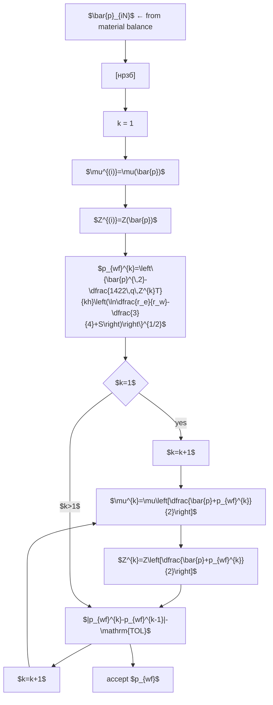
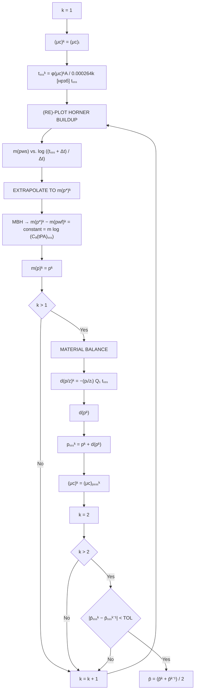
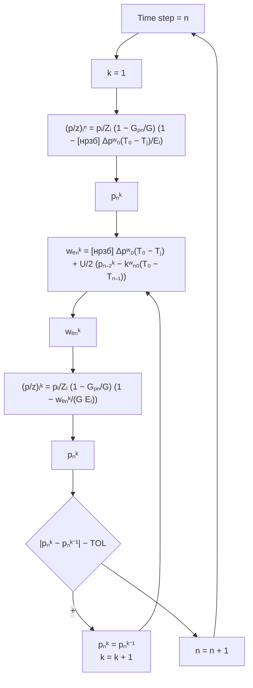

# Developments in Petroleeum Science,8  fundamentals of -- L P  Dake (Eds ) -- Developments in petrole

*OCR: mistral-ocr-latest  |  рисунки: gpt-5.6-terra  |  2026-08-22*

---

<!-- page 1 -->
DEVELOPMENTS IN PETROLEUM SCIENCE 8

# fundamentals of
# reservoir
# engineering

L.P. DAKE


<!-- page 2 -->
Developments in Petroleum Science, 8

# fundamentals of reservoir engineering
<!-- page 3 -->
FURTHER TITLES IN THIS SERIES

1 A. GENE COLLINS
GEOCHEMISTRY OF OILFIELD WATERS

2 W.H. FERTL
ABNORMAL FORMATION PRESSURES

3 A.P. SZILAS
PRODUCTION AND TRANSPORT OF OIL AND GAS

4 C.E.B. CONYBEARE
GEOMORPHOLOGY OF OIL AND GAS FIELDS
IN SANDSTONE BODIES

5 T.F. YEN and G.V. CHILINGARIAN (Editors)
OIL SHALE

6 D.W. PEACEMAN
FUNDAMENTALS OF NUMERICAL RESERVOIR SIMULATION

7 G.V. CHILINGARIAN and T.F. YEN (Editors)
BITUMENS, ASPHALTS AND TAR SANDS

8 L.P. DAKE
FUNDAMENTALS OF RESERVOIR ENGINEERING

9 K. MAGARA
COMPACTION AND FLUID MIGRATION

10 M.T. SILVIA and E.A. ROBINSON
DECONVOLUTION OF GEOPHYSICAL TIME SERIES IN
THE EXPLORATION FOR OIL AND NATURAL GAS

Developments in Petroleum Science, 8

# fundamentals of
reservoir
engineering

L.P. DAKE

Senior Lecturer in Reservoir Engineering,

Shell Internationale Petroleum Maatschappij B.V.,

The Hague, The Netherlands


ELSEVIER, Amsterdam — London — New York — Tokyo
<!-- page 4 -->
ELSEVIER SCIENCE B.V.

Sara Burgerhartstraat 25

P.O. Box 211, 1000 AE Amsterdam, The Netherlands

First edition 1978

Second impression 1979

Third impression 1980

Fourth impression 1981

Fifth impression 1982

Sixth impression 1982

Seventh impression 1983

Eighth impression 1985

Ninth impression 1986

Tenth impression 1988

Eleventh impression 1990

Twelfth impression 1991

Thirteenth impression 1993

Fourteenth impression 1994

Fifteenth impression 1995

Sixteenth impression 1997

ISBN 0-444-41830-X

© 1978 ELSEVIER SCIENCE B.V. All rights reserved.

No part of this publication may be reproduced, stored in a retrieval system or transmitted in any form or by any means, electronic, mechanical, photocopying, recording or otherwise, without the prior written permission of the publisher, Elsevier Science B.V., Copyright & Permissions Department, P.O. Box 521, 1000 AM Amsterdam, The Netherlands.

Special regulations for readers in the U.S.A.-This publication has been registered with the Copyright Clearance Center Inc. (CCC), 222 Rosewood Drive Danvers, MA 01923. Information can be obtained from the CCC about conditions under which photocopies of parts of this publication may be made in the U.S.A. All other copyright questions, including photocopying outside of the U.S.A., should be referred to the publisher

No responsibility is assumed by the publisher for any injury and/or damage to persons or property as a matter of products liability, negligence or otherwise, or from any use or operation of any methods, products, instructions or ideas contained in the material herein.

This book is printed on acid-free paper

Printed in The Netherlands

To Grace
<!-- page 5 -->
PREFACE

This teaching textbook in Hydrocarbon Reservoir Engineering is based on various lecture courses given by the author while employed in the Training Division of Shell Internationale Petroleum Maatschappij B.V. (SIPM), in the Hague, between 1974 and 1977.

The primary aim of the book is to present the basic physics of reservoir engineering, using the simplest and most straightforward of mathematical techniques. It is only through having a complete understanding of the physics that the engineer can hope to appreciate and solve complex reservoir engineering problems in a practical manner.

Chapters 1 through 4 serve as an introduction to the subject and contain material presented on Shell's basic training courses. They should therefore be of interest to anyone even remotely connected with the business of developing and producing hydrocarbon reserves.

Chapters 5 through 8 are more specialised describing the theory and practice of well testing and pressure analysis techniques, which are probably the most important subjects in the whole of reservoir engineering. The approach is entirely general in recognising that the superposition of dimensionless pressure, or pseudo pressure functions, permits the analysis of any rate-pressure-time record retrieved from a well test, for any type of reservoir fluid. To appreciate this generality, the reader is advised to make a cursory inspection of section 8.13 (page 295), before embarking on a more thorough reading of these chapters. The author hopes that this will serve as a useful introduction to the recently published and, as usual, excellent SPE Monograph (Advances in Well Test Analysis; by Robert C. Earlougher, Jr.), in which a knowledge is assumed of much of the theory presented in these four chapters.

Chapter 9 describes the art of aquifer modelling, while Chapter 10, the final chapter, covers the subject of immiscible, incompressible displacement. The message here is — that there is but one displacement theory, that of Buckley and Leverett. Everything else is just a matter of "modifying" the relative permeability curves (known in the business as "scientific adjustment"), to account for the manner in which the fluid saturations are distributed in the dip-normal direction. These curves can then be used in conjunction with the one dimensional Buckley-Leverett equation to calculate the oil recovery. By stating the physics implicit in the generation of averaged (pseudo) relative permeabilities and illustrating their role in numerical simulation, it is hoped that this chapter will help to guide the hand of the scientific adjuster.

The book also contains numerous fully worked exercises which illustrate the theory. The most notable omission, amongst the subjects covered, is the lack of any serious discussion on the complexities of hydrocarbon phase behaviour. This has already been made the subject of several specialist text books, most notably that of Amyx, Bass and Whiting (reference 8, page 42), which is frequently referred to throughout this text.
<!-- page 6 -->
VIII

PREFACE/ACKNOWLEDGEMENTS

A difficult decision to make, at the time of writing, is which set of units to employ. Although the logical decision has been made that the industry should adopt the SI (Système Internationale) units, no agreement has yet been reached concerning the extent to which "allowable" units, expressed in terms of the basic units, will be tolerated. To avoid possible error the author has therefore elected to develop the important theoretical arguments in Darcy units, while equations required for application in the field are stated in Field units. Both these systems are defined in table 4.1, in Chapter 4, which appropriately is devoted to the description of Darcy's law. This chapter also contains a section, (4.4), which describes how to convert equations expressed in one set of units to the equivalent form in any other set of units. The choice of Darcy units is based largely on tradition. Equations expressed in these units have the same form as in absolute units except in their gravity terms. Field units have been used in practical equations to enable the reader to relate to the existing AIME literature.

# ACKNOWLEDGEMENTS

The author wishes to express his thanks to SIPM for so readily granting permission to publish this work and, in particular, to H.L. Douwes Dekker, P.C. Kok and C.F.M. Heck for their sustained personal interest throughout the writing and publication, which has been a source of great encouragement.

Of those who have offered technical advice, I should like to acknowledge the assistance of G.J. Harmon; L.A. Schipper; D. Leijnse; J. van der Burgh; L. Schenk; H. van Engen and H. Brummelkamp, all sometime members of Shell's reservoir engineering staff in the Hague. My thanks for technical assistance are also due to the following members of KSEPL (Koninklijke Shell Exploratie en Productie Laboratorium) in Rijswijk, Holland: J. Offeringa; H.L. van Domselaar; J.M. Dumore; J. van Lookeren and A.S. Williamson. Further, I am grateful to all former lecturers in reservoir engineering in Shell Training, and also to my successor A.J. de la Mar for his many helpful suggestions. Sincere thanks also to S.H. Christiansen (P.D. Oman) for his dedicated attitude while correcting the text over a period of several months, and similarly to J.M. Willetts (Shell Expro, Aberdeen) and B.J.W. Woods (NAM, Assen) for their efforts.

For the preparation of the text I am indebted to G.J.W. Fransz for his co-ordinating work, and particularly to Vera A. Kuipers-Betke for her enthusiastic hard work while composing the final copy. For the drafting of the diagrams and the layout I am grateful to J.C. Jense; C.L. Slootweg; J.H. Bor and S.O. Fraser-Mackenzie.

Finally, my thanks are due to all those who suffered my lectures between 1974 and 1977 for their numerous suggestions which have helped to shape this textbook.

L.P. Dake,

Shell Training,

The Hague,

October 1977.

# CONTENTS

PREFACE ... VII

ACKNOWLEDGEMENTS ... VIII

NOMENCLATURE ... XIII

1. SOME BASIC CONCEPTS IN RESERVOIR ENGINEERING ... 1

1. Introduction ... 1
2. Calculation of hydrocarbon volumes ... 1
3. Fluid pressure regimes ... 3
4. Oil recovery: recovery factor ... 10
5. Volumetric gas reservoir engineering ... 12
6. Application of the real gas equation of state ... 20
7. Gas material balance: recovery factor ... 25
8. Hydrocarbon phase behaviour ... 37
References ... 42

2. PVT ANALYSIS FOR OIL ... 46

1. Introduction ... 45
2. Definition of the basic PVT parameters ... 45
3. Collection of fluid samples ... 53
4. Determination of the basic PVT parameters in the laboratory ... 57
and conversion for field operating conditions
5. Alternative manner of expressing PVT laboratory analysis ... 66
results
6. Complete PVT analysis ... 70
References ... 71

3. MATERIAL BALANCE APPLIED TO OIL RESERVOIRS ... 73

1. Introduction ... 73
2. General form of the material balance equation for a ... 73
hydrocarbon reservoir
3. The material balance expressed as a linear equation ... 78
4. Reservoir drive mechanisms ... 79
5. Solution gas drive ... 80
6. Gascap drive ... 89
7. Natural water drive ... 94
8. Compaction drive and related pore compressibility phenomena ... 98
References ... 102

4. DARCY'S LAW AND APPLICATIONS ... 103

1. Introduction ... 103
2. Darcy's law; fluid potential ... 103
3. Sign Convention ... 107
4. Units: units conversion ... 108
5. Real gas potential ... 113
<!-- page 7 -->
X

CONTENTS

6. Datum pressures 114
7. Radial steady state flow; well stimulation 115
8. Two-phase flow: effective and relative permeabilities 121
9. The mechanics of supplementary recovery 124
References 129

# 5. THE BASIC DIFFERENTIAL EQUATION FOR RADIAL FLOW IN A POROUS MEDIUM 131

1. Introduction 131
2. Derivation of the basic radial flow equation 131
3. Conditions of solution 133
4. The linearization of equation 5.1 for fluids of small and constant compressibility
References 139

# 6. WELL INFLOW EQUATIONS FOR STABILIZED FLOW CONDITIONS 141

1. Introduction 141
2. Semi steady state solution 141
3. Steady state solution 144
4. Example of the application of the stabilized inflow equations 145
5. Generalized form of inflow equation under semi steady state conditions 150
References 152

# 7. THE CONSTANT TERMINAL RATE SOLUTION OF THE RADIAL DIFFUSIVITY EQUATION AND ITS APPLICATION TO OILWELL TESTING 153

1. Introduction 153
2. The constant terminal rate solution 153
3. The constant terminal rate solution for transient and semi steady state flow 154
4. Dimensionless variables 166
5. Superposition theorem: general theory of well testing 174
6. The Matthews, Brons, Hazebroek pressure buildup theory 179
7. Pressure buildup analysis techniques 194
8. Multi-rate drawdown testing 216
9. The effects of partial well completion 225
10. Some practical aspects of well surveying 227
11. Afterflow analysis 231
References 241

# 8. REAL GAS FLOW: GAS WELL TESTING 243

1. Introduction 243
2. Linearization and solution of the basic differential equation for the radial flow of a real gas 243
3. The Russell, Goodrich, et.al. solution technique 245
4. The Al-Hussainy, Ramey, Crawford solution technique 247
5. Comparison of the pressure squared and pseudo pressure solution techniques 254
6. Non-Darcy flow 255
7. Determination of the non-Darcy coefficient F 258
8. The constant terminal rate solution for the flow of a real gas 260

CONTENTS

XI

9. General theory of gas well testing 264
10. Multi-rate testing of gas wells 265
11. Pressure buildup testing of gas wells 282
12. Pressure buildup analysis in solution gas drive reservoirs 293
13. Summary of pressure analysis techniques 295
References 300

# 9. NATURAL WATER INFLUX 303

1. Introduction 303
2. The unsteady state influx theory of Hurst and van Everdingen 304
3. Application of the Hurst, van Everdingen water influx theory in history matching 315
4. The approximate water influx theory of Fetkovitch for finite aquifers 325
5. Predicting the amount of water influx 333
6. Application of influx calculations to steam soaking 338
References 341

# 10. IMMISCIBLE DISPLACEMENT 343

1. Introduction 343
2. Physical assumptions and their implications 343
3. The fractional flow equation 352
4. Buckley-Leverett one dimensional displacement 356
5. Oil recovery calculations 362
6. Displacement under segregated flow conditions 372
7. Allowance for the effect of a finite capillary transition zone in displacement calculations 390
8. Displacement in stratified reservoirs 399
9. Displacement when there is a total lack of vertical equilibrium 412
10. The numerical simulation of immiscible, incompressible displacement 414
References 429

# AUTHOR INDEX 431

# SUBJECT INDEX 433
<!-- page 8 -->
XII

CONTENTS

# EXERCISES

1.1 Gas pressure gradient in the reservoir ... 23

1.2 Gas material balance ... 33

2.1 Underground withdrawal ... 52

2.2 Conversion of differential liberation data to give the field PVT parameters ... 65
B₀, Rₜ and B₉

3.1 Solution gas drive; undersaturated oil reservoir ... 82

3.2 Solution gas drive; below bubble point pressure ... 83

3.3 Water injection below bubble point pressure ... 88

3.4 Gascap drive ... 90

4.1 Units conversion ... 111

6.1 Wellbore damage ... 148

7.1 ei-function: logarithmic approximation ... 160

7.2 Pressure drawdown testing ... 162

7.3 Dimensionless variables ... 167

7.4 Transition from transient to semi steady state flow ... 171

7.5 Generation of dimensionless pressure functions ... 189

7.6 Horner pressure buildup analysis, infinite reservoir case ... 205

7.7 Pressure buildup analysis: bounded drainage volume ... 208

7.8 Multi-rate flow test analysis ... 217

7.9 Afterflow analysis techniques ... 237

8.1 Multi-rate gas well test analysed assuming stabilized flow conditions ... 268

8.2 Multi-rate gas well test analysed assuming unstabilized flow conditions ... 275

8.3 Pressure buildup analysis (gas well) ... 286

9.1 Application of the constant terminal pressure solution ... 313

9.2 Aquifer fitting using the unsteady state theory of Hurst and van ... 317
Everdingen

9.3 Water influx calculations using the method of Fetkovitch ... 329

10.1 Fractional flow ... 365

10.2 Oil recovery prediction for a waterflood ... 369

10.3 Displacement under segregated flow conditions ... 383

10.4 Generation of averaged relative permeability curves for a layered ... 406
reservoir (segregated flow)

# NOMENCLATURE

# ENGLISH

A area

B Darcy coefficient in stabilized gas well
inflow equations (ch. 8)

B₉ gas formation volume factor

B₉ oil formation volume factor

Bₘ water formation volume factor

c isothermal compressibility

cₑ effective compressibility (applied to
hydrocarbon pore volume)

cₜ pore compressibility

cₜ total compressibility (applied to pore
volume)

c̄ total aquifer compressibility (cₘ+cₜ)

C arbitrary constant of integration

C coefficient in gas well back-pressure
equation (ch. 8)

C pressure buildup correction factor (Russell
afterflow analysis ch. 7)

Cₐ Dietz shape factor

D non-Darcy flow constant appearing in
rate dependent skin (ch. 8)

D vertical depth

e exponential

ei exponential integral function

E gas expansion factor

Eₜₘ term in the material balance equation
accounting for the expansion of the
connate water and reduction in pore
volume

E₉ term in the material balance equation
accounting for the expansion of the
gascap gas

Eₒ term in the material balance equation
accounting for the expansion of the oil
and its originally dissolved gas

f fraction

f fractional flow of any fluid in the reser-
voir

f function; e.g. f(p) - function of the
pressure

F cumulative relative gas volume in PVT
differential liberation experiment (ch. 2)

F non-Darcy coefficient in gas flow equa-
tions (ch. 8)

F production term in the material balance
equation (chs. 3, 9)

F wellbore parameter in McKinley afterflow
analysis (ch. 7)

g acceleration due to gravity

g function; e.g. - g(p) function of pressure

G gas initially in place - GIIP

G gravity number (ch. 10)

G wellbore liquid gradient (McKinley after-
flow analysis, ch. 7)

Gₐ apparent gas in place in a water drive gas
reservoir (ch. 1)

Gₚ cumulative gas production

h formation thickness

hₒ thickness of the perforated interval

H total height of the capillary transition
zone

J Bessel function (ch. 7)

J Productivity index

k absolute permeability (chs. 4,9,10)

k effective permeability (chs. 5,6,7,8)

kᵣ relative permeability obtained by normal-
izing the effective permeability curves by
dividing by the absolute permeability

k̄ₜ thickness averaged relative permeability

kᵣ end point relative permeability

k iteration counter

Kₜ relative permeability obtained by normal-
izing the effective permeability curves by
dividing by the end point permeability
to oil (ch. 4)

l length

L length

m ratio of the initial hydrocarbon pore
volume of the gascap to that of the oil
(material balance equation)

m slope of the early, linear section of
pressure analysis plots of pressure
(pseudo pressure) vs. f(time), for pressure
buildup, fall-off or multi-rate flow
tests

m(p) real gas pseudo pressure

m(p) pseudo pressure for two phases (gas-oil)
flow

M end point mobility ratio

M molecular weight

Mₜ shock front mobility ratio

n reciprocal of the slope of the gas well
back pressure equation (ch. 8)

n total number of moles
<!-- page 9 -->
XIV

NOMENCLATURE

NOMENCLATURE

XV

N stock tank oil initially in place (STOIIP)

$N_p$ cumulative oil production

$N_{pd}$ dimensionless cumulative oil production (in pore volumes)

$N_{pD}$ dimensionless cumulative oil production (in movable oil volumes)

p pressure

$p_p$ average pressure in the aquifer (ch. 9)

$p_b$ bubble point pressure

$p_c$ critical pressure

$p_d$ dynamic grid block pressure

$p_D$ dimensionless pressure

$p_e$ pressure at the external boundary

$p_i$ initial pressure

$p_{pc}$ pseudo critical pressure

$p_{pr}$ pseudo reduced pressure

$p_{sc}$ pressure at standard conditions

$p_{wf}$ bottom hole flowing pressure

$p_{wf(1, h)}$ bottom hole flowing pressure recorded one hour after the start of flow
$p_{ws}$ bottom hole static pressure

$p_{ws(LIN)}$ (hypothetical) static pressure on the extrapolation of the early linear trend of the Horner buildup plot

$\bar{p}$ average pressure

$p^*$ specific value of $p_{ws(LIN)}$ at infinite closed-in time

$\Delta p$ pressure drop

N.B. the same subscripts/superscripts, used to distinguish between the above pressures, are also used in conjunction with pseudo pressures, hence: $m(p_i)$; $m(p_{wf})$; $m(p_{ws(LIN)})$; etc.

$P_c$ capillary pressure

$P_p^*$ pseudo capillary pressure

$q$ production rate

$q_i$ injection rate

$Q$ gas production rate

$r$ radial distance

$r_e$ external boundary radius

$r_D$ dimensionless radius = $r/r_w$ (chs. 7,8)
$= r/r_o$ (ch. 9)

$r_{eD}$ dimensionless radius = $r_e/r_w$ (chs. 7,8)
$= r_e/r_o$ (ch. 9)

$r_h$ radius of the heated zone around a steam soaked well

$r_o$ reservoir radius

$r_w$ wellbore radius

$r'_w$ effective wellbore radius taking account of the mechanical skin ($r'_w = r_w e^{-\delta}$)

R producing (or instantaneous) gas oil ratio

R universal gas constant

$R_p$ cumulative gas oil ratio

$R_s$ solution (or dissolved) gas oil ratio

S mechanical skin factor

S saturation (always expressed as a fraction of the pore volume)

$S_g$ gas saturation

$S_{gr}$ residual gas saturation to water

$S_o$ oil saturation

$S_{or}$ residual oil saturation to water

$S_w$ water saturation

$S_{wd}$ connate (or irreducible) water saturation

$p_{wf}$ water saturation at the flood front

$S_w$ thickness averaged water saturation

$S_w$ volume averaged water saturation behind an advancing flood front

t reciprocal pseudo reduced temperature ($T_{pc}/T$)

t time

$t_D$ dimensionless time

$t_{DA}$ dimensionless time ($= t_D r_d^2/A$)

$\Delta t$ closed-in time during a pressure buildup

$\Delta t_s$ closed-in time during a buildup at which $p_{ws(LIN)} = \bar{p}$

$\Delta t_d$ closed in time during a buildup at which $p_{ws(LIN)} = p_d$

T absolute temperature

T transmissibility (McKinley afterflow analysis, ch. 7)

$T_c$ critical temperature

$T_{pc}$ pseudo critical temperature

$T_{pr}$ pseudo reduced temperature

u Darcy velocity (g/A)

U aquifer constant

v velocity

$v_g$ relative gas volume, differential liberation experiment

V volume

V net bulk volume of reservoir

$V_f$ pore volume (PV)

$V_g$ cumulative relative gas volume (sc), differential liberation PVT experiment

$W_D$ dimensionless cumulative water influx (ch. 9)

$W_e$ cumulative water influx

$W_{ei}$ initial amount of encroachable water in an aquifer; $W_{ei} = \bar{w} / p_i$ (ch. 9)

$W_i$ initial volume of aquifer water (ch. 9)

$W_i$ cumulative water injected (ch. 10)

$W_{id}$ dimensionless cumulative water injected (pore volumes)

$W_{iD}$ dimensionless cumulative water injected (movable oil volumes)

$W_o$ cumulative water produced

y reduced density, (Hall-Yarborough equations, ch. 1)

Z Z-factor

# GREEK

$\beta$ turbulent coefficient for non-Darcy flow (ch. 8)

$\beta$ angle between the oil-water contact and the direction of flow, stable segregated displacement (ch. 10)

$\gamma$ specific gravity (liquids, relative to water = 1 at standard conditions; gas, relative to air = 1 at standard conditions)

$\gamma$ exponent of Euler's constant (=1.782)

$\Delta$ difference (taken as a positive difference e.g. $\Delta p = p_i - p$)

$\lambda$ mobility

$\theta$ dip angle of the reservoir

$\Theta$ contact angle

$\mu$ viscosity

$\rho$ density

$\sigma$ surface tension

$\phi$ porosity

$\Phi$ fluid potential per unit mass

$\Psi$ fluid potential per unit volume (datum pressure)

# SUBSCRIPTS

b bubble point

bt breakthrough

c capillary

c critical

d differential (PVT analysis)

d dimensionless (expressed in pore volumes)

d displacing phase

D dimensionless (pressure, time, radius)

D dimensionless (expressed in movable oil volumes)

DA dimensionless (time)

e effective

e at the production end of a reservoir block (e.g. $S_{wd}$)

f flash separation (PVT)

f flood front

f pore (e.g. $c_f$ - pore compressibility)

g gas

h heated zone

i cumulative injection

i initial conditions

n number of flow period

N " " " "

n (superscript) time step number

o oil

p cumulative production

r reduced

r relative

r residual

s steam

s solution gas

sc standard conditions

t total

w water

wf wellbore flowing

ws wellbore static
<!-- page 10 -->
CHAPTER 1

# SOME BASIC CONCEPTS IN RESERVOIR ENGINEERING

# 1.1 INTRODUCTION

In the process of illustrating the primary functions of a reservoir engineer, namely, the estimation of hydrocarbons in place, the calculation of a recovery factor and the attachment of a time scale to the recovery; this chapter introduces many of the fundamental concepts in reservoir engineering.

The description of the calculation of oil in place concentrates largely on the determination of fluid pressure regimes and the problem of locating fluid contacts in the reservoir. Primary recovery is described in general terms by considering the significance of the isothermal compressibilities of the reservoir fluids; while the determination of the recovery factor and attachment of a time scale are illustrated by describing volumetric gas reservoir engineering. The chapter finishes with a brief qualitative account of the phase behaviour of multi-component hydrocarbon systems.

# 1.2 CALCULATION OF HYDROCARBON VOLUMES

Consider a reservoir which is initially filled with liquid oil. The oil volume in the reservoir (oil in place) is

$$\text{OIP} = V\phi(1 - S_{\text{rec}}) \quad \text{(res.vol.)} \tag{1.1}$$

where V = the net bulk volume of the reservoir rock

$\phi$ = the porosity, or volume fraction of the rock which is porous

and $S_{\text{rec}}$ = the connate or irreducible water saturation and is expressed as a fraction of the pore volume.

The product $V\phi$ is called the pore volume (PV) and is the total volume in the reservoir which can be occupied by fluids. Similarly, the product $V\phi(1 - S_{\text{rec}})$ is called the hydrocarbon pore volume (HCPV) and is the total reservoir volume which can be filled with hydrocarbons either oil, gas or both.

The existence of the connate water saturation, which is normally 10-25% (PV), is an example of a natural phenomenon which is fundamental to the flow of fluids in
<!-- page 11 -->
2

SOME BASIC CONCEPTS IN RESERVOIR ENGINEERING

porous media. That is, that when one fluid displaces another in a porous medium, the displaced fluid saturation can never be reduced to zero. This applies provided that the fluids are immiscible (do not mix) which implies that there is a finite surface tension at the interface between them.

Thus oil, which is generated in deep source rock, on migrating into a water filled reservoir trap displaces some, but not all, of the water, resulting in the presence of a connate water saturation. Since the water is immobile its only influence in reservoir engineering calculations is to reduce the reservoir volume which can be occupied by hydrocarbons.

The oil volume calculated using equ. (1.1) is expressed as a reservoir volume. Since all oils, at the high prevailing pressures and temperatures in reservoirs, contain different amounts of dissolved gas per unit volume, it is more meaningful to express oil volumes at stock tank (surface) conditions, at which the oil and gas will have separated. Thus the stock tank oil initially in place is

$$\text{STOIIP} = N = V\phi(1-S_{wc})/B_{ai} \quad (\text{stock tank volume}) \tag{1.2}$$

where $B_{ai}$ is the oil formation volume factor, under initial conditions, and has the units reservoir volume/stock tank volume, usually, reservoir barrels/stock tank barrel (rb/stb). Thus a volume of $B_{ai}$/rb of oil will produce one stb of oil at the surface together with the volume of gas which was originally dissolved in the oil in the reservoir. The determination of the oil formation volume factor and its general application in reservoir engineering will be described in detail in Chapter 2.

In equ. (1.2), the parameters $\phi$ and $S_{wc}$ are normally determined by petrophysical analysis and the manner of their evaluation will not be described in this text$^1$. The net bulk volume, $V$, is obtained from geological and fluid pressure analysis.

The geologist provides contour maps of the top and base of the reservoir, as shown in fig. 1.1. Such maps have contour lines drawn for every 50 feet, or so, of elevation


----
━━━ FORMAT 3: MAP / КАРТА ━━━
Структурная карта с замкнутыми изогипсами.

Сечение изогипс: 50.

Подписанные значения изогипс:
- 5000
- 5050
- 5100
- 5150
- 5200

Внешняя замкнутая линия подписана: OWT.

На карте показаны линии/направления: X—X′ и Y—Y′.

Литология не определяется без легенды.

━━━ FORMAT 4: CROSS-SECTION / РАЗРЕЗ ━━━
Схематический разрез по линии Y—Y′.

Вертикальная шкала и абсолютные отметки глубин не показаны; направление увеличения глубины не указано.

На разрезе:
- Well 1 — скважина в центральной части.
- Верхняя дугообразная линия — кровля/граница пласта, не подписана.
- Нижняя дугообразная линия — подошва/граница пласта, не подписана.
- OIL — область нефти.
- WATER — область воды.
- OWC — нефтеводяной контакт.

Нефтеводяной контакт (OWC) наклонён: в левой части разреза расположен выше, в правой — ниже.

KEYWORDS: structure contour map, oil-water transition, OWT, oil-water contact, OWC, Well 1, cross-section
----


Fig. 1.1 (a) Structural contour map of the top of the reservoir, and (b) cross section through the reservoir, along the line X-Y.

SOME BASIC CONCEPTS IN RESERVOIR ENGINEERING

3

and the problem is to determine the level at which the oil water contact (OWC) is to be located. Measurement of the enclosed reservoir rock volume above this level will then give the net bulk volume V. For the situation depicted in fig. 1.1(b) it would not be possible to determine this contact by inspection of logs run in the well since only the oil zone has been penetrated. Such a technique could be applied, however, if the OWC were somewhat higher in the reservoir.

The manner in which the oil water contact, or fluid contacts in general, can be located requires a knowledge of fluid pressure regimes in the reservoir which will be described in the following section.

### 1.3 FLUID PRESSURE REGIMES

The total pressure at any depth, resulting from the combined weight of the formation rock and fluids, whether water, oil or gas, is known as the overburden pressure. In the majority of sedimentary basins the overburden pressure increases linearly with depth and typically has a pressure gradient of 1 psi/ft, fig. 1.2.


----
━━━ FORMAT 12: CONCEPTUAL DIAGRAM ━━━
Vertical axis: Depth (ft), increasing downward. Horizontal axis: Pressure (psi), increasing to the right; surface reference marked 14.7.

Pressure–depth relationships shown:
- Steep straight line from 14.7: normal hydrostatic pressure.
- Less steep straight line from 14.7: overburden pressure (OP).
- Dashed line to the left of normal hydrostatic pressure: underpressure.
- Dashed line to the right of normal hydrostatic pressure: overpressure.

At an indicated depth, the horizontal pressure separation is divided into:
- FP — arrow directed left from the normal hydrostatic-pressure line.
- GP — arrow directed right from the normal hydrostatic-pressure line.

The diagram illustrates underpressure and overpressure relative to the normal hydrostatic pressure gradient, within the overburden-pressure envelope.
KEYWORDS: pressure, depth, overpressure, underpressure, normal hydrostatic pressure, overburden pressure, pressure gradient
----


Fig. 1.2 Overburden and hydrostatic pressure regimes (FP = fluid pressure; GP = grain pressure).

At a given depth, the overburden pressure can be equated to the sum of the fluid pressure (FP) and the grain or matrix pressure (GP) acting between the individual rock particles, i.e.

$$OP = FP + GP \tag{1.3}$$
<!-- page 12 -->
4

SOME BASIC CONCEPTS IN RESERVOIR ENGINEERING

and, in particular, since the overburden pressure remains constant at any particular depth, then

$$d(FP) = -d(GP) \tag{1.4}$$

That is, a reduction in fluid pressure will lead to a corresponding increase in the grain pressure, and vice versa.

Fluid pressure regimes in hydrocarbon columns are dictated by the prevailing water pressure in the vicinity of the reservoir. In a perfectly normal case the water pressure at any depth can be calculated as

$$p_w = \left(\frac{dp}{dD}\right)_{water} \times D + 14.7 \quad \text{(psia)} \tag{1.5}$$

in which dp/dD, the water pressure gradient, is dependent on the chemical composition (salinity), and for pure water has the value of 0.4335 psi/ft.

Addition of the surface pressure of one atmosphere (14.7 psia) results in the expression of the pressure in absolute rather than gauge units (psig), which are measured relative to atmospheric pressure. In many instances in reservoir engineering the main concern is with pressure differences, which are the same whether absolute or gauge pressures are employed, and are denoted simply as psi.

Equation (1.5) assumes that there is both continuity of water pressure to the surface and that the salinity does not vary with depth. The former assumption is valid, in the majority of cases, even though the water bearing sands are usually interspersed with impermeable shales, since any break in the areal continuity of such apparent seals will lead to the establishment of hydrostatic pressure continuity to the surface. The latter assumption, however, is rather naive since the salinity can vary markedly with depth. Nevertheless, for the moment, a constant hydrostatic pressure gradient will be assumed, for illustrative purposes. As will be shown presently, what really matters to the engineer is the definition of the hydrostatic pressure regime in the vicinity of the hydrocarbon bearing sands.

In contrast to this normal situation, abnormal hydrostatic pressure are encountered which can be defined by the equation

$$p_w = \left(\frac{dp}{dD}\right)_{water} \times D + 14.7 + C \quad \text{(psia)} \tag{1.6}$$

where C is a constant which is positive if the water is overpressured and negative if underpressured.

For the water in any sand to be abnormally pressured, the sand must be effectively sealed off from the surrounding strata so that hydrostatic pressure continuity to the

SOME BASIC CONCEPTS IN RESERVOIR ENGINEERING

5

surface cannot be established. Bradley² has listed various conditions which can cause abnormal fluid pressures in enclosed water bearing sands, which include:

- temperature change; an increase in temperature of one degree Fahrenheit can cause an increase in pressure of 125 psi in a sealed fresh water system.
- geological changes such as the uplifting of the reservoir, or the equivalent, surface erosion, both of which result in the water pressure in the reservoir sand being too high for its depth of burial; the opposite effect occurs in a downthrown reservoir in which abnormally low fluid pressure can occur.
- osmosis between waters having different salinity, the sealing shale acting as the semi permeable membrane in this ionic exchange; if the water within the seal is more saline than the surrounding water the osmosis will cause an abnormally high pressure and vice versa.

Some of these causes of abnormal pressuring are interactive, for instance, if a reservoir block is uplifted the resulting overpressure is partially alleviated by a decrease in reservoir temperature.

The geological textbook of Chapman³ provides a comprehensive description of the mechanics of overpressuring. Reservoir engineers, however, tend to be more pragmatic about the subject of abnormal pressures than geologists, the main questions being; are the water bearing sands abnormally pressured and if so, what effect does this have on the extent of any hydrocarbon accumulations?

So far only hydrostatic pressures have been considered. Hydrocarbon pressure regimes are different in that the densities of oil and gas are less than that of water and consequently, the pressure gradients are smaller, typical figures being

$$\left(\frac{dp}{dD}\right)_{water} = 0.45 \text{ psi/ft}$$

$$\left(\frac{dp}{dD}\right)_{oil} = 0.35 \text{ psi/ft}$$

$$\left(\frac{dp}{dD}\right)_{gas} = 0.08 \text{ psi/ft}$$

Thus for the reservoir containing both oil and a free gascap, shown in fig. 1.3; using the above gradients would give the pressure distribution shown on the left hand side of the diagram.

At the oil-water contact, at 5500 ft, the pressure in the oil and water must be equal otherwise a static interface would not exist. The pressure in the water can be determined using equ. (1.5), rounded off to the nearest psi, as

$$p_w = 0.45 D + 15 \quad \text{(psia)} \tag{1.7}$$
<!-- page 13 -->
6

SOME BASIC CONCEPTS IN RESERVOIR ENGINEERING


----
━━━ FORMAT 6: XY PLOT / CHART WITH DATA ━━━

Оси:
- Горизонтальная ось: Pressure (psi), линейная шкала; значения 2250, 2375, 2500.
- Вертикальная ось: Depth (feet), линейная шкала; значения 5000, 5250, 5500 ft. Глубина увеличивается вниз.

Данные и подписи:
- Скважина/точка: 2265.
- Скважина/точка: 2369.
- GOC: $p_g = p_o = 2385$.
- OWC: $p_o = p_w = 2490$.
- Exploration Well.
- GAS.
- OIL.
- WATER.
- GOC 5200'.
- OWC 5500'.

Результаты испытания:
- TEST RESULTS
- At 5250' ft
- $P_o$ 2400 psi
- $P_g$ 2350 psi
- O? 0.355 [illegible]

Линии/кривые:
- Наклонная линия давления газа соединяет область около 5000 ft и 2265 psi с GOC при 5200 ft и 2385 psi.
- Наклонная линия давления нефти продолжается от GOC к OWC при 5500 ft и 2490 psi.
- Линия давления воды показана ниже OWC.
- В правой части показан разрез с газовой шапкой над нефтью и водой; вертикальная линия Exploration Well пересекает газовую и нефтяную зоны.

> Тренд: давление возрастает с глубиной; в точках газонефтяного и нефтеводяного контактов давления соответствующих флюидов равны.

KEYWORDS: давление, глубина, газонефтяной контакт, нефтеводяной контакт, газ, нефть, вода, exploration well
----


Fig. 1.3 Pressure regimes in the oil and gas for a typical hydrocarbon accumulation.

which assumes a normal hydrostatic pressure regime. Therefore, at the oil-water contact

$$p_o = p_w = .45 \times 5500 + 15 = 2490 \quad \text{(psia)}$$

The linear equation for the oil pressure, above the oil water contact, is then

$$p_o = 0.35D + \text{constant}$$

and since $p_o = 2490$ psia at D = 5500 ft, the constant can be evaluated to give the equation

$$p_o = 0.35D + 565 \quad \text{(psia)} \tag{1.8}$$

At the gas-oil contact at 5200 ft, the pressure in both fluids must be equal and can be calculated, using equ. (1.8), to be 2385 psia. The equation of the gas pressure line can then be determined as

$$p_g = 0.08D + 1969 \quad \text{(psia)} \tag{1.9}$$

Finally, using the latter equation, the gas pressure at the very top of the structure, at 5000 ft, can be calculated as 2369 psia. The pressure lines in the hydrocarbon column are drawn in the pressure depth diagram, fig. 1.3, from which it can be seen that at the top of the structure the gas pressure exceeds the normal hydrostatic

SOME BASIC CONCEPTS IN RESERVOIR ENGINEERING

7

pressure by 104 psi. Thus in a well drilling through a sealing shale on the very crest of the structure there will be a sharp pressure kick from 2265 psi to 2369 psia on first penetrating the reservoir at 5000 ft. The magnitude of the pressure discontinuity on drilling into a hydrocarbon reservoir depends on the vertical distance between the point of well penetration and the hydrocarbon water contact and, for a given value of this distance, will be much greater if the reservoir contains gas alone.

At the time of drilling an exploration well and discovering a new reservoir, one of the main aims is to determine the position of the fluid contacts which, as described in the previous section, will facilitate the calculation of the oil in place.

Consider the exploration well, shown in fig. 1.3, which penetrates the reservoir near the top of the oil column. The gas-oil contact in the reservoir will be clearly "seen", at 5200 ft, on logs run in the well. The oil water contact, however, will not be seen since it is some 225 ft below the point at which the well penetrates the base of the reservoir. The position of the contact can only be inferred as the result of a well test, such as a drill stem or wireline formation test, in which the pressure and temperature are measured and an oil sample recovered. Analysis of the sample permits the calculation of the oil density at reservoir conditions and hence the oil pressure gradient (refer exercise 1, Chapter 2). Together, the pressure measurement and pressure gradient are sufficient to define the straight line which is the pressure depth relation in the oil column. If such a test were conducted at a depth of 5250 ft, in the well in fig. 1.3, then the measured pressure would be 2402 psia and the calculated oil gradient 0.35 psi/ft, which are sufficient to specify the oil pressure line as

$$p_o = 0.35D + 565 \quad \text{(psia)} \tag{1.8}$$

and extrapolation of this line to meet the normal hydrostatic pressure line will locate the oil-water contact at 5500 ft.

This type of analysis relies critically on a knowledge of the hydrostatic pressure regime. If, for instance, the water is overpressured by a mere 20 psi then the oil-water contact would be at 5300 ft instead of at 5500 ft. This fact can be checked by visual inspection of fig. 1.3 or by expressing the equation of the overpressured water line, equ. (1.6) as

$$p_w = 0.45D + 35 \quad \text{(psia)}$$

and solving simultaneously with equ. (1.8) for the condition that $p_w = p_o$ at the oil-water contact. The difference of 200 ft in the position of the contact can make an enormous difference to the calculated oil in place, especially if the areal extent of the reservoir is large.

It is for this reason that reservoir engineers are prepared to spend a great deal of time (and therefore, money) in defining the hydrostatic pressure regime in a new field. A simple way of doing this is to run a series of wireline formation tests in the exploration well, usually after logging and prior to setting casing, in which pressures
<!-- page 14 -->
8

SOME BASIC CONCEPTS IN RESERVOIR ENGINEERING

are deliberately measured in water bearing sands both above and beneath the hydrocarbon reservoir or reservoirs. The series of pressure measurements at different depths enables the hydrostatic pressure line, equ. (1.6), to be accurately defined in the vicinity of the hydrocarbon accumulation, irrespective of whether the pressure regime is normal or abnormal.

Such tests are repeated in the first few wells drilled in a new field or area until the engineers are quite satisfied that there is an areal uniformity in the hydrostatic pressure. Failure to do this can lead to a significant error in the estimation of the hydrocarbons in place which in turn can result in the formulation of woefully inaccurate field development plans.


----
━━━ FORMAT 9: TECHNICAL SCHEMATIC ━━━

Pressure–depth schematic for an exploration well.

- Horizontal axis: Pressure (psia), increasing to the right; labelled values: 2250, 2375, 2500.
- Vertical axis: Depth (feet), increasing downward; labelled depths: 5000 and 5500.
- Exploration Well: vertical wellbore at right.
- GAS: upper interval adjacent to the wellbore.
- OIL COLUMN Fig 3: interval below the gas zone.
- Solid and dashed pressure-gradient lines extend downward and converge near the base of the diagram.
- Label on horizontal arrow: GOC 5150′.
- Label on sloping line: DPGWC 5281′.
- Label near lower right: DPOWC 5640′.
- Test results at 5150′:
  - $p = 2377$ psia
  - $\frac{dp}{dD} = .08$ psi/ft

The schematic demonstrates pressure gradients and inferred fluid-contact depths in an exploration well containing gas above an oil column.

KEYWORDS: pressure-depth plot, exploration well, gas-oil contact, gas-water contact, oil-water contact, pressure gradient, psia
----


Fig. 1.4 Illustrating the uncertainty in estimating the possible extent of an oil column, resulting from well testing in the gas cap.

Figure 1.4 illustrates another type of uncertainty associated with the determination of fluid contacts from pressure measurements. The reservoir is the same as depicted in fig. 1.3 but in this case the exploration well has only penetrated the gascap. A well test is conducted at a depth of 5100 ft from which it is determined that the gas pressure is 2377 psia and, from the analysis of a collected sample (refer exercise 1.1), that the gas gradient in the reservoir is 0.08 psi/ft. From these data the equation of the gas pressure line can be defined as

$$p_g = 0.08D + 1969 \quad \text{(psia)} \tag{1.9}$$

SOME BASIC CONCEPTS IN RESERVOIR ENGINEERING

9

Having seen no oil in the well the engineer may suspect that he has penetrated a gas reservoir alone, and extrapolate equ. (1.9) to meet the normal hydrostatic pressure line

$$p_w = 0.45D + 15 \quad \text{(psia)} \tag{1.7}$$

at a depth of 5281 ft, at which $p_w = p_g$. This level is marked in fig. 1.4 as the deepest possible gas water contact (DPGWC), assuming there is no oil.

Alternatively, since the deepest point at which gas has been observed in the well is 5150 ft (GDT - gas down to), there is no physical reason why an oil column should not extend from immediately beneath this point. The oil pressure at the top of such a column would be equal to the gas pressure, which can be calculated using equ. (1.9) as 2381 psia. Hence the equation of the oil pressure line, assuming the oil gradient used previously of 0.35 psi/ft, would be

$$p_o = .35D + 579 \quad \text{(psia)}$$

and solving this simultaneously with equ. (1.7), for the condition that $p_o = p_w$, gives the oil-water contact at a depth of 5640 ft. This is marked on fig. 1.4 as the deepest possible oil-water contact (DPOWC) and corresponds to the maximum possible oil column. Therefore, in spite of the fact that the well has been carefully tested, there remains high degree of uncertainty as to the extent of any oil column. It could indeed be zero (DPGWC-5281 ft) or, in the most optimistic case, could extend for 490 ft (DPOWC-5640 ft), or, alternatively, assume any value in between these limits. Also shown in fig. 1.4 is the actual oil column from fig. 1.3.

Therefore, the question is always posed, on penetrating a reservoir containing only gas; is there a significant oil column, or oil rim, down-dip which could be developed? The only sure way to find out is to drill another well further down-dip on the structure or, if mechanically feasible, plug back and deviate from the original hole. When planning the drilling of an exploration well it is therefore, not always expedient to aim the well at the highest point on the structure. Doing so will tend to maximise the chance of finding hydrocarbons but will oppose one of the primary aims in drilling exploration wells, which is to gain as much information about the reservoirs and their contents as possible.

Having determined the fluid contacts in the reservoir, using the methods described in this section, the engineer is then in a position to calculate the net bulk volume V required to calculate the hydrocarbons in place. In fig. 1.1(a), for instance, this can be done by planimetering the contours above the OWC$^{1,8}$.

Finally, with regard to the application of equ. (1.2), the correct figure for the STOIIP will only be obtained if all the parameters in the equation are truly representative of their average values throughout the reservoir. Since it is impossible to obtain such figures it is more common to represent each parameter in the STOIIP equation by a probability distribution rather than a determinate value. For instance,
<!-- page 15 -->
10

SOME BASIC CONCEPTS IN RESERVOIR ENGINEERING

there may be several different geological interpretations of the structure giving a spread in values of the net bulk volume V, which could be expressed as a probability distribution of the value of this parameter.

The STOIIP equation is then evaluated using some statistical calculation procedure, commensurate with the quality of the input data, and the results expressed in terms of a probability distribution of the STOIIP. The advantage of this method is that while a mean value of the STOIIP can be extracted from the final distribution, the results can also be formulated in terms of the uncertainty attached to this figure, expressed, for instance, as a standard deviation about the mean⁹,¹⁰. If the uncertainty is very large it may be necessary to drill an additional well, or wells, to narrow the range before proceeding to develop the field.

### 1.4 OIL RECOVERY: RECOVERY FACTOR

Equation (1.2), for the STOIIP, can be converted into an equation for calculating the ultimate oil recovery simply by multiplying by the recovery factor (RF), which is a number between zero and unity representing the fraction of recoverable oil, thus

$$\text{Ultimate Recovery (UR)} = (V\phi(1-S_{wc})/B_{oi}) \times RF \tag{1.10}$$

And, while it is easy to say, "simply by multiplying by the recovery factor", it is much less easy to determine what the recovery factor should be for any given reservoir and, indeed, it is the determination of this figure which is the most important single task of the reservoir engineer.

For a start, one can clearly distinguish between two types of recovery factor. There is one which is governed by current economic circumstances and, ever increasingly, by environmental and ecological considerations, while the second can be classed as a purely technical recovery factor depending on the physics of the reservoir-fluid system. Regrettably, the former, although possibly the more interesting, is not a subject for this book.

The two main categories of hydrocarbon recovery are called primary and supplementary. Primary recovery is the volume of hydrocarbons which can be produced by virtue of utilising the natural energy available in the reservoir and its adjacent aquifer. In contrast, supplementary recovery is the oil obtained by adding energy to the reservoir-fluid system. The most common type of supplementary recovery is water flooding in which water is injected into the reservoir and displaces oil towards the producing wells, thus increasing the natural energy of the system. The mechanics of supplementary recovery will be described later, in Chapter 4, sec. 9 and in Chapter 10; for the moment only primary recovery will be considered.

The entire mechanics of primary recovery relies on the expansion of fluids in the reservoir and can best be appreciated by considering the definition of isothermal compressibility.

SOME BASIC CONCEPTS IN RESERVOIR ENGINEERING

11

$$c = - \frac{1}{V} \left. \frac{\partial V}{\partial p} \right|_T \tag{1.11}$$

The isothermal compressibility is commonly applied in the majority of reservoir engineering calculations because it is considered a reasonable approximation that as fluids are produced, and so remove heat from the reservoir by convection, the cap and base rock, which are assumed to act as heat sources of infinite extent, immediately replace this heat by conduction so that the reservoir temperature remains constant. Therefore, compressibility, when referred to in this text, should always be interpreted as the isothermal compressibility.

The negative sign convention is required in equ. (1.11) because compressibility is defined as a positive number, whereas the differential, ∂V/∂p, is negative, since fluids expand when their confining pressure is decreased. When using the compressibility definition in isolation, to describe reservoir depletion, it is more illustrative to express it in the form

$$dV = c V \Delta p \tag{1.12}$$

where dV is an expansion and Δp a pressure drop, both of which are positive. This is the very basic equation underlying all forms of primary recovery mechanism. In the reservoir, if Δp is taken as the pressure drop from initial to some lower pressure, pᵢ - p, then dV will be the corresponding fluid expansion, which manifests itself as production.

The skill in engineering a high primary recovery factor, utilising the natural reservoir energy, is to ensure that the dV, which is the production, is the most commercially valuable fluid in the reservoir, namely, the oil. The way in which this can be done is shown schematically in fig. 1.5.


----
━━━ FORMAT 9: TECHNICAL SCHEMATIC ━━━
Reservoir-volume schematic with three adjacent compartments, left to right:

1. Aquifer — labelled “aquifer”; volume $V_a$.
2. Oil zone — labelled “oil”; volume $V_o$.
3. Gas cap — labelled “gascap”; volume $V_g$.

- The aquifer–oil and oil–gas-cap interfaces are shown as vertical dashed lines.
- At the aquifer–oil interface, a horizontal displacement/volume-change arrow is labelled $dV_a$.
- At the oil–gas-cap interface, a horizontal displacement/volume-change arrow is labelled $dV_g$.
- A vertical arrow above the oil zone indicates production/total-volume change; accompanying text: “dV tot = oil production”; remaining equation text is [illegible].
- The schematic demonstrates volume changes associated with oil production, aquifer contribution, and gas-cap change.

KEYWORDS: aquifer, oil zone, gas cap, oil production, volume balance, $dV_a$, $dV_g$
----


Fig. 1.5 Primary oil recovery resulting from oil, water and gas expansion.
<!-- page 16 -->
12

SOME BASIC CONCEPTS IN RESERVOIR ENGINEERING

The diagram illustrates the fairly obvious fact that to produce an oil reservoir, wells should be drilled into the oil zone. If the reservoir is in contact with a gascap and aquifer, the oil production due to a uniform pressure drop, Δp, in the entire system, will have components due to the separate expansion of the oil gas and water, thus

$$\mathrm{dV}_{\mathrm{TOT}} = \text{Oil Production} = \mathrm{dV}_{\mathrm{o}} + \mathrm{dV}_{\mathrm{w}} + \mathrm{dV}_{\mathrm{g}}$$

in which the balance is expressed in fluid volumes at reservoir conditions. Applying equ. (1.12), this may be expressed as

$$\mathrm{dV}_{\mathrm{TOT}} = c_{\mathrm{o}} V_{\mathrm{o}} \Delta p + c_{\mathrm{w}} V_{\mathrm{w}} \Delta p + c_{\mathrm{g}} V_{\mathrm{g}} \Delta p$$

Considering the following figures as typical for the compressibilities of the three components at a pressure of 2000 psia:

$$c_{\mathrm{o}} = 15 \times 10^{-6} / \mathrm{psi}$$

$$c_{\mathrm{w}} = 3 \times 10^{-6} / \mathrm{psi}$$

$$c_{\mathrm{g}} = 500 \times 10^{-6} / \mathrm{psi} \quad (\approx \frac{1}{p}; \text{ refer sec. 1.5})$$

it is evident that the contribution to dV_TOT supplied by the oil and water expansion will only be significant if both V_o and V_w, the initial volumes of oil and water, are large. In contrast, because of its very high compressibility, even a relatively small volume of gascap gas will contribute significantly to the oil production.

Therefore, while it is obvious that one would not produce an aquifer, but rather, let the water expand and displace the oil; so too, the gas in the gascap, although having commercial value, is frequently kept in the reservoir and allowed to play its very significant role in contributing to the primary recovery through its expansion. The mechanics of primary oil recovery will be considered in greater detail in Chapter 3.

### 1.5 VOLUMETRIC GAS RESERVOIR ENGINEERING

Volumetric gas reservoir engineering is introduced at this early stage in the book because of the relative simplicity of the subject. It will therefore be used to illustrate how a recovery factor can be determined and a time scale attached to the recovery.

The reason for the simplicity is because gas is one of the few substances whose state, as defined by pressure, volume and temperature (PVT), can be described by a simple relation involving all three parameters. One other such substance is saturated steam, but for oil containing dissolved gas, for instance, no such relation exists and, as shown in Chapter 2, PVT parameters must be empirically derived which serve the purpose of defining the state of the mixture.

SOME BASIC CONCEPTS IN RESERVOIR ENGINEERING

13

The equation of state for an ideal gas, that is, one in which the inter-molecular attractions and the volume occupied by the molecules are both negligible, is

$$\mathrm{pV} = \mathrm{nRT} \tag{1.13}$$

in which, for the conventional field units used in the industry

$$\mathrm{p} = \text{pressure (psia); } \mathrm{V} = \text{volume (cu.ft)}$$

$$\mathrm{T} = \text{absolute temperature} - \text{degrees Rankine } (^{\circ}\mathrm{R} = 460^{\circ}\mathrm{F})$$

$$\mathrm{n} = \text{the number of lb. moles, where one lb. mole is the molecular weight of the gas expressed in pounds.}$$

and R = the universal gas constant which, for the above units, has the value 10.732 psia.cu.ft/lb. mole.°R.

This equation results from the combined efforts of Boyle, Charles, Avogadro and Gay Lussac, and is only applicable at pressures close to atmospheric, for which it was experimentally derived, and at which gases do behave as ideal.

Numerous attempts have been made in the past to account for the deviations of a real gas, from the ideal gas equation of state, under extreme conditions. One of the more celebrated of these is the equation of van der Waals which, for one lb.mole of a gas, can be expressed as

$$(\mathrm{p} + \frac{\mathrm{a}}{\mathrm{V}^2}) (\mathrm{V} - \mathrm{b}) = \mathrm{RT} \tag{1.14}$$

In using this equation it is argued that the pressure p, measured at the wall of a vessel containing a real gas, is lower than it would be if the gas were ideal. This is because the momentum of a gas molecule about to strike the wall is reduced by inter-molecular attractions; and hence the pressure, which is proportional to the rate of change of momentum, is reduced. To correct for this the term a/V² must be added to the observed pressure, where a is a constant depending on the nature of the gas. Similarly the volume V, measured assuming the molecules occupy negligible space, must be reduced for a real gas by the factor b which again is dependent on the nature of the gas.

The principal drawback in attempting to use equ. (1.14) to describe the behaviour of real gases encountered in reservoirs is that the maximum pressure for which the equation is applicable is still far below the normal range of reservoir pressures.

More recent and more successful equations of state have been derived, — the Beattie-Bridgeman and Benedict-Webb-Rubin equations, for instance (which have been conveniently summarised in Chapter 3 of reference 18); but the equation most commonly used in practice by the industry is
<!-- page 17 -->
14

SOME BASIC CONCEPTS IN RESERVOIR ENGINEERING

$$pV = ZnRT \tag{1.15}$$

in which the units are the same as listed for equ. (1.13) and Z, which is dimensionless, is called the Z-factor. By expressing the equation as

$$\left(\frac{p}{Z}\right)V = nRT$$

the Z-factor can be interpreted as a term by which the pressure must be corrected to account for the departure from the ideal gas equation.

The Z-factor is a function of both pressure and absolute temperature but, for reservoir engineering purposes, the main interest lies in the determination of Z, as a function of pressure, at constant reservoir temperature. The Z(p) relationship obtained is then appropriate for the description of isothermal reservoir depletion. Three ways of determining this relationship are described below.

a) Experimental determination

A quantity of n moles of gas are charged to a cylindrical container, the volume of which can be altered by the movement of a piston. The container is maintained at the reservoir temperature, T, throughout the experiment. If $V_o$ is the gas volume at atmospheric pressure, then applying the real gas law, equ. (1.15),

$$14.7 V_o = nRT$$

since Z=1 at atmospheric pressure. At any higher pressure p, for which the corresponding volume of the gas is V, then

$$pV = ZnRT$$

and dividing these equations gives

$$Z = \frac{pV}{14.7 V_o}$$

By varying p and measuring V, the isothermal Z(p) function can be readily obtained. This is the most satisfactory method of determining the function but in the majority of cases the time and expense involved are not warranted since reliable methods of direct calculation are available, as described below.

b) The Z-factor correlation of Standing and Katz

This correlation requires a knowledge of the composition of the gas or, at least, the gas gravity. Naturally occurring hydrocarbons are composed primarily of members of the paraffin series ($C_nH_{2n+2}$) with an admixture of non-hydrocarbon impurities such as carbon dioxide, nitrogen and hydrogen sulphide. Natural gas differs from oil in that it predominantly consists of the lighter members of the paraffin series,

SOME BASIC CONCEPTS IN RESERVOIR ENGINEERING

15

methane and ethane, which usually comprise in excess of 90% of the volume. A typical gas composition is listed in table 1.1.

In order to use the Standing-Katz correlation$^{11}$ it is first necessary, from a knowledge of the gas composition, to determine the pseudo critical pressure and temperature of the mixture as

$$p_{pc} = \sum_i n_i p_{ci} \tag{1.16}$$

and

$$T_{pc} = \sum_i n_i T_{ci} \tag{1.17}$$

where the summation is over all the components present in the gas. The parameters $p_{ci}$ and $T_{ci}$ are the critical pressure and temperature of the $i^{th}$ component, listed in table 1.1, while the $n_i$ are the volume fractions or, for a gas, the mole fractions of each component (Avogadro's law). The next step is to calculate the so-called pseudo reduced pressure and temperature

$$p_{pr} = \frac{p}{p_{pc}} \tag{1.18}$$

and

$$T_{pr} = \frac{T}{T_{pc}} \tag{1.19}$$

where p and T are the pressure and temperature at which it is required to determine Z. In the majority of reservoir engineering problems, which are isothermal, $T_{pr}$ is constant and $p_{pr}$ variable.

With these two parameters the Standing-Katz correlation chart, fig. 1.6, which consists of a set of isotherms giving Z as a function of the pseudo reduced pressure, can be used to determine the Z-factor.

For instance, for the gas composition listed in table 1.1, and at a pressure of 2000 psia and temperature of 180°F, the reader can verify that

$$p_{pc} = 663.3 \text{ and } T_{pc} = 374.1$$

giving

$$p_{pr} = \frac{2000}{663.3} = 3.02 \text{ and } T_{pr} = \frac{640}{374.1} = 1.71$$

from which, using fig. 1.6, the Z-factor can be obtained as 0.865.
<!-- page 18 -->
16

SOME BASIC CONCEPTS IN RESERVOIR ENGINEERING

|  Component |   | Molecular Weight | Critical Pressure (psia) | Temp. (°R) | Typical Composition (volume or mole fraction, n_{i})  |
| --- | --- | --- | --- | --- | --- |
|  CH_{4} | Methane | 16.04 | 668 | 343 | .8470  |
|  C_{2}H_{6} | Ethane | 30.07 | 708 | 550 | .0586  |
|  C_{3}H_{8} | Propane | 44.10 | 616 | 666 | .0220  |
|  i-C_{4}H_{10} | Isobutane | 58.12 | 529 | 735 | .0035  |
|  n-C_{4}H_{10} | Normal butane | 58.12 | 551 | 765 | .0058  |
|  i-C_{5}H_{12} | Isopentane | 72.15 | 490 | 829 | .0027  |
|  n-C_{5}H_{12} | Normal pentane | 72.15 | 489 | 845 | .0025  |
|  n-C_{6}H_{14} | Normal hexane | 86.18 | 437 | 913 | .0028  |
|  n-C_{7}H_{14} | Normal heptane | 100.20 | 397 | 972 | .0028  |
|  n-C_{8}H_{18} | Normal octane | 114.23 | 361 | 1024 | .0015  |
|  n-C_{9}H_{20} | Normal nonane | 128.26 | 332 | 1070 | .0018  |
|  n-C_{10}H_{22} | Normal decane | 142.29 | 304 | 1112 | .0015  |
|  CO_{2} | Carbon dioxide | 44.01 | 1071 | 548 | .0130  |
|  H_{2}S | Hydrogen sulphide | 34.08 | 1306 | 672 | .0000  |
|  N_{2} | Nitrogen | 28.01 | 493 | 227 | .0345  |

TABLE 1.1
Physical constants of the common constituents of hydrocarbon gases$^{12}$, and a typical gas composition.

Conventionally, the composition of natural gases is listed in terms of the individual components as far as hexane, with the heptane and heavier components being grouped together as C$_{7}$$^{+}$ (heptanes-plus). In the laboratory analysis the molecular weight and specific gravity of this group are measured, which permits the determination of the pseudo critical pressure and temperature of the C$_{7}$$^{+}$ from standard correlations$^{6,13}$. This in turn facilitates the calculation of the Z-factor using the method described above.

In calculating the Z-factor it has been assumed that the non-hydrocarbon components, carbon dioxide, hydrogen sulphide and nitrogen, can be included in the summations, equs. (1.16) and (1.17), to obtain the pseudo critical pressure and temperature.

This approach is only valid if the volume fractions of the non-hydrocarbon components are small, say, less than 5% vol. For larger amounts, corrections to the above calculation procedures are to be found in the text book of Amyx, Bass and Whiting$^{8}$. If, however, the volume fractions of the non-hydrocarbons are very large (the carbon dioxide content of the Kapuni field, New Zealand, for instance, is 45% vol.) then it is better to determine the Z-factor experimentally as described in a), above.

SOME BASIC CONCEPTS IN RESERVOIR ENGINEERING

17


----
━━━ FORMAT 7: NOMOGRAM / ПАЛЕТКА ━━━
Палетка коэффициента сверхсжимаемости газа.

Ось абсцисс: **Pseudo reduced pressure**, линейная шкала от 0 до 8.

Ось ординат: **Z-factor**, линейная шкала от 0 до 1.1.

Семейство кривых: **Pseudo reduced temperature**. Подписанные значения параметра:
1.05; 1.1; 1.15; 1.2; 1.25; 1.3; 1.35; 1.4; 1.45; 1.5; 1.6; 1.7; 1.8; 1.9; 2.0; 2.2; 2.4; 2.6; 2.8; 3.0.

Дополнительная шкала справа: 1.05; 1.2; 1.3.

Порядок пользования: по оси абсцисс выбирают псевдоприведённое давление; находят пересечение с кривой заданной псевдоприведённой температуры; по оси ординат считывают Z-factor.

Ориентировочные точки крайних кривых, снято с графика, приблизительно:
- $T_{pr}=3.0$: $P_{pr}=0$ — $Z\approx1.00$; $P_{pr}=2$ — $Z\approx1.04$; $P_{pr}=4$ — $Z\approx1.07$; $P_{pr}=8$ — $Z\approx1.10$.
- $T_{pr}=1.05$: $P_{pr}=0$ — $Z\approx1.00$; $P_{pr}=1.5$ — $Z\approx0.25$; $P_{pr}=2$ — $Z\approx0.27$; $P_{pr}=4$ — $Z\approx0.55$; $P_{pr}=8$ — $Z\approx1.00$.

KEYWORDS: псевдоприведённое давление, псевдоприведённая температура, коэффициент сверхсжимаемости, Z-factor, природный газ, Pseudo reduced pressure
----


Fig. 1.6 The Z-factor correlation chart of Standing and Katz$^{11}$

(Reproduced by courtesy of the SPE of the AIME).
<!-- page 19 -->
18

SOME BASIC CONCEPTS IN RESERVOIR ENGINEERING

If the gas composition is not available, the Standing-Katz correlation can still be used provided the gas gravity, based on the scale air = 1, at atmospheric pressure and at 60°F, is known (refer sec. 1.6). In this case fig. 1.7, is used to obtain the pseudo critical pressure and temperature; then equs. (1.18) and (1.19) can be applied to calculate the pseudo reduced parameters required to obtain the Z-factor from fig. 1.6.


----
━━━ FORMAT 6: XY PLOT / CHART WITH DATA ━━━
Pseudo-critical properties versus gas gravity.

- Ось X: GAS GRAVITY (Air = 1), линейная шкала, диапазон 0.5–1.2.
- Верхняя ось Y: PSEUDO CRITICAL PRESSURE, psc, psia, линейная шкала, диапазон 550–700.
- Нижняя ось Y: PSEUDO CRITICAL TEMPERATURE, degrees Rankine, линейная шкала, диапазон 300–550.
- Кривые:
  - сплошная линия — MISCELLANEOUS GASES;
  - штриховая линия — CONDENSATE WELL FLUID.

| Gas gravity | Pseudo-critical pressure, psia — miscellaneous gases | Pseudo-critical pressure, psia — condensate well fluid | Pseudo-critical temperature, °R — miscellaneous gases | Pseudo-critical temperature, °R — condensate well fluid |
|---:|---:|---:|---:|---:|
| 0.55 | ≈675 | [illegible] | ≈345 | [illegible] |
| 0.60 | ≈673 | ≈671 | ≈360 | ≈358 |
| 0.70 | ≈668 | ≈665 | ≈390 | ≈385 |
| 0.80 | ≈661 | ≈655 | ≈420 | ≈410 |
| 0.90 | ≈655 | ≈645 | ≈450 | ≈430 |
| 1.00 | ≈650 | ≈632 | ≈480 | ≈450 |
| 1.10 | ≈646 | [illegible] | ≈520 | [illegible] |
| 1.20 | ≈640 | [illegible] | ≈550 | [illegible] |

> Тренд: с увеличением относительной плотности газа pseudo-critical pressure уменьшается; pseudo-critical temperature увеличивается. Для CONDENSATE WELL FLUID псевдокритическое давление и псевдокритическая температура ниже, чем для MISCELLANEOUS GASES, при одинаковой gas gravity.

KEYWORDS: pseudo-critical pressure, pseudo-critical temperature, gas gravity, condensate well fluid, miscellaneous gases, psia, degrees Rankine
----


Fig. 1.7 Pseudo critical properties of miscellaneous natural gases and condensate well fluids¹⁹.

SOME BASIC CONCEPTS IN RESERVOIR ENGINEERING

19

# c) Direct calculation of Z-factors

The Standing-Katz correlation is very reliable and has been used with confidence by the industry for the past thirty-five years. With the advent of computers, however, there arose the need to find some convenient technique for calculating Z-factors, for use in gas reservoir engineering programs, rather than feeding in the entire correlation chart from which Z-factors could be retrieved by table look-up. Takacs¹⁴ has compared eight different methods for calculating Z-factors which have been developed over the years. These fall into two main categories: those which attempt to analytically curve-fit the Standing-Katz isotherms and those which compute Z-factors using an equation of state. Of the latter, the method of Hall-Yarborough¹⁵ is worthy of mention because it is both extremely accurate and very simple to program, even for small desk calculators, since it requires only five storage registers.

The Hall-Yarborough equations, developed using the Starling-Camahan equation of state, are

$$Z = \frac{0.06125 p_{pr} t e^{-1.2(1-t)^2}}{y} \tag{1.20}$$

where $p_{pr}$ = the pseudo reduced pressure

t = the reciprocal, pseudo reduced temperature ($T_{pc}/T$)

and y = the "reduced" density which can be obtained as the solution of the equation.

$$-0.06125 p_{pr} t e^{-1.2(1-t)^2} + \frac{y+y^3+y^3-y^4}{(1-y)^3} - (14.76t-9.76t^2+4.58t^3)y^3$$

$$+ (90.7t - 242.2t^2 + 42.4t^3)y^{(2.18+2.82t)} = 0 \tag{1.21}$$

This non-linear equation can be conveniently solved for y using the simple Newton-Raphson iterative technique. The steps involved in applying this are:

1) make an initial estimate of $y^k$, where k is an iteration counter (which in this case is unity, e.g. $y^1 = 0.001$)
2) substitute this value in equ. (1.21); unless the correct value of y has been initially selected, equ. (1.21) will have some small, non-zero value $F^k$.
3) using the first order Taylor series expansion, a better estimate of y can be determined as

$$y^{k+1} = y^k - F^k \Big/ \frac{dF^k}{dy} \tag{1.22}$$
<!-- page 20 -->
20

SOME BASIC CONCEPTS IN RESERVOIR ENGINEERING

where the general expression for dF/dk can be obtained as the derivative of equ. (1.21), i.e.

$$\frac{dF}{dy} = \frac{1 + 4y + 4y^2 - 4y^3 + y^4}{(1-y)^4} - (29.52t - 19.52t^2 + 9.16t^3) y$$

$$+ (2.18 + 2.82t) (90.7t - 242.2t^2 + 42.4t^3) y^{(1.18 + 2.82t)} \tag{1.23}$$

4) iterate, using equs. (1.21) and (1.22), until satisfactory convergence is obtained ($F^k = 0$).
5) substitution of the correct value of y in equ. (1.20) will give the Z-factor.

(N.B. there appears to be a typographical error in the original Hall-Yarborough paper$^{15}$, in that the equations presented for F (equ. 8) and dF/dy (equ. 11), contain $1-y^3$ and $1-y^4$ in the denominators of the second and first terms, respectively, instead of $(1-y)^3$ and $(1-y)^4$ as in equs. (1.21) and (1.23) of this text.)

Takaes$^{14}$ has determined that the average difference between the Standing-Katz correlation chart and the analytical Hall-Yarborough method is - 0.158% and the average absolute difference 0.518%. Figure 1.8 shows an isothermal Z-factor versus pressure relationship, obtained using the Hall-Yarborough method, for a gas with gravity 0.85 and at a reservoir temperature of 200$^\circ$F. The plot coincides, within pencil thickness, with the similar relation obtained by the application of the method described in b), above.

The plot shows that there is a significant deviation from the ideal gas behaviour which is particularly noticeable in the intermediate pressure range at about 2500 psia. At this pressure, use of the ideal gas equation, (1.13), would produce an error of almost 25% in calculated gas volumes.

### 1.6 APPLICATION OF THE REAL GAS EQUATION OF STATE

The determination of the Z-factor as a function of pressure and temperature facilitates the use of the simple equation

$$pV = ZnRT \tag{1.15}$$

to fully define the state of a real gas. This equation is a PVT relationship and in reservoir engineering, in general, the main use of such functions is to relate surface to reservoir volumes of hydrocarbons. For a real gas, in particular, this relation is expressed by the gas expansion factor E, where

SOME BASIC CONCEPTS IN RESERVOIR ENGINEERING

21


----
━━━ FORMAT 6: XY PLOT / CHART WITH DATA ━━━
Axes:
- Vertical axis: Z-factor; linear scale; labelled values 0.75, 0.85, 0.95.
- Horizontal axis: Pressure (psia); linear scale; range 0–5000 psia; labelled values 0, 1000, 2000, 3000, 4000, 5000.

Curve (снято с графика, приблизительно):
| Pressure, psia | Z-factor |
|---:|---:|
| 0 | 1.01 |
| 500 | 0.93 |
| 1000 | 0.86 |
| 1500 | 0.80 |
| 2000 | 0.77 |
| 2500 | 0.76 |
| 3000 | 0.78 |
| 3500 | 0.82 |
| 4000 | 0.87 |
| 4500 | 0.91 |

> Trend: Z-factor decreases with pressure to a minimum of approximately 0.76 at about 2500 psia, then increases with further pressure increase.

KEYWORDS: Z-factor, Pressure, psia, gas compressibility factor, pressure dependence
----


Fig. 1.8 Isothermal Z-factor as a function of pressure (gas gravity = 0.85; temperature = 200$^\circ$F).

$$E = \frac{V_{sc}}{V} = \frac{\text{volume of n moles of gas at standard conditions}}{\text{volume of n moles of gas at reservoir conditions}}$$

and applying equ. (1.15) at both standard and reservoir conditions this becomes

$$E = \frac{V_{sc}}{V} = \frac{\rho}{p_{sc}} \cdot \frac{T_{sc}}{T} \cdot \frac{Z_{sc}}{Z} \tag{1.24}$$

For the field units defined in connection with equ. (1.13), and for standard conditions of $p_{sc} = 14.7$ psia, $T_{sc} = (460+60) = 520^\circ$R and $Z_{sc} = 1$, equ. (1.24) can be reduced to

$$E = 35.37 \frac{\rho}{ZT} \quad (\text{vol/vol}) \tag{1.25}$$

At a pressure of 2000 psia and reservoir temperature of 180$^\circ$F the gas whose composition is detailed in table 1.1 has a Z-factor of 0.865, as already determined in sec. 1.5(b). Therefore, the corresponding gas expansion factor is

$$E = \frac{35.37 \times 2000}{0.865 \times 640} = 127.8 \quad (\text{vol/vol})$$
<!-- page 21 -->
22

SOME BASIC CONCEPTS IN RESERVOIR ENGINEERING

In particular, the gas initially in place (GIIP) in a reservoir can be calculated using an equation which is similar to equ. (1.2) for oil, that is

$$G = V\phi(1-S_{wc})E_i \tag{1.26}$$

in which $E_i$ is evaluated at the initial pressure.

Other important parameters which can be conveniently expressed using the equation of state are, the real gas density, gravity and isothermal compressibility.

Since the mass of n moles of gas is nM, where M is the molecular weight, then the density is

$$\rho = \frac{nM}{V} = \frac{nM}{ZnRT/p} = \frac{Mp}{ZRT} \tag{1.27}$$

Comparing the density of a gas, at any pressure and temperature, to the density of air at the same conditions gives

$$\frac{\rho_{gas}}{\rho_{air}} = \frac{(M/Z)_{gas}}{(M/Z)_{air}}$$

and, in particular, at standard conditions

$$\frac{\rho_{gas}}{\rho_{air}} = \gamma_g = \frac{M_{gas}}{M_{air}} = \frac{M}{28.97} \tag{1.28}$$

where $\gamma_g$ is the gas gravity relative to air at standard conditions and is conventionally expressed as, for instance, $\gamma_g = 0.8$ (air = 1).

Therefore, if the gas gravity is known, M can be calculated using equ. (1.28) and substituted in equ. (1.27) to give the density at any pressure and temperature. Alternatively, if the gas composition is known M can be calculated as

$$M = \sum_i n_i M_i \tag{1.29}$$

and again substituted in equ. (1.27). The molecular weights of the individual gas components, $M_i$, are listed in table 1.1. It is also useful to remember the density of air at standard conditions (in whichever set of units the reader employs). For the stated units this figure is

$$(\rho_{air})_{sc} = 0.0763 \text{ lb/cu.ft}$$

which permits the gas density at standard conditions to be evaluated as

$$\rho_{sc} = 0.0763 \gamma_g \quad (\text{lbs/cu.ft}) \tag{1.30}$$

SOME BASIC CONCEPTS IN RESERVOIR ENGINEERING

23

The final application of the equation of state is to derive an expression for the isothermal compressibility of a real gas. Solving equ. (1.15) for V gives

$$V = \frac{ZnRT}{p}$$

the derivative of which, with respect to pressure, is

$$\frac{\partial V}{\partial p} = - \frac{ZnRT}{p} \left( \frac{1}{p} - \frac{1}{Z} \frac{\partial Z}{\partial p} \right)$$

and substituting these two expressions in the isothermal compressibility definition, equ. (1.11), gives

$$c_g = - \frac{1}{V} \frac{\partial V}{\partial p} = \frac{1}{p} - \frac{1}{Z} \frac{\partial Z}{\partial p} \tag{1.31}$$

In fig. 1.9, a plot of the gas compressibility defined by equ. (1.31) is compared to the approximate expression.

$$c_g = \frac{1}{p} \tag{1.32}$$

for the 0.85 gravity gas whose isothermal Z-factor is plotted in fig. 1.8 at 200°F. As can be seen, the approximation, equ. (1.32), is valid in the intermediate pressure range between 2000-2750 psia where $\partial Z/\partial p$ is small but is less acceptable at very high or low pressures.

### EXERCISE 1.1 GAS PRESSURE GRADIENT IN THE RESERVOIR

1) Calculate the density of the gas, at standard conditions, whose composition is listed in table 1.1.
2) what is the gas pressure gradient in the reservoir at 2000 psia and 180°F (Z = 0.865).

### EXERCISE 1.1 SOLUTION

1) The molecular weight of the gas can be calculated as

$$M = \sum_i n_i M_i = 19.91$$

and therefore, using equ. (1.28) the gravity is
<!-- page 22 -->
24

SOME BASIC CONCEPTS IN RESERVOIR ENGINEERING

GAS
COMPRESSIBILITY


----
━━━ FORMAT 6: XY PLOT / CHART WITH DATA ━━━

Horizontal axis: Pressure (psia), linear scale, 0–5000 psia; labelled ticks: 0, 1000, 2000, 3000, 4000, 5000.

Vertical axis: [illegible] psi⁻¹, linear scale, 0–16; labelled ticks: 0, 2, 4, 6, 8, 10, 12, 14, 16.

Curves:
- $C_g=\frac{1}{p}$
- $C_g=\frac{1}{p}-\frac{1}{z}\frac{\partial z}{\partial p}$

Approximate curve values, read from graph:
| Pressure, psia | $C_g=\frac{1}{p}$ | $C_g=\frac{1}{p}-\frac{1}{z}\frac{\partial z}{\partial p}$ |
|---:|---:|---:|
| 1000 | ~10 | ~14 |
| 1500 | ~6,7 | ~8 |
| 2000 | ~5 | ~5,5 |
| 2500 | ~4 | ~4 |
| 3000 | ~3,3 | ~3 |
| 4000 | ~2,5 | ~1,5 |

> Trend: Both gas-compressibility curves decrease nonlinearly as pressure increases; the curves converge near approximately 2500 psia, after which the $C_g=\frac{1}{p}-\frac{1}{z}\frac{\partial z}{\partial p}$ curve is lower.

KEYWORDS: gas compressibility, pressure, psia, real gas, compressibility factor, z-factor, $C_g$
----


Fig. 1.9 Isothermal gas compressibility as a function of pressure (gas gravity = 0.85; temperature = 200° F).

$$\gamma_g = \frac{M}{M_{air}} = \frac{19.91}{28.97} = 0.687 \text{ (air = 1)}$$

The density at standard conditions can be evaluated using equ. (1.27) as

$$\rho_{sc} = \frac{M p_{sc}}{Z_{sc} R T_{sc}} = \frac{19.91 \times 14.7}{1 \times 10.732 \times 520} = 0.0524 \text{ lb/cu.ft}$$

or, alternatively, using equ. (1.30) as

$$\rho_{sc} = 0.0763 \gamma_g = 0.0524 \text{ lb/cu.ft}$$

2) The density of the gas in the reservoir can be directly calculated using equ. (1.27), or else by considering the mass conservation of a given quantity of gas as

$$(\rho V)_{sc} = (\rho V)_{res}$$

or

$$\rho_{res} = \rho_{sc} E$$

which, using equ. (1.25), can be evaluated at 2000 psia and 180° F as

$$\rho_{res} = \frac{35.37 \rho_{sc} p}{Z T} = \frac{35.37 \times 0.0524 \times 2000}{0.865 \times (180+460)} = 6.696 \text{ lb/cu.ft}$$

SOME BASIC CONCEPTS IN RESERVOIR ENGINEERING

25

To convert this number to a pressure gradient in psi/ft requires the following manipulation

$$\left(\frac{dp}{dD}\right)_{gas} = 6.696 \frac{lb}{ft^3} \times \frac{1}{ft} \times \left(\frac{ft^2}{inch^2}\right) = \frac{6.696}{144} = 0.0465 \text{ psi/ft.}$$

# 1.7 GAS MATERIAL BALANCE: RECOVERY FACTOR

The material balance equation, for any hydrocarbon system, is simply a volume balance which equates the total production to the difference between the initial volume of hydrocarbons in the reservoir and the current volume. In gas reservoir engineering the equation is very simple and will now be considered for the separate cases in which there is no water influx into the reservoir and also when there is a significant degree of influx.

# a) Volumetric depletion reservoirs

The term volumetric depletion, or simply depletion, applied to the performance of a reservoir means that as the pressure declines, due to production, there is an insignificant amount of water influx into the reservoir from the adjoining aquifer. This, in turn, implies that the aquifer must be small (refer sec. 1.4). Thus the reservoir volume occupied by hydrocarbons (HCPV) will not decrease during depletion. An expression for the hydrocarbon pore volume can be obtained from equ. (1.26) as

$$HCPV = V\phi(1-S_{wc}) = G/E_i$$

where G is the initial gas in place expressed at standard conditions. The material balance, also expressed at standard conditions, for a given volume of production $G_p$, and consequent drop in the average reservoir pressure $\Delta p = p_i - p$ is then,

$$\begin{array}{cc} \text{Production} & = \text{GIIP} - \text{Unproduced Gas} \\ (sc) & (sc) \end{array}$$

$$G_p = G - (HCPV)E$$

$$G_p = G - \frac{G}{E_i} E \tag{1.33}$$

which can be expressed as

$$\frac{G_p}{G} = 1 - \frac{E}{E_i} \tag{1.34}$$

or, using equ. (1.25) as

$$\frac{p}{Z} = \frac{p_i}{Z_i} \left(1 - \frac{G_p}{G}\right) \tag{1.35}$$
<!-- page 23 -->
26

SOME BASIC CONCEPTS IN RESERVOIR ENGINEERING

The ratio $G_p/G$ is the fractional gas recovery at any stage during depletion and, if the gas expansion factor E, in equ. (1.34), is evaluated at the proposed abandonment pressure then the corresponding value of $G_p/G$ is the gas recovery factor.

Before describing how the material balance equation is used in practice, it is worthwhile reconsidering the balance expressed by equ. (1.33) more thoroughly. Implicit in the equation is the assumption that because the water influx is negligible then the hydrocarbon pore volume remains constant during depletion. This, however, neglects two physical phenomena which are related to the pressure decline. Firstly, the connate water in the reservoir will expand and secondly, as the gas (fluid) pressure declines, the grain pressure increases in accordance with equ. (1.4).

As a result of the latter, the rock particles will pack closer together and there will be a reduction in the pore volume. These two effects can be combined to give the total change in the hydrocarbon pore volume as

$$d(HCPV) = - dV_w + dV_f \tag{1.36}$$

where $V_w$ and $V_f$ represent the initial connate water volume and pore volume (PV), respectively. The negative sign is necessary since an expansion of the connate water leads to a reduction in the HCPV. These volume changes can be expressed, using equ. (1.11), in terms of the water and pore compressibilities, where the latter is defined as

$$c_f = - \frac{1}{V_f} \frac{\partial V_f}{\partial (GP)}$$

where GP is the grain pressure which is related to the fluid pressure by

$$d(FP) = - d(GP) \tag{1.4}$$

therefore

$$c_f = \frac{1}{V_f} \frac{\partial V_f}{\partial (FP)} = \frac{1}{V_f} \frac{\partial V_f}{\partial p} \tag{1.37}$$

where p is the fluid pressure. Equation (1.36) can now be expressed as

$$d(HCPV) = c_w V_w dp + c_f V_f dp$$

or, as a reduction in hydrocarbon pore volume as

$$d(HCPV) = - (c_w V_w + c_f V_f) \Delta p \tag{1.38}$$

where $\Delta p = p_i - p$, the drop in fluid (gas) pressure. Finally, expressing the pore and connate water volumes as

SOME BASIC CONCEPTS IN RESERVOIR ENGINEERING

27

$$V_f = PV = \frac{HCPV}{(1 - S_{wc})} = \frac{G}{E_i (1 - S_{wc})}$$

and

$$V_w = PV \times S_{wc} = \frac{G S_{wc}}{E_i (1 - S_{wc})}$$

the reduction in hydrocarbon pore volume, equ. (1.38), can be included in equ. (1.33), to give

$$\frac{G_p}{G} = 1 - \left(1 - \frac{(c_w S_{wc} + c_f) \Delta p}{1 - S_{wc}}\right) \frac{E}{E_i} \tag{1.39}$$

as the modified material balance. Inserting the typical values of $c_w = 3 \times 10^{-6}/psi$, $c_f = 10 \times 10^{-6}/psi$ and $S_{wc} = 0.2$ in this equation, and considering a large pressure drop of $\Delta p = 1000 psi$; the term in parenthesis becomes

$$1 - \frac{(3 \times 2 + 10)}{0.8} \times 10^{-6} \times 10^3 = 1 - 0.013$$

That is, the inclusion of the term accounting for the reduction in the hydrocarbon pore volume, due to the connate water expansion and pore volume reduction, only alters the material balance by 1.3% and is therefore frequently neglected. The reason for its omission is because the water and pore compressibilities are usually, although not always, insignificant in comparison to the gas compressibility, the latter being defined in sec. 1.6 as approximately the reciprocal of the pressure. As described in Chapter 3, sec. 8, however, pore compressibility can sometimes be very large in shallow unconsolidated reservoirs and values in excess of $100 \times 10^{-6}/psi$ have been measured, for instance, in the Bolivar Coast fields in Venezuela. In such reservoirs it would be inadmissible to omit the pore compressibility from the gas material balance. In a reservoir which contains only liquid oil, with no free gas, allowance for the connate water and pore compressibility effects must be included in the material balance since these compressibilities have the same order of magnitude as the liquid oil itself (refer Chapter 3, sec. 5).

In the majority of cases the material balance for a depletion type gas reservoir can adequately be described using equ. (1.35). This equation indicates that there is a linear relationship between p/Z and the fractional recovery $G_p/G$, or the cumulative production $G_p$, as shown in fig. 1.10(a) and (b), respectively. These diagrams illustrate one of the basic techniques in reservoir engineering which is, to try to reduce any equation, no matter how complex, to the equation of a straight line; for the simple reason that linear functions can be readily extrapolated, whereas nonlinear functions, in general, cannot. Thus a plot of p versus $G_p/G$ or $G_p$, would have less utility than the representations shown in fig. 1.10, since both would be non-linear.
<!-- page 24 -->
28

SOME BASIC CONCEPTS IN RESERVOIR ENGINEERING


----
━━━ FORMAT 6: XY PLOT / CHART WITH DATA ━━━
Panel (a)

- Vertical axis: $p/z$; linear scale; range not labelled.
- Horizontal axis: $G_p/G$; linear scale; range not labelled.
- Labels on horizontal axis: $G_p/G$, $RF$, $(RF)_{\mathrm{comp}}$ [last subscript partly illegible].
- A solid straight line declines from high $p/z$ at low $G_p/G$ to a marked point at $RF$.
- From the marked point, a horizontal line extends leftward at the level labelled $(p/z)_{ab}$ [subscript partly illegible].
- An open triangular marker is shown at the $RF$ position on the declining line.
- A dashed line extends from the $RF$ point downward to the right toward $(RF)_{\mathrm{comp}}$.

> Trend: $p/z$ decreases linearly as $G_p/G$ increases; the dashed extension projects the trend beyond $RF$.

━━━ FORMAT 6: XY PLOT / CHART WITH DATA ━━━
Panel (b)

- Vertical axis: $p/z$; linear scale; range not labelled.
- Horizontal axis: $G_p$; linear scale; range not labelled.
- Filled circular data points lie on a descending approximately straight trend at low $G_p$.
- A dashed straight-line extrapolation continues downward to the right.
- An open triangular marker is located on the horizontal axis at the end of the dashed extrapolation.

> Trend: $p/z$ decreases approximately linearly with increasing cumulative gas production, $G_p$.

KEYWORDS: p/z plot, cumulative gas production, Gp/G, recovery factor, extrapolation, gas reservoir
----


Fig. 1.10 Graphical representations of the material balance for a volumetric depletion gas reservoir; equ. (1.35).

Figure 1.10(a) shows how the recovery factor (RF) can be determined by entering the ordinate at the value of (p/Z)ab corresponding to the abandonment pressure. This pressure is dictated largely by the nature of the gas contract, which usually specifies that gas should be sold at some constant rate and constant surface pressure, the latter being the pressure at the delivery point, the gas pipeline. Once the pressure in the reservoir has fallen to the level at which it is less than the sum of the pressure drops required to transport the gas from the reservoir to the pipeline, then the plateau production rate can no longer be maintained. These pressure drops include the pressure drawdown in each well, which is the difference between the average reservoir and bottom hole flowing pressures, causing the gas flow into the wellbore; the pressure drop required for the vertical flow to the surface, and the pressure drop in the gas processing and transportation to the delivery point. As a result, gas reservoirs are frequently abandoned at quite high pressures. Recovery can be increased, however, by producing the gas at much lower pressures and compressing it at the surface to give the recovery (RF)comp, as shown in fig. 1.10(a). In this case the capital cost of the compressors plus their operating costs must be compensated by the increased gas recovery.

Figure 1.10(b) also illustrates the important techniques in reservoir engineering, namely, "history matching" and "prediction". The circled points in the diagram, joined by the solid line, represent the observed reservoir history. That is, for recorded values of the cumulative gas production, pressures have been measured in the producing wells and an average reservoir pressure determined, as described in detail in Chapters 7 and 8.

SOME BASIC CONCEPTS IN RESERVOIR ENGINEERING

29

Since the plotted values of p/Z versus Gp form a straight line, the engineer may be inclined to think that the reservoir is a depletion type and proceed to extrapolate the linear trend to predict the future performance. The prediction, in this case, would be how the pressure declines as a function of production and, if the market rate is fixed, of time. In particular, extrapolation to the abscissa would give the value of the GIIP which can be checked against the volumetric estimate obtained as described in secs. 1.2 and 1.3. This technique of matching the observed production-pressure history by building a suitable mathematical model, albeit in this case a very simple one, equ. (1.35), and using the model to predict future performance is one which is fundamental to the subject of Reservoir Engineering.

# b) Water drive reservoirs

If the reduction in reservoir pressure leads to an expansion of the adjacent aquifer water, and consequent influx into the reservoir, the material balance equation must then be modified as

$$\begin{array}{l} \text { Production } = \text { GIIP } - \text { Unproduced Gas } \\ \text {(sc) } \quad \text {(sc)} \quad \text {(sc)} \\ G _ {p} = G - \left(\frac {G}{E _ {i}} - W _ {e}\right) E \end{array} \tag {1.40}$$

where, in this case, the hydrocarbon pore volume at the lower pressure is reduced by the amount We, which is the cumulative amount of water influx resulting from the pressure drop. The equation assumes that there is no difference between surface and reservoir volumes of water and again neglects the effects of connate water expansion and pore volume reduction.

If some of the water influx has been produced it can be accounted for by subtracting this volume, Wp, from the influx, We, on the right hand side of the equation. With some slight algebraic manipulation equ. (1.40) can be expressed as

$$\frac {p}{Z} = \frac {p _ {i}}{Z _ {i}} \left(1 - \frac {G _ {p}}{G}\right) / \left(1 - \frac {W _ {e} E _ {i}}{G}\right) \tag {1.41}$$

where WeEi/G represents the fraction of the initial hydrocarbon pore volume flooded by water and is, therefore, always less than unity. When compared to the depletion material balance, equ. (1.35), it can be seen that the effect of the water influx is to maintain the reservoir pressure at a higher level for a given cumulative gas production. In addition, equ. (1.41) is non-linear, unlike equ. (1.35), which complicates both history matching and prediction. Typical plots of this equation, for different aquifer strengths, are shown in fig. 1.11.

During the history matching phase, a separate part of the mathematical model must be designed to calculate the cumulative water influx corresponding to a given total pressure drop in the reservoir; this part of the history match being described as "aquifer fitting". For an aquifer whose dimensions are of the same order of magnitude as the reservoir itself the following simple model can be used
<!-- page 25 -->
30

SOME BASIC CONCEPTS IN RESERVOIR ENGINEERING


----
━━━ FORMAT 6: XY PLOT / CHART WITH DATA ━━━
Vertical axis: $\frac{P}{Z}$; linear scale, numeric range not printed.

Horizontal axis: $\frac{G_p}{B}$; linear scale, numeric range not printed.

Labelled reference level: $\left(\frac{P}{Z}\right)_{ab}$, shown as a horizontal dashed line.

Curves and points:
- Dashed descending straight line: “depletion line”.
- Three descending solid trajectories originate near the upper-left corner.
- Point C: on the upper solid trajectory, above $\left(\frac{P}{Z}\right)_{ab}$.
- Point B: on the middle solid trajectory, approximately at $\left(\frac{P}{Z}\right)_{ab}$.
- Point A: on the lower solid trajectory, below $\left(\frac{P}{Z}\right)_{ab}$.

> Тренд: $\frac{P}{Z}$ decreases as $\frac{G_p}{B}$ increases; the plotted trajectories deviate from the dashed depletion line.

KEYWORDS: P/Z plot, depletion line, cumulative gas production, pressure, gas material balance, reservoir performance
----


Fig. 1.11 Graphical representation of the material balance equation for a water drive gas reservoir, for various aquifer strengths; equ. (1.41).

$$W_e = \bar{c} W \Delta p$$

where $\bar{c}$ = the total aquifer compressibility ($c_w + c_f$)

W = the total volume of water, and depends primarily on the geometry of the aquifer

and $\Delta p$ = the pressure drop at the original reservoir-aquifer boundary.

This model assumes that, because the aquifer is relatively small, a pressure drop in the reservoir is instantaneously transmitted throughout the entire reservoir-aquifer system. The material balance in such a case would be as shown by plot A in fig. 1.11, which is not significantly different from the depletion line.

To provide the pressure response shown by lines B and C, the aquifer volume must be considerably larger than that of the reservoir and it is then inadmissible to assume instantaneous transmission of pressure throughout the system. There will now be a time lag between a pressure perturbation in the reservoir and the full aquifer response. To build an aquifer model, including this time dependence, is quite complex and the subject will be deferred until Chapter 9 where the use of such a model for both history matching and prediction will be described in detail.

One of the unfortunate aspects in the delay in aquifer response is that, initially, all the material balance plots in fig. 1.11 appear to be linear and, if there is insufficient production and pressure history to show the deviation from linearity, one may be tempted to extrapolate the early trends, assuming a depletion type reservoir, which would result in the determination of too large a value of the GIIP. In such a case,

SOME BASIC CONCEPTS IN RESERVOIR ENGINEERING

31

a large difference between this and the volumetric estimate of the GIIP can be diagnostic in deciding whether there is an aquifer or not. It also follows that attempting to build a mathematical model to describe the reservoir performance based on insufficient history data can produce erroneous results when used to predict future reservoir performance.

If production-pressure history is available it is possible to make an estimate of the GIIP, in a water drive reservoir, using the following method as described by Bruns et.al$^{16}$. The depletion material balance, equ. (1.34), is first solved to determine the apparent gas in place as

$$G_a = \frac{G_p}{1 - E/E_i} \tag{1.42}$$

If there is an active water drive, the value of $G_a$ calculated using this equation, for known values of E and $G_p$, will not be unique. Successive, calculated values of $G_a$ will increase as the deviation of p/Z above the depletion material balance line increases, due to the pressure maintenance provided by the aquifer. The correct value of the gas in place, however, can be obtained from equ. (1.40) as

$$G = \frac{G_p - W_e E}{1 - E/E_i} \tag{1.43}$$

where $W_e$ is the cumulative water influx calculated, using some form of mathematic aquifer model, at the time at which both E and $G_p$ have been measured.


----
━━━ FORMAT 6: XY PLOT / CHART WITH DATA ━━━
Axes:
- Vertical axis: $G$; upper label: $G_a$. Linear scale; no numerical graduations shown.
- Horizontal axis: $W_a E_t/([illegible]E_i)$ [partly illegible]. Linear scale; no numerical graduations shown.

Curves and points:
- Dashed upper curve: $W_e$ = too small.
- Solid rising line with unlabelled black data points: $W_e$ = correct model.
- Dashed lower curve: $W_e$ = too large.
- The solid line rises from left to right and passes through six unlabelled plotted points.

> Trend: With increasing horizontal-axis value, $G$ increases; the “correct model” trend lies between trends for $W_e$ too small and $W_e$ too large.

KEYWORDS: model calibration, $W_e$, $W_a$, $G$, data points, sensitivity analysis, chart
----


Fig. 1.12 Determination of the GIIP in a water drive gas reservoir. The curved, dashed lines result from the choice of an incorrect, time dependent aquifer model; (refer Chapter 9).
<!-- page 26 -->
32

SOME BASIC CONCEPTS IN RESERVOIR ENGINEERING

Subtracting equ. (1.43) from equ. (1.42) gives

(1.44)

$$G_a = G + \frac{W_e E}{1 - E/E_i}$$

If the calculated values of $G_a$, equ. (1.42), are plotted as a function of $W_e E / (1 - E/E_i)$ the result should be a straight line, provided the correct aquifer model has been selected, as shown in fig. 1.12, and the proper value of G can be determined by linear extrapolation to the ordinate. Selecting the correct aquifer model (aquifer fitting) is a trial and error business which continues until a straight line is obtained.

One other interesting feature shown in fig. 1.11 is that the maximum possible gas recovery, shown by the circled points, depends on the degree of pressure maintenance afforded by the aquifer, being smaller for the more responsive aquifers. The reason for this has already been mentioned in sec. 1.2; that in the immiscible displacement of one fluid by another not all of the displaced fluid can be removed from each pore space. Thus as the water advances through the reservoir a residual gas saturation is trapped behind the front. This gas saturation, $S_{gr}$, is rather high being of the order of 30-50% of the pore volume$^{1,17}$, and is largely independent of the pressure at which the gas is trapped. This being the case, then applying the equation of state, equ. (1.15), to the gas trapped per cu.ft of pore volume behind the flood front, gives

$$\frac{P}{Z} S_{gr} = nRT$$

and, since $S_{gr}$ is independent of pressure, then for isothermal depletion

$$n \propto \frac{P}{Z}$$

which indicates that a greater quantity of gas is trapped at high pressure than at low.

The ultimate gas recovery depends both on the nature of the aquifer and the abandonment pressure. For the value of $(p/Z)_{ab}$ shown in fig. 1.11, the aquifer giving the pressure response corresponding to line B is the most favourable. While choice of the abandonment pressure is under the control of the engineer, the choice of the aquifer, unfortunately, is not. It is, therefore, extremely important to accurately measure both pressures and gas production to enable a reliable aquifer model to be built which, in turn, can be used for performance predictions.

One of the more adventurous aspects of gas reservoir engineering is that gas sales contracts, specifying the market rate and pipeline pressure, are usually agreed between operator and purchaser very early in the life of the field, when the amount

SOME BASIC CONCEPTS IN RESERVOIR ENGINEERING

33

of history data is minimal. The operator is then forced to make important decisions on how long he will be able to meet the market demand, based on the rather scant data. Sensitivity studies are usually conducted at this stage, using the simple material balance equations presented in this chapter, and varying the principal parameters, i.e.

- the GIIP
- the aquifer model, based on the possible geometrical configurations of the aquifer
- abandonment pressure; whether to apply surface compression or not
- the number of producing wells and their mechanical design.

(the latter point has not been discussed so far, since it requires the development of well inflow equations, which will be described in Chapter 8). The results of such a study can give initial guidance on the best way to develop the gas reserve.

### EXERCISE 1.2 GAS MATERIAL BALANCE

The following data are available for a newly discovered gas reservoir:

GWC = 9700 ft

Centroid depth = 9537 ft

Net bulk volume (V) = $1.776 \times 10^{10}$ cu.ft

$$\phi = 0.19$$

$$S_{wc} = 0.20$$

$$\gamma_g = 0.85$$

Although a gas sample was collected during a brief production test the reservoir pressure was not recorded because of tool failure. It is known, however, that the water pressure regime in the locality is

$$p_w = 0.441D + 31 \text{ psia}$$

and that the temperature gradient is $1.258^{\circ}F/100$ ft, with ambient surface temperature $80^{\circ}F$.

1) Calculate the volume of the GIIP.
2) It is intended to enter a gas sales contract in which the following points have been stipulated by the purchaser.
a) during the first two years, a production rate build-up from zero-100 MM scf/d (million) must be achieved while developing the field
<!-- page 27 -->
34

SOME BASIC CONCEPTS IN RESERVOIR ENGINEERING

b) the plateau rate must be continued for 15 years at a sales point delivery pressure which corresponds to a minimum reservoir pressure of 1200 psia. Can this latter requirement be fulfilled? (Assume that the aquifer is small so that the depletion material balance equation can be used).

3) Once the market requirement can no longer be satisfied the field rate will decline exponentially by 20% per annum until it is reduced to 20 MMscf/d. (This gas will either be used as fuel in the company's operations or compressed to supply part of any current market requirement).

What will be the total recovery factor for the reservoir and what is the length of the entire project life?

# EXERCISE 1.2 SOLUTION

a) In order to determine the GIIP it is first necessary to calculate the initial gas pressure at the centroid depth of the reservoir. That is, the depth at which there is as much gas above as there is beneath, the pressures for use in the material balance equation will always be evaluated at this depth.

To do this the water pressure at the gas-water contact must first be calculated as

$$p_w = 0.441 \times 9700 + 31 = 4309 \text{ psia} = p_{g_{GWC}}$$

and the temperature as

$$T = (1.258 \times \frac{9700}{100}) + 80 + 460 = 662^\circ R$$

for this 0.85 gravity gas the isothermal Z-factor plot at 200°F (660°R), fig. 1.8, can be used to determine the Z-factor at the GWC, with negligible error. Thus

$$Z_{GWC} = 0.888$$

and $$E_{GWC} = 35.37 \frac{p}{ZT} = \frac{35.37 \times 4309}{0.888 \times 662} = 259.3$$

The pressure gradient in the gas, at the GWC, can now be calculated, as described in exercise 1.1, as

$$\frac{dp}{dD} = \frac{\rho_{sc} E}{144} = \frac{0.0763 \times 0.85 \times 259.3}{144} = 0.117 \text{ psi/ft}$$

The gas pressure at the centroid is therefore

$$p = p_{g_{GWC}} - \left(\frac{dp}{dD}\right)_{GWC} \times \Delta D \tag{1.45}$$

SOME BASIC CONCEPTS IN RESERVOIR ENGINEERING

35

$$p = 4309 - 0.117 \times (9700 - 9537) = 4290 \text{ psia}$$

and the absolute temperature at the centroid is

$$T = (1.258 \times \frac{9537}{100}) + 80 + 460 = 660^\circ R$$

One could improve on this estimate by re-evaluating the gas gradient at the centroid, for p = 4290 psia and T = 660°R, and averaging this value with the original value at the GWC to obtain a more reliable gas gradient to use in equ. (1.45). Gas gradients are generally so small, however, that this correction is seldom necessary. The reader can verify that, in the present case, the correction would only alter the centroid pressure by less than half of one psi.

For the centroid pressure and temperature of 4290 psia and 660°R, the GIIP can be estimated as

$$\begin{array}{l} GIIP = G = V\phi(1 - S_{wc})E_i \tag{1.26} \\ = \frac{1.776 \times 10^{10} \times 0.19 \times 0.8 \times 35.37 \times 4290}{0.887 \times 660} = 699.70 \times 10^9 \text{ scf} \end{array}$$

2) The overall production schedule can be divided into three parts, the build-up, plateau production and decline periods, as shown in fig. 1.13.


----
━━━ FORMAT 6: XY PLOT / CHART WITH DATA ━━━
Vertical axis: Rate, $q$ (MMscf/d); linear scale; labelled values: 50 (MMscf/d), 20 (MMscf/d).

Horizontal axis: time; divided into intervals $t_1$, $t_2$, $t_3$ (increasing to the right).

Labelled points/events:
- $G_{p1}$ at the beginning of $t_1$.
- $G_{p2}$ at the end of $t_2$.
- $G_{p3}$ during $t_3$.
- $q_o = 100$ (MMscf/d), shown as a horizontal reference line.
- Production rate reaches 50 (MMscf/d) at the end of the initial rising segment.
- Production rate declines to 20 (MMscf/d) during $t_3$.

Curve behaviour:
- $t_1$: rate rises approximately linearly from zero to 50 (MMscf/d).
- $t_2$: rate remains approximately constant at 50 (MMscf/d).
- $t_3$: rate declines sharply at first, then declines gradually toward 20 (MMscf/d).

> Trend: production rate increases during $t_1$, is maintained during $t_2$, and declines during $t_3$.

KEYWORDS: rate, MMscf/d, production rate, time intervals, $G_p$, decline curve, gas production
----


Fig. 1.13 Gas field development rate-time schedule (Exercise 1.2).

It is first required, to determine $G_{p_2}$, that is, the cumulative production when the reservoir pressure has fallen to 1200 psia and the plateau rate can no longer be maintained. When p = 1200 psia, Z = 0.832 (fig. 1.8) and using the depletion material balance, equ. (1.35),
<!-- page 28 -->
36

SOME BASIC CONCEPTS IN RESERVOIR ENGINEERING

$$G_{p_2} = G \left( 1 - \frac{\left( \frac{P}{Z} \right)_{1200}}{\left( \frac{P_i}{Z_i} \right)} \right) = 699.70 \times 10^9 \left( 1 - \frac{\frac{1200}{0.832}}{\frac{4290}{0.887}} \right)$$

$$G_{p_2} = 491.04 \times 10^9 \text{ scf}$$

Since the cumulative production during the two years build-up period is

$$G_{p_1} = Q_{avg} \times 2 \times 365 = 50 \times 10^6 \times 2 \times 365 = 36.5 \times 10^9 \text{ scf}$$

the the gas production at the plateau rate of 100 MMscf/d is

$$G_{p_2} - G_{p_1} = (491.04 - 36.50) \times 10^6 = 454.54 \times 10^9 \text{ scf}$$

and the time for which this rate can be maintained is

$$t_2 = \frac{G_{p_2} - G_{p_1}}{Q_p} = \frac{454.54 \times 10^9}{100 \times 10^6 \times 365} = 12.45 \text{ yrs}$$

Therefore the time for which the plateau rate can be sustained will fall short of the requirement by some 2.5 years.

3) During the exponential decline period the rate at any time after the start of the decline can be calculated as

$$Q = Q_p e^{-bt}$$

where $Q_p$ is the rate at t = 0, i.e. 100 MMscf/d, and b is the exponential decline factor of 0.2 p.a. Therefore, the time required for the rate to fall to 20 MMscf/d will be

$$t = \frac{1}{b} \ln \frac{Q_p}{Q} = \frac{1}{0.2} \ln \frac{100}{20} = 8.05 \text{ yrs}$$

If $g_p$ is the cumulative gas production at time t, measured from the start of the decline, then

$$g_p = \int_0^t Q dt = \int_0^t Q_p e^{-bt} dt$$

i.e.

$$g_p = \frac{Q_p}{b} (1 - e^{-bt})$$

and when t = 8.05 yrs.

SOME BASIC CONCEPTS IN RESERVOIR ENGINEERING

37

$$g_{p(8.05)} = \frac{100 \times 10^6 \times 365}{0.2} (1 - e^{-0.2 \times 8.05}) = 146.02 \times 10^9 \text{ scf}$$

Therefore, the total cumulative recovery at abandonment will be

$$G_{p_3} = G_{p_2} + g_{p(8.05)} = (491.04 + 146.02) \times 10^9 = 637.06 \times 10^9 \text{ scf}$$

and the recovery factor

$$RF = \frac{G_{p_3}}{G} = \frac{637.06 \times 10^9}{699.70 \times 10^9} = 0.91 \text{ or } 91\% \text{ GIIP}$$

which will be recovered after a total period of

$$t_1 + t_2 + t_3 = 2 + 12.45 + 8.05 = 22.5 \text{ years.}$$

This simple exercise covers the spectrum of reservoir engineering activity, namely, estimating the hydrocarbons in place, calculating a recovery factor and attaching a time scale to the recovery. The latter is imposed by the overall market rate required of the field, i.e.

$$\text{time} = \frac{\text{cumulative production}}{\text{field rate}}$$

Later in the book, in Chapters 4, 6 and 8, the method of calculating individual well rates is described, which means that the time scale can be fixed by the more usual type of expression.

$$\text{time} = \frac{\text{cumulative production}}{\text{average individual well rate} \times \text{number of wells}}$$

### 1.8 HYDROCARBON PHASE BEHAVIOUR

This subject has been covered extensively in specialist books$^{8,13,18}$ and is described here in a somewhat perfunctory manner simply to provide a qualitative understanding of the difference between various hydrocarbon systems as they exist in the reservoir.

Consider, first of all, the simple experiment in which a cylinder containing one of the lighter members of the paraffin series, $C_2H_6$ - ethane, is subjected to a continuously increasing pressure at constant temperature. At some unique pressure (the vapour pressure) during this experiment the $C_2H_6$, which was totally in the gas phase at low pressures will condense into a liquid. If this experiment were repeated at a series of different temperatures the resulting phase diagram, which is the pressure temperature relationship, could be drawn as shown in fig. 1.14(a).
<!-- page 29 -->
38

SOME BASIC CONCEPTS IN RESERVOIR ENGINEERING

SOME BASIC CONCEPTS IN RESERVOIR ENGINEERING

39


----
━━━ FORMAT 6: XY PLOT / CHART WITH DATA ━━━

(a)

Phase-envelope diagram.

- Vertical axis: $P$; scale and units not shown.
- Horizontal axis: $T$; scale and units not shown.
- Scale type: linear, unlabelled.
- Upper region: LIQUID.
- Lower-right region: GAS.
- Left boundary: BUBBLE POINT LINE.
- Lower/right boundary: DEW POINT LINE.
- Interior quality lines: 10%, 30%, 50%, 70%, 90%.
- Label: C.P.
- Label: C.T.
- Marked points: A, B, C, D, E.
- A–B: vertical dashed line at constant temperature.
- Point B is on the temperature axis.
- Point A lies above the phase envelope at the same temperature as B.
- Point C is at the upper part of the envelope.
- Point D lies on the upper-right boundary of the envelope.
- Point E lies on the lower-right boundary of the envelope.

> Trend: the bubble-point and dew-point boundaries enclose a two-phase liquid–gas region; the labelled percentage curves converge toward the critical region.

━━━ FORMAT 6: XY PLOT / CHART WITH DATA ━━━

(b)

Phase-envelope diagram.

- Vertical axis: $P$; scale and units not shown.
- Horizontal axis: $T$; scale and units not shown.
- Scale type: linear, unlabelled.
- Upper region: LIQUID.
- Lower-right region: GAS.
- Interior quality lines: 10%, 30%, 50%, 70%, 90%.
- Label: C.P.
- Marked points: A, B.
- Point A is above and to the left of the phase envelope.
- Point B lies on the left boundary of the phase envelope.
- C.P. is located near the upper-right part of the envelope.

> Trend: the percentage curves form nested paths within the liquid–gas phase envelope and converge near C.P.

KEYWORDS: phase envelope, bubble point line, dew point line, critical point, liquid, gas, pressure, temperature
----


----
━━━ FORMAT 6: XY PLOT / CHART WITH DATA ━━━
(a) 100% C₂H₆

- Vertical axis: $P$ (range not labelled).
- Horizontal axis: $T$ (range not labelled).
- Critical point: CP.
- Single phase-boundary curve terminates at CP.
- Regions: LIQUID (above the curve); GAS (below the curve).

> Trend: The liquid–gas phase boundary rises with temperature and terminates at the critical point.

━━━ FORMAT 6: XY PLOT / CHART WITH DATA ━━━
(b) 100% C₇H₁₆

- Vertical axis: $P$ (range not labelled).
- Horizontal axis: $T$ (range not labelled).
- Critical point: CP.
- Single phase-boundary curve terminates at CP.
- Regions: LIQUID (left/above the curve); GAS (right/below the curve).

> Trend: The liquid–gas phase boundary rises toward the critical point.

━━━ FORMAT 6: XY PLOT / CHART WITH DATA ━━━
(c) 50% C₂H₆; 50% C₇H₁₆

- Vertical axis: $P$ (range not labelled).
- Horizontal axis: $T$ (range not labelled).
- Closed two-phase envelope; upper point labelled CP.
- Regions: LIQUID (inside the upper part of the envelope); GAS (inside the lower part of the envelope and outside/below the envelope).

> Trend: For the binary mixture, the liquid–gas region is enclosed by a phase envelope with a critical point at its upper extremity.
KEYWORDS: pressure–temperature diagram, phase envelope, critical point, liquid, gas, ethane, heptane
----


Fig. 1.14 Phase diagrams for (a) pure ethane; (b) pure heptane and (c) for a 50-50 mixture of the two.

The line defining the pressures at which the transition from gas to liquid occurs, at different temperatures, is known as the vapour pressure line. It terminates at the critical point (CP) at which it is no longer possible to distinguish whether the fluid is liquid or gas, the intensive properties of both phases being identical. Above the vapour pressure line the fluid is entirely liquid while below it is in the gaseous state.

If the above experiment were repeated for a heavier member of the paraffin series, say, C₇H₁₆ - heptane, the results would be as shown in fig. 1.14(b). One clear difference between (a) and (b) is that at lower temperatures and pressures there is a greater tendency for the heavier hydrocarbon, C₇H₁₆, to be in the liquid state.

For a two component system, the phase diagram for a 50% C₂H₆ and 50% C₇H₁₆ mixture would be as shown in fig. 1.14(c). In this case, while there are regions where the fluid mixture is either entirely gas or liquid, there is now also a clearly defined region in which the gas and liquid states can coexist; the so-called, two phase region. The shape of the envelope defining the two phase region is dependent on the composition of the mixture, being more vertically inclined if the C₂H₆ is the predominant component and more horizontal if it is the C₇H₁₆.

Naturally occurring hydrocarbons are more complex than the system shown in fig. 1.14 in that they contain a great many members of the paraffin series and usually some non-hydrocarbon impurities. Nevertheless, a phase diagram can similarly be defined for complex mixtures and such a diagram for a typical natural gas is shown in fig. 1.15(a).

The lines defining the two phase region are described as the bubble point line, separating the liquid from the two phase region, and the dew point line, separating the gas from the two phase region. That is, on crossing the bubble point line from

Fig. 1.15 Schematic, multi-component, hydrocarbon phase diagrams; (a) for a natural gas; (b) for oil.

liquid to the two phase region, the first bubbles of gas will appear while, crossing the dew point line from the gas, the first drops of liquid (dew) will appear. The lines within the two phase region represent constant liquid saturations.

For a gas field, as described in secs. 1.5 - 1.8, the reservoir temperature must be such that it exceeds the so-called cricondentherm (CT), which is the maximum temperature at which the two phases can coexist for the particular hydrocarbon mixture. If the initial reservoir pressure and temperature are such that they coincide with point A in fig. 1.15(a), then for isothermal reservoir depletion, which is generally assumed, the pressure will decline from A towards point B and the dew point line will never be crossed. This means that only dry gas will exist in the reservoir at any pressure. On producing the gas to the surface, however, both pressure and temperature will decrease and the final state will be at some point X within the two phase envelope, the position of the point being dependent on the conditions of surface separation.

The material balance equations presented in this chapter, equs. (1.35) and (1.41), assumed that a volume of gas in the reservoir was produced as gas at the surface. If, due to surface separation, small amounts of liquid hydrocarbon are produced, the cumulative liquid volume must be converted into an equivalent gas volume and added to the cumulative gas production to give the correct value of Gₚ for use in the material balance equation.

Thus if n pound moles of liquid have been produced, of molecular weight M, then the total mass of liquid is
<!-- page 30 -->
40

SOME BASIC CONCEPTS IN RESERVOIR ENGINEERING

SOME BASIC CONCEPTS IN RESERVOIR ENGINEERING

41

$$nM = \gamma_o \rho_w \times (\text{liquid volume})$$

where $\gamma_o$ is the oil gravity (water = 1), and $\rho_w$ is the density of water (62.43 lb/cu.ft). Since liquid hydrocarbon volumes are generally measured in stock tank barrels (1 bbl = 5.615 cu.ft), then the number of pound moles of liquid hydrocarbon produced in $N_p$ stb is

$$n = 350.5 \frac{\gamma_o N_p}{M}$$

Expressing this number of moles of hydrocarbon as an equivalent gas volume at standard conditions, gives

$$V_{sc} = \frac{nRT_{sc}}{\rho_{sc}} = 350.5 \frac{\gamma_o N_p}{M} \times \frac{10.732 \times 520}{14.7}$$

$$\text{or } V_{sc} = 1.33 \times 10^5 \frac{\gamma_o N_p}{M}$$

The correction in adding the equivalent gas volume to the cumulative gas production is generally rather small, of the order of one percent or less, and is sometimes neglected.

If the initial reservoir pressure and temperature are such that the gas is at point C, fig. 1.15(a), then during isothermal depletion liquid will start to condense in the reservoir when the pressure has fallen below the dew point at D.

The maximum liquid saturation deposited in the reservoir, when the pressure is between points D and E in the two phase region, is generally rather small and frequently is below the critical saturation which must be exceeded before the liquid becomes mobile. This phenomenon is analogous to the residual saturations, discussed previously, at which flow ceases. Therefore, the liquid hydrocarbons deposited in the reservoir, which are referred to as retrograde liquid condensate, are not recovered and, since the heavier components tend to condense first, this represents a loss of the most valuable part of the hydrocarbon mixture. It may be imagined that continued pressure depletion below the dew point at E would lead to re-vapourisation of the liquid condensate. This does not occur, however, because once the pressure falls below point D the overall molecular weight of the hydrocarbons remaining in the reservoir increases, since some of the heavier paraffins are left behind in the reservoir as retrograde condensate. Therefore, the composite phase envelope for the reservoir fluids tends to move downwards and to the right thus inhibiting re-vapourisation.

It is sometimes economically viable to produce a gas condensate field by the process of dry gas re-cycling. That is, from the start of production at point C, fig. 1.15(a), separating the liquid condensate from the dry gas at the surface and re-injecting the latter into the reservoir in such a way that the dry gas displaces the wet gas towards

the producing wells. Since only a relatively small amount of fluid is removed from the reservoir during this process, the pressure drop is small and, for a successful project, the aim should be to operate at above dew point pressure until dry gas breakthrough occurs in the producing wells. After this, the injection is terminated, and the remaining dry gas produced.

The dry gas material balance equations can also be applied to gas condensate reservoirs if the single phase Z-factor is replaced by the, so-called, two phase Z-factor. This must be experimentally determined in the laboratory by performing a constant volume depletion experiment.

A volume of gas, G scf, is charged to a PVT cell at an initial pressure $p_i$, which is above the dew point, and at reservoir temperature. The pressure is reduced in stages as gas is withdrawn from the cell, and measured as $G_p$ scf, without altering either the cell volume or the temperature. This simulates the production of the reservoir under volumetric depletion conditions and therefore, applying the depletion type material balance equation, (1.35), and solving explicitly for Z gives

$$Z_{Z\text{-phase}} = \frac{p}{\frac{p_i}{Z_i} \left(1 - \frac{G_p}{G}\right)} \tag{1.46}$$

Until the pressure has dropped to the dew point, the Z-factor measured in this experiment is identical with the Z-factor obtained using the technique described in sec. 1.5(a). Below the dew point, however, the two techniques will produce different results.

The latter experiment, for determining the single phase Z-factor, implicitly assumes that a volume of reservoir fluids, below dew point pressure, is produced in its entirety to the surface. In the constant volume depletion experiment, however, allowance is made for the fact that some of the fluid remains behind in the reservoir as liquid condensate, this volume being also recorded as a function of pressure during the experiment. As a result, if a gas condensate sample is analysed using both experimental techniques, the two phase Z-factor determined during the constant volume depletion will be lower than the single phase Z-factor. This is because the retrograde liquid condensate is not included in the cumulative gas production $G_p'$ in equ. (1.46), which is therefore lower than it would be assuming that all fluids are produced to the surface, as in the single phase experiment.

Figure 1.15(b) shows a typical phase diagram for oil. As already noted, because oil contains a higher proportion of the heavier members of the paraffin series, the two phase envelope is more horizontally inclined than for gas.

If the initial temperature and pressure are such that the reservoir oil is at point A in the diagram, there will only be one phase in the reservoir, namely, liquid oil containing dissolved gas. Reducing the pressure isothermally will eventually bring the oil
<!-- page 31 -->
42

SOME BASIC CONCEPTS IN RESERVOIR ENGINEERING

SOME BASIC CONCEPTS IN RESERVOIR ENGINEERING

43

to the bubble point, B. Thereafter, further reduction in pressure will produce a two phase system in the reservoir; the liquid oil, containing an amount of dissolved gas which is commensurate with the pressure, and a volume of liberated gas. Unfortunately, when liquid oil and gas are subjected to the same pressure differential in the reservoir, the gas, being more mobile, will travel with a much greater velocity than the oil. This leads to a certain degree of chaos in the reservoir and greatly complicates the description of fluid flow.

From this point of view, it is preferable to produce the reservoir close to (or above) bubble point pressure, which greatly simplifies the mathematical description. Not only that, but as will be shown in Chapter 3, operating in such a manner enhances the oil recovery. The manner in which the reservoir pressure can be maintained at or above bubble point is conventionally by water injection, a detailed description of which is presented in Chapter 10.

# REFERENCES

1) Lynch, E.J., 1964. Formation Evaluation. Harper and Row, New York.

2) Bradley, J.S., 1975. Abnormal Formation Pressure. The American Ass. of Pet. Geologists Bulletin, Vol. 59, No. 6, June: 957-973.

3) Chapman, R.E., 1973. Petroleum Geology, a Concise Study. Elsevier Scientific Publishing Co., Amsterdam: 67-76.

4) Earlougher, R.C., Jr., 1977. Advances in Well Test Analysis. SPE Monograph: Chapter 8.

5) Lebourg, M., Field, R.Q. and Doh, C.A., 1957. A Method of Formation Testing on Logging Cable. Trans. AIME, 210: 260-267.

6) Schultz, A.L., Bell, W.T. and Urbanosky, H.J., 1974. Advancements in Uncased-Hole Wireline-Formation-Tester Techniques. SPE paper 5053, prepared for the Annual Fall Meeting of the SPE of AIME; Houston, Texas. October.

7) Craft, B.C. and Hawkins, M.F., Jr., 1959. Applied Petroleum Reservoir Engineering. Prentice-Hall, Inc. New Jersey.

8) Amyx, J.W., Bass, D.M. and Whiting, R.L., 1960. Petroleum Reservoir Engineering - Physical Properties. McGraw-Hill.

9) Walstrom, J.E., Mueller, T.D. and McFarlane, R.C., 1967. Evaluating Uncertainty in Engineering Calculations. J.Pet. Tech., July: 1595-1603.

10) Northern, I.G., 1967. Risk Probability and Decision-Making in Oil and Gas Development Operations. Paper presented at Petroleum Soc. of CIM. Technical Meeting, Banff, Canada. May.

11) Standing, M.B. and Katz, D.L., 1942. Density of Natural Gases. Trans. AIME, 146: 140-149.

12) Gas Processors Suppliers Association, 1972 (Revised 1974). Engineering Data Book. GPSA, Tulsa: 16-2.

13) Katz, D.L., et. al., 1959. Handbook of Natural Gas Engineering. McGraw-Hill, Inc., New York.

14) Takacs, G., 1976. Comparisons made for Computer Z-Factor Calculations. The Oil and Gas Journal, Dec. 20th: 64-66.

15) Hall, K.R. and Yarborough, L., 1974. How to Solve Equation of State for Z-Factors. The Oil and Gas Journal, Feb. 18th: 86-88.

16) Bruns, J.R., Fetkovitch, M.J. and Meitzen, V.C., 1965. The Effect of Water Influx on p/Z - Cumulative Gas Production Curves. J.Pet.Tech., March: 287-291.

17) Agarwal, R.G., Al-Hussainy, R. and Ramey, H.J., Jr., 1965. The Importance of Water Influx in Gas Reservoirs. J.Pet.Tech., November: 1336-1342. Trans. AIME.

18) McCain, W.D. Jr., 1973. The Properties of Petroleum Fluids. Petroleum Publishing Co., Tulsa.

19) Brown, G.G., Katz, D.L., Oberfell, G.B. and Alden, R.C., 1948. Natural Gasoline and Volatile Hydrocarbons. NGAA, Tulsa.
<!-- page 32 -->
CHAPTER 2

# PVT ANALYSIS FOR OIL

## 2.1 INTRODUCTION

In Chapter 1, the importance of PVT analysis was stressed for relating observed volumes of gas production at the surface to the corresponding underground withdrawal. For gas this relationship could be obtained merely by determining the single or two phase Z factor, and using it in the equation of state. The basic PVT analysis required to relate surface production to underground withdrawal for an oil reservoir is necessarily more complex due to the presence, below the bubble point pressure, of both a liquid oil and free gas phase in the reservoir.

This chapter concentrates on defining the three main parameters required to relate surface to reservoir volumes, for an oil reservoir, and then proceeds to describe how these parameters can be determined in the laboratory by controlled experiments performed on samples of the crude oil.

The subject is approached from a mechanistic point of view in merely recognising that PVT parameters can be determined as functions of pressure by routine laboratory analysis. No attempt is made to describe the complex thermodynamic processes implicit in the determination of these parameters. For a more exhaustive treatment of the entire subject the reader is referred to the text of Amyx, Bass and Whiting¹.

Finally, a great deal of attention is paid to the conversion of PVT data, as presented by the laboratory, to the form required in the field. The former being an absolute set of measurements while the latter depend upon the manner of surface separation of the gas and oil.

## 2.2 DEFINITION OF THE BASIC PVT PARAMETERS

The Pressure-Volume-Temperature relation for a real gas can be uniquely defined by the simple equation of state

$$\mathrm{pV} = \mathrm{ZnRT} \tag{1.15}$$

in which the Z-factor, which accounts for the departure from ideal gas behaviour, can be determined as described in Chapter 1, sec. 5. Using this equation, it is a
<!-- page 33 -->
46

PVT ANALYSIS FOR OIL

PVT ANALYSIS FOR OIL

47

relatively simple matter to determine the relationship between surface volumes of gas and volumes in the reservoir as

$$E = \frac{p}{p_{sc}} \times \frac{T_{sc}}{T} \times \frac{1}{Z} = 35.37 \frac{p}{ZT} \quad (\text{scf/rcf}) \tag{1.25}$$

Unfortunately, no such simple equation of state exists which will describe the PVT properties of oil. Instead, several, so-called, PVT parameters must be measured by laboratory analysis of crude oil samples. The parameters can then be used to express the relationship between surface and reservoir hydrocarbon volumes, equivalent to equ. (1.25).

The complexity in relating surface volumes of hydrocarbon production to their equivalent volumes in the reservoir can be appreciated by considering fig. 2.1.


----
━━━ FORMAT 9: TECHNICAL SCHEMATIC / ТЕХНИЧЕСКАЯ СХЕМА ━━━
Panel (a):
- Labels: SURFACE; RESERVOIR; oil; solution gas; stock tank oil.
- A vertical well extends from the reservoir to the surface.
- At reservoir level, an arrow labelled “oil” points from a small square symbol toward the well.
- At the surface, production passes through a rectangular vessel. An upward-right arrow from this vessel is labelled “solution gas”.
- A flowline runs from the vessel to a stock tank labelled “stock tank oil”.
- The stock tank is shown at the surface to the right of the well.

Panel (b):
- Labels: free gas; solution gas; SURFACE; RESERVOIR; gas; oil; stock tank oil.
- A vertical well extends from the reservoir to the surface.
- At reservoir level, two separate inflow arrows point toward the well: an upper arrow labelled “gas” and a lower arrow labelled “oil”.
- At the surface, production enters a rectangular vessel.
- An upward-right outlet from the vessel is labelled “free gas”; a second gas label beside it reads “solution gas”.
- A flowline leads from the vessel to a stock tank labelled “stock tank oil”.
- The stock tank is shown at the surface to the right of the well.

The schematic compares production in which gas is evolved as “solution gas” from oil (a) with production where reservoir gas and oil enter the well separately and free gas is released at the surface (b).

KEYWORDS: reservoir, oil, gas, solution gas, free gas, well, stock tank, surface production
----


Fig. 2.1 Production of reservoir hydrocarbons (a) above bubble point pressure, (b) below bubble point pressure.

Above the bubble point only one phase exists in the reservoir – the liquid oil. If a quantity of this undersaturated oil is produced to the surface, gas will separate from the oil as shown in fig. 2.1(a), the volume of the gas being dependent on the conditions at which the surface separation is effected. In this case, it is relatively easy to relate the surface volumes of oil and gas to volumes at reservoir conditions since it is known that all the produced gas must have been dissolved in the oil in the reservoir.

If the reservoir is below bubble point pressure, as depicted in fig. 2.1(b), the situation is more complicated. Now there are two hydrocarbon phases in the reservoir, gas saturated oil and liberated solution gas. During production to the surface, solution gas will be evolved from the oil phase and the total surface gas production will have two components; the gas which was free in the reservoir and the gas liberated from the oil during production. These separate components are indistinguishable at the surface and the problem is, therefore, how to divide the observed surface gas production into liberated and dissolved gas volumes in the reservoir.

Below bubble point pressure there is an additional complication in that the liberated solution gas in the reservoir travels at a different velocity than the liquid oil, when both are subjected to the same pressure differential. As will be shown in Chapter 4, sec. 2, the flow velocity of a fluid in a porous medium is inversely proportional to the fluid viscosity. Typically, gas viscosity in the reservoir is about fifty times smaller than for liquid oil and consequently, the gas flow velocity is much greater. As a result, it is normal, when producing from a reservoir in which there is a free gas saturation, that gas will be produced in disproportionate amounts in comparison to the oil. That is, one barrel of oil can be produced together with a volume of gas that greatly exceeds the volume originally dissolved per barrel of oil above bubble point pressure.

Control in relating surface volumes of production to underground withdrawal is gained by defining the following three PVT parameters which can all be measured by laboratory experiments performed on samples of the reservoir oil, plus its originally dissolved gas.

- $R_s$ – The solution (or dissolved) gas oil ratio, which is the number of standard cubic feet of gas which will dissolve in one stock tank barrel of oil when both are taken down to the reservoir at the prevailing reservoir pressure and temperature (units – scf. gas/stb oil).
- $B_o$ – The oil formation volume factor, is the volume in barrels occupied in the reservoir, at the prevailing pressure and temperature, by one stock tank barrel of oil plus its dissolved gas (units – rb(oil + dissolved gas)/stb oil).
- $B_g$ – The gas formation volume factor, which is the volume in barrels that one standard cubic foot of gas will occupy as free gas in the reservoir at the prevailing reservoir pressure and temperature (units – rb free gas/scf gas).

Both the standard cubic foot (scf) and the stock tank barrel (stb) referred to in the above definitions are defined at standard conditions, which in this text are taken as 60° F and one atmosphere (14.7 psia). It should also be noted that $R_s$ and $B_o$ are both measured relative to one stock tank barrel of oil, which is the basic unit of volume used in the field. All three parameters are strictly functions of pressure, as shown in fig. 2.5, assuming that the reservoir temperature remains constant during depletion.
<!-- page 34 -->
48

PVT ANALYSIS FOR OIL

PVT ANALYSIS FOR OIL

49

Precisely how these parameters can be used in relating measured surface volumes to reservoir volumes is illustrated in figs. 2.2 and 2.3.


----
━━━ FORMAT 9: TECHNICAL SCHEMATIC ━━━
Схема расчёта объёма нефти с растворённым газом.

Слева показана фазовая диаграмма:
- вертикальная ось: $P$;
- горизонтальная ось: $T$;
- внутри — несколько дугообразных фазовых границ;
- подпись: “Phase diagram”.

Справа показана последовательность:
1. “Solubility gas” → прямоугольный блок: $R_s$, scf/stb.
2. Знак “+”.
3. Сосуд/ёмкость, связанный с прямоугольным блоком “1 stb oil”.
4. Поток направлен вниз по стрелке к результирующему блоку: [нрзб] oil + dissolved gas/stb.

Схема иллюстрирует сложение объёма 1 stb нефти и растворённого газа, определяемого параметром $R_s$ (scf/stb).

KEYWORDS: phase diagram, pressure, temperature, solubility gas, Rs, scf/stb, stock-tank oil, dissolved gas
----


Fig. 2.2 Application of PVT parameters to relate surface to reservoir hydrocarbon volumes; above bubble point pressure.

Fig. 2.2 depicts the situation when the reservoir pressure has fallen from its initial value p, to some lower value p, which is still above the bubble point. As shown in the P-T diagram (inset) the only fluid in the reservoir is undersaturated liquid oil. When this oil is produced to the surface each stock tank barrel will yield, upon gas oil separation, R_si standard cubic feet of gas. Since the oil is undersaturated with gas, which implies that it could dissolve more if the latter were available, then the initial value of the solution gas oil ratio must remain constant at R_si (scf/stb) until the pressure drops to the bubble point, when the oil becomes saturated, as shown in fig. 2.5(b).

Fig. 2.2 also shows, in accordance with the definitions of B_o and R_s, that if R_si scf of gas are taken down to the reservoir with one stb of oil, then the gas will totally dissolve in the oil at the reservoir pressure and temperature to give a volume of B_o rb of oil plus dissolved gas. Fig. 2.5(a) shows that B_o increases slightly as the pressure is reduced from initial to the bubble point pressure. This effect is simply due to liquid expansion and, since the compressibility of the undersaturated oil in the reservoir is low, the expansion is relatively small.

Typical values of B_o and R_s above the bubble point are indicated in fig. 2.5, these are the plotted results of the laboratory analysis presented in table 2.4. The initial value of the oil formation volume factor B_o, is 1.2417 which increases to

1.2511 at the bubble point. Thus initially, 1.2417 reservoir barrels of oil plus its dissolved gas will produce one stb of oil. This is a rather favourable ratio indicating an oil of moderate volatility and, as would be expected in this case, the initial solution gas oil ratio is also relatively low at 510 scf/stb. Under less favourable circumstances, for more volatile oils, B_oi can have much higher values. For instance, in the Statfjord field in the North Sea, B_oi is 2.7 rb/stb while the value of R_si is approximately 3000 scf/stb. Obviously the most favourable value of B_oi is as close to unity as possible indicating that the oil contains hardly any dissolved gas and reservoir volumes are approximately equal to surface volumes. The small oil fields of Beykan and Kayaköy in the east of Turkey provide good examples of this latter condition having values of B_oi and R_si of 1.05 and 20 scf/stb respectively.

Below the bubble point the situation is more complicated as shown in fig. 2.3.


----
━━━ FORMAT 9: TECHNICAL SCHEMATIC ━━━

Schematic of reservoir-fluid volume components for 1 stb oil, separating dissolved gas and free gas.

- Upper-left inset: pressure–temperature plot.
  - Vertical axis: $p$.
  - Horizontal axis: $T$.
  - Several curved phase-boundary lines are shown.
  - Marked points/labels: $p_i$, $p$, $b$.

- Main schematic:
  1. Reservoir gas–oil ratio:
     $$R = R_s + (R - R_s)\ \mathrm{scf/stb}$$
  2. Oil component:
     $$1\ \mathrm{stb\ oil}$$
  3. Reservoir volume occupied by oil plus dissolved gas:
     $$B_o\ \mathrm{rb\ (oil + dissolved\ gas)/stb}$$
  4. Reservoir volume occupied by free gas:
     $$(R-R_s)B_g\ \mathrm{rb\ (free\ gas)/stb}$$

The schematic demonstrates partitioning of total gas–oil ratio $R$ into solution gas $R_s$ and free gas $(R-R_s)$, with corresponding reservoir-volume contributions through $B_o$ and $B_g$.

KEYWORDS: solution gas, free gas, gas–oil ratio, $R_s$, $B_o$, $B_g$, reservoir volume, stb
----


Fig. 2.3 Application of PVT parameters to relate surface to reservoir hydrocarbon volumes; below bubble point pressure.

In this case each stock tank barrel of oil is produced in conjunction with R scf of gas, where R (scf/stb) is called the instantaneous or producing gas oil ratio and is measured daily. As already noted, some of this gas is dissolved in the oil in the reservoir and is released during production through the separator, while the remainder consists of gas which is already free in the reservoir. Furthermore, the value of R can greatly exceed R_si, the original solution gas oil ratio, since, due to the high velocity of gas flow in comparison to oil, it is quite normal to produce a disproportionate amount of gas. This results from an effective stealing of liberated gas from all over the reservoir and its production through the relatively isolated offtake points, the wells. A typical plot of R as a function of reservoir pressure is shown as fig. 2.4.
<!-- page 35 -->
50

PVT ANALYSIS FOR OIL


----
━━━ FORMAT 6: XY PLOT / CHART WITH DATA ━━━
Vertical axis: $R$ [нрзб], scf/stb; linear scale, numeric range not printed.

Horizontal axis: Reservoir pressure; linear scale, numeric range not printed. $P_b$ is marked on the axis.

Labelled curve values:
- At approximately $P_b$: 510 scf/stb (curve minimum).
- At the curve maximum: 4000 scf/stb.

Curve behaviour: the curve declines to a minimum of 510 scf/stb near $P_b$, then rises steeply to a maximum of 4000 scf/stb, followed by a decline at higher reservoir pressure.

> Trend: $R$ [нрзб] varies non-monotonically with reservoir pressure, with a minimum near $P_b$ and a maximum of 4000 scf/stb.
KEYWORDS: reservoir pressure, bubble-point pressure, scf/stb, gas-oil ratio, PVT, curve
----


Fig. 2.4 Producing gas oil ratio as a function of the average reservoir pressure for a typical solution gas drive reservoir.

The producing gas oil ratio can be split into two components as shown in fig. 2.3, i.e.

$$R = R_s + (R - R_s)$$

The first of these, $R_s$ scf/stb, when taken down to the reservoir with the one stb of oil, will dissolve in the oil at the prevailing reservoir pressure to give $B_0$ rb of oil plus dissolved gas. The remainder, $(R - R_s)$ scf/stb, when taken down to the reservoir will occupy a volume

$$(R - R_s)(\frac{\text{scf}}{\text{stb}}) \times B_0(\frac{\text{rb}}{\text{scf}}) = (R - R_s)B_0 \quad (\text{rb} - \text{free gas/stb}) \tag{2.1}$$

and therefore, the total underground withdrawal of hydrocarbons associated with the production of one stb of oil is

$$(\text{Underground withdrawal})/\text{stb} = B_0 + (R - R_s)B_0 \quad (\text{rb/stb}) \tag{2.2}$$

The above relationship shows why the gas formation volume factor has the rather unfortunate units of rb/scf. It is simply to convert gas oil ratios, measured in scf/stb, directly to rb/stb to be compatible with the units of $B_0$. While $B_0$ is used almost exclusively in oil reservoir engineering its equivalent in gas reservoir engineering is E, the gas expansion factor, which was introduced in the previous chapter and has the units scf/rcf. The relation between $B_0$ and E is therefore,

$$B_0(\frac{\text{rb}}{\text{scf}}) = \frac{1}{5.615E} \tag{2.3}$$

thus $B_0$ has always very small values; for a typical value of E of, say, 150 scf/rcf the value of $B_0$ would be .00119 rb/scf.

PVT ANALYSIS FOR OIL

51


----
━━━ FORMAT 6: XY PLOT / CHART WITH DATA ━━━
Panel a

- Vertical axis: $B_o$ (rb/stb), linear scale, 1.0–1.3.
- Horizontal axis: PRESSURE (psia), linear scale, 0–4000.
- Label: $P_b = 3530$ psig.
- Curve: $B_o$ increases with pressure to a maximum near the bubble-point pressure, then decreases slightly.
- Anchor points (read from graph, approximately): 500 psia — 1.05 rb/stb; 2000 psia — 1.15 rb/stb; 3000 psia — 1.21 rb/stb; 3500 psia — 1.25 rb/stb; 4200 psia — 1.24 rb/stb.

> Trend: Oil formation-volume factor increases up to $P_b$, then decreases slightly at pressures above $P_b$.

━━━ FORMAT 6: XY PLOT / CHART WITH DATA ━━━
Panel b

- Vertical axis: $R_s$ (scf/stb), linear scale, 0–600.
- Horizontal axis: PRESSURE (psia), linear scale, 0–4000.
- Curve: $R_s$ increases linearly to approximately 500 scf/stb at about 3500 psia, then remains constant.
- Anchor points (read from graph, approximately): 500 psia — 50 scf/stb; 1000 psia — 120 scf/stb; 2000 psia — 270 scf/stb; 3000 psia — 420 scf/stb; 3500–4200 psia — 500 scf/stb.

> Trend: Solution gas–oil ratio increases with pressure below the bubble point and is constant above it.

━━━ FORMAT 6: XY PLOT / CHART WITH DATA ━━━
Panel c

- Horizontal axis: PRESSURE (psia), linear scale, 0–4000.
- Left vertical axis: $B_g$ (rb/scf), linear scale, 0–0.010.
- Right vertical axis: $E_g$ (scf/rcf), linear scale, 0–200.
- $B_g$ curve: decreases strongly with pressure.
- $E_g$ curve: increases approximately linearly with pressure.
- $B_g$ anchor points (read from graph, approximately): 500 psia — 0.010 rb/scf; 1000 psia — 0.003 rb/scf; 2000 psia — 0.0015 rb/scf; 3000 psia — 0.0008 rb/scf; 3500 psia — 0.0006 rb/scf.
- $E_g$ anchor points (read from graph, approximately): 500 psia — 20 scf/rcf; 1000 psia — 50 scf/rcf; 2000 psia — 100 scf/rcf; 3000 psia — 150 scf/rcf; 3500 psia — 200 scf/rcf.

> Trend: Gas formation-volume factor decreases with increasing pressure, whereas gas expansion factor increases.

KEYWORDS: oil formation volume factor, bubble-point pressure, solution gas-oil ratio, gas formation volume factor, gas expansion factor, PVT, pressure
----


Fig. 2.5 PVT parameters ($B_0$, $R_s$ and $B_0$), as functions of pressure, for the analysis presented in table 2.4; ($p_b = 3330$ psia).
<!-- page 36 -->
52

PVT ANALYSIS FOR OIL

The shapes of the $B_o$ and $R_s$ curves below the bubble point, shown in fig. 2.5(a) and (b), are easily explained. As the pressure declines below $p_o$, more and more gas is liberated from the saturated oil and thus $R_s$, which represents the amount of gas dissolved in a stb at the current reservoir pressure, continually decreases. Similarly, since each reservoir volume of oil contains a smaller amount of dissolved gas as the pressure declines, one stb of oil will be obtained from progressively smaller volumes of reservoir oil and $B_o$ steadily declines with the pressure.

# EXERCISE 2.1 UNDERGROUND WITHDRAWAL

The oil and gas rates, measured at a particular time during the producing life of a reservoir are, x stb oil/day and y scf gas/day.

1) What is the corresponding underground withdrawal rate in reservoir barrels/day.
2) If the average reservoir pressure at the time the above measurements are made is 2400 psia, calculate the daily underground withdrawal corresponding to an oil production of 2500 stb/day and a gas rate of 2.125 MMscf/day. Use the PVT relationships shown in figs. 2.5(a) - (c), which are also listed in table 2.4.
3) If the density of the oil at standard conditions is 52.8 lb/cu.ft and the gas gravity is 0.67 (air = 1) calculate the oil pressure gradient in the reservoir at 2400 psia.

# EXERCISE 2.1 SOLUTION

1) The instantaneous or producing gas oil ratio is $R = y/x \text{ scf/stb}$. If, at the time the surface rates are measured, the average reservoir pressure is known, then $B_o$, $R_s$ and $B_g$ can be determined from the PVT relationships at that particular pressure.

The daily volume of oil plus dissolved gas produced from the reservoir is then $xB_o$ rb, and the liberated gas volume removed daily is $x(\frac{y}{x} - R_s)B_g$ rb. Thus the total underground withdrawal is

$$x (B_o + (\frac{y}{x} - R_s)B_g) \text{ rb/day} \tag{2.4}$$

2) At a reservoir pressure of 2400 psia, the PVT parameters obtained from table 2.4 are:

$$B_o = 1.1822 \text{ rb/stb}; R_s = 352 \text{ scf/stb and } B_g = .0012 \text{ rb/scf}$$

Therefore, evaluating equ. (2.4) for $x = 2500 \text{ stb/d}$ and $y = 2.125 \text{ MMscf/d}$ gives a total underground withdrawal rate of

$$2500 (1.1822 + (850 - 352) \times .0012) = 4450 \text{ rb/d}$$

PVT ANALYSIS FOR OIL

53

3) The liquid oil gradient in the reservoir can be calculated by applying mass conservation, as demonstrated in exercise 1.1 for the calculation of the gas gradient. In the present case the mass balance is

$$\begin{array}{l} \text{Mass of 1 stb of oil} \\ + \\ R_s \text{ scf dissolved gas} \\ \text{at standard conditions} \end{array} = \begin{array}{l} \text{Mass of } B_o \text{ rb of oil} \\ + \\ \text{dissolved gas in the} \\ \text{reservoir} \end{array}$$

or

$$\begin{array}{l} \left[ 1(\text{stb}) \times \rho_{o_{sc}} \left(\frac{\text{lb}}{\text{cu.ft}}\right) \times 5.615 \right] + \left[ R_s(\text{scf}) \times \rho_{o_{sc}} \left(\frac{\text{lb}}{\text{cu.ft}}\right) \right] \\ = B_o(\text{rb}) \times \rho_{o_s} \left(\frac{\text{lb}}{\text{cu.ft}}\right) \times 5.615 \end{array}$$

in which the subscripts sc and r refer to standard conditions and reservoir conditions, respectively.

The gas density at standard conditions is

$$\begin{array}{l} \rho_{sc} = \gamma_g \times 0.0763 \text{ (refer equ. (1.30))} \\ = 0.0511 \text{ lb/cu ft} \end{array}$$

Therefore,

$$\begin{array}{l} \rho_{o_s} = \frac{(\rho_{o_{sc}} \times 5.615) + (R_s \times \rho_{o_{sc}})}{B_o \times 5.615} \\ = \frac{(52.8 \times 5.615) + (352 \times 0.0511)}{1.1822 \times 5.615} = 47.37 \text{ lb/cu ft} \end{array}$$

and the liquid oil gradient is $47.37/144 = 0.329 \text{ psi/ft}$.

# 2.3 COLLECTION OF FLUID SAMPLES

Samples of the reservoir fluid are usually collected at an early stage in the reservoir's producing life and dispatched to a laboratory for the full PVT analysis. There are basically two ways of collecting such samples, either by direct subsurface sampling or by surface recombination of the oil and gas phases. Whichever technique is used the same basic problem exists, and that is, to ensure that the proportion of gas to oil in the composite sample is the same as that existing in the reservoir. Thus, sampling a reservoir under initial conditions, each stock tank barrel of oil in the sample should be combined with $R_s$, standard cubic feet of gas.
<!-- page 37 -->
54

PVT ANALYSIS FOR OIL

PVT ANALYSIS FOR OIL

55

# a) Subsurface sampling

This is the more direct method of sampling and is illustrated schematically in fig. 2.6.


----
━━━ FORMAT 9: TECHNICAL SCHEMATIC ━━━
Vertical rectangular **sample chamber** above a symmetric pressure-distribution diagram.

Labels and elements:
1. **sample chamber** — vertical chamber, with a short internal bent tube/line shown near its lower part.
2. **pressure** — vertical axis at left; arrow points upward.
3. Dashed horizontal line — reference pressure level, labelled at the right end **pᵢ**.
4. Central lower point beneath the sample chamber — labelled **p_w**.
5. Two solid symmetric curves descend from the dashed reference-pressure level toward **p_w** at the centre.
6. Horizontal axis — radial coordinate, labelled **r** at the lower right; distance increases away from the central point in both directions.
7. Two vertical dashed lines mark the lateral boundaries/alignment of the sample chamber with the pressure diagram.

The schematic demonstrates a symmetric pressure decrease from the far-field pressure $p_i$ toward the central pressure $p_w$ beneath a sample chamber.

KEYWORDS: sample chamber, pressure, pᵢ, p_w, radial coordinate, pressure distribution
----


Fig. 2.6 Subsurface collection of PVT sample.

A special sampling bomb is run in the hole, on wireline, to the reservoir depth and the sample collected from the subsurface well stream at the prevailing bottom hole pressure. Either electrically or mechanically operated valves can be closed to trap a volume of the borehole fluids in the sampling chamber. This method will obviously yield a representative combined fluid sample providing that the oil is undersaturated with gas to such a degree that the bottom hole flowing pressure $p_{wf}$, at which the sample is collected, is above the bubble point pressure. In this case a single phase fluid, oil plus its dissolved gas, is flowing in the wellbore and therefore, a sample of the fluid is bound to have the oil and gas combined in the correct proportion. Many reservoirs, however, are initially at bubble point pressure and under these circumstances, irrespective of how low the producing rate is maintained during sampling, the bottom hole flowing pressure $p_{wf}$ will be less than the bubble point pressure $p_b$ as depicted in fig. 2.6. In this case, there will be saturated oil and a free gas phase flowing in the immediate vicinity of the wellbore, and in the wellbore itself, and consequently, there is no guarantee that the oil and gas will be collected in the correct volume proportion in the chamber.

In sampling a gas saturated reservoir, two situations can arise depending on the time at which the sample is collected. If the sample is taken very early in the producing life it is possible that the fluid flowing into the wellbore is deficient in gas. This is because the initially liberated gas must build up a certain minimum gas saturation in the reservoir pores before it will start flowing under an imposed pressure differential. This, so-called, critical saturation is a phenomenon common to any fluid deposited in the reservoir, not just gas. The effect on the producing gas oil ratio, immediately below bubble point pressure, is shown in fig. 2.4 as the small dip in the value of R

for a short period after the pressure has dropped below bubble point. As a result of this mechanism there will be a period during which the liberated gas remains in the reservoir and the gas oil ratio measured from a subsurface sample will be too low. Conversely, once the liberated gas saturation exceeds the critical value, then as shown in fig. 2.4 and discussed previously, the producing well will effectively steal gas from more remote parts of the reservoir and the sample is likely to have a disproportionately high gas oil ratio.

The problems associated with sampling an initially saturated oil reservoir, or an undersaturated reservoir in which the bottom hole flowing pressure has been allowed to fall below bubble point pressure, can be largely overcome by correct well conditioning prior to sampling. If the well has already been flowing, it should be produced at a low stabilized rate for several hours to increase the bottom hole flowing pressure and thereby re-dissolve some, if not all, of the free gas saturation in the vicinity of the well. Following this the well is closed in for a reasonable period of time during which the oil flowing into the wellbore, under an ever increasing average pressure, will hopefully re-dissolve any of the remaining free gas. If the reservoir was initially at bubble point pressure, or suspected of being so, the subsurface sample should then be collected with the well still closed in. If the reservoir is known to be initially undersaturated the sample can be collected with the well flowing at a very low rate so that the bottom hole flowing pressure is still above the bubble point. With proper well conditioning a representative combined sample can usually be obtained.

One of the main drawbacks in the method is that only a small sample of the wellbore fluids is obtained, the typical sampler having a volume of only a few litres. Therefore, one of the only ways of checking whether the gas oil ratio is correct is to take several downhole samples and compare their saturation pressures at ambient temperature on the well site. This can be done using a mercury injection pump and accurate pressure gauge connected to the sampler. The chamber normally contains both oil and a free gas phase, due to the reduction in temperature between wellbore and surface. Injecting mercury increases the pressure within the chamber until at a saturation pressure corresponding to the ambient surface temperature all the gas will dissolve. This saturation pressure can be quite easily detected since there is a distinct change in compressibility between the two phase and single phase fluids. If it is experimentally determined, on the well site, that successive samples have markedly different saturation pressures, then either the tool has been malfunctioning or the well has not been conditioned properly.

In addition, it is necessary to determine the static reservoir pressure and temperature by well testing prior to collecting the samples. Further details on bottom hole sampling techniques are given in references 2 and 3 listed at the end of this chapter.

# b) Surface recombination sampling

In collecting fluid samples at the surface, separate volumes of oil and gas are taken at separator conditions and recombined to give a composite fluid sample. The surface equipment is shown schematically in fig. 2.7.
<!-- page 38 -->
56

PVT ANALYSIS FOR OIL

PVT ANALYSIS FOR OIL

57


----
━━━ FORMAT 9: TECHNICAL SCHEMATIC ━━━

Схема сепарации продукции скважины с отбором проб газа и нефти.

1. well — скважина; вертикальная линия продукции поднимается от скважины к сепаратору.
2. Клапан на линии между well и separator — запорный/регулирующий элемент (тип не подписан).
3. separator — сепаратор; внутри указаны параметры:
   - $S_{sep}$
   - $T_{sep}$
4. Верхний выход сепаратора — газовая линия, направленная вправо к gas meter.
5. gas sample — сосуд для отбора пробы газа, подключённый к газовой линии.
6. gas meter — газовый счётчик, установленный в конце газовой линии.
7. Боковой выход separator — линия жидкой нефти, направленная вправо к stock tank oil.
8. oil sample — сосуд для отбора пробы нефти, подключённый вниз от нефтяной линии.
9. Клапан на нефтяной линии перед oil sample — запорный/регулирующий элемент (тип не подписан).
10. stock tank oil — резервуар товарной нефти; внутри указаны параметры:
    - $P_{st}$
    - $T_{st}$

Направление процесса: продукция скважины → separator; отделённый газ → gas meter, с отбором gas sample; жидкая нефть → stock tank oil, с отбором oil sample.

Схема демонстрирует поверхностное разделение продукции скважины при сепараторных условиях и последующее измерение газа и хранение нефти при условиях stock tank.

KEYWORDS: well, separator, gas sample, oil sample, gas meter, stock tank oil, сепарация нефти, давление, температура
----


Fig. 2.7 Collection of a PVT sample by surface recombination.

The well is produced at a steady rate for a period of several hours and the gas oil ratio is measured in scf of separator gas per stock tank barrel of oil. If this ratio is steady during the period of measurement then one can feel confident that recombining the oil and gas in the same ratio will yield a representative composite sample of the reservoir fluid. In fact, a slight adjustment must be made to determine the actual ratio in which the samples should be recombined. This is because, as shown in fig. 2.7, the oil sample is collected at separator pressure and temperature whereas the gas oil ratio is measured relative to the stock tank barrel, thus the required recombination ratio is

REQUIRED MEASURED SHRINKAGE
$$R_{sep} \left[ \frac{scf}{sep.bbl} \right] = R \left[ \frac{scf}{stb} \right] \times S \left[ \frac{stb}{sep.bbl} \right]$$

Dimensionally, the measured gas oil ratio must be multiplied by the shrinkage factor from separator to stock tank conditions. This factor is usually determined in the laboratory as the first stage of a PVT analysis of a surface recombination sample by placing a small volume of the oil sample in a cell at the appropriate separator conditions and discharging it (flash expansion) to a second cell maintained at the field stock tank conditions. During this process some gas will be liberated from the separator sample, due to the reduction in pressure and temperature, and the diminished stock tank oil volume is measured, thus allowing the direct calculation of S. In order to be able to perform such an experiment it is important that the engineer should accurately measure the pressure and temperature prevailing at both separator and stock tank during sampling and provide the laboratory with these data.

One of the attractive features of surface recombination sampling is that statistically it gives a reliable value of the producing gas oil ratio measured over a period of hours; furthermore, it enables the collection of large fluid samples. Of course, just as for subsurface sampling, the surface recombination method will only provide the correct gas oil ratio if the pressure in the vicinity of the well is at or above bubble point pressure. If not, the surface gas oil ratio will be too low or too high, depending upon whether the free gas saturation in the reservoir is below or above the critical saturation at which gas will start to flow. In this respect it should be emphasized that PVT samples should be taken as early as possible in the producing life of the field to facilitate the collection of samples in which the oil and gas are combined in the correct ratio.

## 2.4 DETERMINATION OF THE BASIC PVT PARAMETERS IN THE LABORATORY AND CONVERSION FOR FIELD OPERATING CONDITIONS

Quite apart from the determination of the three primary PVT parameters $B_o$, $R_s$ and $B_g$, the full laboratory analysis usually consists of the measurement or calculation of fluid densities, viscosities, composition, etc. These additional measurements will be briefly discussed in section 2.6. For the moment, the essential experiments required to determine the three basic parameters will be detailed, together with the way in which the results of a PVT analysis must be modified to match the field operating conditions.

The analysis consists of three parts:

- flash expansion of the fluid sample to determine the bubble point pressure;
- differential expansion of the fluid sample to determine the basic parameters $B_o$, $R_s$ and $B_g$;
- flash expansion of fluid samples through various separator combinations to enable the modification of laboratory derived PVT data to match field separator conditions.

The apparatus used to perform the above experiments is the PV cell, as shown in fig. 2.8. After recombining the oil and gas in the correct proportions, the fluid is charged to the PV cell which is maintained at constant temperature, the measured reservoir temperature, throughout the experiments. The cell pressure is controlled by a positive displacement mercury pump and recorded on an accurate pressure gauge. The plunger movement is calibrated in terms of volume of mercury injected or withdrawn from the PV cell so that volume changes in the cell can be measured directly.

The flash and differential expansion experiments are presented schematically in figs. 2.9(a) and 2.9(b). In the flash experiment the pressure in the PV cell is initially raised to a value far in excess of the bubble point. The pressure is subsequently reduced in stages, and on each occasion the total volume $v_t$ of the cell contents is
<!-- page 39 -->
58

PVT ANALYSIS FOR OIL

PVT ANALYSIS FOR OIL

59


----
━━━ FORMAT 9: TECHNICAL SCHEMATIC ━━━
Схема установки: слева расположена вертикальная ячейка **PV cell**, помещённая в **thermal jacket**. Нижний выход ячейки соединён трубопроводом с **Heise pressure gauge** и далее с горизонтальным **mercury pump**. Над насосом размещён вертикальный **mercury reservoir**, соединённый с насосом через вентиль. Справа от насоса показан ручной рычажный привод.

1. **PV cell** — ячейка PV.
2. **thermal jacket** — тепловая рубашка вокруг ячейки.
3. **Heise pressure gauge** — манометр Heise.
4. **mercury reservoir** — резервуар ртути.
5. **mercury pump** — ртутный насос.
6. Вентили показаны на линии над ячейкой и между ртутным резервуаром и насосом.
7. Ручной рычажный механизм справа приводит в действие ртутный насос.

Схема демонстрирует систему создания и контроля давления в ячейке посредством ртутного насоса, ртутного резервуара и манометра.

KEYWORDS: PV cell, thermal jacket, Heise pressure gauge, mercury reservoir, mercury pump, pressure measurement
----


Fig. 2.8 Schematic of PV cell and associated equipment.


Fig. 2.9 Illustrating the difference between (a) flash expansion, and (b) differential liberation.

recorded. As soon as the bubble point pressure is reached, gas is liberated from the oil and the overall compressibility of the system increases significantly. Thereafter, small changes in pressure will result in large changes in the total fluid volume contained in the PV cell. In this manner, the flash expansion experiment can be used to "feel" the bubble point. Since the cell used is usually opaque the separate volumes of oil and gas, below bubble point pressure, cannot be measured in the experiment and therefore, only total fluid volumes are recorded.

In the laboratory analysis the basic unit of volume, against which all others are compared, is the volume of saturated oil at the bubble point, irrespective of its magnitude. In this chapter it will be assumed, for consistency, that this unit volume is one reservoir barrel of bubble point oil (1-rb_b).

Table 2.1 lists the results of a flash expansion for an oil sample obtained by the subsurface sampling of a reservoir with an initial pressure of 4000 psia and temperature of 200°F; the experiment was conducted at this same fixed temperature.

|  Pressure psia | Relative Total Volume v_{t} = v/v_{b} * (rb/rb_{b})  |
| --- | --- |
|  5000 | 0.9810  |
|  4500 | 0.9850  |
|  4000 (p_{t}) | 0.9925  |
|  3500 | 0.9975  |
|  3330 (p_{b}) | 1.0000  |
|  3290 | 1.0025  |
|  3000 | 1.0270  |
|  2700 | 1.0603  |
|  2400 | 1.1060  |
|  2100 | 1.1680  |

TABLE 2.1
Results of isothermal flash expansion at 200°F

The bubble point pressure for this sample is determined from the flash expansion as 3330 psia, for which the saturated oil is assigned the unit volume. The relative total fluid volumes listed are volumes measured in relation to this bubble point volume. The flash expansion can be continued to much lower pressures although this is not usually done since the basic PVT parameters are normally obtained from the differential liberation experiment. Furthermore, the maximum volume to which the cell can expand is often a limiting factor in continuing the experiment to low pressures.

The essential data obtained from the differential liberation experiment, performed on the same oil sample, are listed in table 2.2. The experiment starts at bubble point pressure since above this pressure the flash and differential experiments are identical.
<!-- page 40 -->
60

PVT ANALYSIS FOR OIL

PVT ANALYSIS FOR OIL

61

|  Pressure psia | Relative Gas Vol. (at p and T) v_{g} | Relative Gas Vol. (sc) V_{g} | Cumulative Relative Gas Vol. (sc) E | Gas expansion Factor E | Z-factor Z | Relative Oil Vol. (at p and T) v_{g}  |
| --- | --- | --- | --- | --- | --- | --- |
|  3330 (p_{b}) |  |  |  |  |  | 1.0000  |
|  3000 | .0460 | 8.5211 | 8.5211 | 185.24 | .868 | .9769  |
|  2700 | .0417 | 6.9731 | 15.4942 | 167.22 | .865 | .9609  |
|  2400 | .0466 | 6.9457 | 22.4399 | 149.05 | .863 | .9449  |
|  2100 | .0535 | 6.9457 | 29.3856 | 129.83 | .867 | .9298  |
|  1800 | .0597 | 6.5859 | 35.9715 | 110.32 | .874 | .9152  |
|  1500 | .0687 | 6.2333 | 42.2048 | 90.73 | .886 | .9022  |
|  1200 | .0923 | 6.5895 | 48.7943 | 71.39 | .901 | .8884  |
|  900 | .1220 | 6.4114 | 55.2057 | 52.55 | .918 | .8744  |
|  600 | .1818 | 6.2369 | 61.4426 | 34.31 | .937 | .8603  |
|  300 | .3728 | 6.2297 | 67.6723 | 16.71 | .962 | .8459  |
|  14.7 (200°F) |  |  | 74.9557 |  |  | .8296  |
|  14.7 (60°F) |  |  | 74.9557 |  |  | .7794  |

All volumes are measured relative to the unit volume of oil at the bubble point pressure of 3330 psi

TABLE 2.2

Results of isothermal differential liberation at 200°F

In contrast to the flash expansion, after each stage of the differential liberation, the total amount of gas liberated during the latest pressure drop is removed from the PV cell by injecting mercury at constant pressure, fig. 2.9. Thus, after the pressure drop from 2700 to 2400 psia, table 2.2, column 2, indicates that 0.0466 volumes of gas are withdrawn from the cell at the lower pressure and at 200°F. These gas volumes v$_{g}$ are measured relative to the unit volume of bubble point oil, as are all the relative volumes listed in table 2.2. After each stage the incremental volume of liberated gas is expanded to standard conditions and re-measured as V$_{g}$ relative volumes. Column 4 is simply the cumulative amount of gas liberated below the bubble point expressed at standard conditions, in relative volumes, and is denoted by F = Σ V$_{g}$. Dividing values in column 3 by those in column 2 (V$_{g}$/V$_{g}$) gives the gas expansion factor E defined in Chapter 1, sec. 6. Thus the .0466 relative volumes liberated at 2400 psia will expand to give 6.9457 relative volumes at standard conditions and the gas expansion factor is therefore 6.9457/.0466 = 149.05. Knowing E, the Z-factor of the liberated gas can be determined by explicitly solving equ. (1.25) for Z as

$$Z = \frac{p}{p_{sc}} \times \frac{T_{sc}}{T} \times \frac{1}{E} = 35.37 \frac{p}{E T}$$

and for the gas sample withdrawn at 2400 psia

$$Z = 35.37 \times \frac{2400}{149.05 \times 660} = 0.863$$

These values are listed in column 6 of table 2.2.

Finally, the relative oil volumes, v$_{g}$, are measured at each stage of depletion after removal of the liberated gas, as listed in column 7.

Before considering how the laboratory derived data presented in table 2.2 are converted to the required field parameters, B$_{n}$, R$_{s}$ and B$_{g}$, it is first necessary to compare the physical difference between the flash and differential liberation experiments and decide which, if either, is suitable for describing the separation of oil and gas in the reservoir and the production of these volumes through the surface separators to the stock tank.

The main difference between the two types of experiment shown in fig. 2.9(a) and (b) is that in the flash expansion no gas is removed from the PV cell but instead remains in equilibrium with the oil. As a result, the overall hydrocarbon composition in the cell remains unchanged. In the differential liberation experiment, however, at each stage of depletion the liberated gas is physically removed from contact with the oil and therefore, there is a continual compositional change in the PV cell, the remaining hydrocarbons becoming progressively richer in the heavier components, and the average molecular weight thus increasing.

If both experiments are performed isothermally, in stages, through the same total pressure drop, then the resulting volumes of liquid oil remaining at the lowest
<!-- page 41 -->
62

PVT ANALYSIS FOR OIL

PVT ANALYSIS FOR OIL

63

pressure will, in general, be slightly different. For low volatility oils, in which the dissolved gas consists mainly of methane and ethane, the resulting oil volumes from either experiment are practically the same. For higher volatility oils, containing a relatively high proportion of the intermediate hydrocarbons such as butane and pentane, the volumes can be significantly different. Generally, in this latter case, more gas escapes from solution in the flash expansion than in the differential liberation, resulting in a smaller final oil volume after the flash process. This may be explained by the fact that in the flash expansion the intermediate hydrocarbon molecules find it somewhat easier to escape into the large gas volume in contact with the oil than in the case of the differential liberation, in which the volume of liberated gas in equilibrium with the oil, at any stage in the depletion, is significantly smaller.

The above description is a considerable simplification of the complex processes involved in the separation of oil and gas; also, it is not always true that the flash separation yields smaller oil volumes. What must be appreciated, however, is that the flash and differential processes will yield different oil volumes and this difference can be physically measured by experiment. The problem is, of course, which type of experiment will provide the most realistic values of $B_o$, $R_s$ and $B_g$, required for relating measured surface volumes to volumes withdrawn from the reservoir at the current reservoir pressure and fixed temperature.

The answer is that a combination of both flash and differential liberation is required for an adequate description of the overall volume changes. It is considered that the differential liberation experiment provides the better description of how the oil and gas separate in the reservoir since, because of their different flow velocities, they will not remain together in equilibrium once gas is liberated from the oil, thus corresponding to the process shown in fig. 2.9(b). The one exception to this is during the brief period after the bubble point has been reached, when the liberated gas is fairly uniformly distributed throughout the reservoir and remains immobile until the critical gas saturation is exceeded.

The nature of the volume change occurring between the reservoir and stock tank is more difficult to categorise but generally, the overall effect is usually likened to a non-isothermal flash expansion. One aspect in this expansion during production is worth considering in more detail and that is, what occurs during the passage of the reservoir fluids through the surface separator or separators.

Within any single separator the liberation of gas from the oil may be considered as a flash expansion in which, for a time, the gas stays in equilibrium with the oil. If two or more separators are used then the gas is physically removed from the oil leaving the first separator and the oil is again flashed in the second separator. This physical isolation of the fluids after each stage of separation corresponds to differential liberation. In fact, the overall effect of multi-stage separation corresponds to the process shown in fig. 2.9(b), which is differential liberation, only in this case it is not conducted at constant temperature. It is for this reason that multi-stage separation is commonly used in the field because, as already mentioned, differential liberation

will normally yield a larger final volume of equilibrium oil than the corresponding flash expansion.

The conclusion reached, from the foregoing description of the effects of surface separation, is somewhat disturbing since it implies that the volume of equilibrium oil collected in the stock tank is dependent on the manner in which the oil and gas are separated. This in turn means that the basic PVT parameters $B_o$ and $R_s$ which are measured in terms of volume "per stock tank barrel" must also be dependent on the manner of surface separation and cannot be assigned absolute values.

The only way to account for the effects of surface separation is to perform a series of separator tests on oil samples as part of the basic PVT analysis, and combine the results of these tests with differential liberation data. Samples of oil are put in the PV cell, fig. 2.8, and raised to reservoir temperature and bubble point pressure. The cell is connected to a single or multi-stage model separator system, with each separator at a fixed pressure and temperature. The bubble point oil is then flashed through the separator system to stock tank conditions and the resulting volumes of oil and gas are measured. The results of such a series of tests, using a single separator at a series of different pressures and at a fixed temperature, are listed in table 2.3 for the same oil as described previously (tables 2.1 and 2.2).

|  Separator |   | Stock Tank |   | Shrinkage factor | GOR  |
| --- | --- | --- | --- | --- | --- |
|  p | T | p | T | $c_{b_f}$ (stb/rb_{b}) | $R_{u_f}$ (scf/stb)  |
|  (psia) | (°F) | (psia) | (°F) |  |   |
|  200 | 80 | 14.7 | 60 | .7983 | 512  |
|  150 | 80 | 14.7 | 60 | .7993 | 510  |
|  100 | 80 | 14.7 | 60 | .7932 | 515  |
|  50 | 80 | 14.7 | 60 | .7834 | 526  |

TABLE 2.3

Separator flash expansion experiments performed on the oil sample whose properties are listed in tables 2.1 and 2.2

The shrinkage factor $c_{b_f}$, listed in table 2.3, is the volume of oil collected in the stock tank, relative to unit volume of oil at the bubble point (stb/rb$_{b}$), which is the reason for the subscript b (bubble point). The subscript f refers to the fact that these experiments are conducted under flash conditions. All such separator tests, irrespective of the number of separator stages, are described as flash although, as already mentioned, multi-stage separation is closer to a differential liberation. In any case, precisely what the overall separation process is called does not really matter since the resulting volumes of oil and gas are experimentally determined, irrespective of the title. $R_{u_f}$ is the initial solution gas oil ratio corresponding to the separators used and is measured in the experiments in scf/stb.
<!-- page 42 -->
64

PVT ANALYSIS FOR OIL

Using the experimental separator flash data, for a given set of separator conditions, in conjunction with the differential liberation data in table 2.2, will provide a means of obtaining the PVT parameters required for field use. It is considered that the differential liberation data can be used to describe the separation in the reservoir while the separator flash data account for the volume changes between reservoir and stock tank.

What is required for field use is $B_o$ expressed in rb/stb. In the differential liberation data the corresponding parameter is $v_o$ (rb/rb$_b$), that is, reservoir barrels of oil per unit barrel at the bubble point. But from the flash data it is known that one reservoir barrel of oil, at the bubble point, when flashed through the separators yields $c_{b_f}$ stb. Therefore, the conversion from the differential data to give the required field parameter $B_o$ is

$$B_o \left[ \frac{rb}{stb} \right] = \frac{v_o}{c_{b_f}} \left[ \frac{rb/rb_b}{stb/rb_b} \right]$$

Similarly, the solution gas oil ratio required in the field is $R_s$ (scf/stb). The parameter in the differential liberation data from which this can be obtained is F (cumulative gas vol at sc/oil vol at $p_b = stb/rb_b$). In fact, F, the cumulative gas liberated from the oil, must be proportional to $R_{s_f} - R_s$ (scf/stb), which is the initial solution gas oil ratio, as determined in the flash experiment, minus the current solution gas oil ratio at some lower pressure. The exact relationship is

$$(R_{s_f} - R_s) \left[ \frac{scf}{stb} \right] = F \left[ \frac{stb}{rb_b} \right] \times 5.615 \left[ \frac{scf}{stb} \right] \times \frac{1}{c_{b_f}} \left[ \frac{rb_b}{stb} \right]$$

Finally, the determination of the third parameter $B_g$ can be obtained directly from the differential parameter E as

$$B_g \left[ \frac{rb}{scf} \right] = \frac{1}{E} \left[ \frac{rcf}{scf} \right] \times \frac{1}{5.615} \left[ \frac{rb}{rcf} \right]$$

Thus the laboratory differential data can be transformed to give the required field PVT parameters using the following conversions

|  Laboratory Differential Parameter | Required Field Parameter | Conversion  |
| --- | --- | --- |
|  $v_o$ (rb/rb$_b$) | $B_o$ | $B_o = \frac{v_o}{c_{b_f}} \left[ \frac{rb}{stb} \right]$ (2.5)  |
|  F (stb/rb$_b$) | $R_s$ | $R_s = R_{s_f} - \frac{5.615 F}{c_{b_f}} \left[ \frac{scf}{stb} \right]$ (2.6)  |
|  E (scf/rcf) | $B_g$ | $B_g = \frac{1}{5.615 E} \left[ \frac{rb}{scf} \right]$ (2.7)  |

PVT ANALYSIS FOR OIL

65

### EXERCISE 2.2 CONVERSION OF DIFFERENTIAL LIBERATION DATA TO GIVE THE FIELD PVT PARAMETERS $B_o$, $R_s$ AND $B_g$

Convert the laboratory differential liberation data presented in table 2.2 to the required PVT parameters, for field use, for the optimum separator conditions listed in table 2.3.

### EXERCISE 2.2 SOLUTION

The optimum separator pressure in table 2.3 is 150 psia since this gives the largest value of the flash shrinkage factor $c_{b_f}$ as 0.7993 (stb/rb$_b$) and correspondingly, the lowest flash solution gas oil ratio $R_{s_f}$ of 510 scf/stb. Using these two figures the laboratory differential data in table 2.2 can be converted to give the field parameters $B_o$, $R_s$ and $B_g$ using equs. (2.5) - (2.7), as follows

|  Pressure (psia) | $B_o = \frac{v_o}{c_{b_f}}$ (rb/stb) | $R_s = R_{s_f} - \frac{5.615 F}{c_{b_f}}$ (scf/stb) | $B_g = \frac{1}{5.615 E}$ (rb/scf)  |
| --- | --- | --- | --- |
|  4000 (p$_i$) | 1.2417 ($B_{oif}$) | 510 ($R_{sif}$) |   |
|  3500 | 1.2480 | 510 |   |
|  3330 (p$_b$) | 1.2511 ($B_{obf} = \frac{1}{c_{bf}}$) | 510 | .00087  |
|  3000 | 1.2222 | 450 | .00096  |
|  2700 | 1.2022 | 401 | .00107  |
|  2400 | 1.1822 | 352 | .00119  |
|  2100 | 1.1633 | 304 | .00137  |
|  1800 | 1.1450 | 257 | .00161  |
|  1500 | 1.1287 | 214 | .00196  |
|  1200 | 1.1115 | 167 | .00249  |
|  900 | 1.0940 | 122 | .00339  |
|  600 | 1.0763 | 78 | .00519  |
|  300 | 1.0583 | 35 | .01066  |

TABLE 2.4

Field PVT parameters adjusted for single stage, surface separation at 150 psia and 80°F; $c_{b_f} = .7993$ (Data for pressures above 3330 psi are taken from the flash experiment, table 2.1).

The data in table 2.4 are plotted in fig. 2.5(a) - (c).

In summary of this section, it can be stated that the laboratory differential liberation experiment, which is regarded as best simulating phase separation in the reservoir, provides an absolute set of PVT data in which all volumes are expressed relative
<!-- page 43 -->
66

PVT ANALYSIS FOR OIL

PVT ANALYSIS FOR OIL

67

to the unit oil volume at the bubble point, the latter being a unique volume. The PVT parameters conventionally used in the field, however, are dependent on the nature of the surface separation. The basic differential data can be modified in accordance with the surface separators employed using equs. (2.5) - (2.7) in which $c_{b_f}$ and $R_{s_f}$ are determined by flashing unit volume of reservoir oil through the separator system. The modified PVT parameters thus obtained approximate the process of differential liberation in the reservoir and flash expansion to stock tank conditions. Therefore if, during the producing life of the reservoir, the separator conditions are changed, then the fixed differential liberation data will have to be converted to give new tables of $B_o$ and $R_s$ using values of $c_{b_f}$ and $R_{s_f}$ appropriate for the altered separator conditions.

This combination of differential liberation in the reservoir and flash expansion to the surface is generally regarded as a reasonable approximation to Dodson's PVT analysis technique*. In this form of experiment a differential liberation is performed but after each pressure stage the volume of the oil remaining in the PV cell is flashed to stock tank conditions through a chosen separator combination. The ratio of stock tank oil volume to original oil volume in the PV cell prior to flashing gives a direct measure of $B_o$, while the gas evolved in the flash can be used directly to obtain $R_s$. The process is repeated taking a new oil sample for each pressure step, since the remaining oil in the PV cell is always flashed to surface conditions. This type of analysis, while more accurately representing the complex reservoir-production phase separation, is more time consuming and therefore more costly, furthermore, it requires the availability of large samples of the reservoir fluid. For low and moderately volatile crudes, the manner of deriving the PVT parameters described in this section usually provides a very good approximation to the results obtained from the Dodson analysis. For more volatile crudes, however, the more elaborate experimental technique may be justified.

## 2.5 ALTERNATIVE MANNER OF EXPRESSING PVT LABORATORY ANALYSIS RESULTS

The results of the differential liberation experiment, as listed in table 2.2, provide an absolute set of data which can be modified, according to the surface separators used, to give the values of the PVT parameters required for field use. In table 2.2 all volumes are measured relative to the unit oil volume at the bubble point. There is, however, a more common way of representing the results of the differential liberation in which volumes are measured relative to the volume of residual oil at stock tank conditions. This volume is obtained as the final step in the differential liberation experiment by flashing the volume of oil measured at atmospheric pressure and reservoir temperature, to atmospheric pressure and 60°F. This final step is shown in table 2.2 in which 0.8296 relative oil volumes at 14.7 psia and 200°F yield 0.7794 relative oil volumes at 14.7 psia and 60°F. This value of 0.7794 is the shrinkage factor for a unit volume of bubble point oil during differential liberation to stock tank conditions and is denoted by $c_{b_d}$. The value of $c_{b_d}$ is not dependent on any separator conditions and therefore, relating all volumes in the differential liberation to this value of $c_{b_d}$, which is normally referred to as the "residual oil volume", will provide an alternative means of expressing the differential liberation results.

It should be noted, however, that the magnitude of $c_{b_d}$ is dependent on the number of pressure steps taken in the differential experiment. Therefore, the differential liberation results, in which all volumes are measured relative to $c_{b_d}$ do not provide an absolute set of data such as that obtained by relating all volumes to the unit volume of oil at the bubble point.

In the presentation of differential data, in which volumes are measured relative to $c_{b_d}$, the values of $v_o$ and F in table 2.2 are replace by $B_{o_d}$ and $R_{s_d}$ where

$$B_{o_d} = \text{Differential oil formation volume factor} \\ (\text{rb/stb-residual oil})$$

$$\text{and } R_{s_d} = \text{Differential solution gas oil ratio} \\ (\text{scf/stb-residual oil})$$

Alternatively, by replacing $c_{b_f}$ in equs. (2.5) and (2.6) by $c_{b_d}$, these parameters can be expressed as

$$B_{o_d} = \frac{v_o}{c_{b_d}} \left[ \frac{\text{rb/rb}_b}{\text{stb-residual/rb}_b} \right] \tag{2.8}$$

$$\text{and } R_{s_d} = R_{s_d} - \frac{5.615 F}{c_{b_d}} \left[ \frac{\text{scf}}{\text{stb-residual}} \right] \tag{2.9}$$

where $R_{s_d}$ is the initial dissolved gas relative to the residual barrel of oil at 60°F, and is proportional to the total gas liberated in the differential experiment, thus

$$R_{s_d} = \frac{(\text{Maximum value of F})}{c_{b_d}} \times 5.615 \left[ \frac{\text{scf}}{\text{stb-residual}} \right] \tag{2.10}$$

and for the differential data presented in table 2.2

$$R_{s_d} = \frac{74.9557 \times 5.615}{.7794} = 540 \text{ scf/stb-residual oil}$$

The majority of commercial laboratories serving the industry would normally present the essential data in the differential liberation experiment (table 2.2) as shown in table 2.5.

There is a danger in presenting the results of the differential liberation experiment in this way since a great many engineers are tempted to use the $B_{o_d}$ and $R_{s_d}$ values directly in reservoir calculations, without making the necessary corrections to allow for the surface separator conditions. In many cases, the error in directly using the data in table 2.5 is negligible, however, for moderate and high volatility oils the error can be quite significant and therefore, the reader should always make the necessary correction to the data in table 2.5 to allow for the field separator conditions, as a matter of course.
<!-- page 44 -->
68

PVT ANALYSIS FOR OIL

PVT ANALYSIS FOR OIL

69

|  Pressure (psia) | Formation Vol. Factor B_{of} = v_{o}/c_{bf} | Solution GOR R_{sf} = R_{sf} - 5.615 F/c_{bf}  |
| --- | --- | --- |
|  4000 | 1.2734 | 540  |
|  3500 | 1.2798 | 540  |
|  3300 | 1.2830 (B_{ob}) | 540 (R_{sf})  |
|  3000 | 1.2534 | 479  |
|  2700 | 1.2329 | 428  |
|  2400 | 1.2123 | 378  |
|  2100 | 1.1930 | 328  |
|  1800 | 1.1742 | 281  |
|  1500 | 1.1576 | 236  |
|  1200 | 1.1399 | 188  |
|  900 | 1.1219 | 142  |
|  600 | 1.1038 | 97  |
|  300 | 1.0853 | 52  |
|  14.7 (200°F) | 1.0644 | 0  |
|  14.7 ( 60°F) | 1.0000 | 0  |

TABLE 2.5

Differential PVT parameters as conventionally presented by laboratories, in which B$_{o}$ and R$_{s}$ are measured relative to the residual oil volume at 60°F

The conversion can be made by expressing B$_{of}$ and R$_{sf}$, in table 2.5, in their equivalent, absolute forms of v$_{o}$ and F, in table 2.2, using equs. (2.8) and (2.9) and thereafter, using equs. (2.5) and (2.6) to allow for the surface separators. This will result in the required expressions for B$_{o}$ and R$_{s}$. Alternatively, the required field parameters can be calculated directly as

$$B_{o} = \frac{v_{o}}{c_{bf}} = \frac{v_{o}}{c_{bf}} \left[ \frac{c_{bf}}{c_{bf}} \right] = B_{of} \left[ \frac{B_{obf}}{B_{obf}} \right] \tag{2.11}$$

where

v$_{o}$/c$_{bf}$ = B$_{of}$ the differential oil formation volume factor measured relative to the residual oil volume as listed in table 2.5 (rb/stb-residual);

B$_{obf}$ = 1/c$_{bf}$ is the oil formation volume factor of the bubble point oil (rb$_{b}$/stb) determined by flashing the oil through the appropriate surface separators and is measured relative to the stock tank oil volume (refer tables 2.3 and 2.4); and

B$_{obf}$ = 1/c$_{bf}$ is the oil formation volume factor of the bubble point oil determined during the differential liberation experiment and is measured relative to the residual oil volume (refer table 2.5) (rb$_{b}$/stb-residual).

Similarly, the required solution gas oil ratio for use under field operating conditions is, equ. (2.6)

$$R_{s} = R_{sf} - \frac{5.615 F}{c_{bf}} = R_{sf} - \frac{5.615 F}{c_{bf}} \left[ \frac{c_{bf}}{c_{bf}} \right]$$

which, using equ. (2.9), can be expressed as

$$R_{s} = R_{sf} - (R_{sf} - R_{sf}) \left[ \frac{B_{obf}}{B_{obf}} \right] \tag{2.12}$$

where

R$_{sf}$ = solution gas oil ratio of the bubble point oil, determined by flashing the oil through the appropriate surface separators, and is measured relative to the oil volume at 60°F and 14.7 psia (refer tables 2.3 and 2.4) (scf/stb).

R$_{sf}$ = solution gas oil ratio of the bubble point oil determined during the differential experiment and measured relative to the residual oil volume at 60°F and 14.7 psia (refer table 2.5 and equ. (2.10)) (scf/stb-residual).

The differential data, as presented in table 2.5, can be directly converted to the required form, table 2.4, using the above relations. For instance, using the following data from table 2.5, at a pressure of 2400 psi

B$_{of}$ = 1.2123 (rb/barrel of residual oil at 60°F and 14.7 psia)

R$_{sf}$ = 378 (scf/ - " - )

B$_{obf}$ = 1.2830 (rb / - " - )

R$_{sf}$ = 540 (scf/ - " - )

while from the separator flash tests (table 2.3), for the optimum separator conditions of 150 psia and 80°F

$$B_{obf} = (1/c_{bf}) = 1.2511 \text{ (rb/stb)}$$

$$R_{sf} = 510 \text{ (scf/stb)}$$

Therefore, using equ. (2.11)

$$B_{o} = 1.2123 \times \frac{1.2511}{1.2830} = 1.1822 \text{ rb/stb}$$

and equ. (2.12)

$$R_{s} = 510 - (540 - 378) \times \frac{1.2511}{1.2830} = 352 \text{ scf/stb}$$
<!-- page 45 -->
70

PVT ANALYSIS FOR OIL

PVT ANALYSIS FOR OIL

71

## 2.6 COMPLETE PVT ANALYSIS

The complete PVT analysis for oil, provided by most laboratories, usually consists of the following experiments and calculations.

a) Compositional analysis of the separator oil and gas, for samples collected at the surface, together with physical recombination, refer sec. 2.3(b), or; compositional analysis of the reservoir fluid collected in a subsurface sample.

Such analyses usually give the mole fractions of each component up to the hexanes. The heptanes and heavier components are grouped together and the average molecular weight and density of the latter are determined.

b) Flash expansion, as described in sec. 2.4 (table 2.1), conducted at reservoir temperature. This experiment determines

- the bubble point pressure

- the compressibility of the undersaturated oil as

$$c_o = - \frac{1}{v_o} \frac{dv_o}{dp} = - \frac{1}{B_o} \frac{dB_o}{dp} \tag{2.13}$$

- the total volume $v_t$ of the oil and gas at each stage of depletion.

c) Differential liberation experiment as described in sec. 2.4 to determine

- E, Z, F and $v_o$ (as listed in table 2.2), with F and $v_o$ measured relative to the unit volume of bubble point oil.

Alternatively, by measuring $c_{b_d}$ during the last stage of the differential liberation, the above data can be presented as

- E, Z, $R_{s_d} - R_{s_d}$ (or just $R_{s_d}$) and $B_{o_d}$ (as listed in table 2.5), with $R_{s_d}$ and $B_{o_d}$ measured relative to residual oil volume.

In addition, the gas gravity is measured at each stage of depletion.

d) Measurement of the oil viscosity at reservoir temperature (generally using the rolling ball viscometer$^{1-3}$), over the entire range of pressure steps from above bubble point to atmospheric pressure. Gas viscosities are normally calculated at reservoir temperature, from a knowledge of the gas gravity, using standard correlations$^5$.

e) Separator tests to determine the shrinkage, $c_{b_f}$, and solution gas oil ratio, $R_{s_f}$, of unit volume of bubble point oil (1 barrel) when flashed through various separator combinations (refer table 2.3). Instead of actually performing these tests, in many cases the results are obtained using the phase equilibrium calculation technique$^1$.

f) Composition and gravity of the separator gas in the above separator tests.

## REFERENCES

1) Amyx, J.W., Bass, D.M. and Whiting, R.L., 1960. Petroleum Reservoir Engineering; Physical Properties. McGraw-Hill Book Company: 359-425.

2) Reudelhuber, F.O., 1957. Sampling Procedures for Oil Reservoir Fluids. J.Pet. Tech., December.

3) Anonymous, 1966. API Recommended Practice for Sampling Petroleum Reservoir Fluids. Official publication of the American Petroleum Institute, January (API RP 44).

4) Dodson, C.R., Goodwill, D. and Mayer, E.H., 1953. Application of Laboratory PVT Data to Reservoir Engineering Problems. Trans. AIME, 198: 287-298.

5) Carr, N.L., Kobayashi, R. and Burrows, D.B., 1954. Viscosity of Hydrocarbon Gases under Pressure. Trans. AIME, 201: 264-272.
<!-- page 46 -->
# CHAPTER 3

# MATERIAL BALANCE APPLIED TO OIL RESERVOIRS

# 3.1 INTRODUCTION

The Schilthuis material balance equation has long been regarded as one of the basic tools of reservoir engineers for interpreting and predicting reservoir performance.

In this chapter, the zero dimensional material balance is derived and subsequently applied, using mainly the interpretive technique of Havlena and Odeh, to gain an understanding of reservoir drive mechanisms under primary recovery conditions. Finally, some of the uncertainties attached to estimation of in-situ pore compressibility, a basic component in the material balance equation, are qualitatively discussed.

Although the classical material balance techniques, once applied, have now largely been superseded by numerical simulators, which are essentially multi-dimensional, multi-phase, dynamic material balance programs, the classical approach is well worth studying since it provides a valuable insight into the behaviour of hydrocarbon reservoirs.

# 3.2 GENERAL FORM OF THE MATERIAL BALANCE EQUATION FOR A HYDROCARBON RESERVOIR

The general form of the material balance equation was first presented by Schilthuis in 1941. The equation is derived as a volume balance which equates the cumulative observed production, expressed as an underground withdrawal, to the expansion of the fluids in the reservoir resulting from a finite pressure drop. The situation is depicted in fig. 3.1 in which (a) represents the fluid volume at the initial pressure p, in a reservoir which has a finite gascap. The total fluid volume in this diagram is the hydrocarbon pore volume of the reservoir (HCPV). Fig. 3.1 (b) illustrates the effect of reducing the pressure by an amount Δp and allowing the fluid volumes to expand, in an artificial sense, in the reservoir. The original HCPV is still drawn in this diagram as the solid line. Volume A is the increase due to the expansion of the oil plus originally dissolved gas, while volume increase B is due to the expansion of the initial gascap gas. The third volume increment C is the decrease in HCPV due to the combined effects of the expansion of the connate water and reduction in reservoir pore volume as already discussed in Chapter 1, sec. 7.

If the total observed surface production of oil and gas is expressed in terms of an underground withdrawal, evaluated at the lower pressure p, (which means effectively,
<!-- page 47 -->
74

MATERIAL BALANCE APPLIED TO OIL RESERVOIRS


----
━━━ FORMAT 9: TECHNICAL SCHEMATIC ━━━

(a) Initial pressure distribution, labelled $p_i$:
- Upper compartment: “Gascap gas”; below: $N_{Boi}$.
- Lower compartment: “Oil, originally dissolved gas”; below: $N_{Boi}$ (rb).

(b) Pressure reduction, labelled $p$:
- Arrow from (a) to (b): $-\Delta p$.
- Dashed rectangular subdivisions:
  - Upper-right compartment: B.
  - Lower-right compartment: A.
  - Central vertical compartment: C.

The schematic demonstrates subdivision of original gas-cap gas and oil with originally dissolved gas during a pressure decrease.

KEYWORDS: gas cap, oil, dissolved gas, pressure depletion, Δp, reservoir volume
----


Fig. 3.1 Volume changes in the reservoir associated with a finite pressure drop Δp; (a) volumes at initial pressure, (b) at the reduced pressure.

taking all the surface production back down to the reservoir at this lower pressure) then it should fit into the volume A + B + C which is the total volume change of the original HCPV. Conversely, volume A + B + C results from expansions which are allowed to artificially occur in the reservoir. In reality, of course, these volume changes correspond to reservoir fluid which would be expelled from the reservoir as production. Thus the volume balance can be evaluated in reservoir barrels as

Underground withdrawal (rb) = Expansion of oil + originally dissolved gas (rb)

+ Expansion of gascap gas (rb)

+ Reduction in HCPV due to connate water expansion and decrease in the pore volume (rb)

Before evaluating the various components in the above equation it is first necessary to define the following parameters.

N is the initial oil in place in stock tank barrels
= V φ (1-Swc) / Boi stb

m is the ratio

initial hydrocarbon volume of the gascap

initial hydrocarbon volume of the oil

(and, being defined under initial conditions, is a constant)

MATERIAL BALANCE APPLIED TO OIL RESERVOIRS

75

Np is the cumulative oil production in stock tank barrels, and

Rp is the cumulative gas oil ratio

= (Cumulative gas production (scf) / Cumulative oil production (stb))

Then the expansion terms in the material balance equation can be evaluated as follows.

a) Expansion of oil plus originally dissolved gas.

There are two components in this term:

- Liquid expansion

The N stb will occupy a reservoir volume of NBoi rb, at the initial pressure, while at the lower pressure p, the reservoir volume occupied by the N stb will be NBq, where Bq is the oil formation volume factor at the lower pressure. The difference gives the liquid expansion as

N(Bq - Boi) (rb) (3.1)

- Liberated gas expansion

Since the initial oil is in equilibrium with a gascap, the oil must be at saturation or bubble point pressure. Reducing the pressure below pi will result in the liberation of solution gas. The total amount of solution gas in the oil is NRsi scf. The amount still dissolved in the N stb of oil at the reduced pressure is NRs scf. Therefore, the gas volume liberated during the pressure drop Δp, expressed in reservoir barrels at the lower pressure, is

N(Rsi - Rs)Bg (rb) (3.2)

b) Expansion of the gascap gas.

The total volume of gascap gas is mNBoi rb, which in scf may be expressed as

G = (mNBoi / Bgi) (scf)

This amount of gas, at the reduced pressure p, will occupy a reservoir volume

mNBoi Bg / Bgi (rb)

Therefore, the expansion of the gascap is

mNBoi (Bg / Bgi - 1) (rb) (3.3)
<!-- page 48 -->
76

MATERIAL BALANCE APPLIED TO OIL RESERVOIRS

MATERIAL BALANCE APPLIED TO OIL RESERVOIRS

77

c) Change in the HCPV due to the connate water expansion and pore volume reduction.

The total volume change due to these combined effects can be mathematically expressed as

$$d(HCPV) = - dV_w + dV_f \tag{1.36}$$

or, as a reduction in the hydrocarbon pore volume, as

$$d(HCPV) = - (c_w V_w + c_f V_f) \Delta p \tag{1.38}$$

where $V_f$ is the total pore volume = HCPV/(1-Swc)

and $V_w$ is the connate water volume = $V_f \times S_{wc} = (HCPV)S_{wc}/(1-S_{wc})$.

Since the total HCPV, including the gascap, is

$$(1+m)NB_{oi} \quad (rb) \tag{3.4}$$

then the HCPV reduction can be expressed as

$$- d(HCPV) = (1+m)NB_{oi} \left( \frac{c_w S_{wc} + c_f}{1-S_{wc}} \right) \Delta p \tag{3.5}$$

This reduction in the volume which can be occupied by the hydrocarbons at the lower pressure, p, must correspond to an equivalent amount of fluid production expelled from the reservoir, and hence should be added to the fluid expansion terms.

d) Underground withdrawal.

The observed surface production during the pressure drop $\Delta p$ is $N_p$ stb of oil and $N_p R_p$ scf of gas. When these volumes are taken down to the reservoir at the reduced pressure p, the volume of oil plus dissolved gas will be $N_p B_g$ rb. All that is known about the total gas production is that, at the lower pressure, $N_p R_s$ scf will be dissolved in the $N_p$ stb of oil. The remaining produced gas, $N_p (R_p - R_s)$ scf is therefore, the total amount of liberated and gascap gas produced during the pressure drop $\Delta p$ and will occupy a volume $N(R_p - R_s)B_g$ rb at the lower pressure. The total underground withdrawal term is therefore

$$N_p (B_o + (R_p - R_s)B_g) \quad (rb) \tag{3.6}$$

Therefore, equating this withdrawal to the sum of the volume changes in the reservoir, equs. (3.1), (3.2), (3.3) and (3.5), gives the general expression for the material balance as

$$N_p (B_o + (R_p - R_s)B_g) = NB_{oi} \left[ \frac{(B_o - B_{oi}) + (R_o - R_s)B_g}{B_{oi}} + \right.$$

$$\left. m \left( \frac{B_o}{B_{gi}} - 1 \right) + (1+m) \left( \frac{c_w S_{wc} + c_f}{1-S_{wc}} \right) \Delta p \right] + (W_o - W_p)B_w \tag{3.7}$$

in which the final term $(W_o - W_p)B_w$ is the net water influx into the reservoir. This has been intuitively added to the right hand side of the balance since any such influx must expel an equivalent amount of production from the reservoir thus increasing the left hand side of the equation by the same amount. In this influx term

$W_o$ = Cumulative water influx from the aquifer into the reservoir, stb.

$W_p$ = Cumulative amount of aquifer water produced, stb.

and $B_w$ = Water formation volume factor rb/stb.

$B_w$ is generally close to unity since the solubility of gas in water is rather small and this condition will be assumed throughout this text. For more detailed calculations, correlation charts for $B_w$ are presented in references 2 and 3.

The following features should be noted in connection with the expanded material balance equation

- it is zero dimensional, meaning that it is evaluated at a point in the reservoir
- it generally exhibits a lack of time dependence although, as will be discussed in sec. 3.7 and also in Chapter 9, the water influx has a time dependence
- although the pressure only appears explicitly in the water and pore compressibility term as, $\Delta p = p_i - p$, it is implicit in all the other terms since the PVT parameters $B_o$, $R_s$ and $B_g$ are themselves functions of pressure. The water influx is also pressure dependent.
- the equation is always evaluated, in the way it was derived, by comparing the current volumes at pressure p to the original volumes at $p_i$. It is not evaluated in a step-wise or differential fashion.

Although the equation appears a little intimidating, at first sight, it should be thought of as nothing more than a sophisticated version of the compressibility definition.

$$dV = c \times V \times \Delta p$$

Production = Expansion of reservoir fluids.

and, under certain circumstances, can in fact be reduced to this simple form.
<!-- page 49 -->
78

MATERIAL BALANCE APPLIED TO OIL RESERVOIRS

In using the material balance equation, one of the main difficulties lies in the determination of the representative average reservoir pressure at which the pressure dependent parameters in the equation should be evaluated. This follows from the zero dimensional nature of the equation which implies that there should be some point in the reservoir at which a volume averaged pressure can be uniquely determined. In applying the more simple gas material balance, equ. (1.35), such a point could be defined with reasonable accuracy as the centroid point, at which pressures could be evaluated throughout the producing life of the reservoir. In the case of an oil reservoir, however, the situation is generally more complex since below the bubble point two phases, oil and gas, will co-exist and, due to the gravity difference between the phases, will tend to segregate. As a result, the point at which the average pressure should be determined will vary with time. Precisely how the volume averaged reservoir pressure can be determined from the analysis of pressure tests in wells will be detailed in Chapter 7.

### 3.3 THE MATERIAL BALANCE EXPRESSED AS A LINEAR EQUATION

Since the advent of sophisticated numerical reservoir simulation techniques, the Schilthuis material balance equation has been regarded by many engineers as being of historical interest only; a technique used back in the nineteen forties and fifties when people still used slide-rules. It is therefore interesting to note that as late as 1963-4, Havlena and Odeh presented two of the most interesting papers ever published on the subject of applying the material balance equation and interpreting the results. Their papers,4,5 described the technique of interpreting the material balance as the equation of a straight line, the first paper describing the technique and the second illustrating the application to reservoir case histories.

To express equ. (3.7) in the way presented by Havlena and Odeh requires the definition of the following terms

$$F = N_p (B_o + (R_o - R_s)B_g) + W_p B_w \quad (rb) \tag{3.8}$$

which is the underground withdrawal;

$$E_o = (B_o - B_{oi}) + (R_o - R_s)B_g \quad (rb/stb) \tag{3.9}$$

which is the term describing the expansion of the oil and its originally dissolved gas;

$$E_g = B_{oi} \left( \frac{B_g}{B_{oi}} - 1 \right) \quad (rb/stb) \tag{3.10}$$

describing the expansion of the gascap gas, and

$$E_{f,w} = (1+m)B_{oi} \left( \frac{c_w S_{wc} + c_f}{1 - S_{wc}} \right) \Delta p \quad (rb/stb) \tag{3.11}$$

MATERIAL BALANCE APPLIED TO OIL RESERVOIRS

79

for the expansion of the connate water and reduction in the pore volume. Using these terms the material balance equation can be written as

$$F = N(E_o + mE_g + E_{f,w}) + W_e B_w \tag{3.12}$$

Havlena and Odeh have shown that in many cases equ. (3.12) can be interpreted as a linear function. For instance, in the case of a reservoir which has no initial gascap, negligible water influx and for which the connate water and rock compressibility term may be neglected; the equation can be reduced to

$$F = N E_o \tag{3.13}$$

in which the observed production, evaluated as an underground withdrawal, should plot as a linear function of the expansion of the oil plus its originally dissolved gas, the latter being calculated from a knowledge of the PVT parameters at the current reservoir pressure. This interpretation technique is useful, in that, if a simple linear relationship such as equ. (3.13) is expected for a reservoir and yet the actual plot turns out to be non-linear, then this deviation can itself be diagnostic in determining the actual drive mechanisms in the reservoir. For instance, equ. (3.13) may turn out to be non-linear because there is an unsuspected water influx into the reservoir helping to maintain the pressure. In this case equ. (3.12) can still be expressed in a linear form as

$$\frac{F}{E_o} = N + \frac{W_e}{E_o} \tag{3.14}$$

in which $F/E_o$ should now plot as a linear function of $W_e/E_o$.

Once a straight line has been achieved, based on matching observed production and pressure data, then the engineer has, in effect, built a suitable mathematical model to describe the performance of the reservoir. As previously described, in Chapter 1, sec. 7, this phase is commonly referred to as a history match. Once this has been satisfactorily achieved, the next step is to use the same mathematical model to predict how the reservoir will perform in the future, possibly for a variety of production schemes. This prediction phase is facilitated by the mathematical ease in using the simple linear expressions for the material balance equation, as presented by Havlena and Odeh. The technique will be illustrated in greater detail in the following sections.

### 3.4 RESERVOIR DRIVE MECHANISMS

If none of the terms in the material balance equation can be neglected, then the reservoir can be described as having a combination drive in which all possible sources of energy contribute a significant part in producing the reservoir fluids and determining the primary recovery factor. In many cases, however, reservoirs can be singled out as having predominantly one main type of drive mechanism in comparison to which all other mechanisms have a negligible effect. In the following
<!-- page 50 -->
80

MATERIAL BALANCE APPLIED TO OIL RESERVOIRS

sections, such reservoirs will be described in order to isolate and study the contribution of the individual components in the material balance in influencing the recovery factor and determining the production policy of the field. The mechanisms which will be studied are:

- solution gas drive
- gascap drive
- natural water drive
- compaction drive

And these individual reservoir drive mechanisms will be investigated in terms of:

- reducing the material balance to a compact form, in many cases using the technique of Havlena and Odeh, in order to quantify reservoir performance
- determining the main producing characteristics, the producing gas oil ratio and watercut
- determining the pressure decline in the reservoir
- estimating the primary recovery factor
- investigating the possibilities of increasing the primary recovery.

### 3.5 SOLUTION GAS DRIVE

A solution gas drive reservoir is one in which the principal drive mechanism is the expansion of the oil and its originally dissolved gas. The increase in fluid volumes during the process is equivalent to the production.

Two phases can be distinguished, as shown in fig. 3.2(a) when the reservoir oil is undersaturated and (b) when the pressure has fallen below the bubble point and a free gas phase exists in the reservoir.

a) Above bubble point pressure (undersaturated oil)

For a solution gas drive reservoir it is assumed that there is no initial gascap, thus m = 0, and that the aquifer is relatively small in volume and the water influx is negligible. Furthermore, above the bubble point, $R_t = R_{oi} = R_o$, since all the gas produced at the surface must have been dissolved in the oil in the reservoir.

Under these assumptions, the material balance equation, (3.7), can be reduced to

$$N_p B_o = N B_{oi} \left( \frac{(B_o - B_{oi})}{B_{oi}} + \frac{(c_w S_{wc} + c_f)}{1 - S_{wc}} \Delta p \right) \tag{3.15}$$

MATERIAL BALANCE APPLIED TO OIL RESERVOIRS

81


----
━━━ FORMAT 9: TECHNICAL SCHEMATIC ━━━

━━━ FORMAT 9: TECHNICAL SCHEMATIC (a) ━━━
- Two vertical well lines are shown above an inclined reservoir interval.
- A curved contact line is labelled **OWC**.
- At right, a steep dipping fault plane is shown by a thick line with short transverse hachures.
- No fill pattern is shown within the interval.
- The schematic compares the position of the OWC against the fault.

━━━ FORMAT 9: TECHNICAL SCHEMATIC (b) ━━━
- Two vertical well lines are shown above an inclined reservoir interval.
- A curved contact line is labelled **OWC**.
- The interval above the OWC and adjacent to the fault contains a dotted fill pattern.
- At right, a steep dipping fault plane with short transverse hachures is labelled **Sealing fault**.
- The schematic demonstrates a fault-sealed accumulation above the OWC.

KEYWORDS: OWC, oil-water contact, sealing fault, fault seal, reservoir trap, wells
----


Fig. 3.2 Solution gas drive reservoir; (a) above the bubble point pressure; liquid oil, (b) below bubble point; oil plus liberated solution gas.

The component describing the reduction in the hydrocarbon pore volume, due to the expansion of the connate water and reduction in pore volume, cannot be neglected for an undersaturated oil reservoir since the compressibilities $c_w$ and $c_f$ are generally of the same order of magnitude as the compressibility of the oil. The latter may be expressed as described in Chapter 2, sec. 6, as

$$c_o = \frac{(B_o - B_{oi})}{B_{oi} \Delta p}$$

and substituting this in equ. (3.15) gives

$$N_p B_o = N B_{oi} \left( c_o + \frac{(c_w S_{wc} + c_f)}{1 - S_{wc}} \right) \Delta p \tag{3.16}$$

Since there are only two fluids in the reservoir, oil and connate water, then the sum of the fluid saturations must be 100% of the pore volume, or

$$S_o + S_{wc} = 1$$

and substituting the latter in equ. (3.16) gives the reduced form of material balance as

$$N_p B_o = N B_{oi} \left( \frac{c_o S_o + c_w S_{wc} + c_f}{1 - S_{wc}} \right) \Delta p \tag{3.17}$$

or

$$N_p B_o = N B_{oi} c_e \Delta p \tag{3.18}$$

in which
<!-- page 51 -->
82

MATERIAL BALANCE APPLIED TO OIL RESERVOIRS

$$c_{s} = \frac{1}{1 - S_{wc}} (c_{o}S_{o} + c_{w}S_{wc} + c_{f}) \tag{3.19}$$

is the effective, saturation-weighted compressibility of the reservoir system. Since the saturations are conventionally expressed as fractions of the pore volume, dividing by $1 - S_{wc}$ expresses them as fractions of the hydrocarbon pore volume.

Thus the compressibility, as defined in equ. (3.19), must be used in conjunction with the hydrocarbon pore volume. Equation (3.18) illustrates how the material balance can be reduced to nothing more than the basic definition of compressibility, equ. (1.12), in which $N_{o}B_{o} = dV$, the reservoir production expressed as an underground withdrawal, and $NB_{oi} = V$ the initial hydrocarbon pore volume.

### EXERCISE 3.1 SOLUTION GAS DRIVE; UNDERSATURATED OIL RESERVOIR

Determine the fractional oil recovery, during depletion down to bubble point pressure, for the reservoir whose PVT parameters are listed in table 2.4 and for which

$$c_{w} = 3.0 \times 10^{-6} / \text{psi} \quad S_{wc} = .20$$

$$c_{f} = 8.6 \times 10^{-6} / \text{psi}$$

### EXERCISE 3.1 SOLUTION

The data required from table 2.4 are

$$p_{i} = 4000 \text{ psi} \quad B_{oi} = 1.2417 \text{ rb/stb}$$

$$p_{b} = 3330 \text{ psi} \quad B_{ob} = 1.2511 \text{ rb/stb}$$

Therefore, the average compressibility of the undersaturated oil between initial and bubble point pressure is

$$c_{o} = \frac{B_{ob} - B_{oi}}{B_{oi}\Delta p} = \frac{1.2511 - 1.2417}{1.2417 (4000 - 3330)} = 11.3 \times 10^{-6} / \text{psi}$$

The recovery at bubble point pressure can be calculated using equ. (3.18) as

$$\left. \frac{N_{o}}{N} \right|_{p_{b}} = \frac{B_{oi}}{B_{ob}} c_{s} \Delta p$$

where

MATERIAL BALANCE APPLIED TO OIL RESERVOIRS

83

$$c_{s} = \frac{1}{.8} (11.3 \times 0.8 + 3 \times 0.2 + 8.6) \times 10^{-6} / \text{psi}$$

$$= 22.8 \times 10^{-6}$$

and therefore,

$$\text{Recovery} = \frac{1.2417}{1.2511} \times 22.8 \times 10^{-6} \times (4000 - 3330)$$

or 1.52% of the original oil in place. Considering that the 670 psi pressure drop represents about 17% of the initial, absolute pressure, the oil recovery is extremely low. This is because the effective compressibility is small providing the reservoir contains just liquid oil and water. The situation will, however, be quite different once the pressure has fallen below bubble point.

b) Below bubble point pressure (saturated oil)

Below the bubble point pressure gas will be liberated from the saturated oil and a free gas saturation will develop in the reservoir. To a first order of approximation the gas compressibility is $c_{g} \approx 1/p$, as described in Chapter 1, sec. 6. Therefore, using the data of exercise 3.1, the minimum value of the free gas phase compressibility will occur at the bubble point pressure and will be equal to $1/p_{b} = 1/3330 = 300 \times 10^{-6} / \text{psi}$. This is two orders of magnitude greater than the water compressibility and 35 times greater than the pore compressibility and, as a result, the latter two are usually neglected in the material balance equation. The manner in which the reservoir will now behave is illustrated by the following exercise.

### EXERCISE 3.2 SOLUTION GAS DRIVE; BELOW BUBBLE POINT PRESSURE

The reservoir described in exercise 3.1 will be produced down to an abandonment pressure of 900 psia.

1) Determine an expression for the recovery at abandonment as a function of the cumulative gas oil ratio $R_{p}$.

What do you conclude from the nature of this relationship?

2) Derive an expression for the free gas saturation in the reservoir at abandonment pressure.

All PVT data may be taken from table 2.4.
<!-- page 52 -->
84

MATERIAL BALANCE APPLIED TO OIL RESERVOIRS

MATERIAL BALANCE APPLIED TO OIL RESERVOIRS

85

### EXERCISE 3.2 SOLUTION

1) For a solution gas drive reservoir, below the bubble point, the following are assumed

- m = 0; no initial gascap
- negligible water influx
- the term $NB_{oi} \left( \frac{c_{ei} S_{wc} + c_f}{1 - S_{wc}} \right) \Delta p$ is negligible once a significant free gas saturation develops in the reservoir.

Under these conditions the material balance equation can be simplified as

$$N_p (B_o + (R_p - R_s) B_g) = N \left( (B_o - B_{oi}) + (R_{si} - R_s) B_g \right) \tag{3.20}$$

underground withdrawal = expansion of the oil plus originally dissolved gas

and the recovery factor at abandonment pressure of 900 psia is

$$(RF)_{900} = \left. \frac{N_p}{N} \right|_{900 \text{ psi}} = \frac{(B_o - B_{oi}) + (R_{si} - R_s) B_g}{B_o + (R_p - R_s) B_g} \Bigg|_{900 \text{ psi}}$$

in which all the PVT parameters $B_o$, $R_s$ and $B_g$ are evaluated at the abandonment pressure. Using the data in table 2.4, the recovery factor can be expressed as

$$\left. \frac{N_p}{N} \right|_{900} = \frac{(1.0940 - 1.2417) + (510 - 122) .00339}{1.0940 + (R_p - 122) .00339}$$

which can further be reduced to

$$\left. \frac{N_p}{N} \right|_{900} = \frac{344}{R_p + 201}$$

This clearly demonstrates that there is an inverse relationship between the oil recovery and the cumulative gas oil ratio $R_p$, as illustrated in fig. 3.3.

The conclusion to be drawn from the relationship is that, to obtain a high primary recovery, as much gas as possible should be kept in the reservoir, which requires that the cumulative gas oil ratio should be maintained as low as possible. By keeping the gas in the reservoir the total reservoir system compressibility in the simple material balance

$$dV = cV \Delta p$$

will be greatly increased by the presence of the gas and the dV, which is the production, will be large for a given pressure drop.


----
━━━ FORMAT 6: XY PLOT / CHART WITH DATA ━━━
Ось Y: $N_{p}$, %; линейная шкала от 0 до 50.

Ось X: $R$, [нрзб]; линейная шкала от 0 до 4000. Подписанные значения: 0, 1000, 2000, 3000, 4000.

Кривая: убывающая зависимость $N_{p}$ от $R$.

Опорные точки кривой (снято с графика, приблизительно):
- $R \approx 650$; $N_{p} \approx 49\%$;
- $R \approx 800$; $N_{p} \approx 39\%$;
- $R \approx 1000$; $N_{p} \approx 30\%$;
- $R \approx 1500$; $N_{p} \approx 21\%$;
- $R \approx 2000$; $N_{p} \approx 16\%$;
- $R \approx 2500$; $N_{p} \approx 13\%$;
- $R \approx 3000$; $N_{p} \approx 10\%$;
- $R \approx 3500$; $N_{p} \approx 8,5\%$.

> Тренд: с увеличением $R$ величина $N_{p}$ нелинейно уменьшается; наиболее резкое снижение наблюдается при $R$ примерно 600–1500.
KEYWORDS: график, $N_{p}$, $R$, процент, убывающая зависимость, линейная шкала
----


Fig. 3.3 Oil recovery, at 900 psia abandonment pressure (% STOIP), as a function of the cumulative GOR, $R_p$. (Exercise 3.2).

2) The free gas saturation in the reservoir may be deduced in two ways, the most obvious being to consider the overall gas balance

$$\left[ \begin{array}{l} \text{liberated} \\ \text{gas in the} \\ \text{reservoir} \end{array} \right] = \left[ \begin{array}{l} \text{total} \\ \text{amount} \\ \text{of gas} \end{array} \right] - \left[ \begin{array}{l} \text{gas pro-} \\ \text{duced at} \\ \text{the surface} \end{array} \right] - \left[ \begin{array}{l} \text{gas still} \\ \text{dissolved} \\ \text{in the oil} \end{array} \right]$$

which in terms of the basic PVT parameters can be evaluated at any reservoir pressure as

$$\text{liberated gas (rb)} = (NR_{si} - N_p R_p - (N - N_p) R_s) B_g$$

and expressing this as a saturation, which is conventionally required as a fraction of the pore volume, then

$$S_g = [ N (R_{si} - R_s) - N_p (R_p - R_s) ] B_g (1 - S_{wc}) / NB_{oi} \tag{3.21}$$

where $NB_{oi} / (1 - S_{wc}) = HCPV / (1 - S_{wc}) =$ the pore volume.

A simpler and more direct method is to consider that
<!-- page 53 -->
86

MATERIAL BALANCE APPLIED TO OIL RESERVOIRS

$$\left[ \begin{array}{c} \text { liberated gas } \\ \text { in the } \\ \text { reservoir } \end{array} \right] = \left[ \begin{array}{c} \text { initial total } \\ \text { volume of oil } \\ \text { in the reservoir } \end{array} \right] - \left[ \begin{array}{c} \text { current oil } \\ \text { volume in } \\ \text { the reservoir } \end{array} \right]$$

i.e. liberated gas = $NB_{oi} - (N - N_p)B_o$ (rb)

and therefore

$$S_s = (NB_{oi} - (N - N_p)B_o)(1 - S_{wc})/NB_{oi}$$

or

$$S_s = 1 - \left(1 - \frac{N_p}{N}\right)\frac{B_o}{B_{oi}}(1 - S_{wc}) \tag{3.22}$$

which at abandonment pressure becomes

$$S_s = 1 - \left(1 - \frac{N_p}{N}\right)0.88 \times 0.8$$

again showing that if the gas is kept in the reservoir so that $S_s$ has a high value then $N_p/N$ will be large, and vice versa.

Naturally equs. (3.21) and (3.22) are equatable through the material balance equ. (3.20).

Although the lesson of the last exercise is quite clear, the practical means of keeping the gas in the ground in a solution gas drive reservoir is not obvious. Once the free gas saturation in the reservoir exceeds the critical saturation for flow, then as noted already in Chapter 2, sec. 2, the gas will start to be produced in disproportionate quantities compared to the oil and, in the majority of cases, there is little that can be done to avert this situation during the primary production phase. Under very favourable conditions the oil and gas will separate with the latter moving structurally updip in the reservoir. This process of gravity segregation relies upon a high degree of structural relief and a favourable permeability to flow in the updip direction. Under more normal circumstances, the gas is prevented from moving towards the top of the structure by inhomogeneities in the reservoir and capillary trapping forces. Reducing a well's offtake rate or closing it in temporarily to allow gas-oil separation to occur may, under these circumstances, do little to reduce the producing gas oil ratio.

A typical producing history of a solution gas drive reservoir under primary producing conditions is shown in fig. 3.4.

As can be seen, the instantaneous or producing gas oil ratio R will greatly exceed $R_{si}$ for pressures below bubble point and the same is true for the value of $R_p$. The pressure will initially decline rather sharply above bubble point because of the low compressibility of the reservoir system but this decline will be partially arrested once free gas starts to accumulate. The primary recovery factor from such a reservoir is very low and will seldom exceed 30% of the oil in place.

MATERIAL BALANCE APPLIED TO OIL RESERVOIRS

87


----
━━━ FORMAT 6: XY PLOT / CHART WITH DATA ━━━
Axes:
- Horizontal axis: time →.
- Left vertical axis: pressure, labelled $P_i$ at initial value and $P_b$ at bubble-point pressure; pressure declines with time.
- Left lower reference: $R_{si}$.
- Right-side annotation: watercut (%).

Curves:
- Pressure: starts at $P_i$, declines to $P_b$, then continues declining with time.
- $R$ (producing GOR): initially near $R_{si}$; rises sharply after pressure falls below $P_b$, reaches a maximum, then declines.
- Watercut (%): remains near the baseline initially, then increases gradually with time.

A vertical dashed line marks the time when pressure reaches $P_b$.

> Trend: As pressure declines below bubble-point pressure $P_b$, producing GOR increases to a peak and then decreases; watercut increases progressively with time.

KEYWORDS: pressure decline, bubble-point pressure, producing GOR, watercut, solution gas, reservoir performance, time
----


Fig. 3.4 Schematic of the production history of a solution gas drive reservoir.

Two ways of enhancing the primary recovery are illustrated in fig. 3.5. The first of these methods, water injection, is usually aimed at maintaining the pressure above bubble point, or above the pressure at which the gas saturation exceeds the critical value at which the gas becomes mobile. The unfortunate consequences of starting to inject water below bubble point pressure are illustrated in exercise 3.3.


----
━━━ FORMAT 9: TECHNICAL SCHEMATIC / ТЕХНИЧЕСКАЯ СХЕМА ━━━

Схема заводнения и закачки газа в наклонный пласт, экранированный разломом.

1. water treatment plant — установка подготовки воды; расположена слева на поверхности.
2. water injection — закачка воды в левую нагнетательную скважину.
3. OWC — oil-water contact; водонефтяной контакт, показан в нижней части пласта.
4. production well — добывающая скважина в центральной части схемы.
5. oil — нефть, поступающая от добывающей скважины в наземный сборный резервуар.
6. compressor — компрессор, соединённый с системой закачки газа.
7. gas injection — закачка газа через правую скважину.
8. sealing fault — экранирующий разлом справа; наклонная разломная поверхность ограничивает пласт.

Пласт наклонён вверх вправо и ограничен справа экранирующим разломом. Вода нагнетается в нижней левой части пласта и вытесняет нефть вверх по падению к добывающей скважине. Газ закачивается в верхнюю часть залежи через правую скважину; нефть добывается центральной скважиной и направляется в наземную ёмкость.

KEYWORDS: water injection, gas injection, production well, OWC, compressor, sealing fault, oil recovery, reservoir
----


Fig. 3.5 Illustrating two ways in which the primary recovery can be enhanced; by downdip water injection and updip injection of the separated solution gas.
<!-- page 54 -->
88

MATERIAL BALANCE APPLIED TO OIL RESERVOIRS

MATERIAL BALANCE APPLIED TO OIL RESERVOIRS

89

# EXERCISE 3.3 WATER INJECTION BELOW BUBBLE POINT PRESSURE

It is planned to initiate a water injection scheme in the reservoir whose PVT properties are defined in table 2.4. The intention is to maintain pressure at the level of 2700 psia (pb = 3330 psia). If the current producing gas oil ratio of the field (R) is 3000 scf/stb, what will be the initial water injection rate required to produce 10,000 stb/d of oil.

# EXERCISE 3.3 SOLUTION

To maintain pressure at 2700 psia the total underground withdrawal at the producing end of a reservoir block must equal the water injection rate at the injection end of the block. The total withdrawal associated with 1 stb of oil is

$$B_o + (R - R_s)B_g \quad \text{rb}$$

which, evaluating at 2700 psia, using the PVT data in table 2.4, is

$$1.2022 + (3000 - 401) 0.00107$$

$$= 4.0 \text{ rb}$$

Therefore, to produce 10,000 stb/d oil, an initial injection rate of 40,000 rb/d of water will be required, 70% of which will be needed to displace the liberated gas. If the injection had been started at, or above bubble point pressure, a maximum injection rate of only 12500 b/d of water would have been required.

The mechanics of water injection are described in Chapter 10, including methods of calculating the recovery factor. One of the advantages in this secondary recovery process is that if the displacement is maintained at, or just below, bubble point pressure the producing gas oil ratio is constant and approximately equal to $R_s$.

If the gas quantities are sufficiently large it is easier, under these circumstances, to enter into a gas sales contract in which gas rates are usually specified by the customer at a plateau level. Conversely, there are obvious difficulties attached to entering such a contract with a gas oil ratio profile as shown in fig. 3.4. In such cases difficulties are frequently encountered in disposing of all the gas. Some portion of it may be sold under a fixed contract agreement but the remainder, which is frequently unpredictable in quantity, presents problems. In the "old days" (prior to the 1973-energy crisis) a lot of this excess gas, which could not conveniently be used as a local fuel supply, was flared. Even as late as the end of 1973 it was estimated that some 11% of the world's total daily gas production was flared. Today, regulations concerning gas disposal are more stringent and in many cases operators are obliged to re-inject excess gas back into the reservoir as shown in fig. 3.5. The gas is separated from the oil at high pressure and injected at a structurally high point thus forming a secondary gas cap. The oil production is taken from downdip in the reservoir thus allowing the high compressibility gas to expand and displace an equivalent amount of oil towards the producing wells. This demonstrates a method

of keeping as much gas in the reservoir as possible where it can serve its most useful purpose, as suggested in exercise 3.2.

The economic success of both water and solution gas injection depends upon the additional recovery obtained as a result of the projects. The present day value of the additional oil recovery must be greater than the cost of the injection wells, surface treatment facilities (mainly for water) and compressor costs (mainly for gas). In many cases, for small reservoirs, injection of water or gas is not economically viable and the solution gas drive process must be allowed to run its full course resulting in low oil recovery factors.

# 3.6 GASCAP DRIVE

A typical gascap drive reservoir is shown in fig. 3.6. Under initial conditions the oil at the gas oil contact must be at saturation or bubble point pressure. The oil further downdip becomes progressively less saturated at the higher pressure and temperature. Generally this effect is relatively small and reservoirs can be described using uniform PVT properties, as will be assumed in this text. There are exceptions, however, one of the most remarkable being the Brent field in the North Sea in which at the gas oil contact the oil has a saturation pressure of 5750 psi and a solution gas oil ratio of 2000 scf/stb, while at the oil water contact, some 500 feet deeper, the saturation pressure and solution gas oil ratio are 4000 psi and 1200 scf/stb, respectively. Such extremes are rarely encountered and in the case of the Brent field the anomaly is attributed to gravity segregation of the lighter hydrocarbon components.

For a reservoir in which gascap drive is the predominant mechanism it is still assumed that the natural water influx is negligible ($W_s = 0$) and, in the presence of so much high compressibility gas, that the effect of water and pore compressibilities is also negligible. Under these circumstances, the material balance equation, (3.7), can be written as

$$N_p \left( B_o + (R_p - R_s)B_g \right) = N B_{oi} \left[ \frac{(B_o - B_{oi}) + (R_{si} - R_s)B_g}{B_{oi}} + m \left( \frac{B_o}{B_{oi}} - 1 \right) \right] \tag{3.23}$$

in which the right hand side contains the term describing the expansion of the oil plus originally dissolved gas, since the solution gas drive mechanism is still active in the oil column, together with the term for the expansion of the gascap gas. Equation (3.23) is rather cumbersome and does not provide any kind of clear picture of the principles involved in the gascap drive mechanism. A better understanding of the situation can be gained by using the technique of Havlena and Odeh, described in sec. 3.3, for which the material balance, equ. (3.12), can be reduced to the form

$$F = N(E_o + mE_g) \tag{3.24}$$
<!-- page 55 -->
90

MATERIAL BALANCE APPLIED TO OIL RESERVOIRS

MATERIAL BALANCE APPLIED TO OIL RESERVOIRS

91


----
━━━ FORMAT 9: TECHNICAL SCHEMATIC ━━━
Схема наклонённой залежи с газовой, нефтяной и водяной зонами, вскрытой добывающими и разведочной скважинами.

- Слева: три вертикальные добывающие скважины — “producing wells”; нижние интервалы двух скважин показаны частой горизонтальной штриховкой.
- Справа: одна вертикальная разведочная скважина — “exploration well”.
- Верхняя наклонная линия ограничивает верхнюю часть залежи.
- Линия контакта газ–нефть подписана “GOC”.
- Ниже GOC расположена зона: “OIL (Nₐₒₗ - rb)” [нрзб].
- Выше GOC расположена зона: “GAS (m Nₐₒₗ - rb)” [нрзб].
- Нижняя наклонная линия обозначает водонефтяной контакт: “OWC”.
- Стрелка у OWC направлена влево.

Схема демонстрирует положение газонефтяного контакта (GOC) и водонефтяного контакта (OWC) в наклонённой залежи относительно добывающих и разведочной скважин.
KEYWORDS: газонефтяной контакт, водонефтяной контакт, GOC, OWC, добывающие скважины, разведочная скважина, нефтяная залежь
----


Fig. 3.6 Typical gas drive reservoir.

The way in which this equation can be used depends on the unknown quantities. For a gascap reservoir the least certain parameter in equ. (3.24) is very often m, the ratio of the initial hydrocarbon pore volume of the gascap to that of the oil column. For instance, in the reservoir depicted in fig. 3.6, the exploration well penetrated the gascap establishing the level of the gas oil contact. Thereafter, no further wells penetrated the gascap since it is not the intention to produce this gas but rather to let it expand and displace oil towards the producing wells, which are spaced in rows further downdip. As a result there is uncertainty about the position of the sealing fault and hence in the value of m. The value of N, however, is fairly well defined from information obtained from the producing wells. Under these circumstances the best way to interpret equ. (3.24) is to plot F as a function of (E₀ + mE_g) for an assumed value of m. If the correct value has been chosen then the resulting plot should be a straight line passing through the origin with slope N, as shown in fig. 3.7. If the value of m selected is too small or too large, the plot will deviate above or below the line, respectively.

In making this plot F can readily be calculated, at various times, as a function of the production terms N_p and R_p, and the PVT parameters for the current pressure, the latter being also required to determine E_o and E_g. Alternatively, if N is unknown and m known with a greater degree of certainty, then N can be obtained as the slope of the straight line.

One advantage of this particular interpretation is that the straight line must pass through the origin which therefore acts as a control point.

# EXERCISE 3.4 GASCAP DRIVE

The gascap reservoir shown in fig. 3.6 is estimated, from volumetric calculations, to have had an initial oil volume N of 115 x 10⁶ stb. The cumulative oil production


Fig. 3.7 (a) Graphical method of interpretation of the material balance equation to determine the size of the gascap (Havlena and Odeh).

N_p and cumulative gas oil ratio R_p are listed in table 3.1, as functions of the average reservoir pressure, over the first few years of production. (Also listed are the relevant PVT data, again taken from table 2.4, under the assumption that, for this particular application, p_i = p_b = 3330 psia).

|  Pressure psia | N_p MMstb | R_p scf/stb | B_o rb/stb | R_s scf/stb | B_g rb/scf  |
| --- | --- | --- | --- | --- | --- |
|  3330 (p_i=p_b) |  |  | 1.2511 | 510 | .00087  |
|  3150 | 3.295 | 1050 | 1.2353 | 477 | .00092  |
|  3000 | 5.903 | 1060 | 1.2222 | 450 | .00096  |
|  2850 | 8.852 | 1160 | 1.2122 | 425 | .00101  |
|  2700 | 11.503 | 1235 | 1.2022 | 401 | .00107  |
|  2550 | 14.513 | 1265 | 1.1922 | 375 | .00113  |
|  2400 | 17.730 | 1300 | 1.1822 | 352 | .00120  |

TABLE 3.1

The size of the gascap is uncertain with the best estimate, based on geological information, giving the value of m = 0.4. Is this figure confirmed by the production and pressure history? If not, what is the correct value of m?

# EXERCISE 3.4 SOLUTION

Using the technique of Havlena and Odeh the material balance for a gascap drive reservoir can be expressed as

$$F = N (E_o + mE_g) \tag{3.24}$$

where F, E_o and E_g are defined in equs. (3.8 - 10). The values of these parameters, based on the production, pressure and PVT data of table 3.1, are listed in table 3.2.
<!-- page 56 -->
92

MATERIAL BALANCE APPLIED TO OIL RESERVOIRS

MATERIAL BALANCE APPLIED TO OIL RESERVOIRS

93

|  Pressure psia | F MM rb | E_{o} rb/stb | E_{g} rb/stb | m = .4 | E_{o} + mE_{g} m = .5 | m = .6  |
| --- | --- | --- | --- | --- | --- | --- |
|  3330 (p_{i}) |  |  |  |  |  |   |
|  3150 | 5.807 | .01456 | .07190 | .0433 | .0505 | .0577  |
|  3000 | 10.671 | .02870 | .12942 | .0805 | .0934 | .1064  |
|  2850 | 17.302 | .04695 | .20133 | .1275 | .1476 | .1677  |
|  2700 | 24.094 | .06773 | .28761 | .1828 | .2115 | .2403  |
|  2550 | 31.898 | .09365 | .37389 | .2432 | .2806 | .3180  |
|  2400 | 41.130 | .12070 | .47456 | .3105 | .3580 | .4054  |

TABLE 3.2

The theoretical straight line for this problem can be drawn in advance as the line which passes through the origin and has a slope of 115 x 10$^{6}$ stb, fig. 3.7 (b). When the plot is made of the data in table 3.2 for the value of m = 0.4, the points lie above the required line indicating that this value of m is too small. This procedure has been repeated for values of m = 0.5 and 0.6 and, as can be seen in fig. 3.7 (b), the plot for m = 0.5 coincides with the required straight line. Application of this technique relies critically upon the fact that N is known. Otherwise all three plots in fig. 3.7 (b), could be interpreted as straight lines, although the plots for m = .4 and .6 do have slight upward and downward curvature, respectively. Therefore, if there is uncertainty in the value of N, the three plots could be interpreted as

m = 0.4 N = 132 x 10$^{6}$ stb

m = 0.5 N = 114 x 10$^{6}$ stb

m = 0.6 N = 101 x 10$^{6}$ stb

If there is uncertainty in both the value of N and m then Havlena and Odeh suggest that equ. (3.24) should be re-expressed as

$$\frac{F}{E_o} = N + mN \frac{E_g}{E_o}$$

a plot of F/E$_{o}$ versus E$_{g}$/E$_{o}$ should then be linear with intercept N (when E$_{g}$/E$_{o}$ = 0) and slope mN. Thus for the data given in tables 3.1 and 3.2

|  Pressure psia | F/E_{o} stb | E_{g}/E_{o}  |
| --- | --- | --- |
|  3330 (p_{i}) |  |   |
|  3150 | 398.8 x 10^{6} | 4.938  |
|  3000 | 371.8 | 4.509  |
|  2850 | 368.5 | 4.288  |
|  2700 | 355.7 | 4.246  |
|  2550 | 340.6 | 3.992  |
|  2400 | 340.8 | 3.932  |

TABLE 3.3

The plot of F/E$_{o}$ versus E$_{g}$/E$_{o}$ is shown in fig. 3.7 (c), drawn over a limited range of each variable. The least squares fit for the six data points is the solid line which can be expressed by the equation

$$\frac{F}{E_o} = (108.9 + 58.8 \frac{E_g}{E_o}) \times 10^6 \quad \text{stb}$$

and therefore according to this interpretation

N = 108.9 x 10$^{6}$ stb, and m = 0.54


----
━━━ FORMAT 6: XY PLOT / CHART WITH DATA ━━━

Vertical axis: $F$ ([illegible]); linear scale, 0–40.

Horizontal axis: $\varepsilon_o + m\varepsilon_g$ ([illegible]); linear scale, 0–0.4.

Legend:
- ● — $m=.4$
- ▲ — $m=.5$
- ■ — $m=.6$

Labelled curves/lines:
- $m=.4$
- $m=.5$
- $m=.6$
- correct straight line for $N = 1.5$ [illegible]

Approximate plotted trend: $F$ increases approximately linearly with $\varepsilon_o + m\varepsilon_g$; the three point series lie around the indicated straight-line trends.

> Тренд: положительная, приблизительно линейная зависимость $F$ от $\varepsilon_o + m\varepsilon_g$.

KEYWORDS: graph, linear relationship, straight line, parameter m, plotted data, petroleum engineering
----


----
━━━ FORMAT 6: XY PLOT / CHART WITH DATA ━━━
Vertical axis: $F_{o}/E_{o}$, (MW?S?) [illegible unit]; linear scale, 300–400.

Horizontal axis: $E_{o}/E_{o}$ [illegible subscripts], linear scale, 4.0–5.0.

Printed equation:
$$\frac{F_{o}}{E_{o}}=(108.9-58.8\frac{E_{?}}{E_{o}})\times10^{6}$$

Plotted data: four open-circle points.

Line anchors (read from graph, approximately):
| Horizontal-axis value | $F_{o}/E_{o}$ |
|---:|---:|
| 3.85 | 333 |
| 4.00 | 342 |
| 4.20 | 354 |
| 4.40 | 367 |
| 4.60 | 378 |
| 4.80 | 390 |
| 4.95 | 400 |

> Trend: $F_{o}/E_{o}$ increases approximately linearly as the horizontal-axis ratio increases.

KEYWORDS: linear relationship, graph, regression equation, $F_{o}/E_{o}$, $E_{o}/E_{o}$, MW
----


Fig. 3.7 (b) and (c); alternative graphical methods for determining m and N (according to the technique of Havlena and Odeh).
<!-- page 57 -->
94

MATERIAL BALANCE APPLIED TO OIL RESERVOIRS

MATERIAL BALANCE APPLIED TO OIL RESERVOIRS

95

Both methods tend to confirm that the volumetric estimate of the oil in place is probably correct, within about 6%, and the gascap size is between m = 0.5 and 0.54. With the slight scatter in the production data it is not meaningful to try and state these figures with any greater accuracy.

This estimate is made after the production of 17.7 million stb of oil or 15% recovery. As more production data become available the estimates of N and m can be revised.

The pressure and production history of a typical gascap drive reservoir, under primary recovery conditions, are shown in fig. 3.8.


----
━━━ FORMAT 6: XY PLOT / CHART WITH DATA ━━━
Vertical axis: $p$; linear scale; numeric range not printed. Marked pressure levels: $p_i$; $p_b$, $p_{si}$.
Horizontal axis: time; linear scale; range not printed.

Curves:
- pressure — decreases continuously with time, initially steeply and then more gradually.
- producing GOR — increases with time; a short irregular/zigzag segment is shown before continued increase.
- water cut — remains low and approximately constant with time.

> Trend: Pressure declines with time, producing GOR rises, and water cut remains nearly constant.
KEYWORDS: pressure, producing GOR, water cut, time, reservoir pressure, production performance
----


Fig. 3.8 Schematic of the production history of a typical gascap drive reservoir.

Because of the gascap expansion, the pressure decline is less severe than for a solution gas drive reservoir and generally the oil recovery is greater, typically being in the range of 25 - 35%, dependent on the size of the gascap. The peaks in the producing gas oil ratio curve are due to gas oil ratio (GOR) control being exercised. As the gascap expands the time will come when the updip wells start to produce gascap gas and the uppermost row of wells may have to be closed, both for the beneficial effect of keeping the gas in the reservoir and also to avoid gas disposal problems.

Just as described in sec. 3.5 for a solution gas drive reservoir, if the economics are favourable water and/or gas injection will enhance the ultimate recovery.

### 3.7 NATURAL WATER DRIVE

Natural water drive, as distinct from water injection, has already been qualitatively described, in Chapter 1, sec. 7, in connection with the gas material balance equation. The same principles apply when including the water influx in the general hydrocarbon reservoir material balance, equ. (3.7). A drop in the reservoir pressure, due to the production of fluids, causes the aquifer water to expand and flow into the reservoir.

Applying the compressibility definition to the aquifer, then

$$\text{Water Influx} = \text{Aquifer Compressibility} \times \text{Initial volume of water} \times \text{Pressure Drop}$$

or

$$W_e = (c_w + c_f)W_i \Delta p \tag{3.25}$$

in which the total aquifer compressibility is the direct sum of the water and pore compressibilities since the pore space is entirely saturated with water. The sum of $c_w$ and $c_f$ is usually very small, say $10^{-5}/psi$, therefore, unless the volume of water $W_i$ is very large the influx into the reservoir will be relatively small and its influence as a drive mechanism will be negligible. If the aquifer is large, however, equ. (3.25) will be inadequate to describe the water influx. This is because the equation implies that the pressure drop $\Delta p$, which is in fact the pressure drop at the reservoir boundary, is instantaneously transmitted throughout the aquifer. This will be a reasonable assumption only if the dimensions of the aquifer are of the same order of magnitude as the reservoir itself. For a very large aquifer there will be a time lag between the pressure change in the reservoir and the full response of the aquifer. In this respect natural water drive is time dependent. If the reservoir fluids are produced too quickly, the aquifer will never have a chance to "catch up" and therefore the water influx, and hence the degree of pressure maintenance, will be smaller than if the reservoir were produced at a lower rate. To account for this time dependence in water influx calculations requires a knowledge of fluid flow equations and the subject will therefore be deferred until Chapter 9, in which a full description of the phenomenon is provided. For the moment, the simple equation (3.25) will be used to illustrate the influence of water influx in the material balance.

Using the technique of Havlena and Odeh (assuming that $B_w = 1$), the full material balance can be expressed as

$$F = N \left( E_o + mE_g + E_{f,w} \right) + W_e \tag{3.12}$$

in which the term $E_{f,w}$, equ. (3.11), can frequently be neglected when dealing with a water influx. This is not only for the usual reason that the water and pore compressibilities are small but also because a water influx helps to maintain the reservoir pressure and therefore, the $\Delta p$ appearing in the $E_{f,w}$ term is reduced.

This is a point which should be checked at the start of any material balance calculation (refer exercise 9.2). If, in addition, the reservoir has no initial gascap then equ. (3.12) can be reduced to

$$F = NE_o + W_e \tag{3.26}$$

In attempting to use this equation to match the production and pressure history of a reservoir, the greatest uncertainty is always the determination of the water influx $W_e$. In fact, in order to calculate the influx the engineer is confronted with what is inherently the greatest uncertainty in the whole subject of reservoir engineering. The reason is that the calculation of $W_e$ requires a mathematical model which itself
<!-- page 58 -->
96

MATERIAL BALANCE APPLIED TO OIL RESERVOIRS

MATERIAL BALANCE APPLIED TO OIL RESERVOIRS

97

relies on the knowledge of aquifer properties. These, however, are seldom measured since wells are not deliberately drilled into the aquifer to obtain such information. For instance, suppose the influx could be described using the simple model presented as equ. (3.25). Then, if the aquifer shape is radial, the water influx can be calculated as

$$W_e = (c_w + c_f) \pi (r_e^2 - r_o^2) \text{ th}\phi \Delta p \tag{3.27}$$

in which $r_e$ and $r_o$ are the radii of the aquifer and reservoir, respectively, and $f$ is the fractional encroachment angle which is either $\Theta/2\pi$ or $\Theta/360^\circ$, depending on whether $\Theta$ is expressed in radians or degrees. It should be realised that the only term in equ. (3.27) which is known with any degree of certainty is $\pi$? The remaining terms all carry a high degree of uncertainty. For instance, what is the correct value of $r_e$? Is the aquifer continuous for 20 kilometers or is it truncated by faulting? What is the correct value of $h$, the average thickness of the aquifer or $\phi$, the porosity? These can only be estimated, based on the values determined in the oil reservoir. For such reasons, building a correct aquifer model to match the production and pressure data of the reservoir is always done on a "try it and see" basis and even when a satisfactory model has been achieved it is seldom, if ever, unique. Therefore, the most appropriate way of applying equ. (3.26) is by expressing it as

$$\frac{F}{E_o} = N + \frac{W_e}{E_o} \tag{3.28}$$

and plotting $F/E_o$, corresponding to the observed production, versus $W_e/E_o$, where $W_e$ is calculated using an aquifer model such as equ. (3.27).


----
━━━ FORMAT 6: XY PLOT / CHART WITH DATA ━━━
Ось Y: $F/E_o$ (stb), линейная шкала; числовой диапазон не указан.  
Ось X: $W_e/E_o$ (stb), линейная шкала; числовой диапазон не указан.

От начала координат проведена линия под углом $45^\circ$ к оси $W_e/E_o$.

Обозначенные линии/варианты:
- $W_e = 100$ small — верхняя штриховая линия.
- $W_e =$ correct — верхняя сплошная линия.
- incorrect geometry — средняя сплошная линия.
- $W_e = 100$ large — нижняя штриховая линия.

У оси $F/E_o$ отмечены: `1` и `N`.

> Тренд: с увеличением $W_e/E_o$ величина $F/E_o$ возрастает; положение расчётной линии зависит от величины $W_e$ и корректности геометрии.
KEYWORDS: $F/E_o$, $W_e/E_o$, stb, водоприток, геометрия пласта, график
----


Fig. 3.9 Trial and error method of determining the correct aquifer model (Havlena and Odeh).

This model is linked to the reservoir by the pressure drop term $\Delta p$ which is interpreted as the pressure drop at the original reservoir-aquifer boundary, and is normally assumed to be equal to the average pressure drop in the reservoir due to the production of fluids. If the aquifer model is incorrect, the plotted data points will deviate from the theoretical straight line which has a slope of $45^\circ$ and intercept $N$, when $W_e/E_o = 0$, as shown in fig. 3.9.

The deviation labelled as being due to using the wrong geometry means that radial geometry has been assumed whereas linear geometry would probably be more appropriate. With radial geometry there is a larger body of water in close proximity to the reservoir, for the same aquifer volume, than for a linear aquifer and, as a result, response of the radial aquifer is greater causing deviation below the theoretical straight line. Exercise 9.2 provides an example of this technique in which the aquifer model used for calculating $W_e$ caters for time dependence.

Once a satisfactory aquifer model has been obtained by history matching, the same model can hopefully be used in predicting reservoir performance for any scheduled offtake policy. As already mentioned, however, there are so many uncertainties involved that the aquifer model is hardly ever unique and its validity should be continually checked as fresh production and pressure data become available.

If the reservoir has a gascap then equ. (3.12) has the form

$$F = N(E_o + mE_g) + W_e$$

which can alternatively be expressed as

$$\frac{F}{(E_o + mE_g)} = N + \frac{W_e}{(E_o + mE_g)} \tag{3.29}$$

in which it is assumed that both m and N are known.

By plotting $F/(E_o + mE_g)$ versus $W_e/(E_o + mE_g)$ the interpretation is similar to that shown in fig. 3.9.

Equation (3.29) demonstrates how the technique of Havlena and Odeh can be applied to a combination drive reservoir in which there are three active mechanisms, solution gas drive, gascap drive and water drive.

The pressure and production history of an undersaturated reservoir under active water drive are shown in fig. 3.10. The pressure decline is relatively small due to the expansion of the aquifer water and from the producing gas oil ratio plot, it is evident that the pressure is being maintained above the saturation pressure. Recovery from water drive reservoirs can be very high, in excess of 50%, but just as in the case of the flooded out gas reservoir described in Chapter 1, sec. 7, residual oil will now be trapped behind the advancing water which can only be recovered by resorting to more advanced recovery methods, as described in Chapter 4, sec. 9.
<!-- page 59 -->
98

MATERIAL BALANCE APPLIED TO OIL RESERVOIRS


----
━━━ FORMAT 6: XY PLOT / CHART WITH DATA ━━━
Vertical axis: pressure / solution gas–oil ratio notation; linear scale, numeric range not shown. Marked levels: $P_i$; $R_{si}$.

Horizontal axis: time; linear scale, range not shown. Time increases to the right.

Curves:
- pressure — decreases continuously from approximately $P_i$ with time, flattening toward the right.
- water cut — initially near zero; rises sharply during the early-to-middle time interval; then approaches a near-horizontal upper plateau.
- GOR $(R = R_{si})$ — horizontal line at the $R_{si}$ level.

> Trend: pressure declines with time, while water cut increases to a plateau; GOR remains constant at $R = R_{si}$.

KEYWORDS: pressure, water cut, GOR, solution gas–oil ratio, time, reservoir performance
----


Fig. 3.10 Schematic of the production history of an undersaturated oil reservoir under strong natural water drive.

### 3.8 COMPACTION DRIVE AND RELATED PORE COMPRESSIBILITY PHENOMENA

The withdrawal of liquid or gas from a reservoir results in a reduction in the fluid pressure and consequently an increase in the effective or grain pressure, the latter being defined in Chapter 1, sec. 3, as the difference between the overburden and fluid pressures. This increased pressure between the grains will cause the reservoir to compact and this in turn can lead to subsidence at the surface.

Various studies$^{7,8,9,10}$ have shown that compaction depends only upon the difference between the vertically applied stress (overburden) and the internal stress (fluid pressure) and therefore, compaction can conveniently be measured in the laboratory by increasing the vertical stress on a rock sample while keeping the fluid pressure in the pores constant.

If $V_b$ is the bulk volume of a rock sample of thickness h, then the uniaxial compaction

$$\Delta V_b/V_b = \Delta h/h$$

can best be determined in the laboratory using the triaxial compaction cell described by Teeuw$^{11}$, which is shown in fig. 3.11 (a).

The core sample, which is completely saturated with water, is contained in a cell which has permeable cap and base plates and a cylindrical, flexible sleeve surrounding it. Vertical stress is applied by means of a piston while the fluid pressure in the pores is maintained at one atmosphere. The pressure in the fluid surrounding the flexible sleeve can be increased independently so as to maintain the condition of

MATERIAL BALANCE APPLIED TO OIL RESERVOIRS

99


----
━━━ FORMAT 9: TECHNICAL SCHEMATIC ━━━
(a)

Cylindrical sample assembly under applied stresses:

- Vertical stress: downward arrow applied to the top permeable disc.
- Lateral stress: horizontal arrows directed inward on both sides of the sample.
- Permeable disc: hatched upper and lower discs.
- Sample: central cylindrical sample.
- Elastic sleeve: sleeve surrounding the sample laterally.

The schematic demonstrates simultaneous application of vertical and lateral stress to a sample enclosed in an elastic sleeve, with permeable end discs.

━━━ FORMAT 6: XY PLOT / CHART WITH DATA ━━━
(b)

- Horizontal axis: grain pressure; linear scale; numerical range not printed.
- Vertical axis: $\Delta h/h$; linear scale; numerical range not printed.
- Curve: increasing nonlinear curve, steep at low grain pressure and progressively flattening at higher grain pressure.
- Labelled points: A (intermediate grain pressure); B (high grain pressure, near the flattened upper part of the curve).

> Trend: $\Delta h/h$ increases with grain pressure, with a decreasing rate of increase at higher grain pressure.

KEYWORDS: vertical stress, lateral stress, grain pressure, sample deformation, elastic sleeve, permeable disc, Δh/h
----


Fig. 3.11 (a) Triaxial compaction cell (Teeuw); (b) typical compaction curve.

zero lateral strain on the sample. This pressure is continually adjusted so that any change in vertical thickness of the sample $\Delta h$ is uniformly related to the measured water expelled from the porous rock.

If such an experiment were performed on an uncompacted sample of sand and the compaction $\Delta h/h$ plotted as a function of the applied vertical stress which, considering the fluid pressure is maintained at one atmosphere, is equivalent to the grain pressure, then the result would be as shown in fig. 3.11 (b). The slope of this curve, at any point, is

$$\frac{\Delta h}{h} / \Delta p = c_b \approx c_f \phi$$

refer equ. (1.37)

The characteristic shape of this compaction curve is intuitively what one would expect. At low grain pressures the compressibility of the uncompacted sample is very high since it is relatively easy to effect a closer packing of the grains at this stage. As the grain pressure increases, however, it becomes progressively more difficult to compact the sample further and the compressibility decreases. What is clear from such an experiment is that the bulk or pore compressibility of a reservoir is not constant but will continually change as fluids are withdrawn and the grain pressure increases.

Under normal hydrostatic conditions, since both the overburden and water pressures increase linearly with depth, then so too does the grain pressure which is the difference between the two. Thus a reservoir whose initial condition corresponds to point A will normally be buried at shallow depth, while a reservoir corresponding to point B will be buried deeper.
<!-- page 60 -->
100

MATERIAL BALANCE APPLIED TO OIL RESERVOIRS

MATERIAL BALANCE APPLIED TO OIL RESERVOIRS

101

Compaction drive is the expulsion of reservoir fluids due to the dynamic reduction of the pore volume and will only be significant as a drive mechanism if the pore compressibility $c_f$ is large. It therefore follows that such a drive mechanism will normally only provide a significant increase in the primary hydrocarbon recovery in shallow reservoirs. In parts of the Bachaquero field, Venezuela, as reported by Merle, et al$^{12}$, the compaction drive mechanism accounts for more than 50% of total oil recovery. This large reservoir dips between 1000 – 4000 ft. and has uniaxial compressibilities in excess of $100 \times 10^{-6}$/psi.

If the mechanics of reservoir compaction were as simple as described above, it would appear possible to derive a relationship between uniaxial compressibility and depth, for various types of typical reservoir rock, in an attempt to apply such a correlation universally. Unfortunately, the process of compaction is frequently irreversible which in turn implies that in-situ compressibility cannot be estimated in such a simple manner.

If the reservoir rock consists of well cemented grains in a rigid rock frame then the compaction, over a limited pressure range, will be approximately elastic and reversible. In loose unconsolidated sands, however, compaction is both inelastic and irreversible since upon each reloading cycle on such a sample, in a repeated loading experiment in a triaxial cell, it is possible for the individual grains to be packed in a different configuration than on the previous cycle and, in addition, some of the grains can suffer permanent mechanical deformation due to crushing. The effect of this inelastic deformation in the reservoir is shown in fig. 3.12, which is taken from the paper of Merle et al.$^{12}$


----
━━━ FORMAT 6: XY PLOT / CHART WITH DATA ━━━
**COMPACTION**

- Vertical axis: $\Delta n/n$; linear scale; numeric range not printed.
- Horizontal axis: mean grain pressure; increasing to the right; linear scale; numeric range not printed.
- Labelled points: A, C, C′, B, D.
- Process path:
  - A — DEPOSITION.
  - A → C — BURIAL.
  - C → C′ — unloading path (arrow toward C′).
  - B — START PRODUCTION.
  - B → D — COMPACTION DUE TO PRODUCTION.
- The production-related compaction path rises from B toward D with increasing mean grain pressure and $\Delta n/n$.

> Trend: Compaction due to production is shown as an increase in relative change $\Delta n/n$ as mean grain pressure increases.

KEYWORDS: compaction, production, burial, deposition, mean grain pressure, unloading, porosity change
----


Fig. 3.12 Compaction curve illustrating the effect of the geological history of the reservoir on the value of the in-situ compressibility (after Merle).

When the reservoir sand is initially being deposited it is at point A on the compaction curve, fig. 3.12. Over geological times, as more and more material is deposited, the original sand becomes buried corresponding to point B, with grain pressure $p_B$. Following this normal deposition, events can occur which will reduce the grain pressure below $p_B$, such as

- uplifting of the reservoir
- erosion of the surface layers above the reservoir
- overpressuring of the fluid in the reservoir.

As a result of one or more of these effects, in the extreme cases of either completely elastic or completely inelastic deformation of the rock during deposition, the reservoir in fig. 3.12 will be either at C or C', respectively, corresponding to the reduced grain pressure $p_C$. In the former case, for elastic deformation, if the reservoir is produced with an initial grain pressure $p_C$ then the compaction will start immediately since the uniaxial compressibility at point C is finite. In the completely inelastic case, however, there will be a time lag between starting to produce the reservoir and the occurrence of any significant degree of compaction. This is because the uniaxial compressibility in this latter case is the tangent to the compaction curve at point C', which is extremely small. As shown in fig. 3.12, there will be very little compaction in the reservoir until sufficient fluids have been removed to increase the grain pressure to $p_B$, which is the maximum grain pressure experienced by the reservoir in the past.

Compaction, and its associated effect of surface subsidence, will be much more pronounced for shallow, unconsolidated reservoirs than for the deeper, more competent sands. It is therefore necessary to experimentally determine the compressibility of shallow reservoir sands in order to estimate to what degree compaction will enhance the hydrocarbon recovery, and also, to enable the prediction of the resulting surface subsidence, which can cause serious problems if the surface location of the field is adjacent to the sea or a lake$^{13}$.

Unfortunately, the deformation of unconsolidated sands is usually inelastic and this in turn leads to complications in relating laboratory measured compressibilities to the in-situ values in the reservoir. The nature of the problem can be appreciated by referring again to fig. 3.12. Suppose that both the grain and fluid pressures in a reservoir are normal so that under initial conditions the reservoir is at point B on the compaction curve. The process of cutting a core and raising it to the surface will cause unloading, which for a rock which deforms inelastically, will place the core at point C', which lies off the normal compaction curve. During the re-loading the horizontal path B – C' is not reversed, instead there is a mechanical hysteresis effect which means that the true compaction curve is not re-joined until point D, where $p_D > p_B$. As a result, the laboratory measured compressibility, determined as the slope of the line C' – D at pressure $p_B$, will be somewhat lower than the in-situ value, which is the slope of the normal curve at $p_B$. Thus, initial values of the in-situ compressibility are difficult to determine and usually require estimation by back-extrapolation of laboratory values obtained for grain pressures in excess of $p_D$.
<!-- page 61 -->
102

MATERIAL BALANCE APPLIED TO OIL RESERVOIRS

The above description of the various complications in estimating in-situ, uniaxial compressibility has been applied for the extreme case of a perfectly inelastic reservoir rock. Generally rock samples are neither perfectly elastic or inelastic but somewhere in between. Nevertheless, the same qualitative arguments apply and it is therefore not always meaningful to merely estimate in-situ compressibilities by reference to published charts for typical sandstones and limestones.

# REFERENCES

1) Schilthuis, R.J., 1936. Active Oil and Reservoir Energy. Trans., AIME, 118: 33-52.

2) Amyx, J.W., Bass, D.M., and Whiting, R.L., 1960. Petroleum Reservoir Engineering — Physical Properties. McGraw-Hill: 448-472.

3) McCain, W.D., 1973. The Properties of Petroleum Fluids. Petroleum Publishing Company, Tulsa: 268-305.

4) Havlena, D. and Odeh, A.S., 1963. The Material Balance as an Equation of a Straight Line. J.Pet.Tech. August: 896-900. Trans., AIME, 228.

5) Havlena, D. and Odeh, A.S., 1964. The Material Balance as an Equation of a Straight Line. Part II — Field Cases. J.Pet.Tech. July: 815-822. Trans., AIME., 231.

6) Kingston, P.E. and Niko, H., 1975. Development Planning of the Brent Field. J.Pet. Tech. October: 1190-1198.

7) Geertsma, J., 1966. Problems of Rock Mechanics in Petroleum Production Engineering. Proc., 1st Cong. of the Intl. Soc. of Rock Mech., Lisbon. I, 585.

8) Geertsma, J., 1957. The Effect of Fluid Pressure Decline on Volumetric Changes of Porous Rocks. Trans., AIME, 210: 331-340.

9) van der Knaap, W., 1959. Non-linear Behaviour of Elastic Porous Media. Trans., AIME, 216: 179-187.

10) Biot, M.A., 1941. General Theory of Three Dimensional Consolidation. J.Appl. Phys., Vol. 12: 155.

11) Teeuw, D., 1971. Prediction of Formation Compaction from Laboratory Compressibility Data. Soc. of Pet. Eng. J., September: 263-271.

12) Merle, H.A., Kentie, C.J.P., van Opstal, G.H.C. and Schneider, G.M.G., 1976. The Bachaquero Study — A Composite Analysis of the Behaviour of a Compaction Drive/Solution Gas Drive Reservoir. J.Pet.Tech. September: 1107-1115.

13) Geertsma, J., 1973. Land Subsidence Above Compacting Reservoirs. J.Pet.Techn. June: 734-744.

# CHAPTER 4

# DARCY'S LAW AND APPLICATIONS

# 4.1 INTRODUCTION

Darcy's empirical flow law was the first extension of the principles of classical fluid dynamics to the flow of fluids through porous media. This chapter contains a simple description of the law based on experimental evidence. For a more detailed theoretical treatment of the subject, the reader is referred to the classical paper by King Hubbert¹ in which it is shown that Darcy's law can be derived from the Navier-Stokes equation of motion of a viscous fluid.

The significance of Darcy's law is that it introduces flow rates into reservoir engineering and, since the total surface oil production rate from a reservoir is

$$q_{res} = \frac{dN_p}{dt}$$

it implicitly introduces a time scale in oil recovery calculations. The practical application of this aspect of Darcy's law is demonstrated in the latter parts of the chapter in which a brief description is given of the fundamental mechanics of well stimulation and enhanced oil recovery.

# 4.2 DARCY'S LAW; FLUID POTENTIAL

Every branch of science and engineering has its own particular heroes, one only has to think, for example, of the hallowed names of Newton and Einstein in physics or Darwin in the natural sciences. In reservoir engineering, our equivalent is the nineteenth century French engineer Henry Darcy who, although he didn't realise it, has earned himself a special place in history as the first experimental reservoir engineer. In 1856 Darcy published a detailed account of his work² in improving the water-works in Dijon and, in particular, on the design of a filter large enough to process the town's daily water requirements. Although fluid dynamics was a fairly advanced subject in those days, there were no published accounts of the phenomenon of fluid flow through a porous medium and so, being a practical man, Darcy designed a filter, shown schematically in fig. 4.1, in an attempt to investigate the matter.

The equipment consisted of an iron cylinder containing an unconsolidated sand pack, about one metre in length, which was held between two permeable gauze screens. Manometers were connected into the cylinder immediately above and below the sand pack. By flowing water through the pack Darcy established that, for any flow rate, the velocity of flow was directly proportional to the difference in manometric heights, the relationship being
<!-- page 62 -->
104

DARCY'S LAW AND APPLICATIONS

DARCY'S LAW AND APPLICATIONS

105


----
━━━ FORMAT 9: TECHNICAL SCHEMATIC ━━━

Vertical sand-pack flow apparatus with constant-rate water injection and pressure measurement.

1. Top inlet: “constant rate water injection q cc/sec”; water enters downward into the top of the sand pack.
2. Central vessel: vertically oriented “sand pack”, shown by diagonal hatching.
3. Sand-pack length: $l$, indicated by a vertical double-headed arrow alongside the pack.
4. Upper pressure tap: connected to a U-tube “mercury manometer”; vertical head indicated as $h_1$.
5. Lower pressure tap: connected to a second U-tube mercury manometer; vertical head indicated as $h_2$.
6. Bottom outlet: water leaves the sand pack to “water collection and measurement”.
7. Flow direction: downward through the sand pack from the constant-rate injection inlet to the water-collection outlet.

The schematic demonstrates constant-rate water flow through a sand pack, with pressure heads measured at upper and lower points by mercury manometers.

KEYWORDS: sand pack, constant-rate injection, water flow, mercury manometer, pressure head, water collection
----


Fig. 4.1 Schematic of Darcy's experimental equipment.

$$u = K \frac{h_1 - h_2}{l} = K \frac{\Delta h}{l} \tag{4.1}$$

where

u = flow velocity in cm/sec, which is the total measured flow rate q cc/sec, divided by the cross-sectional area of the sand pack

Δh = difference in manometric levels, cm (water equivalent)

l = total length of the sand pack, cm, and

K = constant.

Darcy's only variation in this experiment was to change the type of sand pack, which had the effect of altering the value of the constant K; otherwise, all the experiments were carried out with water and therefore, the effects of fluid density and viscosity on the flow law were not investigated. In addition the iron cylinder was always maintained in the vertical position.

Subsequently, others repeated Darcy's experiment under less restrictive conditions, and one of the first things they did was to orientate the sand pack at different angles with respect to the vertical, as shown in fig. 4.2. It was found, however, that irrespective of the orientation of the sand pack, the difference in manometric height, Δh, was always the same for a given flow rate. Thus Darcy's experimental law proved to be independent of the direction of flow in the earth's gravitational field.


----
━━━ FORMAT 9: TECHNICAL SCHEMATIC ━━━

Inclined cylindrical sample/apparatus schematic with water manometers connected to the upper and lower ends. Flow rate is indicated through the inclined element.

1. Inclined cylindrical element, marked “1”, with diagonal hatching.
2. Upper connection to a vertical water manometer.
3. Lower connection to a second vertical water manometer.
4. Flow direction through the inclined element: downward along the element, labelled $q$ cc/sec.
5. Vertical difference between water levels in the manometers: $\Delta h$.
6. Vertical height from the datum plane to the upper reference level: $h$.
7. Inclined coordinate along the element: $z$.
8. Vertical coordinate axis at left: $-z$, directed upward.
9. Datum plane: “datum plane; z = 0, p = 1 atm.”

The schematic demonstrates flow through an inclined element, with pressure/head difference measured by water manometers relative to a datum plane.

KEYWORDS: water manometers, flow rate, pressure head, datum plane, inclined sample, z coordinate, Δh
----


Fig. 4.2 Orientation of Darcy's apparatus with respect to the Earth's gravitational field.

It is worthwhile considering the significance of the Δh term appearing in Darcy's law. The pressure at any point in the flow path, fig. 4.2, which has an elevation z, relative to the datum plane, can be expressed in absolute units as

$$p = \rho g(h-z)$$

with respect to the prevailing atmospheric pressure. In this equation h is the liquid elevation of the upper manometer, again, with respect to z = 0 and ρ is the liquid (water) density. The equation can be alternatively expressed as

$$hg = (\frac{p}{\rho} + gz) \tag{4.2}$$

If equ. (4.1) is written in differential form as

$$u = K \frac{dh}{dl} \tag{4.3}$$

then differentiating equ. (4.2) and substituting in equ. (4.3) gives

$$u = \frac{K}{g} \frac{d}{dl} (\frac{p}{\rho} + gz) = \frac{K}{g} \frac{d(hg)}{dl} \tag{4.4}$$

The term $$(\frac{p}{\rho} + gz)$$, in this latter equation, has the same units as hg which are: distance x force per unit mass, that is, potential energy per unit mass. This fluid potential is usually given the symbol Φ and defined as the work required, by a
<!-- page 63 -->
106

DARCY'S LAW AND APPLICATIONS

DARCY'S LAW AND APPLICATIONS

107

frictionless process, to transport a unit mass of fluid from a state of atmospheric pressure and zero elevation to the point in question, thus

$$\Phi = \int_{1-\text{atm}}^{\rho} \frac{\mathrm{d}\rho}{\rho} + gz \tag{4.5}$$

Although defined in this way, fluid potentials are not always measured with respect to atmospheric pressure and zero elevation, but rather, with respect to any arbitrary base pressure and elevation ($p_b$, $z_b$) which modifies equ. (4.5) to

$$\Phi = \int_{p_b}^{\rho} \frac{\mathrm{d}\rho}{\rho} + g(z-z_b) \tag{4.6}$$

The reason for this is that fluid flow between two points A and B is governed by the difference in potential between the points, not the absolute potentials, i.e.

$$\Phi_A - \Phi_B = \int_{p_b}^{p_A} \frac{\mathrm{d}\rho}{\rho} + g(z_A-z_b) - \int_{p_b}^{p_B} \frac{\mathrm{d}\rho}{\rho} + g(z_B-z_b) = \int_{p_B}^{p_A} \frac{\mathrm{d}\rho}{\rho} + g(z_A-z_B)$$

It is therefore conventional, in reservoir engineering to select an arbitrary, convenient datum plane, relative to the reservoir, and express all potentials with respect to this plane. Furthermore, if it is assumed that the reservoir fluid is incompressible ($\rho$ independent of pressure) then equ. (4.5) can be expressed as

$$\Phi = \frac{\rho}{\rho} + gz \tag{4.7}$$

which is precisely the term appearing in equ. (4.4). It can therefore be seen that the h term in Darcy's equation is directly proportional to the difference in fluid potential between the ends of the sand pack.

The constant K/g is only applicable for the flow of water, which was the liquid used exclusively in Darcy's experiments. Experiments performed with a variety of different liquids revealed that the law can be generalised as

$$u = \frac{k\rho}{\mu} \frac{\mathrm{d}\Phi}{\mathrm{d}l} \tag{4.8}$$

in which the dependence of flow velocity on fluid density $\rho$ and viscosity $\mu$ is fairly obvious. The new constant k has therefore been isolated as being solely dependent on the nature of the sand and is described as the permeability. It is, in fact, the absolute permeability of the sand, provided the latter is completely saturated with a fluid and, because of the manner of derivation, will have the same value irrespective of the nature of the fluid.

This latter statement is largely true, under normal reservoir pressures and flow conditions, the exception being for certain circumstances encountered in real gas flow. At very low pressures there is a slippage between the gas molecules and the walls of each pore leading to an apparent increased permeability. This phenomenon, which is called the Klinkenberg effect$^3$, seldom enters reservoir engineering calculations but is important in laboratory experiments in which, for convenience, rock permeabilities are determined by measuring air flow rates through core plugs at pressures close to atmospheric. This necessitates a correction to determine the absolute permeability$^4$.

Due to its very low viscosity, the flow velocity of a real gas in a reservoir is much greater than for oil or water. In a limited region around the wellbore, where the pressure drawdown is high, the gas velocity can become so large that Darcy's law does not fully describe the flow.$^5$ This phenomenon, and the manner of its quantification in flow equations for gas, will be fully described in Chapter 8, sec. 6.

### 4.3 SIGN CONVENTION

Darcy's empirical law was described in the previous section without regard to sign convention, it being assumed that all terms in equ. (4.8) were positive. This is adequate if the law is being used independently to calculate flow rates; however, if equ. (4.8) is used in conjunction with other mathematical equations then, just as described in connection with the definition of thermodynamic compressibility in Chapter 1, sec. 4, attention must be given to the matter of sign convention.

# Linear flow

If distance is measured positive in the direction of flow, then the potential gradient d$\Phi$/dl must be negative in the same direction since fluids move from high to low potential. Therefore, Darcy's law is

$$u = - \frac{k\rho}{\mu} \frac{\mathrm{d}\Phi}{\mathrm{d}l} \tag{4.9}$$

# Radial flow

If production from the reservoir into the well is taken as positive, which is the convention adopted in this book, then, since the radius is measured as being positive in the direction opposite to the flow, d$\Phi$/dr is positive and Darcy's law may be stated as

$$u = \frac{k\rho}{\mu} \frac{\mathrm{d}\Phi}{\mathrm{d}r} \tag{4.10}$$
<!-- page 64 -->
108

DARCY'S LAW AND APPLICATIONS

DARCY'S LAW AND APPLICATIONS

109

### 4.4 UNITS: UNITS CONVERSION

In any absolute set of units Darcy's equation for linear flow is

$$u = - \frac{k\rho}{\mu} \frac{d\Phi}{dl} \tag{4.9}$$

in which the various parameters have the following dimensions

u = L/T; ρ = M/L²; μ = M/LT; l = L and Φ(potential energy/unit mass) = L²/T². Therefore, the following dimensional analysis performed on equ. (4.9):

$$\frac{L}{T} = [k] \frac{[M/L^2]}{[M/LT]} \frac{[L^2/T^2]}{[L]}$$

reveals that

$$[k] = [L^2]$$

Thus the unit of permeability should be the cm² in cgs units, or the metre² in SI units.

Both these units are impracticably large for the majority of reservoir rock, as will be demonstrated in exercise 4.1, and therefore, a set of units was devised in which the permeability would have a more convenient numerical size. These are the so-called "Darcy units" (refer table 4.1) in which the unit of permeability is the Darcy. The latter was defined from the statement of Darcy's law for horizontal, linear flow of an incompressible fluid

$$u = - \frac{k}{\mu} \frac{dp}{dl} \tag{4.11}$$

such that k = 1 Darcy when u = 1 cm/sec; μ = 1 cp; and dp/dl = 1 atmosphere/cm.

Inspection of table 4.1 reveals that the units are a hybrid system based on the cgs units. The only difference being that pressure is expressed in atmospheres, viscosity in cp (centipoise) and, as a consequence, the permeability in Darcies. It was intended, in defining this system of units, that not only would the unit of permeability have a reasonable numerical value but also, equations expressed in these units would have the same form as equations in absolute units. That is, there would be no awkward constants involved in the equations other than multiples of π which reflect the geometry of the system. Unfortunately, this latter expectation is not always fulfilled because the Darcy, defined through the use of equ. (4.11), is based on an incomplete statement of Darcy's law. Certainly, equ. (4.11) has the same form whether expressed in absolute or Darcy units but considering the general statement of the flow l.c.w, equ. (4.9), applied to an incompressible fluid (ρ ≈ constant), then

|  Parameter | Symbol | Dimensions | Absolute units |   | Hybrid units  |   |
| --- | --- | --- | --- | --- | --- | --- |
|   |   |   |  cgs | SI | Darcy | Field  |
|  Length | l | L | cm | metre | cm | ft  |
|  Mass | m | M | gm | kg | gm | lb  |
|  Time | t | T | sec | sec | sec | hr  |
|  Velocity | u | L/T | cm/sec | metre/sec | cm/sec | ft/sec  |
|  Rate | q | L²/T | cc/sec | metre³/sec | cc/sec | stb/d (liquid) Mscf/d (gas)  |
|  Pressure | ρ | (ML/T²)/L² | dyne/cm² | Newton/metre² (Pascal) | atm | psia  |
|  Density | ρ | M/L² | gm/cc | kg/metre³ | gm/cc | lb/cu.ft  |
|  Viscosity | μ | M/LT | gm/cm.sec (Poise) | kg/metre.sec | cp | cp  |
|  Permeability | k | L² | cm² | metre² | Darcy | mD  |

TABLE 4.1

Absolute and hybrid systems of units used in Petroleum Engineering
<!-- page 65 -->
110

DARCY'S LAW AND APPLICATIONS

DARCY'S LAW AND APPLICATIONS

111

$$u = - \frac{k\rho}{\mu} \frac{d\Phi}{dl} = - \frac{k}{\mu} \left( \frac{dp}{dl} + \rho g \frac{dz}{dl} \right) \tag{4.12}$$

in absolute units, while

$$u = - \frac{k}{\mu} \left( \frac{dp}{dl} + \frac{\rho g}{1.0133 \times 10^6} \frac{dz}{dl} \right) \tag{4.13}$$

in Darcy units. The constant $1.0133 \times 10^6$ is the number of dyne/cm$^2$ in one atmosphere and is required because both $\rho$ and $g$ have the same units in both the cgs and Darcy systems, and yet, the second term within the parenthesis of equ. (4.13) must have the same units as the first, namely, atm/cm.

In spite of this obvious drawback, reservoir engineers tend to work theoretically using equations expressed in Darcy units. This practice will generally be adhered to in this text and, in the remaining chapters, the majority of the theoretical arguments will be developed with equations expressed in these units.

When dealing with the more practical aspects of reservoir engineering, such as well test analysis described in Chapters 7 and 8, it is conventional to switch to what are called practical, or field units. The word practical is applied to such systems because all the units employed are of a convenient magnitude. There are no rules governing field units which therefore vary between countries and companies. The set of such units presented in table 4.1 is, however, probably the most widely accepted in the industry at the time of writing this book.

Because of the wide variation in unit systems employed by the industry, it is very important that reservoir engineers should be adept at converting equations expressed in Darcy units to the equivalent form in field units, or for that matter, any other set of units. There is a systematic approach in making such conversions which, if rigorously applied, will exclude the possibility of error. Consider, as an example, the conversion of equ. (4.11) from Darcy to field units. Since

$$q = u(cm/sec) \times A(cm^2)$$

the equation can be expressed in more practical form, in Darcy units, as

$$q(cc/sec) = - \frac{k(D) A(cm^2)}{\mu (cp)} \frac{dp}{dl} (atm/cm) \tag{4.14}$$

which, when converted to field units will have the form

$$q(stb/d) = -(constant) \frac{k(mD) A(ft^2)}{\mu (cp)} \frac{dp}{dl} (psi/ft) \tag{4.15}$$

in which the same symbols are used in both equations.

Making the conversion amounts to evaluating the constant in equ. (4.15) and this can be achieved simply by remembering that equations must balance. Thus, if q in equ. (4.14) is, say, 200 reservoir cc/sec, then the left hand side of equ. (4.15) must also have the numerical value of 200, even though q in the latter is in stb/d, i.e.

$$q(stb/d) \times \left[ \frac{\text{conversion}}{\text{factor}} \right] = q(r.cc/sec)$$

which is satisfied by

$$q(stb/d) \left[ \frac{r.cc/sec}{stb/d} \right] = q(r.cc/sec)$$

This preserves the balance on the left hand side of both equations. The conversion factor can be expanded as

$$\left[ \frac{r.cc/sec}{stb/d} \right] = \left[ \frac{r.cc/sec}{rb/d} \right] \left[ \frac{rb/d}{stb/d} \right] = 1.84B_o$$

Applying this method throughout, then

$$q \frac{stb}{d} \left[ \frac{r.cc/sec}{rb/d} \right] \left[ \frac{rb/d}{stb/d} \right] = - \frac{k mD \left[ \frac{D}{mD} \right] \times A ft^2 \left[ \frac{cm^2}{ft^2} \right]}{\mu (cp)} \times \frac{dp}{dl} \frac{psi}{ft} \left[ \frac{atm}{psi} \right] \left[ \frac{cm}{ft} \right] \tag{4.16}$$

and since $\left[ \frac{D}{mD} \right] = \frac{1}{1000} \cdot \left[ \frac{cm}{ft} \right] = 30.48$ and $\left[ \frac{atm}{psi} \right] = \frac{1}{14.7}$; equ. (4.16) can be evaluated as

$$q = - 1.127 \times 10^{-3} \frac{kA}{\mu B_o} \frac{dp}{dl} \quad (stb/d) \tag{4.17}$$

### EXERCISE 4.1 UNITS CONVERSION

1) What is the conversion factor between k, expressed in Darcies and in cm$^2$ and metre$^2$, respectively.
2) Convert the full equation for the linear flow of an incompressible fluid, which in Darcy units is

$$q = - \frac{kA}{\mu} \left( \frac{dp}{dl} + \frac{\rho g}{1.0133 \times 10^6} \frac{dz}{dl} \right)$$

to field units.
<!-- page 66 -->
112

DARCY'S LAW AND APPLICATIONS

DARCY'S LAW AND APPLICATIONS

113

# EXERCISE 4.1 SOLUTION

1) For linear, horizontal flow of an incompressible fluid

$$q(\text{cc/sec}) = - \frac{k(D) A(\text{cm}^2)}{\mu (\text{cp})} \frac{\text{dp}}{\text{dl}} (\text{atm/cm}) \quad \text{(Darcy units)}$$

and

$$q(\text{cc/sec}) = - \frac{k(\text{cm}^2) A(\text{cm}^2)}{\mu (\text{poise})} \frac{\text{dp}}{\text{dl}} \frac{(\text{dyne/cm}^2)}{(\text{cm})} \quad \text{(Absolute cgs units)}$$

The former equation can be converted from Darcy to cgs, absolute units by balancing both sides of the resulting equation, as follows

$$q(\text{cc/sec}) = - \frac{k(\text{cm}^2) \left[ \frac{D}{\text{cm}^2} \right] A(\text{cm}^2)}{\mu (\text{poise}) \left[ \frac{\text{cp}}{\text{poise}} \right]} \frac{\text{dp}}{\text{dl}} \frac{(\text{dyne/cm}^2) \left[ \frac{\text{atm}}{\text{dyne/cm}^2} \right]}{(\text{cm})}$$

and evaluating the conversion factors

$$q = - \frac{k(\text{cm}^2) \left[ \frac{D}{\text{cm}^2} \right] A}{\mu (\text{poise}) [100]} \frac{\text{dp}}{\text{dl}} (\text{dyne/cm}^2) \left[ \frac{1}{1.0133 \times 10^6} \right]$$

or

$$q = - \frac{k(\text{cm}^2) \left[ \frac{D}{\text{cm}^2} \right] A}{\mu} \frac{\text{dp}}{\text{dl}} \left[ \frac{1}{1.0133 \times 10^6} \right]$$

But the numerical constant in this equation must be unity, therefore

$$\left[ \frac{D}{\text{cm}^2} \right] = 1.0133 \times 10^6$$

so that 1 Darcy $\approx 10^{-6}$ cm$^3$ = $10^{-13}$ metre$^2$.

It is proposed that the industry will eventually convert to Si (Système Internationale) absolute units, (table 4.1), in which case the basic unit of permeability will be the metre$^2$. Because this is such an impracticably large unit, it has been tentatively suggested$^6$ that a practical unit, the micrometre$^2$ ($\mu$m$^2$), be "allowable" within the new system. Since

$$1 \text{ } \mu\text{m}^2 = 10^{-13} \text{ m}^2$$

then

$$1 \text{ Darcy} \approx 1 \text{ } \mu\text{m}^2$$

It is also suggested that both the Darcy and milli-Darcy be retained as allowable terms.

2) For horizontal flow, the conversion from Darcy to field units of the first part of the flow equation is

$$q = - 1.127 \times 10^{-3} \frac{kA}{\mu B_o} \frac{\text{dp}}{\text{dl}} \tag{4.17}$$

To convert the gravity term, using the conventional manner described in the text, is rather tedious but can be easily achieved in an intuitive manner. The second term, ($\mu$g/1.0133x10$^6$) dz/dl, must, upon conversion to field units, have the units psi/ft. The only variable involved in this latter term is $\rho$, the fluid density. If this is expressed as a specific gravity $\gamma$, then, since pure water has a pressure gradient of 0.4335 psi/ft, the gravity term can be expressed as

$$0.4335 \gamma \frac{\text{dz}}{\text{dl}} \quad \text{psi/ft}$$

Furthermore, adopting the sign convention which will be used throughout this book, that z is measured positively in the upward, vertical direction, fig. 4.2, and if $\theta$ is the dip angle of the reservoir measured counter-clockwise from the horizontal then

$$\frac{\text{dz}}{\text{dl}} = \sin \theta$$

and the full equation, in field units, becomes

$$q = - 1.127 \times 10^{-3} \frac{kA}{\mu B_o} \left( \frac{\text{dp}}{\text{dl}} + 0.4335 \gamma \sin \theta \right) \tag{4.18}$$

# 4.5 REAL GAS POTENTIAL

The fluid potential function was defined in section 4.2, in absolute units as

$$\Phi = \int_{\theta_b}^{p} \frac{\text{dp}}{\rho} + gz \tag{4.6}$$

and for an incompressible fluid ($\rho \approx$ constant) as
<!-- page 67 -->
114

DARCY'S LAW AND APPLICATIONS

DARCY'S LAW AND APPLICATIONS

115

$$\Phi = \frac{p}{\rho} + gz \tag{4.7}$$

Liquids are generally considered to have a small compressibility but the same cannot be said of a real gas and therefore, it is worthwhile investigating the application of the potential function to the description of gas flow.

The density of a real gas can be expressed (in absolute units) as

$$\rho = \frac{Mp}{ZRT} \tag{1.27}$$

and substituting this in equ. (4.6) gives the real gas potential as

$$\Phi = \frac{RT}{M} \int_{p_b}^{p} \frac{Zdp}{p} + gz \tag{4.19}$$

But, since

$$d\Phi = \frac{RT}{M} \frac{Z}{p} dp + gdz = \frac{d\rho}{\rho} + gdz \tag{4.20}$$

then the gradient of the gas potential in the flow direction is simply

$$\frac{d\Phi}{dl} = \frac{1}{\rho} \frac{dp}{dl} + g \frac{dz}{dl} \tag{4.21}$$

and Darcy's equation for linear flow is again

$$u = - \frac{k\rho}{\mu} \frac{d\Phi}{dl} = - \frac{k}{\mu} \left( \frac{dp}{dl} + \rho g \frac{dz}{dl} \right) \tag{4.12}$$

The above merely illustrates that real gas flow can be described using precisely the same form of equations as for an incompressible liquid.

### 4.6 DATUM PRESSURES

An alternative way of expressing the potential of any fluid is

$$\Psi = \rho\Phi = p + \rho gz$$

where $\Psi$ is the psi-potential and has the units-potential per unit volume. Using this function, Darcy's law becomes

$$q = - \frac{kA\rho}{\mu} \frac{d\Phi}{dl} = - \frac{kA}{\mu} \frac{d\Psi}{dl} \tag{4.22}$$

The $\Psi$ potential is also frequently referred to as the "datum pressure", since the function represents the pressure at any point in the reservoir referred to the datum plane, as illustrated in fig. 4.3.


----
━━━ FORMAT 14: FORMULA ━━━

$$p_{B}^{o}=p_{B}+\rho g(z_{B}-z_{0})$$

$$p_{A}^{o}=p_{A}+\rho g(z_{A}-z_{0})$$

$A\ (p_{A},z_{A})$

$B\ (p_{B},z_{B})$

arbitrary datum plane $(z=z_{0})$

Vertical coordinate $z$ is directed upward.

KEYWORDS: pressure, datum plane, hydrostatic pressure, density, gravity, elevation
----


Fig. 4.3 Referring reservoir pressures to a datum level in the reservoir, as datum pressures (absolute units).

Suppose pressures are measured in two wells, A and B, in a reservoir in which an arbitrary datum plane has been selected at $z = z_0$. If the pressures are measured with respect to a datum pressure of zero, then as shown in fig. 4.3, the calculated values of $\Psi_A$ and $\Psi_B$ are simply the observed pressures in the wells referred to the datum plane, i.e.

$$\Psi_A = (\text{absolute pressure})_A + (\text{gravity head})_A$$

In a practical sense it is very useful to refer pressures measured in wells to a datum level and even to map the distribution of datum pressures throughout the reservoir. In this way the potential distribution and hence direction of fluid movement in the reservoir can be seen at a glance since the datum pressure distribution is equivalent to the potential distribution.

### 4.7 RADIAL STEADY STATE FLOW; WELL STIMULATION

The mathematical description of the radial flow of fluids simulates flow from a reservoir, or part of a reservoir, into the wellbore.

For the radial geometry shown in fig. 4.4, flow will be described under what is called the steady state condition. This implies that, for a well producing at a constant rate, $q$; $dp/dt = 0$, at all points within the radial cell. Thus the outer boundary pressure $p_0$ and the entire pressure profile remain constant with time. This condition may appear somewhat artificial but is realistic in the case of a pressure main-
<!-- page 68 -->
116

DARCY'S LAW AND APPLICATIONS

DARCY'S LAW AND APPLICATIONS

117


Fig. 4.4 The radial flow of oil into a well under steady state flow conditions.

tenance scheme, such as water injection, in which one of the aims is to keep the pressure constant. In such a case, the oil withdrawn from the radial cell is replaced by fluids crossing the outer boundary at r = r_e.

In addition, for simplicity, the reservoir will be assumed to be completely homogeneous in all reservoir parameters and the well perforated across the entire formation thickness.

Under these circumstances, Darcy's law for the radial flow of single phase oil can be expressed as

$$q = \frac{kA}{\mu} \frac{dp}{dr} \tag{4.23}$$

Since the flow rate is constant, it is the same across any radial area, A = 2πrh, situated at distance r from the centre of the system. Therefore, equ. (4.23) can be expressed as

$$q = \frac{2\pi rkh}{\mu} \frac{dp}{dr}$$

and separating the variables and integrating

$$\int_{p_{wf}}^{p} dp = \frac{q\mu}{2\pi kh} \int_{r_w}^{r} \frac{dr}{r}$$

where p_wf is the conventional symbol for the bottom hole flowing pressure. The integration results in

$$p - p_{wf} = \frac{q\mu}{2\pi kh} \ln \frac{r}{r_w} \tag{4.24}$$

which shows that the pressure increases logarithmically with respect to the radius, as shown in fig. 4.4, the pressure drop being consequently much more severe close to the well than towards the outer boundary. In particular, when r = r_e then

$$p_e - p_{wf} = \frac{q\mu}{2\pi kh} \ln \frac{r_e}{r_w} \tag{4.25}$$

When a well is being drilled it is always necessary to have a positive pressure differential acting from the wellbore into the formation to prevent inflow of the reservoir fluids. Because of this, some of the drilling mud will flow into the formation and the particles suspended in the mud can partially plug the pore spaces, reducing the permeability, and creating a damaged zone in the vicinity of the wellbore.

The situation is shown in fig. 4.5, in which r_e represents the radius of this zone. If


----
━━━ FORMAT 6: XY PLOT / CHART WITH DATA ━━━
Vertical axes: left — $q$, increasing upward; right — pressure, increasing upward.  
Horizontal axis: $t$ — time, increasing to the right; linear scale; numerical range not shown.

Labels:
- $\Delta p_{\mathrm{skin}}$ — vertical pressure difference at early time.
- $t_d$ — marked time on the horizontal axis.
- $p_e$ — upper limiting pressure level.
- $q$ — left vertical-axis quantity.
- pressure — right vertical-axis quantity.
- $t$ — time.

Curves:
- Solid curve: rises rapidly from the lower-left corner, then gradually approaches the horizontal level $p_e$.
- Dashed curve: rises more steeply at early time than the solid curve and converges toward the solid curve near $t_d$.
- Horizontal upper line: limiting level $p_e$.
- A vertical line is drawn at $t_d$, from the time axis to the upper horizontal level.

> Trend: Pressure increases with time and asymptotically approaches $p_e$; the early-time difference between the curves is labelled $\Delta p_{\mathrm{skin}}$.
KEYWORDS: pressure, time, $q$, $p_e$, $\Delta p_{\mathrm{skin}}$, skin effect
----


Fig. 4.5 Radial pressure profile for a damaged well.

the well were undamaged, the pressure profile for r < r_e would be as shown by the dashed line, whereas due to the reduction in permeability in the damaged zone, equ. (4.25) implies that the pressure drop will be larger than normal, or that p_wf will be reduced. This additional pressure drop close to the well has been defined by van Everdingen as

$$\Delta p_{skin} = \frac{q\mu}{2\pi kh} S \tag{4.26}$$

in which the Δp_skin is attributed to a skin of reduced permeability around the well and S is the mechanical skin factor, which is just a dimensionless number. This definition can be included in equ. (4.25) to give the total steady state inflow equation as

$$p_e - p_{wf} = \frac{q\mu}{2\pi kh} \left( \ln \frac{r_e}{r_w} + S \right) \tag{4.27}$$
<!-- page 69 -->
118

DARCY'S LAW AND APPLICATIONS

DARCY'S LAW AND APPLICATIONS

119

in which it can be seen that if S is positive then $p_e - p_{wf}$, the pressure drawdown, contains the additional pressure drop due to the perturbing effect of the skin.

Since equ. (4.27) is frequently employed by production engineers, it is useful to express it in field units rather than the Darcy units in which it was derived. The reader should check that this will give

$$p_e - p_{wf} = 141.2 \frac{q \mu B_0}{kh} \left( \ln \frac{r_e}{r_w} + S \right) \tag{4.28}$$

in which the geometrical factor $2\pi$ has been absorbed in the constant. This equation is frequently expressed as

$$\begin{aligned} PI &= \frac{q}{p_e - p_{wf}} = \frac{\text{oil rate (stb/d)}}{\text{pressure drawdown (psi)}} \\ &= \frac{7.08 \times 10^{-3} \text{ kh}}{\mu B_0 \left( \ln \frac{r_e}{r_w} + S \right)} \tag{4.29} \end{aligned}$$

where the PI, or Productivity Index of a well, expressed in stb/d/psi, is a direct measure of the well performance.

One of the aims of production engineering is to make the PI of each well as large as is practically possible, consistent with the economics of doing so. This is termed well stimulation. The ways in which a well can be stimulated can be deduced by considering how to vary the individual parameters in equ. (4.29) so as to increase the PI. The various methods are summarised below.

a) Removal of Skin (S)

Before making any capital expenditure to remove a positive mechanical skin, it is first necessary to check that the formation has in fact been damaged during drilling. This can best be done by performing a pressure buildup test, which is normally carried out as routine, immediately after completing the well. The manner in which S can be calculated in the analysis of such a test is detailed in Chapter 7, sec. 7.

If it is determined that S is positive, the formation damage can be reduced by acid treatment. The type of acid used depends on the nature of the reservoir rock and the type of plugging materials which must be removed. If the formation is limestone, treatment with hydrochloric acid will invariably remove the skin because of the solubility of the rock itself. In sandstone reservoirs, in which the rock matrix is not soluble, special, so-called, mud acids are used. As a result of a successful acid job, the skin factor can be reduced to zero or may even become negative.

b) Increasing the effective permeability (k)

As noted already, due to the logarithmic increase of pressure with radius, the main part of the pressure drawdown occurs close to the well. Therefore, if the effective permeability in this region of high drawdown can be increased, the productivity can be considerably enhanced. This can be achieved by hydraulic fracturing, in which high fluid pressures maintained in the wellbore will induce vertical fractures in the formation. Once the fractures have been initiated, they can be propagated deep into the formation by increasing the wellbore pressure and injecting a suitable fracturing fluid, carrying granular propping agents. In carbonate reservoirs the same effect can be achieved by fracture-acidising.

c) Viscosity reduction ($\mu$)

If the oil viscosity is very high, the flow rate in the reservoir will be correspondingly low, and the time scale attached to the recovery will be greatly extended. The viscosity can be significantly reduced by raising the temperature of the oil, a typical viscosity-temperature relation being shown in fig. 4.6(a). The thermal stimulation process applied to effect this viscosity reduction is steam soaking. Steam is injected into the reservoir and, in the simple model shown in fig. 4.6(b), extends to a radius $r_h$, the magnitude of which is primarily a function of the amount of steam injected, usually several thousand tons, over a period of several days. During injection heat is lost in the wellbore and to the cap and base rock, but since steam is used, these losses are reflected as a reduction in latent heat and therefore take place without a significant change of temperature.


----
━━━ FORMAT 6: XY PLOT / CHART WITH DATA ━━━
(a)

Vertical axis: $I$ (cp), linear scale; labelled values: 0, 150.  
Horizontal axis: $T$ (°F), linear scale; labelled values: 150, 400.

Curve: decreasing curve labelled $\mu^{o}$; viscosity decreases from approximately 150 cp at $T = 150$ °F toward approximately 2 cp near $T = 400$ °F.

Additional marked values: $\Delta\mu_{w}$ [illegible]; 2 cp.

> Trend: $\mu^{o}$ decreases strongly as temperature $T$ increases.

━━━ FORMAT 9: TECHNICAL SCHEMATIC / ТЕХНИЧЕСКАЯ СХЕМА ━━━
(b)

Radial schematic of a heated zone around a wellbore. A rectangular reservoir interval is shown with a central vertical well. The upper central interval is labelled “hot zone”.

Labels:
1. $r_{w}$ — radius at the wellbore.
2. $r_{h}$ — outer radius of the hot zone.
3. $r_{e}$ — external reservoir radius.
4. $p$ — vertical pressure dimension/scale.

The schematic demonstrates radial subdivision of a reservoir into a near-well hot zone and an outer, non-heated zone.

KEYWORDS: viscosity, temperature, cp, hot zone, radial reservoir, wellbore, pressure
----


Fig. 4.6 (a) Typical oil and water viscosities as functions of temperature, and (b) pressure profile within the drainage radius of a steam soaked well.

Following injection, the well is opened on production and the cold oil crossing into the heated annular region has its viscosity greatly reduced and consequently the PI is increased. A typical steam soak production rate, in comparison to the unstimulated
<!-- page 70 -->
120

DARCY'S LAW AND APPLICATIONS

DARCY'S LAW AND APPLICATIONS

121

rate, is shown in fig. 4.7. There is an initial surge in production followed by a steady decline as the temperature in the hot zone is reduced, due to the continual loss of heat to the cap and base rock, as a function of time, and the removal of heat with the produced fluids. When the production rate declines towards the unstimulated rate, the cycle is repeated.


----
━━━ FORMAT 6: XY PLOT / CHART WITH DATA ━━━
Ось Y: oil rate (stb/d), логарифмическая шкала; отмечены 10 и 100.  
Ось X: time (yrs), линейная шкала; отмечены 1, 2, 3.

Подписи:
- “N team seek production” [illegible].
- “unstimulated production”.

Кривые:
- Сплошная кривая: три повторяющихся цикла резкого увеличения дебита с последующим экспоненциально-подобным снижением.
- Первый цикл: около 100 stb/d в начале → около 10 stb/d к 1 yr.
- Второй цикл: около 75 stb/d около 1,3 yr → около 10 stb/d около 2,3 yr.
- Третий цикл: около 50 stb/d около 2,5 yr → около 10 stb/d около 3,4 yr.
- Горизонтальная штриховая линия: около 10 stb/d; продолжается вправо как “unstimulated production”.

> Trend: Oil production rate declines with time after each stimulation/production-cycle peak, approaching approximately 10 stb/d.
KEYWORDS: oil rate, production decline, stimulation, unstimulated production, time, stb/d
----


Fig. 4.7 Oil production rate as a function of time during a multi-cycle steam soak.

The flow equations during the initial and later part of a steam soak cycle will be described in Chapter 9, sec. 6 and Chapter 6, sec. 4, respectively, since they serve as an interesting example of the flexibility of radial flow equations.

d) Reduction of the oil formation volume factor (B_o)

As already described in Chapter 2, sec. 4; B_o (rb/stb) can be minimised by choosing the correct surface separator, or combination of separators.

e) Reduction in the ratio r_s/r_w

Since r_s/r_w appears as a logarithmic term, it has little influence on the PI and alteration of the ratio by, for instance, underreaming the wellbore to increase r_w, is seldom considered as a means of well stimulation.

f) Increasing the well penetration (h)

It was assumed in deriving equ. (4.29) that the well was completed across the total formation thickness and thus the flow was entirely radial. If the well is not fully penetrating, there is a distortion of the radial flow pattern close to the well giving rise to an additional pressure drawdown. This is generally accounted for by using the full formation thickness in equ. (4.29) and including the effect of partial penetration as an additional skin factor. The method of calculating this additional skin is described in Chapter 7, sec. 9. Increasing the well penetration, if possible, will obviously increase the PI but in many cases wells are deliberately completed over a restricted part of the reservoir to avoid excessive gas or water production from individual sands, or to prevent coning.

The methods for stimulating the production of a well, described in this section, do not necessarily increase the ultimate oil recovery from the reservoir, but rather, reduce the time in which the recovery is obtained. As such, they are generally regarded as acceleration projects which speed up the production, thus having a favourable effect on the discounted cash flow.

There are exceptions. For instance, if a well has stopped producing, then any stimulation which results in oil production can be regarded as increasing the recovery. These methods, however, should be distinguished from the enhanced recovery techniques, described in sec. 4.9, in which the reservoir is energised to increase the recovery. In stimulation there is frequently no net energy increase in the reservoir. In steam soaking, for instance, heat energy is supplied to the reservoir and is subsequently lost during the production cycle; as opposed to continuous steam drive, in which the aim is to keep the steam in the reservoir thus increasing the total energy of the system.

### 4.8 TWO-PHASE FLOW: EFFECTIVE AND RELATIVE PERMEABILITIES

In describing Darcy's law, it has so far been assumed that the permeability is a rock property which is a constant, irrespective of the nature of the fluid flowing through the pores. This is correct (with the noted exception of gas flow either at low pressures or very high rates) provided that the rock is completely saturated with the fluid in question, and results from defining k in equ. (4.8) as the permeability, rather than the K in equ. (4.3), the latter having a dependence on the fluid properties. The permeability so defined is termed the absolute permeability.

If there are two fluids, such as oil and water, flowing simultaneously through a porous medium, then each fluid has its own, so-called, effective permeability. These permeabilities are dependent on the saturations of each fluid and the sum of the effective permeabilities is always less than the absolute permeability. The saturation dependence of the effective permeabilities of oil and water is illustrated in fig. 4.8(a). It is conventional to plot both permeabilities as functions of the water saturation alone since the oil saturation is related to the former by the simple relationship S_o = 1 - S_w.

Considering the effective permeability curve for water, two points on this curve are known. When S_w = S_wc, the connate or irreducible water saturation, the water will not flow and k_w = 0. Also, when S_w = 1 the rock is entirely saturated with water and k_w = k, the absolute permeability. Similarly for the oil, when S_w = 0 (S_o = 1) then k_o = k and, when the oil saturation decreases to S_or, the residual saturation, there will be no oil flow and k_o = 0. In between these limiting values, for both curves, the effective permeability functions assume the typical shapes shown in fig. 4.8(a). The main influence on the shapes of the curves appears to be the wettability, that is, which fluid preferentially adheres to the rock surface^5. Although it is difficult to quantify this influence, the permeability curves can be measured in laboratory experiments for the wettability conditions prevailing in the reservoir^6.
<!-- page 71 -->
122

DARCY'S LAW AND APPLICATIONS

DARCY'S LAW AND APPLICATIONS

123


----
━━━ FORMAT 6: XY PLOT / CHART WITH DATA ━━━

Two relative-permeability schematics.

**Left plot**
- Horizontal axis: $S_w$, linear scale, from 0 to 1.
- Marked water saturations: $S_{wc}$ and $1-S_{or}$.
- Left vertical axis: $k_o$.
- Right vertical axis: $k_w$.
- Dashed curves are labelled: “absolute permeability”.
- Solid decreasing curve: oil-phase permeability decreases with increasing $S_w$.
- Solid increasing curve: water-phase permeability increases with increasing $S_w$.
- The solid curves intersect at an intermediate water saturation between $S_{wc}$ and $1-S_{or}$.

**Right plot**
- Horizontal axis: $S_w$, linear scale, from 0 to 1.
- Marked water saturations: $S_{wc}$ and $1-S_{or}$.
- Left vertical axis: $k_{ro}$.
- Right vertical axis: $k_{rw}$.
- Decreasing relative-permeability curve is labelled $k_{ro}$.
- Increasing relative-permeability curve is labelled $k_{rw}$.
- Dashed extensions show the curves approaching the end-member saturation limits.
- $k_{ro}$ decreases from its maximum near $S_{wc}$ toward zero at $1-S_{or}$.
- $k_{rw}$ increases from zero near $S_{wc}$ toward its maximum at $1-S_{or}$.

> Trend: with increasing water saturation $S_w$, oil relative permeability $k_{ro}$ decreases and water relative permeability $k_{rw}$ increases; both phases are mobile between $S_{wc}$ and $1-S_{or}$.

KEYWORDS: relative permeability, absolute permeability, water saturation, $S_{wc}$, $S_{or}$, $k_{ro}$, $k_{rw}$, two-phase flow
----


Fig. 4.8 (a) Effective and (b) corresponding relative permeabilities, as functions of the water saturation. The curves are appropriate for the description of the simultaneous flow of oil and water through a porous medium.

The effective permeability plots can be normalised by dividing the scales by the value of the absolute permeability k to produce the relative permeabilities

$$k_{ro}(S_w) = \frac{k_o(S_w)}{k} \quad \text{and} \quad k_{rw}(S_w) = \frac{k_w(S_w)}{k} \tag{4.30}$$

The plots of $k_{ro}$ and $k_{rw}$, corresponding to the effective permeability plots of fig. 4.8(a), are drawn in fig. 4.8(b). Both sets of curves have precisely the same shape, the only difference being that the relative permeability scales have the range zero to unity. Relative permeabilities are used as a mathematical convenience since in a great many displacement calculations the ratio of effective permeabilities appears in the equations, which can be simplified as the ratio of

$$\frac{k_o(S_w)}{k_w(S_w)} = \frac{k \times k_{ro}(S_w)}{k \times k_{rw}(S_w)} = \frac{k_{ro}(S_w)}{k_{rw}(S_w)}$$

In figs. 4.8(a) and (b) the parts of the curves for water saturations below $S_w = S_{wc}$ and above $S_w = 1 - S_{or}$ are drawn as dashed lines because, although these sections of the plots can be determined in laboratory experiments, they will never be encountered in fluid displacement in the reservoir, since the practical range of water saturations is

$$S_{wc} \leqslant S_w \leqslant 1 - S_{or}$$

The maximum relative permeabilities to oil and water that can naturally occur during displacement are called the end-point relative permeabilities and defined as (fig. 4.8(b)),

$$k'_{ro} = k_{ro} \text{ (at } S_w = S_{wc})$$

and

$$k'_{rw} = k_{rw} \text{ (at } S_w = 1 - S_{or}) \tag{4.31}$$

Sometimes the effective permeability curves are normalised in a different manner than described above, by dividing the scales of fig. 4.8(a) by the value of $k_o(S_w = S_{wc}) = k \times k'_{ro}$, the maximum effective permeability to oil. The resulting curves are shown in fig. 4.9.


Fig. 4.9 Alternative manner of normalising the effective permeabilities to give relative permeability curves.

In this case, the normalised relative permeability curves are defined as

$$K_{ro}(S_w) = \frac{k_o(S_w)}{k_o(S_w = S_{wc})} \quad \text{and} \quad K_{rw}(S_w) = \frac{k_w(S_w)}{k_o(S_w = S_{wc})} \tag{4.32}$$

To describe the simultaneous flow of oil and water in the reservoir, applying Darcy's law, the absolute permeability $k$, implicitly used in the earlier sections of this chapter, must be replaced by the effective permeabilities $k_o(S_w)$ and $k_w(S_w)$ respectively. Using the alternative methods of normalising the effective permeability curves, the required permeabilities can be expressed as either

$$k_o(S_w) = k k_{ro}(S_w) \quad \text{or} \quad k_o(S_w) = k_o(S_w = S_{wc}) K_{ro}(S_w)$$

and

(4.33)

$$k_w(S_w) = k k_{rw}(S_w) \quad \text{or} \quad k_w(S_w) = k_o(S_w = S_{wc}) K_{rw}(S_w)$$

both interpretations, naturally, giving the same values of the effective permeabilities. As already mentioned, in many equations describing the displacement of one immiscible fluid by another it is the ratio of effective permeabilities which is required, and from equ. (4.33) this can be expressed as
<!-- page 72 -->
124

DARCY'S LAW AND APPLICATIONS

DARCY'S LAW AND APPLICATIONS

125

$$\frac{k_{ro}}{k_{rw}} = \frac{K_{ro}}{K_{rw}} \tag{4.34}$$

To complicate matters further, in the literature, it is not normal to distinguish between the two ways of presenting relative permeability curves by assigning one of them a capital letter; both interpretations are denoted by the symbol $k_r$. In this text, the relative permeabilities used will be those obtained by normalising the effective permeability curves with the absolute permeability (fig. 4.8(b)).

Relative permeabilities are measured in the laboratory by studying the displacement of oil by water (or gas) in very thin core plugs in which it is safe to assume that the fluid saturations are uniformly distributed with respect to thickness. Therefore, these laboratory-measured, or rock-relative permeability relationships, can only be used directly to describe flow in a reservoir in which the saturations are also uniformly distributed with respect to thickness. In the majority of practical cases, however, there is a non-uniform water saturation distribution in the vertical direction which is governed by capillary and gravity forces and, therefore, there must also be a relative permeability distribution with respect to thickness. Because of this, the rock-relative permeabilities can seldom be used directly in field displacement calculations.

Practically the whole of Chapter 10 is devoted to describing methods of generating averaged (or pseudo) relative permeabilities, as functions of the thickness averaged water saturation. These are used to describe the displacement of oil by water in a more realistic fashion, taking account of the manner in which the fluid saturations are distributed, with respect to thickness, as they simultaneously move through the reservoir.

Although the above description of the concept of relative permeability has been restricted to a two phase oil-water system, the same general principle applies to any two phase system such as gas-oil or gas-water.

### 4.9 THE MECHANICS OF SUPPLEMENTARY RECOVERY

Supplementary recovery results from increasing the natural energy of the reservoir, usually by displacing the hydrocarbons towards the producing wells with some injected fluid. By far the most common fluid injected is water because of its availability, low cost and high specific gravity which facilitates injection.

The basic mechanics of oil displacement by water can be understood by considering the mobilities of the separate fluids. The mobility of any fluid is defined as

$$\lambda = \frac{kk_r}{\mu} \tag{4.35}$$

which, considering Darcy's law, can be seen to be directly proportional to the velocity of flow. Also included in this expression is the term $k_r/\mu$, which is referred to as the relative mobility.

The manner in which water displaces oil is illustrated in fig. 4.10 for both an ideal and non-ideal linear horizontal waterflood.


Fig. 4.10 Water saturation distribution as a function of distance between injection and production wells for (a) ideal or piston-like displacement and (b) non-ideal displacement

In the ideal case there is a sharp interface between the oil and water. Ahead of this, oil is flowing in the presence of connate water (relative mobility = $k_{ro}(S_w+S_{wc})/\mu_o = k'_{ro}/\mu_o$), while behind the interface water alone is flowing in the presence of residual oil (relative mobility = $k_{rw}(S_w=1-S_{or})/\mu_w = k'_{rw}/\mu_w$). This favourable type of displacement will only occur if the ratio

$$\frac{k'_{rw}/\mu_w}{k'_{ro}/\mu_o} = M \leqslant 1$$

where M is known as the end point mobility ratio and, since both $k'_{ro}$ and $k'_{rw}$ are the end point relative permeabilities, is a constant. If $M \leqslant 1$ it means that, under an imposed pressure differential, the oil is capable of travelling with a velocity equal to or greater than that of the water. Since it is the water which is pushing the oil, there is therefore no tendency for the oil to be by-passed which results in the sharp interface between the fluids.

The displacement shown in fig. 4.10(a) is, for obvious reasons, called "piston-like displacement". Its most attractive feature is that the total amount of oil that can be
<!-- page 73 -->
126

DARCY'S LAW AND APPLICATIONS

DARCY'S LAW AND APPLICATIONS

127

recovered from a linear reservoir block will be obtained by the injection of the same volume of water. This is called the movable oil volume where,

$$1(\text{MOV}) = PV(1-S_{or}-S_{wc})$$

The non-ideal displacement depicted in fig. 4.10(b), which unfortunately is more common in nature, occurs when M > 1. In this case, the water is capable of travelling faster than the oil and, as the water pushes the oil through the reservoir, the latter will be by-passed. Water tongues develop leading to the unfavourable water saturation profile.

Ahead of the water front oil is again flowing in the presence of connate water. This is followed, in many cases, by a waterflood front, or shock front, in which there is a discontinuity in the water saturation. There is then a gradual transition between the shock front saturation and the maximum saturation $S_w = 1-S_{or}$. The dashed line in fig. 4.10(b) depicts the saturation distribution at the time when the shock front breaks through into the producing well (breakthrough). In contrast to the piston-like displacement, not all of the movable oil will have been recovered at this time. As more water is injected, the plane of maximum water saturation ($S_w = 1-S_{or}$) will move slowly through the reservoir until it reaches the producing well at which time the movable oil volume has been recovered. Unfortunately, in typical cases it may take five or six MOV's of injected water to displace the one MOV of oil (as will be demonstrated in exercises 10.2 and 10.3 of Chapter 10). At a constant rate of water injection, the fact that much more water must be injected, in the unfavourable case, protracts the time scale attached to the oil recovery and this is economically unfavourable. In addition, pockets of by-passed oil are created which may never be recovered.

### Mobility control

If the end point mobility ratio for water displacing oil is unfavourable, the injection project can be engineered to overcome this difficulty. The manner in which this is done can be appreciated by considering the general expression

$$M = \frac{\text{Mobility of the displacing fluid}}{\text{Mobility of the displaced fluid}} = \frac{k'_{rd}/\mu_d}{k'_{ro}/\mu_o} \tag{4.36}$$

where the subscript "d" refers to the displacing fluid, which need not necessarily be water. To improve the displacement efficiency, M should be reduced to a value of unity or less which will have the effect of converting the displacement from the type shown in fig. 4.10(b), to the ideal type shown in fig. 4.10(a); this is referred to as "mobility control". The methods by which M can be reduced are.

### Polymer flooding (increase $\mu_d$)

Polymers, such as polysaccharide, are dissolved in the injection water, this raises its viscosity, thus reducing the mobility of the water. Polymer flooding will not only accelerate the oil recovery but can also increase it, in comparison to a normal water drive, because the by-passing of oil is greatly reduced.

### Thermal methods (decrease $\mu_o/\mu_d$)

For very viscous crudes the ratio of $\mu_o/\mu_w$ can be of the order of thousands (which means that M has the same order of magnitude) and therefore, water drive cannot be considered as a feasible project (refer Chapter 10, exercise 10.1). In such cases the viscosity ratio can be drastically reduced by increasing the temperature, as shown in fig. 4.6(a). This is achieved by one of the following methods:

- hot water injection
- steam injection
- in-situ combustion.

Although mobility control is the primary aim in applying thermal methods, there are other factors involved than merely the reduction of $\mu_o/\mu_d$ (where in this case $\mu_d$ is the viscosity of the hot water or steam and differs from $\mu_w$ at normal reservoir temperature). In many cases distillation of the crude occurs, the lighter fractions of the oil being vapourised and providing a miscible flood in advance of the thermal front. Expansion of the oil on heating will also add to the recovery. Thermal methods can therefore be considered as basically secondary recovery processes with some tertiary side effects, such as the crude distillation, which tends to reduce the residual oil saturation.

### Tertiary flooding

Tertiary flooding aims at recovering the oil remaining in the reservoir after a conventional secondary recovery project, such as a water drive. Oil and water are immiscible (do not mix) and as a result there is a finite surface tension at the interface between the fluids. This, in turn, leads to the trapping of oil droplets within each separate pore which is the normal state after a waterflood.

From a strictly mechanical point of view, the methods commonly employed in tertiary flooding can be appreciated by considering fig. 4.11, which shows an enlargement of an oil relative permeability curve (solid line) for water-oil displacement, in the vicinity of the residual oil saturation point. After a water drive, $k_{ro}$ is zero when $S_o=S_{or}$, point A, and the oil will not flow.

Two possibilities for improving the situation are indicated which amount to altering the oil relative permeability characteristics. The first of these is to displace the oil with a fluid which is soluble in it, thus increasing the oil saturation above $S_{or}$. This is equivalent to moving from point A to B on the normal relative permeability curve. As a result $k_{ro}$ is finite and the oil becomes mobile.

Alternatively, flooding can be carried out with a fluid which is miscible, or partially miscible, with the oil thus eliminating surface tension, or in some way modifying the interfacial properties, between the displacing fluid and the oil. This reduces the residual oil saturation to a very low value, $S'_{or}$ in fig. 4.11, and alters the oil relative permeability curve, as shown by the dashed line. In this case, when the displacing
<!-- page 74 -->
128

DARCY'S LAW AND APPLICATIONS

DARCY'S LAW AND APPLICATIONS

129


Fig. 4.11 Illustrating two methods of mobilising the residual oil remaining after a conventional waterflood.

fluid contacts the residual oil left after the waterflood, the effect is that the oil relative permeability increases from zero to point C and again the residual oil becomes mobile.

Obviously the second method appears the more favourable since it creates the possibility of recovering practically all of the residual oil. In the first case, only part of each swollen oil droplet is recovered. Tertiary floods generally aim at either total miscibility or else a combination of the methods described above. The ways in which such floods can be engineered are many and varied, some of the more popular being.

# Miscible (LPG) flooding

The oil is displaced by one of the LPG (Liquid Petroleum Gas) products, ethane, propane or butane. If the reservoir conditions are such that the LPG is in the liquid phase then it is miscible with the oil and theoretically all the residual oil can be recovered.

# Carbon Dioxide flooding

Carbon dioxide has a critical temperature of 88°F and is therefore normally injected into the reservoir as a gas. It is highly soluble in oil and this has two favourable effects. In the first place the saturation of the oil droplets, containing dissolved CO₂, increases above the residual saturation, Sₒᵣ, the oil permeability becomes finite and oil starts to flow. Secondly, the viscosity of the oil is reduced resulting in better mobility control. In addition the carbon dioxide, by extracting light hydrocarbons from the oil, displays miscible properties.

# Surfactant flooding (Micellar Solution flooding)

Surfactants, or surface acting agents, when dissolved in minute quantities in water have a significant influence on the interfacial properties between the water and oil

which it is displacing. The surfactant dissolves in the residual oil droplets thus raising the saturation above the residual level and, in addition, the surface tension between these enlarged oil droplets and the displacing water is very significantly reduced. Both these effects are active in reducing the residual oil saturation and, in laboratory tests, ninety percent residual oil recovery has been observed. The surfactants most commonly used by the industry are petroleum sulphonates.

The above description of tertiary recovery mechanisms hardly "scratches the surface" of the subject. For an excellent, simplified description the reader is referred to the set of papers by Herbeck, Heintz and Hastings¹⁰, which cover all aspects of the subject including the vitally important economic considerations.

The above methods are described as tertiary in that they are capable of recovering some, if not all, of the residual oil remaining after a waterflood. This does not mean, however, that they must be preceded by a waterflood. Instead, the two can be conducted simultaneously. In all tertiary recovery schemes, continuous injection of the expensive agents is unnecessary. The fluids are injected in batches and frequently the batches are followed by mobility buffers. For instance, to ensure stable displacement in a surfactant flood, the chemical slug can be displaced by water thickened with a polymer, the concentration of which is gradually decreased as the flood proceeds.

# REFERENCES

1) King Hubbert, M., 1956. Darcy's Law and the Field Equations of the Flow of Underground Fluids. Trans.AIME, 207: 222-239.

2) Darcy, H., 1856. Les Fontaines Publiques de la Ville de Dijon. Victor Dalmont, Paris.

3) Klinkenberg, L.J., 1941. The Permeability of Porous Media to Liquids and Gases. API Drill. and Prod. Prac.: 200.

4) Cole, F.W., 1961. Reservoir Engineering Manual. Gulf Publishing Co., Houston, Texas: 19-20.

5) Geertsma, J., 1974. Estimating the Coefficient of Inertial Resistance in Fluid Flow Through Porous Media. Soc.Pet.Eng.J., October: 445-450.

6) Campbell, J.M., 1976. Report on Tentative SPE Metrication Standards. Paper presented to the 51st Annual Fall Conference of the AIME, New Orleans, October.

7) van Everdingen, A.F., 1953. The Skin Effect and Its Impediment to Fluid Flow into a Wellbore. Trans.AIME, 198: 171-176.

8) Craig, F.F., Jr., 1971. The Reservoir Engineering Aspects of Waterflooding. SPE Monograph:
<!-- page 75 -->
130

DARCY'S LAW AND APPLICATIONS

9) Amyx, J.W., Bass, D.M. and Whiting, R.L., 1960. Petroleum Reservoir Engineering — Physical Properties. McGraw-Hill: 86-96.

10) Herbeck, E.F., Heintz, R.C. and Hastings, J.R., 1976. Fundamentals of Tertiary Oil Recovery. Series of articles appearing in the "Petroleum Engineer", January — September.

# CHAPTER 5

# THE BASIC DIFFERENTIAL EQUATION FOR RADIAL FLOW IN A POROUS MEDIUM

# 5.1 INTRODUCTION

In this chapter the basic equation for the radial flow of a fluid in a homogeneous porous medium is derived as

$$\frac{1}{r} \frac{\partial}{\partial r} \left( \frac{k \rho}{\mu} r \frac{\partial p}{\partial r} \right) = \phi c \rho \frac{\partial p}{\partial t} \tag{5.1}$$

This equation is non-linear since the coefficients on both sides are themselves functions of the dependent variable, the pressure. In order to obtain analytical solutions, it is first necessary to linearize the equation by expressing it in a form in which the coefficients have a negligible dependence upon the pressure and can be considered as constants. An approximate form of linearization applicable to liquid flow is presented at the end of the chapter in which equ. (5.1) is reduced to the form of the radial diffusivity equation. Solutions of this equation and their applications for the flow of oil are presented in detail in Chapters 6 and 7. For the flow of a real gas, however, a more complex linearization by integral transformation is required which will be presented separately in Chapter 8.

# 5.2 DERIVATION OF THE BASIC RADIAL DIFFERENTIAL EQUATION

The basic differential equation will be derived in radial form thus simulating the flow of fluids in the vicinity of a well. Analytical solutions of the equation can then be obtained under various boundary and initial conditions for use in the description of well testing and well inflow, which have considerable practical application in reservoir engineering. This is considered of greater importance than deriving the basic equation in cartesian coordinates since analytical solutions of the latter are seldom used in practice by field engineers. In numerical reservoir simulation, however, cartesian geometry is more commonly used but even in this case the flow into or out of a well is controlled by equations expressed in radial form such as those presented in the next four chapters. The radial cell geometry is shown in fig. 5.1 and initially the following simplifying assumptions will be made.

a) The reservoir is considered homogeneous in all rock properties and isotropic with respect to permeability.
b) The producing well is completed across the entire formation thickness thus ensuring fully radial flow.
<!-- page 76 -->
132

RADIAL DIFFERENTIAL EQUATION FOR FLUID FLOW

RADIAL DIFFERENTIAL EQUATION FOR FLUID FLOW

133

c) The formation is completely saturated with a single fluid.


Fig. 5.1 Radial flow of a single phase fluid in the vicinity of a producing well.

Consider the flow through a volume element of thickness dr situated at a distance r from the centre of the radial cell. Then applying the principle of mass conservation

$$\begin{array}{l} \text { Mass flow rate } \\ \text { IN } \end{array} - \begin{array}{l} \text { Mass flow rate } \\ \text { OUT } \end{array} = \begin{array}{l} \text { Rate of change of mass in } \\ \text { the volume element } \end{array}$$
$$q \rho | _ {r + d r} - q \rho | _ {r} = 2 \pi r h \phi d r \frac {\partial \rho}{\partial t}$$

where $2\pi rh\phi dr$ is the volume of the small element of thickness dr. The left hand side of this equation can be expanded as

$$\left(q \rho | _ {r} + \frac {\partial (q \rho)}{\partial r} d r - q \rho | _ {r}\right) = 2 \pi r h \phi d r \frac {\partial \rho}{\partial t}$$

which simplifies to

$$\frac {\partial (q \rho)}{\partial r} = 2 \pi r h \phi \frac {\partial \rho}{\partial t} \tag {5.2}$$

By applying Darcy's Law for radial, horizontal flow it is possible to substitute for the flow rate q in equ. (5.2) since

$$q = \frac {2 \pi k h r}{\mu} \frac {\partial p}{\partial r}$$

giving

$$\frac {\partial}{\partial r} \left(\frac {2 \pi k h r}{\mu} \rho \frac {\partial p}{\partial r}\right) = 2 \pi r h \phi \frac {\partial \rho}{\partial t}$$

or

$$\frac {1}{r} \frac {\partial}{\partial r} \left(\frac {k \rho}{\mu} r \frac {\partial p}{\partial r}\right) = \phi \frac {\partial \rho}{\partial t} \tag {5.3}$$

The time derivative of the density appearing on the right hand side of equ. (5.3) can be expressed in terms of a time derivative of the pressure by using the basic thermodynamic definition of isothermal compressibility

$$c = - \frac {1}{V} \frac {\partial V}{\partial p}$$

and since

$$\rho = \frac {m}{V}$$

then the compressibility can be alternatively expressed as

$$c = - \frac {\rho}{m} \frac {\partial \left(\frac {m}{\rho}\right)}{\partial p} = \frac {1}{\rho} \frac {\partial \rho}{\partial p} \tag {5.4}$$

and differentiating with respect to time gives

$$c \rho \frac {\partial p}{\partial t} = \frac {\partial \rho}{\partial t} \tag {5.5}$$

Finally, substituting equ. (5.5) in equ. (5.3) reduces the latter to

$$\frac {1}{r} \frac {\partial}{\partial r} \left(\frac {k \rho}{\mu} r \frac {\partial p}{\partial r}\right) = \phi c \rho \frac {\partial p}{\partial t} \tag {5.1}$$

This is the basic, partial differential equation for the radial flow of any single phase fluid in a porous medium. The equation is referred to as non-linear because of the implicit pressure dependence of the density, compressibility and viscosity appearing in the coefficients $k\rho/\mu$ and $\phi c\rho$. Because of this, it is not possible to find simple analytical solutions of the equation without first linearizing it so that the coefficients somehow lose their pressure dependence. A simple form of linearization applicable to the flow of liquids of small and constant compressibility (under-saturated oil) will be considered in sec. 5.4, while a more rigorous method, using the Kirchhoff integral transformation, will be presented in Chapter 8 for the more complex case of linearization for the flow of a real gas.

### 5.3 CONDITIONS OF SOLUTION

In principle, an infinite number of solutions of equ. (5.1) can be obtained depending on the initial and boundary conditions imposed. The most common and useful of these is called the constant terminal rate solution for which the initial condition is that at some fixed time, at which the reservoir is at equilibrium pressure $p_i$, the well is produced at a constant rate q at the wellbore, $r=r_w$. This type of solution will be examined in detail in Chapters 7 and 8 but it is appropriate, at this stage, to describe the three most common, although not exclusive, conditions for which the constant terminal rate solution is sought. These conditions are called transient, semi steady state and steady state and are each applicable at different times after the start of production and for different, assumed boundary conditions.
<!-- page 77 -->
134

RADIAL DIFFERENTIAL EQUATION FOR FLUID FLOW

RADIAL DIFFERENTIAL EQUATION FOR FLUID FLOW

135

# a) Transient condition

This condition is only applicable for a relatively short period after some pressure disturbance has been created in the reservoir. In terms of the radial flow model this disturbance would be typically caused by altering the well's production rate at $r=r_w$. In the time for which the transient condition is applicable it is assumed that the pressure response in the reservoir is not affected by the presence of the outer boundary, thus the reservoir appears infinite in extent. The condition is mainly applied to the analysis of well tests in which the well's production rate is deliberately changed and the resulting pressure response in the wellbore is measured and analysed during a brief period of a few hours after the rate change has occurred. Then, unless the reservoir is extremely small, the boundary effects will not be felt and the reservoir is, mathematically, infinite.

This gives rise to a complex solution of equ. (5.1) in which both the pressure and pressure derivative, with respect to time, are themselves functions of both position and time, thus

$$p = g(r,t)$$

and $$\frac{\partial p}{\partial t} = f(r,t)$$

Transient analysis techniques and their application to oil and gas well testing will be described in Chapters 7 and 8, respectively.

# b) Semi Steady State condition


Fig. 5.2 Radial flow under semi steady state conditions.

This condition is applicable to a reservoir which has been producing for a sufficient period of time so that the effect of the outer boundary has been felt. In terms of the radial flow model, the situation is depicted in fig. 5.2. It is considered that the well is surrounded, at its outer boundary, by a solid "brick wall" which prevents the flow of fluids into the radial cell. Thus at the outer boundary, in accordance with Darcy's law

$$\frac{\partial p}{\partial r} = 0 \quad \text{at} \quad r = r_e \tag{5.6}$$

Furthermore, if the well is producing at a constant flow rate then the cell pressure will decline in such a way that

$$\frac{\partial p}{\partial t} \approx \text{constant, for all } r \text{ and } t. \tag{5.7}$$

The constant referred to in equ. (5.7) can be obtained from a simple material balance using the compressibility definition, thus

$$cV \frac{dp}{dt} = - \frac{dV}{dt} = - q \tag{5.8}$$

$$\text{or} \quad \frac{dp}{dt} = - \frac{q}{cV} \tag{5.9}$$

which for the drainage of a radial cell can be expressed as

$$\frac{dp}{dt} = - \frac{q}{c \pi r_e^2 h \phi} \tag{5.10}$$

This is a condition which will be applied in Chapter 6, for oil flow, and in Chapter 8, for gas flow, to derive the well inflow equations under semi steady state conditions, even though in the latter case the gas compressibility is not constant.

One important feature of this stabilized type of solution, when applied to a depletion type reservoir, has been pointed out by Matthews, Brons and Hazebroek¹ and is illustrated in fig. 5.3. This is the fact that, once the reservoir is producing under the semi steady state condition, each well will drain from within its own no-flow boundary quite independently of the other wells.

For this condition dp/dt must be approximately constant throughout the entire reservoir otherwise flow would occur across the boundaries causing a re-adjustment in their positions until stability was eventually achieved. In this case a simple technique can be applied to determine the volume averaged reservoir pressure

$$\bar{p}_{res} = \frac{\sum \bar{p}_i V_i}{\sum V_i} \tag{5.11}$$

in which

$V_i$ = the pore volume of the iᵗʰ drainage volume

and $\bar{p}_i$ = the average pressure within the iᵗʰ drainage volume.

Equation (5.9) implies that since dp/dt is constant for the reservoir then, if the variation in the compressibility is small
<!-- page 78 -->
136

RADIAL DIFFERENTIAL EQUATION FOR FLUID FLOW

RADIAL DIFFERENTIAL EQUATION FOR FLUID FLOW

137


Fig. 5.3 Reservoir depletion under semi steady state conditions.

$$q_i \propto V_i \tag{5.12}$$

and hence the volume average in equ. (5.11) can be replaced by a rate average, as follows

$$\overline{p}_{res} = \frac{\sum_i \overline{p}_i q_i}{\sum_i q_i} \tag{5.13}$$

and, whereas the $V_i$'s are difficult to determine in practice, the $q_i$'s are measured on a routine basis throughout the lifetime of the field thus facilitating the calculation of $\overline{p}_{res}$, which is the pressure at which the reservoir material balance is evaluated. The method by which the individual $\overline{p}_i$'s can be determined will be detailed in Chapter 7, sec. 7.

Steady State condition


Fig. 5.4 Radial flow under steady state conditions.

The steady state condition applies, after the transient period, to a well draining a cell which has a completely open outer boundary. It is assumed that, for a constant rate of production, fluid withdrawal from the cell will be exactly balanced by fluid entry across the open boundary and therefore,

$$p = p_e = \text{constant, at } r = r_e \tag{5.14}$$

$$\text{and } \frac{\partial p}{\partial t} = 0 \text{ for all } r \text{ and } t \tag{5.15}$$

This condition is appropriate when pressure is being maintained in the reservoir due to either natural water influx or the injection of some displacing fluid (refer Chapter 10).

It should be noted that the semi steady state and steady state conditions may never be fully realised in the reservoir. For instance, semi steady state flow equations are frequently applied when the rate, and consequently the position of the no-flow boundary surrounding a well, are slowly varying functions of time. Nevertheless, the defining conditions specified by equ. (5.7) and (5.15) are frequently approximated in the field since both production and injection facilities are usually designed to operate at constant rates and it makes little sense to unnecessarily alter these. If the production rate of an individual well is changed, for instance, due to closure for repair or increasing the rate to obtain a more even fluid withdrawal pattern throughout the reservoir, there will be a brief period when transient flow conditions prevail followed by stabilized flow for the new distribution of individual well rates.

### 5.4 THE LINEARIZATION OF EQUATION 5.1 FOR FLUIDS OF SMALL AND CONSTANT COMPRESSIBILITY

A simple linearization of equ. (5.1) can be obtained by deletion of some of the terms, dependent upon making various assumptions concerning the nature of fluid for which solutions are being sought. In this section the fluid considered will be a liquid which, in a practical sense, will apply to the flow of undersaturated oil. Expanding the left hand side of equ. (5.1), using the chain rule for differentiation gives

$$\frac{1}{r} \left[ \frac{\partial}{\partial r} \left( \frac{k}{\mu} \right) \rho r \frac{\partial p}{\partial r} + \frac{k}{\mu} \frac{\partial p}{\partial r} r \frac{\partial p}{\partial r} + \frac{k \rho}{\mu} \frac{\partial p}{\partial r} + \frac{k \rho}{\mu} r \frac{\partial^2 p}{\partial r^2} \right] = \phi c \rho \frac{\partial p}{\partial t} \tag{5.16}$$

and differentiating equ. (5.4) with respect to r gives

$$c \rho \frac{\partial p}{\partial r} = \frac{\partial p}{\partial r} \tag{5.17}$$

which when substituted into equ. (5.16) changes the latter to

$$\frac{1}{r} \left[ \frac{\partial}{\partial r} \left( \frac{k}{\mu} \right) \rho r \frac{\partial p}{\partial r} + \frac{k}{\mu} c \rho r \left( \frac{\partial p}{\partial r} \right)^2 + \frac{k \rho}{\mu} \frac{\partial p}{\partial r} + \frac{k \rho}{\mu} r \frac{\partial^2 p}{\partial r^2} \right] = \phi c \rho \frac{\partial p}{\partial t} \tag{5.18}$$
<!-- page 79 -->
138

RADIAL DIFFERENTIAL EQUATION FOR FLUID FLOW

RADIAL DIFFERENTIAL EQUATION FOR FLUID FLOW

139

For liquid flow, the following assumptions are conventionally made

- the viscosity $\mu$ is practically independent of pressure and may be regarded as a constant
- the pressure gradient $\partial p/\partial r$ is small and therefore, terms of the order $(\partial p/\partial r)^2$ can be neglected.

These two assumptions eliminate the first two terms in the left hand side of equ. (5.18), reducing the latter to

$$\frac{\partial^2 p}{\partial r^2} + \frac{1}{r} \frac{\partial p}{\partial r} = \frac{\phi \mu c}{k} \frac{\partial p}{\partial t} \tag{5.19}$$

which can be more conveniently expressed as

$$\frac{1}{r} \frac{\partial}{\partial r} \left( r \frac{\partial p}{\partial r} \right) = \frac{\phi \mu c}{k} \frac{\partial p}{\partial t} \tag{5.20}$$

Making one final assumption, that the compressibility is constant, means that the coefficient $\phi \mu c/k$ is also constant and therefore, the basic equation has been effectively linearized.

For the flow of liquids the above assumptions are quite reasonable and have been frequently applied in the past. Dranchuk and Quon$^3$, however, have shown that this simple linearization by deletion must be treated with caution and can only be applied when the product

$$cp \ll 1 \tag{5.21}$$

This condition makes it necessary to modify the final assumption so that the compressibility is not just constant but both small and constant. The compressibility appearing in equ. (5.20) is the total, or saturation weighted, compressibility of the entire reservoir-liquid system

$$c_t = c_o S_o + c_w S_{wc} + c_f \tag{5.22}$$

in which the saturations are expressed as fractions of the pore volume. Using typical figures for the components of equ. (5.22)

$$\begin{array}{ll} c_o = 10 \times 10^{-6} / \text{psi} & S_{wc} = 0.2 \\ c_w = 3 \times 10^{-6} / \text{psi} & p = 3000 \text{ psi} \\ c_f = 6 \times 10^{-6} / \text{psi} & \end{array}$$

then $c_t$ in equ. (5.22) has the value $14.6 \times 10^{-6} / \text{psi}$ and the product expressed by equ. (5.21) has the value 0.04, which satisfies the necessary condition for this simple linearization to be valid. However, when dealing with reservoir systems which have a higher total compressibility it will be necessary to linearize equ. (5.1) using some form of integral transformation as detailed by Dranchuk and Quon. Such an approach will be required when describing the flow of a real gas since, in this case,

the compressibility of the gas alone may, to a first approximation, be expressed as the reciprocal of the pressure and the cp product, equ. (5.21), will itself be unity. The linearization of equ. (5.1) under these circumstances will be described in Chapter 8, secs. 2-4.

Before leaving the subject of compressibility, it should be noted that the product of $\phi$ and c in all the equations, in this and the following chapters, is conventionally expressed as

$$\phi_{\text{absolute}} \times (c_o S_o + c_w S_{wc} + c_f) \tag{5.23}$$

since it was assumed in deriving equ. (5.1) that the porous medium was completely saturated with a single fluid thus implying the use of the absolute porosity. Alternatively, allowing for the presence of a connate water saturation, the $\phi c$ product can be interpreted as

$$\phi_{\text{absolute}} (1 - S_{wc}) \times \frac{(c_o S_o + c_w S_{wc} + c_f)}{(1 - S_{wc})} \tag{5.24}$$

in which $\phi_{\text{absolute}} (1 - S_{wc})$ is the effective, hydrocarbon porosity, and the compressibility is equivalent to that derived in Chapter 3, equ. (3.19), which is used in conjunction with the hydrocarbon pore volume. In either event, the products expressed in equ. (5.23) and (5.24) have the same value, the reader must only be careful not to mix the individual terms appearing in the separate equations.

Equation (5.20) is the radial diffusivity equation in which the coefficient $k/\phi \mu c$ is called the diffusivity constant. This is an equation which is frequently applied in physics, for instance, the temperature distribution due to the conduction of heat in radial symmetry would be described by the equation

$$\frac{1}{r} \frac{\partial}{\partial r} \left( r \frac{\partial T}{\partial r} \right) = \frac{1}{K} \frac{\partial T}{\partial t}$$

in which T is the absolute temperature and K the thermal diffusivity constant. Because of the general nature of equ. (5.20) it is not surprising that many reservoir engineering papers, when dealing with complex solutions of the diffusivity equation, make reference to a text book entitled "Conduction of Heat in Solids", by Carslaw and Jaeger$^3$, which gives the solutions of the equation for a large variety of boundary and initial conditions and is regarded as a standard text in reservoir engineering.

# REFERENCES

1) Matthews, C.S., Brons, F. and Hazebroek, P., 1954. A Method for Determination of Average Pressure in a Bounded Reservoir. Trans. AIME. 201: 182-191.

2) Dranchuk, P.M. and Quon, D., 1967. Analysis of the Darcy Continuity Equation. Producers Monthly, October: 25-28.

3) Carslaw, H.S. and Jaeger, J.C., 1959. Conduction of Heat in Solids. Oxford at the Clarendon Press, (2nd edition).
<!-- page 80 -->
CHAPTER 6

# WELL INFLOW EQUATIONS FOR STABILIZED FLOW CONDITIONS

# 6.1 INTRODUCTION

In this chapter solutions of the radial diffusivity equation, for liquid flow, will be sought under stabilized flow conditions. These have already been defined in the previous chapter as semi steady state and steady state for which the time derivative in equ. (5.20) is constant and zero, respectively. The solution technique for semi steady state flow is set out in some detail since the method is a perfectly general one which can be applied for a variety of radial flow problems. Finally, the constraint that the outer boundary of the cell must be radial is removed by the introduction of Dietz shape factors. This allows a general form of inflow equation to be developed for a wide range of geometries of the drainage area and positions of the well within the boundary.

# 6.2. SEMI STEADY STATE SOLUTION

The radial diffusivity equation, (5.20), will be solved under semi steady state flow conditions for the geometry and radial pressure distribution shown in fig. 6.1.


Fig. 6.1 Pressure distribution and geometry appropriate for the solution of the radial diffusivity equation under semi state conditions.

At the time when the solution is being sought the volume averaged pressure within the cell is $\overline{p}$ which can be calculated from the following simple material balance

$$cV(p_i - \overline{p}) = qt \tag{6.1}$$

in which V is the pore volume of the radial cell, q is the constant production rate and t the total flowing time. The corresponding boundary pressures at the time of
<!-- page 81 -->
142

STABILIZED INFLOW EQUATIONS

STABILIZED INFLOW EQUATIONS

143

solution are $p_e$ at $r_e$ and $p_{wf}$ at $r_w$. For the drainage of a radial volume cell, the semi steady state condition was derived in the previous chapter as

$$\frac{\partial p}{\partial t} = - \frac{q}{c \pi r_e^2 h \phi} \tag{5.10}$$

which, when substituted in the radial diffusivity equation, (5.20), gives

$$\frac{1}{r} \frac{\partial}{\partial r} \left( r \frac{\partial p}{\partial r} \right) = - \frac{q \mu}{\pi r_e^2 k h} \tag{6.2}$$

and integrating this equation

$$r \frac{\partial p}{\partial r} = - \frac{q \mu r^2}{2 \pi r_e^2 k h} + C_1 \tag{6.3}$$

where $C_1$ is a constant of integration. At the outer no-flow boundary $\partial p/\partial r$ is zero and hence the constant can be evaluated as $C_1 = q\mu/2\pi kh$ which, when substituted in equ. (6.3), gives

$$\frac{\partial p}{\partial r} = \frac{q \mu}{2\pi k h} \left( \frac{1}{r} - \frac{r}{r_e^2} \right) \tag{6.4}$$

Integrating once again

$$\left[ p \right]_{p_{wf}}^{p_r} = \frac{q \mu}{2\pi k h} \left[ \ln r - \frac{r^2}{2r_e^2} \right]_{r_w}^{r} \tag{6.5}$$

or

$$p_r - p_{wf} = \frac{q \mu}{2\pi k h} \left( \ln \frac{r}{r_w} - \frac{r^2}{2r_e^2} \right) \tag{6.6}$$

in which the term $r_w^2/r_e^2$ is considered to be negligible. Equation (6.6) is a general expression for the pressure as a function of the radius. In the particular case when $r=r_e$ then

$$p_e - p_{wf} = \frac{q \mu}{2\pi k h} \left( \ln \frac{r_e}{r_w} - \frac{1}{2} + S \right) \tag{6.7}$$

This is the familiar well inflow equation under semi steady state conditions and is similar to that presented as equ. (4.27) for steady state flow. It can be transposed to give the PI relationship

$$PI = \frac{q}{p_e - p_{wf}} = \frac{2\pi k h}{\mu \left( \ln \frac{r_e}{r_w} - \frac{1}{2} + S \right)} \tag{6.8}$$

in which the van Everdingen skin factor has been included as described in Chapter 4, sec. 7. One unfortunate aspect concerning the application of this equation is that, while both $q$ and $p_{wf}$ can be measured directly, the outer boundary pressure cannot. It is therefore more common to express the pressure drawdown in terms of $\bar{p} - p_{wf}$ instead of $p_e - p_{wf}$, since $\bar{p}$, the average pressure within the drainage volume, can readily be determined from a well test as will be shown in Chapter 7, sec. 7. To express the inflow equation in these terms requires the determination of the volume averaged pressure within the radial cell as

$$\bar{p} = \frac{\int_{r_w}^{r_e} p dV}{\int_{r_w}^{r_e} dV} \tag{6.9}$$

and since $dV = 2\pi r h \phi dr$, equ. (6.9) can be expressed as

$$\bar{p} = \frac{\int_{r_w}^{r_e} p 2\pi r h \phi dr}{\pi (r_e^2 - r_w^2) h \phi}$$

or

$$\bar{p} = \frac{2}{(r_e^2 - r_w^2)} \int_{r_w}^{r_e} p r dr$$

and since $r_e^2 - r_w^2 = r_e^2 (1 - r_w^2 / r_e^2) \approx r_e^2$, then

$$\bar{p} = \frac{2}{r_e^2} \int_{r_w}^{r_e} p r dr \tag{6.10}$$

The pressure in the integrand of equ. (6.10) is obtained from equ. (6.6) which is a general expression for $p$ as a function of $r$. Substituting the latter in equ. (6.10) gives

$$\bar{p} - p_{wf} = \frac{2}{r_e^2} \cdot \frac{q \mu}{2\pi k h} \int_{r_w}^{r_e} r \left( \ln \frac{r}{r_w} - \frac{1}{2r_e^2} \right) dr \tag{6.11}$$

The first term in the integrand is evaluated using the method of integration by parts, i.e.
<!-- page 82 -->
144

STABILIZED INFLOW EQUATIONS

STABILIZED INFLOW EQUATIONS

145

$$\int_{r_w}^{r_s} r \ln \frac{r}{r_w} dr = \left[ \frac{r^2}{2} \ln \frac{r}{r_w} \right]_{r_w}^{r_s} - \int_{r_w}^{r_s} \frac{1}{r} \frac{r^2}{2} dr$$

$$= \left[ \frac{r^2}{2} \ln \frac{r}{r_w} \right]_{r_w}^{r_s} - \left[ \frac{r^2}{4} \right]_{r_w}^{r_s}$$

$$\approx \frac{r_s^2}{2} \ln \frac{r_s}{r_w} - \frac{r_s^2}{4}$$

while the integration of the latter term in equ. (6.11) gives

$$\int_{r_w}^{r_s} \frac{r^3}{2r_s^3} dr = \left[ \frac{r_s^4}{8r_s^2} \right]_{r_w}^{r_s} \approx \frac{r_s^2}{8}$$

Combining these two results in equ. (6.11), and including the mechanical skin factor, results in the modified inflow equation

$$\bar{p} - p_{wf} = \frac{q\mu}{2\pi kh} \left( \ln \frac{r_s}{r_w} - \frac{3}{4} + S \right) \tag{6.12}$$

### 6.3 STEADY STATE SOLUTION

The steady state solution of the diffusivity equation can be derived using precisely the same mathematical steps as for the semi steady state solution only, in this case, since $\partial p/\partial t = 0$, the diffusivity equation is reduced to

$$\frac{1}{r} \frac{\partial}{\partial r} \left( r \frac{\partial p}{\partial r} \right) = 0 \tag{6.13}$$

which is the radial form of the Laplace equation. Because of the simple form of equ. (6.13) the mathematics involved in obtaining inflow equations expressed in terms of $p_e$ and $\bar{p}$ is somewhat easier than in the previous section. The derivation of these equations will therefore be left as an exercise for the reader. The solutions of the radial diffusivity equation for both steady state and semi steady state flow conditions are summarised in table 6.1.

|   | STEADY STATE | SEMI STEADY STATE  |
| --- | --- | --- |
|  General relationship between p and r | $p - p_{wf} = \frac{q\mu}{2\pi kh} \ln \frac{r}{r_w}$ | $p - p_{wf} = \frac{q\mu}{2\pi kh} \left( \ln \frac{r}{r_w} - \frac{r^2}{2r_s^2} \right)$  |
|  Inflow equations expressed in terms of $p = p_e$ at $r = r_s$. | $p_e - p_{wf} = \frac{q\mu}{2\pi kh} \ln \frac{r_s}{r_w}$ | $p_e - p_{wf} = \frac{q\mu}{2\pi kh} \left( \ln \frac{r_s}{r_w} - \frac{1}{2} \right)$  |
|  Inflow equations expressed in terms of the average pressure | $\bar{p} - p_{wf} = \frac{q\mu}{2\pi kh} \left( \ln \frac{r_s}{r_w} - \frac{1}{2} \right)$ | $\bar{p} - p_{wf} = \frac{q\mu}{2\pi kh} \left( \ln \frac{r_s}{r_w} - \frac{3}{4} \right)$  |

TABLE 6.1

Radial inflow equations for stabilized flow conditions

N.B. To express in field units (stb/d, psi, mD, ft.) the term $\frac{q\mu}{2\pi kh}$ should be replaced by $\frac{141.2q\mu B_0}{kh}$, in each of the equations in table 6.1. In addition the mechanical skin factor can be included in the equations as shown in equs. (4.27) and (6.7).

As an alternative, the skin factor can be accounted for in the inflow equations by artificially changing the wellbore radius. For example, including the skin factor, equ. (6.12) can be expressed as

$$\bar{p} - p_{wf} = \frac{q\mu}{2\pi kh} \left( \ln \frac{r_s}{r_w} - \frac{3}{4} \right) \tag{6.14}$$

in which

$$r_w' = r_w e^{-S} \tag{6.15}$$

is the effective wellbore radius due to the presence of skin. If the formation is damaged, so that the permeability close to the well is reduced, the skin factor is positive. If, however, the well has been stimulated, for instance by acidising, then the permeability close to the well can exceed the average formation permeability and the skin factor is then negative. In either case the magnitude and sign of the skin factor can be determined from pressure buildup analysis as will be described in Chapter 7, sec. 7.

### 6.4 EXAMPLE OF THE APPLICATION OF THE STABILIZED INFLOW EQUATIONS

The solution of the diffusivity equation under semi steady state flow conditions has been described in detail in section 6.2 since the mathematical approach is quite general and can be applied to more complex radial flow problems. Consider, for instance, the case of a well which has been stimulated by steam soaking, refer
<!-- page 83 -->
146

STABILIZED INFLOW EQUATIONS

STABILIZED INFLOW EQUATIONS

147

Chapter 4, sec. 7. In this type of stimulation several thousand tons of steam are injected into the well and, upon re-opening, the well will produce at a greatly increased rate. As a first approximation it will be assumed that, due to the steam injection, the temperature distribution can be described by a temperature step function¹ so that, for $r_w < r < r_h$, the temperature $T_s$ is uniform and initially equal to the condensing steam temperature at the sandface. During production, $T_s$ will decrease due to heat losses by conduction and convection. For $r > r_h$, the temperature is the original reservoir temperature $T_r$. The situation at any time during the production cycle is shown in fig. 6.2.


Fig. 6.2 Pressure profile during the steam soak production phase.

where, $\mu_{oh}$ and $\mu_{oc}$ are the viscosities of the oil at temperatures $T_s$ and $T_r$, respectively. If the inflow equations are formulated under steady state flow conditions, the result will be as follows

$$p_r - p_{wf} = \frac{q\mu_{oh}}{2\pi kh} \ln \frac{r}{r_w} \quad r_w < r \leqslant r_h$$

and $p_r' - p_h = \frac{q\mu_{oc}}{2\pi kh} \ln \frac{r}{r_h} \quad r_h \leqslant r < r_e$

and in particular

$$p_h - p_{wf} = \frac{q\mu_{oh}}{2\pi kh} \ln \frac{r_h}{r_w} \tag{6.16}$$

and $p_e - p_h = \frac{q\mu_{oc}}{2\pi kh} \ln \frac{r_e}{r_h} \tag{6.17}$

Since there is continuity of pressure at $r = r_h$, then equs. (6.16) and (6.17) will yield, upon addition

$$\begin{aligned} p_e - p_{wf} &= \frac{q}{2\pi kh} \left( \mu_{oh} \ln \frac{r_h}{r_w} + \mu_{oc} \ln \frac{r_e}{r_h} \right) \\ &= \frac{q\mu_{oc}}{2\pi kh} \left( \frac{\mu_{oh}}{\mu_{oc}} \ln \frac{r_h}{r_w} + \ln \frac{r_e}{r_h} \right) \tag{6.18} \end{aligned}$$

and since the inflow equation for an unstimulated well is

$$p_e - p_{wf} = \frac{q\mu_{oc}}{2\pi kh} \ln \frac{r_e}{r_w}$$

Then the effect on the productivity index due to steam soaking can be expressed as

PI ratio increase = $\frac{\text{PI stimulated well}}{\text{PI unstimulated well}}$

$$= \frac{\ln \frac{r_e}{r_w}}{\frac{\mu_{oh}}{\mu_{oc}} \ln \frac{r_h}{r_w} + \ln \frac{r_e}{r_h}}$$

and using typical field data in the above formula, i.e.

$$T_r = 113^\circ \text{ F} \quad T_s = 525^\circ \text{ F}$$

$$\mu_{oc} = 980 \text{ cp} \quad \mu_{oh} = 3.2 \text{ cp}$$

$$r_e = 382 \text{ ft} \quad r_h = 65 \text{ ft}$$

$$r_w = 0.23 \text{ ft}$$

Then

$$\text{PI ratio increase} = \frac{\ln \frac{382}{.23}}{\frac{3.2}{980} \ln \frac{65}{.23} + \ln \frac{382}{65}} = 4.14$$

This PI improvement is probably pessimistic since it has been assumed that steady state conditions prevail from the start of production. In fact, transient flow is more likely during the initial stage which will give an early boost to production, in excess of that calculated from steady state considerations. The manner in which the early transient part of the production cycle can be accounted for will be described in Chapter 9, sec. 6.
<!-- page 84 -->
148

STABILIZED INFLOW EQUATIONS

STABILIZED INFLOW EQUATIONS

149

# EXERCISE 6.1 WELLBORE DAMAGE

1) A homogeneous formation has an average effective permeability $k_e$. The effective permeability out to a radius $r_s$ from the well has been altered (damage/stimulation) so that its average value in this region is $k_s$. Show that, for this situation, the skin factor may be expressed as

$$S = \frac{k_e - k_s}{k_s} \ln \frac{r_s}{r_w} \tag{6.19}$$

where $r_w$ is the wellbore radius. Assume that for $r < r_s$, the flow can be approximately described under steady state conditions and that for $r > r_s$, semi steady state.

2) During drilling, a well is damaged out to a radius of 4 ft from the wellbore so that the permeability within the damaged zone is reduced to 1/100 th of the undamaged effective permeability. After completion the well is stimulated so that the permeability out to a distance of 10 ft from the wellbore is increased to ten times the undamaged permeability. What will be the PI ratio increase if the wellbore radius is 0.333 ft and the drainage radius 660 ft?

# EXERCISE 6.1 SOLUTION


Fig. 6.3 Pressure profiles and geometry (Exercise 6.1).

1) The inflow equations appropriate for the pressure distribution shown in fig. 6.3 are

$$p_r - p_{wf} = \frac{q\mu}{2\pi k_s h} \ln \frac{r}{r_w} \quad r_w < r \leqslant r_s$$

$$p_r - p_s = \frac{q\mu}{2\pi k_s h} \left( \ln \frac{r}{r_s} - \frac{r^2}{2r_s^2} \right) \quad r_s \leqslant r < r_s$$

In particular

$$p_s - p_{wf} = \frac{q\mu}{2\pi k_s h} \ln \frac{r_s}{r_w}$$

and

$$p_e - p_s = \frac{q\mu}{2\pi k_s h} \left( \ln \frac{r_s}{r_s} - \frac{1}{2} \right)$$

At $r = r_s$, there is continuity of pressure, therefore, adding the above equations

$$\begin{array}{l} p_e - p_{wf} = \frac{q\mu}{2\pi k_s h} \left( \ln \frac{r_s}{r_s} - \frac{1}{2} + \frac{k_s}{k_s} \ln \frac{r_s}{r_w} \right) \\ = \frac{q\mu}{2\pi k_s h} \left( \ln \frac{r_s}{r_w} - \frac{1}{2} + \ln \frac{r_s}{r_s} - \ln \frac{r_s}{r_w} + \frac{k_s}{k_s} \ln \frac{r_s}{r_w} \right) \end{array}$$

i.e.

$$p_e - p_{wf} = \frac{q\mu}{2\pi k_s h} \left( \ln \frac{r_s}{r_w} - \frac{1}{2} + \left( \frac{k_s}{k_s} - 1 \right) \ln \frac{r_s}{r_w} \right)$$

which must be equivalent to

$$p_e - p_{wf} = \frac{q\mu}{2\pi k_s h} \left( \ln \frac{r_s}{r_w} - \frac{1}{2} + S \right)$$

and therefore

$$S = \frac{k_e - k_s}{k_s} \ln \frac{r_s}{r_w}$$

which is an alternative expression for the skin factor presented by Craft and Hawkins².

2) Before stimulation

$$S_1 = (100 - 1) \ln \frac{4.333}{0.333} = 254.02$$

while the skin factor after stimulation is

$$S_2 = \frac{(1-10)}{10} \ln \frac{10.333}{0.333} = -3.09$$

and since

$$PI = \frac{2\pi k_s h}{\mu \left( \ln \frac{r_s}{r_w} - \frac{1}{2} + S \right)}$$

the PI ratio increase is
<!-- page 85 -->
150

STABILIZED INFLOW EQUATIONS

STABILIZED INFLOW EQUATIONS

151

$$= \frac{\ln \frac{660}{333} - \frac{1}{2} + 254.02}{\ln \frac{660}{333} - \frac{1}{2} - 3.09} = \frac{261.11}{4.00}$$
$$= 65.3$$

### 6.5 GENERALIZED FORM OF INFLOW EQUATION UNDER SEMI STEADY STATE CONDITIONS

The semi steady state inflow equation developed in sec. 6.2 appears to be restrictive in that it only applies for a well producing from the centre of a circular shaped drainage area. When a reservoir is producing under semi steady state conditions each well will assume its own fixed drainage boundary, as shown in fig. 5.3, and the shapes of these may be far from circular. The inflow equation will therefore require some modification to account for this lack of symmetry. Equation (6.12) can be expressed in a generalized form by introducing the so-called Dietz shape factors$^3$ denoted by $C_A$, which are presented for a variety of different geometrical configurations in fig. 6.4. Precisely how these shape factors were generated, in the first place, will be explained in the appropriate place, Chapter 7, sec. 6. For the moment the reader is asked to accept the following tenuous argument for the generalization of the inflow equation. Excluding the mechanical skin factor, equ. (6.12) can be expressed as

$$\bar{p} - p_{wf} = \frac{q\mu}{2\pi kh} \left( \frac{1}{2} \ln \frac{\pi r_e^2}{\pi r_w^2 e^{3/2}} \right) \tag{6.20}$$

in which the argument of the natural log can be modified as

$$\frac{4\pi r_e^2}{4\pi e^{3/2} r_w^2} = \frac{4A}{56.32 r_w^2} = \frac{4A}{\gamma 31.6 r_w^2} \tag{6.21}$$

in which A is the area being drained, $\gamma$ is the exponential of Euler's constant and is equal to 1.781, and 31.6 is the Dietz shape factor for a well at the centre of a circle, refer fig. 6.4. Therefore, equ. (6.20) can be expressed in the general form, including the skin factor, as

$$\bar{p} - p_{wf} = \frac{q\mu}{2\pi kh} \left( \frac{1}{2} \ln \frac{4A}{\gamma C_A r_w^2} + S \right) \tag{6.22}$$

For a reservoir which is producing under semi steady state conditions, then as already noted, the volume drained by each well is directly proportional to the well's production rate. Therefore, it is a fairly straightforward matter to estimate the volume being drained by each well and, using the average thickness in the vicinity of the well, the area. If structural contour maps are available for the reservoir, then the


----
━━━ FORMAT 9: TECHNICAL SCHEMATIC ━━━

Bounded reservoirs. Stabilized conditions → for $\phi\mu C_A$.

Columns of values: $\ln C_A$ | $C_A$ | for $\phi\mu C_A$.

| Reservoir boundary geometry and well position | $\ln C_A$ | $C_A$ | for $\phi\mu C_A$ |
|---|---:|---:|---:|
| Circular boundary; well at centre | 3.45 | 31.6 | 0.1 |
| Square boundary; well near centre | 3.43 | 30.9 | 0.1 |
| Hexagonal boundary; well at centre | 3.45 | 31.6 | 0.1 |
| Triangular boundary; well inside, near centre | 3.32 | 27.6 | 0.2 |
| Parallelogram boundary, acute angle $60^\circ$; well inside | 3.30 | 27.1 | 0.2 |
| Right-triangular boundary; well near lower-left part; two indicated dimensions: 1 and 1 | 3.09 | 21.9 | 0.4 |
| Rectangular boundary, horizontal dimension ratio 2; well near centre | 3.12 | 22.6 | 0.2 |
| Elongated rectangular boundary, horizontal dimension ratio 4; well near centre | 1.68 | 5.38 | 0.7 |
| Elongated rectangular boundary, horizontal dimension ratio 5; well near centre | 0.86 | 2.36 | 0.7 |
| Square boundary divided by one vertical and one horizontal internal line; well in upper-right cell | 2.56 | 12.9 | 0.6 |
| Rectangular boundary divided by one vertical internal line; well in upper-right part | 1.52 | 4.57 | 0.5 |
| Vertical rectangle, dimension ratio 1; horizontal internal line; well in upper part | 2.38 | 10.8 | 0.3 |
| Vertical rectangle, dimension ratio 1; horizontal internal line; well in lower part | 1.58 | 4.86 | 1.0 |
| Horizontal rectangle, dimension ratio 2; horizontal internal line; well in upper-right part | 0.73 | 2.07 | 0.8 |
| Horizontal rectangle, dimension ratio 4; internal horizontal line; well near centre | 3.00 | 2.72 | 0.8 |
| Horizontal rectangle, dimension ratio 4; internal horizontal line; well near right side | −1.46 | 0.232 | 2.5 |
| Horizontal rectangle, dimension ratio 4; internal horizontal line; well near centre | −2.16 | 0.115 | 3.0 |
| Square subdivided by horizontal lines; well in upper central part | 1.22 | 3.39 | 0.6 |
| Horizontal rectangle, dimension ratio 2; subdivided by horizontal and vertical lines; well near centre | 1.14 | 3.13 | 0.3 |
| Horizontal rectangle, dimension ratio 2; grid of rectangular cells; well near right side | −0.50 | 0.607 | 1.0 |
| Horizontal rectangle, dimension ratio 2; grid of rectangular cells; well near centre-right | −2.20 | 0.111 | 1.2 |
| Triangular boundary with internal triangular subdivision; well in lower part | −2.32 | 0.098 | 0.9 |
| Water-drive reservoir: circular boundary; well at centre | 2.95 | 19.1 | 0.1 |
| Reservoirs of unknown production character: circular boundary; well at centre | 3.22 | 25 | 0,1 |

The schematic compares the stabilized-condition constants $\ln C_A$ and $C_A$ for bounded reservoirs of different plan-view shapes, well positions, internal subdivision patterns, and reservoir production character.

KEYWORDS: bounded reservoirs, stabilized conditions, $\ln C_A$, $C_A$, water-drive reservoir, well position, reservoir geometry
----


Fig. 6.4 Dietz shape factors for various geometries$^3$

(Reproduced by courtesy of the SPE of the AIME).
<!-- page 86 -->
152

STABILIZED INFLOW EQUATIONS

areas so determined can be roughly matched to the reservoir geometry to obtain a reasonable estimate of the shape of the drainage area. Fig. 6.4 should then be consulted to determine the shape factor $C_A$ which can be seen to be dependent not only on the drainage shape but also upon the position of the well with respect to the boundary. For irregular shapes, interpolation between the geometrical configurations presented by Dietz may be necessary. Naturally it is never possible to obtain the exact shape of the drainage volume but a reasonable estimate can usually be made which, when interpreted in terms of a shape factor and used in equ. (6.22), can considerably improve the accuracy of calculations made using the inflow equation.

Also listed in fig. 6.4 is the dimensionless time group $t_{DA} = kt/\phi\mu cA$, in which $t$ is the time for which the well has been producing at a reasonably steady rate of production. Unless the calculated value of $t_{DA}$ exceeds the figure quoted for each geometrical configuration then the well is not producing under semi steady state conditions and the Dietz shape factors cannot be used.

# REFERENCES

1) Boburg, T.C. and Lantz, R.B., 1966. Calculation of the Production Rate of a Thermally Stimulated Well. J.Pet.Tech., December: 1613-1623.

2) Craft, B.C. and Hawkins, M.F., Jr., 1959. Applied Petroleum Reservoir Engineering. Prentice-Hall, Inc., Englewood Cliffs, New Jersey.

3) Dietz, D.N., 1965. Determination of Average Reservoir Pressure from Build-Up Surveys. J.Pet.Tech., August: 955-959.

# CHAPTER 7

# THE CONSTANT TERMINAL RATE SOLUTION OF THE RADIAL DIFFUSIVITY EQUATION AND ITS APPLICATION TO OILWELL TESTING

# 7.1 INTRODUCTION

The constant terminal rate solution, which describes the pressure drop in the well-bore due to constant rate production, is the basic equation used in well test analysis. Apart from during the brief transient flow period, (infinite reservoir case) the solution depends critically on the reservoir boundary condition. In this chapter the constant terminal rate solution is presented for a well situated within a no-flow boundary for all the geometrical configurations considered by Matthews, Brons and Hazebroek and for any value of the flowing time. The solutions are expressed in dimensionless form to simplify and generalise the mathematics. Superposition of such solutions leads to a general well test equation which can be applied to the analysis of any pressure test conducted in the wellbore. In this chapter such tests are described for reservoirs containing a fluid of small and constant compressibility (undersaturated oil). In Chapter 8 the same techniques are applied to well test analysis in gas and gas saturated oil reservoirs.

# 7.2 THE CONSTANT TERMINAL RATE SOLUTION

Starting from the static equilibrium pressure $p_{wf} = p_i$ at t=0, the constant terminal rate solution of the radial diffusivity equation describes how the bottom hole flowing pressure $p_{wf}$ varies as a function of time after imposing a rate change from 0 to q. This is illustrated in fig. 7.1.


----
━━━ FORMAT 6: XY PLOT / CHART WITH DATA ━━━
(a)

Vertical axis: Rate, $q$; linear scale; numeric range not printed.  
Horizontal axis: time; linear scale; numeric range not printed.

Curve:
- Rate $q$ is constant with time (horizontal line).

> Trend: Rate remains constant over time.

━━━ FORMAT 6: XY PLOT / CHART WITH DATA ━━━
(b)

Vertical axis: Pressure; linear scale; numeric range not printed.  
Horizontal axis: time; linear scale; numeric range not printed.

Printed pressure labels:
- $P_i$
- $P_{wf}$

Pressure-response curve:
- Transient
- Late Transient
- Semi Steady State

The pressure curve decreases with time, from $P_i$ toward lower pressure.

> Trend: Flowing pressure declines with time through transient, late-transient, and semi-steady-state flow periods.
KEYWORDS: rate, pressure, transient flow, late transient, semi steady state, $P_i$, $P_{wf}$
----


Fig. 7.1 Constant terminal rate solution; (a) constant production rate (b) resulting decline in the bottom hole flowing pressure.
<!-- page 87 -->
154

OILWELL TESTING

OILWELL TESTING

155

The constant terminal rate solution is therefore the equation of $p_{\text{ref}}$ versus t for constant rate production for any value of the flowing time. The pressure decline, fig. 7.1(b), can normally be divided into three sections depending on the value of the flowing time and the geometry of the reservoir or part of the reservoir being drained by the well.

Initially, the pressure response can be described using a transient solution of the diffusivity equation. It is assumed during this period that the pressure response at the wellbore is not affected by the drainage boundary of the well and vice versa. This is frequently referred to as the infinite reservoir case since, during the transient flow period, the reservoir appears to be infinite in extent.

The transient phase is followed by the so-called late transient period during which the influence of the drainage boundary begins to be felt. For a well producing from within a no-flow boundary both the shape of the area drained and position of the well with respect to the boundary are of major importance in determining the appropriate late transient constant terminal rate solution.

Eventually, stabilised flow conditions will prevail which means that for the no-flow boundary case the rate of change of wellbore pressure with respect to time is constant. This corresponds to the semi steady state condition described in Chapter 5, sec 3(b).

The constant terminal rate solution, for all values of the flowing time, was first presented to the Industry by Hurst and Van Everdingen in 1949. In their classic paper on the subject¹, the authors solved the radial diffusivity equation using the Laplace transform for both the constant terminal rate and constant terminal pressure cases. The latter, which is relevant to water influx calculations, will be described in Chapter 9.

The full Hurst and Van Everdingen solution, equ. 7.34, is a most intimidating mathematical equation which contains as one of its components an infinite summation of Bessel functions. The complexity is due to the wellbore pressure response during the late transient period, since for transient and semi steady state flow relatively simple solutions can be obtained which will be described in sec. 7.3. The fact that the full solution is so complex is rather unfortunate since the constant terminal rate solution of the radial diffusivity equation can be regarded as the basic equation in wellbore pressure analysis techniques. By superposition of such solutions, as will be shown in sec. 7.5, the pressure response at the wellbore can be theoretically described for any sequence of different rates acting for different periods of time, and this is the general method employed in the analysis of any form of oil or gas well test.

### 7.3 THE CONSTANT TERMINAL RATE SOLUTION FOR TRANSIENT AND SEMI STEADY STATE FLOW CONDITIONS

During the initial transient flow period, it has been found that the constant terminal rate solution of the radial diffusivity equation, determined using the Laplace transform, can be approximated by the so-called line source solution which assumes that in comparison to the apparently infinite reservoir the wellbore radius is negligible

and the wellbore itself can be treated as a line. This leads to a considerable simplification in the mathematics and for this solution the boundary and initial conditions may be stated as follows

a) $p = p_i$ at $t = 0$, for all $r$

b) $p = p_i$ at $r = \infty$, for all $t$ (7.1)

c) $\lim_{r \to 0} r \frac{\partial p}{\partial r} = \frac{q\mu}{2\pi kh}$, for $t > 0$

Condition (a) is merely the initial condition that, before producing, the pressure everywhere within the drainage volume is equal to the initial equilibrium pressure $p_i$. Condition (b) ensures the condition of transience, namely that the pressure at the outer, infinite boundary is not affected by the pressure disturbance at the wellbore and vice versa.

Condition (c) is the line source inner boundary condition.

In addition, the assumptions made in deriving the radial diffusivity equation in Chapter 5 are retained. That is, that the formation is homogeneous and isotropic, and drained by a fully penetrating well to ensure radial flow; the fluid itself must have a constant viscosity and a small and constant compressibility. The solution obtained will, therefore, be applicable to the flow of undersaturated oil. Having developed the simple theory of pressure analysis based on these assumptions, many of the restrictions will be removed by considering, for instance, the effects of partial well completion, the flow of highly compressible fluids, etc. These modifications to the basic theory will be gradually introduced in this and the following chapter.

Under the above conditions the diffusivity equation

$$\frac{1}{r} \frac{\partial}{\partial r} \left( r \frac{\partial p}{\partial r} \right) = \frac{\phi \mu c}{k} \frac{\partial p}{\partial t} \tag{5.20}$$

can be solved by making use of Boltzmann's transformation

$$s = \frac{r^2}{4(\text{Diffusivity constant})t} = \frac{\phi \mu c r^2}{4kt}$$

so that

$$\frac{\partial s}{\partial r} = \frac{\phi \mu c r}{2kt} \tag{7.2}$$

and

$$\frac{\partial s}{\partial t} = - \frac{\phi \mu c r^2}{4kt^2} \tag{7.3}$$

Equation (5.20) can be expressed with respect to this new variable as
<!-- page 88 -->
156

OILWELL TESTING

OILWELL TESTING

157

$$\frac{1}{r} \frac{d}{ds} \left( r \frac{dp}{ds} \frac{\partial s}{\partial r} \right) \frac{\partial s}{\partial r} = \frac{\phi \mu c}{k} \frac{dp}{ds} \frac{\partial s}{\partial t}$$

and using equs. (7.2) and (7.3), this becomes

$$\frac{1}{r} \frac{\phi \mu c r}{2kt} \frac{d}{ds} \left( \frac{\phi \mu c r^2}{2kt} \frac{dp}{ds} \right) = - \left( \frac{\phi \mu c r}{2kt} \right)^2 \frac{dp}{ds}$$

which can be simplified as

$$\frac{d}{ds} \left( s \frac{dp}{ds} \right) = -s \frac{dp}{ds}$$

or

$$\frac{dp}{ds} + s \frac{d}{ds} \left( \frac{dp}{ds} \right) = -s \frac{dp}{ds}$$

This is an ordinary differential equation which can be solved by letting

$$\frac{dp}{ds} = p'$$

Then

$$p' + s \frac{dp'}{ds} = -sp'$$

$$\frac{dp'}{p'} = - \frac{(s+1)}{s} ds \tag{7.4}$$

Integrating equ. (7.4) gives

$$\ln p' = - \ln s - s + C_1$$

or

$$p' = C_2 \frac{e^{-s}}{s} \tag{7.5}$$

where $C_1$ and $C_2$ are constants of integration and $C_2$ can be evaluated using the line source boundary condition

$$\lim_{r \to 0} r \frac{\partial p}{\partial r} = \frac{q\mu}{2\pi kh} = r \frac{dp}{ds} \frac{\partial s}{\partial r} = 2s \frac{dp}{ds}$$

therefore,

$$\frac{q\mu}{4\pi kh} = C_2 e^{-s}$$

which yields, as r (and therefore s) tends to zero

$$C_2 = \frac{q\mu}{4\pi kh}$$

Equation (7.5) can now be integrated between the limits $t = 0$ ($s \to \infty$) and the current value of t, for which $s = x$; and $p_i$ (initial pressure) and the current pressure p.

i.e.

$$\int_{p_i}^{p} dp = \frac{q\mu}{4\pi kh} \int_{\infty}^{x} \frac{e^{-s}}{s} ds$$

which gives

$$\begin{array}{l} p_{r,t} = p_i - \frac{q\mu}{4\pi kh} \int_{\infty}^{\infty} \frac{e^{-s}}{s} ds \tag{7.6} \\ x = \frac{\phi \mu c r^2}{4kt} \end{array}$$

Equation (7.6) is the line source solution of the diffusivity equation giving the pressure $p_{r,t}$ as a function of position and time.

The integral

(7.7)

$$\int_{x}^{\infty} \frac{e^{-s}}{s} ds = \int_{x}^{\infty} \frac{e^{-s}}{s} ds \quad x = \frac{\phi \mu c r^2}{4kt}$$

is a standard integral, called the exponential integral, and is denoted by ei(x).

Qualitatively, the nature of this integral can be understood by considering the component parts, fig. 7.2.

The integral of curve (c) between x and $\infty$ will have the shape shown in fig. 7.2 (d). Thus ei (x) is large for small values of x, since the ei-function is the area under the graph from the particular value of x out to infinity (i.e. the shaded area in curve (c) of fig. 7.2) and, conversely, small for large values of x. The ei-function is normally plotted on a log-log scale and such a version is included as fig. 7.3. From this curve it can be seen that if x < 0.01, ei (x) can be approximated as

$$ei(x) \approx - \ln x - 0.5772 \tag{7.8}$$
<!-- page 89 -->
158

OILWELL TESTING

OILWELL TESTING

159


----
━━━ FORMAT 6: XY PLOT / CHART WITH DATA ━━━
(a)

Vertical axis: $e^{-s}$; scale and units not shown.  
Horizontal axis: $s$; linear scale; range not labelled.

Curve: $e^{-s}$ decreases monotonically with increasing $s$.

> Тренд: $e^{-s}$ убывает при увеличении $s$.

━━━ FORMAT 6: XY PLOT / CHART WITH DATA ━━━
(b)

Vertical axis: $\dfrac{1}{s}$; scale and units not shown.  
Horizontal axis: $s$; linear scale; range not labelled.

Curve: $\dfrac{1}{s}$ decreases steeply at low $s$ and flattens with increasing $s$.

> Тренд: $\dfrac{1}{s}$ убывает при увеличении $s$.

━━━ FORMAT 6: XY PLOT / CHART WITH DATA ━━━
(c)

Vertical axis: $\dfrac{e^{-s}}{s}$; scale and units not shown.  
Horizontal axis: $s$; linear scale; range not labelled.

Relation shown:  
$$
e^{-s}\times\frac{1}{s}=\frac{e^{-s}}{s}.
$$

Curve: $\dfrac{e^{-s}}{s}$ decreases sharply with increasing $s$. The area below the curve is hatched.

> Тренд: произведение $e^{-s}$ и $\dfrac{1}{s}$ образует убывающую функцию $\dfrac{e^{-s}}{s}$.

KEYWORDS: $e^{-s}$, $\frac{1}{s}$, $\frac{e^{-s}}{s}$, график, функция, произведение
----


Fig. 7.2 The exponential integral function ei(x).

where the number 0.5772 is Euler's constant, the exponential of which is denoted by

$$\gamma = e^{0.5772} = 1.781$$

and therefore equ. (7.8) can be expressed as

$$ei(x) \approx - \ln (\gamma x)$$

$$\text{for } x < 0.01$$

(7.9)

The separate plots of ei(x) and -ln(γx), in Fig. 7.3, demonstrate the range of validity of equ. (7.9). The significance of this approximation is that reservoir engineers are frequently concerned with the analysis of pressures measured in the wellbore, at r=r_w. Since in this case x=dμcr_w^2/4kt, it is usually found that for measurements in the wellbore, x will be less than 0.01 even for small values of t. Equation (7.6) can then be approximated as

$$p_{rw^2} = p_{wf} = p_i - \frac{q\mu}{4\pi kh} \ln \frac{4kt}{\gamma \phi \mu c r_w^2}$$

Or, if the van Everdingen mechanical skin factor is included as a time independent perturbation (ref. Chapter 4, sec. 7), then

$$p_{wf} = p_i - \frac{q\mu}{4\pi kh} \left( \ln \frac{4kt}{\gamma \phi \mu c r_w^2} + 2S \right) \tag{7.10}$$

As expected for this transient solution there is no dependence at all upon the area drained or well position with respect to the boundary since for the short time when equ.(7.10) is applicable the reservoir appears to be infinite in extent.


----
━━━ FORMAT 6: XY PLOT / CHART WITH DATA ━━━

Ось абсцисс: $x$, логарифмическая шкала; диапазон от $10^{-3}$ до $10^{0}$.

Ось ординат слева: $e_i(x)$, логарифмическая шкала; видимые отметки: $10^{1}$, 8, 6, 4, 2, $10^{-2}$, 8, 6, 4, 2, $10^{-3}$.

Ось ординат справа: $e_i(x)$ / $\ln \gamma x$; видимые отметки: $10^{0}$, 8, 6, 4, 2, $10^{-1}$, 8, 6, 4, 2, $10^{-2}$.

Кривые:
- $e_i(x)$ — кривая в левой части графика, резко убывающая с увеличением $x$.
- $e_i(x)$ — плавная кривая, проходящая через центральную и правую части графика.
- $\ln \gamma x$ — прямая линия в правой части графика.
- [нрзб] — кривая в правой нижней части графика.

Подпись на графике:
$$e_i(x)=\ln \gamma x+x+\frac{x^2}{4}+\ldots;\quad 0.5772$$

> Тренд: график сопоставляет функцию $e_i(x)$ с её логарифмическим приближением $\ln \gamma x$ при малых значениях $x$.

KEYWORDS: экспоненциальный интеграл, $e_i(x)$, логарифмическая шкала, $\ln \gamma x$, функция, график
----


Fig. 7.3 Graph of the ei-function for 0.001 ≤ x ≤ 5.0.

Sometimes pressure tests are conducted in order to determine the degree of communication between wells, for example, pulse testing. In such cases pressure transients caused in one well are recorded in a distant well and, under these circumstances, r is large and the approximation of equ. (7.9) is no longer valid. Equation (7.6) must then be used in its full form, i.e.

$$p_{r,t} = p_i - \frac{q\mu}{4\pi kh} e^i \left( \frac{\phi \mu c r^2}{4kt} \right) \tag{7.11}$$

in which the values of the exponential integral can be obtained from fig. 7.3.
<!-- page 90 -->
160

OILWELL TESTING

OILWELL TESTING

161

# EXERCISE 7.1 ei-FUNCTION : LOGARITHMIC APPROXIMATION

A well is initially producing at a rate of 400 stb/d from a reservoir which has the following rock and fluid properties

|  k | = | 50 mD  |
| --- | --- | --- |
|  h | = | 30 ft  |
|  r_w | = | 6 inches  |
|  φ | = | 0.3  |
|  μ | = | 3 cp  |
|  c | = | 10 x 10⁻⁶ / psi  |
|  B_o | = | 1.25 rb/stb  |

1) After what value of the flowing time is the approximation

$$\text{ei}(x) = -\ln(\gamma x) \text{ valid for this system?}$$

2) What will be the pressure drop at the well after flowing at the steady rate of 400 stb/d for 3 hours, assuming transient conditions still prevail.

# EXERCISE 7.1 SOLUTION

Converting the reservoir and fluid properties to Darcy units.

|  k | = | 0.05 D  |
| --- | --- | --- |
|  h | = | 30 ft x 30.48 = 914.4 cm  |
|  r_w² | = | 0.25 sq.ft. = 0.25 x (30.48)² cm²  |
|   |  | = 232.3 cm²  |
|  c | = | 10 x 10⁻⁶/psi = 10 x 10⁻⁶ x 14.7/atm  |
|   |  | = 14.7 x 10⁻⁵/atm  |
|  q | = | 400stb/d = 400x1.25x1.84 r.cc/sec = 920 r.cc/sec.  |

The approximation ei(x) ≈ - ln(γx) applies for x < 0.01 i.e.

$$\frac{\phi \mu c r_w^2}{4kt} < 0.01$$

or

$$t > \frac{\phi \mu c r_w^2}{0.04k}$$

$$t > \frac{.3 \times 3 \times 14.7 \times 10^{-5} \times 232.3}{.04 \times .05}$$

for t > 15.4 seconds

Now in a practical sense, nobody is concerned with what happens in the well during the first 15 seconds, after which the pressure decline can be calculated using the logarithmic approximation for ei(x) i.e.

$$\begin{array}{l} p_i - p_{wf} = \frac{q\mu}{4\pi kh} \text{ ei} \left( \frac{\phi \mu c r_w^2}{4kt} \right) \\ = \frac{q\mu}{4\pi kh} \ln \left( \frac{4kt}{\gamma \phi \mu c r_w^2} \right) \end{array}$$

After producing for 3 hours at a steady rate of 400 stb/d the pressure drop at the wellbore is

$$\begin{array}{l} p_i - p_{wf} = \frac{920 \times 3}{4\pi \times .05 \times 914.4} \ln \left( \frac{4 \times .05 \times 3 \times 3600 \times 10^5}{1.781 \times .3 \times 3 \times 14.7 \times 232.3} \right) \\ = 50.8 \text{ atm, or } 747 \text{ psi.} \end{array}$$

The constant terminal rate solution of the radial diffusivity equation during the late transient flow period is too complicated to include at this stage. A simplified method of obtaining this solution will be described in sec. 7.6.

Once semi steady state conditions prevail the solution can be determined by adding the simple material balance equation for the bounded drainage volume

$$cAh\phi(p_i - \bar{p}) = qt \tag{7.12}$$

to the semi-steady state inflow equation

$$\bar{p} - p_{wf} = \frac{q\mu}{2\pi kh} \left( \frac{1}{2} \ln \frac{4A}{\gamma C_A r_w^2} + S \right) \tag{6.22}$$

to give

$$p_{wf} = p_i - \frac{q\mu}{2\pi kh} \left( \frac{1}{2} \ln \frac{4A}{\gamma C_A r_w^2} + 2\pi \frac{kt}{\phi \mu c A} + S \right) \tag{7.13}$$

In this equation $\bar{p}$ is the current average pressure within the drainage boundary and $C_A$ is the Dietz shape factor introduced in Chapter 6, sec.5. The magnitude of $C_A$ depends on the shape of the area being drained and also upon the position of the well with respect to the boundary.

Theoretically, for the constant terminal rate solution, the rate q in equs. (7.12) and (6.22) is the same. In practice, it is sometimes difficult to maintain the production rate of a well constant over a long period of time and therefore, the current rate in equ. (6.22) may differ from the average rate which is implicitly used in material balance, equ. (7.12). In this case the rate in equ. (7.12) is set equal to the current, or final flow rate, and the flowing time is expressed as an effective flowing time, where
<!-- page 91 -->
162

OILWELL TESTING

OILWELL TESTING

163

$$t = \text{Effective flowing time} = \frac{\text{Cumulative Production}}{\text{Final flow rate}} \tag{7.14}$$

Use of the effective flowing time is therefore simply a method for equalising the rates and preserving the material balance and is frequently used in pressure analysis, as will be described later.

Even though no equation for describing the pressure decline during the late transient flow period has yet been developed, equs. (7.10) and (7.13), which are appropriate for transient and semi-steady state flow, can be usefully employed by themselves in well test analysis.

Well testing involves producing a well at a constant rate or series of rates, some of which may be zero (well closed in), while simultaneously taking a continuous recording of the changing pressure in the wellbore using some form of pressure recording device. The retrieved record of wellbore pressure as a function of time can be analysed in conjunction with the known rate sequence to determine some or all of the following reservoir parameters:

- initial pressure ($p_i$)
- average pressure within the drainage boundary ($\bar{p}$)
- permeability thickness product (kh), and permeability (k)
- mechanical skin factor (S)
- area drained (A)
- Dietz shape factor ($C_A$)

In the following example of a pressure drawdown test, a well is produced at a single constant rate from a known initial equilibrium pressure $p_i$ and $p_{wf}$ analysed as a function of the flowing time t. Equation (7.10) is used to determine k and S while equ. (7.13) is used for large values of t to determine A and $C_A$. This latter part of the test is sometimes referred to as reservoir limit testing and the analysis technique used to determine the shape factor follows that presented by Earlougher$^2$.

### EXERCISE 7.2 PRESSURE DRAWDOWN TESTING

A well is tested by producing it at a constant rate of 1500 stb/d for a period of 100 hours. It is suspected from seismic and geological evidence, that the well is draining an isolated reservoir block which has approximately a 2:1 rectangular geometrical shape and the extended drawdown test is intended to confirm this. The reservoir data and flowing bottom hole pressures recorded during the test are detailed below and in table 7.1

$$\begin{array}{l} h = 20 \text{ ft} \\ r_w = .33 \text{ ft} \\ \phi = .18 \end{array} \quad \begin{array}{l} c = 15 \times 10^{-6} / \text{psi} \\ \mu_o = 1 \text{ cp} \\ B_o = 1.20 \text{ rb/stb} \end{array}$$

|  Flowing time (hours) | $p_{wf}$ (psia) | Flowing time (hours) | $p_{wf}$ (psia)  |
| --- | --- | --- | --- |
|  0 | 3500 ($p_i$) | 20 | 2762  |
|  1 | 2917 | 30 | 2703  |
|  2 | 2900 | 40 | 2650  |
|  3 | 2888 | 50 | 2597  |
|  4 | 2879 | 60 | 2545  |
|  5 | 2869 | 70 | 2495  |
|  7.5 | 2848 | 80 | 2443  |
|  10 | 2830 | 90 | 2392  |
|  15 | 2794 | 100 | 2341  |

TABLE 7.1

1) Calculate the effective permeability and skin factor of the well.
2) Make an estimate of the area being drained by the well and the Dietz shape factor.

### EXERCISE 7.2 SOLUTION

1) The permeability and skin factor can be obtained by the analysis of the transient flow period for which

$$p_{wf} = p_i - \frac{q\mu}{4\pi kh} \left( \ln \frac{4kt}{\gamma \phi \mu c r_w^2} + 2S \right)$$

or in field units

$$p_{wf} = p_i - \frac{162.6q\mu B_o}{kh} \left( \log t + \log \frac{k}{\phi \mu c r_w^2} - 3.23 + 0.87S \right)$$

Thus for the initial period, when transient flow conditions prevail, a plot of $p_{wf}$ versus $\log t$ should be linear with slope $m = 162.6q \mu B_o/kh$, from which $kh$ and $k$ can be determined. Furthermore, using the value of $p_{wf(1 hr)}$ taken from the linear trend for a flowing time of one hour and solving explicitly for S gives

$$S = 1.151 \left( \frac{(p_i - p_{wf(1 hr)})}{m} - \log \frac{k}{\phi \mu c r_w^2} + 3.23 \right)$$

The plot of $p_{wf}$ versus $\log t$ for the first few recorded pressures, fig. 7.4, indicates that transient flow conditions last for about four hours and that the values of m and $p_{wf(1 hr)}$ are 61 psi/log cycle and 2917 psia, respectively.
<!-- page 92 -->
164

OILWELL TESTING

OILWELL TESTING

165


----
━━━ FORMAT 6: XY PLOT / CHART WITH DATA ━━━
Vertical axis: $p_{wf}$, psi; linear scale; labelled range 2700–2900 psi.

Horizontal axis: $\log t$; linear scale; labelled range 0–1,5.

Printed data:
- SLOPE m = 61 psi / log cycle
- $p_{wf}(1hr) = 2917$ psi

Straight-line trend, approximate values read from graph:
- $\log t = 0$: $p_{wf} \approx 2917$ psi
- $\log t = 0,5$: $p_{wf} \approx 2887$ psi
- $\log t = 1,0$: $p_{wf} \approx 2856$ psi
- $\log t = 1,5$: $p_{wf} \approx 2826$ psi

> Trend: $p_{wf}$ decreases linearly with increasing $\log t$, with slope 61 psi per log cycle.
KEYWORDS: well test, flowing bottomhole pressure, semilog plot, pressure transient analysis, slope, psi
----


----
━━━ FORMAT 6: XY PLOT / CHART WITH DATA ━━━

Ось X: $t$, HOURS; линейная шкала от 0 до 100.

Ось Y: $P_{wf}$, psi; линейная шкала от 2300 до 2900 psi. Деления подписаны через 100 psi; давление возрастает вверх.

Начальное давление: $p_o = 2848$ psi.

Линейная зависимость давления от времени:
$$\frac{dp}{dt}=-5.08\ \mathrm{psi/hr}$$

Точки на графике: отдельные кружки вдоль нисходящей прямой; численные значения точек не подписаны.

Линия тренда, снято с графика, приблизительно:

| $t$, hours | $P_{wf}$, psi |
|---:|---:|
| 0 | 2848 |
| 20 | 2745 |
| 40 | 2645 |
| 60 | 2540 |
| 80 | 2440 |
| 100 | 2340 |

Обозначение панели: b.

> Тренд: $P_{wf}$ линейно снижается с течением времени со скоростью $-5.08$ psi/hr.

KEYWORDS: давление в забое, Pwf, время, psi, линейное падение давления, dp/dt, pressure transient
----


Fig. 7.4 Single rate drawdown test; (a) wellbore flowing pressure decline during the early transient flow period, b) during the subsequent semi steady state decline. (Exercise 7.2).

Therefore,

$$\mathrm{kh} = \frac{162.6q \mu B_{o}}{m} = \frac{162.6 \times 1500 \times 1 \times 1.2}{61} = 4798 \text{ mD.ft}$$

and k = 240 mD. The skin factor can be evaluated as

$$S = 1.151 \left( \frac{(3500 - 2917)}{61} - \log \frac{240 \times 10^6}{.18 \times 1 \times 15 \times .109} + 3.23 \right) = 4.5$$

2) The area being drained and the shape factor can be determined from the later part of the flow test when semi steady state flow conditions prevail. Under these circumstances dp/dt ≈ constant, and as shown in the plot of pwf versus t, fig. 7.4(b), this occurs after a flowing time of approximately 50 hours, after which dp/dt = -5.08 psi/hr. Therefore, equ. (5.9) can be used to determine the area, since

$$\frac{dp}{dt} = - \frac{q}{cAh\phi} \quad (\text{atm/sec})$$

or, in field units

$$\frac{dp}{dt} = - \frac{0.2339qB_{o}}{cAh\phi} = -5.08 \text{ (psi/hr)}$$

and hence

$$A = \frac{.2339 \times 1500 \times 1.2}{15 \times 10^{-6} \times 20 \times .18 \times 5.08 \times 43560} = 35 \text{ acres}$$

The equation of the linear pressure decline under semi steady state conditions is

$$p_{wf} = p_{i} - \frac{q\mu}{2\pi kh} \left( \frac{1}{2} \ln \frac{4A}{\gamma C_{A} r_{w}^{2}} + 2\pi \frac{kt}{\phi\mu cA} + S \right) \tag{7.13}$$

The linear extrapolation of this line to small values of t gives the specific value of po = 2848 psia when t=0 and inserting this condition in equ. (7.13) gives

$$p_{i} - p_{o} = \frac{q\mu}{4\pi kh} \left( \ln \frac{4A}{\gamma C_{A} r_{w}^{2}} + 2S \right)$$

or in field units

$$p_{i} - p_{o} = m \left( \log \frac{4A}{\gamma r_{w}^{2}} - \log C_{A} + 0.87S \right)$$

which can be solved to determine the shape factor as CA = 5.31, and consulting the Dietz chart, fig. 6.4, this corresponds approximately to the following geometrical configuration
<!-- page 93 -->
166

OILWELL TESTING

OILWELL TESTING

167


### 7.4 DIMENSIONLESS VARIABLES

For a variety of reasons, which will be duly explained, it is much more convenient to express solutions of the radial diffusivity equation in terms of the following dimensionless variables

dimensionless radius $$r_D = \frac{r}{r_w}$$ (7.15)

dimensionless time $$t_D = \frac{kt}{\phi \mu c r_w^2}$$ (7.16)

and dimensionless pressure $$p_D(r_D, t_D) = \frac{2 \pi kh}{q \mu} (p_i - p_{r,t})$$ (7.17)

Substitution of these variables into the radial diffusivity equ. (5.20) gives

$$\frac{1}{r_D} \frac{\partial}{\partial r_D} \left( r_D \frac{\partial p_D}{\partial r_D} \right) = \frac{\partial p_D}{\partial t_D}$$ (7.18)

the general solutions of which will be for dimensionless pressure as a function of dimensionless radius and time. In particular, for analysing pressures at the wellbore, which is the main concern in this chapter, $$r_D = 1$$ and

$$p_D(1, t_D) = p_D(t_D) = \frac{2\pi kh}{q\mu} (p_i - p_{wf})$$

Finally, allowing for the presence of a mechanical skin factor, the defining expression for $$p_D(t_D)$$ may be written as

$$\frac{2\pi kh}{q\mu} (p_i - p_{wf}) = p_D(t_D) + S$$ (7.19)

which is simply an alternative expression for the constant terminal rate solution of the radial diffusivity equation.

In this text the $$p_D$$ functions are conventionally referred to as dimensionless pressure functions. As equ. (7.19) shows the correct term should be dimensionless pressure drop functions since $$p_D$$ is proportional to $$p_i - p_{wf}$$, and the latter is sometimes used in the literature.

### EXERCISE 7.3 DIMENSIONLESS VARIABLES

1) Show, using dimensional analysis, that both $$t_D$$ and $$p_D$$ are dimensionless.
2) Express $$t_D$$ in field units with the real time in hours and days, respectively.
3) Express $$p_D(t_D)$$ in field units.

### EXERCISE 7.3 SOLUTION

1) In any absolute set of units the dimensions of the parameters in the expressions for $$t_D$$ and $$p_D(t_D)$$ are:

$$\begin{array}{l} [k] = L^2 \\ [\mu] = M/LT \end{array} \quad \begin{array}{l} [p] = (ML/T^2)/L^2 \\ [c] = LT^2/M \end{array} = M/LT^2$$

and therefore

$$t_D = \frac{kt}{\phi \mu c r_w^2} = \frac{L^2 T}{(M/LT)(LT^2/M)L^2}$$

which is dimensionless, and

$$p_D = \frac{2 \pi kh}{q \mu} (p_i - p_{wf}) = \frac{(L^2)(L)(M/LT^2)}{(L^2/T)(M/LT)}$$

which is also dimensionless.

2) $$t_D = \frac{kt}{\phi \mu c r_w^2}$$ Darcy units

$$\begin{array}{l} t_D = \frac{k mD \left[ \frac{D}{mD} \right] \times t hrs \left[ \frac{sec}{hrs} \right]}{\phi \mu c \frac{1}{psi} \left[ \frac{psi}{atm} \right] \times r_w^2 ft^2 \left[ \frac{cm^2}{ft^2} \right]} \quad \text{Field units} \\ = \frac{(1/1000) \times (3600)}{(14.7) \times (30.48)^2} \frac{kt}{\phi \mu c r_w^2} \end{array}$$

$$t_D = 0.000264 \frac{kt}{\phi \mu c r_w^2} \quad t - \text{in hours} \tag{7.20}$$

similarly

$$t_D = 0.00634 \frac{kt}{\phi \mu c r_w^2} \quad t - \text{in days} \tag{7.21}$$
<!-- page 94 -->
168

OILWELL TESTING

OILWELL TESTING

169

3) $$p_D = \frac{2 \pi k h}{q \mu} (p_i - p_{wf})$$ Darcy units

$$p_D = \frac{\left[ 2 \pi k m D \left[ \frac{D}{mD} \right] \times h f t \left[ \frac{cm}{ft} \right] \times (p_i - p_{wf}) \text{ psi} \left[ \frac{atm}{psi} \right] \right]}{q \text{ stb/d} \left[ \frac{rb/d}{stb/d} \right] \left[ \frac{rcc/sec}{rb/d} \right] \mu}$$ field units

$$= \frac{2 \pi (1/1000) \times (30.48) \times (1/14.7)}{B_o (1.84)} \frac{kh}{q \mu} (p_i - p_{wf})$$

$$p_D = 7.08 \times 10^{-3} \frac{kh}{q \mu B_o} (p_i - p_{wf}) \tag{7.22}$$

The reasons for using dimensionless variables in pressure analysis are as follows.

a) The variables lead to both a simplification and generality in the mathematics. The latter is probably the more important and implies that if the radial flow of any fluid can be described by the differential equ. (7.18) then the solutions will be identical irrespective of the nature of the fluid. In this current chapter equ. (7.18) is being applied to a fluid of small and constant compressibility for which the solutions are the $$p_D(t_D, t_D)$$ functions. In Chapter 8, however, it will be shown that an equation identical in form to equ. (7.18) can be applied to the flow of a real gas. In this case the solutions are for $$m_D(t_D, t_D)$$ functions which are dimensionless real gas pseudo pressures. Nevertheless, solutions of equ. (7.18) expressed as $$p_D$$ functions will have the same form as solutions in terms of the $$m_D$$ functions.
b) Since the variables are dimensionless then equations expressed in terms of them are invariant in form, irrespective of the units system used. The same holds true, of course, for dimensionless plots of $$p_D$$ as a function of $$t_D$$. The scales have the same numerical value whether Darcy, field or Si units are employed. This latter point will be referred to again in connection with the Matthews, Brons and Hazebroek plots presented in sec. 7.6. Thus suppose, for instance, a value of $$p_D(t_D) = 35.71$$ is determined as the result of solving an equation or reading a chart for a certain value of $$t_D$$. Then if the reservoir parameters, fluid properties and rate are

$$\begin{array}{l} p_i = 3500 \text{ psi } (238.1 \text{ atm}) \quad B_o = 1.2 \text{ rb/stb} \\ k = 150 \text{ mD } (.15\text{D}) \quad \mu = 3 \text{ cp} \\ h = 20 \text{ ft } (609.6 \text{ cm}) \quad q = 100 \text{ stb/d } (220.8 \text{ rcc/sec}) \\ S = 3 \end{array}$$

then equ. (7.22) (field units) can be used to determine $$p_{wf}$$ in psi as

$$\frac{7.08 \times 10^{-3} \times 150 \times 20 (3500 - p_{wf})}{100 \times 3 \times 1.2} = 35.71 + S$$

$$0.059(3500 - p_{wf}) = 38.71$$

$$p_{wf} = 2844 \text{ psi}$$

or using the same value of $$p_D(t_D) = 35.71$$ in conjunction with equ. (7.19) (Darcy units) to determine $$p_{wf}$$ as 193.5 atm. This example also illustrates that although equations may be developed using dimensionless pressure functions, conversion can easily be made at any stage to obtain the real pressure.

1) The majority of technical papers on the subject of pressure analysis, at least those written since the late sixties, generally have all equations expressed in dimensionless form. It is therefore hoped that by introducing and using dimensionless variables in this text the engineer will be assisted in reading and understanding the current literature.

To illustrate the application of dimensionless variables, the constant terminal rate solution of the radial diffusivity equation derived in sec. 7.3 for transient and semi-steady state conditions, will be expressed in terms of dimensionless pressure functions.

The transient solution is

$$p_{wf} = p_i - \frac{q \mu}{4 \pi k h} \left( \ln \frac{4}{\gamma} \frac{k t}{\phi \mu c r_m^3} + 2S \right) \tag{7.10}$$

which may be re-arranged as

$$\frac{2 \pi k h}{q \mu} (p_i - p_{wf}) = \frac{1}{2} \ln \frac{4 t_D}{\gamma} + S$$

and therefore, from the defining equation for $$p_D(t_D)$$, equ. (7.19), it is evident that

$$p_D(t_D) = \frac{1}{2} \ln \frac{4 t_D}{\gamma} \tag{7.23}$$

which is also frequently expressed as

$$p_D(t_D) = \frac{1}{2} (\ln t_D + 0.809) \tag{7.24}$$

In either case $$p_D(t_D)$$ is strictly a function of the dimensionless time $$t_D$$. For semi-steady state conditions equ. (7.13) can be expressed as
<!-- page 95 -->
170

OILWELL TESTING

OILWELL TESTING

171

$$\frac{2 \pi \text{ kh}}{q \mu} (p_i - p_{mf}) = \frac{1}{2} \ln \frac{4A}{\gamma C_A r_w^2} + 2\pi \frac{\text{kt}}{\phi \mu c r_w^2} \frac{r_w^2}{A} + S$$

or

$$\frac{2 \pi \text{ kh}}{q \mu} (p_i - p_{mf}) = \frac{1}{2} \ln \frac{4A}{\gamma C_A r_w^2} + 2\pi t_D \frac{r_w^2}{A} + S$$

and therefore, applying equ. (7.19)

$$p_D(t_D) = \frac{1}{2} \ln \frac{4A}{\gamma C_A r_w^2} + 2\pi t_D \frac{r_w^2}{A} \tag{7.25}$$

Further, by defining a modified version of the dimensionless time as

$$t_{DA} = t_D \frac{r_w^2}{A} = \frac{\text{kt}}{\phi \mu c A} \tag{7.26}$$

equ. (7.25) can be expressed in its more common form as

$$p_D(t_D) = \frac{1}{2} \ln \frac{4A}{\gamma C_A r_w^2} + 2\pi t_{DA} \tag{7.27}$$

The necessity for, and usefulness of, this dimensionless time $t_{DA}$ will be illustrated later in the chapter.

No attempt can yet be made to define a $p_D$ function appropriate to describe the pressure drop at the wellbore during the late transient period. Ramey and Cobb have shown, however, that for a well situated at the centre of a regular shaped drainage area, for instance, a circle, square or hexagon, the late transient period is of extremely short duration and under these circumstances it is possible to equate equus. (7.23) and (7.27) to determine the approximate time at which the change from transient to semi-steady state conditions will occur, i.e.

$$\frac{1}{2} \ln \frac{4t_D}{\gamma} \approx \frac{1}{2} \ln \frac{4A}{\gamma C_A r_w^2} + 2\pi t_{DA}$$

which may be expressed as either

$$C_A t_D \frac{r_w^2}{A} \approx e^{4\pi t_D r_w^2 / A} \tag{7.28}$$

or

$$C_A t_{DA} \approx e^{4\pi t_{DA}} \tag{7.29}$$

Solving equ. (7.28) for $t_D$ will give an approximate solution for the dimensionless transition time which is dependent both on the ratio $r_w^2/A$ and $C_A$. Solving equ. (7.29) for $t_{DA}$, however, will give a dimensionless transition time which is only dependent on the shape factor. The solution of equ. (7.29), for $C_A \approx 31$, is

$$t_{DA} = \frac{\text{kt}}{\phi \mu c A} \approx 0.1 \tag{7.30}$$

so that for a well draining from the centre of one of the regular drainage area shapes mentioned, a fairly abrupt change from transient to semi-steady state flow occurs for a value of $t_{DA} \approx 0.1$, irrespective of the size of the area being drained. This in part explains the usefulness of expressing dimensionless times in terms of $t_{DA}$ rather than $t_D$. The real time when the transition occurs can be determined by solving equ. (7.30) explicitly for t.

### EXERCISE 7.4 TRANSITION FROM TRANSIENT TO SEMI-STEADY STATE FLOW

Determine the pressure response at the wellbore due to the production of a well which is situated at the centre of a square drainage area with sides measuring

- a) L = 100 ft
- b) L = 500 ft

The relevant reservoir and fluid properties are as follows

- k = 50 mD
- $\phi$ = 0.3
- $\mu$ = 1 cp
- c = 15 x 10$^{-6}$ /psi
- $r_w$ = 0.3 ft
- $C_A$ = 30.9

When does the transition from transient to semi-steady state flow occur for both these drainage areas?

### EXERCISE 7.4 SOLUTION

If the real time is expressed in days, then $t_D$ can be determined as

$$t_D = \frac{0.00634 \text{kt}}{\phi \mu c r_w^2} \text{ (days)} \tag{7.21}$$
<!-- page 96 -->
172

OILWELL TESTING

OILWELL TESTING

173

with all the other parameters in field units, i.e.

$$t_D = \frac{0.00634 \times 50 \times t}{.3 \times 1 \times 15 \times 10^{-6} \times .09} = 7.827 \times 10^5 t$$

The dimensionless pressure response in the well can be determined using the following functions

Transient flow $p_D(t_D) = \frac{1}{2} (\ln t_D + 0.809)$ (7.24)

SSS flow $p_D(t_D) = \frac{1}{2} \ln \frac{4A}{\gamma C_A r_w^2} + 2\pi \frac{t_D r_w^2}{A}$ (7.25)

# Transient flow

Equation (7.24) is independent of the reservoir geometry and will give the same value of $p_D(t_D)$ irrespective of the magnitude of the area drained. Furthermore $p_D(t_D)$ is a linear function of $t_D$ when plotted on semi log paper. Using the following equations, values of $p_D$ and $\log t_D$ have been calculated and the results listed in table 7.2 and plotted in fig. 7.5

$$\begin{array}{l} p_U = \frac{1}{2} (2.303 \log t_U + 0.809) \\ = 1.151 \log t_D + 0.405 \end{array}$$

|  t (days) | t_{D} | log t_{D} | p_{D}(t_{D})  |
| --- | --- | --- | --- |
|  .05 | 39135 | 4.5926 | 5.69  |
|  .50 | 391350 | 5.5926 | 6.84  |
|  5.0 | 3913500 | 6.5926 | 8.00  |

TABLE 7.2

# Semi-steady state flow

Evaluating equation (7.25) for cases a) and b) (refer table 7.3)

a) \(L = 100\mathrm{ft}\) \(\mathsf{p_D(t_D)} = 4.4983 + 5.655\times 10^{-5}t_{\mathrm{D}}\)
b) \(L = 500\mathrm{ft}\) \(\mathsf{p_D(t_D)} = 6.1078 + 2.2619\times 10^{-6}t_{\mathrm{D}}\)

Plots of $p_D(t_D)$ versus $\log t_D$, fig. 7.5 show that, irrespective of the size of the square boundary, flow will initially be under transient conditions. Eventually, however, the boundary effects will result in a transition to semi-steady state flow. The time at which this occurs is naturally dependent upon the dimensions of the volume drained and can be read from the plots in fig. 7.5, as

for \(L = 100\mathrm{ft}\) \(\log t_{D} = 4.10\) \(t_0 = 12590\) and \(t = 0.016\) days
for \(L = 500\mathrm{ft}\) \(\log t_{D} = 5.50\) \(t_0 = 316230\) and \(t = 0.404\) days

|  t (days) | t_{D} | Dimensionless Pressure, p_{D}  |   |
| --- | --- | --- | --- |
|   |   |  L=100 ft. | L=500 ft.  |
|  .005 | 3914 | 4.72 |   |
|  .01 | 7827 | 4.94 |   |
|  .025 | 19568 | 5.60 |   |
|  .05 | 39135 | 6.71 |   |
|  .10 | 78270 | 8.92 |   |
|  .25 | 195675 | 15.56 | 6.55  |
|  .50 | 391350 | 26.63 | 6.99  |
|  1.00 | 782700 |  | 7.88  |
|  2.50 | 1956750 |  | 10.53  |
|  5.00 | 3913500 |  | 14.96  |
|  10.00 | 7827000 |  | 23.81  |

TABLE 7.3

In themselves these figures lead to no general conclusion concerning the time at which semi-steady state flow commences. However, evaluating in terms of $t_{DA} = t_D r_w^2 / A$, then

for L = 100 ft; $t_{DA} = 0.113$
and for L = 500 ft; $t_{DA} = 0.114$

which indicate that semi-steady state conditions will occur for the same value of $t_{DA}$ irrespective of the size of the square. It is generally true for a well situated at the centre of

a square
- a circle
- a hexagon

that semi-steady state conditions will prevail after a flowing time such that $t_{DA} > 0.1$.


----
━━━ FORMAT 6: XY PLOT / CHART WITH DATA ━━━
Ось X: $\log t_D$, линейная шкала, диапазон 0–7.

Ось Y: $p_D$, линейная шкала, диапазон 0–32; подписанные значения: 0, 4, 8, 12, 16, 20, 24, 28, 32.

Области:
- TRANSIENT FLOW — нижняя левая область графика.
- SEMI-STEADY STATE — верхняя правая область графика.

Кривые:
- $L = 100\ ft$ — кривая начинает резко возрастать приблизительно при $\log t_D \approx 4,6$; ориентировочные точки, снято с графика, приблизительно: $(4,0; 4)$, $(4,8; 8)$, $(5,1; 16)$, $(5,3; 24)$, $(5,45; 32)$.
- $L = 500\ ft$ — кривая начинает резко возрастать приблизительно при $\log t_D \approx 5,7$; ориентировочные точки, снято с графика, приблизительно: $(5,0; 4)$, $(5,9; 8)$, $(6,2; 16)$, $(6,45; 24)$, $(6,6; 32)$.
- Неподписанная плавная кривая проходит через область TRANSIENT FLOW и продолжается вправо с медленным ростом; ориентировочные точки, снято с графика, приблизительно: $(0; 0)$, $(2; 1)$, $(3; 2)$, $(4; 4)$, $(5; 6)$, $(6; 8)$, $(7; 10)$.

> Тренд: в области transient flow $p_D$ возрастает плавно с увеличением $\log t_D$; при переходе к semi-steady state давление резко возрастает, причём для $L = 100\ ft$ переход наступает раньше, чем для $L = 500\ ft$.

KEYWORDS: безразмерное давление, безразмерное время, transient flow, semi-steady state, $p_D$, $\log t_D$, L
----


Fig. 7.5 Dimensionless pressure as a function of dimensionless flowing time for a well situated at the centre of a square. (Exercise 7.4).
<!-- page 97 -->
174

OILWELL TESTING

### 7.5 SUPERPOSITION THEOREM: GENERAL THEORY OF WELL TESTING

Mathematically the superposition theorem states that any sum of individual solutions of a second order linear differential equation is also a solution of the equation.

In practice, this is one of the most powerful tools at the reservoir engineer's disposal for writing down solutions to complex flow problems in the reservoir without explicitly solving the full differential equation on each occasion. Applying the superposition theorem means that individual constant rate wells can be placed in any position in the reservoir at any time and an expression for the resulting pressure distribution in space and time derived by inspection. The principle will be illustrated with an example of superposition in time at a fixed location which is particularly relevant to well test analysis.


Fig. 7.6 Production history of a well showing both rate and bottom hole flowing pressure as functions of time.

Consider the case of well producing at a series of constant rates for the different time periods shown in fig. 7.6. To determine the wellbore pressure after a total flow time $t_n$ when the current rate is $q_n$, the superposition theorem is applied to determine a composite solution of equ. (7.18) in terms of

OILWELL TESTING

175

|   | $q_1$ | Acting for time | $t_n$  |
| --- | --- | --- | --- |
|  + | $(q_2-q_1)$ | " " " | $(t_n-t_1)$  |
|  + | $(q_3-q_2)$ | " " " | $(t_n-t_2)$  |
|  . |  |  |   |
|  . |  |  |   |
|  + | $(q_j-q_{j-1})$ | " " " | $(t_n-t_{j-1})$  |
|  . |  |  |   |
|  . |  |  |   |
|  . | $(q_n-q_{n-1})$ | " " " | $(t_n-t_{n-1})$  |

That is, a solution is obtained for the initial rate $q_1$, acting over the entire period $t_n$. At time $t_1$ a new well is opened to flow at precisely the same location as the original well at a rate $(q_2-q_1)$ so that the net rate after $t_1$ is $q_2$. At time $t_2$ a third well is opened at the same location with rate $(q_3-q_2)$ which reduces the rate to $q_3$ after time $t_2$ . . . . . . . . . . . . . . . . . . . . . . . . . . . . . . . . . . . . . . . . . . . . . . . . . . . . . . . . . . . . . . . . . . . . . . . . . . . . . . . . . . . . . . . . . . . . . . . . . . . . . etc.

The composite solution of equ. (7.18) for this variable rate case can then be formed by adding individual constant terminal rate solutions, equ. (7.19), for the rate-time sequence specified above, i.e.

$$\begin{array}{l} \frac{2 \pi k h}{\mu} (p_i - p_{wf_n}) = (q_1 - 0) (p_D (t_{D_n} - 0) + S) \\ + (q_2 - q_1) (p_D (t_{D_n} - t_{D_1}) + S) \\ + (q_3 - q_2) (p_D (t_{D_n} - t_{D_2}) + S) \\ + (q_j - q_{j-1}) (p_D (t_{D_n} - t_{D_{j-1}}) + S) \\ + (q_n - q_{n-1}) (p_D (t_{D_n} - t_{D_{n-1}}) + S) \end{array}$$

in which $p_{wf_n}$ is the specific value of the bottom hole flowing pressure corresponding to the total time $t_n$, which may occur at any time during the $n^{th}$ period of constant flow, when the rate is $q_n$. In this summation all the skin factor terms disappear except for the last, $q_n S$. The summation can be expressed as

$$\frac{2 \pi k h}{\mu} (p_i - p_{wf_n}) = \sum_{j=1}^{n} \Delta q_j p_D (t_{D_n} - t_{D_{j-1}}) + q_n S \tag{7.31}$$

in which $\Delta q_j = q_j - q_{j-1}$

Equation (7.31) may be regarded as the basic equation for interpreting the pressure-time-rate data collected during any well test, and with minor modifications, described in Chapter 8, can equally well be applied to gas well test analysis. The whole philosophy of well testing is to mechanically design the test with a series of different
<!-- page 98 -->
176

OILWELL TESTING

OILWELL TESTING

177

flow rates, some of which may be zero (well closed in), for different periods of time so that equ. (7.31) can be readily interpreted to yield some or all of the required reservoir parameters, $p_i$, $\bar{p}$, k, S, A and $C_A$. The three most common forms of well testing are the single rate drawdown test, the pressure buildup test and the multi rate drawdown test. The analysis of each of these tests using equ. (7.31) is briefly described below and in much greater detail in the following sections of this chapter.

# a) Single rate drawdown test

In this type of test the well is flowed at a single constant rate for an extended period of time so that

$$q_1 = q; \Delta q_1 = q \quad \text{and} \quad t_{D_n} = t_D$$

and equ. (7.31) can be reduced to

$$\frac{2 \pi kh}{q \mu} (p_i - p_{wf}) = p_D (t_D) + S \tag{7.19}$$

which is simply the constant terminal rate solution expressed in dimensionless form. The flowing pressure $p_{wf}$, which is recorded throughout the test, can be analysed as a function of the flowing time t to yield the basic reservoir parameters k, S, A and $C_A$. The most common form of analysis used has already been fully described in exercise 7.2. It is assumed that the initial equilibrium pressure $p_i$ is known and this is simply the recorded pressure prior to opening the well in the first place.

# b) Pressure buildup testing

This is probably the most common of all well test techniques for which the rate schedule and corresponding pressure response are shown in fig. 7.7.


----
━━━ FORMAT 6: XY PLOT / CHART WITH DATA ━━━
Panel (a): Rate history.

- Vertical axis: Rate; linear scale; range not labelled.
- Horizontal axis: time; linear scale; range not labelled.
- Rate: $q$.
- Production period: $t$; constant rate $q$.
- Shut-in period: $\Delta t$; rate decreases abruptly to zero at the start of $\Delta t$.

> Trend: Constant production rate $q$ during $t$, followed by shut-in for $\Delta t$.

━━━ FORMAT 6: XY PLOT / CHART WITH DATA ━━━
Panel (b): Pressure history.

- Vertical axis: Pressure; linear scale; range not labelled.
- Horizontal axis: time; linear scale; range not labelled.
- Initial pressure: $p_i$.
- Flowing bottom-hole pressure: $p_{wf}$.
- Shut-in well pressure: $p_{ws}$.
- During production period $t$, pressure declines from $p_i$ to $p_{wf}$.
- During shut-in period $\Delta t$, pressure rises from $p_{wf}$ toward $p_{ws}$.

> Trend: Pressure declines during constant-rate production and builds up after shut-in.
KEYWORDS: rate history, pressure history, constant-rate production, shut-in, $p_i$, $p_{wf}$, $p_{ws}$, pressure buildup
----


Fig. 7.7 Pressure buildup test; (a) rate, (b) wellbore pressure response.

Ideally the well is flowed at a constant rate q for a total time t and then closed in. During the latter period the closed-in pressure $p_{wf} = p_{ws}$ is recorded as a function of the closed in time $\Delta t$. Equation (7.31) can again be used but in this case with

$$q_1 = q; \Delta q_1 = q; t_{D_n} = t_D + \Delta t_D$$

$$q_2 = 0; \Delta q_2 = (0-q); t_{D_n} - t_{D_1} = \Delta t_D$$

the skin factor disappears by cancellation and the equation is reduced to

$$\frac{2\pi kh}{q\mu} (p_i - p_{ws}) = p_D (t_D + \Delta t_D) - p_D (\Delta t_D) \tag{7.32}$$

Equation (7.32) is the basic equation for pressure buildup analysis and can be interpreted in a variety of ways. The most common method of analysis is to plot the closed in pressure $p_{ws}$ as a function of $\log(t + \Delta t)/\Delta t$. This is called the Horner plot$^4$ and can be used to determine $p_i$ or $\bar{p}$, kh, and S as will be described in detail in sec. 7.7, and illustrated in exercises 7.6 and 7.7.

# c) Multi-rate drawdown testing

In this form of test the well is flowed at a series of different rates for different periods of time and equ. (7.31) is used directly to analyse the results. The sequence is arbitrary but usually the test is conducted with either a series of increasing or decreasing rates. Providing that none of the rates is zero, the Odeh-Jones$^5$ technique can be used to analyse the results. That is, dividing equ. (7.31) throughout by the final rate $q_n$

$$\frac{2\pi kh}{\mu} \frac{(p_i - p_{wf_n})}{q_n} = \sum_{j=1}^{n} \frac{\Delta q_j}{q_n} p_D (t_{D_n} - t_{D_{j-1}}) + S \tag{7.33}$$

Values of $p_{wf_n}$ are read from the continuous pressure record at the end of each flowing period and the corresponding values of the summation are computed on each occasion, so that each value represents a point on the graph. A plot of $(p_i - p_{wf_n})/q_n$


----
━━━ FORMAT 6: XY PLOT / CHART WITH DATA ━━━

Ось Y: $\dfrac{p_i-p_{wf,a}}{q_n}$; линейная шкала, числовые деления не указаны.

Ось X: $\displaystyle \sum_{i=1}^{n}\frac{\Delta q_i}{q_n}\,p_D(t_n-t_{i-1})$; линейная шкала, числовые деления не указаны.

На графике показаны четыре экспериментальные точки, лежащие приблизительно на возрастающей прямой.

Прямая имеет наклон $m$; на схеме наклона указано:

$$\frac{m}{2\pi h}$$

Пересечение экстраполированной прямой с осью Y обозначено $mS$.

> Тренд: нормированная разность давления линейно возрастает с функцией суперпозиции изменения дебита.

KEYWORDS: pressure transient analysis, superposition, normalized pressure, flow rate change, slope m, skin factor
----


Fig. 7.8 Multi-rate flow test analysis
<!-- page 99 -->
178

OILWELL TESTING

versus $$\sum_{j=1}^{n} \frac{\Delta q_j}{q_n} p_D(t_{D_n} - t_{D_{j-1}})$$ should be linear as shown in fig. 7.8, with slope $$m = \mu/2\pi kh$$ and intercept on the ordinate mS.

The test yields the value of kh from the slope and S from the intercept assuming, as in the case of the single rate drawdown test, that $$p_j$$ is measured prior to flowing the well at the first rate. Exercise 7.8 provides an example of the traditional Odeh-Jones analysis technique.

The basic oilwell test equation, (7.31), is fairly simple in form and yet it presents one major difficulty when applying it to well test analysis. The problem is, how can the $$p_D$$ functions, which are simply constant terminal rate solutions of the radial diffusivity equation, be evaluated for any value of the dimensionless time argument $$(t_{D_n} - t_{D_{j-1}})$$?

So far in this chapter dimensionless pressure functions have only been evaluated for transient and semi-steady state flow conditions, equi. (7.23) and (7.27), respectively. For a well draining from the centre of a circular, bounded drainage area, the full constant terminal rate solution for any value of the flowing time is

$$p_D(t_D) = \frac{2t_D}{r_{eD}^2} + \ln r_{eD} - \frac{3}{4} + 2 \sum_{n=1}^{\infty} \frac{e^{-a_n^2 t_D} J_1^2(a_n r_{eD})}{a_n^2 (J_1^2(a_n r_{eD}) - J_1^2(a_n))} \tag{7.34}$$

in which $$r_{eD} = r_e/r_w$$ and $$a_n$$ are the roots of

$$J_1(a_n r_{eD}) Y_1(a_n) - J_1(a_n) Y_1(a_n r_{eD}) = 0$$

and $$J_1$$ and $$Y_1$$ are Bessel functions of the first and second kind. Equation (7.34) is the full Hurst and Van Everdingen constant terminal rate solution referred to in sec. 7.2, the detailed derivation of which can be found in their original paper¹, or in a concise form in Appendix A of the Matthews and Russell monograph². One thing that can be observed immediately from this equation is that it is extremely complex, to say the least and yet this is the expression for the case of simple radial symmetry. In fact, as already noted in sec. 7.4 and demonstrated in exercise 7.4, for a well producing from the centre of a regular shaped drainage area there is a fairly abrupt change from transient to semi-steady state flow so that equi. (7.34) need never be used in its entity to generate $$p_D$$ functions. Instead, equi. (7.23) can be used for small values of the flowing time and equi. (7.27) for large values, with the transition occurring at $$t_{DA} = 0.1$$.

Problems arise when trying to evaluate $$p_D$$ functions for wells producing from asymmetrical positions with respect to irregular shaped drainage boundaries. In this case a similar although more complex version of equi. (7.34) could be derived which again would reduce to equi. (7.23) for small $$t_D$$ and to equi. (7.27) for large $$t_D$$.

OILWELL TESTING

179

Now, however, there would be a significant late transient period during which there would be no alternative but to use the full solution to express the $$p_D$$ function.

Due to the complexity of equations such as equi. (7.34) engineers have always tried to analyse well tests using either transient or semi-steady state analysis methods and in certain cases this approach is quite valid, such analyses having already been presented in exercise 7.2 for a single rate drawdown test. Sometimes, however, serious errors can arise through using this simplified approach and some of these will be described in detail in the following sections. It first remains, however, to describe an extremely simple method of generating $$p_D$$ functions for any value of the dimensionless time and for any areal geometry and well asymmetry. The method requires an understanding of the Matthews, Brons and Hazebroek pressure buildup analysis technique which is described in the following section.

### 7.6 THE MATTHEWS, BRONS, HAZEBROEK PRESSURE BUILDUP THEORY

In this section the MBH pressure buildup analysis technique will be examined from a purely theoretical standpoint, the main aim being to illustrate a simple method of evaluating the $$p_D$$ function for a variety of drainage shapes and for any value of the dimensionless flowing time.

The theoretical buildup equation was presented in the previous section as

$$\frac{2 \pi kh}{q \mu} (p_i - p_{ws}) = p_D(t_D + \Delta t_D) - p_D(\Delta t_D) \tag{7.32}$$

in which $$t_D$$ is the dimensionless flowing time prior to closure and is therefore a constant, while $$\Delta t_D$$ is the dimensionless closed in time corresponding to the pressure $$p_{ws}$$, the latter two being variables which can be determined by interpretation of the pressure chart retrieved after the survey.

For small values of $$\Delta t$$, $$p_{ws}$$ is a linear function of $$\ln (t + \Delta t) / \Delta t$$, which can be verified by adding and subtracting $$\frac{1}{2} \ln (t_D + \Delta t_D)$$ to the right hand side of equi. (7.32) and evaluating $$p_D(\Delta t_D)$$ for small $$\Delta t$$ using equi. (7.23). Thus,

$$\frac{2 \pi kh}{q \mu} (p_i - p_{ws}) = p_D(t_D + \Delta t_D) - \frac{1}{2} \ln \frac{4 \Delta t_D}{\gamma} \pm \frac{1}{2} \ln (t_D + \Delta t_D)$$

which can alternatively be expressed as

$$\frac{2 \pi kh}{q \mu} (p_i - p_{ws}) = \frac{1}{2} \ln \frac{t + \Delta t}{\Delta t} + p_D(t_D + \Delta t_D) \pm \frac{1}{2} \ln \frac{4 (t_D + \Delta t_D)}{\gamma} \tag{7.35}$$

in which dimensionless time has been replaced by real time in the ratio $$t + \Delta t / \Delta t$$. Again, for small values of the closed-in time $$\Delta t$$
<!-- page 100 -->
180

OILWELL TESTING

OILWELL TESTING

181

$$\ln (t_D + \Delta t_D) \approx \ln (t_D)$$

and

$$p_D (t_D + \Delta t_D) \approx p_D (t_D)$$

and equ. (7.35) can be reduced to

$$\frac{2\pi kh}{q\mu} (p_i - p_{ws}) = \frac{1}{2} \ln \frac{t + \Delta t}{\Delta t} + p_D (t_D) - \frac{1}{2} \ln \frac{4t_D}{\gamma} \tag{7.36}$$

Since the dimensionless flowing time $t_D$ is a constant then so too are the last two terms on the right-hand side of equ. (7.36) and therefore, for small values of $\Delta t$ a plot of the observed values of $p_{ws}$ versus $\ln (t+\Delta t) / \Delta t$ should be linear with slope $m = q\mu/4\pi kh$, from which the value of the permeability can be determined. This particular presentation of pressure buildup data is known as a Horner plot$^4$ and is illustrated in fig. 7.9.

Equation (7.36) is the equation describing the early linear buildup and due to the manner of derivation is only valid for small values of $\Delta t$. Nevertheless, having obtained such a straight line it is perfectly valid to extrapolate the line to large values of $\Delta t$ in which case equ. (7.36) can be replaced by

$$\frac{2 \pi kh}{q \mu} (p_i - p_{ws(LIN)}) = \frac{1}{2} \ln \frac{t + \Delta t}{\Delta t} + p_D(t_D) - \frac{1}{2} \ln \frac{4t_D}{\gamma} \tag{7.37}$$

in which $p_{ws}$ the actual pressure in equ. (7.36), is now replaced by $p_{ws(LIN)}$ which is simply the pressure for any value of $\Delta t$ on the extrapolated linear trend and while the latter may be hypothetical it is, as will be shown, mathematically very useful. The equation can be used in two ways. Firstly, drawing a straight line through the early linear trend of the observed points on the Horner buildup plot will automatically reach equ. (7.37) as illustrated in fig. 7.9. Extrapolation of this line is useful in the determination of the average reservoir pressure. Alternatively, an attempt can be made to theoretically evaluate the $p_D$ function in the equation and then compare the theoretical with the actual straight line with the aim of gaining additional information about the reservoir. The application of this method will be illustrated in exercise 7.7.

If the well cold be closed in for an infinite period of time the initial linear buildup would typically follow the curved solid line in fig. 7.9 and could theoretically be predicted using equ. (7.32). The final buildup pressure $\bar{p}$ is the average pressure within the bounded volume being drained and is consistent with the material balance for this volume i.e.

$$cAh\phi (p_i - \bar{p}) = \frac{1}{q} t \tag{7.12}$$

which may be expressed as

$$\frac{2\pi kh}{q\mu} (p_i -) = \frac{2\pi khqt}{q\mu cAh\phi} = 2\pi t_{DA} \tag{7.38}$$


----
━━━ FORMAT 6: XY PLOT / CHART WITH DATA ━━━
Vertical axis: $p_{ws}$; scale and units not shown.

Horizontal axis: $\ln\left(\dfrac{t_p+\Delta t}{\Delta t}\right)$; linear scale, labelled from 3 at left to 0 at right. “small $\Delta t$” at left; “large $\Delta t$” at right.

Labelled points:
- A — on the lower straight-line segment.
- B — at the intersection of the lower and upper straight-line trends.
- B′ — on the extrapolated upper trend at $\ln\left(\dfrac{t_p+\Delta t}{\Delta t}\right)=0$.

Labelled curves:
- Solid lower line: “equ. (7.32)”.
- Dashed upward extrapolation from B toward B′: “equ. (7.37)”.
- Measured/marked points between A and B are shown as crosses.

> Trend: $p_{ws}$ increases toward smaller values of $\ln\left(\dfrac{t_p+\Delta t}{\Delta t}\right)$ (toward large $\Delta t$); equation (7.37) gives a steeper extrapolated increase from B to B′.
KEYWORDS: pressure buildup, Horner plot, $p_{ws}$, $\Delta t$, extrapolation, well test
----


Fig. 7.9 Horner pressure buildup plot for a well draining a bounded reservoir, or part of a reservoir surrounded by a no-flow boundary.

The closed in pressures observed during the test are plotted between points A and B. Since it is impracticable to close in a well for a sufficient period of time so that the entire buildup is obtained then it is not possible to determine $\bar{p}$ directly from the Horner plot of the observed pressures. Instead, indirect methods of calculating $\bar{p}$ are employed which rely on the linear extrapolation of the observed pressures to large values of $\Delta t$ and therefore implicitly require the use of equ. (7.37). In particular, the Matthews, Brons and Hazebroek$^1$ method involves the extrapolation of the early linear trend to infinite closed in time. The extrapolation to $\ln (t+\Delta t) / \Delta t = 0$ gives the value of $p_{ws(LIN)} = p^*$. In the particular case of a brief initial well test in a new reservoir the amount of fluids withdrawn during the production phase will be infinitesimal and the extrapolated pressure $p^*$ will be equal to the initial pressure $p_i$ which is also the average pressure $\bar{p}$. This corresponds to the so-called infinite reservoir case for which $p_D(t_D)$ in equ. (7.37) may be evaluated under transient conditions, equ. (7.23), and hence the last two terms in the former equation will cancel each other out. Apart from this special case $p^*$ cannot be thought of as having any clearly defined physical meaning but is merely a mathematical device used in calculating the average reservoir pressure. Thus evaluating equ. (7.37) for infinite closed in time gives

$$\frac{2 \pi kh}{q \mu} (p_i - p^*) = p_D(t_D) - \frac{1}{2} \ln \frac{4t_D}{\gamma} \tag{7.39}$$

and subtracting this equation from the material balance for the bounded drainage volume, equ. (7.38), and multiplying throughout by 2, gives

$$\frac{4 \pi kh}{q \mu} (p^* - \bar{p}) = 4 \pi t_{DA} + \ln \frac{4t_D}{\gamma} - 2p_D(t_D) \tag{7.40}$$

Since $p^*$ is obtained from the extrapolation of the observed pressure trend on the
<!-- page 101 -->
182

OILWELL TESTING

Horner buildup plot, then $\overline{p}$ can be calculated once the right hand side of equ. (7.40) has been correctly evaluated. This, of course, gets back to the old problem of how can $p_D(t_D)$, the dimensionless pressure, be determined for any value of $t_D$, which is the dimensionless flowing time prior to the survey? Matthews, Brons and Hazebroek derived $p_D(t_D)$ functions for a variety of bounded geometrical shapes and for wells asymmetrically situated with respect to the boundary using the so-called "method of images" with which the reader who has studied electrical potential field theory will already be familiar. The method is illustrated for a 2 : 1 rectangular bounded reservoir in fig. 7.10.


----
━━━ FORMAT 9: ТЕХНИЧЕСКАЯ СХЕМА ━━━
Точечная регулярная сетка. В центральной части показан горизонтально ориентированный прямоугольник.

Через прямоугольник проходит наклонная штриховая линия, направленная снизу-слева вверх-направо; её верхний конец отмечен стрелкой. Возле верхнего участка линии подписано: θ.

Схема демонстрирует наклонное направление (угол θ) относительно прямоугольного элемента на точечной сетке.
KEYWORDS: точечная сетка, прямоугольник, наклонная линия, стрелка, угол θ, схема
----


Fig. 7.10 Part of the infinite network of image wells required to simulate the no-flow condition across the boundary of a 2:1 rectangular part of a reservoir in which the real well is centrally located.

Very briefly, in order to maintain a strict no-flow condition at the outer boundary requires the placement of an infinite grid of virtual or image wells, a part of such an array being shown in fig. 7.10, each well producing at the same rate as the real well within the boundary. The constant terminal rate solution for this complex system can then be expressed as

$$\frac{2 \pi k h}{q \mu} p_i - p_{wf}) = p_D(t_D) = \frac{1}{2} \ln \frac{4 t_D}{\gamma} + \frac{1}{2} \sum_{i=2}^{\infty} e i \frac{\phi \mu c a_i^2}{4 k t} \tag{7.41}$$

in which the first term on the right hand side of the equation is the component of the pressure drop due to the production of the well itself, within an infinite reservoir, eq. (7.23), and the infinite summation is the contribution to the wellbore pressure drop due to the presence of the infinite array of image wells which simulate the no-flow boundary. The exponential integral function is the line source solution of the diffusivity equation introduced in sec. 7.2, equ. (7.11), for the constant terminal rate case and is necessitated by the fact that the distance $a_i$ between the producing we and the $j^{th}$ image well is large so that the logarithmic expression of the line source solution, equ. (7.10), is an unacceptable approximation and the full exponential integral solution must be used. The infinite summation in equ. (7.41) is therefore a example of superposition in space of the basic constant terminal

OILWELL TESTING

183

rate solution of the diffusivity equation. For further details of the mathematical technique the reader should consult the appendices of the original MBH paper$^1$.

Using this method to determine $p_D(t_D)$, MBH were able to evaluate equ. (7.40) for a wide variety of boundary conditions and presented their results as plots of

$$\frac{4 \pi k h}{q \mu} (p^* - \overline{p}) \quad \text{vs. } t_{DA}$$

where $t_{DA}$ is the dimensionless flowing time. These charts have been included in this text as figs. 7.11-15. The individual plots are for different geometries and different asymmetries of the producing well with respect to the no-flow boundary.

The MBH charts were originally designed to facilitate the determination of $\overline{p}$ from pressure buildup data by first determining $p^*$, by the extrapolation of the Horner plot, and $k$ from the slope of the straight line. If an estimate is made of the area being drained, $t_{DA} = kt/\phi\mu cA$ can be calculated for the actual flowing time $t$. Then, using the appropriate MBH chart the value of $4\pi kh (p^* - \overline{p})/q\mu$ is read off the ordinate from which $\overline{p}$ can be calculated. The details of this important technique will be described in sec. 7.7. For the moment, the MBH charts will be used in a more general manner to determine $p_D(t_D)$ functions for the range of geometries covered by the charts and for any value of the flowing time.


----
━━━ FORMAT 6: XY PLOT / CHART WITH DATA ━━━

Vertical axis: $\dfrac{4\pi kh(p_i-p)}{q\mu B}$; linear scale, 0–7.

Horizontal axis: $t_{DA}=\dfrac{kt}{\phi\mu c_A}$; logarithmic scale, 0.01–100.

Labelled curves:
- HEXAGON AND CIRCLE
- SQUARE
- EQUILATERAL TRIANGLE
- RHOMBUS
- RIGHT TRIANGLE

Approximate curve values read from the graph:
| $t_{DA}$ | $\dfrac{4\pi kh(p_i-p)}{q\mu B}$ |
|---:|---:|
| 0.01 | 0.1 |
| 0.03 | 0.25 |
| 0.1 | 0.8 |
| 0.3 | 1.6 |
| 1 | 2.7 |
| 3 | 3.6–4.0 |
| 10 | 4.4–4.8 |
| 100 | 5.4–5.8 |

The curves coincide approximately at early $t_{DA}$ values and diverge at later time. The HEXAGON AND CIRCLE curve has the highest ordinate at late time; the RIGHT TRIANGLE curve has the lowest ordinate.

> Trend: $\dfrac{4\pi kh(p_i-p)}{q\mu B}$ increases with logarithmic dimensionless time $t_{DA}$; reservoir drainage-area shape affects the response increasingly at late time.

KEYWORDS: dimensionless time, pressure transient, drainage area, hexagon, circle, square, triangle, rhombus, well test
----


Fig. 7.11 MBH plots for a well at the centre of a regular shapedrainage area$^2$.

(Reproduced by courtesy of the SPE of the AIME)
<!-- page 102 -->
184

OILWELL TESTING

OILWELL TESTING

185


----
━━━ FORMAT 6: XY PLOT / CHART WITH DATA ━━━
Ось Y: 0–7, линейная шкала; подпись: «ΔТ кк (р - β) · ρ [нрзб] (мВ)».

Ось X: логарифмическая шкала; видимые отметки: 0,01; 2; 3; 4; 5; 6; 7; 8; 9; 0,1; 2; 3; 4; 5; 6; 7; 8; 9; 1; 2; 3; 4; 5; 6. Подпись оси: «δ₁».

Кривые: I, II, III; возле каждой кривой нанесён квадратный условный знак.

| Кривая | Характер изменения |
|---|---|
| I | Возрастает от примерно 0,1 при δ₁ = 0,01 до примерно 5,7 при δ₁ ≈ 6 (снято с графика, приблизительно). |
| II | Возрастает от примерно 0 при δ₁ ≈ 0,08 до примерно 4,8 при δ₁ ≈ 6 (снято с графика, приблизительно). |
| III | Возрастает от примерно 0 при δ₁ ≈ 0,3 до примерно 3,8 при δ₁ ≈ 6 (снято с графика, приблизительно). |

Подпись в правом нижнем углу: «I<sub>ДА</sub> = [нрзб] мкА/см²».

> Тренд: с увеличением δ₁ значения ΔТ кк возрастают; кривая I расположена выше II, кривая III — ниже II.

KEYWORDS: логарифмическая шкала, ΔТ кк, δ₁, мВ, мкА/см², кривые I–III
----


----
━━━ FORMAT 7: ПАЛЕТКА ━━━

Наименование палетки: [нрзб].

Ось ординат: шкала от 0 до 7, линейная.

Ось абсцисс: логарифмическая шкала; подписанные значения: 0,01; 0,1; 1; 10. Обозначение и единицы оси: [нрзб].

Семейство восходящих кривых: пять кривых. Подписи параметра на кривых: [нрзб].

Дополнительные надписи в верхней левой части:
- «[нрзб]»;
- «[нрзб]».

Порядок пользования: по значению на логарифмической оси абсцисс находят пересечение с кривой заданного параметра; соответствующее значение считывают по оси ординат.

Крайние кривые, ориентировочно:
- нижняя кривая: при $x \approx 0,1$ значение ординаты близко к 0; при $x \approx 1$ — около 1; при $x \approx 10$ — около 3,0;
- верхняя кривая: при $x \approx 0,01$ значение ординаты близко к 0; при $x \approx 0,1$ — около 1,0; при $x \approx 1$ — около 3,0; при $x \approx 10$ — около 5,4.

KEYWORDS: палетка, логарифмическая шкала, семейство кривых, графическая интерпретация, параметры
----


Fig. 7.12 MBH plots for a well situated within; a) a square, and b) a 2:1 rectangle?
(Reproduced by courtesy of the SPE of the AIME).


----
━━━ FORMAT 6: XY PLOT / CHART WITH DATA ━━━

График с логарифмической осью абсцисс и линейной осью ординат.

- Ось абсцисс: [нрзб], масштаб логарифмический; диапазон 0,01–10. Подписанные основные значения: 0,01; 0,1; 1; 10. Промежуточные деления в декадах: 2; 3; 4; 5; 6; 7; 8; 9.
- Ось ординат: [нрзб]; масштаб линейный; диапазон от −2 до 5. Подписанные значения: −2; −1; 0; 1; 2; 3; 4; 5.
- Верхняя подпись: [нрзб] (…ρ (омм)).
- Нижняя правая подпись оси: [нрзб], д.е.
- В нижней правой части графика имеется подпись: «TDA» [чтение неуверенное].

На поле графика показано несколько кривых и прямолинейных зависимостей:
- две почти параллельные возрастающие прямые, начинающиеся приблизительно при $x≈0,2$–0,3, $y≈0$ и достигающие приблизительно $y≈3,8$ и $y≈3,1$ при $x≈10$;
- несколько U-образных кривых с минимумами вблизи $x≈1$–1,5; минимальные значения лежат приблизительно в интервале $y≈−1,2$…−2,0$;
- кривая с максимумом приблизительно $y≈0,3$ при $x≈0,08$–0,1, затем снижающаяся к отрицательным значениям;
- нисходящие кривые от области $x≈0,01$, $y≈0$ к области $x≈1$–2, $y≈−1,4$…−2,0$;
- возрастающая кривая в правой нижней части, пересекающая уровень $y≈0$ при $x≈5$–6 и достигающая приблизительно $y≈0,7$ при $x≈10$.

Обозначенные на графике прямоугольные маркеры/интервалы:
- в области $x≈0,4$–0,8$, $y≈1,4$–1,8$: прямоугольник с подписью [нрзб];
- в области $x≈1,1$, $y≈1,0$: маркер с цифрой «1»;
- в области $x≈1,3$–2,4$, $y≈1,0$: горизонтальный интервал с цифрой «6»;
- в области $x≈1,4$–2,4$, $y≈−0,35$: горизонтальный интервал с цифрой «4»;
- в области $x≈2,5$–3,2$, $y≈−0,4$: прямоугольный маркер с подписью [нрзб];
- в области $x≈3,0$–5,0$, $y≈−1,0$: горизонтальный интервал с цифрой «3»;
- в области $x≈5,0$–8,0$, $y≈−1,55$: горизонтальный интервал с цифрой «5».

> Тренд: при увеличении значения по логарифмической оси две верхние зависимости возрастают, тогда как несколько средних и нижних кривых сначала снижаются до минимума при $x≈1$–1,5, затем возрастают.

KEYWORDS: логарифмический масштаб, график, кривые, номограмма, безразмерные единицы, интерпретация, петрофизика
----


----
━━━ FORMAT 6: XY PLOT / CHART WITH DATA ━━━

График зависимости: [нрзб] = f($P_{D}$ [нрзб]).

- Ось Y: $q_{D}$; линейная шкала от −2 до 5.
- Ось X: $t_{D}$, [нрзб]; логарифмическая шкала от 0,01 до 10.
- На оси X подписаны основные значения: 0,01; 0,1; 1; 10.
- Показаны несколько сплошных и штриховых расчётных кривых; часть линий имеет наклонные прямолинейные участки.
- Отмечены интервалы/точки: I, II, III, IV, V.
- Подписанные точки (снято с графика, приблизительно):
  - I: $t_{D}$ ≈ 0,5; $q_{D}$ ≈ 3,0.
  - II: $t_{D}$ ≈ 0,9; $q_{D}$ ≈ 2,5.
  - III: $t_{D}$ ≈ 0,6; $q_{D}$ ≈ 1,4.
  - IV: $t_{D}$ ≈ 0,3; $q_{D}$ ≈ 1,5.
  - V: $t_{D}$ ≈ 2; $q_{D}$ ≈ 1,0.
- Верхняя кривая: возрастает от $q_{D}$ ≈ 0 при $t_{D}$ = 0,01 до $q_{D}$ ≈ 5 при $t_{D}$ ≈ 7–8.
- Средняя кривая: возрастает от $q_{D}$ ≈ 0,2 при $t_{D}$ = 0,01 до $q_{D}$ ≈ 4 при $t_{D}$ = 10.
- Нижняя кривая: в области $t_{D}$ ≈ 0,2–0,4 снижается до $q_{D}$ ≈ −0,1, затем возрастает до $q_{D}$ ≈ 3,5 при $t_{D}$ = 10.
- Штриховая наклонная линия проходит приблизительно от ($t_{D}$ ≈ 0,1; $q_{D}$ ≈ 1,0) до ($t_{D}$ ≈ 7; $q_{D}$ ≈ 5,0).

> Тренд: с увеличением $t_{D}$ значения $q_{D}$ в целом возрастают; нижняя кривая имеет начальный минимум.

KEYWORDS: график, безразмерное время, логарифмическая шкала, $t_{D}$, $q_{D}$, расчётные кривые, гидродинамика
----


Fig. 7.13 MBH plots for a well situated within; a) a 4:1 rectangle, b) various rectangular geometries?

(Reproduced by courtesy of the SPE of the AIME).
<!-- page 103 -->
186

OILWELL TESTING

OILWELL TESTING

187


----
━━━ FORMAT 6: XY PLOT / CHART WITH DATA ━━━
Ось Y: $[нрзб]$; линейная шкала от −1 до 6.

Ось X: $[нрзб]$; логарифмическая шкала от 0.01 до 10; подписи основных делений: 0.01, 0.1, 1, 10.

Обозначения кривых:
- I — WELL 1/8 OF HEIGHT AWAY FROM SIDE.
- II — WELL 1/8 OF HEIGHT AWAY FROM SIDE.
- III — WELL 1/8 OF HEIGHT AWAY FROM SIDE.

Кривые:
- I: начиная приблизительно от $x=0,1$, возрастает; ориентировочно проходит через $(0,1;\,-0,5)$, $(0,3;\,0)$, $(1;\,1,5)$, $(3;\,3)$, $(10;\,4,7)$; к правому верхнему углу достигает около 5,8.
- II: возрастающая почти прямолинейная кривая; ориентировочно проходит через $(0,3;\,-1)$, $(1;\,0)$, $(3;\,1,4)$, $(10;\,3,1)$; к правой границе достигает около 4,0.
- III: кривая с минимумом; ориентировочно снижается от $(0,01;\,-0,1)$ до $(0,1;\,-0,9)$, затем возрастает через $(0,3;\,-0,8)$ и $(1;\,-0,2)$; в области $x\approx2$ имеет значение около $-0,3$.

На графике показаны три положения скважины относительно боковой границы, каждое на расстоянии 1/8 высоты от стороны.

> Тренд: с увеличением параметра по логарифмической оси X кривые I и II возрастают; кривая III сначала снижается до минимума, затем возрастает.
KEYWORDS: скважина, боковая граница, логарифмическая шкала, давление, безразмерный график, фильтрация, пласт
----


Fig. 7.14 MBH plots for a well in a square and in rectangular 2:1 geometries?


----
━━━ FORMAT 6: XY PLOT / CHART WITH DATA ━━━

Ось Y: $-4\pi kh(p_i-p)/q\mu B = p_D$ [частично нрзб]; линейная шкала, диапазон от −4 до 4.

Ось X: $t_{DA} =$ [нрзб]; логарифмическая шкала, диапазон 0.01–100. Подписанные основные значения: 0.01, 0.1, 1, 10, 100; промежуточные деления: 2, 3, 4, 5.

Кривые:
- I — WELL 1/16 OF LENGTH AWAY FROM SIDE.
- II — WELL 1/4 OF ALTITUDE AWAY FROM APEX.

Кривая I: от приблизительно 0 при $t_{DA}=0.01$ снижается до минимума около −2.8 при $t_{DA}\approx0.4$–0.5, затем возрастает; пересекает уровень 0 приблизительно при $t_{DA}\approx8$–9 и достигает около 2.3 при $t_{DA}=100$.
- Якорные точки (снято с графика, приблизительно): (0.01; 0), (0.1; −1.2), (0.5; −2.8), (1; −2.4), (10; 0.2), (100; 2.3).

Кривая II: от приблизительно 0.2 при $t_{DA}=0.01$ снижается до минимума около −2.5 при $t_{DA}\approx0.6$, затем возрастает; пересекает уровень 0 приблизительно при $t_{DA}\approx7$–8 и достигает около 2.2 при $t_{DA}=100$.
- Якорные точки (снято с графика, приблизительно): (0.01; 0.2), (0.1; −1.1), (0.6; −2.5), (1; −2.1), (10; 0.3), (100; 2.2).

> Тренд: обе безразмерные кривые давления сначала снижаются до отрицательного минимума при $t_{DA}<1$, затем монотонно возрастают почти линейно относительно логарифма времени; кривая I имеет несколько более глубокий минимум.

KEYWORDS: безразмерное давление, безразмерное время, скважина, интерференция скважин, гидродинамическое исследование, логарифмический график
----


Fig. 7.15 MBH plots for a well in a 2:1 rectangle and in an equilateral triangle?

(Reproduced by courtesy of the SPE of the AIME).

As indicated by Cobb and Dowdle*, equ. (7.40) can be solved for $p_D(t_D)$ as

$$p_D(t_D) = 2 \pi t_{DA} + \frac{1}{2} \ln \frac{4t_D}{\gamma} - \frac{1}{2} p_{D(MBH)}(t_{DA}) \tag{7.42}$$

in which

$$p_{D(MBH)}(t_{DA}) = \frac{4 \pi kh}{q \mu} (p^* - \bar{p})$$

is the dimensionless MBH pressure, which is simply the ordinate of the MBH chart evaluated for the dimensionless flowing time $t_{DA}$.

Equation (7.42) is extremely important since it represents the constant terminal rate solution of the diffusivity equation which, for the case of a well draining from the centre of a bounded, circular part of a reservoir, replaces the extremely complex form of equ. (7.34). It should be noted, however, that the mathematical complexity of equ. (7.34) is not being avoided since it is implicitly included in the MBH charts which were evaluated using the method of images. Furthermore, equ. (7.42) is not restricted to circular geometry and can be used for the range of the geometries and well asymmetries included in the MBH charts.

For very short values of the flowing time $t$, when transient conditions prevail, the left hand side of equ. (7.42) can be evaluated using equ. (7.23) and the former can be reduced to

$$p_{D(MBH)}(t_{DA}) = \frac{4 \pi kh}{q \mu} (p^* - \bar{p}) = 4 \pi t_{DA} \tag{7.43}$$

Alternatively, for very long flowing times, when semi steady state conditions prevail, the left hand side of equ. (7.42) can be expressed as equ. (7.27) and in this case equation (7.42) becomes

$$p_{D(MBH)}(t_{DA}) = \frac{4 \pi kh}{q \mu} (p^* - \bar{p}) = \ln C_A t_D \frac{r^2}{A} = \ln(C_A t_{DA}) \tag{7.44}$$

Inspection of the MBH plots of fig. 7.11, for a well situated at the centre of a regular shaped bounded area, illustrates the significance of equ. (7.43) and (7.44). For small values of the dimensionless flowing time $t_{DA}$ the semi-log plot of $p_{D(MBH)}$ vs $t_{DA}$ is non-linear while for large $t_{DA}$ the plots are all linear as predicted by equ. (7.44), and have unit slope ($dp_{D(MBH)}/d$ ($\ln t_{DA}$) = 1). This latter feature is common to all the MBH charts, figs. 7.11-15, that in each case there is a value of $t_{DA}$, the magnitude of which depends on the geometry and well asymmetry, for which the plots become linear indicating the start of the semi-steady state flow condition. Furthermore, for the symmetry conditions of fig. 7.11 there is a fairly sharp transition between transient and semi-steady state flow at a value of $t_{DA} \approx 0.1$, which confirms the conclusion reached in sec. 7.4 and exercise 7.4. For the geometries and various degrees of well asymmetry depicted in the remaining charts,
<!-- page 104 -->
188

OILWELL TESTING

OILWELL TESTING

189

however, there is frequently a pronounced degree of curvature extending to quite large values of $t_{DA}$ before the start of semi-steady state flow. This part of the plots represents both the pure transient flow period, equ. (7.43), and the late transient period and it is not worthwhile trying to distinguish between the two.

Equation (7.44) is interesting since it reveals how the Dietz shape factors were originally determined. Dietz, whose paper on pressure analysis was published some years after that of MBH, evaluated the relationship expressed in equ. (7.44) for the specific value of $t_{DA} = 1$, thus

$$p_{D(MBH)}(t_{DA} = 1) = \left. \frac{4 \pi kh}{q \mu} (p^* - \bar{p}) \right|_{t_{DA} = 1} = \ln C_A \tag{7.45}$$

Values of $\ln C_A$ (and hence $C_A$) could be determined as the ordinate of the MBH charts for each separate plot corresponding to the value of $t_{DA} = 1$, and these are shown in fig. 6.4. In some cases of extreme well asymmetry, late transient flow conditions still prevail at $t_{DA} = 1$ (e.g. fig. 7.13) and in these cases the linear trend of $p_{D(MBH)}$ versus $t_{DA}$ must be extrapolated back to the specific value $t_{DA} = 1$ to determine the correct shape factor. The usefulness of the Dietz shape factors in the formulation of equations describing semi steady state flow, for which they were derived, has already been amply illustrated in this text.

The importance of equ. (7.42) for generating dimensionless pressure functions for a variety of boundary conditions and for any value of the flowing time cannot be overemphasised. It is rather surprising that this equation has been lying dormant in the literature since 1954, the date of the original MBH paper, with its full potential being largely unrealised. It appears in disguised form in many papers and even in the classic Matthews, Russell, SPE monograph (equ. 10.18, p. 109), yet it was not presented in the simple form of equ. (7.42) of this text until it was highlighted in a brief J.P.T. Forum article in 1973 by Cobb and Dowdle. The latter use a slightly modified form of the equation in which the right hand side of equ. (7.42) is expressed strictly as a function of $t_{DA}$, thus

$$p_D(t_{DA}) = 2 \pi t_{DA} + \frac{1}{2} \ln t_{DA} + \frac{1}{2} \ln \frac{4A}{\pi^2} - \frac{1}{2} p_{D(MBH)}(t_{DA}) \tag{7.46}$$

In application to general oilwell test analysis, any rate-time-pressure sequence can be analysed using the following general equations

$$\frac{2 \pi kh}{\mu} (p_i - p_{wf_n}) = \sum_{j=1}^{n} \Delta q_j p_D(t_{D_n} - t_{D_{j-1}}) + c_n S \tag{7.31}$$

in which $p_D(t_{D_n} - t_{D_{j-1}}) = p_D(t'_D)$ can be evaluated using either equ. (7.42) or (7.46), for dimensionless time arguments $t'_D$ or $t'_{DA}$, respectively.

and as will be shown in Chapter 8, with slight modification, the same combination of equations can also be applied to gas well testing. Theoretically, at least, the use of equ. (7.42) to quantify the $p_D$ function in equ. (7.31) removes the problem of trying to decide under which flowing condition $p_D$ should be evaluated because it is valid for all flowing times. Even if $t_{DA}$ exceeds the maximum value on the abscissa of the MBH chart, the plots are all linear at this point, and therefore $p_{D(MBH)}$ can readily be calculated by linear extrapolation. For very short or very long flowing times equ. (7.42) reduces to equ. (7.23) and (7.27) respectively, which can be verified by using the argument used to derive equ. (7.43) and (7.44) in reverse, i.e. by evaluating $p_{D(MBH)}$ in equ. (7.42) as being equal to $4\pi t_{DA}$ and $\ln (C_A t_{DA})$, respectively.

The relative ease with which $p_D$ functions can be generated using the MBH charts is illustrated in the following exercise which is an extension of exercise 7.2.

### EXERCISE 7.5 GENERATION OF DIMENSIONLESS PRESSURE FUNCTIONS

The analysis of the single rate drawdown test, exercise 7.2, indicated that the Dietz shape factor for the 35 acre drainage area had the value $C_A = 5.31$. The tabulated values of $C_A$ presented in fig. 6.4 indicate that there are three geometrical configurations with shape factors in the range of 4.5 to 6.5 which are shown in fig. 7.16.


(a) $C_A = 4.57$


(b) $C_A = 4.96$


(c) $C_A = 5.38$

Fig. 7.16 Geometrical configurations with Dietz shape factors in the range, 4.5-5.5.
<!-- page 105 -->
190

OILWELL TESTING

The geological evidence suggests that the 2 : 1 geometry, fig. 7.16(b), is probably correct. Using the basic data and results of exercise 7.2, confirm the geological interpretation by comparing the observed pressure decline, table 7.1, with the theoretical decline calculated for the three geometries of fig. 7.16.

# EXERCISE 7.5 SOLUTION

The constant terminal rate solution of the radial diffusivity equation, in field units, is, equ. (7.19),

$$\frac{7.08 \times 10^{-3} \text{ kh}}{q \mu B_o} (p_i - p_{wf}) = p_D (t_D) + S$$

in which the $p_D$ function can be determined using equ. (7.46); and evaluating for the data and results of exercise 7.2 (i.e. k = 240 mD, A = 35 acres, S = 4.5).

$$0.0189(3500 - p_{wf}) = 2\pi t_{DA} + \frac{1}{2} \ln t_{DA} + 8.632 - \frac{1}{2} p_{D(MBH)} (t_{DA}) + 4.5 \tag{7.46}$$

in which

$$t_{DA} = \frac{.000264 \text{ kt}}{\phi \mu cA} = \frac{.000264 \times 240 \times t \text{ (hrs)}}{.18 \times 1 \times 15 \times 10^{-6} \times 35 \times 43560}$$

$$t_{DA} = 0.0154 \text{ t}$$

For convenience, equ. (7.46) can be reduced to

$$0.0189 (3500 - p_{wf}) = a - \frac{1}{2} p_{D(MBH)} (t_{DA}) \tag{7.47}$$

in which

$$a = 2\pi t_{DA} + \frac{1}{2} \ln t_{DA} + 13.132$$

and has the same value for all three geometries shown in fig. 7.16. Values of $p_{wf}$ in equ. (7.47) can therefore be calculated by reading values of $p_{D(MBH)} (t_{DA})$ from the appropriate MBH plots contained in figs. 7.11-15. The values of $\frac{1}{2} p_{D(MBH)} (t_{DA})$ and $p_{wf}$ for all three geometries are listed in table 7.4 for the first 50 hours of the

OILWELL TESTING

191

drawdown test. Plots of $\Delta p_{wf}$, which is the difference between the calculated and observed bottom hole flowing pressure, versus the flowing time, are shown in fig. 7.17. These plots tend to confirm that the geological interpretation, fig. 7.16(b), is appropriate. For the other two rectangular geometries the late transient flow period is not modelled correctly. For comparison the plot has also been made for the case of a well draining from the centre of circular bounded area, which is the simple case normally considered in the literature. As can be seen, the value of $\Delta p_{wf}$ after 50 hours, when semi-steady state conditions prevail, is 44 psi for this latter case.

$\Delta p_{wf}$ (psi)


----
━━━ FORMAT 6: XY PLOT / CHART WITH DATA ━━━
Horizontal axis: TIME (hrs), linear scale, 0–50; labelled ticks: 0, 10, 20, 30, 40, 50.

Vertical axis: quantity not labelled; linear scale, −30 to 50; labelled ticks: −30, −20, −10, 0, 10, 20, 30, 40, 50.

Plotted curves (values снято с графика, приблизительно):

| Time, hrs | Curve rising to positive values | Curve with minimum near −16 | Curve with minimum near −20 | Curve near −5 to −10 |
|---:|---:|---:|---:|---:|
| 0 | 0 | 0 | 0 | −2 |
| 5 | 5 | −9 | −12 | −3 |
| 10 | 15 | −16 | −20 | −5 |
| 15 | 25 | −16 | −19 | −6 |
| 20 | 33 | −12 | −15 | −7 |
| 30 | 40 | −6 | −9 | −9 |
| 40 | 42 | −4 | −7 | −9 |
| 50 | 42 | −3 | −6 | −8 |

Legend symbols visible below graph:
- Δ
- ●
- ⊙
- •
- □
- □ with label 2
- ×
- □ with label 4
- □ with label 1

> Trend: one curve rises rapidly from 0 to about 40 by 30 hrs and then approaches a near-constant value of about 42; the negative curves decline during the first 10–15 hrs and subsequently recover toward less-negative values.

KEYWORDS: time, hours, linear scale, plotted curves, transient response, graph
----


Fig. 7.17 Plots of $\Delta p_{wf}$ (calculated minus observed) wellbore flowing pressure as a function of the flowing time, for various geometrical configurations. (Exercise 7.5).

To facilitate the calculation of dimensionless pressure functions, as illustrated in exercise 7.5, the MBH dimensionless plots of $p_{D(MBH)}$ versus $t_{DA}$ can be expressed in digitised form and used as a data bank in a simple computer program to evaluate $p_D$ functions by applying equ. (7.46) (which can always be reduced to the form of equ. (7.47)). In fact such a program could be written for the range of small desk calculators which have sufficient memory storage capacity. Digitised MBH functions have already been presented by Earlougher et al$^{10}$ for all the rectangular geometrical configurations considered by Matthews, Brons and Hazebroek.
<!-- page 106 -->
192

OILWELL TESTING

OILWELL TESTING

193

*) a = 2πtDA + ½ ln tDA + 13.132

TABLE 7.4[{"box_2d": [105, 103, 421, 939], "label": "table", "caption": "<table><tr><td rowspan=\"2\">t<br/>(hrs)</td><td rowspan=\"2\">Observed<br/>p<sub>w</sub><br/>(psi)</td><td rowspan=\"2\">t<sub>DA</sub></td><td rowspan=\"2\">a</td><td colspan=\"2\">1/2 p<sub>D</sub>(MBH)</td><td colspan=\"2\">2/3 p<sub>D</sub>(MBH)</td><td colspan=\"2\">4/5 p<sub>D</sub>(MBH)</td><td colspan=\"2\">6/7 p<sub>D</sub>(MBH)</td><td colspan=\"2\">8/9 p<sub>D</sub>(MBH)</td><td colspan=\"2\">10/12 p<sub>D</sub>(MBH)</td><td colspan=\"2\">12/16 p<sub>D</sub>(MBH)</td><td colspan=\"2\">16/20 p<sub>D</sub>(MBH)</td><td colspan=\"2\">20/24 p<sub>D</sub>(MBH)</td><td colspan=\"2\">24/28 p<sub>D</sub>(MBH)</td><td colspan=\"2\">28/32 p<sub>D</sub>(MBH)</td><td colspan=\"2\">32/36 p<sub>D</sub>(MBH)</td><td colspan=\"2\">36/40 p<sub>D</sub>(MBH)</td><td colspan=\"2\">40/44 p<sub>D</sub>(MBH)</td><td colspan=\"2\">44/48 p<sub>D</sub>(MBH)</td><td colspan=\"2\">48/52 p<sub>D</sub>(MBH)</td><td colspan=\"2\">52/56 p<sub>D</sub>(MBH)</td><td colspan=\"2\">56/60 p<sub>D</sub>(MBH)</td><td colspan=\"2\">60/64 p<sub>D</sub>(MBH)</td><td colspan=\"2\">64/68 p<sub>D</sub>(MBH)</td><td colspan=\"2\">68/72 p<sub>D</sub>(MBH)</td><td colspan=\"2\">72/76 p<sub>D</sub>(MBH)</td><td colspan=\"2\">76/80 p<sub>D</sub>(MBH)</td><td colspan=\"2\">80/84 p<sub>D</sub>(MBH)</td><td colspan=\"2\">84/88 p<sub>D</sub>(MBH)</td><td colspan=\"2\">88/92 p<sub>D</sub>(MBH)</td><td colspan=\"2\">92/96 p<sub>D</sub>(MBH)</td><td colspan=\"2\">96/100 p<sub>D</sub>(MBH)</td><td colspan=\"2\">100/104 p<sub>D</sub>(MBH)</td><td colspan=\"2\">104/108 p<sub>D</sub>(MBH)</td><td colspan=\"2\">108/112 p<sub>D</sub>(MBH)</td><td colspan=\"2\">112/116 p<sub>D</sub>(MBH)</td><td colspan=\"2\">116/120 p<sub>D</sub>(MBH)</td><td colspan=\"2\">120/124 p<sub>D</sub>(MBH)</td><td colspan=\"2\">124/128 p<sub>D</sub>(MBH)</td><td colspan=\"2\">128/132 p<sub>D</sub>(MBH)</td><td colspan=\"2\">132/136 p<sub>D</sub>(MBH)</td><td colspan=\"2\">136/140 p<sub>D</sub>(MBH)</td><td colspan=\"2\">140/144 p<sub>D</sub>(MBH)</td><td colspan=\"2\">144/148 p<sub>D</sub>(MBH)</td><td colspan=\"2\">148/152 p<sub>D</sub>(MBH)</td><td colspan=\"2\">152/156 p<sub>D</sub>(MBH)</td><td colspan=\"2\">156/160 p<sub>D</sub>(MBH)</td><td colspan=\"2\">160/164 p<sub>D</sub>(MBH)</td><td colspan=\"2\">164/168 p<sub>D</sub>(MBH)</td><td colspan=\"2\">168/172 p<sub>D</sub>(MBH)</td><td colspan=\"2\">172/176 p<sub>D</sub>(MBH)</td><td colspan=\"2\">176/180 p<sub>D</sub>(MBH)</td><td colspan=\"2\">180/184 p<sub>D</sub>(MBH)</td><td colspan=\"2\">184/188 p<sub>D</sub>(MBH)</td><td colspan=\"2\">188/192 p<sub>D</sub>(MBH)</td><td colspan=\"2\">192/196 p<sub>D</sub>(MBH)</td><td colspan=\"2\">196/200 p<sub>D</sub>(MBH)</td><td colspan=\"2\">200/204 p<sub>D</sub>(MBH)</td><td colspan=\"2\">204/208 p<sub>D</sub>(MBH)</td><td colspan=\"2\">208/212 p<sub>D</sub>(MBH)</td><td colspan=\"2\">212/216 p<sub>D</sub>(MBH)</td><td colspan=\"2\">216/220 p<sub>D</sub>(MBH)</td><td colspan=\"2\">220/224 p<sub>D</sub>(MBH)</td><td colspan=\"2\">224/228 p<sub>D</sub>(MBH)</td><td colspan=\"2\">228/232 p<sub>D</sub>(MBH)</td><td colspan=\"2\">232/236 p<sub>D</sub>(MBH)</td><td colspan=\"2\">236/240 p<sub>D</sub>(MBH)</td><td colspan=\"2\">240/244 p<sub>D</sub>(MBH)</td><td colspan=\"2\">244/248 p<sub>D</sub>(MBH)</td><td colspan=\"2\">248/252 p<sub>D</sub>(MBH)</td><td colspan=\"2\">252/256 p<sub>D</sub>(MBH)</td><td colspan=\"2\">256/260 p<sub>D</sub>(MBH)</td><td colspan=\"2\">260/264 p<sub>D</sub>(MBH)</td><td colspan=\"2\">264/268 p<sub>D</sub>(MBH)</td><td colspan=\"2\">268/272 p<sub>D</sub>(MBH)</td><td colspan=\"2\">272/276 p<sub>D</sub>(MBH)</td><td colspan=\"2\">276/280 p<sub>D</sub>(MBH)</td><td colspan=\"2\">280/284 p<sub>D</sub>(MBH)</td><td colspan=\"2\">284/288 p<sub>D</sub>(MBH)</td><td colspan=\"2\">288/292 p<sub>D</sub>(MBH)</td><td colspan=\"2\">292/296 p<sub>D</sub>(MBH)</td><td colspan=\"2\">296/300 p<sub>D</sub>(MBH)</td><td colspan=\"2\">300/304 p<sub>D</sub>(MBH)</td><td colspan=\"2\">304/308 p<sub>D</sub>(MBH)</td><td colspan=\"2\">308/312 p<sub>D</sub>(MBH)</td><td colspan=\"2\">312/316 p<sub>D</sub>(MBH)</td><td colspan=\"2\">316/320 p<sub>D</sub>(MBH)</td><td colspan=\"2\">320/324 p<sub>D</sub>(MBH)</td><td colspan=\"2\">324/328 p<sub>D</sub>(MBH)</td><td colspan=\"2\">328/332 p<sub>D</sub>(MBH)</td><td colspan=\"2\">332/336 p<sub>D</sub>(MBH)</td><td colspan=\"2\">336/340 p<sub>D</sub>(MBH)</td><td colspan=\"2\">340/344 p<sub>D</sub>(MBH)</td><td colspan=\"2\">344/348 p<sub>D</sub>(MBH)</td><td colspan=\"2\">348/352 p<sub>D</sub>(MBH)</td><td colspan=\"2\">352/356 p<sub>D</sub>(MBH)</td><td colspan=\"2\">356/360 p<sub>D</sub>(MBH)</td><td colspan=\"2\">360/364 p<sub>D</sub>(MBH)</td><td colspan=\"2\">364/368 p<sub>D</sub>(MBH)</td><td colspan=\"2\">368/372 p<sub>D</sub>(MBH)</td><td colspan=\"2\">372/376 p<sub>D</sub>(MBH)</td><td colspan=\"2\">376/380 p<sub>D</sub>(MBH)</td><td colspan=\"2\">380/384 p<sub>D</sub>(MBH)</td><td colspan=\"2\">384/388 p<sub>D</sub>(MBH)</td><td colspan=\"2\">388/392 p<sub>D</sub>(MBH)</td><td colspan=\"2\">392/396 p<sub>D</sub>(MBH)</td><td colspan=\"2\">396/400 p<sub>D</sub>(MBH)</td><td colspan=\"2\">400/404 p<sub>D</sub>(MBH)</td><td colspan=\"2\">404/408 p<sub>D</sub>(MBH)</td><td colspan=\"2\">408/412 p<sub>D</sub>(MBH)</td><td colspan=\"2\">412/416 p<sub>D</sub>(MBH)</td><td colspan=\"2\">416/420 p<sub>D</sub>(MBH)</td><td colspan=\"2\">420/424 p<sub>D</sub>(MBH)</td><td colspan=\"2\">424/428 p<sub>D</sub>(MBH)</td><td colspan=\"2\">428/432 p<sub>D</sub>(MBH)</td><td colspan=\"2\">432/436 p<sub>D</sub>(MBH)</td><td colspan=\"2\">436/440 p<sub>D</sub>(MBH)</td><td colspan=\"2\">440/444 p<sub>D</sub>(MBH)</td><td colspan=\"2\">444/448 p<sub>D</sub>(MBH)</td><td colspan=\"2\">448/452 p<sub>D</sub>(MBH)</td><td colspan=\"2\">452/456 p<sub>D</sub>(MBH)</td><td colspan=\"2\">456/460 p<sub>D</sub>(MBH)</td><td colspan=\"2\">460/464 p<sub>D</sub>(MBH)</td><td colspan=\"2\">464/468 p<sub>D</sub>(MBH)</td><td colspan=\"2\">468/472 p<sub>D</sub>(MBH)</td><td colspan=\"2\">472/476 p<sub>D</sub>(MBH)</td><td colspan=\"2\">476/480 p<sub>D</sub>(MBH)</td><td colspan=\"2\">480/484 p<sub>D</sub>(MBH)</td><td colspan=\"2\">484/488 p<sub>D</sub>(MBH)</td><td colspan=\"2\">488/492 p<sub>D</sub>(MBH)</td><td colspan=\"2\">492/496 p<sub>D</sub>(MBH)</td><td colspan=\"2\">496/500 p<sub>D</sub>(MBH)</td><td colspan=\"2\">500/504 p<sub>D</sub>(MBH)</td><td colspan=\"2\">504/508 p<sub>D</sub>(MBH)</td><td colspan=\"2\">508/512 p<sub>D</sub>(MBH)</td><td colspan=\"2\">512/516 p<sub>D</sub>(MBH)</td><td colspan=\"2\">516/520 p<sub>D</sub>(MBH)</td><td colspan=\"2\">520/524 p<sub>D</sub>(MBH)</td><td colspan=\"2\">524/528 p<sub>D</sub>(MBH)</td><td colspan=\"2\">528/532 p<sub>D</sub>(MBH)</td><td colspan=\"2\">532/536 p<sub>D</sub>(MBH)</td><td colspan=\"2\">536/540 p<sub>D</sub>(MBH)</td><td colspan=\"2\">540/544 p<sub>D</sub>(MBH)</td><td colspan=\"2\">544/548 p<sub>D</sub>(MBH)</td><td colspan=\"2\">548/552 p<sub>D</sub>(MBH)</td><td colspan=\"2\">552/556 p<sub>D</sub>(MBH)</td><td colspan=\"2\">556/560 p<sub>D</sub>(MBH)</td><td colspan=\"2\">560/564 p<sub>D</sub>(MBH)</td><td colspan=\"2\">564/568 p<sub>D</sub>(MBH)</td><td colspan=\"2\">568/572 p<sub>D</sub>(MBH)</td><td colspan=\"2\">572/576 p<sub>D</sub>(MBH)</td><td colspan=\"2\">576/580 p<sub>D</sub>(MBH)</td><td colspan=\"2\">580/584 p<sub>D</sub>(MBH)</td><td colspan=\"2\">584/588 p<sub>D</sub>(MBH)</td><td colspan=\"2\">588/592 p<sub>D</sub>(MBH)</td><td colspan=\"2\">592/596 p<sub>D</sub>(MBH)</td><td colspan=\"2\">596/600 p<sub>D</sub>(MBH)</td><td colspan=\"2\">600/604 p<sub>D</sub>(MBH)</td><td colspan=\"2\">604/608 p<sub>D</sub>(MBH)</td><td colspan=\"2\">608/612 p<sub>D</sub>(MBH)</td><td colspan=\"2\">612/616 p<sub>D</sub>(MBH)</td><td colspan=\"2\">616/620 p<sub>D</sub>(MBH)</td><td colspan=\"2\">620/624 p<sub>D</sub>(MBH)</td><td colspan=\"2\">624/628 p<sub>D</sub>(MBH)</td><td colspan=\"2\">628/632 p<sub>D</sub>(MBH)</td><td colspan=\"2\">632/636 p<sub>D</sub>(MBH)</td><td colspan=\"2\">636/640 p<sub>D</sub>(MBH)</td><td colspan=\"2\">640/644 p<sub>D</sub>(MBH)</td><td colspan=\"2\">644/648 p<sub>D</sub>(MBH)</td><td colspan=\"2\">648/652 p<sub>D</sub>(MBH)</td><td colspan=\"2\">652/656 p<sub>D</sub>(MBH)</td><td colspan=\"2\">656/660 p<sub>D</sub>(MBH)</td><td colspan=\"2\">660/664 p<sub>D</sub>(MBH)</td><td colspan=\"2\">664/668 p<sub>D</sub>(MBH)</td><td colspan=\"2\">668/672 p<sub>D</sub>(MBH)</td><td colspan=\"2\">672/676 p<sub>D</sub>(MBH)</td><td colspan=\"2\">676/680 p<sub>D</sub>(MBH)</td><td colspan=\"2\">680/684 p<sub>D</sub>(MBH)</td><td colspan=\"2\">684/688 p<sub>D</sub>(MBH)</td><td colspan=\"2\">688/692 p<sub>D</sub>(MBH)</td><td colspan=\"2\">692/696 p<sub>D</sub>(MBH)</td><td colspan=\"2\">696/700 p<sub>D</sub>(MBH)</td><td colspan=\"2\">700/704 p<sub>D</sub>(MBH)</td><td colspan=\"2\">704/708 p<sub>D</sub>(MBH)</td><td colspan=\"2\">708/712 p<sub>D</sub>(MBH)</td><td colspan=\"2\">712/716 p<sub>D</sub>(MBH)</td><td colspan=\"2\">716/720 p<sub>D</sub>(MBH)</td><td colspan=\"2\">720/724 p<sub>D</sub>(MBH)</td><td colspan=\"2\">724/728 p<sub>D</sub>(MBH)</td><td colspan=\"2\">728/732 p<sub>D</sub>(MBH)</td><td colspan=\"2\">732/736 p<sub>D</sub>(MBH)</td><td colspan=\"2\">736/740 p<sub>D</sub>(MBH)</td><td colspan=\"2\">740/744 p<sub>D</sub>(MBH)</td><td colspan=\"2\">744/748 p<sub>D</sub>(MBH)</td><td colspan=\"2\">748/752 p<sub>D</sub>(MBH)</td><td colspan=\"2\">752/756 p<sub>D</sub>(MBH)</td><td colspan=\"2\">756/760 p<sub>D</sub>(MBH)</td><td colspan=\"2\">760/764 p<sub>D</sub>(MBH)</td><td colspan=\"2\">764/768 p<sub>D</sub>(MBH)</td><td colspan=\"2\">768/772 p<sub>D</sub>(MBH)</td><td colspan=\"2\">772/776 p<sub>D</sub>(MBH)</td><td colspan=\"2\">776/780 p<sub>D</sub>(MBH)</td><td colspan=\"2\">780/784 p<sub>D</sub>(MBH)</td><td colspan=\"2\">784/788 p<sub>D</sub>(MBH)</td><td colspan=\"2\">788/792 p<sub>D</sub>(MBH)</td><td colspan=\"2\">792/796 p<sub>D</sub>(MBH)</td><td colspan=\"2\">796/800 p<sub>D</sub>(MBH)</td><td colspan=\"2\">800/804 p<sub>D</sub>(MBH)</td><td colspan=\"2\">804/808 p<sub>D</sub>(MBH)</td><td colspan=\"2\">808/812 p<sub>D</sub>(MBH)</td><td colspan=\"2\">812/816 p<sub>D</sub>(MBH)</td><td colspan=\"2\">816/820 p<sub>D</sub>(MBH)</td><td colspan=\"2\">820/824 p<sub>D</sub>(MBH)</td><td colspan=\"2\">824/828 p<sub>D</sub>(MBH)</td><td colspan=\"2\">828/832 p<sub>D</sub>(MBH)</td><td colspan=\"2\">832/836 p<sub>D</sub>(MBH)</td><td colspan=\"2\">836/840 p<sub>D</sub>(MBH)</td><td colspan=\"2\">840/844 p<sub>D</sub>(MBH)</td><td colspan=\"2\">844/848 p<sub>D</sub>(MBH)</td><td colspan=\"2\">848/852 p<sub>D</sub>(MBH)</td><td colspan=\"2\">852/856 p<sub>D</sub>(MBH)</td><td colspan=\"2\">856/860 p<sub>D</sub>(MBH)</td><td colspan=\"2\">860/864 p<sub>D</sub>(MBH)</td><td colspan=\"2\">864/868 p<sub>D</sub>(MBH)</td><td colspan=\"2\">868/872 p<sub>D</sub>(MBH)</td><td colspan=\"2\">872/876 p<sub>D</sub>(MBH)</td><td colspan=\"2\">876/880 p<sub>D</sub>(MBH)</td><td colspan=\"2\">880/884 p<sub>D</sub>(MBH)</td><td colspan=\"2\">884/888 p<sub>D</sub>(MBH)</td><td colspan=\"2\">888/892 p<sub>D</sub>(MBH)</td><td colspan=\"2\">892/896 p<sub>D</sub>(MBH)</td><td colspan=\"2\">896/900 p<sub>D</sub>(MBH)</td><td colspan=\"2\">900/904 p<sub>D</sub>(MBH)</td><td colspan=\"2\">904/908 p<sub>D</sub>(MBH)</td><td colspan=\"2\">908/912 p<sub>D</sub>(MBH)</td><td colspan=\"2\">912/916 p<sub>D</sub>(MBH)</td><td colspan=\"2\">916/920 p<sub>D</sub>(MBH)</td><td colspan=\"2\">920/924 p<sub>D</sub>(MBH)</td><td colspan=\"2\">924/928 p<sub>D</sub>(MBH)</td><td colspan=\"2\">928/932 p<sub>D</sub>(MBH)</td><td colspan=\"2\">932/936 p<sub>D</sub>(MBH)</td><td colspan=\"2\">936/940 p<sub>D</sub>(MBH)</td><td colspan=\"2\">940/944 p<sub>D</sub>(MBH)</td><td colspan=\"2\">944/948 p<sub>D</sub>(MBH)</td><td colspan=\"2\">948/952 p<sub>D</sub>(MBH)</td><td colspan=\"2\">952/956 p<sub>D</sub>(MBH)</td><td colspan=\"2\">956/960 p<sub>D</sub>(MBH)</td><td colspan=\"2\">960/964 p<sub>D</sub>(MBH)</td><td colspan=\"2\">964/968 p<sub>D</sub>(MBH)</td><td colspan=\"2\">968/972 p<sub>D</sub>(MBH)</td><td colspan=\"2\">972/976 p<sub>D</sub>(MBH)</td><td colspan=\"2\">976/980 p<sub>D</sub>(MBH)</td><td colspan=\"2\">980/984 p<sub>D</sub>(MBH)</td><td colspan=\"2\">984/988 p<sub>D</sub>(MBH)</td><td colspan=\"2\">988/992 p<sub>D</sub>(MBH)</td><td colspan=\"2\">992/996 p<sub>D</sub>(MBH)</td><td colspan=\"2\">996/1000 p<sub>D</sub>(MBH)</td><td colspan=\"2\">1000/1004 p<sub>D</sub>(MBH)</td><td colspan=\"2\">1004/1008 p<sub>D</sub>(MBH)</td><td colspan=\"2\">1008/1012 p<sub>D</sub>(MBH)</td><td colspan=\"2\">1012/1016 p<sub>D</sub>(MBH)</td><td colspan=\"2\">1016/1020 p<sub>D</sub>(MBH)</td><td colspan=\"2\">1020/1024 p<sub>D</sub>(MBH)</td><td colspan=\"2\">1024/1028 p<sub>D</sub>(MBH)</td><td colspan=\"2\">1028/1032 p<sub>D</sub>(MBH)</td><td colspan=\"2\">1032/1036 p<sub>D</sub>(MBH)</td><td colspan=\"2\">1036/1040 p<sub>D</sub>(MBH)</td><td colspan=\"2\">1040/1044 p<sub>D</sub>(MBH)</td><td colspan=\"2\">1044/1048 p<sub>D</sub>(MBH)</td><td colspan=\"2\">1048/1052 p<sub>D</sub>(MBH)</td><td colspan=\"2\">1052/1056 p<sub>D</sub>(MBH)</td><td colspan=\"2\">1056/1060 p<sub>D</sub>(MBH)</td><td colspan=\"2\">1060/1064 p<sub>D</sub>(MBH)</td><td colspan=\"2\">1064/1068 p<sub>D</sub>(MBH)</td><td colspan=\"2\">1068/1072 p<sub>D</sub>(MBH)</td><td colspan=\"2\">1072/1076 p<sub>D</sub>(MBH)</td><td colspan=\"2\">1076/1080 p<sub>D</sub>(MBH)</td><td colspan=\"2\">1080/1084 p<sub>D</sub>(MBH)</td><td colspan=\"2\">1084/1088 p<sub>D</sub>(MBH)</td><td colspan=\"2\">1088/1092 p<sub>D</sub>(MBH)</td><td colspan=\"2\">1092/1096 p<sub>D</sub>(MBH)</td><td colspan=\"2\">1096/1098 p<sub>D</sub>(MBH)</td><td colspan=\"2\">1098/1102 p<sub>D</sub>(MBH)</td><td colspan=\"2\">1102/1106 p<sub>D</sub>(MBH)</td><td colspan=\"2\">1106/1110 p<sub>D</sub>(MBH)</td><td colspan=\"2\">1110/1114 p<sub>D</sub>(MBH)</td><td colspan=\"2\">1114/1118 p<sub>D</sub>(MBH)</td><td colspan=\"2\">1118/1122 p<sub>D</sub>(MBH)</td><td colspan=\"2\">1122/1126 p<sub>D</sub>(MBH)</td><td colspan=\"2\">1126/1130 p<sub>D</sub>(MBH)</td><td colspan=\"2\">1130/1134 p<sub>D</sub>(MBH)</td><td colspan=\"2\">1134/1138 p<sub>D</sub>(MBH)</td><td colspan=\"2\">1138/1142 p<sub>D</sub>(MBH)</td><td colspan=\"2\">1142/1146 p<sub>D</sub>(MBH)</td><td colspan=\"2\">1146/1150 p<sub>D</sub>(MBH)</td><td colspan=\"2\">1150/1154 p<sub>D</sub>(MBH)</td><td colspan=\"2\">1154/1158 p<sub>D</sub>(MBH)</td><td colspan=\"2\">1158/1162 p<sub>D</sub>(MBH)</td><td colspan=\"2\">1162/1166 p<sub>D</sub>(MBH)</td><td colspan=\"2\">1166/1170 p<sub>D</sub>(MBH)</td><td colspan=\"2\">1170/1174 p<sub>D</sub>(MBH)</td><td colspan=\"2\">1174/1178 p<sub>D</sub>(MBH)</td><td colspan=\"2\">1178/1182 p<sub>D</sub>(MBH)</td><td colspan=\"2\">1182/1186 p<sub>D</sub>(MBH)</td><td colspan=\"2\">1186/1190 p<sub>D</sub>(MBH)</td><td colspan=\"2\">1190/1194 p<sub>D</sub>(MBH)</td><td colspan=\"2\">1194/1198 p<sub>D</sub>(MBH)</td><td colspan=\"2\">1198/1202 p<sub>D</sub>(MBH)</td><td colspan=\"2\">1202/1206 p<sub>D</sub>(MBH)</td><td colspan=\"2\">1206/1210 p<sub>D</sub>(MBH)</td><td colspan=\"2\">1210/1214 p<sub>D</sub>(MBH)</td><td colspan=\"2\">1214/1218 p<sub>D</sub>(MBH)</td><td colspan=\"2\">1218/1222 p<sub>D</sub>(MBH)</td><td colspan=\"2\">1222/1226 p<sub>D</sub>(MBH)</td><td colspan=\"2\">1226/1230 p<sub>D</sub>(MBH)</td><td colspan=\"2\">1230/1234 p<sub>D</sub>(MBH)</td><td colspan=\"2\">1234/1238 p<sub>D</sub>(MBH)</td><td colspan=\"2\">1238/1242 p<sub>D</sub>(MBH)</td><td colspan=\"2\">1242/1246 p<sub>D</sub>(MBH)</td><td colspan=\"2\">1246/1250 p<sub>D</sub>(MBH)</td><td colspan=\"2\">1250/1254 p<sub>D</sub>(MBH)</td><td colspan=\"2\">1254/1258 p<sub>D</sub>(MBH)</td><td colspan=\"2\">1258/1262 p<sub>D</sub>(MBH)</td><td colspan=\"2\">1262/1266 p<sub>D</sub>(MBH)</td><td colspan=\"2\">1266/1270 p<sub>D</sub>(MBH)</td><td colspan=\"2\">1270/1274 p<sub>D</sub>(MBH)</td><td colspan=\"2\">1274/1278 p<sub>D</sub>(MBH)</td><td colspan=\"2\">1278/1282 p<sub>D</sub>(MBH)</td><td colspan=\"2\">1282/1286 p<sub>D</sub>(MBH)</td><td colspan=\"2\">1286/1290 p<sub>D</sub>(MBH)</td><td colspan=\"2\">1290/1294 p<sub>D</sub>(MBH)</td><td colspan=\"2\">1294/1298 p<sub>D</sub>(MBH)</td><td colspan=\"2\">1298/1302 p<sub>D</sub>(MBH)</td><td colspan=\"2\">1302/1306 p<sub>D</sub>(MBH)</td><td colspan=\"2\">1306/1310 p<sub>D</sub>(MBH)</td><td colspan=\"2\">1310/1314 p<sub>D</sub>(MBH)</td><td colspan=\"2\">1314/1318 p<sub>D</sub>(MBH)</td><td colspan=\"2\">1318/1322 p<sub>D</sub>(MBH)</td><td colspan=\"2\">1322/1326 p<sub>D</sub>(MBH)</td><td colspan=\"2\">1326/1330 p<sub>D</sub>(MBH)</td><td colspan=\"2\">1330/1334 p<sub>D</sub>(MBH)</td><td colspan=\"2\">1334/1338 p<sub>D</sub>(MBH)</td><td colspan=\"2\">1338/1342 p<sub>D</sub>(MBH)</td><td colspan=\"2\">1342/1346 p<sub>D</sub>(MBH)</td><td colspan=\"2\">1346/1350 p<sub>D</sub>(MBH)</td><td colspan=\"2\">1350/1354 p<sub>D</sub>(MBH)</td><td colspan=\"2\">1354/1358 p<sub>D</sub>(MBH)</td><td colspan=\"2\">1358/1362 p<sub>D</sub>(MBH)</td><td colspan=\"2\">1362/1366 p<sub>D</sub>(MBH)</td><td colspan=\"2\">1366/1370 p<sub>D</sub>(MBH)</td><td colspan=\"2\">1370/1374 p<sub>D</sub>(MBH)</td><td colspan=\"2\">1374/1378 p<sub>D</sub>(MBH)</td><td colspan=\"2\">1378/1382 p<sub>D</sub>(MBH)</td><td colspan=\"2\">1382/1386 p<sub>D</sub>(MBH)</td><td colspan=\"2\">1386/1390 p<sub>D</sub>(MBH)</td><td colspan=\"2\">1390/1394 p<sub>D</sub>(MBH)</td><td colspan=\"2\">1394/1398 p<sub>D</sub>(MBH)</td><td colspan=\"2\">1398/1402 p<sub>D</sub>(MBH)</td><td colspan=\"2\">1402/1406 p<sub>D</sub>(MBH)</td><td colspan=\"2\">1406/1410 p<sub>D</sub>(MBH)</td><td colspan=\"2\">1410/1414 p<sub>D</sub>(MBH)</td><td colspan=\"2\">1414/1418 p<sub>D</sub>(MBH)</td><td colspan=\"2\">1418/1422 p<sub>D</sub>(MBH)</td><td colspan=\"2\">1422/1426 p<sub>D</sub>(MBH)</td><td colspan=\"2\">1426/1430 p<sub>D</sub>(MBH)</td><td colspan=\"2\">1430/1434 p<sub>D</sub>(MBH)</td><td colspan=\"2\">1434/1438 p<sub>D</sub>(MBH)</td><td colspan=\"2\">1438/1442 p<sub>D</sub>(MBH)</td><td colspan=\"2\">1442/1446 p<sub>D</sub>(MBH)</td><td colspan=\"2\">1446/1450 p<sub>D</sub>(MBH)</td><td colspan=\"2\">1450/1454 p<sub>D</sub>(MBH)</td><td colspan=\"2\">1454/1458 p<sub>D</sub>(MBH)</td><td colspan=\"2\">1458/1462 p<sub>D</sub>(MBH)</td><td colspan=\"2\">1462/1466 p<sub>D</sub>(MBH)</td><td colspan=\"2\">1466/1470 p<sub>D</sub>(MBH)</td><td colspan=\"2\">1470/1474 p<sub>D</sub>(MBH)</td><td colspan=\"2\">1474/1478 p<sub>D</sub>(MBH)</td><td colspan=\"2\">1478/1482 p<sub>D</sub>(MBH)</td><td colspan=\"2\">1482/1486 p<sub>D</sub>(MBH)</td><td colspan=\"2\">1486/1490 p<sub>D</sub>(MBH)</td><td colspan=\"2\">1490/1494 p<sub>D</sub>(MBH)</td><td colspan=\"2\">1494/1498 p<sub>D</sub>(MBH)</td><td colspan=\"2\">1498/1502 p<sub>D</sub>(MBH)</td><td colspan=\"2\">1502/1506 p<sub>D</sub>(MBH)</td><td colspan=\"2\">1506/1510 p<sub>D</sub>(MBH)</td><td colspan=\"2\">1510/1514 p<sub>D</sub>(MBH)</td><td colspan=\"2\">1514/1518 p<sub>D</sub>(MBH)</td><td colspan=\"2\">1518/1522 p<sub>D</sub>(MBH)</td><td colspan=\"2\">1522/1526 p<sub>D</sub>(MBH)</td><td colspan=\"2\">1526/1530 p<sub>D</sub>(MBH)</td><td colspan=\"2\">1530/1534 p<sub>D</sub>(MBH)</td><td colspan=\"2\">1534/1538 p<sub>D</sub>(MBH)</td><td colspan=\"2\">1538/1542 p<sub>D</sub>(MBH)</td><td colspan=\"2\">1542/1546 p<sub>D</sub>(MBH)</td><td colspan=\"2\">1546/1550 p<sub>D</sub>(MBH)</td><td colspan=\"2\">1550/1554 p<sub>D</sub>(MBH)</td><td colspan=\"2\">1554/1558 p<sub>D</sub>(MBH)</td><td colspan=\"2\">1558/1562 p<sub>D</sub>(MBH)</td><td colspan=\"2\">1562/1566 p<sub>D</sub>(MBH)</td><td colspan=\"2\">1566/1570 p<sub>D</sub>(MBH)</td><td colspan=\"2\">1570/1574 p<sub>D</sub>(MBH)</td><td colspan=\"2\">1574/1578 p<sub>D</sub>(MBH)</td><td colspan=\"2\">1578/1582 p<sub>D</sub>(MBH)</td><td colspan=\"2\">1582/1586 p<sub>D</sub>(MBH)</td><td colspan=\"2\">1586/1590 p<sub>D</sub>(MBH)</td><td colspan=\"2\">1590/1594 p<sub>D</sub>(MBH)</td><td colspan=\"2\">1594/1598 p<sub>D</sub>(MBH)</td><td colspan=\"2\">1598/1602 p<sub>D</sub>(MBH)</td><td colspan=\"2\">1602/1606 p<sub>D</sub>(MBH)</td><td colspan=\"2\">1606/1610 p<sub>D</sub>(MBH)</td><td colspan=\"2\">1610/1614 p<sub>D</sub>(MBH)</td><td colspan=\"2\">1614/1618 p<sub>D</sub>(MBH)</td><td colspan=\"2\">1618/1622 p<sub>D</sub>(MBH)</td><td colspan=\"2\">1622/1626 p<sub>D</sub>(MBH)</td><td colspan=\"2\">1626/1630 p<sub>D</sub>(MBH)</td><td colspan=\"2\">1630/1634 p<sub>D</sub>(MBH)</td><td colspan=\"2\">1634/1638 p<sub>D</sub>(MBH)</td><td colspan=\"2\">1638/1642 p<sub>D</sub>(MBH)</td><td colspan=\"2\">1642/1646 p<sub>D</sub>(MBH)</td><td colspan=\"2\">1646/1650 p<sub>D</sub>(MBH)</td><td colspan=\"2\">1650/1654 p<sub>D</sub>(MBH)</td><td colspan=\"2\">1654/1658 p<sub>D</sub>(MBH)</td><td colspan=\"2\">1658/1662 p<sub>D</sub>(MBH)</td><td colspan=\"2\">1662/1666 p<sub>D</sub>(MBH)</td><td colspan=\"2\">1666/1670 p<sub>D</sub>(MBH)</td><td colspan=\"2\">1670/1674 p<sub>D</sub>(MBH)</td><td colspan=\"2\">1674/1678 p<sub>D</sub>(MBH)</td><td colspan=\"2\">1678/1682 p<sub>D</sub>(MBH)</td><td colspan=\"2\">1682/1686 p<sub>D</sub>(MBH)</td><td colspan=\"2\">1686/1690 p<sub>D</sub>(MBH)</td><td colspan=\"2\">1690/1694 p<sub>D</sub>(MBH)</td><td colspan=\"2\">1694/1698 p<sub>D</sub>(MBH)</td><td colspan=\"2\">1698/1702 p<sub>D</sub>(MBH)</td><td colspan=\"2\">1702/1706 p<sub>D</sub>(MBH)</td><td colspan=\"2\">1706/1710 p<sub>D</sub>(MBH)</td><td colspan=\"2\">1710/1714 p<sub>D</sub>(MBH)</td><td colspan=\"2\">1714/1718 p<sub>D</sub>(MBH)</td><td colspan=\"2\">1718/1722 p<sub>D</sub>(MBH)</td><td colspan=\"2\">1722/1726 p<sub>D</sub>(MBH)</td><td colspan=\"2\">1726/1730 p<sub>D</sub>(MBH)</td><td colspan=\"2\">1730/1734 p<sub>D</sub>(MBH)</td><td colspan=\"2\">1734/1738 p<sub>D</sub>(MBH)</td><td colspan=\"2\">1738/1742 p<sub>D</sub>(MBH)</td><td colspan=\"2\">1742/1746 p<sub>D</sub>(MBH)</td><td colspan=\"2\">1746/1750 p<sub>D</sub>(MBH)</td><td colspan=\"2\">1750/1754 p<sub>D</sub>(MBH)</td><td colspan=\"2\">1754/1758 p<sub>D</sub>(MBH)</td><td colspan=\"2\">1758/1762 p<sub>D</sub>(MBH)</td><td colspan=\"2\">1762/1766 p<sub>D</sub>(MBH)</td><td colspan=\"2\">1766/1770 p<sub>D</sub>(MBH)</td><td colspan=\"2\">1770/1774 p<sub>D</sub>(MBH)</td><td colspan=\"2\">1774/1778 p<sub>D</sub>(MBH)</td><td colspan=\"2\">1778/1782 p<sub>D</sub>(MBH)</td><td colspan=\"2\">1782/1786 p<sub>D</sub>(MBH)</td><td colspan=\"2\">1786/1790 p<sub>D</sub>(MBH)</td><td colspan=\"2\">1790/1794 p<sub>D</sub>(MBH)</td><td colspan=\"2\">1794/1798 p<sub>D</sub>(MBH)</td><td colspan=\"2\">1798/1802 p<sub>D</sub>(MBH)</td><td colspan=\"2\">1802/1806 p<sub>D</sub>(MBH)</td><td colspan=\"2\">1806/1810 p<sub>D</sub>(MBH)</td><td colspan=\"2\">1810/1814 p<sub>D</sub>(MBH)</td><td colspan=\"2\">1814/1818 p<sub>D</sub>(MBH)</td><td colspan=\"2\">1818/1822 p<sub>D</sub>(MBH)</td><td colspan=\"2\">1822/1826 p<sub>D</sub>(MBH)</td><td colspan=\"2\">1826/1830 p<sub>D</sub>(MBH)</td><td colspan=\"2\">1830/1834 p<sub>D</sub>(MBH)</td><td colspan=\"2\">1834/1838 p<sub>D</sub>(MBH)</td><td colspan=\"2\">1838/1842 p<sub>D</sub>(MBH)</td><td colspan=\"2\">1842/1846 p<sub>D</sub>(MBH)</td><td colspan=\"2\">1846/1850 p<sub>D</sub>(MBH)</td><td colspan=\"2\">1850/1854 p<sub>D</sub>(MBH)</td><td colspan=\"2\">1854/1858 p<sub>D</sub>(MBH)</td><td colspan=\"2\">1858/1862 p<sub>D</sub>(MBH)</td><td colspan=\"2\">1862/1866 p<sub>D</sub>(MBH)</td><td colspan=\"2\">1866/1870 p<sub>D</sub>(MBH)</td><td colspan=\"2\">1870/1874 p<sub>D</sub>(MBH)</td><td colspan=\"2\">1874/1878 p<sub>D</sub>(MBH)</td><td colspan=\"2\">1878/1882 p<sub>D</sub>(MBH)</td><td colspan=\"2\">1882/1886 p<sub>D</sub>(MBH)</td><td colspan=\"2\">1886/1890 p<sub>D</sub>(MBH)</td><td colspan=\"2\">1890/1894 p<sub>D</sub>(MBH)</td><td colspan=\"2\">1894/1898 p<sub>D</sub>(MBH)</td><td colspan=\"2\">1898/1902 p<sub>D</sub>(MBH)</td><td colspan=\"2\">1902/1906 p<sub>D</sub>(MBH)</td><td colspan=\"2\">1906/1910 p<sub>D</sub>(MBH)</td><td colspan=\"2\">1910/1914 p<sub>D</sub>(MBH)</td><td colspan=\"2\">1914/1918 p<sub>D</sub>(MBH)</td><td colspan=\"2\">1918/1922 p<sub>D</sub>(MBH)</td><td colspan=\"2\">1922/1926 p<sub>D</sub>(MBH)</td><td colspan=\"2\">1926/1930 p<sub>D</sub>(MBH)</td><td colspan=\"2\">1930/1934 p<sub>D</sub>(MBH)</td><td colspan=\"2\">1934/1938 p<sub>D</sub>(MBH)</td><td colspan=\"2\">1938/1942 p<sub>D</sub>(MBH)</td><td colspan=\"2\">1942/1946 p<sub>D</sub>(MBH)</td><td colspan=\"2\">1946/1950 p<sub>D</sub>(MBH)</td><td colspan=\"2\">1950/1954 p<sub>D</sub>(MBH)</td><td colspan=\"2\">1954/1958 p<sub>D</sub>(MBH)</td><td colspan=\"2\">1958/1962 p<sub>D</sub>(MBH)</td><td colspan=\"2\">1962/1966 p<sub>D</sub>(MBH)</td><td colspan=\"2\">1966/1970 p<sub>D</sub>(MBH)</td><td colspan=\"2\">1970/1974 p<sub>D</sub>(MBH)</td><td colspan=\"2\">1974/1978 p<sub>D</sub>(MBH)</td><td colspan=\"2\">1978/1982 p<sub>D</sub>(MBH)</td><td colspan=\"2\">1982/1986 p<sub>D</sub>(MBH)</td><td colspan=\"2\">1986/1990 p<sub>D</sub>(MBH)</td><td colspan=\"2\">1990/1994 p<sub>D</sub>(MBH)</td><td colspan=\"2\">1994/1998 p<sub>D</sub>(MBH)</td><td colspan=\"2\">1998/2002 p<sub>D</sub>(MBH)</td><td colspan=\"2\">1998/2006 p<sub>D</sub>(MBH)</td><td colspan=\"2\">1998/2010 p<sub>D</sub>(MBH)</td><td colspan=\"2\">1998/2014 p<sub>D</sub>(MBH)</td><td colspan=\"2\">1998/2018 p<sub>D</sub>(MBH)</td><td colspan=\"2\">1998/2022 p<sub>D</sub>(MBH)</td><td colspan=\"2\">1998/2026 p<sub>D</sub>(MBH)</td><td colspan=\"2\">1998/2032 p<sub>D</sub>(MBH)</td><td colspan=\"2\">1998/2036 p<sub>D</sub>(MBH)</td><td colspan=\"2\">1998/2042 p<sub>D</sub>(MBH)</td><td colspan=\"2\">1998/2046 p<sub>D</sub>(MBH)</td><td colspan=\"2\">1998/2052 p<sub>D</sub>(MBH)</td><td colspan=\"2\">1998/2056 p<sub>D</sub>(MBH)</td><td colspan=\"2\">1998/2062 p<sub>D</sub>(MBH)</td><td colspan=\"2\">1998/2066 p<sub>D</sub>(MBH)</td><td colspan=\"2\">1998/2072 p<sub>D</sub>(MBH)</td><td colspan=\"2\">1998/2076 p<sub>D</sub>(MBH)</td><td colspan=\"2\">1998/2082 p<sub>D</sub>(MBH)</td><td colspan=\"2\">1998/2086 p<sub>D</sub>(MBH)</td><td colspan=\"2\">1998/2092 p<sub>D</sub>(MBH)</td><td colspan=\"2\">1998/2096 p<sub>D</sub>(MBH)</td><td colspan=\"2\">1998/2098 p<sub>D</sub>(MBH)</td><td colspan=\"2\">1998/2102 p<sub>D</sub>(MBH)</td><td colspan=\"2\">1998/2106 p<sub>D</sub>(MBH)</td><td colspan=\"2\">1998/2112 p<sub>D</sub>(MBH)</td><td colspan=\"2\">1998/2116 p<sub>D</sub>(MBH)</td><td colspan=\"2\">1998/2122 p<sub>D</sub>(MBH)</td><td colspan=\"2\">1998/2126 p<sub>D</sub>(MBH)</td><td colspan=\"2\">1998/2132 p<sub>D</sub>(MBH)</td><td colspan=\"2\">1998/2136 p<sub>D</sub>(MBH)</td><td colspan=\"2\">1998/2142 p<sub>D</sub>(MBH)</td><td colspan=\"2\">1998/2146 p<sub>D</sub>(MBH)</td><td colspan=\"2\">1998/2152 p<sub>D</sub>(MBH)</td><td colspan=\"2\">1998/2156 p<sub>D</sub>(MBH)</td><td colspan=\"2\">1998/2162 p<sub>D</sub>(MBH)</td><td colspan=\"2\">1998/2168 p<sub>D</sub>(MBH)</td><td colspan=\"2\">1998/2172 p<sub>D</sub>(MBH)</td><td colspan=\"2\">1998/2176 p<sub>D</sub>(MBH)</td><td colspan=\"2\">1998/2182 p<sub>D</sub>(MBH)</td><td colspan=\"2\">1998/2186 p<sub>D</sub>(MBH)</td><td colspan=\"2\">1998/2192 p<sub>D</sub>(MBH)</td><td colspan=\"2\">1998/2196 p<sub>D</sub>(MBH)</td><td colspan=\"2\">1998/2202 p<sub>D</sub>(MBH)</td><td colspan=\"2\">1998/2206 p<sub>D</sub>(MBH)</td><td colspan=\"2\">1998/2212 p<sub>D</sub>(MBH)</td><td colspan=\"2\">1998/2216 p<sub>D</sub>(MBH)</td><td colspan=\"2\">1998/2222 p<sub>D</sub>(MBH)</td><td colspan=\"2\">1998/2226 p<sub>D</sub>(MBH)</td><td colspan=\"2\">1998/2232 p<sub>D</sub>(MBH)</td><td colspan=\"2\">1998/2238 p<sub>D</sub>(MBH)</td><td colspan=\"2\">1998/2242 p<sub>D</sub>(MBH)</td><td colspan=\"2\">1998/2248 p<sub>D</sub>(MBH)</td><td colspan=\"2\">1998/2252 p<sub>D</sub>(MBH)</td><td colspan=\"2\">1998/2256 p<sub>D</sub>(MBH)</td><td colspan=\"2\">1998/2262 p<sub>D</sub>(MBH)</td><td colspan=\"2\">1998/2268 p<sub>D</sub>(MBH)</td><td colspan=\"2\">1998/2272 p<sub>D</sub>(MBH)</td><td colspan=\"2\">1998/2276 p<sub>D</sub>(MBH)</td><td colspan=\"2\">1998/2282 p<sub>D</sub>(MBH)</td><td colspan=\"2\">1998/2286 p<sub>D</sub>(MBH)</td><td colspan=\"2\">1998/2292 p<sub>D</sub>(MBH)</td><td colspan=\"2\">1998/2298 p<sub>D</sub>(MBH)</td><td colspan=\"2\">1998/2302 p<sub>D</sub>(MBH)</td><td colspan=\"2\">1998/2306 p<sub>D</sub>(MBH)</td><td colspan=\"2\">1998/2312 p<sub>D</sub>(MBH)</td><td colspan=\"2\">1998/2316 p<sub>D</sub>(MBH)</td><td colspan=\"2\">1998/2320 p<sub>D</sub>(MBH)</td><td colspan=\"2\">1998/2326 p<sub>D</sub>(MBH)</td><td colspan=\"2\">1998/2332 p<sub>D</sub>(MBH)</td><td colspan=\"2\">1998/2336 p<sub>D</sub>(MBH)</td><td colspan=\"2\">1998/2342 p<sub>D</sub>(MBH)</td><td colspan=\"2\">1998/2348 p<sub>D</sub>(MBH)</td><td colspan=\"2\">1998/2352 p<sub>D</sub>(MBH)</td><td colspan=\"2\">1998/2358 p<sub>D</sub>(MBH)</td><td colspan=\"2\">1998/2362 p<sub>D</sub>(MBH)</td><td colspan=\"2\">1998/2368 p<sub>D</sub>(MBH)</td><td colspan=\"2\">1998/2372 p<sub>D</sub>(MBH)</td><td colspan=\"2\">1998/2378 p<sub>D</sub>(MBH)</td><td colspan=\"2\">1998/2382 p<sub>D</sub>(MBH)</td><td colspan=\"2\">1998/2386 p<sub>D</sub>(MBH)</td><td colspan=\"2\">1998/2392 p<sub>D</sub>(MBH)</td><td colspan=\"2\">1998/2396 p<sub>D</sub>(MBH)</td><td colspan=\"2\">1998/2402 p<sub>D</sub>(MBH)</td><td colspan=\"2\">1998/2408 p<sub>D</sub>(MBH)</td><td colspan=\"2\">1998/2412 p<sub>D</sub>(MBH)</td><td colspan=\"2\">1998/2416 p<sub>D</sub>(MBH)</td><td colspan=\"2\">1998/2422 p<sub>D</sub>(MBH)</td><td colspan=\"2\">1998/2426 p<sub>D</sub>(MBH)</td><td colspan=\"2\">1998/2432 p<sub>D</sub>(MBH)</td><td colspan=\"2\">1998/2436 p<sub>D</sub>(MBH)</td><td colspan=\"2\">1998/2442 p<sub>D</sub>(MBH)</td><td colspan=\"2\">1998/2446 p<sub>D</sub>(MBH)</td><td colspan=\"2\">1998/2452 p<sub>D</sub>(MBH)</td><td colspan=\"2\">1998/2456 p<sub>D</sub>(MBH)</td><td colspan=\"2\">1998/2462 p<sub>D</sub>(MBH)</td><td colspan=\"2\">1998/2466 p<sub>D</sub>(MBH)</td><td colspan=\"2\">1998/2472 p<sub>D</sub>(MBH)</td><td colspan=\"2\">1998/2476 p<sub>D</sub>(MBH)</td><td colspan=\"2\">1998/2482 p<sub>D</sub>(MBH)</td><td colspan=\"2\">1998/2486 p<sub>D</sub>(MBH)</td><td colspan=\"2\">1998/2492 p<sub>D</sub>(MBH)</td><td colspan=\"2\">1998/2496 p<sub>D</sub>(MBH)</td><td colspan=\"2\">1998/2502 p<sub>D</sub>(MBH)</td><td colspan=\"2\">1998/2506 p<sub>D</sub>(MBH)</td><td colspan=\"2\">1998/2512 p<sub>D</sub>(MBH)</td><td colspan=\"2\">1998/2518 p<sub>D</sub>(MBH)</td><td colspan=\"2\">1998/2522 p<sub>D</sub>(MBH)</td><td colspan=\"2\">1998/2526 p<sub>D</sub>(MBH)</td><td colspan=\"2\">1998/2532 p<sub>D</sub>(MBH)</td><td colspan=\"2\">1998/2536 p<sub>D</sub>(MBH)</td><td colspan=\"2\">1998/2542 p<sub>D</sub>(MBH)</td><td colspan=\"2\">1998/2548 p<sub>D</sub>(MBH)</td><td colspan=\"2\">1998/2552 p<sub>D</sub>(MBH)</td><td colspan=\"2\">1998/2558 p<sub>D</sub>(MBH)</td><td colspan=\"2\">1998/2562 p<sub>D</sub>(MBH)</td><td colspan=\"2\">1998/2568 p<sub>D</sub>(MBH)</td><td colspan=\"2\">1998/2572 p<sub>D</sub>(MBH)</td><td colspan=\"2\">1998/2578 p<sub>D</sub>(MBH)</td><td colspan=\"2\">1998/2582 p<sub>D</sub>(MBH)</td><td colspan=\"2\">1998/2588 p<sub>D</sub>(MBH)</td><td colspan=\"2\">1998/2592 p<sub>D</sub>(MBH)</td><td colspan=\"2\">1998/2598 p<sub>D</sub>(MBH)</td><td colspan=\"2\">1998/2602 p<sub>D</sub>(MBH)</td><td colspan=\"2\">1998/2608 p<sub>D</sub>(MBH)</td><td colspan=\"2\">1998/2612 p<sub>D</sub>(MBH)</td><td colspan=\"2\">1998/2616 p<sub>D</sub>(MBH)</td><td colspan=\"2\">1998/2622 p<sub>D</sub>(MBH)</td><td colspan=\"2\">1998/2628 p<sub>D</sub>(MBH)</td><td colspan=\"2\">1998/2632 p<sub>D</sub>(MBH)</td><td colspan=\"2\">1998/2636 p<sub>D</sub>(MBH)</td><td colspan=\"2\">1998/2642 p<sub>D</sub>(MBH)</td><td colspan=\"2\">1998/2646 p<sub>D</sub>(MBH)</td><td colspan=\"2\">1998/2652 p<sub>D</sub>(MBH)</td><td colspan=\"2\">1998/2658 p<sub>D</sub>(MBH)</td><td colspan=\"2\">1998/2662 p<sub>D</sub>(MBH)</td><td colspan=\"2\">1998/2666 p<sub>D</sub>(MBH)</td><td colspan=\"2\">1998/2672 p<sub>D</sub>(MBH)</td><td colspan=\"2\">1998/2676 p<sub>D</sub>(MBH)</td><td colspan=\"2\">1998/2682 p<sub>D</sub>(MBH)</td><td colspan=\"2\">1998/2688 p<sub>D</sub>(MBH)</td><td colspan=\"
<!-- page 107 -->
194

OILWELL TESTING

OILWELL TESTING

195

### 7.7 PRESSURE BUILDUP ANALYSIS TECHNIQUES

The remaining sections of this chapter concentrate on the practical application of the theory developed so far to the analysis of well tests. It is considered worthwhile at this stage to change from Darcy to field units since, in practice, tests are invariably analysed using the latter and the majority of the literature on the subject employs these units. All equations in the remainder of this chapter will therefore be formulated using the field units specified in table 4.1. Since a great many of the equations are expressed in dimensionless parameters they remain invariant, or at least partially invariant in form. For instance, the most significant equation in the present subject of pressure buildup analysis is that describing the theoretical linear buildup, which in Darcy units, is

$$\frac{2 \pi k h}{q \mu} (p_i - p_{ws(LIN)}) = \frac{1}{2} \ln \frac{t + \Delta t}{\Delta t} + p_D(t_D) - \frac{1}{2} \ln \frac{4t_D}{\gamma} \tag{7.37}$$

and which, on conversion to field units becomes

$$7.08 \times 10^{-3} \frac{kh}{q \mu B_o} (p_i - p_{ws(LIN)}) = 1.151 \log \frac{t + \Delta t}{\Delta t} + p_D(t_D) - \frac{1}{2} \ln \frac{4t_D}{\gamma} \tag{7.48}$$

The conversion of the left hand side of this equation has already been described in exercise 7.3 and is necessary to preserve this expression as dimensionless, in field units. The only change to the right hand side is that the natural log of the dimensionless time ratio has been replaced by $\log_{10}$, which is mainly required for plotting purposes, the remainder of the equation is invariant in form. Thus the $p_D$ function is still

$$p_D(t_D) = 2 \pi t_{DA} + \frac{1}{2} \ln \frac{4t_D}{\gamma} - \frac{1}{2} p_{D(MBH)}(t_{DA}) \tag{7.42}$$

which is totally invariant, although in evaluating this expression it must be remembered that now

$$t_D = 0.000264 \frac{kt}{\phi \mu c r_w^2} \quad (\text{t-hours}) \tag{7.20}$$

and

$$t_{DA} = 0.000264 \frac{kt}{\phi \mu c A} \quad (\text{t-hours}) \tag{7.49}$$

The $p_{D(MBH)}$ term is, in the majority of cases, just a number read from the MBH charts corresponding to $t_{DA}$ evaluated in field units. Only when used to calculate $\bar{p}$ using the MBH method does it require interpreting as

$$p_{D(MBH)} = 0.01416 \frac{kh}{q \mu B_o} (p^* - \bar{p})$$

The Horner plot for a typical buildup is shown as fig. 7.18.


----
━━━ FORMAT 6: XY PLOT / CHART WITH DATA ━━━

Vertical axis: $P_{ws}$, psi; linear scale; numeric range not printed. Direction: increases upward.

Horizontal axis: $\log \frac{t+\Delta t}{\Delta t}$; linear logarithmic-time scale. Marked values: 4, 3, 2, 1, 0. Annotation: small $\Delta t$ at left; large $\Delta t$ at right.

Lower auxiliary horizontal scale: $\frac{t+\Delta t}{\Delta t}$; marked values: 10000, 1000, 100, 10, 1.

Legend:
- dotted line with points — observed data;
- dashed line — equation (7.48).

Labels:
- $P_{ws}\ (\mathrm{LIN})$ - hr
- m
- P

A straight dashed trend rises from left to right. Observed data points scatter closely about this line; a circled point is shown near $\log \frac{t+\Delta t}{\Delta t} \approx 4$.

> Trend: $P_{ws}$ increases approximately linearly with $\log \frac{t+\Delta t}{\Delta t}$.

KEYWORDS: pressure buildup, $P_{ws}$, Horner plot, observed data, equation (7.48), logarithmic time
----


Fig. 7.18 Typical Horner pressure buildup plot.

The first part of the buildup is usually non-linear resulting from the combined effects of the skin factor and afterflow. The latter is due to the normal practice of closing in the well at the surface rather than downhole and will be described in greater detail in sec. 7.11. Thereafter, a linear trend in the plotted pressures is usually observed for relatively small values of $\Delta t$ and this can be analysed to determine the effective permeability and the skin factor. The former can be obtained by measuring the slope of the straight line, m, and from equ. (7.48) it is evident that

$$m = 162.6 \frac{q \mu B_o}{kh} \quad \text{psi/log.cycle} \tag{7.50}$$

Providing the well is fully penetrating and the PVT properties are known, equ. (7.50) can be solved explicitly for k. The skin factor can be determined using the API recommended procedure which consists of subtracting equ. (7.48), the theoretical equation of the linear buildup, from the constant terminal rate solution which describes the pressure drawdown prior to closure and in field units is

$$7.08 \times 10^{-3} \frac{kh}{q \mu B_o} (p_i - p_{wf}) = p_D(t_D) + S \tag{7.51}$$

where $p_{wf}$ is the bottom hole flowing pressure at the time of closure and t the flowing time. The subtraction results in

$$7.08 \times 10^{-3} \frac{kh}{q \mu B_o} (p_{ws(LIN)} - p_{wf}) = \frac{1}{2} \ln \frac{4t_D}{\gamma} + S - 1.151 \log \frac{t + \Delta t}{\Delta t}$$
<!-- page 108 -->
196

OILWELL TESTING

OILWELL TESTING

197

which may be solved for S to give

$$S = 1.151 \left( \log \frac{t + \Delta t}{\Delta t} + \frac{(p_{\text{well(IN)}} - p_{\text{ref}})}{m} - \log \frac{0.000264 \times 4kt}{\gamma \phi \mu c r_{\text{ref}}^2} \right)$$

in which m is the slope of the buildup. Finally, evaluating this latter equation for the specific value of $\Delta t = 1$ hour, and assuming that $t >> \Delta t$ gives

$$S = 1.151 \left( \frac{(p_{\text{well(IN)}} - p_{\text{ref}})}{m} - \log \frac{k}{\phi \mu c r_{\text{ref}}^2} + 3.23 \right) \tag{7.52}$$

in which $p_{\text{well(IN)}} - p_{\text{ref}}$ is the hypothetical closed-in pressure read from the extrapolated linear buildup trend at $\Delta t = 1$ hour as shown in fig. 7.18.

It should be noted in connection with the determination of the permeability from the buildup plot that k is in fact, the average effective permeability of the formation being tested, thus for the simultaneous flow of oil and water in a homogeneous reservoir

$$k = k_{(\text{abs})} \times \bar{k}_{\text{ro}} (\bar{S}_{\text{m}}) \tag{7.53}$$

in which $\bar{k}_{\text{ro}}(\bar{S}_{\text{m}})$ is the average relative permeability representative for the flow of oil in the entire formation and is a function of the thickness averaged water saturation prevailing at the time of the survey. It has been assumed until now that reservoirs are perfectly homogeneous. In a test conducted in an inhomogeneous, stratified reservoir, however, providing the different layers in the reservoir are in pressure communication, the measured permeability will be representative of the average for the entire layered system for the current water saturation distribution. The concept of averaged (relative) permeability functions which account for both stratification and water saturation distribution will be described in detail in Chapter 10. The permeability measured from the buildup, or for that matter from any well test, is therefore the most useful parameter for assessing the well's productive capacity since it is measured under in-situ flow conditions. Problems occur in stratified reservoirs when the separate sands are not in pressure communication since the individual layers will be depleted at different rates. This leads to pressure differentials between the layers in the wellbore, resulting in crossflow.

It is also important to note that in the subtraction of equ. (7.48) from equ. (7.51) to determine the skin factor, the $p_D(t_D)$ functions in each equation disappear leading to an unambiguous determination of S. If this were not the case then one could have little confidence in the calculated value of S since the evaluation of $p_D(t_D)$ at the time of closure may require a knowledge of the geometry of the drainage area and degree of well asymmetry with respect to the boundary. This point is made at this stage to contrast this method of determining the skin factor with the method which will be described in sec. 7.8, for multi-rate flow tests, in which the calculation of S does rely on the correct determination of the dimensionless pressure functions throughout the test.

Figure 7.19 shows the effect of the flowing time on the Horner buildup plot. For an initial well test in a reservoir, if the flowing period prior to the buildup is short, then $p_D(t_D)$ in equ. (7.48) can be approximated as $\frac{1}{2} \ln(4 t_D/\gamma)$ and the last two terms in the equation will cancel resulting in the simple buildup equation

$$p_{\text{ws}} = p_i - 162.6 \frac{q \mu B_p}{kh} \log \frac{t + \Delta t}{\Delta t} \tag{7.54}$$

which corresponds to the plot for $t \approx 0$ in fig. 7.19.


----
━━━ FORMAT 6: XY PLOT / CHART WITH DATA ━━━
Horizontal axis: $\log \frac{t+\Delta t}{\Delta t}$; linear scale, labelled values 4, 3, 2, 1, 0 (increasing right to left).

Vertical axis: $p_{ws}$; scale values not shown.

Labelled curves/lines:
- dashed line: equation (7.48), actual buildup;
- three approximately parallel solid straight lines.

Right-side annotations:
- $p^* = p_i$ (initial survey), $t=0$;
- $p^*$, 6-months;
- $p^*$, 1-year.

The bracket at the right connects the three $p^*$ values.

> Тренд: pressure-buildup lines are approximately parallel; the extrapolated pressure $p^*$ increases from the initial survey to the 6-month and 1-year surveys.

KEYWORDS: pressure buildup, $p_{ws}$, $p^*$, initial survey, log time function, well test
----


Fig. 7.19 Illustrating the dependence of the shape of the buildup on the value of the total production time prior to the survey.

The same result can also be obtained by evaluating both $p_D$ functions in the theoretical buildup equation, (7.32), for transient flow. Equation (7.54) is the original Horner buildup equation$^4$, for the infinite reservoir case, in which the extrapolated buildup pressure $p^* = p_i$, the initial reservoir pressure, when $\log \frac{t + \Delta t}{\Delta t} = 0$, ($\Delta t = \infty$). Furthermore, if the amount of oil withdrawn from the reservoir prior to the survey is negligible in comparison with the oil in place then the initial pressure is approximately equal to the average pressure thus, $p^* = p_i \approx \bar{p}$. As the flowing time before the survey increases, so that the $p_D$ function in equ. (7.48) can no longer be evaluated under transient conditions, then the difference between the last two terms in equ. (7.48), i.e. $p_D(t_D) - \frac{1}{2} \ln(4 t_D/\gamma)$, continuously increases with the flowing time ref. exercise 7.4, fig. 7.5). Two cases are shown in fig. 7.19 for surveys conducted six months and one year after the initial survey in a well producing at a constant rate.

As the flowing time increases the entire buildup is displaced downwards in fig. 7.19, resulting in ever decreasing values of $p^*$ and $\bar{p}$. This is to be expected since for long flowing times there is a significant withdrawal of oil prior to the survey and this
<!-- page 109 -->
198

OILWELL TESTING

OILWELL TESTING

199

reduces the average reservoir pressure. Such surveys correspond to the routine tests conducted in wells at regular intervals throughout the producing life of the reservoir. The main aim of these tests is to determine the average pressure within each drainage volume and hence, using equ. (5.13), the average pressure in the entire reservoir for use in the material balance equation.

Since the production history of any oilwell consists of periods during which the rates vary considerably, including periods of closure for repair and testing, it may be felt by the reader that to interpret any buildup test conducted after a lengthy period of production would require the application of the superposition principle as presented in equ. (7.31) to obtain meaningful results.

Fortunately, this is not necessary providing that the well is producing under semi steady state conditions at the time of the survey. The following argument will show that, in this case, the real time can be replaced by the effective flowing time, defined by equ. (7.14), without altering the value of the average pressure calculated from the buildup analysis.

Suppose a well has been producing with a variable rate history prior to closure at real time $t_n$ for a buildup survey. If the final production rate is $q_n$ during the period $(t_n - t_{n-1})$, then the wellbore pressure at any time $\Delta t$ during the buildup can be determined using the equation

$$7.08 \times 10^{-3} \frac{\mathrm{kh}}{\mathrm{q}_n \mu \mathrm{B}_\mathrm{o}} (\mathrm{p}_\mathrm{i} - \mathrm{p}_{\mathrm{ws}}) = \sum_{\mathrm{j}=1}^{n} \frac{\Delta \mathrm{q}_\mathrm{i}}{\mathrm{q}_\mathrm{n}} \mathrm{p}_\mathrm{D} (\mathrm{t}_{\mathrm{D}_\mathrm{n}} + \Delta \mathrm{t}_\mathrm{D} - \mathrm{t}_{\mathrm{D}_{\mathrm{j}-1}}) - \mathrm{p}_\mathrm{D} (\Delta \mathrm{t}_\mathrm{D}) \tag{7.55}$$

which is simply a direct application of equ. (7.31) for the variable rate history, including the buildup. It is analogous to the theoretical buildup equation, (7.32), which was derived for constant rate production during the entire history of the well. Therefore, repeating the steps taken in the derivation of equ. (7.37) from equ. (7.32), equ. (7.55) can be expressed as

$$7.08 \times 10^{-3} \frac{\mathrm{kh}}{\mathrm{q}_n \mu \mathrm{B}_\mathrm{o}} (\mathrm{p}_\mathrm{i} - \mathrm{p}_{\mathrm{ws}(\mathrm{L}_{\mathrm{N}})}) = 1.151 \log \frac{\mathrm{t}_\mathrm{n} + \Delta \mathrm{t}}{\Delta \mathrm{t}} + \sum_{\mathrm{j}=1}^{n} \frac{\Delta \mathrm{q}_\mathrm{i}}{\mathrm{q}_\mathrm{n}} \mathrm{p}_\mathrm{D} (\mathrm{t}_{\mathrm{D}_\mathrm{n}} - \mathrm{t}_{\mathrm{D}_{\mathrm{j}-1}}) - \frac{1}{2} \ln \frac{4 \mathrm{t}_\mathrm{D}}{\gamma} \tag{7.56}$$

which is the theoretical linear equation which matches the actual buildup for small values of $\Delta t$. Implicit in the derivation of equ. (7.56) is the condition that the final flow period $(t_n - t_{n-1}) >> \Delta t$, thus the last two terms in the equation are constants evaluated at time $t_n$.

Alternatively, if the effective flowing time $t = N_p/q$ is used in the analysis then a different buildup plot will be obtained for which the early linear trend can be matched by equ. (7.48), in which the final flow rate is $q_n$, i.e.

$$7.08 \times 10^{-3} \frac{\mathrm{kh}}{\mathrm{q}_n \mu \mathrm{B}_\mathrm{o}} (\mathrm{p}_\mathrm{i} - \mathrm{p}_{\mathrm{ws}(\mathrm{L}_{\mathrm{N}})}) = 1.151 \log \frac{\mathrm{t} + \Delta \mathrm{t}}{\Delta \mathrm{t}} + \mathrm{p}_\mathrm{D} (\mathrm{t}_\mathrm{D}) - \frac{1}{2} \ln \frac{4 \mathrm{t}_\mathrm{D}}{\gamma} \tag{7.48}$$

The two buildup plots for real and effective flowing time are shown as lines A and B, respectively, in fig. 7.20.


----
━━━ FORMAT 6: XY PLOT / CHART WITH DATA ━━━
Horner-type semilogarithmic plot.

- Horizontal axis: $\log \frac{t_p+\Delta t}{\Delta t}$; labelled values decrease from 4 (left) through 3, 2, 1 to 0 (right).
- Vertical axis: $p_{ws}$ (label at left); scale values are not readable. Pressure increases upward.
- Right-hand vertical reference line: upper pressure labelled $p_i$; lower labels are partly illegible.
- Two dashed straight-line extrapolations are shown, converging toward the right-hand pressure reference line.
- A dotted data trend lies between the dashed extrapolations.
- Points/intervals labelled A and B are indicated on the plotted trends.
- Slope constructions are marked by small right triangles; slope label: $m$.
- Printed relationships:
  - $m\log \frac{t_p}{t_n}$ — eq. (7.48).
  - $m\log \frac{t}{t_{sss}}$ — eq. (7.56).
  - Additional lower expressions: $\log \frac{t_p}{t_n}$ and $\log \frac{t}{t_{sss}}$.
- Other pressure/subscript labels: [illegible].

> Trend: straight-line semilogarithmic pressure extrapolations are used to relate shut-in pressure $p_{ws}$ to the Horner time function and to estimate the upper reference pressure $p_i$.

KEYWORDS: Horner plot, pressure buildup, shut-in pressure, $p_{ws}$, initial pressure, semilogarithmic plot, slope $m$, well test
----


Fig. 7.20 Analysis of a single set of buildup data using three different values of the flowing time to draw the Horner plot. A - actual flowing time; B - effective flowing time; C - time required to reach semi steady state conditions.

It should be noted that the difference between plots A and B is not the same as the difference between the buildups shown in fig. 7.19. The latter diagram is for three separate sets of data, $p_{ws}$ as a function of $\Delta t$, obtained in three different surveys. These curves are displaced downwards as a function of the flowing time, that is, as a function of the reservoir depletion. What is shown in fig. 7.20, however, is a single set of pressure-time data interpreted as Horner plots for different assumed values of the flowing time. Both the linear, extrapolated buildups, equ. (7.56) and (7.48), have the same slope $m$, which is dictated by the final flow rate $q_n$. The difference between them is that a value of $p_{ws}$ on plot A is displaced laterally by an amount

$$\log \frac{\mathrm{t}_n + \Delta \mathrm{t}}{\Delta \mathrm{t}} - \log \frac{\mathrm{t} + \Delta \mathrm{t}}{\Delta \mathrm{t}} \approx \log \frac{\mathrm{t}_n}{\mathrm{t}}$$

with respect to the same value on plot B, providing that both t and $t_n >> \Delta t$. Therefore, as shown in fig. 7.20, there is a vertical difference $m \log (t_n/t)$ between the buildups for a given value of $\Delta t$ which can be interpreted as
<!-- page 110 -->
200

OILWELL TESTING

OILWELL TESTING

201

$$p_{in}^{*} - p^{*} = m \log \frac{t_{in}}{t} \tag{7.57}$$

where $p_{in}^{*}$ and $p^{*}$ are the extrapolated values of $p_{ws(L,N)}$ at $\Delta t^{\text{max}}$ for the real and effective flowing time, respectively.

In addition, if it is assumed for a routine survey that the final flow period is sufficiently long so that flow is under semi steady state conditions, then the MBH equation, (7.44), from which $\bar{p}$ can be calculated, is

$$p_{D(MBH)} (t_{DA}) = 0.01416 \frac{kh}{q_n \mu B_o} (p^{*} - \bar{p}) = 2.303 \log (C_A t_{DA}) \tag{7.58}$$

or

$$p^{*} - \bar{p} = 162.6 \frac{q_n \mu B_o}{kh} 2 \log(C_A t_{DA}) = m \log(C_A t_{DA}) \tag{7.59}$$

Equation (7.59) is appropriate for the effective flowing time while for the real time

$$p_{in}^{*} - \bar{p}_{in} = m \log(C_A t_{DA_n}) \tag{7.60}$$

Subtracting equ. (7.59) from (7.60) gives

$$(p_{in}^{*} - p^{*}) - (\bar{p}_{in} - \bar{p}) = m \log \frac{t_{in}}{t} \tag{7.61}$$

which, when compared with equ. (7.57), shows that $\bar{p}_{in} = \bar{p}$ and therefore the determination of the average pressure using the MBH method is the same whether the real or effective flowing time is employed in the analysis.

Using an identical argument it can easily be demonstrated that the average pressure determined from a survey is independent of the flowing time used in the analysis. This is correct providing that the flowing time is equal to or greater than $t_{SSS}$, the time required for semi steady state conditions to be established within the drainage volume, and the final production rate is also used in the analysis. As an illustration of this statement, plot C in fig. 7.20 has been drawn for the limiting value of $t_{SSS}$. In this case plot C is laterally displaced with respect to plot B, for the effective flowing time, so that the equivalent equations to equ. (7.57) and (7.61) are now

$$p^{*} - p_{SSS}^{*} = m \log \frac{t}{t_{SSS}}$$

and

$$(p^{*} - p_{SSS}^{*}) - (\bar{p} - \bar{p}_{SSS}) = m \log \frac{t}{t_{SSS}}$$

which shows that the MBH analysis technique will yield the same values of $\bar{p}$ whether t or $t_{SSS}$ is used to plot the buildup. This same conclusion has been presented in the literature by Pinson$^{12}$ and Kazemi$^{13}$

It should also be noted that the value of the skin factor determined from the analysis is also independent of the flowing time. This is because the value of $p_{ws(L,N)1-hr}$ required for the calculation of $S$, (equ. (7.52), does not depend on the flowing time and is the same for plots A, B and C in fig. 7.20.

It is for the above reasons that the convenient combination of final flow rate and effective flowing time is generally used in buildup analysis. The only assumption that can be regarded as restrictive is that the final flow period should be of sufficient duration so that semi steady state flow conditions prevail at the time of closure, and even if this condition is not exactly satisfied the error introduced will be rather small. The occasion when the use of this rate-time combination may not be acceptable is for initial tests when the well may be produced for a relatively short period of time at an uneven rate. Odeh and Selig$^{14}$ have described a method for buildup analysis under these conditions which can improve the accuracy of the results. In the remaining description of pressure buildup analysis the effective flowing time will be used exclusively and denoted by t, and the final production rate by q. An example of the use of $t_{SSS}$ in buildup analysis for a gas well will be described in Chapter 8, sec. 11.

Having plotted the observed pressures according to the interpretation method of Horner, the MBH method can be applied to determine $\bar{p}$ according to the following recipe.

1) Extrapolate the early linear buildup trend to $\log \frac{t+\Delta t}{\Delta t} = 0$ and determine the value of $p^{*}$. From the slope of the straight line calculate k using equ. (7.50).
2) Divide the reservoir into drainage volumes so that

$$\frac{q_i}{q_{TOT}} = \frac{V_i}{V_{TOT}}$$

where $q_i$ is the production rate for the $i^{th}$ well draining a reservoir bulk volume $V_i$ and $q_{TOT}$ and $V_{TOT}$ are the total rate and bulk volume of the reservoir respectively. This relationship has been shown in Chapter 5, sec. 5.3, to be valid for wells draining a reservoir under semi steady state flow conditions, however, Matthews, Brons and Hazebroek assert that the relationship can be applied with reasonable accuracy irrespective of the prevailing flow condition. This step leads to the determination of $V_i$ and hence $A_i$, the area drained by the well, can be estimated by assuming that the average thickness within the area is equal to that observed in the well. With the aid of a geological structural map of the reservoir, both the shape of the drainage area and position of the well with respect to the boundary can be roughly estimated to correspond to one of the MBH geometrical configurations shown in figs. 7.11-15.
<!-- page 111 -->
202

OILWELL TESTING

OILWELL TESTING

203

3) Evaluate the dimensionless time

$$t_{DA} = 0.000264 \frac{kt}{\phi \mu cA} \quad (t\text{-hours}) \tag{7.49}$$

using values of k and A obtained from steps 1) and 2) respectively. For liquid flow the $\mu c$ product is small and constant but for two phase gas-oil and for single phase gas flow this is not the case which leads to certain difficulties in interpretation which will be described in Chapter 8.

4) Enter the appropriate MBH chart, fig. 7.11-15, and, for the curve corresponding closest to the estimated geometrical configuration, read the value of the ordinate, $p_{D(MBH)}(t_{DA})$, for the calculated value of the dimensionless (effective) flowing time $t_{DA}$

$$p_{D(MBH)}(t_{DA}) = 0.01416 \frac{kh}{q \mu B_o} (p^* - \bar{p}) \tag{7.58}$$

and, since $p^*$ has been determined in step 1), then $\bar{p}$ can be directly calculated. It should be noted that the MBH charts are equally appropriate for values of $t_{DA}$ and $p_{D(MBH)}$ evaluated in either Darcy or field units since both parameters are dimensionless.

An equivalent method of determining $\bar{p}$ is that presented by Dietz in which the aim is to calculate the value of $\log \frac{t + \Delta t}{\Delta t}$ at which to enter the Horner plot and read off the value of $\bar{p}$ directly from the extrapolated linear buildup, as illustrated in fig. 7.21.


----
━━━ FORMAT 6: XY PLOT / CHART WITH DATA ━━━
Vertical axis: $p_{ws}$; linear scale; numerical range not printed.

Horizontal axis: $\log \dfrac{t_p+\Delta t}{\Delta t}$; linear scale, reversed from 4 at left to 0 at right.

Printed horizontal-axis values: 4, 3, 2, 1, 0.

Plotted relation:
- Solid straight-line pressure trend, rising toward the right.
- Dashed extrapolation of the straight-line trend toward $x=0$.
- At $x=0$: extrapolated pressure $p^*$.
- A marked pressure below $p^*$: $p_1$ [label partly unclear].
- Lower marked pressure: $p_d$.
- Printed pressure difference: $(p^*-p_1)$ [subscript partly unclear].
- A horizontal reference line extends from the left to the point labelled $p_d$.
- A right-angle construction is drawn between the horizontal reference line and the inclined pressure trend.
- Logarithmic intervals are indicated beneath the plot; one is labelled $\log \dfrac{t_p+\Delta t}{\Delta t}$, another label is [illegible].

> Trend: $p_{ws}$ increases approximately linearly as $\log \dfrac{t_p+\Delta t}{\Delta t}$ decreases toward zero.
KEYWORDS: pressure buildup, Horner plot, $p_{ws}$, extrapolated pressure, logarithmic time, well test
----


Fig. 7.21 The Dietz method applied to determine both the average pressure $\bar{p}$ and the dynamic grid block pressure $p_d$.

Let $\Delta t_s$ be the closed-in time for which the hypothetical pressure on the extrapolated linear buildup equals the average reservoir pressure. Then $p_{wall,IN} = \bar{p}$ in equ. (7.48), and the latter may be expressed as

$$7.08 \times 10^{-3} \frac{kh}{q \mu B_o} (p_i - \bar{p}) = 1.151 \log \frac{t + \Delta t_s}{\Delta t_s} + p_D(t_D) - \frac{1}{2} \ln \frac{4t_D}{\gamma}$$

but the left hand side of this equation can be evaluated using equ. (7.38), the material balance, to give

$$2 \pi t_{DA} = 1.151 \log \frac{t + \Delta t_s}{\Delta t_s} + p_D(t_D) - \frac{1}{2} \ln \frac{4t_D}{\gamma}$$

If the $p_D$ function in this equation is expressed in general form using equ. (7.42), then

$$2.303 \log \frac{t + \Delta t_s}{\Delta t_s} = p_{D(MBH)} = 0.01416 \frac{kh}{q \mu B_o} (p^* - \bar{p})$$

or

$$\log \frac{t + \Delta t_s}{\Delta t_s} = \frac{(p^* - \bar{p})}{m} \tag{7.62}$$

This equation, in which $m = 162.6 q \mu B_o/kh$, the slope of the buildup, demonstrates the equivalence between the Dietz and MBH methods, which is also illustrated in fig. 7.21.

In particular, Dietz concentrated on buildup analysis for wells which were producing under semi steady state conditions at the time of survey, in which case, applying equ. (7.44), in field units

$$p_{D(MBH)} = 2.303 \log (C_A t_{DA})$$

and therefore

$$\log \frac{t + \Delta t_s}{\Delta t_s} = \log (C_A t_{DA}) \tag{7.63}$$

from which the value of $\log \frac{t + \Delta t_s}{\Delta t_s}$ at which to enter the Horner plot can be calculated.

An extension of Dietz method to determine $\bar{p}$ is frequently used in comparing observed well pressures with average grid block pressures calculated by numerical simulation models.
<!-- page 112 -->
204

OILWELL TESTING

OILWELL TESTING

205


----
━━━ FORMAT 9: TECHNICAL SCHEMATIC ━━━

Схема расчётной сетки и физической границы области.

- Сплошная замкнутая кривая — **Physical no-flow boundary**.
- Штриховые вертикальные и горизонтальные линии — **Grid block boundaries in the numerical simulation**.
- Точка внутри области обозначена: **A**.
- Физическая непроницаемая граница не совпадает с прямоугольными границами блоков численной сетки; часть граничных блоков пересекается физической границей.

KEYWORDS: physical no-flow boundary, grid block, numerical simulation, boundary condition, simulation grid
----


Fig. 7.22 Numerical simulation model showing the physical no-flow boundary drained by well A and the superimposed square grid blocks used in the simulation.

Suppose that a numerical simulation model is constructed so that there are several grid blocks contained within the natural no-flow boundary of the well, as shown in fig. 7.22. At the end of each time step in the simulation, the average pressure in each grid block is calculated and printed out. Therefore, by interpolation in time between the simulated pressures, it is a relatively simple matter to determine the individual grid block pressures corresponding to the time at which a buildup survey is made in well A, whether the latter time coincides with the end of a simulation time step or not. There are then two ways of comparing the observed well pressure with the simulated grid block pressures.

The first of these is to calculate the average pressure within the no-flow boundary at the time of survey, using the MBH or Dietz method, and compare this with the volume averaged pressure over all the grid blocks and partial blocks within the natural no-flow boundary. This is a rather tedious business. A simpler, approximate method has been introduced by van Poollen¹⁵ and further described by Earlougher¹⁶. This consists of using the Horner buildup plot in conjunction with the Dietz method to calculate the so-called "dynamic grid block pressure" p_d which is simply the average pressure in the grid block containing the well at the time of survey. The analysis seeks to determine at what value of log (t + Δt_d) / Δt_d should the

Horner plot be entered so that the pressure read from the hypothetical linear build-up has risen to be equal to the dynamic pressure, i.e. p_well(N) = p_d. Again, equ. (7.63) can be applied but in this case t_DA must be evaluated using the grid block area rather than that of the no-flow boundary and C_A takes on the fixed value of 19.1. The reasoning behind the latter choice is that the grid block boundary is not a no-flow boundary. Instead the boundary condition corresponds more closely to that of steady state flow and for such Dietz has only presented one case corresponding to a well producing from the centre of a circle for which C_A = 19.1, fig. 6.4. Thus the rectangular grid block shape is approximated as circular with area equal to that of

the grid block. Therefore, the Horner plot is entered for a value of

$$\log \frac{t + \Delta t_d}{\Delta t_d} = \log (19.1 \tau_{DA}) \tag{7.64}$$

and p_d read from the linear buildup as shown in fig. 7.21. Again, use of equ. (7.64) depends on the fact that the well is flowing under stabilised conditions at the time of survey. Normally, in this case t >> Δt_d and van Poollen, using this assumption, has presented an expression for explicitly calculating the closed in time at which p_well(N) = p_d. This can readily be obtained from equ. (7.64), as

$$\Delta t_d = \frac{\phi \mu c A}{0.000264 \times 19.1 \text{ k}} = \frac{\phi \mu c \pi r_e^2}{0.005042 \text{ k}}$$

or

$$\Delta t_d = 623 \frac{\phi \mu c r_e^2}{\text{k}}$$

where r_e is the radius of the circle with area equivalent to that of the grid block. This approximate but speedy method for comparing observed with simulated pressures is very useful in performing a history match on well pressures.

The following two exercises will illustrate the application of the pressure buildup techniques, described in this section, to an undersaturated oil reservoir.

### EXERCISE 7.6 HORNER PRESSURE BUILDUP ANALYSIS, INFINITE RESERVOIR CASE

A discovery well is produced for a period of approximately 100 hours prior to closure for an initial pressure buildup survey. The production data and estimated reservoir and fluid properties are listed below

|  q | = | 123 stb/d | φ | = | 0.2  |
| --- | --- | --- | --- | --- | --- |
|  N_p | = | 500 stb | μ | = | 1 cp  |
|  h | = | 20 ft | B_o | = | 1.22 rb/stb  |
|  r_w | = | 0.3 ft | c | = | 20x10⁻⁶/psi  |
|  A | = | 300 acres |  | = | (c_o S_o + c_w S_w + c_f)  |

and the pressures recorded during the test are listed in table 7.5.

1) What is the initial reservoir pressure?
2) If the well is completed across the entire formation thickness, calculate the effective permeability.
3) Calculate the value of the mechanical skin factor.
4) What is the additional pressure drop in the wellbore due to the skin?
5) If it is initially assumed that the well is draining from the centre of a circle, is it valid to equate p_i to p*?
<!-- page 113 -->
206

OILWELL TESTING

OILWELL TESTING

207

|  Closed-in time Δt (hrs) | Wellbore pressure (psi) | Closed-in time Δt (hrs) | Wellbore pressure (psi)  |
| --- | --- | --- | --- |
|  0.0 | 4506 (p_{wf}) |  |   |
|  0.5 | 4675 | 3.0 | 4763  |
|  0.66 | 4705 | 4.0 | 4766  |
|  1.0 | 4733 | 6.0 | 4770  |
|  1.5 | 4750 | 8.0 | 4773  |
|  2.0 | 4757 | 10.0 | 4775  |
|  2.5 | 4761 | 12.0 | 4777  |

TABLE 7.5

# EXERCISE 7.6 SOLUTION

1) The effective flowing time is

$$t = \frac{N_p}{q_{final}} \times 24 = \frac{500}{123} \times 24 = 97.6 \text{ hrs}$$

Points on the Horner build up plot of p$_{ws}$ versus log $\frac{t + \Delta t}{\Delta t}$ are listed in table 7.6.

|  Closed in time Δt (hrs) | t+ Δt Δt | log t+ Δt Δt | p_{ws} (psi)  |
| --- | --- | --- | --- |
|  0 |  |  | 4506 (p_{wf})  |
|  .5 | 196.2 | 2.29 | 4675  |
|  .66 | 148.9 | 2.17 | 4705  |
|  1.0 | 98.6 | 1.99 | 4733  |
|  1.5 | 66.1 | 1.82 | 4750  |
|  2.0 | 49.8 | 1.70 | 4757  |
|  2.5 | 40.04 | 1.60 | 4761  |
|  3.0 | 33.53 | 1.52 | 4763  |
|  4.0 | 26.40 | 1.40 | 4768  |
|  6.0 | 17.27 | 1.24 | 4770  |
|  8.0 | 13.20 | 1.12 | 4773  |
|  10.0 | 10.76 | 1.03 | 4775  |
|  12.0 | 9.13 | .96 | 4777  |

TABLE 7.6

The pressure buildup plot, on a linear scale, is shown as fig. 7.23. The last seven points define a straight line and the extrapolation of this trend to the value of log t+Δt/Δt = 0 gives p* = 4800 psi and, assuming the validity of equ. (7.54) for an initial well test, p$_{i}$ = 4800 psi.


----
━━━ FORMAT 6: XY PLOT / CHART WITH DATA ━━━
Ось Y: $p_{ws}$, psi; линейная шкала, 4600–4800 psi; значения увеличиваются вверх.

Ось X: $\log \frac{t+\Delta t}{\Delta t}$; линейная шкала, значения 2, 1, 0; шкала убывает слева направо.

Обозначения:
- $p_{ws}(t=1\ \mathrm{hr}) = 4752\ \mathrm{psi}$.
- $p^* = 4800\ \mathrm{psi}$.

Кривая $p_{ws}$: в левой части показан криволинейный участок; далее точки ложатся на прямолинейный тренд, экстраполированный к $p^*=4800$ psi при $\log \frac{t+\Delta t}{\Delta t}=0$.

Точки на прямолинейном участке: незакрашенные кружки; значения по сетке не подписаны.

> Тренд: давление остановки скважины $p_{ws}$ возрастает при уменьшении $\log \frac{t+\Delta t}{\Delta t}$ и линейно экстраполируется к пластовому давлению $p^*$.
KEYWORDS: давление остановки, $p_{ws}$, Хорнер, пластовое давление, psi, экстраполяция
----


Fig. 7.23 Horner buildup plot, infinite reservoir case.

2) The slope of the linear section of the buildup plot is m = 24.5 psi/log cycle. Therefore, since the well is fully penetrating the effective permeability of the formation is

$$k = \frac{162.6q \mu B_{el}}{mh} = \frac{162.6 \times 123 \times 1 \times 1.22}{24.5 \times 20} = 50 \text{ mD}$$

3) The skin factor can be evaluated using equ. (7.52) in which the hypothetical value of p$_{ws(LIN) 1-hr}$ = 4752 psi is obtained from the extrapolation of the linear buildup trend to Δt = 1 hour, fig. 7.23, therefore,

$$\begin{array}{l} S = 1.151 \left( \frac{(p_{ws(LIN) 1-hr} - p_{wf})}{m} - \log \frac{k}{\phi \mu c r_w^2} + 3.23 \right) \tag{7.52} \\ = 1.151 \left( \frac{(4752 - 4506)}{24.5} - \log \frac{50}{.2 \times 1 \times 20 \times 10^{-6} \times .09} + 3.23 \right) \\ S = 6.0 \end{array}$$

4) The additional pressure drop due to the skin, while producing, can be calculated as
<!-- page 114 -->
208

OILWELL TESTING

OILWELL TESTING

209

$$\begin{array}{l} \Delta p = \frac{q \mu}{2 \pi k h} \times S \quad \text{atm.} \\ = \frac{2m}{2.303} \times S = 0.87 \text{mS psi.} \\ = 128 \text{ psi} \end{array}$$

5) The assumption that $p_i = p^*$ relies entirely on the fact that both $p_D$ functions in the theoretical buildup equation (7.32) can be evaluated under transient flow conditions so that the equation can be reduced to the simple form equ. (7.54) for the infinite reservoir case. As already noted for a well at the centre of a circular bounded reservoir, there is a fairly sharp change from transient to semi steady state flow for a value of $t_{DA} \approx 0.1$. Therefore, for the effective flowing time of 97.6 hours, the minimum area for which the assumption is valid is

$$A_{min} = \frac{0.000264kt}{0.1\phi \mu c} \times \frac{1}{43560}$$

$$A_{min} = \frac{0.000264 \times 50 \times 97.6}{0.1 \times 2 \times 1 \times 20 \times 10^{-6}} \times \frac{1}{43560} \approx 74 \text{ acres}$$

and since the estimated area is 300 acres the assumption that $p^* = p_i$ is perfectly valid as the test is conducted entirely under transient flow conditions.

### EXERCISE 7.7 PRESSURE BUILDUP TEST ANALYSIS: BOUNDED DRAINAGE VOLUME

A pressure buildup test is conducted in the same well described in exercise 7.6, some seven and a half months after the start of production. At the time, the well is producing 400 stb/d and the cumulative production is 74400 stb. The only change in the well data presented in the previous exercise is that $B_0$ has increased from 1.22 to 1.23 rb/stb. The closed-in pressures as a function of time are listed in table 7.7.

|  Closed-in time $\Delta t$ (hrs) | Closed-in pressure $p_{min}$ (psi) | Closed-in time $\Delta t$ (hrs) | Closed-in pressure $p_{max}$ (psi)  |
| --- | --- | --- | --- |
|  0 | 1889 | 6 | 2790  |
|  0.5 | 2683 | 7.5 | 2795  |
|  1 | 2713 | 10 | 2804  |
|  1.5 | 2743 | 12 | 2809  |
|  2 | 2752 | 14 | 2813  |
|  2.5 | 2760 | 16 | 2817  |
|  3 | 2766 | 20 | 2823  |
|  3.5 | 2771 | 25 | 2833  |
|  4 | 2777 | 30 | 2840  |
|  4.5 | 2779 | 36 | 2844  |
|  5 | 2783 |  |   |

TABLE 7.7

At the time of the survey several wells are draining the reservoir and the well in question is estimated to be producing from a 2:1 rectangle with area 80 acres. The position of the well with respect to its no-flow boundary is shown in fig. 7.24.


----
━━━ FORMAT 9: TECHNICAL SCHEMATIC ━━━

Rectangular 80 acre drainage area, bounded by hatched reservoir boundaries along the left and lower sides and a hatched short boundary segment at the upper-right side.

Inside the drainage area:
- One solid horizontal line, labelled **Internal no-flow boundary**, extends from the left boundary to the right side.
- Dashed horizontal and vertical lines form the **Numerical simulation grid**.
- A solid vertical internal boundary is shown near the right side.
- A black dot marks a well/location within the upper central grid block.

Legend:
- Hatched line — Reservoir boundary.
- Solid line — Internal no-flow boundary.
- Dashed line — Numerical simulation grid.

Label: **80 acre drainage area**.

The schematic demonstrates discretisation of a bounded drainage area into numerical simulation grid blocks, including an internal no-flow boundary.

KEYWORDS: reservoir boundary, internal no-flow boundary, numerical simulation grid, drainage area, reservoir simulation, grid block
----


Fig. 7.24 Position of the well with respect to its no-flow boundary; exercise 7.7.

1) From the Horner plot determine $k$, $S$ and $\bar{p}$, the average pressure within the drainage volume. If the reservoir is modelled with grid block boundaries corresponding to the dashed lines in fig. 7.24, calculate the dynamic pressure in the grid block containing the well at the time of the survey.
2) Plot the theoretical linear buildup, equ. (7.48), and the actual buildup for this 2:1 rectangular geometry.

### EXERCISE 7.7 SOLUTION

1) The conventional Horner plot of the observed pressures is drawn in fig. 7.25 as the set of circled points, the plot is for an effective flowing time of $t = 74400/400 \times 24 = 4464$ hours. The early linear trend of the observed data, for $1.5 < t < 6$ hours has been extrapolated to determine

$$p^* = 3020 \text{ psi for log } \frac{t + \Delta t}{\Delta t} = 0$$

and $p_{wsL(N) (1-hr)} = 2727 \text{ psi for } \Delta t = 1 \text{ hour}$

The slope of buildup is $m = 80 \text{ psi/log cycle}$ from which $k$ can be calculated as

$$k = \frac{162.6 q \mu B_0}{mh} = \frac{162.6 \times 400 \times 1 \times 1.23}{80 \times 20} = 50 \text{ mD}$$

and using equ. (7.52), the skin factor is
<!-- page 115 -->
210

OILWELL TESTING

OILWELL TESTING

211


----
━━━ FORMAT 6: XY PLOT / CHART WITH DATA ━━━
**[No title shown]**

- Vertical axis: [illegible quantity]; linear scale, range 2600–3000. Values increase upward.
- Horizontal axis: $\log \frac{[illegible]}{[illegible]}$; linear scale; labelled values 4, 5, 6, 7, 8.
- Solid straight trend line: approximately from $(3,5;\ 2700)$ to $(5,8;\ 2840)$.
- Dashed extrapolated trend line: approximately from $(5,8;\ 2840)$ to $(8;\ 3020)$.
- Plotted points: a cluster of open circles near horizontal-axis value 5,3–5,6 and vertical-axis value approximately 2815–2835.
- Label near the lower-left plotted point: “[illegible] 2727”.
- Annotation at upper right: “$x = 3020$ m”.
- Additional right-side annotation: “[illegible] 2982 [illegible]”.
- Printed equations/annotations near the lower part of the plot are illegible.

> Trend: the vertical-axis quantity increases approximately linearly with increasing $\log \frac{[illegible]}{[illegible]}$; the line is extrapolated upward by a dashed segment.

KEYWORDS: XY plot, logarithmic axis, linear trend, extrapolation, plotted points, empirical correlation
----


Fig. 7.25 Pressure buildup analysis to determine the average pressure within the no-flow boundary, and the dynamic grid block pressure. (Exercise 7.7).


----
━━━ FORMAT 6: XY PLOT / CHART WITH DATA ━━━

Vertical axis: $p_{ws}$, psi; linear scale; labelled values 2600, 2700, 2800, 2900, 3000. Pressure increases upward.

Horizontal axis: $\log \frac{t_p+\Delta t}{\Delta t}$ [partially illegible]; linear scale; labelled values −5, −4, −3, −2, −1, 0, 1, 2, 3, 4, 5. Values increase to the right.

Plotted data and curves:
- Filled circular points: actual build-up data (observed pressures).
- Straight dashed line: linear extrapolation of actual (observed pressures).
- Curved theoretical lines: theoretical linear build-up responses for [illegible] flow geometries.
- A horizontal/near-horizontal theoretical curve is shown in the upper part of the plot.
- Marked open circle near $p_{ws}\approx2800$ psi and $\log[(t_p+\Delta t)/\Delta t]\approx-4$.
- Marked square near $p_{ws}\approx2730$ psi and $\log[(t_p+\Delta t)/\Delta t]\approx-4$.
- Marked triangle near $p_{ws}\approx2650$ psi and $\log[(t_p+\Delta t)/\Delta t]\approx-4$.
- Printed annotation at right: $p_i = 2943$ psi.

Legend:
- [illegible] ACTUAL [illegible] (OBSERVED PRESSURES)
- LINEAR EXTRAPOLATION OF ACTUAL (OBSERVED PRESSURES)
- THEORETICAL, LINEAR BUILDUPS, [illegible] FLOW [illegible]
- THEORETICAL BUILDUPS, [illegible] FLOW [illegible]

> Trend: observed pressure-build-up points follow an approximately linear trend over the central part of the semilog plot; extrapolation indicates $p_i = 2943$ psi.

KEYWORDS: pressure buildup, observed pressures, linear extrapolation, theoretical buildup, flow geometry, initial pressure, semilog plot
----


Fig. 7.26 Influence of the shape of the drainage area and degree of well asymmetry on the Horner buildup plot. (Exercise 7.7).

$$S = 1.151 \left( \frac{(2727 - 1889)}{80} - \log \frac{50}{.2 \times 1 \times 20 \times 10^{-6} \times .09} + 3.23 \right) = 6.4$$

both of which agree with the values obtained in the previous exercise.

The average pressure within the no-flow boundary at the time of survey (t = 4464 hours) can be calculated using the MBH method for the dimensionless flowing time

$$t_{DA} = 0.000264 \frac{kt}{\phi \mu c A} = \frac{0.000264 \times 50 \times 4464}{.2 \times 1 \times 20 \times 10^{-6} \times 80 \times 43560} = 4.23$$

and consulting fig. 7.12 for the appropriate geometrical configuration, the ordinate of the MBH chart for this flowing time has the value

$$P_{D(MBH)} (4.23) = .01416 \frac{kh}{q \mu B_o} (p^* - \bar{p}) = 2.23$$

$$\text{i.e. } .01416 \times \frac{162.6}{m} (p^* - \bar{p}) = .0288 (p^* - \bar{p}) = 2.23$$

and therefore $\bar{p}$ (MBH) = 2943 psi

The MBH curve, fig. 7.12 (IV), shows that for $t_{DA} = 4.23$ semi steady state flow conditions prevail in the reservoir and therefore the method of Dietz can also be applied to calculate $\bar{p}$, i.e.

$$\begin{array}{l} \log \frac{t + \Delta t_s}{\Delta t_s} = \log (C_A t_{DA}) \tag{7.63} \\ = \log (2.07 \times 4.23) = 0.942 \end{array}$$

and entering the buildup plot for this value of the abscissa gives the corresponding value of $p_{wdL(N)} = \bar{p}$ as

$$\bar{p} (\text{Dietz}) = 2944 \text{ psi}$$

To determine the dynamic pressure in the grid block containing the well at the time of survey, equ. (7.64) can be applied for $t_{DA} = t_{DA} \times 4$ since the grid block area is only one quarter of the total drainage area. Thus

$$\log \frac{t + \Delta t_d}{\Delta t_d} = \log (19.1 \times 16.92) = 2.51$$

and from the buildup plot, the corresponding dynamic pressure can be read as $p_{wdL(N)} = p_d = 2820 \text{ psi}$.

2) The theoretical equation of the straight line which matches the observed linear buildup is
<!-- page 116 -->
212

OILWELL TESTING

OILWELL TESTING

213

$$7.08 \times 10^{-3} \frac{\mathrm{kh}}{\mathrm{q}\mu\mathrm{B}_{\mathrm{o}}} (\mathrm{p}_{\mathrm{i}} - \mathrm{p}_{\mathrm{ws}(\mathrm{LIN})}) = 1.151 \log \frac{\mathrm{t} + \Delta\mathrm{t}}{\Delta\mathrm{t}} + \mathrm{p}_{\mathrm{D}} (\mathrm{t}_{\mathrm{D}}) - \frac{1}{2} \ln \frac{4\mathrm{t}_{\mathrm{D}}}{\gamma} \tag{7.48}$$

and since $t_{\mathrm{D}} = t_{\mathrm{DA}} \times \mathrm{A}/r_{\mathrm{w}}^{2}$, this may be expressed as

$$0.0144 (\mathrm{p}_{\mathrm{i}} - \mathrm{p}_{\mathrm{ws}(\mathrm{LIN})}) = 1.151 \log \frac{\mathrm{t} + \Delta\mathrm{t}}{\Delta\mathrm{t}} + \mathrm{p}_{\mathrm{D}} (\mathrm{t}_{\mathrm{D}}) - 9.862$$

Taking several points on the straight line, $\mathrm{p}_{\mathrm{D}} (\mathrm{t}_{\mathrm{D}})$ can be evaluated as

$$\mathrm{p}_{\mathrm{D}} (\mathrm{t}_{\mathrm{D}}) = 35.49$$

and therefore, the correct linear equation is

$$0.0144 (4800 - \mathrm{p}_{\mathrm{ws}(\mathrm{LIN})}) = 1.151 \log \frac{\mathrm{t} + \Delta\mathrm{t}}{\Delta\mathrm{t}} + 25.63 \tag{7.65}$$

If the geometry and well position within the bounded area have been estimated correctly, then it should be possible to match equ. (7.65) by theoretically calculating $\mathrm{p}_{\mathrm{D}}$ using equ. (7.42) or, since semi steady state conditions prevail at the time of the survey, $\mathrm{p}_{\mathrm{D}}$ can be alternatively expressed as

$$\mathrm{p}_{\mathrm{D}} (\mathrm{t}_{\mathrm{D}}) = \frac{1}{2} \ln \frac{4\mathrm{A}}{\gamma \mathrm{C}_{\mathrm{A}} \mathrm{r}_{\mathrm{w}}^{2}} + 2 \pi \mathrm{t}_{\mathrm{DA}} \tag{7.27}$$

and substituting this in equ. (7.48) reduces the latter to

$$\begin{array}{l} 0.0144 (4800 - \mathrm{p}_{\mathrm{ws}(\mathrm{LIN})}) = 1.151 \log \frac{\mathrm{t} + \Delta\mathrm{t}}{\Delta\mathrm{t}} + 2 \pi \mathrm{t}_{\mathrm{DA}} - \frac{1}{2} \ln (\mathrm{C}_{\mathrm{A}} \mathrm{t}_{\mathrm{DA}}) \\ = 1.151 \log \frac{\mathrm{t} + \Delta\mathrm{t}}{\Delta\mathrm{t}} + \alpha \tag{7.66} \end{array}$$

where $\alpha = 26.58 - \frac{1}{2} \ln (\mathrm{C}_{\mathrm{A}} 4.23)$

To investigate the effect of the geometry of the drainage area and well asymmetry, $\alpha$ and hence equ. (7.66), has been evaluated for the three markedly different cases shown in table 7.8.

|  Case | Geometry | Shape factor | $\alpha$  |
| --- | --- | --- | --- |
|  A |  | 2.07 | 25.50  |
|  B |  | 31.6 | 24.13  |
|  C |  | 0.232 | 26.59  |

TABLE 7.8

The value of $\alpha$ for the 2:1 rectangular geometry corresponds closely to the value obtained from the plotted points, equ. (7.65), thus tending to confirm the geometrical interpretation. The linear plots of equ. (7.66) for the three cases listed in table 7.8 are shown in fig. 7.26.

The actual pressure buildup, as distinct from the linear buildup, can be determined using equ. (7.32) which, in field units and for the data relevant for this exercise, is

$$0.0144(\mathrm{p}_{\mathrm{i}} - \mathrm{p}_{\mathrm{ws}}) = \mathrm{p}_{\mathrm{D}} (\mathrm{t}_{\mathrm{D}} + \Delta\mathrm{t}_{\mathrm{D}}) - \mathrm{p}_{\mathrm{D}} (\Delta\mathrm{t}_{\mathrm{D}}) \tag{7.67}$$

This function must be evaluated for all values of the closed in time $\Delta\mathrm{t}$. Since the well is flowing under semi steady state conditions at the time of the buildup $\mathrm{p}_{\mathrm{D}} (\mathrm{t}_{\mathrm{D}} + \Delta\mathrm{t}_{\mathrm{D}})$ can be expressed as

$$\mathrm{p}_{\mathrm{D}} (\mathrm{t}_{\mathrm{D}} + \Delta\mathrm{t}_{\mathrm{D}}) = \frac{1}{2} \ln \frac{4\mathrm{A}}{\gamma \mathrm{C}_{\mathrm{A}} \mathrm{r}_{\mathrm{w}}^{2}} + 2 \pi (\mathrm{t}_{\mathrm{DA}} + \Delta\mathrm{t}_{\mathrm{DA}})$$

but the second $\mathrm{p}_{\mathrm{D}}$ function must be evaluated using equ. (7.42) as

$$\mathrm{p}_{\mathrm{U}} (\Delta\mathrm{t}_{\mathrm{U}}) = 2 \pi \Delta\mathrm{t}_{\mathrm{DA}} + \frac{1}{2} \ln \frac{4 \Delta\mathrm{t}_{\mathrm{D}}}{\gamma} - \frac{1}{2} \mathrm{p}_{\mathrm{DIMBH}} (\Delta\mathrm{t}_{\mathrm{DA}})$$

Substituting these functions in equ. (7.67) gives

$$0.0144(\mathrm{p}_{\mathrm{i}} - \mathrm{p}_{\mathrm{ws}}) = 2 \pi \mathrm{t}_{\mathrm{DA}} - \frac{1}{2} \ln (\mathrm{C}_{\mathrm{A}} \Delta\mathrm{t}_{\mathrm{DA}}) + \frac{1}{2} \mathrm{p}_{\mathrm{DIMBH}} (\Delta\mathrm{t}_{\mathrm{DA}})$$

and subtracting equ. (7.66), the equation of the linear buildup, from this equation gives

$$0.0288(\mathrm{p}_{\mathrm{ws}(\mathrm{LIN})} - \mathrm{p}_{\mathrm{ws}}) = \ln \mathrm{t}_{\mathrm{DA}} - \ln \Delta\mathrm{t}_{\mathrm{DA}} - \ln \frac{\mathrm{t} + \Delta\mathrm{t}}{\Delta\mathrm{t}} + \mathrm{p}_{\mathrm{DIMBH}} (\Delta\mathrm{t}_{\mathrm{DA}})$$

which can be simplified as

$$0.0288 \Delta \mathrm{p}_{\mathrm{ws}} = \mathrm{p}_{\mathrm{DIMBH}} (\Delta\mathrm{t}_{\mathrm{DA}}) - \ln \frac{\mathrm{t} + \Delta\mathrm{t}}{\mathrm{t}} \tag{7.68}$$

in which $\Delta \mathrm{p}_{\mathrm{ws}} = \mathrm{p}_{\mathrm{ws}(\mathrm{LIN})} - \mathrm{p}_{\mathrm{ws}}$, the pressure deviation below the linear buildup trend. Values of $\Delta \mathrm{p}_{\mathrm{ws}}$ as a function of $\Delta\mathrm{t}$ are listed in table 7.9 for the three geometrical configurations presented in table 7.8. The actual pressure buildups for these three cases are included in fig. 7.26 by plotting the deviations $\Delta \mathrm{p}_{\mathrm{ws}}$ below the linear buildups.
<!-- page 117 -->
214

OILWELL TESTING

OILWELL TESTING

215

|  t = 4464 hrs  |   |   |   |   |   |   |   |   |
| --- | --- | --- | --- | --- | --- | --- | --- | --- |
|  Δt (hrs) | Δt_{OA} | ln (t+Δt)/t | p_{DMBH} | Δp_{ws} (psi) | p_{DMBH} | Δp_{ws} (psi) | p_{DMBH} | Δp_{ws} (psi)  |
|  5 | .005 | .001 | .063 | 2.1 | .063 | 2.1 | .063 | 2.1  |
|  10 | .009 | .002 | .106 | 3.6 | .113 | 3.8 | .113 | 3.8  |
|  20 | .019 | .004 | .176 | 6.0 | .232 | 7.9 | .224 | 7.6  |
|  50 | .047 | .011 | .205 | 6.7 | .591 | 20.1 | .334 | 11.2  |
|  100 | .095 | .022 | .133 | 3.9 | 1.163 | 39.6 | .305 | 9.8  |
|  250 | .237 | .054 | .100 | 1.6 | 2.013 | 68.0 | -.081 | -4.7  |
|  500 | .473 | .106 | .224 | 4.1 | 2.744 | 91.6 | -.634 | -25.7  |
|  1000 | .947 | .202 | .757 | 19.3 | 3.442 | 112.5 | -1.030 | -42.8  |
|  2500 | 2.367 | .455 | 1.648 | 41.4 | 4.363 | 135.7 | -.563 | -35.3  |
|  5000 | 4.735 | .751 | 2.324 | 54.6 | 5.032 | 148.6 | .134 | -21.4  |

TABLE 7.9

Exercises 7.6 and 7.7 illustrate the common techniques applied in pressure buildup analysis. One of the most reliable features of the analysis is that the Horner plot of observed pressures p$_{ws}$ versus log (t+Δt)/(t-Δt) can be drawn without a knowledge of the p$_{D}$ function at the start of the survey. Furthermore, if a linear section of the plot can be defined for small values of the closed in time this can be analysed to determine the kh value and skin factor.

In partially depleted reservoirs, in which the aim is also to determine the average pressure p̄, the analysis is necessarily more complex. The difficulty lies in the fact that to determine p̄ requires a knowledge of the magnitude of the area drained and the geometrical configuration, including the well position with respect to the boundary. In other words, complex boundary conditions of the differential equations implicit in the analysis are required to obtain meaningful results. As fig. 7.26 clearly demonstrates, varying the boundary conditions can have a profound influence on the shape and position of the theoretical buildup plot. One hopeful feature in this diagram is again the fact that the observed data gives an absolute buildup plot. By the appropriate choice of the boundary condition it may therefore be possible to match the observed buildup as demonstrated in exercise 7.7, in which the original geological interpretation was confirmed. With a reasonable geological map of the reservoir the technique can be diagnostic in building a model of the current drainage patterns.

In addition, attempting even some crude match of the observed buildup can eliminate serious error. If it were assumed, for instance, that the well in exercise 7.7 was located at the centre of a circle, which is the conventional boundary condition assumed in the literature, then the reader can confirm by calculation, or merely by inspection of fig. 7.26, that the estimated value of p̄ calculated in this latter exercise would be about 100 psi too low.

One other feature in fig. 7.26 is of interest and that is the rather strange shape of the theoretical buildup plot for the assumed 4:1 rectangular geometry. In this case there is a pronounced increase of slope which is due to the proximity of the no-flow boundaries. This is just a more complex manifestation of the phenomenon of "doubling of the slope" due to the presence of a fault close to a well in an otherwise infinite reservoir, which has repeatedly featured in the literature$^{4-6}$. References 17 and 18 of this chapter are recommended to the reader who is further interested in the subject of matching theoretical with actual pressure buildups.

### 7.8 MULTI-RATE DRAWDOWN TESTING

Closing in a well for a pressure buildup survey is often inconvenient since it involves loss of production and sometimes it is difficult, for a variety of reasons, to start the well producing again after the survey. Therefore, multi-rate drawdown testing is sometimes practised as an alternative means of measuring the basic reservoir parameters and indeed, in some places the regulatory bodies insist that such surveys be conducted in preference to other forms of testing. This restriction is more common in the case of gas well testing which will be described separately in Chapter 8, sec. 10.

The basic equation for analysing a multi-rate drawdown test for liquid flow has already been presented in sec. 7.5 as equ. (7.33) In field units this becomes

$$7.08 \times 10^{-3} \frac{\mathrm{kh}}{\mu B_0} \frac{(p_i - p_{wf_0})}{q_n} = \sum_{j=1}^{n} \frac{\Delta q_j}{q_n} p_D (t_{D_n} - t_{D_{j-1}}) + S \tag{7.69}$$

in which p$_{wf_0}$ is the specific value of the flowing pressure at total flowing time t$_{n}$ during the n$^{th}$ production period at rate q$_{n}$. It should also be noted that throughout this section t is the actual rather than effective flowing time.

Consider the typical multi-rate test shown in fig. 7.27 for four sequential flow periods.

Conventionally in the analysis of such a test the pressures p$_{wf_1}$, p$_{wf_2}$, ... are read from the pressure chart at the end of each separate flow period and matched to the theoretical equation (7.69). For instance, the calculation of p$_{wf_3}$ at the end of the third flow period is

$$7.08 \times 10^{-3} \frac{\mathrm{kh}}{\mu B_0} \frac{(p_i - p_{wf_3})}{q_3} = \frac{(q_1 - 0)}{q_3} p_D (t_{D_3}) + \frac{(q_3 - q_1)}{q_3} p_D (t_{D_3} - t_{D_1}) + \frac{(q_3 - q_1)}{q_3} p_D (t_{D_3} - t_{D_2}) + S \tag{7.70}$$

in which, e.g. t$_{D_3}$ is the dimensionless flowing time evaluated for t = t$_{3}$, fig. 7.27. Furthermore, it will be assumed that the test starts from some known initial equilibrium pressure p$_{i}$ which is a conventional although theoretically unnecessary assumption, as will be demonstrated presently.
<!-- page 118 -->
216

OILWELL TESTING

OILWELL TESTING

217


Fig. 7.27 Multi-rate oilwell test (a) increasing rate sequence (b) wellbore pressure response.

The correct way to analyse such a test, as already described in sec. 7.5, is to plot

$$\frac{(p_i - p_{wf_i})}{q_n} \text{ versus } \sum_{j=1}^{n} \frac{\Delta q_j}{q_n} p_D (t_{D_n} - t_{D_{j-1}}) \tag{7.71}$$

which should result in a straight line with slope m = 141.2 $\mu B_o$/kh and intercept on the ordinate equal to mS. The main drawback to this form of analysis technique is that it pre-supposes that the engineer is able to evaluate the $p_D$ functions for all values of the dimensionless time argument during the test period, and this in turn can demand a knowledge of the drainage area, shape and degree of well asymmetry. Because of this difficulty, the literature on the subject deals exclusively with multi-rate testing under transient flow conditions thus assuming the infinite reservoir case.

The original paper on the subject was presented by Odeh and Jones$^5$ in which the analysis technique is precisely as described above except that the $p_D$ functions in equ. (7.69) were evaluated for transient flow as

$$p_D(t_D) = \frac{1}{2} \ln \frac{4t_D}{\gamma} \tag{7.23}$$

This leads to the test analysis equation (with t in hours)

$$7.08 \times 10^{-3} \frac{\text{kh}}{\mu B_o} \frac{(p_i - p_{wf_i})}{q_n} = 1.151 \left( \sum_{j=1}^{n} \frac{\Delta q_j}{q_n} \log(t_n - t_{j-1}) + \log \frac{k}{\phi \mu c r_w^2} - 3.23 + 0.87S \right) \tag{7.72}$$

which, providing the assumption of transient flow is appropriate for the test, will give a linear plot of $(p_i - p_{wf_i})/q_n$ versus $\sum \Delta q_j/q_n \log(t_n - t_{j-1})$, with slope m = 162.6$\mu B_o$/kh and intercept m(log(k/$\phi \mu c r_w^2$) = 3.23 + .87S), from which k and S can be calculated.

It is frequently stated in the literature that the separate flow periods should be of short duration so that transient flow conditions will prevail at each rate. While this condition is necessary, it is insufficient for the valid application of transient analysis to the test. Instead, the entire test, from start to finish, should be sufficiently short so that transience is assured throughout the whole test period. The reason for this restriction is that the largest value of the dimensionless time argument, for which the $p_D$ functions in equ. (7.69) must be evaluated, is equal to the total duration of the test. This point is illustrated in fig. 7.27 (b), which again demonstrates the basic principle of superposition and shows that in evaluating the flowing pressure at the very end of the test there is still a component of the pressure response due to the first flow rate to be included in the superposed constant terminal rate solution. The following example will illustrate the magnitude of the error that can be made by automatically assuming that a multi-rate flow test can be interpreted using transient analysis techniques.

### EXERCISE 7.8 MULTI-RATE FLOW TEST ANALYSIS

An initial test in a discovery well is conducted by flowing the well at four different rates over a period of 12 hours as detailed in table 7.10.

|  Flowing time (hours) | Oil rate (stb/d) | $p_{wf}$ (psia)  |
| --- | --- | --- |
|  0 | 0 | 3000 ($p_i$)  |
|  3 | 500 | 2892  |
|  6 | 1000 | 2778  |
|  9 | 1500 | 2660  |
|  12 | 2000 | 2538  |

TABLE 7.10

At the end of the flow test the well is closed in for a pressure buildup from which the permeability is estimated as 610 mD. The available reservoir data and fluid properties are listed below.

Drainage area A = 80 acres


<!-- page 119 -->
218

OILWELL TESTING

OILWELL TESTING

219

1) Analyse the test data to determine k and S using equ. (7.69) with the p_D functions evaluated using equ. (7.42) or (7.46).
2) Repeat the analysis evaluating the p_D function for transient flow conditions, equ. (7.23).

# EXERCISE 7.8 SOLUTION

1) The general multi-rate test analysis equation, (7.69) can be expressed as

$$\frac{(p_i - p_{wf_n})}{q_n} = m \sum_{j=1}^{n} \frac{\Delta q_j}{q_n} p_D (t_{D_n} - t_{D_{j-1}}) + mS$$

where m = 141.2 μB₀/kh

and p_D(t_{D_n} - t_{D_{j-1}}) = p_D(t'_D) can be evaluated as

$$p_D(t'_D) = 2 \pi t'_{DA} + \frac{1}{2} \ln t'_{DA} + \frac{1}{2} \ln \frac{4A}{\pi r_w^2} - \frac{1}{2} p_{D(MBH)}(t'_{DA}) \tag{7.46}$$

i.e.

$$p_D(t'_D) = a - \frac{1}{2} p_{D(MBH)}(t'_{DA}) \tag{7.73}$$

in which t_D = \frac{.000264 \text{ kt}}{\phi \mu \text{ cr}_w^2} = \frac{.000264 \times 610 \text{ t}}{.22 \times 1 \times 21 \times 10^{-6} \times (.33)^2}

$$= 3.2 \times 10^5 \text{ t (hours)}$$

and t_{DA} = t_D \times r_w^2 / A = .01 \text{ t (hours)}$

The p_D functions, equ. (7.73), are evaluated in table 7.11 for all values of the time argument required in the test, and for a variety of geometrical configurations of the 80 acre drainage area in order to investigate the sensitivity of the results to variation in shape.

|  Time (hrs) | t_{DA} | α (equ.7.73) | 2 |   | 1 |   | 4  |   |
| --- | --- | --- | --- | --- | --- | --- | --- | --- |
|   |   |   |  ½p_{D(MBH)} | p_{D} | ½p_{D(MBH)} | p_{D} | ½p_{D(MBH)} | p_{D}  |
|  3 | .03 | 7.480 | .098 | 7.382 | .189 | 7.291 | -.069 | 7.549  |
|  6 | .06 | 8.015 | .098 | 7.917 | .381 | 7.634 | -.151 | 8.166  |
|  9 | .09 | 8.407 | .071 | 8.336 | .553 | 7.854 | -.162 | 8.569  |
|  12 | .12 | 8.739 | .055 | 8.684 | .690 | 8.049 | -.177 | 8.916  |

TABLE 7.11

The test analysis itself is presented in table 7.12.

|  t_{n} hrs | q (stb/d) | p_{wf} (psi) | p_{i} - p_{wf} q_{n} | $$\sum_{j=1}^{n} \frac{\Delta q_j}{q_n} p_D (t_{D_n} - t_{D_{j-1}})$$  |   |   |
| --- | --- | --- | --- | --- | --- | --- |
|   |   |   |   |  2 | 1 | 4  |
|  3 | 500 | 2892 | .2160 | 7.382 | 7.291 | 7.549  |
|  6 | 1000 | 2778 | .2220 | 7.650 | 7.463 | 7.868  |
|  9 | 1500 | 2660 | .2267 | 7.878 | 7.593 | 8.095  |
|  12 | 2000 | 2538 | .2310 | 8.080 | 7.707 | 8.300  |

TABLE 7.12

e.g. the complex summation for n = 3 is

$$\sum_{j=1}^{3} = \frac{(500 - 0)}{1500} p_D (t_{D_9}) + \frac{(1000 - 500)}{1500} p_D (t_{D_9} - t_{D_3}) + \frac{(1500 - 1000)}{1500} p_D (t_{D_9} - t_{D_6})$$

in which the p_D functions are taken from table 7.11 for the various geometries considered. The test results in table 7.12 are plotted in fig. 7.28. The basic reservoir parameters derived from these plots are listed in table 7.13. In each case the intercept on the ordinate has been calculated by linear extrapolation.

|  Geometry | Slope m | Intercept mS | k (mD) | S  |
| --- | --- | --- | --- | --- |
|  2 | .0214 | .0580 | 594 | 2.7  |
|  1 | .0360 | -.0466 | 353 | -1.3  |
|  4 | .0199 | .0655 | 639 | 3.3  |

TABLE 7.13

2) If the test is analysed assuming transient flow conditions, the evaluation would be as set out in table 7.14.
<!-- page 120 -->
220

OILWELL TESTING

OILWELL TESTING

221


----
━━━ FORMAT 6: XY PLOT / CHART WITH DATA ━━━
**Infinite reservoir and circular geometry**

- Vertical axis: $\rho_D$ [нрзб]; linear scale, range 0.20–0.24.
- Horizontal axis: $\Delta q_D/q_D\;p_D(t_D,\;t_D')^{-1}$ [нрзб]; linear scale, labelled values 0.73, 0.75, 0.77, 0.79, 0.81, 0.83.
- Printed equation at upper left: $\rho_D=[нрзб]$.
- Curves/lines are labelled: 1, 2, 3, 4.
- Grid: vertical increment 0.01 on the horizontal axis; horizontal increment 0.01 on the vertical axis.

| Curve | Anchor points (read from graph, approximately) |
|---|---|
| 1 | (0.735; 0.216), (0.750; 0.225), (0.770; 0.235) |
| 2 | (0.735; 0.214), (0.755; 0.221), (0.775; 0.228), (0.795; 0.234) |
| 3 | (0.732; 0.212), (0.750; 0.218), (0.770; 0.224), (0.790; 0.230), (0.810; 0.235) |
| 4 | (0.730; 0.210), (0.750; 0.215), (0.770; 0.221), (0.790; 0.226), (0.810; 0.231), (0.833; 0.234) |

> Trend: $\rho_D$ increases approximately linearly as the horizontal-axis parameter increases; curve 1 has the steepest slope and curve 4 the shallowest.

KEYWORDS: infinite reservoir, circular geometry, dimensionless pressure, dimensionless flow rate, graphical correlation, reservoir engineering
----


Fig. 7.28 Illustrating the dependence of multi-rate analysis on the shape of the drainage area and the degree of well asymmetry. (Exercise 7.8).

|  t_{x} (hrs) | t_{D_{n}} | p_{D} (t_{D}) | $$\frac{p_i - p_{wf}}{q_n} \sum_{j=1}^{n} \frac{\Delta q_j}{q_n} p_D (t_{D_n} - t_{D_{j-1}})$$  |
| --- | --- | --- | --- |
|  3 | 9.6x10^{2} | 7.292 | .2160 7.292  |
|  6 | 19.2 " | 7.639 | .2220 7.466  |
|  9 | 28.8 " | 7.842 | .2267 7.591  |
|  12 | 38.4 " | 7.985 | .2310 7.690  |

TABLE 7.14

To facilitate comparison with the results from the first part of this exercise, the present results have also been plotted in fig. 7.28 rather than making the more conventional Odeh-Jones semi log plot, as specified by equ. (7.72). For the infinite reservoir case the slope m = .0374 and calculated intercept mS = -.0573 which implies that

$$k = 340 \text{ mD}$$

$$S = -1.5$$

At first glance, the results of exercise 7.8 are somewhat alarming. Assuming that the 2:1 geometry is correct, as stated in the question, then there is an error of over forty percent in the calculated permeability, and what is in fact a damaged well (S = 2.7)

appears to be stimulated (S = -1.5), merely as a result of applying transient analysis to the same set of test data.

The reason for this disparity lies in the nature of the analysis technique itself. In plotting the results according to equ. (7.71) the evaluation of the abscissa,

$$\sum_{j=1}^{n} \frac{\Delta q_j}{q_n} p_D (t_{D_n} - t_{D_{j-1}})$$, automatically involves the boundary condition in the analysis, since use of the p$_{D}$ function implies a knowledge of the geometrical configuration. Therefore, unlike the buildup analysis, for which a unique plot of the observed data is obtained, the multi-rate test analysis can yield a different plot for each assumed boundary condition, as shown in fig. 7.28, and all the plots appear to be approximately linear. The only time when a straight line is obtained, which has no dependence on the boundary condition, is for the infinite reservoir case. Then the Odeh-Jones plot is applicable which has as its abscissa $$\sum_{j=1}^{n} \frac{\Delta q_j}{q_n} \log(t_n - t_{j-1})$$, equ. (7.72). The problem is, of course, how can one be sure that transient analysis is valid without a knowledge of several of the basic reservoir parameters, some of which may have to be determined as results of the test analysis.

As clearly shown in the MBH charts, figs. 7.11-15, the crucial parameter for deciding the flow condition is

$$t_{DA} = 0.000264 \frac{kt}{\phi \mu c A} \tag{7.49}$$

If t$_{DA}$ is extremely small when evaluated for the maximum value of t (i.e. t = total test duration) then it is probably safe to use the transient analysis technique. It is not obvious, however, just how small this limiting value of t$_{DA}$ should be because this too depends on the geometrical configuration. For a well positioned at the centre of a circle or square the minimum value of t$_{DA}$ is 0.1, at which point there is a fairly well defined change from pure transient to semi steady state flow. For a well asymmetrically positioned within a 2:1 rectangle, e.g. curve IV of the MBH chart, fig. 7.12 (which is the correct geometrical configuration for exercise 7.8) the departure from purely transient flow, in this case to late transient flow, occurs for t$_{DA}$ < 0.015. Similarly for the 4:1 geometrical configuration included in the exercise the departure occurs for t$_{DA}$ < 0.01.

In exercise 7.8, the relationship between t$_{DA}$ and the real time has a large coefficient of 0.01 (i.e. t$_{DA}$ = 0.01 t). This results from the fact that the permeability is large and the area relatively small and have been deliberately chosen so to illustrate the hidden dangers in applying transient analysis techniques to multi-rate test results. After the first 3-hour flow period the corresponding value of t$_{DA}$ is 0.03 and therefore there is already a departure from transient flow for the 2:1 and the 4:1 geometries used in the exercise. If it is assumed that the well is at the centre of a circle, however, transient analysis can be applied throughout since the value of t$_{DA}$ corresponding to the entire test duration of 12-hours is t$_{DA}$ = 0.12 and, as already noted,
<!-- page 121 -->
222

OILWELL TESTING

OILWELL TESTING

223

the departure from transient flow for this geometry occurs for $t_{DA} = 0.1$. The above points are clearly illustrated in fig. 7.28 and in tables 7.11-14.

The majority of examples of multi-rate test analysis in the literature have, quite correctly, been subjected to transient analysis. For instance, there is an example of a multi-rate test in a gas well presented in the original Odeh-Jones paper$^5$ for a well positioned at the centre of a circular shaped area of radius 3000 ft (A $\approx$ 650 acres) and for which the permeability is 19.2 mD. In the example $t_{DA} = 9.2 \times 10^{-5}$, and for the geometry considered, transient analysis can be applied for a total of 1086 hours. It is in cases where reservoirs are not continuous and homogeneous over large areas but splintered into separate reservoir blocks on account of faulting that errors can occur in assuming the infinite reservoir case is applicable in the test analysis.

One further complication arises in connection with this type of analysis, and that is, that in order to apply the correct technique, using the general $p_D$ function, equ. (7.42), requires a knowledge of the permeability in order to calculate $t_D$ or $t_{DA}$. In buildup analysis this presents no problem since it can be readily calculated from the slope of the linear section of the buildup plot. In multi-rate testing, however, this can prove more difficult. Sometimes it is possible to separately analyse the initial flow period by plotting $p_{mf}$ versus log t and applying the transient analysis technique described in exercise 7.2. Unfortunately, in high permeability reservoirs this is very difficult to apply in practice, since the pressure fall-off is initially very rapid. Under these circumstances it may be necessary, and indeed is always advisable, to conduct a buildup at the end of the flow test which tends to defeat one of the main purposes of the multi-rate test, namely, to avoid well closure.

It is commonly believed that multi-rate flow tests can only be analysed if the initial equilibrium pressure within the drainage volume is known. This is an unnecessary restriction which has tended to limit the application of this technique to initial well tests for which $p_i$ can be readily determined. The following analysis shows that, with minor modifications to the method presented so far, the multi-rate test can be analysed with only a knowledge of the bottom hole pressure and surface production rate prior to the survey.

Suppose that a well with the variable rate history shown in fig. 7.29 is to be tested by flowing it at a series of different rates.

Prior to the test the well is produced at a constant rate $q_N$ during the $N^{th}$ and final flow period before the multi-rate test commences at time $t_N$. Then, for any value of the total time $t_n$ during the test, when the current rate is $q_n$, the bottom hole flowing pressure $p_{mf_n}$ can be calculated as

$$7.08 \times 10^{-3} \frac{kh}{\mu B_0} (p_i - p_{mf_n}) = \sum_{j=1}^{n} \Delta q_j p_D (t_{D_n} - t_{D_{j-1}}) + q_n S$$

in which $p_i$ is the initial pressure at t = 0 and the summation includes all the variable rate history up to and including the test itself. This equation can be subdivided as


Fig. 7.29 Multi-rate test conducted after a variable rate production history.

$$7.08 \times 10^{-3} \frac{kh}{\mu B_0} (p_i - p_{mf_n}) = \sum_{j=1}^{n} \Delta q_j p_D (t_{D_N} + \delta t_{D_n} - t_{D_{j-1}}) + q_N S + \sum_{j=N+1}^{n} \Delta q_j p_D (\delta t_{D_n} - \delta t_{D_{j-1}}) + (q_n - q_N) S \tag{7.74}$$

$$\begin{array}{ll} \text{in which } & \delta t_n = t_n - t_N \\ \text{and } & \delta t_{j-1} = t_{j-1} - t_N \text{ for } j \geqslant N + 1 \end{array}$$

Then if the condition is imposed that $(t_N - t_{N-1}) \gg t_{n(max)}$, i.e. the last flow period before the test commences is considerably greater than the total duration of the test itself, then

$$\sum_{j=1}^{N} \Delta q_j p_D (t_{D_N} + \delta t_{D_n} - t_{D_{j-1}}) \approx \sum_{j=1}^{N} \Delta q_j p_D (t_{D_N} - t_{D_{j-1}}) \tag{7.75}$$

and

$$\sum_{j=1}^{N} \Delta q_j p_D (t_{D_N} - t_{D_{j-1}}) + q_N S \approx 7.08 \times 10^{-3} \frac{kh}{\mu B_0} (p_i - p_{mf_N})$$

where $p_{mf_N}$ is the flowing pressure recorded immediately before the multi-rate test commences.

Equation (7.74) can therefore be simplified as

$$7.08 \times 10^{-3} \frac{kh}{\mu B_0} (p_{mf_N} - p_{mf_n}) = \sum_{j=N+1}^{n} \Delta q_j p_D (\delta t_{D_n} - \delta t_{D_{j-1}}) + (q_n - q_N) S$$

and therefore a plot of

$$\frac{(p_{mf_N} - p_{mf_n})}{q_n - q_N} \text{ versus } \sum_{j=N+1}^{n} \frac{\Delta q_j}{q_n - q_N} p_D (\delta t_{D_n} - \delta t_{D_{j-1}}) \tag{7.76}$$
<!-- page 122 -->
224

OILWELL TESTING

OILWELL TESTING

225

should again be linear with slope m = 141.2μB₀/kh and the intercept on the ordinate equal to mS. Using this modified technique provides a useful way of applying the multi-rate flow test for routine well surveys. The only condition for its application is that the flow period before the test should be much longer than the total test duration. This does not necessarily mean that flow should be under semi steady state conditions at this final rate. The condition is usually satisfied since the reliable analysis of a multi-rate test, as already noted, requires that the total test duration should be brief so that transient analysis can be applied.

As a demonstration of the effectiveness of this analysis technique, a test has been simulated in a well for which the following data are applicable

Area drained 650 acres

|  geometry | rₑ ≈ 3000 ft | h | = | 50 ft  |
| --- | --- | --- | --- | --- |
|   |  | r_w | = | .3 ft  |
|   |  | B₀ | = | 1.2 rb/stb  |
|  κ | = 20 mD | c | = | 15 x 10⁻⁶/psi  |
|  φ | = .23 | μ | = | 1 cp  |
|  pᵢ | = 3500 psia | S | = | 2.0  |

Prior to the test the well had been producing for one year at 1000 stb/d and for a second year at 400 stb at which time a multi-rate test was conducted as detailed in table 7.15. The bottom hole flowing pressure prior to the test was p_wf_N = 2085 psi.

|  Rate stb/d | Cumulative time hrs | Flowing pressure psia  |
| --- | --- | --- |
|  600 | 4 | 1815  |
|  800 | 8 | 1533  |
|  1000 | 12 | 1244  |
|  1200 | 16 | 950  |

TABLE 7.15

For the above conditions the relationship between dimensionless and real time is t_DA = 5.41 x 10⁻⁵ t (hours) and therefore, after the total test period of 16 hours t_DA = 8.65 x 10⁻⁴. This means that transient analysis can be safely applied to the test since, for a well at the centre of a circle, transient conditions prevail until t_DA ≈ 0.1.

The test data in table 7.15 are analysed using the plotting technique of equ. (7.76), with the p_D functions evaluated as

$$p_D(t_D) = \frac{1}{2} \ln \frac{4t_D}{\gamma} = \frac{1}{2} \ln t_{DA} + \frac{1}{2} \ln \frac{4A}{\gamma r_w^2} \tag{7.23}$$

The analysis is detailed in table 7.16, and the resulting plot shown as fig. 7.30.

|  Time hrs | Rate stb/d | p_wf_n psi | (p_wf_N - p_wf_n) q_n - q_N | p_D(t_D) | Δq_i / (q_n - q_N) | Δq_i / (q_n - q_N) | p_D(δt_D_n - δt_D_{i-1})  |
| --- | --- | --- | --- | --- | --- | --- | --- |
|  4 | 600 | 1815 | 1.350 | 5.968 |  |  | 5.968  |
|  8 | 800 | 1533 | 1.380 | 6.315 |  |  | 6.142  |
|  12 | 1000 | 1244 | 1.402 | 6.518 |  |  | 6.267  |
|  16 | 1200 | 950 | 1.419 | 6.662 |  |  | 6.366  |

TABLE 7.16


----
━━━ FORMAT 6: XY PLOT / CHART WITH DATA ━━━
Ось X: обозначение не указано; линейная шкала, 5,9–6,4.

Ось Y: $\dfrac{(\rho_{w}N_{w}-\rho_{н}N_{н})}{(c_{вн}-c_{н})}$, $[\text{нрзб}/\text{std}]$; линейная шкала, 1,33–1,41.

Подпись в нижней части графика:
$$\sum \frac{\Delta q_i}{c_{н}-c_{в}}\,\beta_i(\delta_{вi}-\delta_{нi})$$

Кривая: возрастающая почти линейная зависимость; отмечены отдельные точки.

Опорные точки кривой (снято с графика, приблизительно):
| X | Y |
|---:|---:|
| 5,95 | 1,345 |
| 6,00 | 1,353 |
| 6,10 | 1,369 |
| 6,20 | 1,384 |
| 6,30 | 1,400 |
| 6,38 | 1,412 |

> Тренд: с увеличением значения по оси X величина по оси Y линейно возрастает.

KEYWORDS: график, линейная зависимость, $\rho_w$, $\rho_н$, $N_w$, $N_н$, суммирование, петрофизика
----


Fig. 7.30 Multi-rate test analysis in a partially depleted reservoir.

The slope and intercept of the straight line have values of 0.173 and 0.317, respectively, from which it can be calculated that k = 19.6 mD and S = 1.8. These values compare very favourably with the actual values of k = 20 mD and S = 2.0.

### 7.9 THE EFFECTS OF PARTIAL WELL COMPLETION

In deriving the basic diffusivity equation for liquid flow, equ. (5.20), it was assumed that the well was completed across the entire producing interval thus implying fully radial flow. If for some reason the well only partially penetrates the formation, as shown in fig. 7.31(a), then the flow can no longer be regarded as radial. Instead, in a restricted region at the base of the well, the flow could more closely be described as being spherical.
<!-- page 123 -->
226

OILWELL TESTING

OILWELL TESTING

227


Fig. 7.31 Examples of partial well completion showing; (a) well only partially penetrating the formation; (b) well producing from only the central portion of the formation; (c) well with 5 intervals open to production. (After Brons and Marting¹⁹).


----
━━━ FORMAT 6: XY PLOT / CHART WITH DATA ━━━
Axes:
- Vertical axis: $S_b$; linear scale, 0–28; values increase upward.
- Horizontal axis: $\beta$; linear scale, 0–1,0; values increase to the right. Labelled ticks: 0; 0,2; 0,4; 0,6; 0,8; 1,0.

Family of downward-curving lines (parameter labels printed along curves):
- 1000
- 800
- 600
- [illegible]
- [illegible]
- 4
- 6
- 8

Approximate curve behaviour: all curves descend from high $S_b$ at low $\beta$ toward $S_b \approx 0$ at $\beta \approx 0,5$–1,0; curves with labels 1000, 800, and 600 lie progressively farther right.

> Trend: $S_b$ decreases nonlinearly with increasing $\beta$ for all plotted parameter values.
KEYWORDS: XY plot, $S_b$, $\beta$, family of curves, nonlinear relationship, parameter curves
----


Fig. 7.32 Pseudo skin factor S_b as a function of b and h/r_w. (After Brons and Marting¹⁹).

(Reproduced by courtesy of the SPE of the AIME).

Brons and Marting¹⁹ have shown that the deviation from radial flow due to restricted fluid entry leads to an additional pressure drop close to the wellbore which can be interpreted as an extra skin factor. This is because the deviation from radial flow only occurs in a very limited region around the well and changes in rate, for instance, will lead to an instantaneous perturbation in the wellbore pressure without any associated transient effects. This pseudo skin can be determined as a function of two parameters, the penetration ratio b and the ratio h/r_w, where

$$b = \frac{\text{the total interval open to flow}}{\text{the total thickness of the producing zone}}$$

and

$$\frac{h}{r_w} = \frac{\text{thickness of the producing zone}}{\text{wellbore radius}}$$

The latter definition is somewhat more complex than it appears since if the well is open to flow over several sections of the total producing interval then h represents the thickness of the symmetry element within the total zone. This point is made clear in fig. 7.31 (a)-(c), which has been taken from the Brons and Marting paper and illustrates three possible types of partial well completion. In all three cases the ratio b = 30/150 = 0.2 while the ratio of h/r_w is 150/.25 = 600 for case (a), 75/.25 = 300 for case (b) and 15/.25 = 60 for case (c). Having thus determined the values of b and h/r_w the pseudo skin S_b can be determined using the chart presented as fig. 7.32. For the three geometric configurations shown in fig. 7.31, the pseudo skin factors are approximately 17, 15 and 9, respectively. Once the pseudo skin has been calculated it must be subtracted from the total skin measured in the well test to give the mechanical skin factor.

### 7.10 SOME PRACTICAL ASPECTS OF WELL SURVEYING

This section deals with some of the practical aspects involved in the routine pressure testing of wells in a producing oilfield.

a) Wireline Pressure Recording Instrument

Due to its accuracy and ruggedness the most popular wireline pressure gauge is the Amerada (RPG), a rough schematic diagram of this tool is shown in fig. 7.33(a). The continuous trace of pressure versus time is made by the contact of a stylus with a chart which has been specially treated on one side to permit the stylus movement to be permanently recorded. The chart is held in a cylindrical chart holder which in turn is connected to a clock which drives the holder in the vertical direction. The stylus is connected to a bourdon tube and is constrained to record pressures in the perpendicular direction to the movement of the chart holder. The combined movement is such that, on removing the chart from the holder after the survey, a continuous trace of pressure versus time is obtained as shown in fig. 7.33(b), for a typical pressure buildup survey. Both the clock and pressure element can be selected
<!-- page 124 -->
228

OILWELL TESTING

OILWELL TESTING

229

to match the maximum time and pressure anticipated for the particular survey. With careful handling, regular calibration and accurate reading of the pressure chart with a magnifying instrument, an accuracy of about 0.2 percent can be achieved.


----
━━━ FORMAT 9: TECHNICAL SCHEMATIC / ТЕХНИЧЕСКАЯ СХЕМА ━━━

Vertical wellhead schematic with an **AMERADA WITH LUBRICATOR** installed above a **GATE VALVE** and **MASTER VALVE**. A wireline exits from the upper lubricator assembly, runs diagonally to a sheave/pulley at right, and continues downward to a **WIRELINE WINCH**.

1. AMERADA WITH LUBRICATOR — vertical tool/lubricator assembly above the wellhead.
2. GATE VALVE — valve directly below the lubricator.
3. MASTER VALVE — wellhead master valve below the gate valve.
4. CASING — outer vertical pipe below the master valve.
5. TUBING — inner vertical pipe within the casing.
6. WIRELINE WINCH — winch at right; wireline is routed over a circular sheave/pulley.

Arrow/line direction: wireline is deployed from the wireline winch, over the right-hand sheave, into the lubricator and well.

The schematic demonstrates wireline operation through a lubricator and valve stack above a tubing-completed well.

KEYWORDS: wireline, lubricator, Amerada, gate valve, master valve, casing, tubing, wireline winch
----


----
━━━ FORMAT 9: TECHNICAL SCHEMATIC ━━━

(a) Pressure-recording chart arrangement.

- Clock: drives the chart.
- Vertical chart movement ∝ time.
- Cylindrical chart rotates about its vertical axis.
- Stylus contacts the chart surface.
- Stylus movement ∝ pressure.
- Bourdon pressure element: connected to the stylus; pressure-induced deformation moves the stylus.

The schematic demonstrates recording of pressure against time on a vertically moving, rotating chart.

━━━ FORMAT 6: XY PLOT / CHART WITH DATA ━━━

(b) Pressure–depth plot.

- Vertical axis: Pressure; linear scale, numeric range not printed.
- Horizontal axis: Depth; linear scale, numeric range not printed.
- Baseline: horizontal reference line at the lower part of the plot.
- Static pressure–depth survey: upper stepped curve, labelled “STATIC PRESSURE–DEPTH SURVEY”.
- Flowing pressure–depth survey: lower curve, labelled “FLOWING PRESSURE–DEPTH SURVEY”.
- $P_{wf}$: labelled point on the flowing-pressure curve.
- $P_{ws}$: labelled point on the static-pressure curve.
- $\Delta L$: horizontal distance indicated between two short vertical marks below the curves; following text is [illegible].

> Trend: Static pressure is higher than flowing pressure over the plotted depth interval; both surveys show stepped pressure changes with depth.

KEYWORDS: pressure-depth survey, static pressure, flowing pressure, Pwf, Pws, Bourdon pressure element, chart recorder, depth
----


Fig. 7.33 (a) Amerada pressure gauge; (b) Amerada chart for a typical pressure buildup survey in a producing well.

# b) Conducting a Pressure Buildup Survey

Prior to the survey the well should be gauged to determine the gas/oil ratio and final flow rate. The Amerada is calibrated, assembled and a base pressure line recorded on the chart by disconnecting the clock and allowing the chart holder to fall slowly through its full length while in contact with the stylus at atmospheric pressure and ambient temperature. When subsequently measuring pressures after the survey, the readings are made in the direction perpendicular to this base line.


----
━━━ FORMAT 9: TECHNICAL SCHEMATIC / ТЕХНИЧЕСКАЯ СХЕМА ━━━

(a)

- Криволинейная линия поверхности; слева подписано: `SEA LEVEL`.
- Горизонтальная линия: `DATUM`.
- Вертикальный отрезок от datum до точки измерения: `MEASUREMENT DEPTH`; рядом обозначение `E`.
- Ниже показана наклонная линия контакта: `OIL-WATER CONTACT`.

Схема показывает отсчёт глубины измерения от горизонтальной плоскости datum при наклонном водонефтяном контакте.

━━━ FORMAT 9: TECHNICAL SCHEMATIC / ТЕХНИЧЕСКАЯ СХЕМА ━━━

(b)

- Вертикальная ось скважины показана штриховой линией.
- Верхняя горизонтальная отметка: `DATUM LEVEL`.
- Интервал от datum level до средней глубины измерения обозначен вертикальной размерной линией; подпись: `AVERAGE MEASUREMENT DEPTH (F)`.
- Внутри размерного интервала показаны обозначения `H` и `F`.
- Ниже расположена горизонтальная отметка: `TOP PERFORATIONS`.
- Справа от оси скважины показано условное изображение обсадной колонны/перфорационного оборудования.

Схема показывает соотношение datum level, average measurement depth и top perforations в скважине.

KEYWORDS: datum level, measurement depth, average measurement depth, oil-water contact, perforations, well
----


The Amerada is placed in a lubricator and the latter is flanged up to the wellhead as indicated in fig. 7.34. When the gate valve beneath the lubricator is opened, the Amerada can be run in on wireline against the flowing well stream. In a flowing or gas lift well, it is common practice to stop at intervals of 1000 or 500 ft while running in with the Amerada to record a flowing pressure survey. Each stop should be made for long enough so that a series of pressure steps is discernible as shown in fig. 7.33 (b), and therefore the length of time for each stop will depend on the scale of the clock being used. The flowing pressure gradient, as a function of depth, measured in such a survey is useful for production engineers in checking the lifting efficiency of the well.

Once the survey depth has been reached the bottom hole flowing pressure $p_{mf}$ is recorded prior to closure. The well is then closed-in, usually at the surface, and the

Fig. 7.34 Lowering the Amerada into the hole against the flowing well stream.

Amerada records the increasing pressure which can be related to the closed-in time $\Delta t$, fig. 7.33 (b).

At the end of the pressure buildup survey the Amerada is pulled out, with the well still closed-in, and a static pressure survey is measured as a function of depth in a manner similar to the flowing survey made while running in. In this case, stops should be made at fairly short intervals of say 100-200 ft, close to the survey depth, and at wider spaced intervals of 500-1000 ft, higher up the hole. The information gained from such a survey can be vital in referring actual measured pressures in the well to a datum level in the reservoir, in cases where it is not possible to conduct the buildup survey adjacent to the perforated interval to be tested (refer Chapter 4, sec. 6).

Fig. 7.35 Correction of measured pressures to datum; (a) well position in the reservoir, (b) well completion design.
<!-- page 125 -->
230

OILWELL TESTING

OILWELL TESTING

231

Consider, for instance, a survey conducted in the well shown in fig. 7.35 (a), (b). When closed-in, the distribution of fluids in the well could vary between the two extremes illustrated in fig. 7.36 (a), (b). In case (a), in which the well has been producing with a watercut, the fluid distribution may be as indicated by the solid line, which is necessary to obtain the correct pressure in the oil at the top of the perforations, the virtual oil gradient being shown by the dashed line. Alternatively, there may be no water entering the well and the fluid and pressure distribution to the surface would then be as shown in fig. 7.36(b), in which a rise in the static tubing head pressure occurs due to phase separation.


(a)


(b)

Fig. 7.36 Extreme fluid distributions in the well; (a) with water entry and no rise in the tubing head pressure, (b) without water entry and with a rise in the THP.

Between these extremes, of course, there is an infinite range of possible fluid distributions. The important thing is that the engineer should know the pressure gradient in the wellbore fluid at the survey depth, which can only be obtained from the static pressure -depth survey. If the well is completed as shown in fig. 7.35 (b), in which for mechanical reasons it is not possible to conduct the buildup survey at the actual reservoir depth, then, in order to relate the pressures measured in the borehole to the datum level in the reservoir, it is first necessary to calculate the pressure at the top of the perforations using the measured pressure gradient of the fluid in the borehole at the survey depth, thus

$$p_{(perfs)} = p_m + \left(\frac{dp}{dz}\right)_{(well)} \times h$$

and thereafter, use the calculated oil gradient in the reservoir to correct to the datum plane.

$$p_{(datum)} = p_m + \left(\frac{dp}{dz}\right)_{(well)} \times h - \left(\frac{dp}{dz}\right)_{(oil)} \times H$$

### 7.11 AFTERFLOW ANALYSIS

When a well is closed in for a pressure survey, the closure is usually made at the surface rather than at the sandface. Because the fluids in the flow string have a higher compressibility than in the reservoir, production will continue at the sandface for some finite time after the surface production has ceased. The time lag between closing in the well at the surface and feeling the effects of closure in the reservoir is, to a large extent, dependent upon the mechanical design of the well. If the well is completed with a packed off annulus the volume of fluids in the flow string is considerably smaller than if no packer is used and the afterflow effects will be of less significance. Afterflow distorts the early part of the Horner buildup plot, as shown in fig. 7.37.


----
━━━ FORMAT 6: XY PLOT / CHART WITH DATA ━━━
Axes:
- Vertical: $P_{ws}$ [unit not shown]; linear scale; labelled values not shown.
- Horizontal: $\Delta t$ [unit not shown]; logarithmic scale, decreasing from left to right: 1000, 100, 10, 1.

Label inside plot: “Buildup dominated by afterflow”.

Curve: rising, concave-down curve from the lower left toward a near-horizontal trend; a dashed line extends upward to the right. A plotted point is shown near $\Delta t = 1$.

> Trend: $P_{ws}$ increases as $\Delta t$ decreases; the pressure-buildup response is labelled as dominated by afterflow.
KEYWORDS: pressure buildup, afterflow, $P_{ws}$, $\Delta t$, logarithmic scale, well test
----


Fig. 7.37 Pressure buildup plot dominated by afterflow.

Several theoretical methods have been presented for analysing the pressure response during the afterflow period in order to determine kh and S. Due to the basic complexity of the problem, it should be stated from the outset that the results obtained from any of the various techniques are liable to be less accurate than those from the simple Horner analysis of the straight line part of the buildup, once the afterflow has ceased.

In some cases, however, afterflow analysis provides a valuable means of obtaining information about the reservoir. For instance, in several areas in the Middle East, wells are capable of producing in excess of 50000b/d from limestone reservoirs. Because of the very high kh values, which leads to very rapid pressure buildups, and the fact that in many cases the wells produce through the casing, the afterflow period can completely dominate the pressure buildup and afterflow analysis is the only method of determining the essential reservoir parameters. The analysis methods which will be described in this section are those of Russell²⁸ and McKinley³¹.
<!-- page 126 -->
232

OILWELL TESTING

OILWELL TESTING

233

# a) Russell Analysis

Russell developed a theoretical equation describing how the bottom hole pressure should increase as fluid accumulates in the wellbore during the buildup. As a result of this, he determined that the correct way of plotting the pressures during the part of the buildup influenced by the afterflow was as

$$\frac{\Delta p}{1 - \frac{1}{C \Delta t}} \quad \text{versus} \quad - \log \Delta t \tag{7.77}$$

in which $\Delta p = p_{\text{ext}}(\Delta t) - p_{\text{ref}}(t)$ (psi), and $\Delta t$ is the closed in time (hrs). The denominator of the left hand side contains a correction factor C to allow for the gradually decreasing flow into the wellbore. This constant C must be selected by trial and error so that the resulting plot is linear. This is illustrated in fig. 7.38. For very small values of $\Delta t$ the buildup is dominated by the skin factor rather than afterflow. Therefore, not all the values of $\Delta p$ and $\Delta t$ can be used in this analysis. Russell recommends that plot should be made only for values of $\Delta t$ measured after one hour of closed-in time.


----
━━━ FORMAT 6: XY PLOT / CHART WITH DATA ━━━
Vertical axis: not labelled; linear scale; no numerical values shown.

Horizontal axis: `log Δt`; linear scale; no numerical values shown.

Curves:
- Upper curve: `C - TOO SMALL`; decreases initially, then rises toward the upper right.
- Middle curve: unlabeled; rises approximately linearly toward the upper right.
- Lower curve: `C - TOO LARGE`; rises steeply and curves toward the upper right.

Inset at left:
- Vertical arrow labelled `ΔP`.
- Horizontal reference line.
- Label: `(psi)`.

> Trend: The plotted response varies with `log Δt`; curves labelled “C - TOO SMALL” and “C - TOO LARGE” bound an intermediate rising relation.
KEYWORDS: log Δt, ΔP, psi, curve, parameter C, graphical relationship
----


Fig. 7.38 Russell plot for analysing the effects of afterflow.

Having chosen the correct value of C, the slope of the straight line is measured (m psi/log cycle) and the formation kh value can be determined using the equation

$$kh = \frac{162.6q\mu B}{m} \tag{7.78}$$

The skin factor can be calculated using the expression

$$S = 1.151 \left( \frac{p_{\text{well ext}} - p_{\text{ref}}}{\frac{1 - 1/C \Delta t}{m}} - \log \frac{k}{\phi \mu c r_{\text{ref}}^2} + 3.23 \right) \tag{7.79}$$

# b) McKinley Analysis

To apply the McKinley method it is necessary to plot the pressure buildup in a special manner and compare the resulting plot with so called "Type Curves" presented by McKinley$^{21}$, as shown in fig. 7.39.


----
━━━ FORMAT 6: XY PLOT / CHART WITH DATA ━━━

Left panel (a):
- Vertical axis: $\Delta t$ (mins), logarithmic scale, 1–1000.
- Horizontal axis: $\Delta p$ (psi), logarithmic scale, 1–1000.
- One unlabeled rising curve.
- Curve behaviour: $\Delta t$ increases nonlinearly with increasing $\Delta p$.
- Approximate graph-read anchor points: $(\Delta p,\Delta t)\approx(3,2)$; $(10,7)$; $(30,30)$; $(100,150)$; $(200,800)$.

Right panel (b):
- Vertical axis: $\Delta t$ (mins), logarithmic scale, 1–1000.
- Horizontal axis: $\Delta F/q$, logarithmic scale, $10^{-4}$–$10^{-1}$.
- Three rising curves, labelled: $r_D=\infty$; $r_D=500$; $r_D=2500$.
- The curve labelled $r_D=\infty$ lies leftmost; $r_D=500$ is intermediate; $r_D=2500$ lies rightmost.
- Approximate graph-read anchor points:
  - $r_D=\infty$: $(\Delta F/q,\Delta t)\approx(2\times10^{-4},2)$; $(5\times10^{-4},10)$; $(10^{-3},100)$; $(2\times10^{-3},1000)$.
  - $r_D=500$: $(4\times10^{-4},2)$; $(10^{-3},10)$; $(3\times10^{-3},100)$; $(6\times10^{-3},1000)$.
  - $r_D=2500$: $(10^{-3},2)$; $(3\times10^{-3},10)$; $(10^{-2},100)$; $(3\times10^{-2},1000)$.

> Тренд: $\Delta t$ возрастает с увеличением $\Delta p$ и $\Delta F/q$; при большем $r_D$ кривые смещаются вправо.

KEYWORDS: pressure difference, time increment, psi, logarithmic scale, $r_D$, type curves, well testing
----


Fig. 7.39 (a) Pressure buildup plot on transparent paper for overlay on (b) McKinley type curves, derived by computer solution of the complex afterflow problem.

A set of McKinley type curves is included as fig. 7.40. These curves were computed by numerical simulation of the complex afterflow process by forming a dynamic balance between the capacity of the wellbore to store fluid and the resistance of the wellbore to the flow of fluid from the reservoir.

All the curves were computed for a constant value of $\phi \mu c r_{\text{ref}}^2 / k = 1.028 \times 10^{-7}$ cp. sq ft/(mD psi), since in his original paper McKinley has demonstrated that the shape of the type curves is insensitive to variation in the value of this parameter. Furthermore, the curves were computed assuming no mechanical skin factor. If a well is damaged this fact is evident since the pressure buildup plot will deviate from the McKinley type curve and while the analysis does not explicitly determine the skin factor, it does allow a comparison to be made between the kh values in the damaged and undamaged parts of the reservoir.

The abscissa of fig. 7.40 is for the parameter $\Delta pF/q$ where

$$\Delta p = p_{\text{ext}}(\Delta t) - p_{\text{ref}}(t) \text{ (psi)}$$

$$q = \text{oil rate in rb/d}$$

and F is the so called "wellbore parameter"

$$F = \frac{\text{Wellbore area (sq.ft)}}{\text{Wellbore liquid gradient (psi/ft)}} \quad (\text{for partially liquid filled wells})$$

$$F = \text{Wellbore fluid compressibility (psi}^{-1}\text{)} \times \text{Wellbore volume (ft}^3\text{)}.$$

(for fluid filled wells)
<!-- page 127 -->
234

OILWELL TESTING

OILWELL TESTING

235


----
━━━ FORMAT 7: NOMOGRAM / ПАЛЕТКА ━━━

Pressure-buildup type-curve chart.

- Верхняя ось абсцисс: **SHUT-IN TIME — Δt, MINUTES**; логарифмическая шкала, от 0.1 до 10,000 min.
- Левая ось ординат: **PRESSURE BUILDUP — Δp, P.S.I.**; логарифмическая шкала, от $10^{0}$ до $10^{4}$ psi.
- Семейство кривых: **T**, production time prior to shut-in, minutes.
- Подписанные значения параметра $T$: 500,000; 250,000; 100,000; 50,000; 25,000; 10,000; 5,000; 2,500; 1,000; 500; 250; 100; 50; 25; 10; 5; 2.5; 1.0; 0.5; 0.25; 0.1.
- На графике показаны сплошные и штриховые расчётные кривые; в нижней правой области они сходятся к наклонным почти прямолинейным участкам.

Обозначения:
- $\Delta p = p_i - p_{wf}$, pressure increase after flowing.
- $p_i =$ initial reservoir pressure.
- $p_{wf} =$ flowing bottom-hole pressure.
- $\Delta t =$ shut-in time, minutes.
- $T =$ production time prior to shut-in, minutes.
- $k =$ permeability, millidarcys.
- $h =$ reservoir net thickness, feet.
- $\phi =$ porosity.
- $\mu =$ viscosity, centipoises.
- $c =$ total compressibility, psi$^{-1}$.
- $r_w =$ wellbore radius, feet.
- $B =$ formation volume factor, bbl/STB.
- $q =$ flow rate, bbl/day.

Рисуночная подпись вдоль левого края: **Fig. 7-10 McN. [нрзб] (Reproduced by courtesy of A.S.M.E.)**

Порядок считывания: по оси абсцисс выбирается время остановки $\Delta t$; затем выбирается кривая, соответствующая времени добычи до остановки $T$, и по оси ординат снимается прирост давления $\Delta p$. Для расчёта используются приведённые в обозначениях параметры пласта, жидкости и скважины.

Ориентировочно: при $\Delta t \approx 10$ min кривые $T = 500{,}000$ и $T = 250{,}000$ располагаются около $\Delta p \approx 10^{2}$ psi; при $\Delta t \approx 1{,}000$ min кривые малых $T$ достигают порядка $10^{3}$–$10^{4}$ psi.

KEYWORDS: pressure buildup, shut-in time, production time, permeability, reservoir pressure, wellbore pressure, type curves, transient well test
----


In practice, the value of F is seldom explicitly calculated in the McKinley analysis. It is a parameter which disappears by cancellation when calculating the wellbore transmissibility.

Each type curve is characterised by a fixed value of T/F, where T is the transmissibility = kh/μ mD.ft/cp.

The steps involved in a McKinley analysis, which is usually aimed at determining transmissibilities in the damaged/stimulated zone close to the wellbore, and the average for the formation away from the well, are as follows.

a) Make a table of values of Δt, the closed in time (minutes), and the corresponding values of Δp = p_wk(Δt) - p_wf(t) (psi). Unlike the Russell method it is not necessary to differentiate between the part of the buildup due to skin and that due to afterflow, all values of Δt and Δp can be used.
b) Overlay the McKinley chart with a sheet of transparent paper and draw vertical and horizontal axes to match those of the chart. The ordinate should have the same log time scale as the McKinley chart but the abscissa, while using the same log scale, should be plotted for the most suitable range of pressure values. Plot the Δt versus Δp data on this transparent paper.
c) The transparent paper is then moved laterally over the McKinley chart, keeping the abscissae together, until the early part of the pressure buildup coincides with one of the type curves.
d) The value of the parameter T/F, characterising the type curve for which the match is obtained, is noted.
e) Any one of the points on the pressure buildup, which also lies on the type curve, is now used as a match point and the corresponding value of ΔpF/q is read from the abscissa of the McKinley chart. Multiplying this value by the value of T/F gives

$$\frac{\Delta pF}{q} \times \frac{T}{F} = \frac{\Delta pT}{q} \tag{7.80}$$

Since Δp (psi) is known for the match point, then the transmissibility T can be calculated from this latter expression. Finally, since T = kh/μ, the values of kh and k can be determined. The procedure is illustrated in fig. 7.41.

Using the figures shown in this diagram

$$\frac{\Delta pF}{q} \times \frac{T}{F} = 0.05 \times 5000 = \frac{\Delta pT}{q}$$

If q = 500 rb/d, then T = 5000 × 0.05 × 500/800 = 156 mD.ft/cp.
<!-- page 128 -->
236

OILWELL TESTING

OILWELL TESTING

237


----
━━━ FORMAT 6: XY PLOT / CHART WITH DATA ━━━

Вертикальная ось: $\Delta t$, (mins); логарифмическая шкала, значения 1, 10, 100, 1000.

Горизонтальная ось: $\dfrac{\Delta p_F}{q}$; логарифмическая шкала, отмечены $10^{-4}$, $10^{-3}$, $10^{-2}$.

Обозначения:
- buildup plot — кривая точек восстановления давления.
- McKinley type curve ($T' = 5000$) — эталонная кривая.
- match point — точка совмещения кривой buildup plot с типовой кривой.
- $\Delta p = 800$ psi.
- $\dfrac{\Delta p_F}{q} = 0.05$.

Кривая: значения $\Delta t$ возрастают с увеличением $\Delta p_F/q$; кривая buildup plot совмещается с типовой кривой McKinley в отмеченной точке.

> Тренд: с увеличением $\Delta p_F/q$ величина $\Delta t$ возрастает; типовая кривая используется для сопоставления с buildup plot.

KEYWORDS: типовая кривая McKinley, восстановление давления, buildup plot, match point, $\Delta p$, psi, логарифмический график
----


Fig. 7.41 Buildup plot superimposed on a particular McKinley type curve for T/F = 5000.

The transmissibility obtained in this manner is for the damaged or stimulated region close to the wellbore, T_w.

f) If, for large values of Δt on the buildup plot, the pressure points trend away from the McKinley type curve, this indicates the presence of a mechanical skin factor, as shown in fig. 7.42.


Fig. 7.42 Deviation of observed buildup from a McKinley type curve, indicating the presence of skin.

Since the latter part of the buildup, for large Δt, is not influenced by the skin it should reflect the actual transmissibility of the formation beyond the damaged or stimulated zone near the well.

Therefore, to obtain the formation transmissibility, T_f, the late part of the build-up plot is re-aligned with another of the type curves, for which the value of T/F

is again noted. Since F is a constant, dependent upon the well design and fluid compressibility, then by simple proportionality

$$T_f = \frac{(T_p/F)}{(T_w/F)} \times T_w$$

or

$$k_T = \frac{(T_f/F)}{(T_w/F)} \times k_w$$

Apart from the two methods mentioned in this text, afterflow analysis techniques relying on the use of type curves have also been presented by Ramey²² and Earl-ougher and Kersch²³. Which of all these methods is the most reliable is a question which is still unanswered. One point on which all the authors of papers on the subject agree is that afterflow analysis techniques should not be used for pressure buildup analysis when there is a clearly defined linear portion of the conventional Horner plot which can be subjected to the analysis techniques described in sec. 7.7. This is because the physical and mathematical concepts involved in the description of afterflow are vastly more complex than for the simple pressure buildup theory and therefore, the analysis results may be less reliable.

Nevertheless, it is recommended that engineers should experiment with one or all of these methods in their own fields to determine which, if any, is suitable. To do this, pressure buildup tests which provide both a linear trend on the conventional Horner plot and also a significant deviation from this trend due to afterflow, for small values of Δt, should be analysed using both the normal and afterflow analysis techniques, and the results compared. If the comparison is favourable and statistical confidence is built up in one of the afterflow methods, then the engineer can use this method for test analysis on such occasions as when buildup surveys are recovered which are dominated by the effects of afterflow.

### EXERCISE 7.9 AFTERFLOW ANALYSIS TECHNIQUES

A twelve hour pressure buildup test was conducted in a flowing oil well from which the pressure-time record was recovered, as listed in table 7.17.

The production data and reservoir and fluid properties are as follows:

|  N_p | = | 30,655 stb | φ | = | 0.2  |
| --- | --- | --- | --- | --- | --- |
|  q | = | 231 stb/d | μ | = | 0.6 cp  |
|  h | = | 10 ft | B_p | = | 1.3 rb/stb  |
|  r_w | = | 0.3 ft | c | = | 20x 10⁻⁶/psi  |
<!-- page 129 -->
238

OILWELL TESTING

|  Δt (mins) | p_{ws} (psi) | Δt (mins) | p_{ws} (psi)  |
| --- | --- | --- | --- |
|  0 | 1600 (p_{wf}) |  |   |
|  20 | 1920 | 270 | 2879  |
|  40 | 2160 | 300 | 2900  |
|  60 | 2350 | 360 | 2935  |
|  90 | 2525 | 420 | 2960  |
|  120 | 2650 | 480 | 2980  |
|  150 | 2726 | 540 | 2998  |
|  180 | 2779 | 600 | 3011  |
|  210 | 2822 | 660 | 3022  |
|  240 | 2852 | 720 | 3035  |


----
━━━ FORMAT 6: XY PLOT / CHART WITH DATA ━━━

$kh=\dfrac{162.6\times231\times0.6\times1.3}{151}=194\ \mathrm{mD\cdot ft}$; and $k=19.4\ \mathrm{mD}$

- Ордината: $\Delta p/q$ (psi); линейная шкала, подписанные значения 1300, 1400, 1500.
- Абсцисса: $\log \Delta t$; линейная шкала, подписанные значения −.5 и +1.0.
- На графике показаны три восходящие прямолинейные зависимости, обозначенные: $C=1.7$, $C=2.1$, $C=2.6$.
- Также показана U-образная кривая с круглыми маркерами; минимум расположен приблизительно при $\log \Delta t\approx-0.25$ и $\Delta p/q\approx1460$ psi.
- Восходящая линия $C=1.7$: приблизительно от $\Delta p/q\approx1330$ psi при $\log \Delta t\approx-1.1$ до $\approx1510$ psi при $\log \Delta t\approx1.2$.
- Восходящая линия $C=2.1$: приблизительно от $\Delta p/q\approx1315$ psi при $\log \Delta t\approx-0.6$ до $\approx1500$ psi при $\log \Delta t\approx1.2$.
- Восходящая линия $C=2.6$: приблизительно от $\Delta p/q\approx1300$ psi при $\log \Delta t\approx-0.8$ до $\approx1485$ psi при $\log \Delta t\approx1.1$.

> Тренд: прямолинейные ветви $\Delta p/q$ возрастают с увеличением $\log \Delta t$; U-образная кривая сначала снижается, затем возрастает.

KEYWORDS: pressure transient test, $\Delta p/q$, log $\Delta t$, permeability, $kh$, mD, psi, straight-line analysis
----


TABLE 7.17

The conventional Horner plot of p$_{ws}$ versus log (1+Δt)/(Δt) does not become linear, even for the largest values of Δt, and therefore the afterflow analysis techniques presented in this section must be used to analyse this test.

1) Evaluate k and S using the Russell method.
2) Determine the permeability in the vicinity of the wellbore and of the undamaged formation using the McKinley method.

# EXERCISE 7.9. SOLUTION

# 1) Russell Analysis

As suggested by Russell, the analysis should only be applied for pressures measured after Δt = 1 hour. In table 7.18 several values of the parameter C have been selected in an attempt to linearize the plot of equ. (7.77).

|  Δp/(1 - 1/CΔt)  |   |   |   |   |   |
| --- | --- | --- | --- | --- | --- |
|  Δt (hrs) | log Δt | Δp (psi) | C=1.7 | C=2.1 | C=2.5  |
|  1.5 | .176 | 925 | 1522 | 1355 | 1261  |
|  2.0 | .301 | 1050 | 1487 | 1378 | 1314  |
|  2.5 | .398 | 1126 | 1472 | 1391 | 1340  |
|  3.0 | .477 | 1178 | 1467 | 1401 | 1360  |
|  3.5 | .544 | 1222 | 1469 | 1414 | 1380  |
|  4.0 | .602 | 1252 | 1468 | 1421 | 1391  |
|  4.5 | .653 | 1279 | 1471 | 1430 | 1404  |
|  5.0 | .699 | 1300 | 1473 | 1437 | 1413  |
|  6.0 | .778 | 1335 | 1480 | 1450 | 1430  |
|  7.0 | .845 | 1360 | 1485 | 1459 | 1442  |
|  8.0 | .903 | 1380 | 1490 | 1467 | 1453  |
|  9.0 | .954 | 1398 | 1496 | 1476 | 1463  |
|  10.0 | 1.000 | 1411 | 1499 | 1482 | 1470  |
|  11.0 | 1.041 | 1422 | 1502 | 1486 | 1476  |
|  12.0 | 1.079 | 1435 | 1509 | 1494 | 1484  |

TABLE 7.18

OILWELL TESTING

239

As shown in fig. 7.43, the correct value of the parameter C to obtain a linear Russell plot is C = 2.1.

Since the slope of this line is 151 psi/log cycle, then the kh product can be evaluated using equ. (7.78) as

$$kh = \frac{162.6 \times 231 \times 0.6 \times 1.3}{151} = 194 \text{ mD.ft; and } k = 19.4 \text{ mD}$$

Fig. 7.43 Russell afterflow analysis (Exercise 7.9).

The value of (p$_{ws}$(Δt) - p$_{wf}$(t))/(1 - 1/CΔt) at Δt = 1 hour can be read from the linear plot as 1329 psi. Therefore the skin factor can be calculated using equ. (7.79) as

$$S = 1.151 \left( \frac{1329}{151} - \log \frac{19.4}{2 \times .6 \times 20 \times 10^{-5} \times .09} + 3.23 \right) = 4.7$$

# 2) McKinley Analysis

To apply the McKinley method it is necessary to plot the closed in time Δt(minutes) versus the pressure buildup Δp = p$_{ws}$(Δt) - p$_{wf}$(t) (psi) on transparent paper using the same log-log scales as on the McKinley type curve chart. When this plot is moved laterally across the McKinley chart, keeping the abscissae of both charts together, the early part of the buildup is found to match the type-curve which has the parametric value T/F = 2500, fig. 7.44. Selecting a match point Δt = 60 minutes, Δp = 750 psi, the corresponding value on the abscissa of the McKinley chart is ΔpF/q = 0.14. Therefore,
<!-- page 130 -->
240

OILWELL TESTING

OILWELL TESTING

241


----
━━━ FORMAT 6: XY PLOT / CHART WITH DATA ━━━

Ось Y: $\Delta t$ (mins), логарифмическая шкала, диапазон $1$–$1000$ mins; значения увеличиваются вверх.

Ось X: $\dfrac{\Delta p_F}{q}$, логарифмическая шкала, диапазон $10^{-2}$–$1$.

Обозначенные кривые:
- $t = 5000$ — кривая с закрашенными точками.
- $t = 2500$ — кривая с незакрашенными кружками.

Отмеченная точка:
- **MATCH POINT**
  - $\Delta t = 60$ mins
  - $\Delta p_F = 750$ psi

Нижняя аннотация со стрелкой:
- $\dfrac{\Delta p_F}{q} = 0.14$

Ориентировочные точки, снято с графика, приблизительно:

| Кривая | $\Delta p_F/q$ | $\Delta t$, mins |
|---|---:|---:|
| $t = 5000$ | 0.02 | 3 |
| $t = 5000$ | 0.05 | 10 |
| $t = 5000$ | 0.10 | 30 |
| $t = 5000$ | 0.14 | 60 |
| $t = 5000$ | 0.20 | 100 |
| $t = 5000$ | 0.30 | 1000 |
| $t = 2500$ | 0.02 | 3 |
| $t = 2500$ | 0.07 | 15 |
| $t = 2500$ | 0.14 | 60 |
| $t = 2500$ | 0.25 | 100 |
| $t = 2500$ | 0.32 | 1000 |

> Тренд: $\Delta t$ возрастает с увеличением $\Delta p_F/q$; положение кривых зависит от параметра $t$.

KEYWORDS: график, Δt, ΔpF/q, match point, psi, логарифмическая шкала, анализ скважин
----


Fig. 7.44 Match between McKinley type curves and superimposed observed buildup (Exercise 7.9).

○ - match for small Δt (T/F = 2500)
● - match for large Δt (T/F = 5000)

$$\frac{\Delta pF}{q} \times \frac{T}{F} = \frac{\Delta pT}{q} = 0.14 \times 2500 = 350$$

and since q = 300 rb/d, then the wellbore transmissibility is

$$T_w = \frac{k_w h}{\mu} = \frac{350 \times 300}{750} = 140 \text{ mD.ft/cp.}$$

and therefore

$$k_w = 8.4 \text{ mD}$$

For values of Δt greater than 150 minutes the actual buildup curve breaks away from the parametric curve for T/F = 2500, indicating the presence of a positive skin factor. For large values of Δt the buildup matches the McKinley curve with parametric value T/F = 5000, fig. 7.44. Even for this latter match, however, the buildup continues to be dominated by afterflow. Therefore, a minimum value of the formation transmissibility can be estimated as

$$T_f = \frac{(T_f/F)}{(T_w/F)} \times T_w$$

giving

$$k_f = \frac{5000}{2500} \times 8.4 = 16.8 \text{ mD}$$

Thus the comparison between the Russell and McKinley techniques is quite reasonable in this case.

# REFERENCES

1) van Everdingen, A.F. and Hurst, W., 1949. The Application of the Laplace Transformation to Flow Problems in Reservoirs. Trans. AIME. 186: 305-324.

2) Earlougher, R.C., Jr., 1971. Estimating Drainage Shapes from Reservoir Limit Tests. J. Pet. Tech., October: 1266-1268.

3) Ramey, H.J., Jr. and Cobb, W.M., 1971. A General Pressure Buildup Theory for a Well in a Closed Drainage Area. J. Pet. Tech., December: 1493-1505. Trans. AIME.

4) Horner, D.R., 1951. Pressure Build Up in Wells. Proc., Third World Petroleum Congress. E.J. Brill, Leiden. II, 503.

5) Odeh, A.S. and Jones, L.G., 1965. Pressure Drawdown Analysis, Variable Rate Case. J. Pet. Tech., August: 960-964. Trans. AIME.

6) Matthews, C.S. and Russell, D.G., 1967. Pressure Buildup and Flow Tests in Wells. SPE Monograph: 130-133.

7) Matthews, C.S., Brons, F. and Hazebroek, P., 1954. A Method for the Determination of Average Pressure in a Bounded Reservoir. Trans. AIME. 201: 182-191.
<!-- page 131 -->
242

OILWELL TESTING

8) Cobb, W.M. and Dowdle, W.L., 1973. A Simple Method for Determining Well Pressures in Closed Rectangular Reservoirs, J. Pet. Tech., November: 1305-1306.

9) Dietz, D.N., 1965. Determination of Average Reservoir Pressures from Build Up Surveys. J. Pet. Tech., August: 955-959. Trans. AIME.

10) Earlougher, R.C., Jr., Ramey, H.J., Jr., Miller, F.G. and Mueller, T.D., 1968. Pressure Distribution in Rectangular Reservoirs. J. Pet. Tech., February: 199-208. Trans. AIME.

11) Ramey, H.J., Jr., Kumar, A. and Gulati, M.S. 1973. Gas Well Test Analysis Under Water-Drive Conditions. American Gas Assn., Arlington, Va.

12) Pinson, A.E., Jr., 1972. Concerning the Value of Producing Time in Average Pressure Determinations from Pressure Buildup Analysis, J. Pet. Tech., November: 1369-1370.

13) Kazemi, H., 1974. Determining Average Reservoir Pressure from Pressure Buildup Tests. Soc. Pet. Eng. J., February: 55-62. Trans. AIME.

14) Odeh, A.S., and Selig, F., 1963. Pressure Buildup Analysis, Variable Rate Case. J. Pet. Tech., July: 790-794. Trans. AIME.

15) van Poollen, H.K., Breitenback, E.A. and Thurnau, D.H., 1968. Treatment of Individual Wells and Grids in Reservoir Modelling. Soc. Pet. Eng. J., December: 341-346.

16) Earlougher, R.C., Jr., 1972. Comparing Single-Point Pressure Buildup Data With Reservoir Simulator Results. J. Pet. Tech., June: 711-712.

17) Cobb, W.M. and Smith, J.T., 1975. An Investigation of Pressure Buildup Tests in Bounded Reservoirs. J. Pet. Tech., August: 991-996. Trans. AIME.

18) Denson, A.H., Smith, J.T. and Cobb, W.M., 1976. Determining Well Drainage Pore Volume and Porosity from Pressure Buildup Tests. Soc. Pet. Eng. J., August: 209-216.

19) Brons, F. and Marting, V.E., 1961. The Effect of Restricted Fluid Entry on Well Productivity. J. Pet. Tech., February: 172-174. Trans. AIME.

20) Russell, D.G., 1966. Extensions of Pressure Buildup Analysis Methods. J. Pet. Tech., December: 1624-1636. Trans. AIME.

21) McKinley, R.M., 1971. Wellbore Transmissibility from Afterflow-Dominated Pressure Buildup Data. J. Pet. Tech. July: 863-872. Trans. AIME.

22) Ramey, H.J., Jr., 1970. Short-Time Well Test Data Interpretation in the Presence of Skin Effect and Wellbore Storage. J. Pet. Tech., January: 97-104. Trans. AIME.

23) Earlougher, R.C., and Kersch, K.M., 1974. Analysis of Short-Time Transient Test Data by Type-Curve Matching. J. Pet. Tech., July: 793-800. Trans. AIME.

# CHAPTER 8

# REAL GAS FLOW: GAS WELL TESTING

# 8.1 INTRODUCTION

The first part of this chapter describes how the basic differential equation for radial fluid flow, equ. (5.1), can be approximately linearized for real gas flow. This is achieved using the real gas pseudo pressure function

$$m(p) = 2 \int_{p_b}^{p} \frac{p dp}{\mu Z}$$

and subsequently, all equations in the chapter are expressed in terms of m(p) functions rather than real pressures. The constant terminal rate solution of the radial diffusivity equation is then presented in dimensionless form, equivalent to the pD functions for liquid flow, and the solution is applied to the analysis of gas well tests. A similar approach is used for analysing pressure buildup tests in solution gas drive reservoirs, below bubble point pressure.

# 8.2 LINEARIZATION AND SOLUTION OF THE BASIC DIFFERENTIAL EQUATION FOR THE RADIAL FLOW OF A REAL GAS

By assuming mass conservation, Darcy's law and applying the definition of fluid compressibility, the basic equation for the radial flow of a single phase fluid in a porous medium was derived in chapter 5 as

$$\frac{1}{r} \frac{\partial}{\partial r} \left( \frac{k \rho}{\mu} r \frac{\partial p}{\partial r} \right) = \phi c \rho \frac{\partial p}{\partial t} \tag{5.1}$$

This equation was linearized for liquid flow by deletion of terms, assuming that

- μ was independent of pressure
- $\frac{\partial p}{\partial r}$ was small and therefore $\left( \frac{\partial p}{\partial r} \right)^2$ was negligible
- c was small and constant so that cp << 1

which resulted in the radial diffusivity equation

$$\frac{1}{r} \frac{\partial}{\partial r} \left( r \frac{\partial p}{\partial r} \right) = \frac{\phi \mu c}{k} \frac{\partial p}{\partial t} \tag{5.20}$$
<!-- page 132 -->
244

REAL GAS FLOW: GAS WELL TESTING

REAL GAS FLOW: GAS WELL TESTING

245

Because this equation is linear for liquid flow, simple analytical methods could be applied to describe stabilized inflow (Chapter 6) and the constant terminal rate solution (Chapter 7). The assumptions made in linearizing equ. (5.1) are inappropriate when applied to the flow of a real gas. In the first place, gas viscosity is highly pressure dependent. Secondly, the isothermal compressibility of a real gas is

$$c = \frac{1}{p} - \frac{1}{Z} \frac{\partial Z}{\partial \mu} \approx \frac{1}{p} \tag{1.31}$$

which again is highly pressure dependent and automatically violates the above condition that cp << 1.

These problems, although severe, are not insurmountable. Nevertheless, it was not until the mid sixties that reliable analytical solutions of equ. (5.1) were developed. Two separate solution methods were published almost simultaneously in 1966; these are

- the Russell, Goodrich et. al., p² formulation¹
- the Al-Hussainny, Ramey and Crawford, real gas pseudo pressure formulation².

Both techniques will be described in this chapter although the latter, for reasons explained in the text, is preferred. To illustrate the difference in approach the radial semi steady state inflow equation, equivalent to equ. (6.12), will be derived in secs. 8.3 and 8.4, using both methods. Having thus established an analogy between liquid and real gas flow equations, the constant terminal rate solution for gas is stated by inference and its application described in detail in the remainder of the chapter.

Because of the great disparity between gas rates measured at the surface (Q) and in the reservoir (q) it has become conventional to express gas flow equations using surface rates, at standard conditions, with all parameters expressed in field units. This practice will be adhered to in this chapter, using the following units

|  Q | - | Mscf/d | μ | - | cp(= μq)  |
| --- | --- | --- | --- | --- | --- |
|   |  | (at 60°F and 14.7 psia) | Z | - | dimensionless  |
|  t | - | hours | p | - | psia  |
|  k | - | mD | T | - | °R (460°F)  |
|  h, r | - | ft |  |  |   |

In all equations μ and Z are evaluated at some defined reservoir condition. The basic derivations of the flow equations in sections 8.3 through 8.8 will still be performed in Darcy units, with conversion to field units being made upon achieving the desired form of equation.

### 8.3 THE RUSSELL, GOODRICH, et.al. SOLUTION TECHNIQUE

The authors approached the problem by making the initial assumption that it was possible to linearize equ. (5.1) for real gas flow in precisely the same manner as for liquid flow, described in Chapter 5, sec. 4. Admittedly, this approach should yield inaccurate results. However, Russell and Goodrich also designed a numerical model of a single well draining a radial volume element which itself was subdivided into finite grid blocks as shown in fig. 8.1.


Fig. 8.1 Radial numerical simulation model for real gas inflow.

The flow equations from block to block were solved numerically, using a finite difference approximation, making due allowance for the variation of μ and Z as functions of pressure. This is equivalent to solving the non-linear second order differential equation (5.1). The results may be expected to be in slight error due to the use of finite difference calculus, but the errors were minimised by making the grid blocks smaller in the vicinity of the wellbore, where the pressure gradients are largest, thus providing a higher resolution of solution in this region. With this model it was hoped that some correcting factor could be found which could be used to match the approximate analytical results, obtained by making the same assumptions as for a single phase liquid, with the more exact results from the numerical simulation.

As an example of the approach taken by Russell and Goodrich, consideration will be given to adapting the semi steady state inflow equation, developed in chapter 6, sec. 2, for the flow of oil, to an equivalent form which will be appropriate for the flow of gas. The equation of interest, expressed in Darcy units, is

$$\bar{p} - p_{\text{ref}} = \frac{q\mu}{2\pi kh} \left( \ln \frac{r_s}{r_m} - \frac{3}{4} + S \right) \tag{6.12}$$

which, when expressed in the field units specified in the previous section, becomes

$$(\bar{p} - p_{\text{ref}}) \text{psi} \left[ \frac{\text{atm}}{\text{psi}} \right] = \frac{Q \text{ Mscf/d} \left[ \frac{\text{s.cc/sec}}{\text{Mscf/d}} \right] \left[ \frac{\text{r.cc/sec}}{\text{s.cc/sec}} \right]}{2\pi k \text{ mD} \left[ \frac{\text{D}}{\text{mD}} \right] \text{h ft} \left[ \frac{\text{cm}}{\text{ft}} \right]} \mu \left( \ln \frac{r_s}{r_m} - \frac{3}{4} + S \right) \tag{8.1}$$
<!-- page 133 -->
246

REAL GAS FLOW: GAS WELL TESTING

REAL GAS FLOW: GAS WELL TESTING

247

In this conversion the ratio

$$\left[ \frac{r.cc/sec}{s.cc/sec} \right] = \left[ \frac{\text{reservoir } cc/sec}{\text{standard } cc/sec} \right] = \frac{1}{E} = \frac{1}{\text{Gas expansion factor}}$$

and in field units

$$E = 35.37 \frac{\tilde{p}}{ZT} \tag{1.25}$$

and $\tilde{p}$, the pressure at which E is evaluated, is as yet undefined. The full conversion of the rate term in equation (8.1) can be expressed as

$$Q \text{ Mscf/d} \left[ \frac{\text{Mstb/d}}{\text{Mscf/d}} \right] \left[ \frac{\text{stb/d}}{\text{Mstb/d}} \right] \left[ \frac{\text{s.cc/sec}}{\text{stb/d}} \right] \frac{1}{E} = q r.cc/sec$$

$$Q \text{ Mscf/d} \left[ \frac{1}{5.615} \right] \times [1000] \times [1.84] \frac{ZT}{35.37\tilde{p}} = q r.cc/sec$$

$$9.265 \frac{\Omega ZT}{\tilde{p}} \text{ Mscf/d} = q r.cc/sec$$

Including the remaining conversion factors in equ. (8.1) yields

$$\tilde{p} - p_{mf} = \frac{711 Q\mu ZT}{kh \tilde{p}} \left( \ln \frac{r_e}{r_w} - \frac{3}{4} + S \right) \tag{8.2}$$

Russell and Goodrich, comparing equ. (8.2) with the numerical simulation, found that for the same reservoir and flow conditions the two were in close agreement providing that the pressure $\tilde{p}$, at which the gas expansion factor was evaluated, was set equal to the average of the current, average reservoir pressure and the bottom hole flowing pressure i.e.

$$\tilde{p} = \frac{\tilde{p} + p_{mf}}{2} \tag{8.3}$$

Furthermore, both $\mu$ and Z should also be evaluated at this same pressure so that

$$\mu = \mu \left[ \frac{\tilde{p} + p_{mf}}{2} \right] \quad \text{and} \quad Z = Z \left[ \frac{\tilde{p} + p_{mf}}{2} \right] \tag{8.4}$$

and substituting these values of $\tilde{p}$, $\mu$ and Z in equ. (8.2) gives

$$\tilde{p}^2 - p_{mf}^2 = \frac{1422 Q\mu ZT}{kh} \left( \ln \frac{r_e}{r_w} - \frac{3}{4} + S \right) \tag{8.5}$$

Equ. (8.5) is the familiar $p^2$ formulation of the well inflow equation, under semi steady state conditions, which was tested by Russell and Goodrich and found to be applicable over a wide range of reservoir conditions and flow rates.

Similarly, the transient line source solution for the same initial and boundary conditions detailed in chapter 7, sec. 2, is

$$p_i^2 - p_{mf}^2 = \frac{711 Q\mu ZT}{kh} \left( \ln \frac{4}{\gamma} \frac{.000264kt}{\phi(\mu c)_i r_w^2} + 2S \right) \tag{8.6}$$

which is the real gas equivalent of equ. (7.10) in field units. This equation was also found to compare favourably with the numerical simulation results, providing the viscosity-compressibility product was evaluated as $(\mu c)_i$, at the initial pressure $p_i$, (ref. sec. 8.8).

One obvious practical disadvantage in using the $p^2$ formulation can be appreciated by considering a frequently occurring problem in gas inflow calculations, namely, the calculation of $p_{mf}$ if both $\tilde{p}$ and Q are known using, in this case, the semi steady state inflow equation. A schematic of the calculation procedure is shown in fig. 8.2. If it is assumed that $\tilde{p}$ has been determined in the drainage volume of the well from material balance considerations then, for a fixed offtake rate, it will be necessary to solve the inflow equation by iteration to determine $p_{mf}$, since both $\mu$ and Z must be evaluated at the pressure defined in equ. (8.4). In any iteration cycle $p_{mf}^k$ is calculated using values of $\mu^k$ and $Z^k$ evaluated at the pressure $(\tilde{p} + p_{mf}^{k,1})/2$, where $k$ is the iteration counter. For $k = 1$, both $\mu^1$ and $Z^1$ can be evaluated at some convenient starting pressure, which in this case has been selected as $\tilde{p}$. When the difference between successive values of $p_{mf}^k$ is less than some tolerance value (TOL) the iteration is terminated. Other disadvantages in using the $p^2$ formulation for inflow equations will be discussed in section 8.5.

### 8.4 THE AL-HUSSAINY, RAMEY, CRAWFORD SOLUTION TECHNIQUE

In their approach the authors attempted to linearize the basic flow equation, (5.1), using the following version of the Kirchhoff integral transformation

$$m(p) = 2 \int_{p_b}^{p} \frac{p dp}{\mu Z} \tag{8.7}$$

which was given the name, in this present context, of "the real gas pseudo pressure".
<!-- page 134 -->
248

REAL GAS FLOW: GAS WELL TESTING

REAL GAS FLOW: GAS WELL TESTING

249


----
━━━ FORMAT 11: FLOW / PROCESS DIAGRAM ━━━


KEYWORDS: material balance, bottom-hole flowing pressure, iteration, gas compressibility factor, gas viscosity, tolerance, well flow equation
----


Fig. 8.2 Iterative calculation of $p_{wf}$ using the $p^2$ formulation of the radial, semi steady state inflow equation, (8.5).

The limits of integration are between a base pressure $p_b$ and the pressure of interest $p$. The value of the base pressure is arbitrary since in using the transformation only differences in pseudo pressures are considered i.e.

$$m(\bar{p}) - m(p_{wf}) = 2 \int_{p_b}^{\bar{p}} \frac{p dp}{\mu Z} - 2 \int_{p_b}^{p_{wf}} \frac{p dp}{\mu Z} = 2 \int_{p_{wf}}^{\bar{p}} \frac{p dp}{\mu Z}$$

As will be seen presently, it is possible, and indeed advantageous, to express all flow equations in terms of these pseudo pressures rather than in the $p^2$ formulation of Russell and Goodrich. However, conceptually it is more difficult and generally engineers feel more comfortable dealing with $p^2$ rather than an integral transformation. Therefore, it is worthwhile, at this stage, to examine the ease with which these functions can be generated and used.

|  PVT data |   |   | Numerical Integration |   |   |   | Pseudo pressures  |
| --- | --- | --- | --- | --- | --- | --- | --- |
|  p_{-} (psia) | μ (cp) | Z | $\frac{2p}{\mu Z}$ | $\frac{2\bar{p}}{\mu Z}$ | Δp | $\frac{2\bar{p}}{\mu Z} \times \Delta p$ | m(p) = $\Sigma \frac{2\bar{p}}{\mu Z} \Delta p$ (psia)^{2}/cp  |
|  400 | .01286 | .937 | 66391 | 33196 | 400 | 13.278×10^{6} | 13.278×10^{6}  |
|  800 | .01390 | .882 | 130508 | 98449 | " | 39.380 " | 52.658 "  |
|  1200 | .01530 | .832 | 188537 | 159522 | " | 63.809 " | 116.467 "  |
|  1600 | .01680 | .794 | 239894 | 214216 | " | 85.686 " | 202.153 "  |
|  2000 | .01840 | .770 | 282326 | 261110 | " | 104.444 " | 306.597 "  |
|  2400 | .02010 | .763 | 312983 | 297655 | " | 119.062 " | 425.659 "  |
|  2800 | .02170 | .775 | 332986 | 322985 | " | 129.194 " | 554.853 "  |
|  3200 | .02340 | .797 | 343167 | 338079 | " | 135.231 " | 690.084 "  |
|  3600 | .02500 | .827 | 348247 | 345707 | " | 138.283 " | 828.367 "  |
|  4000 | .02660 | .860 | 349711 | 348979 | " | 139.592 " | 967.958 "  |
|  4400 | .02831 | .896 | 346924 | 348318 | " | 139.327 " | 1107.285 "  |

TABLE 8.1
Generation of the real gas pseudo pressure, as a function of the actual pressure;
(Gas gravity, 0.85, temperature 200°F).

All the parameters in the integrand of equ. (8.7) are themselves functions of pressure and can be obtained directly from PVT analysis of the gas at reservoir temperature or, knowing only the gas gravity, from standard correlations of $\mu$ and Z, again at reservoir temperature. Table 8.1 lists a set of typical PVT data and shows how, using a simple graphical method for numerical integration (trapezoidal rule), a table of values of m(p) can be generated as a function of the actual pressures.

A graph of the values of m(p) versus pressure, corresponding to table 8.1, is included as fig. 8.3. This plot is used in the gas well test exercises 8.1-3, (secs. 8.10-11), in which it is assumed that for high pressures, in excess of 2800 psia, the function is almost linear and can be described by

$$m(p) = (0.3457p - 414.76) \times 10^6 \quad psia^2/cp$$

Having once obtained this relationship, the resulting plot should be preserved since it will be relevant for the entire lifetime of the reservoir. Using the plot, it is always quite straightforward to convert from real to pseudo pressures and vice versa.

In attempting to linearize the basic radial flow equation (5.1), (using, for the moment, Darcy units), Al-Hussainy, Ramey and Crawford replaced the dependent variable p by the real gas pseudo pressure m(p) in the following manner.
<!-- page 135 -->
250

REAL GAS FLOW: GAS WELL TESTING

REAL GAS FLOW: GAS WELL TESTING

251

Fig. 8.3 Real gas pseudo pressure, as a function of the actual pressure, as derived in table 8.1; (Gas gravity, 0.86; Temperature 200°F).


----
━━━ FORMAT 6: XY PLOT / CHART WITH DATA ━━━

Horizontal axis: PRESSURE (psia), linear scale, 0–5000 psia.

Vertical axis: [illegible] (scf/bbl), linear scale, 0–1200; values increase upward. Labelled values: 200, 400, 600, 800, 1000, 1200.

Single unlabelled curve, decreasing nonlinearly with pressure. Approximate values read from graph:
- 0 psia → 1200 scf/bbl
- 1000 psia → 1080 scf/bbl
- 2000 psia → 870 scf/bbl
- 3000 psia → 620 scf/bbl
- 4000 psia → 340 scf/bbl
- 4500 psia → 220 scf/bbl
- approximately 4750 psia → 130 scf/bbl

> Trend: the plotted gas-volume-related quantity decreases with increasing pressure; the decline is initially curved and becomes approximately linear at higher pressures.

KEYWORDS: pressure, psia, scf/bbl, gas-oil ratio, PVT, pressure dependence, curve
----


Fig. 8.4 2p/μZ as a function of pressure.

Since $$\frac{\partial m(p)}{\partial r} = \frac{\partial m(p)}{\partial p} \cdot \frac{\partial p}{\partial r}$$

and $$\frac{\partial m(p)}{\partial p} = \frac{2p}{\mu Z}$$

Then $$\frac{\partial m(p)}{\partial r} = \frac{2p}{\mu Z} \frac{\partial p}{\partial r}$$ (8.8)

and similarly $$\frac{\partial m(p)}{\partial t} = \frac{2p}{\mu Z} \frac{\partial p}{\partial t}$$ (8.9)

These relations are evident from fig. 8.4 and, substituting for ∂p/∂r and ∂p/∂t in equ. (5.1), using equs. (8.8) and (8.9) gives

$$\frac{1}{r} \frac{\partial}{\partial r} \left( \frac{k\rho}{\mu} r \frac{\mu Z}{2p} \frac{\partial m(p)}{\partial r} \right) = \phi c \rho \frac{\mu Z}{2p} \frac{\partial m(p)}{\partial t}$$ (8.10)

Finally, using the equation of state for a real gas

$$\rho = \frac{Mp}{ZRT}$$

and substituting this expression for ρ in equ. (8.10) leads, after some cancellation of terms, to the simplified expression

$$\frac{1}{r} \frac{\partial}{\partial r} \left( r \frac{\partial m(p)}{\partial r} \right) = \frac{\phi \mu c}{k} \frac{\partial m(p)}{\partial t}$$ (8.11)

Equation (8.11) has precisely the same form as the diffusivity equation, (5.20), except that the dependent variable has been replaced by m(p).
<!-- page 136 -->
252

REAL GAS FLOW: GAS WELL TESTING

REAL GAS FLOW: GAS WELL TESTING

253

Note that in reaching this stage it has not been necessary to make any restrictive assumptions about the viscosity being independent of pressure or that the pressure gradients are small and hence squared pressure gradient terms are negligible, as was implicit in the approach of Russell and Goodrich.

Therefore, the problem has already been partially solved but it should be noted that the term $\phi\mu c/k$ in equ. (8.11) is not a constant, as it was in the case of liquid flow, since for a real gas both $\mu$ and c are highly pressure dependent. Equation (8.11) is therefore a non-linear form of the diffusivity equation.

Continuing with the argument, in order to derive an inflow equation under semi steady state flow conditions, then applying the simple material balance for a well draining a bounded part of the reservoir at a constant rate

$$cV \frac{\partial p}{\partial t} = - \frac{\partial V}{\partial t} = - q \tag{5.8}$$

and for the drainage of a radial volume element

$$\frac{\partial p}{\partial t} = - \frac{q}{\pi r_e^2 h \phi c} \tag{5.10}$$

Also, using equ. (8.9)

$$\frac{\partial m(p)}{\partial t} = \frac{2p}{\mu Z} \cdot \frac{\partial p}{\partial t} = - \frac{2p}{\mu Z} \cdot \frac{q}{\pi r_e^2 h \phi c} \tag{8.12}$$

and substituting equ. (8.12) in (8.11) gives

$$\frac{1}{r} \frac{\partial}{\partial r} \left( r \frac{\partial m(p)}{\partial r} \right) = - \frac{\phi \mu c}{k} \cdot \frac{2p}{\mu Z} \cdot \frac{q}{\pi r_e^2 h \phi c}$$

or

$$\frac{1}{r} \frac{\partial}{\partial r} \left( r \frac{\partial m(p)}{\partial r} \right) = - \frac{2}{\pi r_e^2 kh} \left( \frac{pq}{Z} \right)_{res} \tag{8.13}$$

Furthermore, using the real gas equation of state,

$$\left( \frac{pq}{Z} \right)_{res} = p_{ac} q_{ac} \frac{T}{T_{ac}}$$

equ. (8.13) can be expressed as

$$\frac{1}{r} \frac{\partial}{\partial r} \left( r \frac{\partial m(p)}{\partial r} \right) = - \frac{2 p_{ac} q_{ac}}{\pi r_e^2 kh} \cdot \frac{T}{T_{ac}} \tag{8.14}$$


----
━━━ FORMAT 14: FORMULA ━━━

— from material balance

$$
\overline{m}(p_{wf})=\overline{m}(\overline{p})-\frac{1422\ QT}{kh}\left(\ln\frac{r_e}{r_w}-\frac{3}{4}+S\right)
$$

Diagrammatic relations:
- $\overline{m}(\overline{p})$ versus $\overline{p}$: increasing nonlinear curve.
- $\overline{m}(p_{wf})$ versus $p_{wf}$: increasing nonlinear curve.
- Horizontal arrows indicate transformation from material-balance pressure $\overline{p}$ to flowing bottomhole pressure $p_{wf}$.
- Vertical arrows indicate the corresponding decrease from $\overline{m}(\overline{p})$ to $\overline{m}(p_{wf})$.

KEYWORDS: material balance, pseudopressure, flowing bottomhole pressure, skin factor, radial flow, pressure
----


Fig. 8.5 Calculation of $p_{wf}$ using the radial semi steady state inflow equation expressed in terms of real gas pseudo pressures, (equ. 8.15).

For isothermal reservoir depletion, the right hand side of equ. (8.14) is a constant, and the differential equation has been linearized. A solution can now be obtained using precisely the same technique as applied in Chapter 6, sec. 2, for liquid flow. If, in addition, field units are employed then the resulting semi steady state inflow equation can be expressed as

$$m(\bar{p}) - m(p_{wf}) = \frac{1422 QT}{kh} \left( \ln \frac{r_e}{r_{ac}} - \frac{3}{4} + S \right) \tag{8.15}$$

Note that this equation has a similar form to the $p^2$ formulation of equ. (8.5), except that the right hand side no longer contains the pressure dependent $\mu Z$ term which is now implicit in the pseudo pressures. Because of this, the practical difficulty in having to iterate when solving the inflow equation for $p_{wf}$ is removed. The relevant steps corresponding to fig. 8.2 are shown in fig. 8.5. Similarly, the transient line source solution, when expressed in pseudo pressures and field units, becomes

$$m(p_t) - m(p_{wf}) = \frac{711 QT}{kh} \left( \ln \frac{4}{\gamma} \frac{.000264kt}{\phi(\mu c)_t r_{sw}^2} + 2S \right) \tag{8.16}$$
<!-- page 137 -->
254

REAL GAS FLOW: GAS WELL TESTING

REAL GAS FLOW: GAS WELL TESTING

255

### 8.5 COMPARISON OF THE PRESSURE SQUARED AND PSEUDO PRESSURE SOLUTION TECHNIQUES

Much has been written$^{3,4,5}$ about the conditions under which the $p^2$ and $m(p)$ solution techniques give identical results. Comparison of the methods can best be summarised by directly comparing equ. (8.5) and equ. (8.15) i.e.

$$\text{when is } \frac{\bar{p}^2 - p_{wf}^2}{\mu Z} \text{ equivalent to } m(\bar{p}) - m(p_{wf}) = 2 \int_{p_{wf}}^{\bar{p}} \frac{p dp}{\mu Z}$$

$$\text{or } \frac{(\bar{p} + p_{wf})(\bar{p} - p_{wf})}{2 \mu Z} \text{ equivalent to } \int_{p_{wf}}^{\bar{p}} \frac{p dp}{\mu Z} \tag{8.17}$$

where both $\mu$ and Z appearing on the left hand side are evaluated at $(\bar{p} + p_{wf})/2$. As shown in fig. 8.6, the equivalence expressed in equ. (8.17) is only established if $p/\mu Z$ is a linear function of the pressure.


Fig. 8.6 $p/\mu Z$ as a linear function of pressure.

In this case the area under the curve between $\bar{p}$ and $p_{wf}$ is the integral in equ. (8.17), which is equal to $\frac{(\bar{p} + p_{wf})}{2 \mu Z} \cdot (\bar{p} - p_{wf})$.

However, in general $p/\mu Z$ is non-linear and has the typical shape shown in fig. 8.7.

It can be seen that $p/\mu Z$ versus $p$ is only linear at high and very low pressures, the latter corresponding to the ideal gas state. In between, there is a very definite curved section in the plot where the two different solution techniques are liable to give


Fig. 8.7 Typical plot of $p/\mu Z$ as a function of pressure.

different results. The diagram also shows that even in the non-linear part of the plot, providing the drawdown, $\bar{p} - p_{wf} = dp$, is small, the two methods will always give approximately the same answers. It is only when the drawdown is very large (i.e. for low $k$ reservoirs producing at high rates) that the results using the two methods will be significantly different. Under these circumstances the assumption implicit in the Russell Goodrich approach, namely that pressure gradients are small, is no longer valid.

With the exception of the brief description of the history of gas well testing in sec. 8.10, all the equations for the flow of a real gas, in the remainder of this chapter, will be expressed in terms of real gas pseudo pressures. The reasons for adopting this approach are:

- it is theoretically the better method and in using it one does not have to be concerned about the pressure ranges in which it is applicable, as is the case when using the $p^2$ method
- with a bit of practice, it is technically the more simple method to use once the basic relationship for $m(p)$ as a function of $p$ has been derived
- the necessity for iteration in solving the inflow equation for $p_{wf}$ is avoided
- the technique is widely used in the current literature and readers are expected to be quite familiar with its application.

### 8.6 NON-DARCY FLOW

For the horizontal flow of fluids through a porous medium at low and moderate rates, the pressure drop in the direction of flow is proportional to the fluid velocity. The mathematical statement of this relationship is Darcy's law, which for radial flow is

$$\frac{dp}{dr} = \frac{\mu}{k} u \tag{8.18}$$
<!-- page 138 -->
256

REAL GAS FLOW: GAS WELL TESTING

REAL GAS FLOW: GAS WELL TESTING

257

where u is the fluid velocity = $$\frac{q}{2 \pi rh}$$.

At higher flow rates, in addition to the viscous force component represented by Darcy's equation, there is also an inertial force acting due to convective accelerations of the fluid particles in passing through the pore spaces.⁶ Under these circumstances the appropriate flow equation is that of Forchheimer (1901), which is

$$\frac{dp}{dr} = \frac{\mu}{k}u + \beta\rho u^2 \tag{8.19}$$

In this equation the first term on the right hand side is the Darcy or viscous component while the second is the non-Darcy component. In this latter term, $$\beta$$ is the coefficient of inertial resistance and, as the following dimensional analysis shows, has the dimension (length)⁻¹.

$$\frac{dp}{dr} \left[ \frac{ML}{T^2 L^2} \right] \left[ \frac{1}{L} \right] = [\beta] \rho \left[ \frac{M}{L^3} \right] u^2 \left[ \frac{L^2}{T^2} \right]$$

$$\beta = L^{-1}$$

The non-Darcy component in equ. (8.19) is negligible at low flow velocities and is generally omitted from liquid flow equations. For a given pressure drawdown, however, the velocity of gas is at least an order of magnitude greater than for oil, due to the low viscosity of the former, and the non-Darcy component is therefore always included in equations describing the flow of a real gas through a porous medium.

Because of this it should be necessary to use the Forchheimer equation, rather than that of Darcy, in deriving the basic radial differential equation for gas flow (refer Chapter 5, sec. 2). Fortunately, even for gas, the non-Darcy component in equ. (8.19) is significant only in the restricted region of high pressure drawdown, and flow velocity close to the wellbore.

Therefore, the non-Darcy flow is conventionally included in the flow equations as an additional skin factor, that is, as a time independent perturbation affecting the solutions of the basic differential equation in the same manner as the van Everdingen skin (Chapter 4, sec. 7). Forchheimer's equation was originally derived for the flow of fluids in pipes where at high velocity there is a distinct transition from laminar to turbulent flow. In fluid flow in a porous medium, however, for most practical cases in reservoir engineering, the macroscopic flow is always laminar according to the definitions of classical fluid dynamics. What is referred to as the non-Darcy component does not correspond with classical ideas of turbulent flow but, as stated earlier, is due to the accelerations and decelerations of the fluid particles in passing through the pore spaces. Nevertheless, Forchheimer's equation can be used to describe the additional pressure drop due to this phenomenon, by integrating the second term on the right hand side of equ. (8.19), as follows.

$$\Delta p_{\text{non Darcy}} = \int_{r_w}^{r_g} \beta\rho \left( \frac{q}{2 \pi rh} \right)^2 dr$$

or expressed as a drop in the real gas pseudo pressure, using equ. (8.8)

$$\Delta m(p)_{nD} = \int_{r_w}^{r_g} \frac{2p}{\mu Z} \beta\rho \left( \frac{q}{2 \pi rh} \right)^2 dr \tag{8.20}$$

Also since $$\rho = \gamma_g \times$$ density of air at s.c. x E

$$= \text{constant} \times \gamma_g \times \frac{p}{ZT}$$

where $$\gamma_g$$ is the gas gravity (air=1)

Then equ. (8.20) can be written as

$$\Delta m(p)_{nD} = \text{constant} \times \int_{r_w}^{r_g} \left( \frac{pq}{ZT} \right)^2 \frac{\beta T \gamma_g}{\mu r^2 h^2} dr \tag{8.21}$$

and since $$\frac{pq}{ZT} = \frac{p_{sc} q_{sc}}{T_{sc}} = \text{constant} \times q_{sc}$$

then for isothermal reservoir depletion equ. (8.21) becomes

$$\Delta m(p)_{nD} = \text{constant} \times \frac{\beta T \gamma_g q_{sc}^2}{h^2} \int_{r_w}^{r_g} \frac{dr}{\mu r^2} \tag{8.22}$$

Since non-Darcy flow is usually confined to a localised region around the wellbore where the flow velocity is greatest, the viscosity term in the integrand of equ. (8.22) is usually evaluated at the bottom hole flowing pressure $$p_{wf}$$ and hence is not a function of position. Integrating equ. (8.22) gives

$$\Delta m(p)_{nD} = \text{constant} \times \frac{\beta T \gamma_g q_{sc}^2}{\mu_w h^2} \left( \frac{1}{r_w} - \frac{1}{r_g} \right) \tag{8.23}$$
<!-- page 139 -->
258

REAL GAS FLOW: GAS WELL TESTING

REAL GAS FLOW: GAS WELL TESTING

259

If equ. (8.23) is expressed in field units (Q - Mscf/d, β - ft⁻¹) and assuming
$$\frac{1}{r_w} >> \frac{1}{r_e}$$, then

$$\Delta m(p)_{nD} = 3.161 \times 10^{-13} \frac{\beta T \gamma_g Q^2}{\mu_w h_p^2 r_w} = FQ^2 \tag{8.24}$$

where F is the non-Darcy flow coefficient psia²/cp/(Msct/d)².

Since non-Darcy flow is only significant very close to the wellbore, two assumptions are commonly made in connection with equ. (8.24), these are

- the value of the thickness h is conventionally taken as h_p, the perforated interval of the well
- the pseudo pressure drop Δm(p)ₙD = FQ² can be considered as a perturbation which readjusts instantaneously after a change in the production rate.

Because of the latter assumption the FQ² term can be included in equs. (8.15) and (8.16) in very much the same way as the mechanical skin factor, only in this case it is interpreted as being a rate dependent skin. Thus equ. (8.15), for instance, including the non-Darcy flow component, becomes

$$\begin{array}{l} m(\bar{p}) - m(p_{wf}) = \frac{1422 \text{ TQ}}{kh} \left( \ln \frac{r_e}{r_w} - \frac{3}{4} + S \right) + FQ^2 \tag{8.25} \\ = \frac{1422 \text{ TQ}}{kh} \left( \ln \frac{r_e}{r_w} - \frac{3}{4} + S + DQ \right) \tag{8.26} \end{array}$$

where in the latter expression, which is commonly used in the literature, DQ is interpreted as the rate dependent skin factor and

$$D = \frac{Fkh}{1422T} \tag{8.27}$$

Either F or D is used in the remainder of this chapter, to allow for non-Darcy flow, depending on which is the more convenient for the application being considered.

### 8.7 DETERMINATION OF THE NON-DARCY COEFFICIENT F

Two methods are available for the determination of the non-Darcy flow coefficient, which are

- from the analysis of well tests
- by experimentally measuring the values of the coefficient of inertial resistance β and using it in equ. (8.24) to calculate F.

Of these two, the well testing method will give the more reliable result just as in the case of oil well testing in which, from the slope of the pressure buildup plot, a more meaningful value of the kh product can be obtained than by measuring values of the permeability on a selection of core samples and trying to average these results over the entire formation. Furthermore, in the well test F will be measured in the presence of any liquid saturation in the vicinity of the well. The determination of F by well testing will be described in detail in secs. 8.10 and 8.11 and will not be discussed further at this stage.

To determine β experimentally, the procedure is to first measure the absolute permeability of each of the core samples and then to apply a series of increasing pressure differentials across each sample by flowing air through the core plugs at ever increasing rates. Knowing the flow rates and pressure differentials across the plugs, the coefficient of inertial resistance can be directly calculated using a linear version of the Forchheimer equation (8.19). The results are usually presented as shown in fig. 8.8 in which β is plotted as a function of the absolute permeability over the range of core samples tested.


----
━━━ FORMAT 6: XY PLOT / CHART WITH DATA ━━━

Logarithmic chart with a square logarithmic grid.

- Vertical axis: $K$ [illegible]; logarithmic scale; values visible from approximately 1 to 10 000; values increase upward.
- Horizontal axis: FACTOR 1 [illegible]; logarithmic scale; values visible from approximately 1 to 10 000; values increase to the right.
- A single descending straight line is plotted from upper left to lower right.
- Printed labels adjacent to the line: [illegible].

Curve anchor points (read from graph, approximately):
| Horizontal-axis value | Vertical-axis value |
|---:|---:|
| 5 | 10 000 |
| 10 | 5 000 |
| 100 | 500 |
| 1 000 | 50 |
| 3 000 | 10 |

> Trend: inverse logarithmic relationship; the vertical-axis value decreases approximately proportionally as FACTOR 1 increases.

KEYWORDS: logarithmic plot, factor, inverse relationship, grid, calibration curve, chart
----


Fig. 8.8 Laboratory determined relationship between β and the absolute permeability.

A relationship is usually derived of the form

$$\beta = \frac{\text{constant}}{k^\alpha} \tag{8.28}$$

in which the exponent α is a constant. For the experimental results shown in fig. 8.8 the specific relationship is
<!-- page 140 -->
260

REAL GAS FLOW: GAS WELL TESTING

REAL GAS FLOW: GAS WELL TESTING

261

$$\beta = \frac{2.73 \times 10^{10}}{k^{1.1045}}$$

where k is in mD and $\beta$ in ft$^{-1}$. Providing that the range of porosity variation in the samples is not too great, the variation of $\beta$ with $\phi$ can be neglected in comparison with the variation of $\beta$ with the absolute permeability.

The experimental value of $\beta$ so determined is applicable to the flow of gas at 100% saturation. In the presence of a liquid saturation, e.g. connate water and immobile liquid condensate, Gewers, Nichol and Wong$^{7,8}$ have experimentally determined that the permeability term in equ. (8.28) should be replaced by the effective permeability to gas at the particular liquid saturation $S_L$, thus

$$\beta = \frac{\text{constant}}{(k k_{ig})^\alpha} \tag{8.29}$$

It should be noted that the experimental work of Gewers, Nichol and Wong, in directly measuring $\beta$ in the presence of a liquid saturation, was conducted on microvagular carbonate rock samples for which the dry core $\beta$ values are at least an order of magnitude greater than for typical sandstone samples. So far, the experiments have not been repeated on sandstone but in using equ. (8.29) it is assumed that the same physical principles will apply. Although correlation charts giving $\beta$ as a function of the permeability exist in the literature$^9$ the reader should be aware that they are not always applicable. Irregularities in the pores can greatly modify the $\beta$ versus k relationship making it advisable, in many cases, to experimentally derive a relationship of the form given by equ. (8.28).

### 8.8 THE CONSTANT TERMINAL RATE SOLUTION FOR THE FLOW OF A REAL GAS

The constant terminal rate solution of the radial diffusivity equation

$$\frac{1}{r} \frac{\partial}{\partial r} \left( r \frac{\partial m(p)}{\partial r} \right) = \frac{\phi \mu c}{k} \frac{\partial m(p)}{\partial t} \tag{8.11}$$

for the flow of a real gas, describes the change in real gas pseudo pressure at the wellbore due to production at a constant rate from time t = 0. Equation (8.11) is identical in form with equ. (5.20) except that pseudo pressure replaces real pressure as the dependent variable. Therefore, the constant terminal rate solution of equ. (8.11) must, by analogy, have the same form as the solution presented for liquid flow in Chapter 7.

For small flowing times, the transient, constant terminal rate solution of equ. (8.11), in Darcy units, is similar to equ. (7.10), i.e.

$$m(p_i) - m(p_{wf}) = \text{constant} \times \left( \ln \frac{4}{\gamma} \cdot \frac{kt}{\phi \mu c r_w^2} + 2S' \right)$$

in which $S' = S + DQ$. The constant can be evaluated using the relationship

$$\Delta m(p) = \frac{2p}{\mu Z} \Delta p$$

therefore,

$$m(p_i) - m(p_{wf}) = \frac{2p}{\mu Z} \frac{q\mu}{4 \pi kh} \left( \ln \frac{4}{\gamma} \frac{kt}{\phi \mu c r_w^2} + 2S' \right)$$

and converting to field units, using the fact that $pq/Z = (p_{sc} q_{sc})T/T_{sc}$, gives

$$m(p_i) - m(p_{wf}) = \frac{711QT}{kh} \left( \ln \frac{4t_D}{\gamma} + 2S' \right) \tag{8.30}$$

Taking the analogy with the liquid flow equations a stage further, equ. (8.30) can be expressed in dimensionless form as

$$\frac{kh}{1422QT} (m(p_i) - m(p_{wf})) = m_D(t_D) + S' \tag{8.31}$$

in which $m_D(t_D)$ is the dimensionless real gas pseudo pressure which for transient flow conditions is simply

$$m_D(t_D) = \frac{1}{2} \ln \frac{4t_D}{\gamma} \tag{8.32}$$

and is identical in form to equ. (7.23).

Similarly, for long flowing times the semi steady state constant terminal rate solution of equ. (8.11), in Darcy units, is

$$m(p_i) - m(p_{wf}) = \frac{2p}{\mu Z} \frac{q\mu}{2 \pi kh} \left( \frac{1}{2} \ln \frac{4A}{\gamma C_A r_w^2} + 2\pi \frac{kt}{\phi \mu c A} + S' \right)$$

which is the equivalent of equ. (7.13). In field units this becomes

$$m(p_i) - m(p_{wf}) = \frac{1422QT}{kh} \left( \frac{1}{2} \ln \frac{4A}{\gamma C_A r_w^2} + 2\pi t_{DA} + S' \right)$$

and therefore the $m_D(t_D)$ function for semi-steady state flow is

$$m_D(t_D) = \frac{1}{2} \ln \frac{4A}{\gamma C_A r_w^2} + 2\pi t_{DA} \tag{8.33}$$

which is equivalent to equ. (7.27).
<!-- page 141 -->
262

REAL GAS FLOW: GAS WELL TESTING

REAL GAS FLOW: GAS WELL TESTING

263

To generalise, the dimensionless real gas pseudo pressures are the constant terminal rate solutions of the equation

$$\frac{1}{r_D} \frac{\partial}{\partial r_D} \left( r_D \frac{\partial m_D}{\partial r_D} \right) = \frac{\partial m_D}{\partial t_D} \tag{8.34}$$

and the solution which is valid for all values of the flowing time is

$$m_D(t_D) = 2\pi t_{DA} + \frac{1}{2} \ln \frac{4t_D}{\gamma} - \frac{1}{2} m_{D(MBH)}(t_{DA}) \tag{8.35}$$

which is the same as equ. (7.42), for liquid flow.

The $m_{D(MBH)}$ function, the Matthews, Brons and Hazebroek dimensionless pseudo pressure, can be read directly from the MBH charts, figs. 7.11-15, for the appropriate value of the dimensionless time argument $t_{DA}$, in just the same way as the $p_{D(MBH)}$ function was evaluated for use in equ. (7.42). Since field units are being used in this chapter, the abscissa and ordinate of the MBH charts should be interpreted as

$$t_{DA} = 0.000264 \frac{\text{kt (hrs)}}{\phi \mu cA} \tag{8.36}$$

and

$$m_{D(MBH)}(t_{DA}) = \frac{kh}{711QT}(m(p^*) - m(\bar{p})) \tag{8.37}$$

The right hand side of equ. (8.37) is only used to calculate $m(\bar{p})$, having already determined $m(p^*)$ from the extrapolated pseudo pressure buildup plot (ref. sec. 8.11). In the majority of cases, $m_{D(MBH)}$ is simply a number read from the MBH charts for the appropriate value of $t_{DA}$, for use in equ. (8.35).

Because of the equivalence in form of the constant terminal rate solution for both oil and gas, when expressed in dimensionless parameters, there is no need to elaborate further on how this solution is used in practice since the subject has been fully described in the previous chapter. The application of equ. (8.35) to gas well testing will be demonstrated in secs. 8.10 and 11.

Although the form of the $m_D$ and $p_D$ functions is the same, it must always be kept in mind that the $m_D$ function applied to real gas flow is less accurate than the $p_D$ function applied to liquid flow. The reason is that the $m_D$ functions are derived as solutions of equ. (8.11), which is non-linear. The non-linearity arises from the fact that both the real gas viscosity and compressibility in the coefficient $\phi \mu c/k$, in equ. (8.11), are highly pressure dependent. Fortunately, the gas viscosity is directly proportional to the pressure while the compressibility, equ. (1.31), is inversely proportional to pressure and this tends to reduce the pressure dependence of the product.

This favourable effect is particularly pronounced in the high pressure range where the product is fairly constant. For instance, using the PVT data presented in table 8.1, the value of $\mu c$ only increases from $3.54 \times 10^{-6}$ cp/psi at 4400 psia to $4.96 \times 10^{-6}$ cp/psi at 3400 psia. In evaluating these figures, the isothermal gas compressibility has been calculated using equ. (1.31), treating the pore and connate water compressibilities as negligible in comparison to that of the gas. This practice is adhered to in the remainder of this chapter, thus $c_t \approx c_g = c$.

Because of this insensitivity of the $\mu c$ product to pressure change it is common, when applying the $m_D$ function, to use the product ($\mu c$), evaluated at the initial equilibrium pressure, which is also the assumption made in generating $p_D$ functions for liquid flow. Thus, $t_D$, $t_{DA}$ and $\frac{1}{2} m_{D(MBH)}(t_{DA})$ in equ. (8.35), which are dependent on the product, are all evaluated using ($\mu c$). Al-Hussainy, Ramey and Crawford$^2$ have demonstrated that, using this initial value of the product, the $m_D$ functions do correlate very favourably with the $p_D$ functions for liquid flow over a wide range of conditions. While the match is very good for transient flow conditions, it is less reliable for very large values of the flowing time, once the boundary effects have been felt. Thus, equ. (8.32) correlates with the $p_D$ function better than equ. (8.33). The latter must, therefore, be used with more caution. Fortunately, the inflow equation (8.15), for semi steady state flow, which can be expressed in dimensionless form as

$$\frac{kh}{1422QT}(m(\bar{p}) - m(p_{wt})) = \bar{m}_D(t_D) + S' = \frac{1}{2} \ln \frac{4A}{\gamma C_A r_w^2} + S' \tag{8.38}$$

was found to correlate almost exactly with the equivalent function for liquid flow for all values of the flowing time. This is to be expected since the $\mu c$ product is not present in equ. (8.38) as a result of the use of pseudo pressures, rather than pressures, in its formulation. The correlations between $m_D$ and $p_D$ functions were only checked for a well producing at the centre of a circular shaped reservoir, equ. (8.35) and (8.38) are generalized expressions which include the dependence of $m_D$ on geometry and well asymmetry.

In practice, one is interested in applying the constant terminal rate solution ($m_D$ function) to the analysis of well tests and several examples of such usage are provided in the following sections of this chapter. All the examples considered are for initial well tests and, for this condition, the evaluation of the $m_D$ function using the ($\mu c$), product can be expected to be quite reliable, particularly if the test duration is not excessively long and the pressure drawdowns imposed are not too large. Problems arise, however, when analysing routine pressure surveys throughout the producing lifetime of the reservoir. For instance, if a pressure test is conducted in a well several years after the start of production, at what pressure should the $\mu c$ product be evaluated? This question will be dealt with in sec. 8.11 using the method presented by Kazemi$^{10}$, which describes how the average reservoir pressure can be obtained from a pressure analysis using a $\mu c$ product which must be iteratively determined. Once the average reservoir pressure is known, however, the inflow equation (8.38) can be used with confidence to calculate the long term deliverability of wells.
<!-- page 142 -->
264

REAL GAS FLOW: GAS WELL TESTING

REAL GAS FLOW: GAS WELL TESTING

265

### 8.9 GENERAL THEORY OF GAS WELL TESTING

Gas well tests can be interpreted using the following equations

$$\frac {\mathrm{kh}}{1 4 2 2 \mathrm{T}} \left(\mathrm{m} \left(\mathrm{p} _ {\mathrm{i}}\right) - \mathrm{m} \left(\mathrm{p} _ {\mathrm{wf} _ {\mathrm{n}}}\right)\right) = \sum_ {\mathrm{j} = 1} ^ {\mathrm{n}} \Delta \mathrm{Q} _ {\mathrm{j}} \mathrm{m} _ {\mathrm{D}} \left(\mathrm{t} _ {\mathrm{D} _ {\mathrm{n}}} - \mathrm{t} _ {\mathrm{D} _ {\mathrm{j} - 1}}\right) + \mathrm{Q} _ {\mathrm{n}} \mathrm{S} _ {\mathrm{n}} ^ {\prime} \tag {8.39}$$

in which

$$\mathrm{m} _ {\mathrm{D}} \left(\mathrm{t} _ {\mathrm{D} _ {\mathrm{n}}} - \mathrm{t} _ {\mathrm{D} _ {\mathrm{j} - 1}}\right) = \mathrm{m} _ {\mathrm{D}} \left(\mathrm{t} _ {\mathrm{D}} ^ {\prime}\right) = 2 \pi \mathrm{t} _ {\mathrm{DA}} ^ {\prime} + \frac {1}{2} \ln \frac {4 \mathrm{t} _ {\mathrm{D}} ^ {\prime}}{\gamma} - \frac {1}{2} \mathrm{m} _ {\mathrm{D} (\mathrm{MSH})} \left(\mathrm{t} _ {\mathrm{DA}} ^ {\prime}\right) \tag {8.40}$$

$$\Delta Q _ {j} = Q _ {j} - Q _ {j - 1}$$

and

$$S _ {n} ^ {\prime} = S + D Q _ {n}$$

For convenience, equ. (8.39) is frequently expressed in the form

$$\frac {\mathrm{kh}}{1 4 2 2 \mathrm{T}} \left(\mathrm{m} \left(\mathrm{p} _ {\mathrm{i}}\right) - \mathrm{m} \left(\mathrm{p} _ {\mathrm{wf} _ {\mathrm{n}}}\right) - \mathrm{FQ} _ {\mathrm{n}} ^ {2}\right) = \sum_ {\mathrm{j} = 1} ^ {\mathrm{n}} \Delta \mathrm{Q} _ {\mathrm{j}} \mathrm{m} _ {\mathrm{D}} \left(\mathrm{t} _ {\mathrm{D} _ {\mathrm{n}}} - \mathrm{t} _ {\mathrm{D} _ {\mathrm{j} - 1}}\right) + \mathrm{Q} _ {\mathrm{n}} \mathrm{S} \tag {8.41}$$

in which F is the non-Darcy flow coefficient, equ. (8.27).

These equations are analogous to equs. (7.31) and (7.42) which were used for oilwell test analysis. Equation (8.39) results from the application of the principle of superposition in time, as described in Chapter 7, sec. 5. In the summation of the individual constant terminal rate solutions it is assumed that the only skin factor term remaining which influences $p_{wf_n}$ is the value $S_n' = S + DQ_n$. This is because the rate dependent skin factor is not, in itself, a time dependent solution of the diffusivity equation but is merely considered to have a perturbing influence on the bottom hole flowing pressure which re-adjusts instantaneously when the rate changes. Thus, even though the DQ terms in the summation leading to equ. (8.39) do not algebraically cancel, as do the mechanical skin factor components, on changing the rate from $Q_{n-1}$ to $Q_n$, the value of $p_{wf_n}$ is only influenced by $DQ_n$. The components $DQ_{n-1}, DQ_{n-2} \ldots DQ_{n-j}$ have no transient effects and die out immediately.

The main difference between oil and gas well testing arises from the fact that the total skin factor in a gas well has two components, one of which is rate dependent. Because of this, a gas well must be tested with a minimum of two separate flow rates to be able to differentiate between these two skins.

Thus, at rate $Q_1$ the total skin

$$S _ {1} ^ {\prime} = S + D Q _ {1}$$

can be obtained from the test analysis, while at rate $Q_2$

$$S _ {2} ^ {\prime} = S + D Q _ {2}$$

can be similarly determined. The two equations for $S_1'$ and $S_2'$ can then be solved simultaneously to provide S and D (or F).

A further complication in applying equs. (8.39) and (8.40) to gas well test analysis lies in the fact that the superposition principle itself, which is implicit in the formulation of equ. (8.39), is strictly only valid when applied to solutions of linear differential equations. Since it is the constant terminal rate solution of the non-linear radial diffusivity equation (8.11) that is being superposed, some fundamental mathematical error might therefore be expected. Al-Hussainy, Ramey and Crawford$^2$ have shown, by comparing superposed $m_D$ functions for gas with the superposed $p_D$ functions for liquid flow, that the error is very slight providing that the test is conducted with an increasing rather than a decreasing rate sequence.

As stated in sec. 8.8, the viscosity-compressibility product used in an initial well test is $(\mu c)_1$ evaluated for the initial equilibrium pressure $p_1$. In the test analysis exercises included in the following sections of the chapter, the initial pressure in each case is taken as 4290 psi and the PVT data and real gas pseudo pressures of table 8.1 are common to all. The value of $(\mu c)_1$ under these circumstances is $3.6 \times 10^{-6}$ cp/psi and no allowance for its variation is made during the ensuing analyses. It is interesting to note that, in spite of the high compressibility, the $\mu c$ product for a gas reservoir ($\approx \mu c_g$) is invariably three or four times smaller than for an oil reservoir, because of the low viscosity of the gas. This implies that, for a given drainage area, permeability and porosity, the change from transient to either late transient or stabilized flow can be expected to occur much more rapidly in a gas than in an oil reservoir. This has implications which will be discussed in greater detail in secs. 8.10 and 8.11.

In conclusion, it can be stated that the use of equs. (8.39) and (8.40) to analyse gas well tests is never quite as satisfactory as using the combination of equs. (7.31) and (7.42) for oilwell tests. Nevertheless, the former equations do provide what is usually described in the literature as "a reasonable engineering approximation" and their application will now be described in detail.

### 8.10 MULTI-RATE TESTING OF GAS WELLS

This section will be presented in the form of a brief history of the subject of multi-rate testing of gas wells in which former analysis techniques will be compared with the method implied in the use of equs. (8.39) and (8.40).

The first and perhaps the best known equation for analysing multi-rate tests is that of Schellhardt and Rawlins$^{11}$ which was empirically established as the result of the
<!-- page 143 -->
266

REAL GAS FLOW: GAS WELL TESTING

REAL GAS FLOW: GAS WELL TESTING

267

analysis of some 600 gas well tests during the 1930's. The equation is

$$Q = C(p_i^2 - p_{wf}^2)^n \tag{8.42}$$

the so-called "back pressure equation". Using the observed pressures at the end of each flow period a plot can be made of $\log (p_i^2 - p_{wf}^2)$ versus $\log Q$, the slope of which has the value 1/n. Having thus determined n, the value of C can be calculated using equ. (8.42).

It was originally believed that both C and n were constants that, once determined from the test analysis, could be used for the long term prediction of gas well deliverability. This being accomplished merely by replacing $p_i$ by the current average reservoir pressure $\bar{p}$. Carter et al.$^{12}$, have shown, however, that n is a variable with a range between .5 and 1 depending on whether the value of the non-Darcy flow component $FQ_1^2$, defined by equ. (8.24), is very large (n = .5) or negligible (n = 1). Furthermore, the value of C can be shown to be dependent on k, A, $C_A$ and S and also on the pressure dependent functions $\mu$, Z and the flowing time $t$, and can hardly be expected to remain constant throughout the producing life of the well. These statements will not be substantiated in this text since it is not intended to use equ. (8.42) which may be regarded, at best, as being a useful empirical approximation.

Nevertheless, in spite of all the drawbacks mentioned above, it was found that the back pressure equation could be used with tolerable accuracy in analysing tests in which it was suspected that semi steady state flow conditions prevailed during each separate flow period. As a result, it became, and still is, quite fashionable to test wells in such a way that stabilized flow is achieved at each rate. Precisely when the change from transient to semi steady state flow occurs depends on some minimum value of $t_{DA} = .000264 \text{ kt/}\phi$ ($\mu c$), A, (a fact which is clearly illustrated by the MBH charts, figs. 7.11-15), which in turn depends upon the geometry of the drainage area and well asymmetry. As already noted in sec. 8.8, since the $\mu c$ product for gas is considerably smaller than for a liquid, there is at least some justification in attempting to analyse gas well tests assuming stabilized flow conditions, even for a test of relatively short duration.

The most popular current method of analysing such a test is to use the semi steady state inflow equation, (8.38), which, including both skin factor components and assuming that for an initial test $\bar{p} = p_i$, becomes

$$m(p_i) - m(p_{wf}) = \frac{1422QT}{kh} \left( \frac{1}{2} \ln \frac{4A}{\gamma C_A r_w^2} + S \right) + FQ^2 \tag{8.43}$$

which can be further simplified as

$$m(p_i) - m(p_{wf}) = BQ + FQ^2 \tag{8.44}$$

where B is the Darcy coefficient and F the non-Darcy coefficient of the inflow equation. The purpose of testing is then to determine B and F and to use these values for predicting the future deliverability of the well, for which $p_i$ is replaced by the current average pressure $\bar{p}$. The method of analysis is simply to plot

$$\frac{m(p_i) - m(p_{wf_n})}{Q_n} \text{ versus } Q_n \tag{8.45}$$

in which the $Q_n$ are the surface production rates and $p_{wf_n}$ the values of the bottom hole flowing pressure recorded at the end of each separate flow period. The plot should be linear with slope F and intercept B, when $Q_n = 0$; an example of such a plot is shown as fig. 8.9.

This method of analysis is simple and the results obtained in terms of B and F are considered more reliable parameters for estimating well deliverabilities than the C and n determined using equ. (8.42).

Nevertheless, the application of the stabilized well inflow equation, (8.43), to analyse a well test is mathematically incorrect and the results obtained from such an analysis can only be considered as an approximation, although, as will be demonstrated in exercise 8.1, a perfectly acceptable approximation in many cases. The fault lies in analysing the test data using an inflow equation rather than the superposed constant terminal rate solutions, equ. (8.39). It may well be that each flow period in the test is sufficiently long so that semi steady state conditions prevail but that does not mean that, for instance, the wellbore pressure response during the third flow period is unaffected by what happened during the first and second periods, as implied by the use of equ. (8.43) in the analysis.

The rigorously correct technique is to use equ. (8.39) in which the $m_D$ functions, equ. (8.40), are evaluated for semi steady state flow as

$$m_D(t'_{DA}) = \frac{1}{2} \ln \frac{4A}{\gamma C_A r_w^2} + 2 \pi t'_{DA} \tag{8.33}$$

The test analysis equation is then

$$\frac{kh}{1422T} \left( m(p_i) - m(p_{wf_n}) \right) = \sum_{j=1}^{n} \Delta Q_j 2\pi (t_{DA_n} - t_{DA_{j-1}}) + Q_n \left( \frac{1}{2} \ln \frac{4A}{\gamma C_A r_w^2} + S + DQ_n \right)$$

or alternatively, by re-arranging the summation term

$$\frac{kh}{1422T} \left( m(p_i) - m(p_{wf_n}) \right) = 2\pi \sum_{j=1}^{n} Q_j \Delta t_{DA_j} + Q_n \left( \frac{1}{2} \ln \frac{4A}{\gamma C_A r_w^2} + S + DQ_n \right)$$

where

$$\Delta t_{DA_j} = t_{DA_j} - t_{DA_{j-1}}$$

Finally, dividing throughout by $Q_n$, converting to real time (hours) and taking the rate dependent skin over to the left hand side of the equation gives
<!-- page 144 -->
268

REAL GAS FLOW: GAS WELL TESTING

REAL GAS FLOW: GAS WELL TESTING

269

$$\frac{m(p_i) - m(p_{wf_n}) - FQ_n^2}{Q_n} = \frac{2.359T}{\phi(\mu c)_i Ah} \sum_{j=1}^{n} \frac{Q_j}{Q_n} \Delta t_j + \frac{1422T}{kh} \left( \frac{1}{2} \ln \frac{4A}{\gamma C_A r_w^2} + S \right) \tag{8.46}$$

It can be seen immediately, from this equation, that if the first term on the right hand side is ignored then it reduces to exactly the same form as the semi steady state inflow equation, (8.43). The additional term

$$\frac{2.359T}{\phi(\mu c)_i Ah} \sum_{j=1}^{n} \frac{Q_j}{Q_n} \Delta t_j$$

can be interpreted as a material balance correction required due to the use of the initial pressure $p_i$ in the inflow equation, (8.43), rather than the current average pressure which, for $t > 0$, is somewhat lower and changes throughout the test. Therefore, the difference between equ. (8.46) and (8.43) is generally rather small, especially in cases of interest, that is, large gas accumulations (large $Ah\phi$). Theoretically, a plot of

$$\frac{m(p_i) - m(p_{wf_n}) - FQ_n^2}{Q_n} \text{ versus } \sum_{j=1}^{n} \frac{Q_j}{Q_n} \Delta t_j \tag{8.47}$$

should be linear with slope

$$\frac{2.359T}{\phi(\mu c)_i Ah} = \frac{2.359T}{(\mu c)_i \times \text{Pore Volume}}$$

and intercept

$$B = \frac{1422T}{kh} \left( \frac{1}{2} \ln \frac{4A}{\gamma C_A r_w^2} + S \right)$$

Of course, to draw this plot requires a knowledge of the non-Darcy flow coefficient F. As a starting point the value of F determined as the slope of the plot of equ. (8.45) can be used and the value decreased gradually until the plot of equ. (8.47) becomes linear. The slope of the latter plot will then yield the value of the pore volume and the intercept the correct value of the Darcy flow coefficient B. At first sight this analysis technique appears to be rather useful but the following exercise will reveal the great sensitivity in the plot to the chosen value of F.

### EXERCISE 8.1 MULTI-RATE GAS WELL TEST ANALYSED ASSUMING STABILIZED FLOW CONDITIONS

A gas well is tested by producing it at four different rates over a total period of 48 hours. The rate-time sequence and pressures recorded at the end of each separate flow period are listed in table 8.2.

|  Rate (Q) Mscf/d | Cum. Flowing time (t) hrs | $p_{wf}$ psia | m ($p_{wf}$) psia$^2$/cp  |
| --- | --- | --- | --- |
|  10 x 10$^3$ | 12 | 4182 | 1030.96x10$^6$  |
|  20 " | 24 | 4047 | 984.29 "  |
|  30 " | 36 | 3884 | 927.94 "  |
|  40 " | 48 | 3694 | 862.26 "  |

TABLE 8.2

The reservoir temperature and fluid properties are the same as those listed in table 8.1 and therefore, the relationship between real pressure and pseudo pressure, fig. 8.3, can be used in this exercise. For pressures in excess of 2800 psia, this relationship is almost linear and can be matched by the equation

$$m(p) = (0.3457p - 414.76) \times 10^6 \quad \text{psia}^2/\text{cp} \tag{8.48}$$

from which the real gas pseudo pressures, $m(p_{wf})$, in table 8.2 have been calculated. The reservoir and well data for the exercise are as follows

$$\begin{array}{ll} p_i = 4290 \text{ psi} & h = 40 \text{ ft} \\ (\mu c)_i = 3.6 \times 10^{-6} \text{ cp/psi} & r_w = 0.3 \text{ ft} \end{array}$$

If the correct values of the flow coefficients are

$$B = 3176 \text{ psia}^2/\text{cp/Mscf/d} \quad \text{and} \quad F = 04 \text{ psia}^2/\text{cp/(Mscf/d)}^2$$

1) Calculate both B and F using the interpretation technique suggested by equ. (8.45).
2) If there is a possible error of 10 psi in the measurement of $p_i$, determine the effect of this error on the analysis.
3) It is proposed to produce this reservoir block at a plateau production rate of 5 MMscf/d down to some fixed minimum wellhead pressure. If the plateau rate can be maintained until the average reservoir pressure has fallen to 1200 psi, calculate the error in the estimate of the cumulative gas production, at this stage, due to using the analysis results determined in the first part of this exercise, instead of the correct values of B and F.
4) Using, as an initial estimate, the value of F determined in the first part of this exercise, analyse the test data using the interpretation technique of equ. (8.47).
<!-- page 145 -->
270

REAL GAS FLOW: GAS WELL TESTING

# EXERCISE 8.1 SOLUTION

1) Values of $\Delta m(p)/Q_n$ required for the plot, equ. (8.45), are listed in table 8.3, for $p_i = 4290$ psia; i.e. $m(p_i) = 1068.29 \times 10^6$ psia$^2$/cp.

|  $Q_n$ | $(m(p_i) - m(p_{wf_n})) / Q_n$ psia$^2$/cp/Mscf/d  |   |   |
| --- | --- | --- | --- |
|  Mscf/d | $p_i = 4290$ psia: | $p_i = 4280$ psia: | $p_i = 4300$ psia:  |
|  $10 \times 10^3$ | 3733 | 3388 | 4079  |
|  20 " | 4200 | 4028 | 4373  |
|  30 " | 4678 | 4563 | 4794  |
|  40 " | 5151 | 5065 | 5237  |

TABLE 8.3

The corresponding plot of $\Delta m(p)/Q_n$ versus $Q_n$ is shown as fig. 8.9. The intercept and slope of the straight line give

$$B = 3262 \text{ psia}^2/\text{cp/Mscf/d}$$

and $F = 0.047 \text{ psia}^2/\text{cp}/(\text{Mscf/d})^2$

2) Also listed in table 8.3 and plotted in fig. 8.9 are values of $\Delta m(p)/Q_n$ as a function of $Q_n$ for initial pressures differing by $\pm 10$ psi from the measured value of 4290 psia.

i.e. $p_i = 4280$ psia: $m(p_i) = 1064.84 \times 10^6$ psia$^2$/cp

and $p_i = 4300$ psia: $m(p_i) = 1071.75 \times 10^6$ psia$^2$/cp

These plots exhibit quite a pronounced degree of curvature, even for the relatively small error in the measured value of $p_i$. Therefore, if the plot of equ. (8.45) appears to be curved, rather than linear, it is first necessary to determine the correct value of $p_i$, by trial and error, to obtain a straight line.

3) The inflow equation, using the values of B and F determined in the first part of this exercise is

$$m(\bar{p}) - m(p_{wf}) = 3262 Q + .047 Q^2$$

whereas, using the correct values

$$m(\bar{p}) - m(p_{wf}) = 3176 Q + .040 Q^3$$

If it is assumed that these expressions will not change throughout the producing lifetime of the well then, for a given plateau rate of 5 MMscf/d, the duration of the plateau production is determined by the value of $p_{wf}$. If this pressure drops

REAL GAS FLOW: GAS WELL TESTING

271


----
━━━ FORMAT 6: XY PLOT / CHART WITH DATA ━━━

Оси графика:
- Ось X: $q_g$, [MMscf/d]; линейная шкала, 0–40. Подписанные значения: 0, 10, 20, 30, 40.
- Ось Y: [нрзб]; линейная шкала, 3000–5000. Подписанные значения: 3000, 4000, 5000.
- В верхней части: $m(p)$ = [нрзб].
- Единицы, указанные под формулой: [нрзб].

Справа указано:
- $p_i$ (psia): 4300;
- $p_i$ (psia): 4200;
- $p_i$ (psia): 4100.

Кривые:
- Сплошная восходящая прямая: приблизительно от $(q_g=0;\ y=3200)$ до $(q_g=36;\ y=4700)$.
- Сплошная восходящая прямая: приблизительно от $(q_g=10;\ y=3300)$ до $(q_g=39;\ y=4750)$.
- Штриховая восходящая прямая: приблизительно от $(q_g=10;\ y=3500)$ до $(q_g=37;\ y=4700)$.
- Штриховая восходящая прямая: приблизительно от $(q_g=15;\ y=3850)$ до $(q_g=38;\ y=4750)$.
- Дополнительные штриховые участки показаны в верхней правой части графика; соответствие отдельных линий значениям $p_i$ не подписано.

> Тренд: с увеличением $q_g$ значения по вертикальной оси возрастают; показано несколько близких линейных зависимостей для различных $p_i$.

KEYWORDS: дебит газа, MMscf/d, psia, пластовое давление, $m(p)$, линейная зависимость, график
----


Fig. 8.9 Gas well test analysis assuming semi steady state conditions during each flow period. Data; table 8.3.

below the level required to maintain the minimum allowable wellhead pressure then the rate must be reduced. Therefore, at this point the values of $m(p_{wf})$ in both the above equations must be equal and

$$\Delta m(\bar{p}) = 86 Q + .007 Q^2$$

and for $Q = 5$ MMscf/d

$$\Delta m(\bar{p}) = .605 \times 10^6 \text{ psia}^2/\text{cp}$$

Also

$$\Delta m(\bar{p}) = \frac{2\bar{p}}{\mu Z} \Delta p$$

and using the data in table 8.1 for $\bar{p} = 1200$ psi

$$\Delta \bar{p} = \frac{.0153 \times .832 \times .605 \times 10^6}{2 \times 1200} = 3.21 \text{ psi}$$

Assuming a depletion type material balance, equ. (1.35), then

$$\Delta G_p = - \frac{G}{p_i/Z_i} \Delta (\frac{\bar{p}}{Z}) \approx -8 \times 10^{-4} G$$

Thus the use of the flow coefficients B and F, determined using the inflow
<!-- page 146 -->
272

REAL GAS FLOW: GAS WELL TESTING

REAL GAS FLOW: GAS WELL TESTING

273

equation in the analysis is only very slightly pessimistic and in general provides a perfectly acceptable approximation for highly productive wells such as the one described in this exercise.

4) For the assumed value of F = .047 psia²/cp/(Mscf/d)², which was determined in the first part of this exercise, the data for the plot of equ. (8.47) are listed in table 8.4, and the plot itself shown as fig. 8.10.


----
━━━ FORMAT 6: XY PLOT / CHART WITH DATA ━━━

Vertical axis: $\Delta m(p)-p$ [нрзб]; range 3000–4000; linear scale. Printed unit: $(\mathrm{cm^3/sec})/(\mathrm{Mscf/d})$.

Horizontal axis: $\dfrac{\Delta Q}{Q_n}\,\delta t_1$ [нрзб]; linear scale; labelled values 10, 20, 30.

Labelled curves:
- $F=0.030;\ A=43\ \mathrm{ACRES}$ — dashed curve.
- $F=0.035;\ A=60\ \mathrm{ACRES}$ — dashed curve.
- $F=0.040;\ A=100\ \mathrm{ACRES}$ — solid rising curve.
- $F=0.047;\ A=\infty$ [нрзб] — approximately horizontal solid line.

Approximate curve anchor values, read from graph:
- $F=0.030$: at horizontal-axis value ≈15, vertical-axis value ≈3450; at ≈30, ≈3980.
- $F=0.035$: at ≈15, ≈3400; at ≈30, ≈3700.
- $F=0.040$: at ≈0, ≈3200; at ≈15, ≈3350; at ≈30, ≈3550.
- $F=0.047$: vertical-axis value ≈3300 over horizontal-axis values ≈0–30.

> Тренд: при увеличении $\dfrac{\Delta Q}{Q_n}\,\delta t_1$ величина по вертикальной оси возрастает для $F=0.030$, $0.035$ и $0.040$; для $F=0.047$ кривая почти горизонтальна.

KEYWORDS: график, F, площадь, acres, расход, ΔQ, линейная шкала, зависимость
----


Fig. 8.10 Gas well test analysis assuming semi steady state conditions and applying equ. (8.47). Data; table 8.4.

|  Q Mscf/d | t hrs | $$\sum_{j=1}^{n} \frac{Q_j}{Q_n} \Delta t_j$$ hrs | $$\frac{\Delta m(p) - FQ_n^2}{Q_n}$$ |   | psia²/cp/(Mscf/d)  |   |
| --- | --- | --- | --- | --- | --- | --- |
|   |   |   |  F = .047 | .03 | .035 | .04  |
|  10×10³ | 12 | 12 | 3263 | 3433 | 3383 | 3333  |
|  20 " | 24 | 18 | 3260 | 3600 | 3500 | 3400  |
|  30 " | 36 | 24 | 3268 | 3778 | 3628 | 3478  |
|  40 " | 48 | 30 | 3271 | 3951 | 3751 | 3551  |

TABLE 8.4

These data points plot almost as a horizontal straight line which implies an infinite area. This is to be expected since the value of F determined in the first part of this exercise is under the assumption that the reservoir pressure remains constant throughout the test, which implicitly assumes that the reservoir is infinite.

The correct plot should have some positive slope corresponding to the fact that a finite volume is being drained. This means that the value of F should be decreased on a trial and error basis until a straight line is obtained. The plot has been re-drawn for values of F of 0.040, 0.035 and 0.030, refer table 8.4 and fig. 8.10. For the latter two values there is a slight degree of upward curvature, whereas for the value of F = .04 the plot is linear with slope 12.2 psia²/cp/Mscf/d/hr, which implies that the pore volume drained is 35.5 x 10⁶ cu ft. Using the values of h = 40 ft and φ = .2 as average for the drainage volume, the area is approximately 100 acres. Further, the intercept gives the value of the Darcy flow coefficient B as 3186 psia²/cp/(Mscf/d).

It must be admitted that the stabilized analysis technique using the plot of equ. (8.47) is a precarious business, to say the least. In this exercise any of the plots in fig. 8.10, for different values of F, could be taken to be linear leading to estimates of the area of 60 acres, for F = .035, or 43 acres for F = .030. In a great many cases the high degree of sensitivity to the value of F precludes any reliable estimate of the pore volume or area drained being made.

To summarize the foregoing remarks on stabilized gas well testing; semi steady flow conditions will occur for some fixed value of

$$t_{DA} = 0.000264 \frac{kt}{\phi(\mu c)_i A} \tag{8.36}$$

Therefore, such tests will be appropriate in reservoirs which have a high permeability and small drainage area so that the semi steady state condition will be reached in a relatively short period of time. The reader should be cautioned, however, that these are not the sole criteria. In exercise 8.1, for instance, the actual permeability is 100 mD and the well is draining from the centre of a square of area 100 acres. Under these circumstances the value of t_DA which must be exceeded before semi steady state conditions prevail is 0.1 (refer either MBH charts, fig. 7.11, or the Dietz chart fig. 6.4).

Therefore, using equ. (8.36) and the data provided in exercise 8.1, the real time before the semi steady state condition is reached is

$$t = \frac{.1 \times \phi(\mu c)_i A}{0.000264k} = \frac{.1 \times .2 \times 3.6 \times 10^{-6} \times 100 \times 43560}{0.000264 \times 100} = 11.9 \text{ hrs}$$

which confirms that, in this case, the separate twelve hour flow periods are just sufficient to permit the test to be analysed using semi steady state equations. Suppose, however, the well was not situated at the centre of a square no-flow boundary but instead, at the centre of one of the four quarters of the same square (graph III of fig. 7.12(a)). In this case the value of t_DA before the semi steady state condition is reached is 0.5 and consequently, for the same reservoir properties, each flow period would have to be about 60 hours before semi steady state analysis could be correctly applied. In this latter case, if the flow periods were each of twelve hour duration, the application of the stabilized analysis technique would be inappropriate since the
<!-- page 147 -->
274

REAL GAS FLOW: GAS WELL TESTING

REAL GAS FLOW: GAS WELL TESTING

275

entire test would be run under the late transient flow condition for which the $m_D$ functions should be evaluated using equ. (8.40) rather than equ. (8.33). For high permeability reservoirs, such as that tested in exercise 8.1, the error made in using the incorrect mathematics in the analysis would not have too serious an effect on the values of B and F determined from the test. For lower permeability reservoirs, however, use of the incorrect mathematics could produce a more serious error.

One other disadvantage of the stabilized analysis techniques described so far is that while they provide a value of the Darcy flow coefficient

$$B = \frac{1422 T}{kh} \left( \frac{1}{2} \ln \frac{4A}{\gamma C_A r_m^2} + S \right)$$

there is no way of determining the individual components in this expression. In exercise 8.1 these values happen to be k = 100 mD, A = 100 acres, $C_A$ = 30.9 and S = 6.0 but, with the exception of A, which was obtained from the rather dubious analysis in part four of the exercise, none of these can be explicitly calculated from the test. This can have unfortunate consequences if the value of B, derived from the test, is used in the inflow equation in an attempt to predict the long term deliverability of the average reservoir well. For instance, the skin factor can be expected to be high in an exploration well but this should be improved when drilling the average production well using a more compatible completion fluid. Indeed, if the skin factor could be reduced to zero in the well considered in exercise 8.1, the value of the flow coefficient B would be reduced from 3176 to 1768 psia$^3$/cp/(Mscf/d). Furthermore, if the reservoir is large and requires more than one well for drainage the value of A and $C_A$, which are implicit in the value of B determined for the test well, will change during the producing lifetime of the reservoir. Therefore, the use of the coefficient B in making long term predictions of well deliverability can be misleading. It would be preferable if some analysis technique could be employed which could explicitly determine k and S so that the coefficient B could be calculated from its component parts, and such methods will now be described.

As deeper, less permeable gas reservoirs were discovered and tested it became evident that the stabilized analysis techniques described so far in this section were inadequate to define the B and F factors in the well inflow equation (8.44). This is because if the permeability is small then the flowing time required to reach semi steady state conditions, which depends on $t_{OA} = 0.000264kt/\phi(\mu c)_A$, can become extremely large. Then, the use of a semi steady state inflow equation to analyse the test is inadmissible because the pressure response at the wellbore is strongly time dependent. To cater for this time dependence, two methods have been presented in the literature for analysing tests under the assumption that the wellbore pressure response could be matched by superposing transient constant terminal rate solutions of the radial diffusivity equation. The first of these was the Odeh-Jones technique$^{13}$ (1965), in which the test analysis equation was formulated using p-squared terms. This was followed in 1971 by the method of Essis and Thomas$^{16}$, in which the Odeh-Jones test equation was modified by the use of real gas pseudo pressure to give

$$\frac{kh}{1422T} (m(p_i) - m(p_{wf_n})) = \sum_{j=1}^{n} \Delta Q_j m_D (t_{D_n} - t_{D_{j-1}}) + Q_n S_n'$$

which is the general form of the superposed constant terminal rate solution, equ. (8.39). Both Odeh and Jones and Essis and Thomas applied their analyses techniques strictly for transient flow conditions, for which the superposed $m_D$ functions in equ. (8.39) can each be expressed as

$$m_D (t_D) = \frac{1}{2} \ln \frac{4t_D}{\gamma} \tag{8.32}$$

rather than using the general expression, equ. (8.40), which assumes a knowledge of the area drained and geometry. If transient $m_D$ functions can be used then the analysis is simple and should yield values of k and S which in turn can be used to calculate a value of the Darcy flow coefficient B, equ. (8.44), for any values of the area drained and shape factor. The analysis also directly determines F (or D), the second coefficient in the inflow equation. The technique will be fully illustrated in exercise 8.2.

The statements made in Chapter 7, sec. 8, about the possibility of incorrectly interpreting multi-rate test data through making an a priori judgement concerning the prevailing flow conditions are equally, if not more, valid in gas well test analysis. This is because the $\mu c$ product for gas is several times smaller than for oil which implies that, for the same permeability, porosity and area drained, the boundary effects will be felt much earlier in a gas well test. To apply transient analysis techniques it is insufficient to assume that each separate flow period should be short enough so that transient conditions prevail. Instead, the entire test duration must be so brief that the maximum value of the $m_D$ function in equ. (8.39), which is

$$m_D (t'_{D_{max}}) = m_D \text{ (total dimensionless testing time)}$$

can still be evaluated using the transient expression, equ. (8.32). The possible error that can be made by making the flow periods too long will be illustrated in the following exercise.

### EXERCISE 8.2 MULTI-RATE GAS WELL TEST ANALYSED ASSUMING UNSTABILIZED FLOW CONDITIONS

A gas well is tested by producing at four different rates for periods of one hour, followed by a four hour pressure buildup. The rates, times and observed pressures during the flow test are listed in table 8.5.
<!-- page 148 -->
276

REAL GAS FLOW: GAS WELL TESTING

REAL GAS FLOW: GAS WELL TESTING

277

|  Rate (Q) Mscf/d | Cum. Flowing Time (t) hrs | p_{wf} psia | m (p_{wf}) psia^{2}/cp  |
| --- | --- | --- | --- |
|  10x10^{3} | 1 | 4160 | 1023.35x10^{6}  |
|  20x " | 2 | 3997 | 967.00 "  |
|  30x " | 3 | 3802 | 899.59 "  |
|  40x " | 4 | 3577 | 821.81 "  |


----
━━━ FORMAT 6: XY PLOT / CHART WITH DATA ━━━
Ось Y: [нрзб], линейная шкала, диапазон 0–0.08.

Ось X: $t_{DA}$, линейная шкала; отмечены значения 0, 0.005, 0.010.

Кривая без подписи: возрастает от приблизительно 0 при $t_{DA}\approx0.001$ до максимума приблизительно 0.052 при $t_{DA}\approx0.006$, затем снижается до приблизительно 0.008 при $t_{DA}\approx0.012$.

Ориентировочные точки кривой (снято с графика, приблизительно):

| $t_{DA}$ | [нрзб] |
|---:|---:|
| 0.001 | 0.000 |
| 0.003 | 0.030 |
| 0.005 | 0.049 |
| 0.006 | 0.052 |
| 0.008 | 0.047 |
| 0.010 | 0.032 |
| 0.012 | 0.008 |

В верхней правой части показаны две горизонтальные линии: верхняя обозначена «4», нижняя — «1».

> Тренд: величина по оси Y сначала возрастает с увеличением $t_{DA}$, достигает максимума около $t_{DA}=0.006$, затем уменьшается.
KEYWORDS: график, $t_{DA}$, безразмерный параметр, максимум, кривая, линейная шкала
----


TABLE 8.5

The reservoir temperature and gas properties are again the same as detailed in table 8.1 and therefore, the pressure-pseudo pressure relationship for p > 2800 psia is given by equ. (8.48). The reservoir and well data are listed below.

|  p_{i} = 4290 psia | (μc)_{i} = 3.6 x 10^{-6} cp/psi  |
| --- | --- |
|  A = 200 acres | φ = .15  |
|  4 | h = 50 ft  |
|  Geometry 1 | r_{w} = .3 ft  |

This exercise requires the evaluation of m$_{D(MBH)}$(t$_{DA}$) for values of t$_{DA}$ < 0.01, which is the lower limit of the dimensionless time scale in each of the MBH charts, figs. 7.11-15. For t$_{DA}$ < 0.01, values of m$_{D(MBH)}$, for the 4:1 geometry, can be obtained from fig. 8.11, which has been drawn from the tabulated values of m$_{D(MBH)}$ versus t$_{DA}$ presented by Earlougher$^{12}$. (N.B. There appears to be a typographical error in the latter reference in that the data listed for the 4 : 1 geometries

and

in table 2, p. 203, should be interchanged).

The pressure buildup is first analysed from which it is determined that the permeability is 50 mD. (This technique will be fully described in sec. 8.11 and illustrated in exercise 8.3).

Analyse this multi-rate test to determine values of k, S and F using

1) \(m_{\mathrm{D}}\) evaluated for transient conditions, equ. (8.32)
2) \(m_{\mathrm{D}}\) evaluated using the general expression, equ. (8.40)

# EXERCISE 8.2 SOLUTION

1) The Essis-Thomas combination of equations (8.39) and (8.32) can be expressed in more practical terms as

Fig. 8.11 MBH chart for the indicated 4:1 rectangular geometry for t$_{DA}$ < .01. (After Earlougher, et.al$^{15}$).

$$m(p_i) - m(p_{wf_n}) - FQ_n^2 = \frac{1637T}{kh} \left[ \sum_{j=1}^{n} \Delta Q_j \log(t_n - t_{j-1}) + Q_n \left( \log \frac{k}{\phi(\mu c)_i r_w^2} - 3.23 + .87 S \right) \right]$$

or

$$\frac{m(p_i) - m(p_{wf_n}) - FQ_n^2}{Q_n} = m \sum_{j=1}^{n} \frac{\Delta Q_j}{Q_n} \log(t_n - t_{j-1}) + m \left( \log \frac{k}{\phi(\mu c)_i r_w^2} - 3.23 + .87 S \right) \tag{8.49}$$

Thus a plot of (m(p$_{i}$) - m(p$_{wf_n}$) - FQ$_{n}$$^{2}$)/Q$_{n}$ versus $$\sum_{j=1}^{n} \frac{\Delta Q_j}{Q_n} \log(t_n - t_{j-1})$$ should be

linear with slope m = 1637 T/kh and intercept = m (log $$\frac{k}{\phi(\mu c)_i r_w^2} - 3.23 + .87S$$) from which values of k and S can be calculated. In this type of analysis the value of F must be obtained by trial and error until a straight line is achieved. The analysis is shown in table 8.6 and the plot as fig. 8.12.
<!-- page 149 -->
278

REAL GAS FLOW: GAS WELL TESTING

REAL GAS FLOW: GAS WELL TESTING

279

|  Q_{t} Mscf/dhrs | ΣQ_{i}/Q_{n} log (t_{n}-t_{i-1}) | ρ_{wf} psia | m(ρ_{wf}) psia²/cp | m(p_{i}) - m(ρ_{wf,n}) - FQ_{n}²  |   |   |   |
| --- | --- | --- | --- | --- | --- | --- | --- |
|   |   |   |   |  F = 0 | Q_{n} .04 | .05 | .06  |
|  10x10³ 1 | 0 | 4160 | 1023.35x10⁶ | 4494 | 4094 | 3994 | 3894  |
|  20x " 2 | .1505 | 3997 | 967.00 " | 5065 | 4265 | 4065 | 3865  |
|  30x " 3 | .2594 | 3802 | 899.59 " | 5623 | 4423 | 4123 | 3823  |
|  40x " 4 | .3450 | 3577 | 821.81 " | 6162 | 4562 | 4162 | 3762  |

TABLE 8.6


----
━━━ FORMAT 6: XY PLOT / CHART WITH DATA ━━━
Vertical axis: [illegible], range 3500–6000; linear scale; values increase upward.

Horizontal axis: unlabeled, range 0–0.4; linear scale; values increase from left to right. Labelled divisions: 0; 0.1; 0.2; 0.3; 0.4.

Labelled curves:
- $P=0.00$
- $P=0.04$
- $P=0.05$
- $P=0.06$

Printed formula in inset: $\dfrac{\Delta Q}{Q_n}=$ [illegible].

| Curve | Approximate points read from graph |
|---|---|
| $P=0.00$ | (0; 4500), (0.1; 4800), (0.2; 5200), (0.3; 5700), (0.36; 6250) |
| $P=0.04$ | (0; 4050), (0.1; 4180), (0.2; 4330), (0.3; 4500), (0.4; 4650) |
| $P=0.05$ | (0; 3960), (0.1; 4010), (0.2; 4070), (0.3; 4140), (0.4; 4210) |
| $P=0.06$ | (0; 3840), (0.1; 3810), (0.2; 3780), (0.3; 3740), (0.4; 3700) |

> Trend: with increasing horizontal-axis value, the plotted quantity rises strongly for $P=0.00$, rises moderately for $P=0.04$ and $P=0.05$, and decreases for $P=0.06$.

KEYWORDS: graph, parameter P, linear scale, plotted curves, quantitative relationship
----


Fig. 8.12 Essis-Thomas analysis of a multi-rate gas well test under assumed transient flow conditions. Data, table 8.6.

Initially, the plot is made ignoring the effects of non-Darcy flow (F = 0) and this exhibits a marked upward curvature for large values of the abscissa, corresponding to the fact that the high flow rates occur towards the end of the test. If the well had been tested with a decreasing rate sequence, the degree of curvature would have been greater for smaller values of the abscissa¹⁴. The calculation of the left hand side

of equ. (8.49) has been repeated in table 8.6 for different values of F in an attempt to linearize the plot, and from fig. 8.12 it can be seen that a value of F = .05 accomplishes this. For this value, the plot has a slope of m = 491.5 and intercept 3993, from which the permeability and skin factor can be calculated as

$$k = \frac{1637 T}{mh} = \frac{1637 \times 660}{491.5 \times 50} = 44 \text{ mD}$$

$$\text{and } S = 1.151 \left( \frac{\text{intercept}}{m} - \log \frac{k}{\phi(\mu c)_i r_w^2} + 3.23 \right) = 2.7$$

2) The Essis-Thomas analysis, which assumes transient flow conditions for the evaluation of m_D, equ. (8.32), will now be compared with the more general case in which m_D is calculated using equ. (8.40) for the 4 : 1 rectangular geometry. The general well test equation (8.41) can be re-arranged as

$$\frac{m(p_i) - m(p_{wf,n}) - FQ_n^2}{Q_n} = \frac{1422T}{kh} \sum_{j=1}^{n} \frac{\Delta Q_j}{Q_n} m_D(t_{D_n} - t_{D_{j-1}}) + \frac{1422T}{kh} S \tag{8.50}$$

in which m_D is evaluated as

$$m_D(t'_D) = 2 \pi t'_{DA} + \frac{1}{2} \ln t'_{DA} + \frac{1}{2} \ln \frac{4A}{\gamma r'_w} - \frac{1}{2} m_{D(MBH)}(t'_{DA}) \tag{8.40}$$

or

$$m_D(t'_D) = a - \frac{1}{2} m_{D(MBH)}(t'_{DA}) \tag{8.51}$$

Alternatively, adhering to the Essis-Thomas analysis expressed in terms of dimensionless parameters

$$m_D(t'_D) = \frac{1}{2} \ln \frac{4t_D}{\gamma} = \frac{1}{2} \ln t'_{DA} + \frac{1}{2} \ln \frac{4A}{\gamma r'_w} \tag{8.32}$$

A plot of the left hand side of equ. (8.50) versus Σ ΔQ_j/Q_n m_D(t_{D_n} - t_{D_{j-1}}) should be linear with slope m = 1422 T/kh, and intercept = 1422 TS/kh, which will yield values of k and S, respectively.

The first part of the analysis is to evaluate the m_D functions, equs. (8.51) and (8.32), for all values of the dimensionless time argument t_{D_n} - t_{D_{j-1}} required in the analysis. These functions are listed in table 8.7, for k = 50 mD, the permeability value obtained from the pressure buildup analysis, for which

$$t_{DA} = \frac{.000264kt}{\phi(\mu c)_i A} = .0028 t$$
<!-- page 150 -->
280

REAL GAS FLOW: GAS WELL TESTING

REAL GAS FLOW: GAS WELL TESTING

281


----
━━━ FORMAT 6: XY PLOT / CHART WITH DATA ━━━

Ось Y: [нрзб]; линейная шкала, отмечены значения 3900, 4000, 4100.

Ось X: [нрзб]; линейная шкала, диапазон 6,5–7,25; отмечены значения 6,5; 6,75; 7,0; 7,25.

На графике показаны две близко расположенные восходящие прямые линии. Точки/концы линий расположены приблизительно:
- при X ≈ 6,6: Y ≈ 3970;
- при X ≈ 7,1: Y ≈ 4130–4140.

Справа от графика: обозначение панели «а» в кружке.

Подпись под осью X: $\Delta \sigma_{i}$ [нрзб].

> Тренд: с увеличением значения по оси X величина по оси Y линейно возрастает.

KEYWORDS: график, линейная зависимость, ось X, ось Y, Δσᵢ, панель а
----


|  t (hrs) | t_{DA} | α |   | equ. (8.51) equ. (8.32)  |   |
| --- | --- | --- | --- | --- | --- |
|   |   |  equ. (8.51) | % m_{DMSH} | m_{D} | m_{D}  |
|  1 | .0028 | 6.6772 | .0174 | 6.6598 | 6.6590  |
|  2 | .0056 | 7.0413 | .0266 | 7.0147 | 7.0061  |
|  3 | .0084 | 7.2617 | .0230 | 7.2387 | 7.2080  |
|  4 | .0112 | 7.4231 | .0121 | 7.4110 | 7.3527  |

TABLE 8.7

Assuming the value of F = .05 determined from the Essis-Thomas analysis, equ. (8.50) can be evaluated for both m$_{D}$ functions as listed in table 8.8.


----
━━━ FORMAT 6: XY PLOT / CHART WITH DATA ━━━
Панель: b.

Ось ординат: [нрзб]; линейная шкала, значения 4100, 4200, 4300, 4400.

Ось абсцисс: дробная величина, подпись [нрзб]; линейная шкала, значения 7.0, 7.25, 7.5.

На графике показаны две возрастающие кривые: сплошная и штриховая. Штриховая кривая располагается выше сплошной в правой части графика.

Ориентировочные точки, снято с графика, приблизительно:
- сплошная кривая: (7.0; 4110), (7.25; 4220), (7.5; 4340);
- штриховая кривая: (7.0; 4100), (7.25; 4230), (7.4; 4350).

> Тренд: с увеличением значения по оси абсцисс величина по оси ординат возрастает; штриховая зависимость возрастает круче.
KEYWORDS: график, линейная шкала, сплошная кривая, штриховая кривая, зависимость
----


|  Q Mscf/d | t hrs | $$\frac{\Delta m(p) - FQ_n^2}{Q_n}$$ | $$\sum_{i=1}^{n} \frac{\Delta Q_i}{Q_n} m_D (t_{D_n} - t_{D_{i-1}})$$  |   |
| --- | --- | --- | --- | --- |
|   |   |   |  m_{D} (equ. (8.51)) | m_{D} (equ. (8.32))  |
|  10x10^{3} | 1 | 3994 | 6.6598 | 6.6596  |
|  20 " | 2 | 4065 | 6.8373 | 6.8329  |
|  30 " | 3 | 4123 | 6.9711 | 6.9582  |
|  40 " | 4 | 4162 | 7.0811 | 7.0568  |

TABLE 8.8

The plots of the data contained in table 8.8 are shown as fig. 8.13 (a) and it can be seen that for the total test duration of four hours the difference between them is very slight. The values of k and S calculated from the two plots are presented in table 8.9.


----
━━━ FORMAT 6: XY PLOT / CHART WITH DATA ━━━

Ось Y: [нрзб], линейная шкала; диапазон 4200–4500, значения увеличиваются вверх.

Ось X: [нрзб], линейная шкала; отмечены значения 7.5 и 7.75; направление значений — слева направо.

Кривые:
- Сплошная линия — `CORRECT ANALYSIS, [нрзб] EVALUATE USING EQ. (8.40)`.
- Штриховая линия — `TRANSIENT, [нрзб] Eq. (8.32)`.

Ориентировочные точки, снято с графика, приблизительно:
- Сплошная линия: при X ≈ 7.45, Y ≈ 4260; при X = 7.5, Y ≈ 4310; при X ≈ 7.75, Y ≈ 4490.
- Штриховая линия: при X ≈ 7.45, Y ≈ 4240; при X = 7.5, Y ≈ 4360; при X ≈ 7.6, Y ≈ 4500.

Справа от графика: символ `C` в кружке.

> Тренд: обе зависимости возрастают с увеличением X; штриховая кривая имеет более крутой наклон, чем сплошная.

KEYWORDS: график, correct analysis, transient, Eq. (8.40), Eq. (8.32), линейная зависимость
----


|   | m_{D} (equ. (8.51)) | m_{D} (equ. (8.32))  |
| --- | --- | --- |
|  Slope, m | 402.8 | 426.5  |
|  Intercept | 1312 | 1153  |
|  k = 1422 T/mh | 46.6 mD | 44.0 mD  |
|  S = kh x intercept/1422 T | 3.3 | 2.7  |

TABLE 8.9

As the duration of each flow period is increased, the difference between the transient and the correct analysis becomes much more pronounced. Fig. 8.13 (b) shows the difference for 4 x 2 hour flow periods while fig. 8.13 (c) is for a test of 4 x 4 hour flow periods. In each case the solid line represents the correct analysis technique, in which m$_{D}$ is evaluated using equ. (8.51), while the dashed line is derived for the same


----
━━━ FORMAT 6: XY PLOT / CHART WITH DATA ━━━
Axes:
- Vertical axis: [illegible]; linear scale, 4100–4400.
- Horizontal axis: [illegible]; linear scale, 7.0–7.5.

Labelled axis values:
- Vertical: 4100, 4200, 4300, 4400.
- Horizontal: 7.0, 7.25, 7.5.

Two approximately linear plotted trends are shown, rising from lower left to upper right. One trend is labelled “A”; the other trend label is [illegible].

Approximate anchor points read from the graph:
- Trend A: (7.00; 4115), (7.25; 4230), (7.50; 4380).
- Second trend: (7.00; 4105), (7.25; 4205), (7.50; 4345).

A circled panel designation “b” is shown to the right of the graph.

> Trend: the plotted vertical quantity increases approximately linearly as the horizontal quantity increases.
KEYWORDS: linear plot, trend A, graph, axis scale, panel b
----


Fig. 8.13 The effect of the length of the individual flow periods on the analysis of a multi-rate gas well test; (a) 4x1 hr periods, (b) 4x2 hrs, (c) 4x4 hrs.
<!-- page 151 -->
282

REAL GAS FLOW: GAS WELL TESTING

REAL GAS FLOW: GAS WELL TESTING

283

observed pressure data but with the $m_D$ function evaluated under the assumption that transient flow conditions prevail throughout the test. Using the correct analysis technique always gives the same values of k and S, but the results obtained from the transient analysis are open to severe misinterpretation. One may either treat the dashed lines in figs. 8.13 (b) and (c) as being approximately linear, which would result in the calculated values of both k and S being too small. Alternatively, since both the dashed lines have a distinct upward curvature one may be tempted to linearize them either by increasing the non-Darcy flow coefficient (even though the correct value of F = .05 has been used in the analysis to produce figs. 8.13 (b) and (c)), or by reducing the initial pressure as demonstrated in exercise 8.1.

The majority of gas well test analyses described in the literature, for non-stabilized flow conditions, are for wells which have very low permeabilities; a few millidarcies or less. Under these circumstances, the transient analysis technique of Essis and Thomas, which is usually applied in one form or another, is probably quite justified. The foregoing exercise illustrates what can go wrong in applying transient analysis techniques in a moderately high permeability reservoir and, of course, at the time of planning the test the permeability is unknown. It is therefore very difficult to estimate in advance just how long the total test duration should be for the application of transient analysis to be still valid.

As a safeguard, it is recommended that all sequential flow tests be followed by a pressure buildup, which under normal circumstances should provide a more reliable value of the permeability and one which can be determined independently of the boundary condition or flow condition (refer Chapter 7, sec. 7). If the permeability derived from the multi-rate test, assuming the transient flow condition, is less than that from the buildup it is likely that the multi-rate test analysis is incorrect and should be re-analysed, attempting to make allowance for the boundary condition and discarding the assumption of transient flow. The latter is easier said than done, however, for although the value of k, obtained from the buildup, facilitates the determination of $t_{DA}$, required in the analysis, there always remains an ambiguity in the estimation of the correct shape of the drainage area which, as shown in exercise 7.8, cannot be resolved by conventional analysis techniques.

Odeh et al.$^{16}$ have also described an analysis technique for multi-rate flow tests which are followed by a buildup. The obvious drawback to this method of testing is that it negates one of the main aims of multi-rate testing which is to avoid well closure.

### 8.11 PRESSURE BUILDUP TESTING OF GAS WELLS

Just as in the case of oilwell testing, pressure buildup tests in gas wells, if analysed correctly using the Horner buildup plot, can provide the most reliable values of the permeability and skin factor. The only difference is that a buildup in a gas well must be accompanied by two separate flow periods, one before and one after the buildup,

as shown in fig. 8.14. This measure is necessary in order to determine both components of the skin factor, S and DQ.


----
━━━ FORMAT 6: XY PLOT / CHART WITH DATA ━━━
(a)

Vertical axis: Rate; linear scale; units and numeric range not shown.  
Horizontal axis: Time; linear scale; units and numeric range not shown.

| Label / interval | Rate behaviour |
|---|---|
| $q_1$ | Constant-rate production interval, from $t$ to $t_1$. |
| $t$ | Start of the first rate interval. |
| $t_1$ | End of the first rate interval. |
| $\Delta t$ | Time interval between the first and second rate periods. |
| $q_2$ | Constant-rate production interval beginning at $t'$. |
| $t'$ | Start of the second rate interval. |
| $\Delta t_{\max.}$ | Maximum time interval indicated beneath the second rate period. |

> Trend: A constant rate $q_1$ is applied, followed by an interval $\Delta t$, then a second constant rate $q_2$.

━━━ FORMAT 6: XY PLOT / CHART WITH DATA ━━━
(b)

Vertical axis: Bottom Hole Pressure; linear scale; units and numeric range not shown.  
Horizontal axis: Time; linear scale; units and numeric range not shown.

| Label / interval | Bottom-hole-pressure behaviour |
|---|---|
| $p_{wf}$ | Flowing bottom-hole pressure; decreases during the first constant-rate interval. |
| $t$ to $t_1$ | Pressure declines from the initial level to $p_{wf}$. |
| $t_1$ to $t'$ | Pressure recovery during the interval $\Delta t$. |
| $p_{ws}$ | Shut-in bottom-hole pressure, approached before the second rate period. |
| $t'$ onward | Pressure declines after commencement of the $q_2$ rate interval. |
| $\Delta t$ | Pressure-recovery time between the two flow periods. |
| $\Delta t_{\max.}$ | Maximum time interval indicated on the time axis. |

> Trend: Bottom-hole pressure falls during flow, recovers during shut-in, and falls again when the second constant-rate period begins.

KEYWORDS: rate history, bottom hole pressure, flowing pressure, shut-in pressure, pressure recovery, well test, time interval
----


Fig. 8.14 (a) Rate-time schedule, and (b) corresponding wellbore pressure response during a pressure buildup test in a gas well.

The theoretical buildup equation for the rates and times shown in fig. 8.14 is just a special case of the general test equation (8.39).

$$\frac{kh}{1422Q_1T} (m(p_i) - m(p_{ws})) = m_D(t_{D_1} + \Delta t_D) - m_D(\Delta t_D) \tag{8.52}$$

This is identical in form to equ. (7.32), the theoretical buildup equation for an oilwell test. In deriving equ. (8.52) from equ. (8.39), for superposed constant terminal rate solutions with rate changes $Q_1$ and $(0 - Q_1)$, both the mechanical and rate dependent skin factors disappear, a fact which has been investigated by Ramey and Wattenbarger$^4$.

In analogy with the buildup theory described in Chapter 7, sec. 7, for small values of $\Delta t$, equ. (8.52) can be expressed as a linear relationship between $m(p_{ws})$ and $\log(t_1 + \Delta t)/\Delta t$. The equation of this straight line for any value of $\Delta t$ is

$$\frac{kh}{1422Q_1T} (m(p_i) - m(p_{wsLINI})) = 1.151 \log \frac{t_1 + \Delta t}{\Delta t} + m_D(t_{D_1}) - \frac{1}{2} \ln \frac{4t_{D_1}}{\gamma} \tag{8.53}$$
<!-- page 152 -->
284

REAL GAS FLOW: GAS WELL TESTING

REAL GAS FLOW: GAS WELL TESTING

285

in which $m(p_{\text{well,IN1}})$ is the hypothetical pseudo pressure on the extrapolated linear trend, and $m_D(t_{D_1})$ and $\frac{1}{2} \ln 4t_{D_1}/\gamma$, which are both evaluated for the dimensionless, effective flowing time before the buildup, are constants. For large values of $\Delta t$ the real pseudo pressure $m(p_{\text{res}})$, equ. (8.52), will deviate from $m(p_{\text{well,IN1}})$ as demonstrated for the similar liquid flow equations in exercise 7.7. Therefore, the Horner plot of

$$m(p_{\text{res}}) \text{ versus } \log \frac{t_1 + \Delta t}{\Delta t}$$

for the recorded pressure data will be linear for small $\Delta t$ and the extrapolated trend can theoretically be matched by equ. (8.53). The attractive feature of the Horner buildup is that the analysis to determine k and S does not involve the specific evaluation of $m_D(t_{D_1})$ in equ. (8.53) but merely requires that the early linear buildup trend be identified. The slope of this line is

$$m = \frac{1637Q_1 T}{kh} \tag{8.54}$$

from which kh and k can be calculated, and the total skin factor, corresponding to rate $Q_1$, can be determined as

$$S'_1 = S + DQ_1 = 1.151 \left( \frac{(m(p_{\text{well,IN1-hr}}) - m(p_{\text{ref}}))}{m} - \log \frac{k}{\phi(\mu c)_1 r_{\text{ref}}^2} + 3.23 \right) \tag{8.55}$$

in which $m(p_{\text{well,IN1-hr}})$ is the pseudo pressure read from the extrapolated straight line at $\Delta t = 1$ hour. The derivation of equ. (8.55) follows the same argument leading to equ. (7.52) and therefore the calculated value of $S'_1$ is independent of the value of $m_D(t_{D_1})$.

The early, transient pressure response of both flow periods can be analysed to determine values of k, $S'_1$ and $S'_2$ ($= S + DQ_2$). The equation describing the transient pseudo pressure drop at the wellbore at any time t during the first flow period is

$$\frac{kh}{1422Q_1 T} (m(p_i) - m(p_{\text{ref}})) = \frac{1}{2} \ln \frac{4t_D}{\gamma} + S'_1$$

which can be expressed as

$$m(p_i) - m(p_{\text{ref}}) = \frac{1637Q_1 T}{kh} \left( \log t + \log \frac{k}{\phi(\mu c)_1 r_{\text{ref}}^2} - 3.23 + 0.87S'_1 \right) \tag{8.56}$$

Thus a plot of $m(p_{\text{ref}})$ versus log t will be linear during the transient flow period with slope

$$m = \frac{1637Q_1 T}{kh} \tag{8.54}$$

again giving the value of k, while the skin factor can be calculated by evaluating equ. (8.56), for the specific value of $m(p_{\text{ref}})$ at t = 1 hr, as

$$S'_1 = S + DQ_1 = 1.151 \left( \frac{(m(p_i) - m(p_{\text{ref}})_{1-\text{hr}})}{m} - \log \frac{k}{\phi(\mu c)_1 r_{\text{ref}}^2} + 3.23 \right) \tag{8.57}$$

Only the values of $m(p_{\text{ref}})$ which plot as a linear function of log t are used, which ensures that the application of transient analysis is valid.

The theoretical equation describing the pseudo pressure drop during the second flow period can be derived from the basic test equation (8.39) as

$$\frac{kh}{1422T} (m(p_i) - m(p_{\text{ref}})) = Q_1 (m_D(t_{D_1} + \Delta t_{D_{\text{max}}} + t'_D) - m_D(\Delta t_{D_{\text{max}}} + t'_D)) + Q_2 m_D(t'_D) + Q_2 S'_2 \tag{8.58}$$

where $t'$ is the time measured from the start of the second flow period at rate $Q_2$, (fig. 8.14). This equation is analysed for transient conditions during the second flow period, that is, for small values of $t'$. In this case the expression

$$Q_1 (m_D(t_{D_1} + \Delta t_{D_{\text{max}}} + t'_D) - m_D(\Delta t_{D_{\text{max}}} + t'_D))$$

in equ. (8.58) can be regarded as being constant. If both $t_1$ and $\Delta t_{\text{max}}$ are short so that both the $m_D$ functions can be evaluated under transient conditions the above statement is quite correct and, in fact, the difference between the $m_D$ functions is both small and constant. For a very long initial flow period, corresponding to a routine well survey rather than an initial test, the difference between the $m_D$ functions can only be regarded as constant on the grounds that $t'$ is small, which is always the case since the wellbore pressure response at rate $Q_2$ is only being analysed during the brief, initial, transient flow period. Therefore, equ. (8.58) implies that a plot of $m(p_{\text{ref}})$ versus log $t'$ will be linear, for transient flow, with slope

$$m = \frac{1637Q_2 T}{kh}$$

which leads to a re-determination of k. The skin factor can be evaluated by expressing equ. (8.58) as

$$\frac{kh}{1422T} (m(p_i) - m(p_{\text{ref}})) = \frac{kh}{1422T} (m(p_i) - m(p'_{\text{res}})) + Q_2 m_D(t'_D) + Q_2 S'_2 \tag{8.59}$$

in which $p'_{\text{res}}$ is the hypothetical static pressure that would be obtained had the buildup been continued for a time $\Delta t_{\text{max}} + t'$. The value of $p'_{\text{res}}$ will therefore increase as $t'$ increases. Equation (8.59) can then be solved to give $S'_2$ as
<!-- page 153 -->
286

REAL GAS FLOW: GAS WELL TESTING

REAL GAS FLOW: GAS WELL TESTING

287

$$S_2' = S + DQ_2 = 1.151 \left( \frac{m(p_{ws}')_{1-hr} - m(p_{wf})_{1-hr}}{m} - \log \frac{k}{\phi(\mu c)_i r_m^2} + 3.23 \right) \tag{8.60}$$

in which both $m(p_{wf})$ and $m(p_{ws}')$ are evaluated for $t' = 1$ hour. The latter can be obtained by extrapolation of the final buildup trend for one hour after the buildup has ceased. However, this correction is seldom applied and usually $m(p_{ws}')_{1-hr}$ is set equal to $m(p_{ws})$, evaluated for the final closed in pressure.

The following exercise illustrates the method of buildup analysis for a well test in a new reservoir in which $p_i$ is the initial reservoir pressure.

### EXERCISE 8.3 PRESSURE BUILDUP ANALYSIS

Instead of applying a multi-rate flow test, the reservoir described in exercise 8.2 is tested by producing it for 3 hours at a rate of 40 MMscf/d, closing in for an 8 hour buildup and finally, by producing for a further 3 hours at a rate of 60 MMscf/d. The pressures recorded during the flowing and closed in periods are listed in table 8.10 and 8.11, respectively.

|  Flowing time hrs | First Flow Period $Q_1 = 40$ MMscf/d |   | Second Flow Period $Q_2 = 60$ MMscf/d  |   |
| --- | --- | --- | --- | --- |
|   |  $p_{wf}$ psia | $m(p_{wf})$ psia$^2$/cp | $p_{wf}$ psia | $m(p_{wf})$ psia$^2$/cp  |
|  .75 | 3602 | 830.45x10$^6$ | 3076 | 648.61x10$^6$  |
|  1.00 | 3596 | 828.38 " | 3066 | 645.16 "  |
|  1.25 | 3591 | 826.65 " | 3059 | 642.74 "  |
|  1.50 | 3587 | 825.27 " | 3053 | 640.66 "  |
|  1.75 | 3583 | 823.88 " | 3048 | 638.93 "  |
|  2.00 | 3580 | 822.85 " | 3043 | 637.21 "  |
|  2.25 | 3577 | 821.81 " | 3038 | 635.48 "  |
|  2.50 | 3575 | 821.12 " | 3036 | 634.79 "  |
|  3.00 | 3570 | 819.39 " | 3029 | 632.37 "  |

TABLE 8.10

|  Closed in time $\Delta t$ hrs | $p_{ws}$ psia | $m(p_{ws})$ psia$^2$/cp | Closed in time $\Delta t$ hrs | $p_{ws}$ psia | $m(p_{ws})$ psia$^2$/cp  |
| --- | --- | --- | --- | --- | --- |
|  .5 | 4100 | 1002.61x10$^6$ | 3.5 | 4272 | 1062.07x10$^6$  |
|  1.0 | 4255 | 1056.19 " | 4.0 | 4274 | 1062.76 "  |
|  1.5 | 4263 | 1058.96 " | 5.0 | 4276 | 1063.45 "  |
|  2.0 | 4267 | 1060.34 " | 6.0 | 4277 | 1063.80 "  |
|  2.5 | 4269 | 1061.03 " | 7.0 | 4278 | 1064.14 "  |
|  3.0 | 4271 | 1061.72 " | 8.0 | 4279 | 1064.49 "  |

TABLE 8.11

Since the fluid properties are the same as in the two previous exercises, equ. (8.48) can be used as the relationship between real and pseudo pressures. All other data presented in exercise 8.2 can be used in the current exercise.

1) From the pressure buildup determine $p_i$, $k$ and $S_1'$.
2) From the flow tests determine $k$, $S_1'$, $S_2'$ and hence $D$, or $F$.

### EXERCISE 8.3 SOLUTION

# 1) Buildup Analysis

For a flowing time of 3 hours, the data necessary to draw the Horner buildup plot are listed in table 8.12.

|  $\Delta t$ hrs | $\log \frac{t_1 + \Delta t}{\Delta t}$ | $m(p_{ws})$ psia$^2$/cp | $\Delta t$ hrs | $\log \frac{t_1 + \Delta t}{\Delta t}$ | $m(p_{ws})$ psia$^2$/cp  |
| --- | --- | --- | --- | --- | --- |
|  .5 | .845 | 1002.61x10$^6$ | 3.5 | .269 | 1062.07x10$^6$  |
|  1.0 | .602 | 1056.19 " | 4.0 | .243 | 1062.76 "  |
|  1.5 | .477 | 1058.96 " | 5.0 | .204 | 1063.45 "  |
|  2.0 | .398 | 1060.34 " | 6.0 | .176 | 1063.80 "  |
|  2.5 | .342 | 1061.03 " | 7.0 | .155 | 1064.14 "  |
|  3.0 | .301 | 1061.72 " | 8.0 | .138 | 1064.49 "  |
|   |  |  | (9.0) | (.125) | (1064.65) "  |

TABLE 8.12

The corresponding buildup plot is shown as fig. 8.15 (a), from which the slope has been determined as

$$m = 16.17 \times 10^6 \text{ psia}^2/\text{cp/log cycle} = \frac{1637Q_1T}{kh}$$

which for a fully penetrating well gives

$$k = \frac{1637 \times 40 \times 10^3 \times 660}{16.17 \times 10^6 \times 50} = 53.5 \text{ mD}$$

and the extrapolation to $\Delta t = \infty$ gives

$$\begin{array}{l} m(p_i) = 1066.7 \times 10^6 \text{ psia}^2/\text{cp} \\ p_i = 4285 \text{ psi} \end{array}$$

The value of $m(p_{ws})_{1-hr}$ taken from the extrapolated linear trend is $1057 \times 10^6$ psia$^2$/cp and therefore, using equ. (8.55)
<!-- page 154 -->
288

REAL GAS FLOW: GAS WELL TESTING

REAL GAS FLOW: GAS WELL TESTING

289


----
━━━ FORMAT 6: XY PLOT / CHART WITH DATA ━━━

**a**

- Vertical axis: $m(p_{ws})$, $(\mathrm{psi})^{2}/(\mathrm{cp}\times10^{6})$ [unit partly illegible]; linear scale, labelled values 1055, 1060, 1065.
- Horizontal axis: $\log \frac{\Delta t}{\Delta t}$ [denominator partly illegible]; linear scale, values 5, 4, 3, 2, 1, 0 from left to right.
- A straight line rises from left to right.
- Marked annotation near the left side: $m(p_{ws})$ 1-hr [remainder illegible].
- Marked annotation near the right side: $m(p_{ws})$ [illegible] = 666.7.
- Approximate line anchor points (read from graph): $(5;\ 1057)$, $(4;\ 1059)$, $(3;\ 1061)$, $(2;\ 1063)$, $(1;\ 1065)$, $(0;\ 1067)$.

> Trend: $m(p_{ws})$ increases approximately linearly as the horizontal logarithmic variable decreases.

━━━ FORMAT 6: XY PLOT / CHART WITH DATA ━━━

**b**

- Vertical axis: $m(p_{ws})$, $(\mathrm{psi})^{2}/(\mathrm{cp}\times10^{6})$ [unit partly illegible]; linear scale, range 810–830.
- Horizontal axis: $\log t$; linear scale, range −0.1 to 0.5.
- A straight line decreases from left to right.
- Plotted points are shown along the line.
- Approximate line anchor points (read from graph): $(-0.1;\ 830)$, $(0.0;\ 828.5)$, $(0.1;\ 826.5)$, $(0.2;\ 824.5)$, $(0.3;\ 822.5)$, $(0.4;\ 820.5)$, $(0.5;\ 819)$.

> Trend: $m(p_{ws})$ decreases approximately linearly with increasing $\log t$.

━━━ FORMAT 6: XY PLOT / CHART WITH DATA ━━━

**c**

- Vertical axis: $m(p_{ws})$, $(\mathrm{psi})^{2}/(\mathrm{cp}\times10^{6})$ [unit partly illegible]; linear scale, range 630–650.
- Horizontal axis: $\log t$; linear scale, range −0.1 to 0.5.
- A straight line decreases from left to right.
- Plotted points are shown along the line.
- Approximate line anchor points (read from graph): $(-0.1;\ 649)$, $(0.0;\ 646)$, $(0.1;\ 643)$, $(0.2;\ 640)$, $(0.3;\ 637)$, $(0.4;\ 634)$, $(0.5;\ 631)$.

> Trend: $m(p_{ws})$ decreases approximately linearly with increasing $\log t$.

KEYWORDS: pressure transient analysis, $p_{ws}$, log-time plot, straight-line trend, psi, viscosity
----


Fig. 8.15 Complete analysis of a pressure buildup test in a gas well: (a) buildup analysis (table 8.12); (b) and (c) transient flow analyses of the first and second flow periods, respectively (table 8.10).

$$S_1' = S + DQ_1 = 1.151 \left( \frac{1057 - 819.4}{16.17} - \log \frac{53.5 \times 10^6}{.15 \times 3.6 \times .09} + 3.23 \right) = 10.22$$

# 2) Flow Analysis

Plots of m(p_wf) versus log t for the data listed in table 8.10, are shown as fig. 8.15 (b) and (c), from which the data presented in table 8.13 have been determined.

|  Rate Mscf/d | Slope psia²/cp/log cycle | m(p_wf)₁₋ₕᵣ | k mD | Total Skin  |
| --- | --- | --- | --- | --- |
|  40x10³ | 16.64x10⁶ | 828.38x10⁶ | 45 | 9.9  |
|  60 " | 26.08 " | 645.16 " | 43 | 11.9  |

TABLE 8.13

The values of the permeability in this table have been calculated using equ. (8.54) for rates Q₁ and Q₂ and the total skin factors using equ. (8.57) and (8.60) for the first and second flow periods respectively. In applying equ. (8.60) the value of m(p_wf)₁₋ₕᵣ has been determined from the buildup plot for Δt = 9 hours as 1064.65 x 10⁶ psia²/cp (fig. 8.15 (a) and table 8.12). The reader can verify that irrespective of whether m(p_wf)₁₋ₕᵣ, m(p_wf) for the maximum buildup time, or m(p₁) is used in equ. (8.60) makes very little difference to the calculated value of S₂'. Finally, S and D can be calculated by solving the equations

$$S_1' = 9.9 = S + 40 \times 10^3 D$$

$$S_2' = 11.9 = S + 60 \times 10^3 D$$

to give S = 5.9; D = 1.0 x 10⁻⁴/Mscf/d

and F = (1422 DT / kh) = 0.043 psia²/cp/(Mscf/d)²

and from these figures the Darcy flow coefficient B can be calculated for the estimated values of A and C_A, equ. (8.44), for use in long term well deliverability calculations.

A similar example of a pressure buildup analysis for a low permeability reservoir (k = 5 mD), has been presented in the literature by Al-Hussainy and Ramey³. The main advantage of this type of test over the multi-rate drawdown test is the same as mentioned in Chapter 7, sec. 7. It is, that the buildup analysis will provide values of k and S₁' which are independent of the value of m(t_D) at the time of the survey. Furthermore, since only the transient pressure response during each flow period is interpreted, then it means that the entire test can be analysed without having to be concerned about the size or shape of the area drained or the well position with respect to the boundary.
<!-- page 155 -->
290

REAL GAS FLOW: GAS WELL TESTING

REAL GAS FLOW: GAS WELL TESTING

291

The pressure buildup test can also be used for the routine surveys conducted at regular intervals throughout the producing life of the field. Prior to the survey the well must be produced at a constant rate for a sufficient period of time so that the flow is under semi-steady state conditions. This renders transient analysis of the first flow period, at rate Q₁, impossible but analysis of the buildup will yield values of k and S₁. Following this, k and S₂ can be determined from the transient analysis of the second flow period at rate Q₂. The main purpose of this type of test is to determine the current average pressure within the drainage boundary of the well, p̄. Theoretically, this can be done by using either the method of Matthews, Brons and Hazebroek, or Dietz (refer Chapter 7, sec. 7), but the difficulty is to determine at what pressure the μc product should be evaluated which is required to calculate t_DA for use with either of these methods. For the initial well tests described in exercises 8.1-3, the product (μc)_i evaluated at the initial equilibrium pressure could be used but for a survey made, say, several years after the well has started to produce this can lead to serious error. The basic problem is that for very long flowing times the calculation of m_D using the semi steady state equation (8.33) with the (μc)_i product does not accurately correlate with the similar p_D function for liquid flow, equ. (7.27).

Kazemi¹⁰ has presented an iterative method for determining the pressure at which μc should be evaluated and hence the correct value of p̄. The method is applicable for wells producing under semi steady state conditions at the time of the survey. In this case, as shown in Chapter 7, sec. 7, the value of the flowing time used to plot the buildup is immaterial providing that t ≥ t_SSS, the time required for semi steady state conditions to be reached for the particular geometrical configuration of the drainage area. Strictly speaking, this statement is only valid when applied to a liquid, in which case the MBH plots, figs. 7.11-15, are linear functions of the dimensionless flowing time t_DA. For a real gas, however, the m_D(MBH) functions deviate from the linear p_D(MBH) functions for large values of t_DA, as shown in fig. 8.16. This implies that using the MBH charts, for a large value of the (effective) flowing time, can lead to an error in the determination of p̄ in the analysis of a routine buildup survey in a gas well.

Kazemi argues, and substantiates his argument with detailed numerical simulation, that if the buildup is plotted for a flowing time t_SSS, where

$$t_{\text{EEE}} = \frac{\phi(\mu c)_{\bar{p}_{\text{SSS}}} A}{0.000264k} (t_{\text{DA}})_{\text{EEE}} \tag{8.61}$$

and the MBH method applied for a dimensionless flowing time (t_DA)_SSS, then the portion of the MBH charts for which the liquid and gas MBH functions correlate is used and this should result in the correct determination of p̄. Of course, in order to calculate t_SSS, using equ. (8.61), requires a knowledge of p̄_SSS, the average pressure at a time t_SSS prior to the buildup and the evaluation of the μc product at this pressure. A simple iterative scheme for calculating p̄_SSS, t_SSS and hence p̄ is shown in fig. 8.17.


----
━━━ FORMAT 6: XY PLOT / CHART WITH DATA ━━━
График зависимости $D$ от $\mu_{сA}$.

- Ось ординат: $D$; обозначены уровни $D_{M(\mathrm{ВМН})}$ и $D(\mathrm{ВМН})$. Числовая шкала не указана.
- Ось абсцисс: $\mu_{сA}$; логарифмическая шкала. Подписанные значения: 0,1; 1,0; 10,0.
- Начало координат: $O$.
- Кривые:
  - сплошная кривая: $P_D(\mathrm{ВМН})$;
  - штриховая кривая: $P'(\mathrm{ВМН})$.
- Отмеченная точка на сплошной кривой: $t'_{DA}>SSS$ [нрзб].
- Вертикальная отметка на оси абсцисс: $t_{DA}=0,000264$ [нрзб].
- В верхней левой части изображён условный знак: квадрат с точкой в центре.

> Тренд: с увеличением $\mu_{сA}$ величина $D$ возрастает; сплошная кривая выходит к уровню $D_{M(\mathrm{ВМН})}$, штриховая — к более низкому уровню $D(\mathrm{ВМН})$.

KEYWORDS: график, логарифмическая шкала, D, μсA, ВМН, сплошная кривая, штриховая кривая
----


Fig. 8.16 MBH plot for a well at the centre of a square, showing the deviation of m_D(MBH) from p_D(MBH) for large values of the dimensionless flowing time t_DA.

In the first place an estimate is made of (t_DA)_SSS, for the particular geometrical configuration, fig. 6.4. Both (t_DA)_SSS and m(p*) - m(p̄) remain constant throughout the analysis. An estimate of μc is made, using either the initial pressure or some roughly estimated value of p̄_SSS, from which an initial value of t_SSS is determined using equ. (8.61). The Homer buildup is plotted using this value of t_SSS instead of the effective flowing time. The MBH (or Dietz) method is then used to obtain an initial value of the average pressure at the time of the survey (refer Chapter 7, sec.7). The μc product is re-evaluated at p̄, and t_SSS and p̄ re-estimated. For this second, and all successive values of p̄, the material balance is applied to determine p̄_SSS, the average pressure t_SSS hours before the well closure, using dQ_p = Q_1 t_SSS for the final flow rate Q_1 and the latest estimate of t_SSS. A cycle is entered in which μc is evaluated for the latest determined value of p̄_SSS and this continues until successive values of this pressure do not differ by more than some tolerance value (e.g. TDL = 5 psi).

Each new estimate of t_SSS leads to a new buildup plot and since m(p*) - m(p̄) is constant, a new value of p̄ is obtained on each occasion. In a worked example Kazemi has shown that applying the above method can lead to a correction of 100 psi in the value p̄ compared to the normal method in which μc is evaluated as (μc)_i. The method can also be used to correct the average pressure determined from a buildup test in a solution gas drive reservoir which is below bubble point pressure.
<!-- page 156 -->
292

REAL GAS FLOW: GAS WELL TESTING

REAL GAS FLOW: GAS WELL TESTING

293


----
━━━ FORMAT 11: FLOW / PROCESS DIAGRAM ━━━


k = iteration counter.

KEYWORDS: Horner buildup, material balance, MBH, extrapolation, pressure, iteration, pseudopressure
----


Fig. 8.17 Iterative determination of $\overline{p}$ in a gas well test analysis (Kazemi$^{39}$).

### 8.12 PRESSURE BUILDUP ANALYSIS IN SOLUTION GAS DRIVE RESERVOIRS

The pressure buildup theory described in sec. 7 of the previous chapter was developed for liquid flow and is therefore only appropriate for pressure surveys in under-saturated oil reservoirs. For routine pressure surveys conducted throughout the producing lifetime of the field, it is more likely that the average pressure will be below bubble point so that there will be two phases, liquid oil and free gas, in the reservoir.

To analyse pressure buildup tests under these circumstances, Raghavan$^{17}$ has suggested the use of the integral transformation

$$m'(p) = \int_{p_b}^{p} \frac{k_{ro}(S_o)}{\mu_o B_o} dp \tag{8.62}$$

which again is referred to as a pseudo pressure, only in this case applied to the flow of oil, as denoted by the subscript "o". The $k_{ro}(S_o)$ is the oil relative permeability, which is a function of the oil saturation, while the other parameters, $\mu_o$ and $B_o$, are functions of pressure. This leads to a certain degree of difficulty in determining the relation between pressure and saturation required to evaluate equ. (8.62). Raghavan has shown that this relationship can be obtained from the gas-oil ratio equation which expresses the ratio of the reservoir gas to oil rates at the time of closure of the well, i.e.

$$\frac{(R \cdot R_s) B_g}{B_o} \quad \frac{(rb/gas)}{(rb/oil)} = \frac{k_{rg}}{\mu_g} \frac{\mu_o}{k_{ro}}$$

or $$R = R_s + \frac{k_{rg}}{\mu_g} \frac{\mu_o}{k_{ro}} \frac{B_o}{B_g} \tag{8.63}$$

In this relationship, R is the fixed value of the producing GOR at the time of closure and therefore, since $k_{rg}$ and $k_{ro}$ are functions of the oil saturation and $B_o$, $B_g$ and $R_s$ are functions of pressure, equ. (8.63) implicitly defines the pressure-saturation relationship. The steps in evaluating the pseudo pressure integral, equ. (8.62), are then.

1) Using the value of R at the time of the survey, determine the relation $k_{rg}/k_{ro}$ as a function of the pressure, using equ. (8.63).
2) Providing gas-oil relative permeability curves are available ($k_{ro}$ and $k_{rg}$ as functions of $S_g$, refer sec. 4.8) the relation between $k_{ro}$ and pressure can be determined.
3) Using the trapezoidal rule, evaluate $m'(p)$ as a function of pressure, in the same way as demonstrated in table 8.1.

It should be noted that this $m'(p)$ function only reflects conditions near the well at the time of the survey and must be re-calculated for each pressure survey, as R varies.
<!-- page 157 -->
294

REAL GAS FLOW: GAS WELL TESTING

REAL GAS FLOW: GAS WELL TESTING

295

Using the m'(p) pseudo pressure, the constant terminal rate solution of the radial diffusivity equation can be expressed in dimensionless form as

$$7.08 \times 10^{-3} \frac{kh}{q_o} (m'(p_i) - m'(p_{wf})) = m'_D(t_D) + S$$

where

$$m'_D(t_D) = 2 \pi t_{DA} + \frac{1}{2} \ln \frac{4t_D}{\gamma} - \frac{1}{2} m'_{DMBH}(t_{DA}) \tag{8.64}$$

in which k is the effective permeability to oil in the presence of the connate water. Raghavan has shown, using numerical simulation, that the $m'_D(t_D)$ functions correlate very well with the $p_D(t_D)$ functions for liquid flow but, as in the case of real gas flow, the match is better for small values of $t_D$, before the boundary effects are felt.

It should also be noted that the compressibility used in the evaluation of $t_{DA}$ is the total compressibility of the system. Above the bubble point this is simply

$$c_t = c_o S_o + c_w S_{wc} + c_f \tag{5.22}$$

but below bubble point there must be additional components to account for the presence of free gas and for the transfer of solution gas from the oil$^{14}$. Thus for the oil, a pressure drop $\Delta p$ will cause a reduction in the oil volume $\Delta B_o$ and an increase in the liberated gas volume $B_g \Delta R_t$, and

$$c_o = - \frac{1}{B_o} \left( \frac{\partial B_o}{\partial p} - B_g \frac{\partial R_t}{\partial p} \right)$$

The total compressibility, below bubble point pressure is therefore

$$c_t = \frac{S_o}{B_o} \left( B_g \frac{\partial R_t}{\partial p} - \frac{\partial B_o}{\partial p} \right) - \frac{S_g}{B_g} \frac{\partial B_g}{\partial p} + c_w S_{wc} + c_f \tag{8.65}$$

in which, for a significant gas saturation, the last two terms can usually be neglected.

Because of the equivalence of form of the $m'_D$ functions, equ. (8.64), with the $p_D$ or $m_D$ functions, it is clear that the buildup theory must follow that detailed in Chapter 7, sec. 7, for oil, and sec. 8.11 of this chapter, for gas. A Horner plot of $m'(p_{ws})$ versus $\log \frac{1+\Delta t}{\Delta t}$ is made and the early linear trend extrapolated to determine $m'(p^*)$. The slope of the linear section is

$$m = \frac{162.6 \, q}{kh}$$

and the skin factor can be calculated using equ. (7.52), with pseudo pressures replacing the actual pressures in the equation. Again the MBH method can be used to determine $m'(\bar{p})$ and hence the average pressure $\bar{p}$. Furthermore, if the flowing time

before the survey is very long, the correction method of Kazemi, described in the previous section, can be applied to improve the estimate of $\bar{p}$.

### 8.13 SUMMARY OF PRESSURE ANALYSIS TECHNIQUES

For those who have struggled through this and the previous three chapters, it is worthwhile presenting a brief summary of their contents in an effort to simplify and generalise the theory of well testing.

To start with, the application of the principle of mass conservation, together with Darcy's law and the definition of isothermal compressibility, lead to the non-linear, radial, second order, partial differential equation for the flow of a single phase fluid (in Darcy units) as

$$\frac{1}{r} \frac{\partial}{\partial r} \left( \frac{kp}{\mu} r \frac{\partial p}{\partial r} \right) = \phi c_p \frac{\partial p}{\partial t} \tag{5.1}$$

Prior to obtaining useful solutions of this equation it must first be linearized (or partially linearized) and the method by which this can be achieved depends on the nature of the fluid under consideration, as follows.

Undersaturated oil

Linearization by deletion of terms, assuming that $(\partial p/\partial r)^2 \approx 0$; $\mu \approx$ constant and $cp \ll 1$.

Real gas

Partial linearization using the integral transformation

$$m(p) = 2 \int_{p_o}^{p} \frac{p dp}{\mu Z} \tag{8.7}$$

Gas-oil

Partial linearization using the integral transformation

$$m'(p) = \int_{p_o}^{p} \frac{k_{ro}(S_o)}{\mu_o B_o} dp \tag{8.62}$$

or, strictly speaking, in Darcy units, the correct form of this transformation should be
<!-- page 158 -->
296

REAL GAS FLOW: GAS WELL TESTING

$$m'(p) = \int_{p_b}^{p} \frac{k_{rp}(S_o)\rho_o}{\mu_o} dp$$

Application of any of the above methods leads to the re-formulation of equ. (5.1) as

$$\frac{1}{r} \frac{\partial}{\partial r} \left( r \frac{\partial \beta}{\partial r} \right) = \frac{\phi \mu c}{k} \frac{\partial \beta}{\partial t} \tag{8.66}$$

which has the form of the radial diffusivity equation and in which:

for undersaturated oil $\beta = p$

for a real gas $\beta = m(p)$

and for gas-oil (two phase) $\beta = m'(p)$

Although the term linearization has been applied to the conversion of equ. (5.1) to equ. (8.66), it should be remembered that linearization is only achieved for the case of liquid flow (undersaturated oil) for which the coefficient $k/\phi\mu c$ is a constant. For both real gas and two phase (gas-oil) systems, the $\mu c$ product is pressure dependent, meaning that equ. (8.66) is still non-linear.

The basic building block in well test analysis is the constant terminal rate solution of equ. (8.66), which predicts the pressure or pseudo pressure response at the wellbore, resulting from the production of a well at constant rate from a state of equilibrium pressure. Expressing equ. (8.66) in dimensionless form

$$\frac{1}{r_D} \frac{\partial}{\partial r_D} \left( r_D \frac{\partial \beta_D}{\partial r_D} \right) = \frac{\partial \beta_D}{\partial t_D} \tag{8.67}$$

where $r_D = r/r_w$ and $t_D = kt/\phi\mu cr_w^2$ ($= 0.000264 \text{ kt}/\phi\mu cr_w^2$ in field units- t in hours), the general constant terminal rate solution, for $r_D = 1$, can be expressed as

$$\left( \frac{a}{q} \right) f(p) = \beta_D (t_D) + S \tag{8.68}$$

In this equation the various component parts are as listed in table 8.14, (in field units), again, dependent on the nature of the fluid.

To interpret the majority of practical well tests requires the superposition of constant terminal rate solutions, for different constant production rates acting for different periods of time, to give the value of $f(p)_n$ at time $t_n$ during the $n^{th}$ flow period, as

$$a f(p)_n = \sum_{j=1}^{n} \Delta q_j \beta_D (t_{D_n} - t_{D_{j-1}}) + q_n S \tag{8.69}$$

in which

REAL GAS FLOW: GAS WELL TESTING

297

|   | Undersaturated oil | Real gas | Two phase gas-oil  |
| --- | --- | --- | --- |
|  $\frac{a}{q}$ (field units) | $7.08 \times 10^{-3} \frac{\text{kh}}{q_o \mu_o B_o}$ | $\frac{\text{kh}}{1422QT}$ | $7.08 \times 10^{-3} \frac{\text{kh}}{q_o}$  |
|  $f(p)$ | $p_j - p_{wf}$ | $m(p_j) - m(p_{wf})$ | $m'(p_j) - m'(p_{wf})$  |
|  $\beta_D (t_D)$ | $p_D (t_D)$ | $m_D (t_D)$ | $m'_D (t_D)$  |
|  S | S | S + DQ | S  |

TABLE 8.14

$$\beta_D (t_{D_n} - t_{D_{j-1}}) = \beta_D (t'_D) = 2\pi t'_{DA} + \frac{1}{2} \ln \frac{4t'_D}{\gamma} - \frac{1}{2} \beta_{D(MBH)} (t'_{DA}) \tag{8.70}$$

where $t_{DA} = 0.000264 \text{kt}^2/\phi\mu cA$ (field units), and $\beta_{D(MBH)}(t_{DA})$ is the ordinate of the MBH charts, corresponding to the value of $t'_{DA}$, and includes allowance for the geometry of the drainage area and the degree of well asymmetry with respect to the boundary.

Well test analysis techniques presented in the literature invariably require the superposition of transient constant terminal rate solutions of equ. (8.67) which, in comparison with equ. (8.70), have the form

$$\beta_D (t_{D_n} - t_{D_{j-1}}) = \beta_D (t'_D) = \frac{1}{2} \ln \frac{4t'_D}{\gamma} \tag{8.71}$$

Superposition of such solutions, however, automatically assumes the infinite boundary condition and is therefore only appropriate for tests of short duration, whereas superposition of the total solution, equ. (8.70), is theoretically correct for any value of the flowing time and for any boundary condition.

Examples in this and the previous chapter (exercises 7.8 and 8.2), have shown that the ad-hoc assumption of transient flow can be particularly dangerous in the interpretation of multi-rate flow tests. Furthermore, conventional multi-rate test analysis techniques do not permit the attempted matching of the drainage boundary, even using the correct $\beta_D$ function, equ. (8.70), in the superposed test analysis equation, (8.69), as illustrated in exercise 7.8. Multi-rate tests should only be planned when the engineer is quite confident that transient conditions apply for the duration of the entire test, which is difficult to ascertain in advance of the test itself.

In this author's opinion, the safest and most useful type of test, for any fluid system, is the pressure buildup. Definition of a linear trend, for small values of the closed in time on a Horner buildup plot, can lead to the unambiguous determination of the effective permeability and the skin factor. Use of this early linear trend, in fact, imposes transience on the buildup analysis. In addition, the test can be interpreted to determine the average pressure within the drainage boundary of the well and also to gain some impression of the shape, area and well position within the boundary, as illustrated in exercise 7.7.
<!-- page 159 -->
298

REAL GAS FLOW: GAS WELL TESTING

REAL GAS FLOW: GAS WELL TESTING

299

It must be admitted that the use of equ. (8.70) instead of equ. (8.71), in the basic well test equation, (8.69), only serves to complicate well test analysis. Nevertheless, in using the correct solution one is simply recognising the basic fact that second order differential equations require the specification of both initial and boundary conditions to obtain meaningful solutions.

As illustrated in the various exercises, it is not difficult to evaluate equ. (8.70) for use in test analysis. These days when engineers have access to computers or, at least, sophisticated electronic desk calculators, the evaluation is much less tedious than in the past.

For instance, a perfectly general program for evaluating pressure buildup tests, for any fluid, could be structured as shown in fig. 8.18.


----
━━━ FORMAT 11: FLOW / PROCESS DIAGRAM ━━━

KEYWORDS: PVT, preliminary analysis, Kazemi iteration, MBH charts, special analyses
----


Fig. 8.18 Schematic of a general analysis program applicable to pressure buildup tests for any fluid system.

The various component parts have all been detailed in the text and will only be briefly summarised here.

# Basic input

This consists of the basic reservoir parameters, as detailed at the beginning of exercises 7.6 and 7.7, together with the specification of the flowing time to be used in the analysis and the bottom hole flowing pressure at the time of closure. A table of recorded wellbore pressures as a function of closed in time is also required and, for a gas well test, wellbore pressures as a function of time during the flowing periods before and after the buildup (exercise 8.3).

# PVT

For a buildup in an undersaturated oil reservoir it is only necessary to specify the current oil formation volume factor, viscosity and total compressibility. For a gas well test, however, the program should be capable of generating real gas pseudo pressures as a function of the actual pressure, as shown in table 8.1. Similarly, for a test in a gas saturated reservoir the pseudo pressure function described in sec. 8.12, must be generated.

# Preliminary analysis

The program should print a Horner plot, using closed-in pressures or pseudo pressures, as appropriate. The engineer should inspect this plot and decide which, if any, of the plotted points constitute an early, linear buildup trend. It is inadvisable to let the computer perform this task. Having defined the points on the linear trend, the computer can determine the equation of the straight line which best matches the points and subsequently determine the extrapolated pressure at infinite closed-in time, the permeability and the skin factor.

For a gas well test, this part of the program should also analyse the transient pressure fall-off during the flowing periods, giving a re-determination of the permeability and two separate skin factors, at different flow rates, which facilitate the calculation of the rate dependent skin (exercise 8.3).

For an initial test in either an oil or gas reservoir (exercises 7.6 and 8.3, respectively) the analysis would cease at this point. In the more common instance of routine pressure surveys made throughout the producing lifetime of the well, the following steps are necessary which incorporate the boundary condition in the analysis.

# Digitized MBH charts

This set of data is the main-spring of the special analyses part of the program. As already mentioned, the MBH charts (figs. 7.11-15), which are equally appropriate for dimensionless pressure or pseudo pressures, have already been digitized by Earlougher¹⁵, for dimensionless time in the range 0.001 ≤ t_GA ≤ 10. From this data bank, values of the constant terminal rate solution β_D, equ. (8.70), can be extracted for any fluid type, geometry of the drainage area and degree of well asymmetry.

# Special analyses

This part of the program should be quite flexible with the main aims being to determine the average pressure within the drainage boundary at the time of the survey and to gain some information about the magnitude and shape of the drainage area and well position with respect to the boundary. For instance, the program could be structured, as described in exercise 7.7, to match the equation of the observed linear buildup, obtained in the preliminary analysis, with a theoretical straight line for various assumed area sizes and shapes. Alternatively, an attempt could be made to match the entire buildup by evaluating both β_D(t_D + Δt_D) and β_D(Δt_D), and plotting the difference between the two, also as described in exercise 7.7.

# Kazemi iteration

Iteration over the entire test analysis may be required for surveys conducted in gas, or in gas saturated oil reservoirs, as described in sec. 8.11. This measure is necessary to refine the estimate of the average pressure within the drainage area at the time of the survey.
<!-- page 160 -->
300

REAL GAS FLOW: GAS WELL TESTING

REAL GAS FLOW: GAS WELL TESTING

301

# REFERENCES

1) Russell, D.G., Goodrich, J.H., Perry, G.E. and Bruskotter, J.F., 1966. Methods of Predicting Gas Well Performance. J.Pet.Tech., January: 99-108.Trans. AIME.

2) Al-Hussainy, R., Ramey, H.J., Jr. and Crawford, P.B., 1966. The Flow of Real Gases Through Porous Media. J.Pet.Tech., May: 624-636. Trans. AIME.

3) Al-Hussainy, R. and Ramey, H.J., Jr., 1966. Application of Real Gas Flow Theory to Well Testing and Deliverability Forecasting. J.Pet.Tech., May: 637-642. Trans. AIME.

4) Ramey, H.J., Jr. and Wattenbarger, R.A., 1968. Gas Well Testing with Turbulence, Damage and Wellbore Storage. J.Pet.Tech., August: 877-887. Trans. AIME.

5) Aziz, K., Mathar, L., Ko, S. and Brar, G.S., 1976. Use of Pressure, Pressure-Squared or Pseudo-Pressure in the Analysis of Transient Pressure Drawdown Data from Gas Wells. J.Can.Pet.Tech., April-June: 58-65.

6) Geertsma, J., 1974. Estimating the Coefficient of Inertial Resistance in Fluid Flow Through Porous Media. Soc.Pet.Eng.J., October: 445-450.

7) Gewers, C.W.W. and Nichol, L.R., 1969. Gas Turbulence Factor in a Microwigular Carbonate. J.Can.Pet.Tech., April.

8) Wong, S.W., 1970. Effects of Liquid Saturation on Turbulence Factors for Gas Liquid Systems. J.Can.Pet.Tech., October.

9) Katz, D.L., et.al., 1959. Handbook of Natural Gas Engineering. McGraw-Hill Book Company, Inc. 47-50.

10) Kazemi, H., 1974. Determining Average Reservoir Pressure from Pressure Buildup Test. Soc.Pet.Eng.J., February: 55-62. Trans. AIME.

11) Rawlins, E.L. and Schellhardt, M.A., Back Pressure Tests on Natural Gas Wells and Their Application to Production Practices. Monograph 7, USBM.

12) Carter, R.D., Millers, S.C., Jr. and Riley, H.G., 1963. Determination of Stabilized Gas Well Performance from Short Flow Tests. J.Pet.Tech., June: 651-658. Trans. AIME.

13) Odeh, A.S. and Jones, L.G., 1965. Pressure Drawdown Analysis, Variable Rate Case. J.Pet.Tech., August: 960-964. Trans. AIME.

14) Essis, A.E. and Thomas, G.W., 1971. The Use of Open Flow Potential Test Data in Determining Formation Capacity and Skin Factor. J.Pet.Tech., July: 879-887. Trans. AIME.

15) Earlougher, R.C., Ramey, H.J., Jr., Miller, F.G. and Mueller, T.D., 1968. Pressure Distribution in Rectangular Reservoirs. J.Pet.Tech., February: 199-208. Trans. AIME.

16) Odeh, A.S., Moreland, E.E., and Schueler, S., 1975. Characterization of a Gas Well from One Flow-Test Sequence. J.Pet.Tech., December: 1500-1505. Trans. AIME.

17) Raghavan, R., 1976. Well Test Analysis: Wells Producing by Solution Gas Drive. Soc.Pet.Eng.J., August: 196-208.

18) Ramey, H.J., Jr., 1964. Rapid Method for Estimating Reservoir Compressibilities. J.Pet.Tech., April: 447-454.
<!-- page 161 -->
CHAPTER 9

NATURAL WATER INFLUX

### 9.1 INTRODUCTION

Natural water influx into both gas and oil reservoirs has been described previously (Chapter 1, sec. 7, and Chapter 3, sec. 7) using the simple, time independent aquifer material balance

$$W_e = \bar{c} W_i (p_i - p)$$

for calculating the amount of influx. In this equation

$W_i$ = initial volume of water in the aquifer and is therefore dependent upon aquifer geometry

$p_i$ = initial aquifer/reservoir pressure

p = current reservoir pressure, which in this chapter will always be assumed to be equal to the pressure at the original oil (or gas) water contact

$\bar{c}$ = total aquifer compressibility = $c_w + c_f$

The equation is simply a re-statement of the basic definition of compressibility and is only applicable to very small aquifers. For large aquifers a mathematical model is required which includes time dependence, to cater for the fact that it takes a finite time for the aquifer to respond fully to a pressure change in the reservoir. Two such models will be studied in this chapter: firstly, that of Hurst and van Everdingen¹ and secondly, the more recent, approximate method of Fetkovitch². These techniques will be applied in the classical reservoir engineering manner of first building a model which will adequately match the reservoir's production and pressure history when included in the material balance equation (this is sometimes referred to as aquifer fitting) then, once a satisfactory model has been built, using it to predict the future performance of the reservoir, say, for a given offtake policy.

It should be appreciated that there are more uncertainties attached to this subject, in reservoir engineering, than to any other. This is simply because one seldom drills wells into an aquifer to gain the necessary information about the porosity, permeability, thickness and fluid properties. Instead, these properties have frequently to be inferred from what has been observed in the reservoir. Even more uncertain, however, is the geometry and areal continuity of the aquifer itself. The reservoir engineer should therefore consult both production and exploration geologists, concerning the latter, rather than relying entirely upon his own judgement. Due to these inherent uncertainties the aquifer fit obtained from history matching is seldom
<!-- page 162 -->
304

NATURAL WATER INFLUX

NATURAL WATER INFLUX

305

unique and the aquifer model may require frequent updating as more production and pressure data become available, as illustrated in exercise 9.2.

## 9.2 THE UNSTEADY STATE WATER INFLUX THEORY OF HURST AND VAN EVERDINGEN

The flow equations for oil into a wellbore are identical in form to the equations describing flow from an aquifer into a cylindrical reservoir; only the radial scale is different. In the former case, when an oil well is opened up on production at a constant rate q, the pressure response at the wellbore can first of all be described under transient flow conditions, before the reservoir boundary effects are felt, followed possibly by a period of late transient flow and finally by stabilized, semi steady state flow. Irrespective of the flow condition the general equation for calculating the pressure in the wellbore at any time was presented in Chapter 7, sec. 6, as

$$p_D(t_D) = 2\pi t_{DA} + \frac{1}{2} \ln \frac{4t_D}{\gamma} - \frac{1}{2} p_{D(MBH)}(t_{DA}) \tag{7.42}$$

where

$$p_D(t_D) = \frac{2\pi kh}{q\mu} (p_i - p_{wi})$$

which is the dimensionless pressure function describing the constant terminal rate case. That is, it determines the pressure drop at $r = r_w$ due to a rate change from zero to q applied at the inner boundary at time t = 0.

In the description of water influx from an aquifer into a reservoir there is greater interest in calculating the influx rate rather than the pressure drop. This leads to the determination of the influx as a function of a given pressure drop at the inner boundary of the system. In this respect Hurst and van Everdingen$^1$ solved the radial diffusivity equation for the aquifer-reservoir system by applying the Laplace transformation to the equation, expressed in terms of dimensionless variables as

$$\frac{1}{r_D} \frac{\partial}{\partial r_D} \left( r_D \frac{\partial p_D}{\partial t_D} \right) = \frac{\partial p_D}{\partial t_D} \tag{7.18}$$

where in this case

$$r_D = \frac{r}{r_o} \tag{9.1}$$

and

$$t_D = \frac{kt}{\phi \mu \bar{c} r_o^2} \tag{9.2}$$

in which $r_o$ is the outer radius of the reservoir and all the other parameters in both equs. (9.1) and (9.2) refer to aquifer rather than reservoir properties, which will be the case for all the equations in this chapter unless specifically stated otherwise.

Instead of obtaining constant terminal rate solutions of equ. (7.18), Hurst and van Everdingen derived constant terminal pressure solutions of the form

$$q_D(t_D) = \frac{q\mu}{2\pi kh \Delta p} \tag{9.3}$$

where $q_D(t_D)$ is the dimensionless influx rate evaluated at $r_D = 1$ and describes the change in rate from zero to q due to a pressure drop $\Delta p$ applied at the outer reservoir boundary $r_o$ at time t = 0. These functions can be generated from constant terminal rate solutions and vice-versa. It is generally more convenient to express this solution in terms of cumulative water influx rather than rate of influx. Thus integrating equ. (9.3) with respect to time

$$\frac{\mu}{2\pi kh \Delta p} \int_{0}^{t} q \, dt = \int_{0}^{t_D} q_D(t_D) \frac{dt}{dt_D} \, dt_D$$

which gives

$$\frac{W_e \mu}{2\pi kh \Delta p} = W_D(t_D) \frac{\phi \mu \bar{c} r_o^2}{k}$$

and therefore

$$W_e = 2\pi \phi h \bar{c} r_o^2 \Delta p W_D(t_D) \tag{9.4}$$

in which, since Darcy units are being employed

$$W_e = \text{cumulative water influx (ccs) due to a pressure drop } \Delta p \text{ (atm)}$$
$$\text{imposed at } r_o \text{ at } t = 0$$

and $W_D(t_D)$ = dimensionless, cumulative water influx function giving the dimensionless influx per unit pressure drop imposed at the reservoir-aquifer boundary at t=0.

Equation (9.4) is frequently expressed as

$$W_e = U \Delta p W_D(t_D) \tag{9.5}$$

where

$$U = 2\pi f \phi h \bar{c} r_o^2 \tag{9.6}$$

which is the aquifer constant for radial geometry
<!-- page 163 -->
306

NATURAL WATER INFLUX

NATURAL WATER INFLUX

307

and

$$f = \frac{(\text{encroachment angle})^\circ}{360^\circ}$$

which is to be used for aquifers which subtend angles of less than 360° at the centre of the reservoir-aquifer system.

The dimensionless water influx $W_D(t_D)$ is frequently presented in tabular form or as a set of polynomial expressions giving $W_D$ as a function of $t_D$ for a range of ratios of the aquifer to reservoir radius $r_{sD} = r_s/r_o$, for radial aquifers. In contrast, plots of $W_D$ versus $t_D$ for both radial and linear geometry and, in the former case, for select values of $r_{sD}$ are included as figs. 9.3 - 9.7. The plots are taken from the published solutions of equ. (7.18) by Hurst and van Everdingen$^1$. Each chart has a different resolution of the dimensionless time scale. It should be noted that the graphs are valid for all values of $t_D$ and hence are applicable for calculating both the early, unstable influx (infinite aquifer case) and for the influx occurring once the aquifer boundary effects have been felt. There are differences in the way in which the dimensionless time and aquifer constant are calculated, dependent on the geometry. These are summarised in figs. 9.1 and 9.2.


----
━━━ FORMAT 9: TECHNICAL SCHEMATIC ━━━
Concentric circular schematic: an inner circular zone labelled “Oil” is surrounded by an outer annular zone labelled “Water”. A sector is defined by two radial lines from the centre; the central angle is labelled $\theta$.

Fraction of the full circular area represented by the sector:
$$
f=\frac{\theta^\circ}{360^\circ}
$$
or, when $\theta$ is in radians:
$$
f=\frac{\theta}{2\pi}\ \text{radians}
$$

The schematic demonstrates conversion of a circular sector angle to its fractional part of a full radial reservoir model.

KEYWORDS: oil, water, circular sector, radial model, angle, radians, area fraction
----


Fig. 9.1 Radial aquifer geometry.

Darcy Units

$$t_D = \frac{kt}{\phi\mu\bar{c}r_o^2} \quad (t\text{-sec})$$

Field Units

$$t_D = \text{constant} \times \frac{kt}{\phi\mu\bar{c}r_o^2} \tag{9.7}$$

the constant = .000264 (t-hours)

= .00634 (t-days)

= 2.309 (t-years)

$$U = 2\pi f\phi h\bar{c}r_o^2 \quad (cc/atm)$$

$$U = 1.119 f\phi h\bar{c}r_o^2 \quad (bbl/psi) \tag{9.8}$$


Fig. 9.2 Linear aquifer geometry.

Darcy Units

Field Units

$$t_D = \frac{kt}{\phi\mu\bar{c}L^2} \quad (t\text{-sec})$$

$$t_D = \text{constant} \times \frac{kt}{\phi\mu\bar{c}L^2} \tag{9.9}$$

constant, same as for equ. (9.7)

$$U = wLh\phi\bar{c} \quad (cc/atm)$$

$$U = .1781 wLh\phi\bar{c} \quad (bbl/psi) \tag{9.10}$$

Other characteristic features of the plots of $W_D(t_D)$ versus $t_D$ depend upon whether the aquifer is bounded or infinite in extent.

### Bounded Aquifers

Irrespective of the geometry there is a value of $t_D$ for which the dimensionless water influx reaches a constant maximum value. This value is, however, dependent upon the geometry as follows

Radial $W_D(\text{max}) = \frac{1}{2} (r_{sD}^2 - 1)$ (9.11)

Linear $W_D(\text{max}) = 1$ (9.12)

Note that if $W_D$ in equ. (9.11) is used in equ. (9.4), for a full radial aquifer (f = 1), the result is

$$W_s = 2\pi\phi h\bar{c}r_o^2 \times \Delta p \times \frac{(r_s^2 - r_o^2)}{r_o^2}$$

$$= \pi(r_s^2 - r_o^2)h\phi\bar{c}\Delta p$$

But this latter expression is also equivalent to the total influx occurring, assuming that the $\Delta p$ is instantaneously transmitted throughout the aquifer. A similar result can be obtained using equ. (9.12) for linear geometry. Therefore, once the plateau level of $W_D(t_D)$ has been reached, it means that the minimum value of $t_D$ at which this occurs has been sufficiently large for the instantaneous pressure drop $\Delta p$ to be
<!-- page 164 -->
308

NATURAL WATER INFLUX

NATURAL WATER INFLUX

309


----
━━━ FORMAT 6: XY PLOT / CHART WITH DATA ━━━

Оси:
- Вертикальная: $w_D$, линейная шкала, от 0 до 4.0; значения возрастают вверх.
- Горизонтальная: $t_D$, линейная шкала, от 0 до 7.0; значения возрастают вправо.
- Основные подписанные деления: $t_D$: 0, 1.0, 2.0, 3.0, 4.0, 5.0, 6.0, 7.0; $w_D$: 0, 0.5, 1.0, 1.5, 2.0, 2.5, 3.0, 3.5, 4.0.

Семейство кривых:
- $[нрзб]=1.5$: кривая быстро возрастает от начала координат и выходит на почти горизонтальное плато $w_D\approx0.60$.
  - Снято с графика, приблизительно: $(t_D;w_D)$ = (0; 0), (0.1; 0.35), (0.3; 0.55), (1.0; 0.60), (4.0; 0.60), (7.0; 0.60).
- $[нрзб]=2.0$: кривая возрастает и выходит на почти горизонтальное плато $w_D\approx1.50$.
  - Снято с графика, приблизительно: (0; 0), (0.2; 0.55), (0.5; 1.05), (1.0; 1.35), (2.0; 1.48), (7.0; 1.50).
- $[нрзб]=2.5$: кривая возрастает с постепенным переходом к почти горизонтальному участку $w_D\approx2.60$.
  - Снято с графика, приблизительно: (0; 0), (0.3; 0.70), (1.0; 1.45), (2.0; 2.05), (3.5; 2.45), (5.5; 2.60), (7.0; 2.60).
- Верхняя кривая с подписью $[нрзб]=3.0$: монотонно возрастает; в показанном диапазоне плато не достигает.
  - Снято с графика, приблизительно: (0; 0), (0.5; 0.95), (1.0; 1.55), (2.0; 2.35), (3.0; 2.95), (4.0; 3.25), (5.0; 3.45), (7.0; 3.75).
- Несколько верхних кривых, уходящих за верхнюю границу графика, подписаны значениями $[нрзб]$; подписи вдоль кривых частично неразборчивы.
  - Снято с графика, приблизительно: для наиболее крутой кривой (0; 0), (0.5; 1.10), (1.0; 1.65), (2.0; 2.45), (3.0; 3.20), (3.8; 4.0).
  - Снято с графика, приблизительно: для соседней кривой (0; 0), (0.5; 1.00), (1.0; 1.50), (2.0; 2.30), (3.0; 3.05), (4.3; 4.0).

> Тренд: при увеличении $t_D$ величина $w_D$ возрастает; для кривых с меньшими подписанными параметрами формируются более низкие горизонтальные плато, тогда как верхние кривые продолжают рост.

KEYWORDS: $w_D$, $t_D$, безразмерная зависимость, семейство кривых, линейная шкала, плато
----


Fig. 9.3 Dimensionless water influx, constant terminal pressure case, radial flow.
(After Hurst and van Everdingen, ref. 1).


----
━━━ FORMAT 7: NOMOGRAM ━━━

Axes:
- Horizontal axis: $t_D$, linear scale, 0–70; arrow points to the right.
- Vertical axis: $W_D$, linear scale, 0–20; arrow points upward.

Family parameter: $r_{eD}$.

Labelled curves:
- $r_{eD}=3.0$
- $r_{eD}=3.5$
- $r_{eD}=4.0$
- $r_{eD}=4.5$
- $r_{eD}=5.0$
- $r_{eD}=6.0$
- $r_{eD}=7.0$
- $r_{eD}=8.0$
- $r_{eD}=10.0$

All curves originate near $t_D=0$, $W_D=0$ and increase with $t_D$. Curves for lower $r_{eD}$ progressively level off at lower $W_D$ values; curves for higher $r_{eD}$ continue rising over the displayed range.

Approximate extreme-curve anchor points, read from graph:
- $r_{eD}=3.0$: $t_D\approx10$, $W_D\approx3.5$; $t_D\approx20$, $W_D\approx4.2$; $t_D\approx40$, $W_D\approx4.4$; $t_D\approx70$, $W_D\approx4.4$.
- $r_{eD}=10.0$: $t_D\approx10$, $W_D\approx6$; $t_D\approx20$, $W_D\approx11$; $t_D\approx30$, $W_D\approx16$; $t_D\approx35$, $W_D\approx20$.

Reading procedure: select the curve corresponding to the specified $r_{eD}$ value; from a given $t_D$ on the horizontal axis, move vertically to the curve and read $W_D$ on the vertical axis.

KEYWORDS: nomogram, dimensionless time, dimensionless function, $t_D$, $W_D$, $r_{eD}$, family of curves
----


Fig. 9.4 Dimensionless water influx, constant terminal pressure case, radial flow.
(After Hurst and van Everdingen, ref. 1).
<!-- page 165 -->
310

NATURAL WATER INFLUX

NATURAL WATER INFLUX

311


----
━━━ FORMAT 6: XY PLOT / CHART WITH DATA ━━━

Ось абсцисс: $t_D$, линейная шкала, диапазон 0–300; направление увеличения слева направо.

Ось ординат: $W_D$, линейная шкала, диапазон 0–110; направление увеличения снизу вверх.

Подписанные кривые:
- $r_{eD}=\infty$ — прямая, приблизительно проходит через точки $(0;0)$, $(50;18)$, $(100;36)$, $(150;54)$, $(200;72)$, $(250;90)$, $(300;106)$.
- $r_{eD}=10,0$ — кривая с замедляющимся ростом; приблизительно: $(0;0)$, $(50;21)$, $(100;34)$, $(150;40)$, $(200;44)$, $(250;46)$, $(300;48)$.
- $r_{eD}=9,0$ — приблизительно: $(0;0)$, $(50;19)$, $(100;29)$, $(150;35)$, $(200;38)$, $(250;39)$, $(300;40)$.
- $r_{eD}=8,0$ — приблизительно: $(0;0)$, $(50;17)$, $(100;25)$, $(150;29)$, $(200;31)$, $(250;32)$, $(300;32)$.
- $r_{eD}=7,0$ — приблизительно: $(0;0)$, $(50;15)$, $(100;21)$, $(150;24)$, $(200;26)$, $(250;27)$, $(300;27)$.
- $r_{eD}=6,0$ — приблизительно: $(0;0)$, $(50;13)$, $(100;18)$, $(150;20)$, $(200;22)$, $(250;23)$, $(300;23)$.
- $r_{eD}=5,0$ — приблизительно: $(0;0)$, $(50;11)$, $(100;14)$, $(150;15)$, $(200;15)$, $(250;15)$, $(300;15)$.

> Тренд: при $r_{eD}=\infty$ величина $W_D$ линейно возрастает с $t_D$; при конечных значениях $r_{eD}$ кривые постепенно выходят на почти постоянные уровни, причём этот уровень возрастает с увеличением $r_{eD}$.

KEYWORDS: $W_D$, $t_D$, безразмерное время, безразмерный параметр, радиус, график, кривые
----


Fig. 9.5 Dimensionless water influx, constant terminal pressure case, radial flow.
(After Hurst and van Everdingen, ref. 1).


----
━━━ FORMAT 7: NOMOGRAM / ПАЛЕТКА ━━━
Палетка с семейством кривых; внутри поля подписано: “FILTRATE, MUD-CAKE”.

Ось абсцисс: $t_D$; линейная шкала, значения 0, 2, 4, 6, 8, 10; направление возрастания показано стрелкой.

Ось ординат: $M_D$; линейная шкала, значения 0, 2, 4, 6, 8, 10; направление возрастания показано стрелкой.

Семейство кривых: несколько близко расположенных кривых, расходящихся при больших $t_D$; подписи параметров в верхней части изображения: 0,00; 0,10; 0,20; 0,30; 0,40; 0,50; 0,60; 0,70; 0,80; 0,90; 1,0; 1,5; 2,0; 2,5. Часть подписей читается неуверенно.

Порядок считывания: по оси $t_D$ выбирается значение времени, затем по соответствующей кривой семейства определяется $M_D$.

Ориентировочно: при $t_D \approx 0$ кривые имеют $M_D \approx 0$; при $t_D \approx 5$ значения $M_D$ составляют приблизительно 4–6; при $t_D \approx 10$ кривые достигают приблизительно 4–9.

KEYWORDS: палетка, $t_D$, $M_D$, filtrate, mud-cake, семейство кривых, безразмерное время
----


Fig. 9.6 Dimensionless water influx, constant terminal pressure case, radial and linear flow. (After Hurst and van Everdingen, ref. 1).
<!-- page 166 -->
312

NATURAL WATER INFLUX

NATURAL WATER INFLUX

313


----
━━━ FORMAT 7: NOMOGRAM / ПАЛЕТКА ━━━
**Fig. 7.4 — Dimensionless water influx, constant terminal pressure case — solid line. After Hurst and van Everdingen, 1949.**

- Ось абсцисс: $t_D$, безразмерное время; логарифмическая шкала. Отмечены значения от 0.01 до 100.
- Ось ординат: $W_D$, безразмерный водоприток; логарифмическая шкала. Отмечены значения от 0.01 до 4.
- Семейство сплошных кривых: параметр, обозначенный на кривых как $r_D$; читаемые значения: $r_D = 0.20$, $0.25$, $0.30$, $0.35$, $0.40$, $0.50$, $0.60$, $0.70$, $0.80$, $0.90$, $1.00$.
- Показана диагональная линия $r_D = \infty$.
- Надпись: “USE THIS SCALE FOR LINE $r_D=\infty$ (CONT’D) ONLY”.
- Использование: по заданному $t_D$ на оси абсцисс выбирают кривую соответствующего $r_D$ и считывают $W_D$ по оси ординат. Для линии $r_D=\infty$ следует использовать специально указанную шкалу.
- Ориентировочно, линия $r_D=\infty$: при $t_D \approx 0.01$, $W_D \approx 0.02$; при $t_D \approx 0.1$, $W_D \approx 0.2$; при $t_D \approx 1$, $W_D \approx 0.7$; при $t_D \approx 10$, $W_D \approx 2$; при $t_D \approx 100$, $W_D \approx 4$.
KEYWORDS: безразмерный водоприток, $W_D$, безразмерное время, $t_D$, водоносный пласт, постоянное забойное давление, Hurst, van Everdingen
----


felt throughout the aquifer. The plateau level of $W_D(t_D)$ is then the maximum dimensionless water influx resulting from such a pressure drop.

# Infinite Aquifer

Naturally, no maximum value of $W_D(t_D)$ is reached in this case since the water influx is always governed by transient flow conditions. For radial geometry, values of $W_D(t_D)$ can be obtained from the graphs for $r_{eD} = \infty$. There is no plot of $W_D(t_D)$ for an infinite linear aquifer. Instead, the cumulative water influx can be calculated directly using the following equation

$$W_e = 2hw\sqrt{\frac{\phi k \bar{c}t}{\pi\mu}} \times \Delta p \quad \text{(ccs)} \tag{9.13}$$

which is expressed in Darcy units. The corresponding equation in field units, with t measured in hours, is

$$W_e = 3.26 \times 10^{-3}hw\sqrt{\frac{\phi k \bar{c}t}{\mu}} \times \Delta p \quad \text{(bbls)} \tag{9.14}$$

Note that dimensionless time is not used in the above equations.

### EXERCISE 9.1 APPLICATION OF THE CONSTANT TERMINAL PRESSURE SOLUTION

A reservoir-aquifer system has the geometry and dimensions as shown in fig. 9.8.


Fig. 9.8 Water influx from a segment of a radial aquifer.

If the aquifer properties are as follows

$$\begin{array}{l} h = 50 \text{ ft} \\ \phi = 0.25 \\ k = 50 \text{ mD} \end{array} \quad \begin{array}{l} \mu = 0.4 \text{ cp} \\ c_m = 3.0 \times 10^{-6} / \text{psi} \\ c_f = 6.0 \times 10^{-6} / \text{psi} \end{array}$$

1) Calculate the water influx at times t = 0.5, 1, 1.5, 2 and 3 years after an instantaneous pressure drop of $\Delta p = 100$ psi, at the oil water contact, at time t=0.
<!-- page 167 -->
314

NATURAL WATER INFLUX

NATURAL WATER INFLUX

315

2) What would be the corresponding water influx if it is assumed that the same pressure drop is transmitted instantaneously throughout the aquifer?

# EXERCISE 9.1 SOLUTION

1) Since t is measured in years, then

$$\begin{array}{l} t_{D} = \frac{2.309 kt}{\phi \rho c r_{o}^{2}} = \frac{2.309 \times 50 \times t}{.25 \times .4 \times 9 \times 10^{-6} \times (5000)^{2}} \\ t_{D} = 5.131 t \end{array}$$

The encroachment angle is 80°, therefore f = 80°/360° = 0.222 and

$$\begin{array}{l} W_{e} = 1.119 f \phi h c r_{o}^{2} \Delta p W_{D} (t_{D}) \\ = 1.119 \times .222 \times .25 \times 50 \times 9 \times 10^{-6} \times (5000)^{2} \times 100 W_{D} (t_{D}) \\ W_{e} = 69868 W_{D} (t_{D}) \quad \text{bbls} \end{array}$$

Using figs. 9.3 and 9.4 to obtain values of $W_{D}(t_{D})$; $W_{e}$ can be calculated as follows:

|  t (years) | $t_{D}$ | $W_{D}(t_{D})$ ($r_{oD}$=3.0) | $W_{e}$ (bbls)  |
| --- | --- | --- | --- |
|  .5 | 2.6 | 2.7 | 188644  |
|  1.0 | 5.1 | 3.5 | 244538  |
|  1.5 | 7.7 | 3.8 | 265498  |
|  2.0 | 10.3 | 3.9 | 272485  |
|  3.0 | 15.4 | 4.0 | 279472  |

TABLE 9.1

For dimensionless times greater than $t_{D}$=15, $W_{D}(t_{D})$ = 4 and remains constant at this value indicating that the maximum amount of water influx due to the 100 psi pressure drop is 279500 bbl.

2) If the pressure drop is transmitted instantaneously throughout the aquifer, then

$$\begin{array}{l} W_{e} = \partial f \pi (r_{o}^{2} - r_{o}^{2}) h \phi \Delta p / 5.615 \quad \text{bbls} \\ = 9 \times 10^{-6} \times .222 \times \pi (15000^{2} - 5000^{2}) \times 50 \times .25 \times 100 / 5.615 \\ W_{e} = 279500 \text{ bbls} \end{array}$$

which again is the maximum water influx due to the 100 psi pressure drop. In using the constant terminal pressure solution, a time scale has been attached to the water influx.

### 9.3 APPLICATION OF THE HURST, VAN EVERDINGEN WATER INFLUX THEORY IN HISTORY MATCHING

In the previous section the cumulative water influx into a reservoir, due to an instantaneous pressure drop applied at the outer boundary, was expressed as

$$W_{e} = U \Delta p W_{D} (t_{D}) \tag{9.5}$$

In the more practical case of history matching the observed reservoir pressure, it is necessary to extend the theory to calculate the cumulative water influx corresponding to a continuous pressure decline at the reservoir-aquifer boundary. In order to perform such calculations it is conventional to divide the continuous decline into a series of discrete pressure steps. For the pressure drop between each step, $\Delta p$, the corresponding water influx can be calculated using equ. (9.5). Superposition of the separate influxes, with respect to time, will give the cumulative water influx.

The recommended method of approximating the continuous pressure decline, by a series of pressure steps, is that suggested by van Everdingen, Timmerman and McMahon$^{3}$, which is illustrated in fig. 9.9.


----
━━━ FORMAT 6: XY PLOT / CHART WITH DATA ━━━
Pressure-versus-time plot.

- Vertical axis: PRESSURE; linear scale; units and numeric range not printed. Pressure increases upward.
- Horizontal axis: TIME; linear scale; labelled times $t_1$, $t_2$, $t_3$; origin $0$; time increases to the right.
- A smooth downward-curving line shows pressure decreasing with time.
- Label at the initial upper-left part of the curve: $p_i$.
- Marked pressures on the curve: $p_1$, $p_2$, $p_3$.
- Dashed vertical lines connect $t_1$, $t_2$, and $t_3$ to the corresponding curve positions.
- Dashed horizontal reference lines are drawn through the levels associated with $p_1$, $p_2$, and $p_3$.
- Pressure drops indicated by vertical arrows:
  - $\Delta p_0$ near the initial pressure $p_i$;
  - $\Delta p_1$ at time $t_1$;
  - $\Delta p_2$ at time $t_2$.
- Additional labels adjacent to the dashed reference levels: $\bar{p}_1$, $\bar{p}_2$, $\bar{p}_3$.

> Тренд: давление монотонно снижается во времени; последующие значения $p_1$, $p_2$ и $p_3$ уменьшаются с ростом времени.
KEYWORDS: pressure, time, pressure decline, $\Delta p$, $p_i$, $p_1$, $p_2$, $p_3$
----


Fig. 9.9 Matching a continuous pressure decline at the reservoir-aquifer boundary by a series of discrete pressure steps.

Suppose that the observed reservoir pressures, which are assumed to be equal to the pressures at the original hydrocarbon-water contact, are $p_{1}$, $p_{1}$, $p_{2}$, $p_{3}$ ... etc., at times 0, $t_{1}$, $t_{2}$, $t_{3}$ ... etc. Then the average pressure levels during the time intervals should be drawn in such a way that
<!-- page 168 -->
316

NATURAL WATER INFLUX

NATURAL WATER INFLUX

317

$$\bar{p}_1 = \frac{p_1 + p_2}{2}$$

$$\bar{p}_2 = \frac{p_1 + p_2}{2}$$

$$\bar{p}_i = \frac{p_{i-1} + p_i}{2} \tag{9.15}$$

The pressure drops occurring at times 0, $t_1$, $t_2$ ... etc. are then

$$\Delta p_0 = p_i - \bar{p}_1 = p_i - \frac{(p_i + p_1)}{2} = \frac{p_i - p_1}{2}$$

$$\Delta p_1 = \bar{p}_1 - \bar{p}_2 = \frac{(p_1 + p_1)}{2} - \frac{(p_1 + p_2)}{2} = \frac{p_1 - p_2}{2}$$

$$\Delta p_2 = \bar{p}_2 - \bar{p}_3 = \frac{(p_1 + p_2)}{2} - \frac{(p_2 + p_3)}{2} = \frac{p_1 - p_2}{2}$$

$$\Delta p_i = \bar{p}_i - \bar{p}_{i-1} = \frac{(p_{i-1} + p_i)}{2} - \frac{(p_i + p_{i+1})}{2} = \frac{p_{i-1} - p_{i+1}}{2} \tag{9.16}$$

Therefore, to calculate the cumulative water influx $W_e$ at some arbitrary time $T$, which corresponds to the end of the $n^{th}$ time step, requires the superposition of solutions of type, equ. (9.5), to give

$$W_e(T) = U [\Delta p_0 W_D(T_D) + \Delta p_1 W_D(T_D - t_{D_1}) + \Delta p_2 W_D(T_D - t_{D_2})$$

$$+ \dots \Delta p_i W_D(T_D - t_{D_i}) + \dots \Delta p_{n-1} W_D(T_D - t_{D_{n-1}})]$$

where $\Delta p_i$ is the pressure drop at time $t_i$, given by equ. (9.16), and $W_D(T_D - t_{D_i})$ is the dimensionless cumulative water influx, obtained from figs. 9.3 - 9.7, for the dimensionless time $T_D - t_{D_i}$ during which the effect of the pressure drop is felt. Summing the terms in the latter equation gives

$$W_e(T) = U \sum_{i=0}^{n-1} \Delta p_i W_D(T_D - t_{D_i}) \tag{9.17}$$

In the special case of an infinite, linear aquifer for which, as noted in sec. 9.2, there is no $W_D$ function included in figs. 9.3 - 9.7, the cumulative water influx at time $T$ due to a step-like pressure decline at the aquifer-reservoir boundary can be calculated using equ. (9.13) as

$$W_e(T) = 2hw \sqrt{\frac{\phi k \bar{c}}{\pi \mu}} \sum_{i=0}^{n-1} \Delta p_i \sqrt{T - t_i}$$

which, when expressed in field units has the same constant, $3.26 \times 10^{-3}$, as equ. (9.14). The following exercise will illustrate the application of the method of superposition in history matching.

### EXERCISE 9.2 AQUIFER FITTING USING THE UNSTEADY STATE THEORY OF HURST AND VAN EVERDINGEN

A wedge shaped reservoir is suspected of having a fairly strong natural water drive. The geometry of the reservoir-aquifer system is shown in fig. 9.10.


----
━━━ FORMAT 9: TECHNICAL SCHEMATIC / ТЕХНИЧЕСКАЯ СХЕМА ━━━
Схема двух наклонных прямых, сходящихся в верхней вершине; между ними показан угол 40°. Ниже проведена большая дуга окружности, соединяющая обе наклонные прямые.

1. Левая наклонная линия с короткими перпендикулярными штрихами; подпись: «[illegible] 920°».
2. Угол между наклонными линиями: 40°.
3. Правая наклонная линия с короткими перпендикулярными штрихами; подпись: «striking line».
4. Нижняя дуга окружности.

Схема демонстрирует геометрическую связь между двумя линиями, образующими угол 40°.

KEYWORDS: striking line, угол, наклонные линии, геометрическая схема, дуга окружности
----


Fig. 9.10 Aquifer-reservoir geometry, exercise 9.2.

|  Properties common to the reservoir and aquifer |   | Reservoir properties  |
| --- | --- | --- |
|  h | = 100 ft | N = 312x10^{6} stb  |
|  k | = 200 mD | S_{wc} = 0.05  |
|  μ_{w} | = 0.55 cp | (PVT data are plotted in figs. 9.12 and 9.13 and listed in table 9.3)  |
|  φ | = 0.25  |   |
|  c_{w} | = 3.0x10^{-6} /psi  |   |
|  c_{i} | = 4.0x10^{-6} "  |   |
|  B_{w} | = 1.0  |   |
<!-- page 169 -->
318

NATURAL WATER INFLUX

NATURAL WATER INFLUX

319


----
━━━ FORMAT 6: XY PLOT / CHART WITH DATA ━━━

- Horizontal axis: TIME (years), linear scale, 0–10 years.
- Left vertical axis: PRESSURE, Psia, linear scale, 0–2800 Psia; increases upward.
- Secondary left vertical scale: Np, MM stb, 0–100 MM stb.
- Right vertical axis: Rp, scf/stb, labelled values 600, 800, 1000; increases upward.

Labelled curves:
- Pressure — declining curve.
- Rp — increasing curve.
- Np — increasing curve.

Approximate curve anchor points (снято с графика, приблизительно):

| Time, years | Pressure, Psia | Rp, scf/stb | Np, MM stb |
|---:|---:|---:|---:|
| 0 | 2700 | 600 | 0 |
| 1 | 2450 | 680 | 8 |
| 2 | 2250 | 750 | 18 |
| 3 | 2050 | 800 | 30 |
| 4 | 1900 | 830 | 42 |
| 5 | 1800 | 850 | 55 |
| 6 | 1700 | 880 | 67 |
| 7 | 1600 | 900 | 77 |
| 8 | 1500 | 920 | 87 |
| 9 | 1450 | 930 | 95 |
| 10 | 1400 | 940 | 100 |

> Тренд: пластовое давление непрерывно снижается во времени; накопленная добыча нефти $N_p$ и газовый фактор $R_p$ возрастают.

KEYWORDS: pressure, Psia, Np, MM stb, Rp, scf/stb, time, production history
----


Fig. 9.11 Reservoir production and pressure history; exercise 9.2.


----
━━━ FORMAT 6: XY PLOT / CHART WITH DATA ━━━

X-axis: PRESSURE (psi), linear scale, 0–3000 psi.

Left Y-axis: $R_s$ (scf/stb), linear scale, 0–600 scf/stb.

Right Y-axis: $B_g$ (rb/scf), linear scale, 0.001–0.006 rb/scf.

Curves:
- $R_s$: increasing with pressure. Approximate points read from graph: 100 psi — 100 scf/stb; 1000 psi — 250 scf/stb; 2000 psi — 450 scf/stb; 2700 psi — 600 scf/stb.
- $B_g$: decreasing with pressure. Approximate points read from graph: 500 psi — 0.006 rb/scf; 1000 psi — 0.003 rb/scf; 1500 psi — 0.002 rb/scf; 2000 psi — approximately 0.0014 rb/scf; 2700 psi — 0.001 rb/scf.

The curves visually intersect near PRESSURE ≈ 1000 psi; the intersection compares different ordinate scales and does not indicate equality of $R_s$ and $B_g$.

> Trend: $R_s$ increases approximately linearly as pressure increases, whereas $B_g$ decreases nonlinearly with increasing pressure.

KEYWORDS: pressure, psi, solution gas-oil ratio, Rs, gas formation volume factor, Bg, scf/stb, rb/scf
----


Fig. 9.12 $R_s$ and $B_g$ as functions of pressure; exercise 9.2.


Fig. 9.13 $B_o$ as a function of pressure; exercise 9.2.

Initially the reservoir was at bubble point pressure but apparently there was no initial gas cap (m=0). The graphs of cumulative oil production ($N_p$), cumulative GOR ($R_p$) and the average reservoir pressure (p), as functions of time, are shown in fig. 9.11, for the first 10 years of production. It may be assumed that the pressure decline at the oil water contact is the same as the average pressure decline in the reservoir.

It was initially suspected, based on seismic and geological evidence that the value of $r_{eD} = r_e/r_o$ was about 10. Do you consider this to be the correct value of $r_{eD}$ based on 10 years of production history, and if not, what is your estimate of the correct value of this ratio?


----
━━━ FORMAT 6: XY PLOT / CHART WITH DATA ━━━

- Y-axis: PRESSURE (psia), linear scale; range 1300–2700 psia.
- X-axis: TIME (years), linear scale; range 0–10 years.
- Labelled pressure values:
  - $P_1 = 2740$
  - 2620
  - $P_2 = 2500$
  - 2395
  - $P_3 = 2290$
  - 2199
  - $P_4 = 2109$
  - 2029
  - $P_5 = 1949$
  - 1883
  - $P_6 = 1818$
  - 1760
  - $P_7 = 1702$
  - $P_8 = 1600$
  - $P_9 = 1535$
  - 1571
  - $P_{10} = 1480$
  - 1507
  - $P_{10} = 1440$
  - 1460

- Curve behaviour: pressure decreases approximately linearly from 2740 psia at time 0 to about 1535 psia near 7 years. From approximately 7 to 10 years, the pressure curve becomes irregular, rising locally to 1571 and 1507 before declining to 1460 psia.

> Trend: Pressure generally declines with time; the early trend is near-linear, followed by fluctuations after approximately 7 years.

KEYWORDS: pressure, psia, time, years, pressure decline, reservoir pressure, P₁, P₁₀
----


Fig. 9.14 Reservoir pressure decline approximated by a series of discrete pressure steps; exercise 9.2.
<!-- page 170 -->
320

NATURAL WATER INFLUX

NATURAL WATER INFLUX

321

# Interpreted Data

Fig. 9.14 shows a more detailed graph of the continuous pressure decline which has been approximated by 10 annual pressure steps, as described in the text. The magnitude of the $\Delta p$'s can be calculated, using equs. (9.15) and (9.16), as shown in table 9.2.

|  Time (years) | Pressure at the O.W.C. (psia) | Plateau Pressure levels (psia) | $\Delta p$ (psi)  |
| --- | --- | --- | --- |
|  0 | 2740 (p_{i}) |  | 120  |
|  1 | 2500 | 2620 | 225  |
|  2 | 2290 | 2395 | 196  |
|  3 | 2109 | 2199 | 170  |
|  4 | 1949 | 2029 | 146  |
|  5 | 1818 | 1883 | 123  |
|  6 | 1702 | 1760 | 105  |
|  7 | 1608 | 1655 | 84  |
|  8 | 1535 | 1571 | 64  |
|  9 | 1480 | 1507 | 47  |
|  10 | 1440 | 1460 |   |

TABLE 9.2

The "end of the year values" of $N_p$, the cumulative oil production, $R_p$, the cumulative GOR and PVT properties, corresponding to the pressure points given in column 2 of table 9.2, are listed in table 9.3.

|  Time (years) | $N_p$ (MM/stb) | $R_p$ (scf/stb) | $B_o$ (rb/stb) | $R_t$ (scf/stb) | $B_g$ (rb/scf)  |
| --- | --- | --- | --- | --- | --- |
|  0 |  | 650($R_{si}$) | 1.404($B_{oi}$) | 650($R_{si}$) | .00093($B_{oi}$)  |
|  1 | 7.88 | 760 | 1.374 | 592 | .00098  |
|  2 | 18.42 | 845 | 1.349 | 545 | .00107  |
|  3 | 29.15 | 920 | 1.329 | 507 | .00117  |
|  4 | 40.69 | 975 | 1.316 | 471 | .00128  |
|  5 | 50.14 | 1025 | 1.303 | 442 | .00139  |
|  6 | 58.42 | 1065 | 1.294 | 418 | .00150  |
|  7 | 65.39 | 1095 | 1.287 | 398 | .00160  |
|  8 | 70.74 | 1120 | 1.280 | 383 | .00170  |
|  9 | 74.54 | 1145 | 1.276 | 371 | .00176  |
|  10 | 77.43 | 1160 | 1.273 | 364 | .00182  |

TABLE 9.3

# EXERCISE 9.2 SOLUTION

The procedure in tackling this type of problem is as follows.

1) Calculate the water influx using the unsteady state influx theory of Hurst and van Everdingen for $r_{eD} = 10$.
2) Apply the technique of Havlena and Odeh in interpreting the material balance as the equation of a straight line (refer Chapter 3, sec. 7). For a reservoir with no initial gas cap the material balance is

$$N_p [B_o + (R_p - R_t)B_g] = N B_{oi} \left( \frac{(B_o - B_{oi}) + (R_p - R_t)B_g}{B_{oi}} + \frac{(c_w S_{wc} + c_t)}{1 - S_{wc}} \Delta p \right) + W_e$$

where $W_e$ is the cumulative water influx (rb). If the entire pressure drop over the 10 year period is considered ($\Delta p = 1300$ psi) the magnitude of the compressibility term is

$$\frac{(c_w S_{wc} + c_t)}{1 - S_{wc}} \Delta p = \frac{(3 \times .05 + 4)}{.95} \times 10^{-6} \times 1300 \sim 0.006$$

This is only 2% of the maximum value of the term accounting for the expansion of the oil plus its originally dissolved gas (refer table 9.6; $(E_o/B_{oi})_{max} = .3895/1.404 = .277$) and therefore, the pore and water compressibility effects will be neglected. The material balance is then reduced to

$$N_p [B_o + (R_p - R_t)B_g] = N [(B_o - B_{oi}) + (R_{si} - R_t)B_g] + W_e$$

or

$$F = N E_o + W_e$$

and a plot of $F/E_o$ versus $W_e/E_o$ should be linear with intercept $F/E_o = N$ when $W/E_o = 0$ and with unit slope.

3) If such a plot is non-linear for $r_{eD} = 10$, vary the value of this parameter until a straight line is obtained.
1) Calculation of $W_e$ for $r_{eD} = 10$

Since annual time steps have been selected, the dimensionless time coefficient can most conveniently be expressed, with t in years and all other parameters in field units, as

$$\begin{array}{l} t_D = \frac{2.309 \text{ kt}}{\phi \mu \varepsilon r_o^2} \tag{9.7} \\ = \frac{2.309 \times 200 \text{ kt}}{.25 \times .55 \times 7 \times 10^{-6} \times (9200)^2} = 5.67 \text{ t} \end{array}$$
<!-- page 171 -->
322

NATURAL WATER INFLUX

NATURAL WATER INFLUX

323

Similarly, the value of the aquifer constant, in field units, is

|   | U = 1.119 fφhčr₀² | (9.8)  |
| --- | --- | --- |
|  where | f = 140°/380° = 0.3889 |   |
|  i.e. | U = 1.119×.3889×.25×100×7×10⁻⁶×(9200)² |   |
|   | U = 6446 bbls/psi |   |

|  Time (years) | dimensionless time | Δpᵢ (psi) | Wₒ (rₑₒ=10) | Wₒ (rₑₒ=5)  |
| --- | --- | --- | --- | --- |
|  0 | 0 | 120 |  |   |
|  1 | 5.67 | 225 | 4.95 | 4.88  |
|  2 | 11.34 | 196 | 8.12 | 7.46  |
|  3 | 17.01 | 170 | 10.90 | 9.10  |
|  4 | 22.68 | 146 | 13.50 | 10.09  |
|  5 | 28.35 | 123 | 15.90 | 10.83  |
|  6 | 34.02 | 105 | 18.10 | 11.27  |
|  7 | 39.69 | 84 | 20.20 | 11.52  |
|  8 | 45.36 | 64 | 22.20 | 11.69  |
|  9 | 51.03 | 47 | 24.00 | 11.81  |
|  10 | 56.70 |  | 25.70 | 11.89  |

TABLE 9.4

The water influx can now be calculated, using values of Δpᵢ and Wₒ listed in table 9.4, as shown in table 9.5.

|  T (years) | Wₑ = U Σᵢ₌₀ⁿ⁻¹ ΔpᵢWₒ(Tₒ - tₒᵢ) | Wₑ (MMrb)  |
| --- | --- | --- |
|  1 | 6446(120x4.95) | 3.829  |
|  2 | 6446(120x8.12 + 225x4.95) | 13.460  |
|  3 | 6446(120x10.90 + 225x9.12 + 196x4.95) | 26.462  |
|  4 | 6446(120x13.50 + 225x10.90 + 196x8.12 + 170x4.95) | 41.935  |
|  5 | 6446(120x15.90 + 225x13.50 + 196x10.90 + 170x8.12 + 146x4.95) | 59.207  |
|  6 | 6446(120x18.10 + 225x15.90 + 196x13.50 + 170x10.90 + 146x8.12 + 123x4.95) | 77.628  |
|  7 | 6446(120x20.20 + 225x18.10 + 196x15.90 + 170x13.50 + 146x10.90 + 123x8.12 + 105x4.95) | 96.805  |
|  8 | 6446(120x22.20 + 225x20.20 + 196x18.10 + 170x15.90 + 146x13.50 + 123x10.90 + 105x8.12 + 84x4.95) | 116.284  |
|  9 | 6446(120x24.00 + 225x22.20 + 196x20.20 + 170x18.10 + 146x15.90 + 123x13.50 + 105x10.90 + 84x8.12 + 64x4.95) | 135.601  |
|  10 | 6446(120x25.70 + 225x24.00 + 196x22.20 + 170x20.20 + 146x18.10 + 123x15.90 + 105x13.50 + 84x10.90 + 64x8.12 + 47x4.95) | 154.401  |

TABLE 9.5

2) Material Balance Calculation

F = Nₚ(Bₒ + (Rₚ - Rₛ)Bₔ)

Eₒ = ((Bₒ - Bₒᵢ) + (Rₒ - Rₛ)Bₔ)

|  Time (years) | F (MMrb) | Eₒ (rb/stb) | F/Eₒ (MMstb) | Wₑ/Eₒ (rₑₒ=10) | Wₑ/Eₒ (rₑₒ=5)  |
| --- | --- | --- | --- | --- | --- |
|  1 | 12.124 | .0268 | 452.4 | 142.9 | 140.9  |
|  2 | 30.761 | .0574 | 535.9 | 234.5 | 223.8  |
|  3 | 52.826 | .0923 | 572.3 | 286.7 | 260.3  |
|  4 | 79.798 | .1411 | 565.5 | 297.2 | 253.5  |
|  5 | 105.964 | .1881 | 563.3 | 314.8 | 251.3  |
|  6 | 132.292 | .2380 | 555.8 | 326.2 | 243.8  |
|  7 | 157.080 | .2862 | 548.8 | 338.2 | 236.8  |
|  8 | 179.177 | .3299 | 543.1 | 352.5 | 231.2  |
|  9 | 196.654 | .3630 | 541.7 | 373.6 | 229.7  |
|  10 | 210.743 | .3895 | 541.1 | 396.4 | 229.1  |

TABLE 9.6

The plot of F/Eₒ versus Wₑ/Eₒ, fig. 9.15, shows that the trend deviates below the theoretical 45° line after the first year. This indicates that the correct value of rₑₒ should be somewhat smaller. The calculation has therefore been repeated with rₑₒ=5.

3) Calculation of Wₑ for rₑₒ = 5.

Values of Wₑ for rₑₒ=5 are listed in table 9.7. These have been calculated using the Wₒ values listed in column 5 of table 9.4.

|  T (years) | Wₑ = U Σᵢ₌₀ⁿ⁻¹ ΔpᵢWₒ(Tₒ - tₒᵢ) | Wₑ (MMrb)  |
| --- | --- | --- |
|  1 | 6446(120x4.88) | 3.775  |
|  2 | 6446(120x7.46 + 225x4.88) | 12.848  |
|  3 | 6446(120x9.10 + 225x7.46 + 196x4.88) | 24.024  |
|  4 | 6446(120x10.09 + 225x9.10 + 196x7.46 + 170x4.88) | 35.775  |
|  5 | 6446(120x10.83 + 225x10.09 + 196x9.10 + 170x7.46 + 146x4.88) | 47.276  |
|  6 | 6446(120x11.27 + 225x10.83 + 196x10.09 + 170x9.10 + 146x7.46 + 123x4.88) | 58.035  |
|  7 | 6446(120x11.52 + 225x11.27 + 196x10.83 + 170x10.09 + 146x9.10 + 123x7.46 + 105x4.88) | 67.778  |
|  8 | 6446(120x11.69 + 225x11.52 + 196x11.27 + 170x10.83 + 146x10.09 + 123x9.10 + 105x7.46 + 84x4.88) | 76.259  |
|  9 | 6446(120x11.81 + 225x11.69 + 196x11.52 + 170x11.27 + 146x10.83 + 123x10.09 + 105x9.10 + 84x7.46 + 64x4.88) | 83.398  |
|  10 | 6446(120x11.89 + 225x11.81 + 196x11.69 + 170x11.52 + 146x11.27 + 123x10.83 + 105x10.09 + 84x9.10 + 64x7.46 + 47x4.88) | 89.225  |

TABLE 9.7
<!-- page 172 -->
324

NATURAL WATER INFLUX

NATURAL WATER INFLUX

325

The corresponding values of $W_e/E_o$, required for the material balance calculations, are listed in table 9.6 and plotted in fig. 9.15. As can be seen, in this case, all the points lie on the straight line of unit slope which intercepts the ordinate at $N_p = 312$ MMstb, thus confirming that $r_{e0} = 5$ is the correct value of the ratio of the aquifer/reservoir radius.

Also apparent from this plot is the fact that after the third year there occurs a reversal in the trend of plotted points with both $W_e/E_o$ and $F/E_o$ decreasing with time. Havlena and Odeh have pointed out$^{4,5}$ that this reversal is to be expected for a finite acting aquifer but nevertheless all points, for the correct value of $r_{e0}$, must lie on the linear trend. For the incorrect aquifer model ($r_{e0} = 10$), however, the calculated values of $W_e/E_o$ continually increase as $F/E_o$ decrease, as illustrated in fig. 9.15.


----
━━━ FORMAT 6: XY PLOT / CHART WITH DATA ━━━
Y-axis: $F_0/E_0$ (мМоль), linear scale; range 350–600.  
X-axis: $W_g/E_0$ (мМоль), linear scale; range 0–400.

Y-axis labelled values: 350, 400, 450, 500, 550, 600.  
X-axis labelled values: 0, 100, 200, 300, 400.

Two plotted series (legend):
- dashed line with filled circles — $F_0^D$ 5;
- solid line with open circles — $F_0^D$ 10.

Annotated plotted points / groups: 1, 2, 3, 4, 5, 6, 7, 8, 9, 10; several labels are partly illegible.

Additional printed annotation: “1,2,3, exc. Time (years)” [illegible fragment].  
Lower-left annotation: $N_p = 3?2$ [illegible].

Curve behaviour:
- Both series rise approximately linearly from $F_0/E_0 \approx 350$ at $W_g/E_0 \approx 40$ to a maximum of approximately 570–580 at $W_g/E_0 \approx 270$.
- At $W_g/E_0 > 270$, both series decrease gradually to approximately 530–540 at $W_g/E_0 \approx 390$.
- The series converge near the maximum; individual values are not printed.

> Тренд: $F_0/E_0$ increases with $W_g/E_0$ to a maximum near 270 мМоль, then decreases.

KEYWORDS: XY plot, $F_0/E_0$, $W_g/E_0$, мМоль, experimental time, curve maximum, linear scale
----


Fig. 9.15 Aquifer fitting using the interpretation technique of Havlena and Odeh.

### 9.4 THE APPROXIMATE WATER INFLUX THEORY OF FETKOVITCH FOR FINITE AQUIFERS

The unsteady state influx theory of Hurst and van Everdingen provides the correct method for calculating the cumulative water influx, under practically all circumstances, for radial and linear aquifers. Unfortunately, it has the disadvantage that calculations performed using the method are rather tedious, due to the complexity of superposing solutions for each time step. This drawback is exaggerated by the fact that influx calculations, when history matching, usually require a trial and error approach. Because of this, many attempts have been made in the past to find a more direct computational method of performing water influx calculations which would duplicate results obtained with the Hurst and van Everdingen method and remove the necessity of superposition.

The most successful of the methods is that proposed by Fetkovitch in 1971$^2$. In this approach the flow of aquifer water into a hydrocarbon reservoir is modelled in precisely the same way as the flow of oil from a reservoir into a well. An inflow equation of the form

$$q_w = \frac{dW_e}{dt} = J(\bar{p}_a - p) \tag{9.18}$$

is used where,

$q_w$ = water influx rate

J = aquifer productivity index

p = reservoir pressure, i.e. pressure at the oil or gas water contact.

$\bar{p}_a$ = average pressure in the aquifer.

The latter is evaluated using the simple aquifer material balance

$$W_e = \bar{c}W_i(p_i - \bar{p}_a) \tag{9.19}$$

in which $p_i$ is the initial pressure in the aquifer and reservoir. This balance can be alternatively expressed as

$$\bar{p}_a = p_i \left(1 - \frac{W_e}{\bar{c}W_i p_i}\right) = p_i \left(1 - \frac{W_e}{W_{ei}}\right) \tag{9.20}$$

where $W_{ei} = \bar{c}W_i p_i$ is defined as the initial amount of encroachable water and represents the maximum possible expansion of the aquifer. Differentiating equ. (9.20) with respect to time gives

$$\frac{dW_e}{dt} = - \frac{W_{ei}}{p_i} \frac{d\bar{p}_a}{dt} \tag{9.21}$$

and substituting equ. (9.21) into equ. (9.18) and separating the variables gives
<!-- page 173 -->
326

NATURAL WATER INFLUX

NATURAL WATER INFLUX

327

$$\frac{d\bar{p}_a}{\bar{p}_a - p} = - \frac{Jp_i}{W_{ei}} dt$$

This equation will now be integrated for the initial condition that at t=0 ($W_e = 0$, $\bar{p}_a = p_i$) a pressure drop $\Delta p = p_i - p$ is imposed at the reservoir boundary. Furthermore, the boundary pressure p remains constant during the period of interest so that

$$\ln(\bar{p}_a - p) = - \frac{Jp_i t}{W_{ei}} + C$$

where C is an arbitrary constant of integration which can be evaluated from the initial conditions as $C = \ln(p_i - p)$, and therefore

$$\bar{p}_a - p = (p_i - p) e^{-Jp_i t/W_{ei}} \tag{9.22}$$

which on substituting in the inflow equation (9.18) gives

$$\frac{dW_e}{dt} = J(p_i - p) e^{-Jp_i t/W_{ei}} \tag{9.23}$$

Finally, integrating equ. (9.23) for the stated initial conditions yields the following expression for the cumulative water influx

$$W_e = \frac{W_{ei}}{p_i} (p_i - p) (1 - e^{-Jp_i t/W_{ei}}) \tag{9.24}$$

What can be observed immediately from this expression is that as t tends to infinity, then

$$\begin{array}{l} W_e = \frac{W_{ei}}{p_i} (p_i - p) \\ = \bar{c}W_i (p_i - p) \end{array}$$

which is the maximum amount of water influx that could occur once the pressure drop $p_i - p$ has been transmitted throughout the aquifer.

As it stands, equ. (9.24) is not particularly useful since it was derived for a constant inner boundary pressure. To use this solution in the practical case, in which the boundary pressure is varying continuously as a function of time, it should again be necessary to apply the superposition theorem. Fetkovitch has shown, however, that a difference form of equ. (9.24) can be used which eliminates the need for superposition. That is, for the influx during the first time step $\Delta t_1$, equ. (9.24) can be expressed as

$$\Delta W_{e_1} = \frac{W_{ei}}{p_i} (p_i - \bar{p}_1) (1 - e^{-Jp_i \Delta t_1 / W_{ei}}) \tag{9.25}$$

where $\bar{p}_1$ is the average reservoir boundary pressure during the first time interval. For the second interval $\Delta t_1$

$$\Delta W_{e_2} = \frac{W_{ei}}{p_i} (\bar{p}_{a_1} - \bar{p}_2) (1 - e^{-Jp_i \Delta t_2 / W_{ei}}) \tag{9.26}$$

where $\bar{p}_{a_1}$ is the average aquifer pressure at the end of the first time interval and is evaluated using equ. (9.20) as

$$\bar{p}_{a_1} = p_i \left(1 - \frac{\Delta W_{e_1}}{W_{ei}}\right) \tag{9.27}$$

In general for the nth time period,

$$\Delta W_{e_n} = \frac{W_{ei}}{p_i} (\bar{p}_{a_{n-1}} - \bar{p}_n) (1 - e^{-Jp_i \Delta t_n / W_{ei}}) \tag{9.28}$$

where

$$\bar{p}_{a_{n-1}} = p_i \left(1 - \frac{\sum_{j=1}^{n-1} \Delta W_{e_j}}{W_{ei}}\right) \tag{9.29}$$

The values of $\bar{p}_n$, the average reservoir boundary pressure, are calculated, as described in section 9.3, as

$$\bar{p}_n = \frac{p_{n-1} + p_n}{2} \tag{9.15}$$

Fetkovitch has demonstrated that using equs. (9.28) and (9.29), in a stepwise fashion, the water influx calculated for a variety of different aquifer geometries matches closely the results obtained using the unsteady state influx theory of Hurst and van Everdingen for finite aquifers.

Values of the aquifer productivity index J, which depend both on the geometry and flowing conditions, are listed in table 9.8, in Darcy units. Multiplying the radial PI functions by $7.08 \times 10^{-3}$ and the linear by $1.127 \times 10^{-3}$ will convert these expressions to field units. The radial values of J for semi steady state and steady state influx will be recognised as identical in form to the productivity indices listed in Chapter 6, table 6.1, for the flow of a liquid into a wellbore. The only difference is that $r_0$, the reservoir radius, now replaces $r_m$, the wellbore radius. Note also that, while semi steady state expressions for J, equs. (9.30), are used in conjunction with the Fetkovitch equations (9.28) and (9.29), the steady state expressions, (9.31), are used in a different manner. In applying these values it is assumed that the water influx from the aquifer into the reservoir is replaced by water from an external source, such as an artesian water supply, so that the pressure
<!-- page 174 -->
328

NATURAL WATER INFLUX

NATURAL WATER INFLUX

329

|  Flowing Condition | Radial Aquifers J (cc/sec/atm) | Linear Aquifers J (cc/sec/atm)  |
| --- | --- | --- |
|  Semi Steady State (Used with drawdown expressed as $\overline{p}_a-p$) | $\frac{2\pi fkh}{\mu \left( \ln \frac{r_s}{r_o} - \frac{3}{4} \right)}$ | $3 \frac{khw}{\mu L}$ (9.30)  |
|  Steady State (Used with drawdown expressed as $p_i-p$) | $\frac{2\pi fkh}{\mu \ln \frac{r_s}{r_o}}$ | $\frac{khw}{\mu L}$ (9.31)  |

TABLE 9.8

at the external boundary of the aquifer remains constant at its initial value $p_i$. In this case it is unnecessary to keep evaluating the average pressure in the aquifer since it remains unchanged. The J values expressed in equ. (9.31) are now used in conjunction with the drawdown measured as $p_i-p$. Referring to equ. (9.23),

$$q_w = \frac{dW_e}{dt} = J(p_i-p)e^{-Jp_i t/W_{ei}} \tag{9.23}$$

the steady state case implies that $W_{ei}$, the encroachable water, is infinite and therefore

$$q_w = \frac{dW_e}{dt} = J(p_i-p) \tag{9.32}$$

which, upon integration, gives the cumulative water influx as

$$W_e = J \int_0^t (p_i-p)dt \tag{9.33}$$

Equis. (9.32) and (9.33), which are a special case of Fetkovitch's theory, were first presented in 1936 by Schilthuis$^4$ and described as steady state influx equations. Equation (9.33) can be evaluated in stepwise fashion in which values of $\overline{p}_a$, the inner boundary pressure during the $n^{th}$ time period, are calculated using equ. (9.15).

The reader should also be aware that the PI expressions presented in table 9.8 were derived in similar form in Chapter 6, sec. 2, under the assumption that $(r_w/r_e)^2$ was approximately zero. For small radial aquifers, the equivalent assumption that $(r_o/r_e)^2$ is negligible may not always be applicable and the correct PI expression should then be obtained by solving the radial diffusivity equation, using exactly the same steps as shown in Chapter 6 but, without neglecting such terms. Considering the inherent uncertainties in aquifer fitting this approach is generally unnecessary and, in fact, Fetkovitch has demonstrated an almost perfect match between his results and those of Hurst and van Everdingen for values of $r_{eD}$ as small as three.

For the case of a reservoir asymmetrically situated within a non-circular shaped aquifer it should, with tolerable accuracy, be possible to use the Dietz shape factors presented in fig. 6.4, and described in Chapter 7, sec. 7, to modify the semi steady state PI expressions. Thus the radial PI in equ. (9.30) can be generalised as

$$J = \frac{2\pi fkh}{\frac{\mu}{2} \ln \frac{4A}{\gamma C_A r_o^2}}$$

which has precisely the same form as equ. (6.22).

For very large aquifers, the initial flow of water into the reservoir will be governed by transient flow conditions. In this case, it takes a finite time for the initial pressure disturbance at the reservoir-aquifer boundary to feel the effect of the outer boundary of the aquifer. Unfortunately, during this transient flow period it is no longer possible, in analogy with wellbore equations, to derive a simple expression for the productivity index J. This is because for inflow into a reservoir it is incorrect to use the approximate line source solution of the radial diffusivity equation, in an attempt to evaluate a PI under transient conditions, since $r_o$ is always finite and the boundary conditions for this type of solution, expressed in equ. (7.1), can no longer be justified. Therefore, the method of Fetkovitch cannot be used for the description of influx from an infinite aquifer and, when dealing with very large, finite aquifers, it is initially still necessary to apply the unsteady state influx theory of Hurst and van Everdingen for the first few time steps. The following example will illustrate the speed and accuracy in using the method of Fetkovitch in comparison to that of Hurst and van Everdingen. In addition, it will demonstrate how the two methods can be combined when dealing with a large aquifer, $r_{eD} = 10$, in which, for the first few years, the influx occurs under transient flow conditions.

### EXERCISE 9.3 WATER INFLUX CALCULATIONS USING THE METHOD OF FETKOVITCH

Recalculate the cumulative water influx as a function of time, using all the reservoir and aquifer data presented in exercise 9.2, but applying the method of Fetkovitch. Perform the calculations for both $r_{eD} = 5$ and 10.

### EXERCISE 9.3 SOLUTION

Using the method of Fetkovitch the following two equations are required

$$\overline{p}_{a_{n-1}} = p_i \left( 1 - \frac{\sum_{j=1}^{n-1} \Delta W_{e_j}}{W_{ei}} \right) \tag{9.29}$$
<!-- page 175 -->
330

NATURAL WATER INFLUX

NATURAL WATER INFLUX

331

and

$$\Delta W_{e_n} = \frac{W_{ei}}{p_i} (\bar{p}_{a_{n-1}} - \bar{p}_n) \left(1 - e^{-Jp_i \Delta t_n / W_{ei}}\right) \tag{9.28}$$

where $\bar{p}_{a_n}$ is the average pressure in the aquifer at the end of the (n-1)$^{th}$ time interval

and $\bar{p}_n$ is the average reservoir-aquifer boundary pressure during the n$^{th}$ time interval.

Since in this present application a history match is being sought for available reservoir pressures, that is, values of $\bar{p}_n$ which are listed in column 3 of table 9.2 in the previous exercise, the manner of solving the above equations, to explicitly calculate the cumulative water influx, is as follows

- having obtained $\Delta W_{e_{n-1}}$ for the n-1$^{th}$ time step

$$\text{then } W_{e_{n-1}} = \sum_{i=1}^{n-1} \Delta W_{e_i}$$

- using equ. (9.29), evaluate $\bar{p}_{a_{n-1}}$

- insert $\bar{p}_{a_{n-1}}$ in equ. (9.28) and solve for $\Delta W_{e_n}$.

For the first time step $\bar{p}_{a_{n-1}} = p_i$, the initial reservoir and aquifer pressure.

The constant terms in equs. (9.28) and (9.29) can be evaluated (in field units), for the correct aquifer size, i.e. $r_{eD} = 5$, as follows:

$$\begin{array}{l} W_{ei} = \delta W_i p_i \\ = \delta f \pi (r_e^3 - r_o^2) h \phi p_i / 5.615 \quad rb \\ = \frac{7 \times 10^{-5} \times .3889 \times \pi (2116 - 85) \times 10^6 \times 100 \times .25 \times 2740}{5.615} \end{array}$$

$$W_{ei} = 211.9 \text{ MMrb}$$

For a finite radial aquifer

$$\begin{array}{l} J = \frac{7.08 \times 10^{-3} \text{ fkh}}{\mu \left(\ln \frac{r_e}{r_o} - \frac{3}{4}\right)} \tag{9.30} \\ = \frac{7.08 \times 10^{-3} \times .3889 \times 200 \times 100}{.55 (\ln 5 - .75)} = 116.5 \text{ b/d/psi} \end{array}$$

Therefore, $Jp_i/W_{ei} = 116.5 \times 2740 / 211.9 \times 10^6$

$$= 1.506 \times 10^{-3} / \text{day}$$

Since the $\Delta t$ in equ. (9.28) is in days, then for time steps of one year

$$1 - e^{-Jp_i \Delta t / W_{ei}} = 1 - e^{-1.506 \times 10^{-3} \times 365} = 0.4229$$

Equ. (9.28) can therefore be reduced to

$$\Delta W_{e_n} = \frac{211.9 \times 10^6}{2740} (\bar{p}_{a_{n-1}} - \bar{p}_n) \times 0.4229$$

$$\Delta W_{e_n} = 32705 (\bar{p}_{a_{n-1}} - \bar{p}_n) \text{ rb}$$

The calculation of the water influx is as shown in table 9.9.

|  Time (years) | $\bar{p}_n$ (psia) | $\bar{p}_{a_{n-1}} - \bar{p}_n$ (psi) | $\Delta W_{e_n}$ (MMrb) | $W_{e_n}$ (MMrb) | $\bar{p}_{a_n}$ (psia)  |
| --- | --- | --- | --- | --- | --- |
|  0 | 2740(p_{i}) |  |  |  |   |
|  1 | 2620 | 120 | 3.925 | 3.925 | 2689  |
|  2 | 2395 | 294 | 9.615 | 13.540 | 2565  |
|  3 | 2199 | 366 | 11.970 | 25.510 | 2410  |
|  4 | 2029 | 381 | 12.461 | 37.971 | 2249  |
|  5 | 1883 | 366 | 11.970 | 49.941 | 2094  |
|  6 | 1760 | 334 | 10.924 | 60.865 | 1953  |
|  7 | 1655 | 298 | 9.746 | 70.611 | 1827  |
|  8 | 1571 | 256 | 8.373 | 78.984 | 1719  |
|  9 | 1507 | 212 | 6.934 | 85.918 | 1629  |
|  10 | 1460 | 169 | 5.527 | 91.445 | 1558  |

TABLE 9.9

The cumulative water influx is shown in fig. 9.16, in comparison to that calculated in exercise 9.2, for $r_{eD} = 5$, (table 9.7). As can be seen, the agreement between the two is excellent.

The water influx has been recalculated, using the method of Fetkovitch, for $r_{eD} = 10$, in which case: $W_{ei} = 874.2 \text{ MMrb}$; $J = 64.5 \text{ b/d/psi}$ and the influx equation becomes $\Delta W_{e_n} = 22685(\bar{p}_{a_{n-1}} - \bar{p}_n)$. This influx, as a function of time, is shown in fig. 9.17, in which it can be seen that there is a disparity between this and the un-stey state influx calculated in table 9.5. This is because the method of Fetkovitch cannot correctly model the early, transient influx from a large aquifer. The figures can be improved by applying the Hurst and van Everdingen method for the first few years, which is computationally simple, and then switching to Fetkovitch's method. This procedure is illustrated in table 9.10, using values of $W_e$ from table 9.5, for the first four years.
<!-- page 176 -->
332

NATURAL WATER INFLUX

NATURAL WATER INFLUX

333


----
━━━ FORMAT 6: XY PLOT / CHART WITH DATA ━━━
Ось X: Time (years), линейная шкала, 0–10 years.

Ось Y: [illegible] (MM), линейная шкала, 0–100; подписанные отметки: 0, 20, 40, 60, 80, 100.

Обозначения:
- ○ — Hurst, sum of degrees (table 9.7).
- ● — Fetkovich (table 9.9).

Кривая плавно возрастает с течением времени.

Опорные точки кривой (снято с графика, приблизительно):
- 1 year — 2;
- 2 years — 12;
- 3 years — 23;
- 4 years — 37;
- 5 years — 48;
- 6 years — 59;
- 8 years — 78;
- 10 years — 89.

> Тренд: величина по оси Y монотонно возрастает во времени; темп роста постепенно снижается.
KEYWORDS: Time, Hurst, Fetkovich, sum of degrees, years, график, линейная шкала
----


Fig. 9.16 Comparison between Hurst and van Everdingen and Fetkovitch for $r_{eD} = 5$.


----
━━━ FORMAT 6: XY PLOT / CHART WITH DATA ━━━
Ось Y: $W$, [illegible]; линейная шкала, 0–160.
Ось X: Time (years); линейная шкала, 0–10.

Легенда:
- Сплошная линия — Hurst, van Everdingen (table 9.5).
- Пустые кружки — Fetkovitch (table 9.6).
- Закрашенные точки — Fetkovitch (modified) (table 9.10).

Подписанные деления оси Y: 20, 40, 60, 80, 100, 120, 140, 160.
Подписанные деления оси X: 1, 2, 3, 4, 5, 6, 7, 8, 9, 10.

Кривая монотонно возрастает и выпукла вверх; расчётные точки Fetkovitch и Fetkovitch (modified) близки к сплошной кривой Hurst–van Everdingen.

Опорные точки сплошной линии, снято с графика, приблизительно:
- 1 year — $W \approx 4$;
- 2 years — $W \approx 11$;
- 3 years — $W \approx 23$;
- 4 years — $W \approx 39$;
- 5 years — $W \approx 57$;
- 6 years — $W \approx 78$;
- 7 years — $W \approx 99$;
- 8 years — $W \approx 120$;
- 9 years — $W \approx 141$;
- 10 years — $W \approx 160$.

> Тренд: $W$ нелинейно возрастает со временем; результаты Fetkovitch и modified Fetkovitch практически совпадают с решением Hurst–van Everdingen.
KEYWORDS: Hurst, van Everdingen, Fetkovitch, modified Fetkovitch, Time, cumulative production, reservoir engineering
----


Fig. 9.17 Comparison between Hurst and van Everdingen and Fetkovitch for $r_{eD} = 10$.

|  Time (years) | $\bar{p}_n$ (psia) | $\bar{p}_{e_{n-1}} - \bar{p}_n$ (psi) | $\Delta W_{e_n}$ (MMrb) | $W_{e_n}$ (MMrb) | $\bar{p}_{e_n}$ (psia)  |
| --- | --- | --- | --- | --- | --- |
|  0 | 2740 |  |  |  | 2740  |
|  1 | 2620 |  |  | 3.829 | 2728  |
|  2 | 2395 |  |  | 13.460 | 2698  |
|  3 | 2199 |  |  | 26.462 | 2657  |
|  4 | 2029 |  |  | 41.935 | 2609  |
|  5 | 1883 | 726 | 16.469 | 58.404 | 2557  |
|  6 | 1760 | 797 | 18.080 | 76.484 | 2500  |
|  7 | 1655 | 845 | 19.169 | 95.653 | 2440  |
|  8 | 1571 | 869 | 19.713 | 115.366 | 2378  |
|  9 | 1507 | 871 | 19.759 | 135.125 | 2316  |
|  10 | 1460 | 856 | 19.418 | 154.543 | 2256  |

TABLE 9.10

Using this combined method (Fetkovitch-modified) it can be seen that the results are almost identical with those obtained using the unsteady state influx theory throughout, as shown in fig. 9.17.

### 9.5 PREDICTING THE AMOUNT OF WATER INFLUX

Sections 9.2 through 9.4 considered the ways in which a mathematical aquifer model is constructed and matched to the reservoir production and pressure history. If it is felt confident that the model so developed is satisfactory in matching the history, then the next step is to use it in predicting the future reservoir performance. The aim here is usually to determine how the reservoir pressure will decline for a given offtake rate of reservoir fluids. A knowledge of this decline will assist in calculating the recovery factor, consistent with production engineering and economic constraints. All the mathematical tools necessary to perform such an exercise have already been presented; all that is necessary to consider is how to solve the various equations to explicitly determine the pressure.

The basic equations are the reservoir material balance and the water influx equation. These can be solved simultaneously, by an iterative process, to give the reservoir pressure. To illustrate the method of solution the case of water influx into a gas reservoir will be considered for which the material balance is very simple and, as shown in Chapter 1, sec. 7, can be expressed as

$$\frac{p}{z} = \frac{p_i}{z_i} \left(1 - \frac{G_p}{G}\right) / \left(1 - \frac{W_e E_i}{G}\right) \tag{1.41}$$

in which the cumulative gas production $G_p$ is constrained to meet a fixed market offtake rate. The methods of Hurst and van Everdingen and Fetkovitch will be described separately.
<!-- page 177 -->
334

NATURAL WATER INFLUX

NATURAL WATER INFLUX

335

a) Hurst and van Everdingen


Fig. 9.18 Predicting the pressure decline in a water drive gas reservoir.

Fig. 9.18 illustrates the situation. Up to time level n-1 everything has been determined and the water influx up to this point has been correctly included in the material balance. The next step is the determination of p_n, the current reservoir pressure at the end of the nth time interval, that is at time T. The water influx is then

$$W_{e_n} = U \sum_{j=0}^{n-1} \Delta p_j W_D (T_D - t_{D_j}) \tag{9.17}$$

which may be expanded as

$$W_{e_n} = U \sum_{j=0}^{n-2} \Delta p_j W_D (T_D - t_{D_j}) + U \Delta p_{n-1} W_D (T_D - t_{D_{n-1}}) \tag{9.34}$$

and, using equ. (9.16)

$$\Delta p_{n-1} = \frac{p_{n-2} - p_n}{2}$$

equ. (9.34) may be written as

$$W_{e_n} = U \sum_{j=0}^{n-2} \Delta p_j W_D (T_D - t_{D_j}) + \frac{U}{2} (p_{n-2} - p_n) W_D (T_D - t_{D_{n-1}}) \tag{9.35}$$

In this equation there are only two unknowns $W_{e_n}$ and $p_n$. These two are also related through the material balance

$$\left(\frac{p}{Z}\right)_n = \frac{p_i}{Z_i} \left(1 - \frac{G_{p_n}}{G}\right) / \left(1 - \frac{W_{e_n} E_i}{G}\right) \tag{9.36}$$

A convenient way of solving equ. (9.35) and (9.36) is by the iterative method shown in fig. 9.19. The sequence of steps during any time period may be described as follows.


----
━━━ FORMAT 11: FLOW / PROCESS DIAGRAM ━━━


KEYWORDS: time step, iterative calculation, material balance, pressure, water influx, tolerance, convergence
----


k = iteration counter
TOL = tolerance pressure difference (psi)

Fig. 9.19 Prediction of gas reservoir pressures resulting from fluid withdrawal and water influx (Hurst and van Everdingen).

Make an initial estimate of the reservoir pressure $p_n^k = p_n^1$ at the end of time step n by evaluating the material balance equation with the water influx initially set equal to

$$W_{e_n}^1 = U \sum_{j=0}^{n-2} \Delta p_j W_D (T_D - t_{D_j}) \tag{9.37}$$
<!-- page 178 -->
336

NATURAL WATER INFLUX

NATURAL WATER INFLUX

337

i.e. neglecting the final term $U\Delta p_{n-1}W_D(T_D - t_{D_{n-1}})$ in equ. (9.35).

Note: one could also use the value of $W_{e_{n-1}}$, the water influx after time step n-1, in the material balance but equ. (9.37) is usually closer to the actual influx and will lead to a smaller number of iterations.

- Insert this initial estimate of $p_n^1$, which is admittedly too small, in the water influx equation thus calculating a new value of $W_{e_n}^1$, which will now be too large.
- Rework the material balance with this new value of $W_{e_n}^1$, giving $p_n^1$, which must now be too large.
- Iterate finding $(W_{e_n}^2, p_n^2)$, $(W_{e_n}^3, p_n^3)$ ... etc. until the difference between successive values of $p_n^k$ is less than some tolerance level, at which point the procedure is repeated for the next time step.

b) Fetkovitch

The iterative solution technique can again be applied but in this case the equations used are (9.28) and (9.29).

Aquifer material balance

$$\bar{p}_{s_{n-1}} = p_i \left(1 - \frac{W_{e_{n-1}}}{W_{ei}}\right)$$

Water influx

$$\Delta W_{e_n}^k = \frac{W_{ei}}{p_i} (\bar{p}_{s_{n-1}} - \frac{1}{2} (p_{n-1} + p_n^k)) (1 - e^{-J p_i \Delta t_n / W_{ei}})$$

$$W_{e_n}^k = \sum_{j=1}^{n-1} \Delta W_{e_j} + \Delta W_{e_n}^k$$

Reservoir material balance

$$\left(\frac{p}{Z}\right)_n^k = \frac{p_i}{Z_i} \left(1 - \frac{G_{p_n}}{G}\right) / \left(1 - \frac{W_{e_n}^k E_i}{G}\right)$$

A flow chart showing the sequence of steps is included as fig. 9.20. An example illustrating this technique is presented in Fetkovitch's paper.²


----
━━━ FORMAT 11: FLOW / PROCESS DIAGRAM ━━━
```mermaid
graph TD
    A[Time step n] --> B[\bar{p}_{n-1}]
    B --> C[\rho_i \left(1-\frac{W_{en-1}}{W_{ei}}\right)]
    C --> D[i = 1, n]
    D --> E[\left(\frac{p}{Z}\right)_i^k = \frac{p_i^k}{Z_i}\left(1-\frac{G_p}{G}\right)\left(1-\frac{W_{en}^k E_i}{G}\right)]
    E --> F[p_n^k]
    F --> G[\Delta W_{en}^k = [нрзб]\,(p_{n-1}+p_n^k)\left(1-e^{-J_p\Delta t_n/W_{ei}}\right)]
    G --> H[W_{en}^k = W_{en-1}+\Delta W_{en}^k]
    H --> I[p_n^k = p_{n-1}^k]
    I --> J[\left(\frac{p}{Z}\right)_n^k = \frac{p_n^k}{Z_n}\left(1-\frac{G_p}{G}\right)\left(1-\frac{W_{en}^k E_i}{G}\right)]
    J --> K[p_n^k]
    K --> L{k = 1}
    L --> M{|p_n^k-p_n^{k-1}| − TOL}
    M -->|+| N[k = k + 1]
    N --> I
    M -->|-| O[Time step n + 1]
    O --> A
```

$k$ = iteration counter  
TOL = tolerance pressure difference [psi]

KEYWORDS: time step, iteration counter, pressure, water influx, gas reservoir, tolerance, material balance
----


Fig. 9.20 Prediction of gas reservoir pressures resulting from fluid withdrawal and water influx (Fetkovitch).
<!-- page 179 -->
338

NATURAL WATER INFLUX

NATURAL WATER INFLUX

339

## 9.6 APPLICATION OF INFLUX CALCULATION TECHNIQUES TO STEAM SOAKING

The method of predicting aquifer performance, using the unsteady state theory of Hurst and van Everdingen presented in the previous section, is not necessarily restricted in use to the description of reservoir-aquifer systems. The same technique can be used to predict fluid influx in any system which has the same geometry as the reservoir-aquifer model described in this chapter. As an example, the method will be used to determine the oil producing rate during the early, transient phase of a steam soak cycle. This subject was discussed in Chapter 6, sec. 4, in which an expression was derived for the PI ratio increase during the later stabilized flow part of the cycle. Immediately upon opening the well on production, however, there will be a period when transient flow conditions prevail, that is, before the effect of the boundary of the drainage volume has been felt.

The initial situation is shown in fig. 9.21, in which, after injecting several thousand tons of steam, a hot zone of radius $r_h$ is created around the well in which the temperature is $T_s$, the condensing steam temperature at the prevailing reservoir pressure.


Fig. 9.21 Conditions prior to production in a steam soak cycle.

The radius of the hot zone can be calculated using the technique of Marx and Langenheim$^7$, which allows for heat losses to both cap and base rock during the steam injection. This simplified description of the temperature distribution is justified by the experimental findings of Niko and Troost$^8$, which indicate that the dominant factor in the production cycle is the total amount of heat injected into the formation, the additional oil production being largely independent of the way in which the temperature is distributed.

The overall geometry of this system is the same as for an aquifer producing into a reservoir, only on a smaller scale. During the transient flow period there will be an influx of cold oil into the heated region which can be described using the water influx calculation procedures already developed in this chapter.

If the transient period is divided into small, equal time steps of length $\Delta t$, then it is required to calculate the average oil rate $\overline{q}_n$ during the $n^{th}$ time step and, assuming steady state flow at all times within the small volume of the hot zone close to the well, then

$$\overline{q}_n = \frac{2\pi k_a h (\overline{p}_n - \overline{p}_{wf,n})}{\mu_{oh} \ln \frac{r_h}{r_w}} \tag{9.38}$$

which is a re-formulation of the steady state inflow equation presented in table 6.1. The oil viscosity $\mu_{oh}$ is a function of the average temperature in the hot zone during the $n^{th}$ time interval. The temperature will decline continuously during production as heat is lost by conduction to the cap and base rock and by convection through the produced fluids. A simple method for predicting the temperature decline allowing for both effects has been presented by Boburg and Lantz$^9$. The pressure $\overline{p}_n$ in equ. (9.38) is the average pressure during the time step at $r_h$, the outer boundary of the hot zone, and $\overline{p}_{wf,n}$ the average wellbore pressure during the same period. If it is assumed that the pressure declines at $r_h$ and $r_w$ can be approximated by a series of discrete pressure steps then, in accordance with equ. (9.15), $\overline{p}_n$ and $\overline{p}_{wf,n}$ can be expressed as

$$\overline{p}_n = \frac{1}{2} (p_{n-1} + p_n) \tag{9.39}$$

and

$$\overline{p}_{wf,n} = \frac{1}{2} (p_{wf,n-1} + p_{wf,n}) \tag{9.40}$$

where $p_n$ and $p_{wf,n}$ are the pressures at $r_h$ and $r_w$ respectively at the end of the $n^{th}$ time step. The cumulative oil influx across the boundary $r_h$ by the end of the time step will be

$$N_{p,n} = N_{p,n-1} + \overline{q}_n \Delta t$$

in which $N_{p,n-1}$ is the known influx at the end of the $(n-1)^{th}$ time step. Using equ. (9.39) and (9.40), the influx can be expressed as

$$N_{p,n} = N_{p,n-1} + \frac{a}{2} (p_{n-1} + p_n - p_{wf,n-1} - p_{wf,n}) \tag{9.41}$$

where

$$a = \frac{2\pi k_a h \Delta t}{\mu_{oh} \ln \frac{r_h}{r_w}}$$

An expression for the cumulative oil influx can also be obtained using the unsteady state influx theory of Hurst and van Everdingen in the manner similar to that of equ. (9.34)
<!-- page 180 -->
340

NATURAL WATER INFLUX

NATURAL WATER INFLUX

341

$$N_{p,n} = U \sum_{j=0}^{n-2} \Delta p_j W_D (T_D - t_{D_j}) + U \Delta p_{n-1} W_D (T_D - t_{D_{n-1}}) \tag{9.42}$$

in which T = n. Δt and W_D is the dimensionless influx function of Hurst and van Everdingen, figs. 9.3-9.7. U is the aquifer constant defined in equ. (9.6), only in this case applied to the oil reservoir for which f = 1, and the radius r_o is replaced by r_h. Values of the pressure drop Δp_j at the hot zone boundary can be evaluated using equ. (9.16) as

$$\Delta p_j = \frac{1}{2} (p_{j-1} - p_{j+1}) \tag{9.16}$$

and in particular

$$\Delta p_{n-1} = \frac{1}{2} (p_{n-2} - p_n)$$

therefore, equ. (9.42) can be written as

$$N_{p,n} = U \sum_{j=0}^{n-2} \Delta p_j W_D (T_D - t_{D_j}) + \frac{\beta}{2} (p_{n-2} - p_n) \tag{9.43}$$

where β = U W_D (T_D - t_{D_{n-1}})

Equations (9.41) and (9.43) can now be equated and solved explicitly for the boundary pressure p_n at r_h at the end of the nth time step, i.e.

$$p_n = \frac{1}{(\alpha + \beta)} \left[ 2 U \sum_{j=0}^{n-2} \Delta p_j W_D (T_D - t_{D_j}) - 2 N_{p,n-1} + \beta p_{n-2} + \alpha (p_{wf,n-1} + p_{wf,n} - p_{n-1}) \right] \tag{9.44}$$

Providing that the manner in which the bottom hole flowing pressure will be allowed to decline is specified, then everything on the right hand side of equ. (9.44) is determined, thus p_n can be calculated and subsequently p̄_n, using equ. (9.39). Finally, substituting this value of p̄_n in equ. (9.38) will lead to the determination of q̄_n. In fact, it is necessary to iterate on this oil rate to correctly model the heat loss due to convection, since, as mentioned already, the temperature in the hot zone, which determines the oil viscosity in equ. (9.38), is reduced due to the removal of heat by the produced oil. This convective heat loss is directly proportional to the production rate and therefore, the oil rate and viscosity are dependent upon one another necessitating the iterative solution technique.

Bentsen and Donohue19 have reported the use of the above technique incorporated in a dynamic programming model for optimising steam soak operations.

# REFERENCES

1) van Everdingen, A.F. and Hurst, W., 1949. The Application of the Laplace Transformation to Flow Problems in Reservoirs. Trans. AIME. 186: 305-324.

2) Fetkovitch, M.J., 1971. A Simplified Approach to Water Influx Calculations—Finite Aquifer Systems. J.Pet.Tech., July: 814-828.

3) van Everdingen, A.F., Timmerman, E.H. and McMahon, J.J., 1953. Application of the Material Balance Equation to a Partial Water-Drive Reservoir. Trans. AIME. 198: 51.

4) Havlena, D. and Odeh, A.S., 1963. The Material Balance as an Equation of a Straight Line. J.Pet.Techn, August: 896-900. Trans. AIME.

5) Havlena, D. and Odeh, A.S., 1964. The Material Balance as an Equation of a Straight Line — Part II, Field Cases. J.Pet.Tech., July: 815-822. Trans. AIME.

6) Schilthuis, R.J., 1936. Active Oil and Reservoir Energy. Trans. AIME. 118: 37.

7) Marx, J.W. and Langenheim, R.H., 1959. Reservoir Heating by Hot Fluid Injection. Trans. AIME: 118:37.

8) Niko, H. and Troost, P.J.P.M., 1971. Experimental Investigation of Steam Soaking in a Depletion-Type Reservoir. J.Pet.Tech., August: 1006-1014. Trans. AIME.

9) Boberg, T.C. and Lantz, R.B., Jr., 1966. Calculation of the Production Rate of a Thermally Stimulated Well. J.Pet.Tech., December: 1613-1623.

10) Bentsen, R.G. and Donohue, D.A.T., 1969. A Dynamic Programming Model of the Cyclic Steam Injection Process. J.Pet.Tech., December: 1582-1596.
<!-- page 181 -->
CHAPTER 10

# IMMISCIBLE DISPLACEMENT

# 10.1 INTRODUCTION

This chapter describes how to calculate the oil recovery resulting from displacement by an immiscible (non-mixing) fluid which is primarily taken to be water. After considering several basic assumptions, the subject is introduced in the conventional manner by describing fractional flow and the Buckley-Leverett equation. Since the latter is one dimensional its direct application, in calculating oil recovery, is restricted to cases in which the water saturation distribution is uniform with respect to thickness. In more practical cases where there is a non-uniform saturation distribution, defined, for instance, by the assumption of vertical equilibrium, then it is necessary to generate relative permeabilities, which are functions of the thickness averaged water saturation, for use in conjunction with the Buckley-Leverett theory. This has the effect of reducing two dimensional problems to one dimension. The remainder of the chapter concentrates on the theme of generating these averaged functions, for various assumed flow conditions in homogeneous and layered reservoirs, and describes their application in numerical reservoir simulation.

# 10.2 PHYSICAL ASSUMPTIONS AND THEIR IMPLICATIONS

Before undertaking to describe the mechanics of displacement, it is first necessary to consider some of the basic physical assumptions which will later be incorporated in the simple mathematical description of the process. The implications of each assumption are described in detail.

a) Water is displacing oil in a water wet reservoir

When two immiscible fluids, such as oil and water, are together in contact with a rock face the situation is as depicted in fig. 10.1. The angle Θ, measured through the water, is called the contact angle. If Θ < 90° the reservoir rock is described as being water wet, whereas if Θ > 90° it is oil wet. The wettability, as defined by the angle Θ, is a measure of which fluid preferentially adheres to the rock.

The two dynamic situations shown in fig. 10.1(a) and (b) are described as (a) Imbibition; in which the wetting phase saturation is Increasing and (b) Drainage; in which the wetting phase saturation is Decreasing. It has been determined experimentally that the contact angle is larger when the wetting phase is advancing over the rock face than when retreating and this difference is described as the hysteresis of the contact angle.
<!-- page 182 -->
344

IMMISCIBLE DISPLACEMENT

IMMISCIBLE DISPLACEMENT

345


(a)


(b)

Fig. 10.1 Hysteresis in contact angle in a water wet reservoir, (a) wetting phase increasing (imbibition); (b) wetting phase decreasing (drainage).

Whether the majority of reservoirs are water wet, oil wet, or of intermediate wettability ($\Theta \approx 90^{\circ}$) is still very much a matter of debate and research. It is argued by many that since all sands were initially saturated with water (water wet), prior to the migration of hydrocarbons into the reservoir traps, then this initial wettability should be retained. In this chapter it will also be assumed that the reservoirs described are water wet. This is not necessarily because this author is convinced by the above argument but more for the sake of uniformity.

The displacement of oil by water in a water wet reservoir is, therefore, an imbibition process. As such, the capillary pressure curve and relative permeabilities used in the description of the displacement must be measured under imbibition conditions. Conversely, the displacement of oil by water in an oil wet reservoir would be a drainage process and require capillary pressures and relative permeabilities measured under drainage conditions. There is a basic difference between the two due to the hysteresis of contact angle$^{1,2}$.

The fact that the oil and water are immiscible is also important. When such fluids are in contact a clearly defined interface exists between them. The molecules near the interface are unevenly attracted by their neighbours and this gives rise to a free surface energy per unit area or interfacial tension. If the interface is curved the pressure on the concave side exceeds that on the convex and this difference is known as the capillary pressure. The general expression for calculating the capillary pressure at any point on an interface between oil and water is given by the Laplace equation

$$P_c = p_o - p_w = \sigma \left( \frac{1}{r_1} + \frac{1}{r_2} \right) \tag{10.1}$$

where

$P_c$ = the capillary pressure (absolute units)

$\sigma$ = the interfacial tension

and $r_1$ and $r_2$ = the principal radii of curvature at any point on the interface where the pressures in the oil and water are $p_o$ and $p_w$, respectively.

There is also a sign convention that the radii are positive if measured in the oil and negative if measured in the water, in a water wet system.

Consider a volume of water contained between two spherical sand grains, in a water wet reservoir, as shown in fig. 10.2.


Fig. 10.2 Water entrapment between two spherical sand grains in a water wet reservoir.

In applying equ. (10.1) to calculate the capillary or phase pressure difference at point X on the interface, one of the principal of curvature, say, $r_1$, is positive, since it is measured through the oil, while the other, $r_2$, which is measured through the water, is negative. Since $r_1 < r_2$, however, the capillary pressure is positive. What is also evident from fig. 10.2 is the fact that as the volume of water (water saturation) decreases, the radii decrease, and therefore there must be some inverse relationship between $P_c$ and $S_w$.

This relationship is called the capillary pressure curve (function) and is measured routinely in the laboratory. Typically, such experiments are conducted, for convenience, using air-brine or air-mercury fluid combinations and the resulting capillary pressure curve converted for the oil-water system in the reservoir$^{3,4}$. For the sake of consistency, however, a hypothetical experiment will be considered, firstly for the (non-commercial) case of oil displacing water, in a water wet core sample, and then the displacement process will be reversed. The results of such an experiment are shown in fig. 10.3.
<!-- page 183 -->
346

IMMISCIBLE DISPLACEMENT

IMMISCIBLE DISPLACEMENT

347


----
━━━ FORMAT 6: XY PLOT / CHART WITH DATA ━━━

Vertical axis: $P_c$; unit and numeric scale not shown.

Horizontal axis: $S_w$ (% OF PORE VOLUME); linear scale; increases to the right. Marked values/positions: $S_{wc}$, $1-S_{or}$, 100%.

Curves:
- DRAINAGE — upper curve, from point B at $S_w=S_{wc}$ toward point A at $S_w=100\%$.
- IMBIBITION — lower curve, from point B toward point C at $S_w=1-S_{or}$.

Labelled points:
- B — at $S_w=S_{wc}$ and high $P_c$.
- C — at $S_w=1-S_{or}$, near zero $P_c$.
- A — at $S_w=100\%$, near zero $P_c$.

Dashed vertical line: through point B at $S_{wc}$.

> Trend: Capillary pressure $P_c$ decreases as water saturation $S_w$ increases; drainage and imbibition follow different paths (capillary-pressure hysteresis).

KEYWORDS: capillary pressure, drainage, imbibition, water saturation, $S_{wc}$, $S_{or}$, hysteresis
----


Fig. 10.3 Drainage and imbibition capillary pressure functions.

Starting at point A, with the core sample 100% saturated with water, the water is displaced by the oil, which is a drainage process. If the difference in phase pressures (imposed pressure differential) is plotted as a function of the decreasing water saturation the result would be the dashed line shown in fig. 10.3, the capillary pressure drainage curve. At the connate water saturation (point B) there is an apparent discontinuity at which the water saturation cannot be reduced further, irrespective of the imposed difference in phase (capillary) pressure. If the experiment is reversed, by displacing the oil with water, the result would be the imbibition curve shown as the solid line in fig. 10.3. The drainage and imbibition plots differ due to the hysteresis in contact angle, the latter being the one required for the displacement described in this chapter. When the water saturation has risen to its maximum value $S_w = 1 - S_{or}$ the capillary pressure is zero (point C). At this point the residual oil saturation, $S_{or}$, cannot be reduced, irrespective of the pressure difference applied between the water and oil ($P_c$-negative).

The capillary pressure curve can also be interpreted in terms of the elevation of a plane of constant water saturation above the level at which $P_c = 0$. The analogy is usually drawn between capillary rise in the reservoir and the simple laboratory experiment, shown in fig. 10.4, performed with oil and water, the latter being the wetting phase. At the level interface, application of equ. (10.1) for infinite $r_1$ and $r_2$ indicates that $P_c = 0$ and therefore at this point $p_o = p_w = p$. The water will rise in the capillary tube until it reaches a height H, above the level interface, when capillary-gravity (hydrostatic) equilibrium is achieved. If $p_o$ and $p_w$ are the oil and water pressures on opposite sides of the curved interface then, in absolute units

$$p_o + p_a gH = p$$

and


Fig. 10.4 Capillary tube experiment for an oil-water system.

$$p_w + p_w gH = p$$

which, on subtraction, give

$$p_o - p_w = P_c = \Delta \rho gH \tag{10.2}$$

where $\Delta \rho = \rho_w - \rho_o$. Furthermore, considering in detail the geometry at the interface in the capillary tube, fig. 10.4. If the curvature is approximately spherical with radius R, then in applying the Laplace equation, (10.1), $r_1 = r_2 = R$ at all points on the interface. Also if r is the radius of the capillary tube, then $r = R \cos \theta$ and therefore

$$p_o - p_w = P_c = \frac{2\sigma \cos \theta}{r} = \Delta \rho gH \tag{10.3}$$

This equation is frequently used to draw a comparison between simple capillary rise experiments, as described above, and capillary rise in the reservoir, the porous tracts in the latter being likened to a collection of capillary tubes with different radii. In this comparison it can be seen that the capillary rise of water will be greater for small r, equ. (10.3), and will decrease as r increases. The decrease in capillary rise will be apparently a continuous function due to the continuous range of pore capillaries in the reservoir and will define, in fact, the capillary pressure-saturation relation. This argument is frequently applied to consider the static case of water distribution above the 100% water saturation level in the reservoir, under initial conditions, for which the drainage capillary pressure curve is required. There will generally be no sharp interface between the water and oil but, rather, a zone in
<!-- page 184 -->
348

IMMISCIBLE DISPLACEMENT

IMMISCIBLE DISPLACEMENT

349

which saturations decrease with height above the 100% water saturation level, at which $P_c = 0$, in accordance with the capillary pressure (capillary rise)-saturation relationship. The vertical distance between the point at which $S_w = 100\%$, $P_c = 0$ and $S_w = S_{wc}$ is called the capillary transition zone and is denoted by H.

This chapter is more concerned with the effect of capillary pressure on the displacement of oil by water, for which the imbibition capillary pressure curve is relevant ($P_c = 0$ at $S_w = 1-S_{or}$). Consider the static situation during a water drive shown in fig. 10.5.


----
━━━ FORMAT 12: CONCEPTUAL DIAGRAM ━━━
Схема распределения водонасыщенности и капиллярного давления в наклонном пласте, содержащем OIL над WATER. Граница раздела наклонена под углом $\theta$; показаны координаты $y$ вдоль наклонной плоскости и $z$ по вертикали, при этом $z = y\cos\theta$. Вертикальная координата $z$ направлена вверх; глубина в данном рисунке не показана.

Слева показан наклонный пласт: выше пунктирной горизонтальной линии — OIL, ниже — WATER. На пунктирной линии подписано $S_w = 1-S_{or}$. Точка $A$ расположена в нефтяной части; от неё проведены горизонтальная стрелка вправо и вертикальная проекция к точке $x$ на пунктирной линии.

Справа приведена кривая зависимости $P_c$ от $S_w$: вертикальная ось — $P_c$, горизонтальная ось — $S_w$. На оси водонасыщенности отмечены $S_{wc}$ и $1-S_{or}$; между ними показана убывающая кривая. Справа от графика указано $\Delta\rho gz$.

Ключевая идея: наклон контакта и изменение водонасыщенности связаны с вертикальным изменением капиллярного давления $\Delta\rho gz$.
KEYWORDS: капиллярное давление, водонасыщенность, нефтеводяной контакт, остаточная нефть, связанная вода, гравитационное разделение
----


Fig. 10.5 Determination of water saturation as a function of reservoir thickness above the maximum water saturation plane, $S_w = 1-S_{or}$, of an advancing waterflood.

By static it is meant that the downdip water injection is stopped when the maximum water saturation plane, $S_w = 1-S_{or}$, at which $P_c = 0$, has just reached point X in the linear displacement path. If the imbibition capillary pressure curve has a distinct capillary transition zone, as shown on the right hand side of the diagram, then above point X the water saturation will be distributed in accordance with the capillary pressure (capillary rise)-saturation relationship. In particular, the capillary pressure at point A, a distance y above the base of the reservoir, in the dip-normal direction (normal to the flow direction), can be calculated as

$$P_c(S_w) = p_0 - p_w = \Delta \rho g y \cos \theta \tag{10.4}$$

from which the saturation at point A can be determined from the capillary pressure curve, as shown in fig. 10.5.

Equation (10.4) is referred to, in this text, as the capillary pressure equation expressed, in this case, in absolute units. In Darcy units, which are used in this chapter to develop theoretical arguments, the general equation becomes

$$P_c(S_w) = \frac{\Delta \rho g y \cos \theta}{1.0133 \times 10^6} \quad (\text{atm}) \tag{10.5}$$

while in the field units defined in table 4.1, which are employed in the exercises

$$P_c(S_w) = 0.4335 \Delta \gamma y \cos \theta \quad (\text{psi}) \tag{10.6}$$

where $\Delta \gamma$ is the difference between the water and oil specific gravities in the reservoir.

Allowing the $S_w = 1-S_{or}$ plane to rise incrementally in fig. 10.5 will result in a different water saturation distribution, in the dip-normal direction, at point X in the displacement path. This concept is applied in sec. 10.7 in which dynamic displacement is viewed as a series of static positions of the $S_w = 1-S_{or}$ plane as the flood moves through the reservoir, each position leading to a new water saturation distribution dictated by the capillary pressure-saturation relationship.

b) Displacement generally occurs under conditions of vertical equilibrium.

Coats$^5$ has qualitatively explained the concept of vertical equilibrium by drawing an analogy with a simple problem in heat conduction. If one were trying to mathematically describe heat conduction in a thin metal plate, say, 1/8th of an inch thick and with an area of several square feet, no allowance would be made for the heat distribution across the thickness of the metal, in which direction thermal equilibrium would be assumed. Since reservoirs, typically, have dimensions in proportion to those described for the metal plate, displacement problems can be frequently tackled in a similar manner. In this case, however, the assumption made is that of fluid potential equilibrium across the thickness of the reservoir.

The condition for fluid potential equilibrium is simply that of hydrostatic equilibrium, discussed previously, for which the saturation distribution can be determined as a function of capillary pressure and, therefore, height, as

$$P_c(S_w) = \frac{\Delta \rho g y \cos \theta}{1.0133 \times 10^6} \tag{10.5}$$

that is, the fluids are distributed in accordance with capillary-gravity equilibrium. The vertical equilibrium condition can therefore be interpreted in the following manner. When, during the displacement of oil by water, the water saturation at any point in the reservoir increases by a small amount, the new water saturation is instantaneously redistributed as indicated by equ. (10.5). This means that the vertical velocities of oil and water, as the two are redistributed in accordance with capillary-gravity equilibrium, appear to be infinite in comparison with the velocity of fluid movement parallel to the reservoir bedding planes resulting from the Darcy or viscous forces.
<!-- page 185 -->
350

IMMISCIBLE DISPLACEMENT

IMMISCIBLE DISPLACEMENT

351

The condition of vertical equilibrium will be promoted by

- a large vertical permeability ($k_v$)
- small reservoir thickness (h)
- large density difference between the fluids ($\Delta\rho$)
- high capillary forces (large capillary transition zone H)
- low fluid viscosities
- low injection rates.

Coats$^{5,6}$ has presented two dimensionless groups, relating the above terms, the magnitudes of which can be used as "rough rules of thumb" for deciding whether vertical equilibrium conditions prevail in the reservoir. The two cases considered can be applied when the capillary transition zone is large and also when it is negligible. These dimensionless groups are not presented in this text since, irrespective of their magnitude, the only way to check the validity of the vertical equilibrium is by using the numerical simulation techniques described in sec. 10.10. In any case, when applying simple, analytical techniques to describe the displacement process one is obliged to assume that either vertical equilibrium is valid or else the complete opposite, that there is a total lack of vertical equilibrium. The latter case will apply when, for instance, the injection rate is so high that the water and oil velocities, parallel to the bedding planes are much greater than their velocity components in the dip-normal direction. Under these circumstances the water saturation will be uniformly distributed with respect to thickness. These two extremes both represent conditions under which the saturation profile in the dip-normal direction is definable and this facilitates the application of the analytical techniques described in this chapter. For in-between cases the engineer must resort to numerical simulation techniques (refer sec. 10.10). It has been found that the vertical equilibrium condition is approximately satisfied in a great many reservoirs. Nevertheless, it will be repeatedly stated throughout the remainder of the chapter precisely when this condition is being assumed, and when not.

# c) The displacement is considered as incompressible

This assumption implies that steady state conditions prevail in the reservoir with the pressure at any point remaining constant. There must, of course, be a pressure differential between injection and production wells but the variation in the pressure dependent variables, viscosities and densities, resulting from this differential is ignored. This type of displacement will occur if

$$q_t = q_o + q_w = q_i \tag{10.7}$$

where

$q_t$ = total flow rate (r.vol/time)
$q_o$ = oil " " "
$q_w$ = water " " "
$q_i$ = water injection rate

The assumption is quite realistic since the engineer has control over the displacement process to a much greater extent than, say, during the volumetric depletion of a reservoir. Therefore, the wells and surface facilities are usually designed for constant rate injection/production for it makes little sense to do otherwise. In addition, from a reservoir engineering point of view, there are definite advantages in maintaining the pressure at a constant level above that at which the solution gas first becomes mobile (refer Chapter 3, sec. 5). Because of this assumption the methods described in this chapter will be equally appropriate for the description of the displacement of oil by gas at constant pressure with no mass transfer between the phases.

# d) The displacement is considered to be linear.

Throughout the chapter displacement will be considered exclusively in a linear prototype reservoir model, as shown in fig. 10.6.


Fig. 10.6 Linear prototype reservoir model, (a) plan view; (b) cross section.

The model represents a symmetry element taken from a line drive pattern. The coordinates used in describing displacement in the linear cross section are shown in fig. 10.6(b). Both the injection and production wells are considered to be perforated across the entire formation thickness, in the dip-normal direction. No account is taken of the distortion of the linear flow streamlines (lines of constant fluid potential) in the vicinity of the wells and saturations are assumed to be uniformly distributed across the entire width of the block, that is, normal to plane shown in fig. 10.6(b).

The main concern in this chapter is, therefore, to account for the fluid saturation distributions in the dip-normal direction (y-direction) as the flood moves through the linear reservoir block. No analytical methods are presented to account for the areal distribution of saturations in the reservoir. Such methods do exist for regular
<!-- page 186 -->
352

IMMISCIBLE DISPLACEMENT

IMMISCIBLE DISPLACEMENT

353

grid spacings of injection and production wells and are described in the Craig monograph¹. For irregular well spacing, however, the analytical methods are extremely complex and have largely been superseded by numerical simulation techniques. In fact, one of the main purposes in using simulators is to determine the areal distribution of oil and water (or displacing fluid in general) resulting from a flood. This knowledge enables the engineer to place injection and production wells to gain the maximum recovery. To provide such results, however, it is necessary that the simulator be informed of what can be expected to occur in the dip-normal direction, that is, how the fluids will be distributed in this direction. This information is generally provided as input to the simulation.

The whole intent of this chapter is, therefore, to describe the physics governing displacement, as viewed through a linear cross section of the reservoir, which is of vital concern if the areal distributions of fluids are to be correctly modelled. The chapter describes, in the first place, displacement in a homogeneous linear section, secs. 10.3-7, and subsequently extends the methods developed to the description of displacement in inhomogeneous (layered) reservoirs.

### 10.3 THE FRACTIONAL FLOW EQUATION

In this, and the following two sections, oil displacement will be assumed to take place under the so-called diffuse flow condition. This means that fluid saturations at any point in the linear displacement path are uniformly distributed with respect to thickness. The sole reason for making this assumption is that it permits the displacement to be described, mathematically, in one dimension and this provides the simplest possible model of the displacement process. The one dimensional description follows from the fact that since the water saturation is uniformly distributed in the dip-normal direction then so too are the relative permeabilities to oil and water, which are themselves functions of the water saturation at any point. This means that the simultaneous flow of oil and water can be modelled using thickness averaged relative permeabilities, along the centre line of the reservoir, which are also equivalent to relative permeabilities at any point throughout the thickness.

The diffuse flow condition can be encountered under two extreme physical conditions:

- a) when displacement occurs at very high injection rates so that, as described in sec. 10.2, the condition of vertical equilibrium is not satisfied and the effects of the capillary and gravity forces are negligible, and
- b) for displacement at low injection rates in reservoirs for which the measured capillary transition zone greatly exceeds the reservoir thickness (H >> h) and the vertical equilibrium condition applies.

The latter case can be visualized by considering the capillary pressure curve, fig. 10.7. Since, H >> h then it will appear that the water saturation is, to a first approximation, uniformly distributed with respect to thickness in the reservoir.


----
━━━ FORMAT 6: XY PLOT / CHART WITH DATA ━━━

Vertical axis: $P_c$; scale and numeric range not shown. Direction indicated downward.

Horizontal axis: water saturation, labelled $S_{wc}$, $S_w$, and $1-S_{or}$; scale and numeric range not shown.

Curve: a smooth, non-linear curve trends from upper left toward lower right, terminating near $1-S_{or}$.

Annotation: RESERVOIR THICKNESS h.

Left-side vertical dimension: H, shown by a downward arrow.

> Trend: $P_c$ varies nonlinearly with $S_w$; reservoir thickness is denoted by $h$.

KEYWORDS: capillary pressure, $P_c$, water saturation, $S_w$, connate water saturation, $S_{wc}$, residual oil saturation, $S_{or}$, reservoir thickness
----


Fig. 10.7 Approximation to the diffuse flow condition for H >> h.

It should also be noted that relative permeabilities are measured in the laboratory under the diffuse flow condition. This normally results from displacing one fluid by another, in thin core plugs, at high flow rates². As such, the laboratory, or rock relative permeabilities, must be regarded as point relative permeabilities which are functions of the point water saturation in the reservoir. It is, therefore, only when describing displacement, under the diffuse flow condition, that rock relative permeabilities can be used directly in calculations since, in this case, they also represent the thickness averaged relative permeabilities.

Consider then, oil displacement in a tilted reservoir block, as shown in fig. 10.6(b), which has a uniform cross sectional area A. Applying Darcy's law, for linear flow, the one dimensional equations for the simultaneous flow of oil and water are

$$q_o = - \frac{kk_{ro} A \rho_o}{\mu_o} \frac{\partial \Phi_o}{\partial x} = - \frac{kk_{ro} A}{\mu_o} \left( \frac{\partial p_o}{\partial x} + \frac{\rho_o g \sin \theta}{1.0133 \times 10^6} \right)$$

and

$$q_w = - \frac{kk_{rw} A \rho_w}{\mu_w} \frac{\partial \Phi_w}{\partial x} = - \frac{kk_{rw} A}{\mu_w} \left( \frac{\partial p_w}{\partial x} + \frac{\rho_w g \sin \theta}{1.0133 \times 10^6} \right)$$

By expressing the oil rate as

$$q_o = q_t - q_w$$

the subtraction of the above equations gives

$$q_w \left( \frac{\mu_w}{kk_{rw}} + \frac{\mu_o}{kk_{ro}} \right) = \frac{q_t \mu_o}{kk_{ro}} + A \left( \frac{\partial P_c}{\partial x} - \frac{\Delta \rho g \sin \theta}{1.0133 \times 10^6} \right) \tag{10.8}$$
<!-- page 187 -->
354

IMMISCIBLE DISPLACEMENT

IMMISCIBLE DISPLACEMENT

355

in which

$$\frac{\partial P_c}{\partial x} = \frac{\partial p_o}{\partial x} - \frac{\partial p_w}{\partial x}$$

the capillary pressure gradient in the direction of flow, and

$$\Delta \rho = \rho_w - \rho_o$$

The fractional flow of water, at any point in the reservoir, is defined as

$$f_w = \frac{q_w}{q_o + q_w} = \frac{q_w}{q_t}$$

and substitution of this in equ. (10.8) gives

$$f_w = \frac{1 + \frac{kk_{ro}A}{q_t\mu_o} \left( \frac{\partial P_c}{\partial x} - \frac{\Delta \rho g \sin\theta}{1.0133 \times 10^6} \right)}{1 + \frac{\mu_w}{k_{rw}} \cdot \frac{k_{ro}}{\mu_o}} \tag{10.9}$$

while, by analogy with equ. (4.18), this equation can be expressed in field units as

$$f_w = \frac{1 + 1.127 \times 10^{-3} \frac{kk_{ro}A}{q_t\mu_o} \left( \frac{\partial P_c}{\partial x} - .4335 \Delta \gamma \sin\theta \right)}{1 + \frac{\mu_w}{k_{rw}} \cdot \frac{k_{ro}}{\mu_o}} \tag{10.10}$$

both of these being fractional flow equations for the displacement of oil by water, in one dimension.

It is worthwhile considering the influence of the various component parts of this expression. According to the convention adopted in this text $\theta$ is the angle measured from the horizontal to the line indicating the direction of flow. Therefore, the gravity term $\Delta \rho g \sin\theta / 1.0133 \times 10^6$ will be positive for oil displacement in the up-dip direction ($0 < \theta < \pi$), as shown in fig. 10.6(b), and negative for displacement downdip ($\pi < \theta < 2\pi$). As a result, provided all the other terms in equ. (10.9) are the same, the fractional flow of water for displacement updip is lower than for displacement downdip since in the former case gravity tends to suppress the flow of water.

The effect of the capillary pressure gradient term is less obvious but can be qualitatively understood by expressing the gradient as

$$\frac{\partial P_o}{\partial x} = \frac{dP_c}{dS_w} \cdot \frac{\partial S_w}{\partial x} \tag{10.11}$$

The first term on the right hand side is the slope of the capillary pressure curve, fig. 10.8(a), and is always negative. The second term is the slope of the water saturation profile in the direction of flow, a typical profile being shown in fig. 10.8(b).


----
━━━ FORMAT 12: CONCEPTUAL DIAGRAM ━━━
Панель (a): график капиллярного давления $P_c$ в зависимости от водонасыщенности $S_w$. Вертикальная ось — $P_c$; горизонтальная ось направлена вправо и обозначена $S_w$. На оси отмечены $S_{wc}$, $S_w$ и $1-S_{or}$. Кривая $P_c(S_w)$ убывает при увеличении $S_w$; показаны приращения $+dP_c$ и $+dS_w$.

━━━ FORMAT 12: CONCEPTUAL DIAGRAM ━━━
Панель (b): схема изменения водонасыщенности $S_w$ вдоль координаты $x$. Вертикальная ось — $S_w$, с отметками $S_{wc}$ внизу и $1-S_{or}$ вверху; горизонтальная ось $x$ направлена вправо. Кривая начинается при высокой $S_w$ слева, плавно снижается и достигает $S_{wf}$ справа. Показаны приращения $-dS_w$ и $+dx$.

Ключевая идея: показана связь между функцией капиллярного давления $P_c(S_w)$ и пространственным распределением водонасыщенности $S_w(x)$.
KEYWORDS: капиллярное давление, водонасыщенность, $P_c$, $S_w$, $S_{wc}$, $S_{wf}$, остаточная нефтенасыщенность
----


Fig. 10.8 (a) Capillary pressure function and; (b) water saturation distribution as a function of distance in the displacement path.

From this it can be seen that $\partial S_w / \partial x$ is also negative. Therefore $\partial P_c / \partial x$ is always positive and consequently the presence of the capillary pressure gradient term tends to increase the fractional flow of water. Quantitatively, it is difficult to allow for the capillary pressure gradient for, although the capillary pressure curve may be available, the water saturation profile, fig. 10.8(b), is unknown and, as will be shown presently, is the required result of displacement calculations.

The water saturation distribution shown in fig. 10.8(b), corresponding to the situation after injecting a given volume of water, may be regarded as typical for the displacement of oil by water. The diagram shows that there is a distinct flood front, or shock front, at which point there is a discontinuity in the water saturation which increases abruptly from $S_{wc}$ to $S_{wf}$, the flood front saturation. It is at this shock front where both derivatives on the right hand side of equ. (10.11) have their maximum value, which is evident by inspection of fig. 10.8(a) and (b), and therefore $\partial P_c / \partial x$ is also maximum. Behind the flood front there is gradual increase in saturations from $S_{wf}$ up to the maximum value $1 - S_{or}$. In this region it is normally considered that both $dP_c / dS_w$ and $\partial S_w / \partial x$ are small and therefore $\partial P_c / \partial x$ can be neglected in the fractional flow equation.

For displacement in a horizontal reservoir ($\sin\theta = 0$), and neglecting, for the moment, the capillary pressure gradient, the fractional flow equation is reduced to

$$f_w = \frac{1}{1 + \frac{\mu_w}{k_{rw}} \cdot \frac{k_{ro}}{\mu_o}} \tag{10.12}$$
<!-- page 188 -->
356

IMMISCIBLE DISPLACEMENT

Provided the oil displacement occurs at a constant temperature then the oil and water viscosities have fixed values and equ. (10.12) is strictly a function of the water saturation, as related through the relative permeabilities. For a typical set of relative permeabilities, as shown in fig. 4.8, the fractional flow equation, (10.12), usually has the shape indicated in fig. 10.9, with saturation limits $S_{wc}$ and $1-S_{or}$, between which the fractional flow increases from zero to unity. The manner in which the shape of this curve is influenced by the viscosity ratio of oil to water will be studied in exercise 10.1.


Fig. 10.9 Typical fractional flow curve as a function of water saturation, equ. (10.12).

The fractional flow equation is used to calculate the fraction of the total flow which is water, at any point in the reservoir, assuming the water saturation at that point is known. Precisely how to determine when a given water saturation plane reaches a particular point in the linear system requires the application of the displacement theory presented in the following section.

### 10.4 BUCKLEY-LEVERETT ONE DIMENSIONAL DISPLACEMENT

In 1942 Buckley and Leverett presented what is recognised as the basic equation for describing immiscible displacement in one dimension$^7$. For water displacing oil, the equation determines the velocity of a plane of constant water saturation travelling through a linear system. Assuming the diffuse flow condition, the conservation of mass of water flowing through volume element $A\phi dx$, fig. 10.10, may be expressed as

$$\begin{array}{l l} \text { Mass flow rate } & = \text { Rate of increase of mass } \\ \text { In } - \text { Out } & \text { in the volume element } \end{array}$$

$$\left. q _ {w} \rho_ {w} \right| _ {x} - \left. q _ {w} \rho_ {w} \right| _ {x = d x} = A \phi d x \frac {\partial}{\partial t} \left(\rho_ {w} S _ {w}\right) \tag {10.13}$$

IMMISCIBLE DISPLACEMENT

357


Fig. 10.10 Mass flow rate of water through a linear volume element $A\phi dx$.

or

$$\left. q _ {w} \rho_ {w} \right| _ {x} - \left. \left(q _ {w} \rho_ {w} \right| _ {x} + \frac {\partial}{\partial x} \left(q _ {w} \rho_ {w}\right) d x\right) = A \phi d x \frac {\partial}{\partial t} \left(\rho_ {w} S _ {w}\right)$$

which can be reduced to

$$\frac {\partial}{\partial x} \left(q _ {w} \rho_ {w}\right) = - A \phi \frac {\partial}{\partial t} \left(\rho_ {w} S _ {w}\right) \tag {10.14}$$

and for the assumption of incompressible displacement ($\rho_w \approx$ constant)

$$\left. \frac {\partial q _ {w}}{\partial x} \right| _ {t} = - A \phi \left. \frac {\partial S _ {w}}{\partial t} \right| _ {x} \tag {10.15}$$

The full differential of the water saturation is

$$d S _ {w} = \left. \frac {\partial S _ {w}}{\partial x} \right| _ {t} d x + \left. \frac {\partial S _ {w}}{\partial t} \right| _ {x} d t$$

and since it is the intention to study the movement of a plane of constant water saturation, that is, $dS_w = 0$, then

$$\left. \frac {\partial S _ {w}}{\partial t} \right| _ {x} = - \left. \frac {\partial S _ {w}}{\partial x} \right| _ {t} \left. \frac {d x}{d t} \right| _ {S _ {w}} \tag {10.16}$$

Furthermore,

$$\left. \frac {\partial q _ {w}}{\partial x} \right| _ {t} = \left(\frac {\partial q _ {w}}{\partial S _ {w}} \cdot \frac {\partial S _ {w}}{\partial x}\right) _ {t} \tag {10.17}$$
<!-- page 189 -->
358

IMMISCIBLE DISPLACEMENT

IMMISCIBLE DISPLACEMENT

359

and substituting equs. (10.16) and (10.17) in equ. (10.15) gives

$$\left. \frac{\partial q_w}{\partial S_w} \right|_t = A\phi \left. \frac{dx}{dt} \right|_{S_w} \tag{10.18}$$

Again, for incompressible displacement, $q_t$ is constant and, since $q_w = q_t f_w$, equ. (10.18) may be expressed as

$$V_{S_w} = \left. \frac{dx}{dt} \right|_{S_w} = \frac{q_t}{A\phi} \left. \frac{df_w}{dS_w} \right|_{S_w} \tag{10.19}$$

This is the equation of Buckley-Leverett which implies that, for a constant rate of water injection ($q_t = q_i$), the velocity of a plane of constant water saturation is directly proportional to the derivative of the fractional flow equation evaluated for that saturation. If the capillary pressure gradient term is neglected in equ. (10.9) then the fractional flow is strictly a function of the water saturation, irrespective of whether the gravity term is included or not, hence the use of the total differential of $f_w$ in the Buckley-Leverett equation. Integrating for the total time since the start of injection gives

$$x_{S_w} = \frac{1}{A\phi} \left. \frac{df_w}{dS_w} \right|_0^t q_t dt$$

or

$$x_{S_w} = \left. \frac{W_i}{A\phi} \frac{df_w}{dS_w} \right|_{S_w} \tag{10.20}$$

where $W_i$ is the cumulative water injected and it is assumed, as an initial condition, that $W_i = 0$ when $t = 0$. Therefore, at a given time after the start of injection ($W_i = \text{constant}$) the position of different water saturation planes can be plotted, using equ. (10.20), merely by determining the slope of the fractional flow curve for the particular value of each saturation.

There is a mathematical difficulty encountered in applying this technique which can be appreciated by considering the typical fractional flow curve shown in fig. 10.9 in conjunction with equ. (10.20). Since there is frequently a point of inflexion in the fractional flow curve then the plot of $df_w/dS_w$ versus $S_w$ will have a maximum point, as shown in fig. 10.11(a).

Using equ. (10.20) to plot the saturation distribution at a particular time will therefore result in the solid line shown in fig. 10.11(b). This bulbous saturation profile is physically impossible since it indicates that multiple water saturations can co-exist at a given point in the reservoir. What actually occurs is that the intermediate values of the water saturation, which as shown in fig. 10.11(a) have the maximum velocity, will initially tend to overtake the lower saturations resulting in the formation of a


----
━━━ FORMAT 6: XY PLOT / CHART WITH DATA ━━━
(a)

- Horizontal axis: $S_w$, linear scale; labelled limits: $S_{wc}$ to $1-S_{or}$.
- Vertical axis: $V_s = [нрзб]\dfrac{df_w}{dS_w}$, linear scale.
- Curve: a single bell-shaped curve; zero at $S_{wc}$ and approaching zero at $1-S_{or}$; maximum is unlabelled.

> Тренд: величина $V_s$ возрастает от нуля при $S_{wc}$, достигает максимума при промежуточной водонасыщенности и уменьшается к $1-S_{or}$.

━━━ FORMAT 6: XY PLOT / CHART WITH DATA ━━━
(b)

- Horizontal axis: $x$, linear scale; range not numerically labelled.
- Vertical axis: $S_w$, linear scale; depth/sign direction not applicable.
- Labelled saturation values: $S_{wc}$, $S_{wf}$, $1-S_{or}$.
- Saturation profile: declining curved line from $1-S_{or}$ at the left boundary toward $S_{wf}$ at the right.
- A horizontal dashed line marks $S_{wc}$.
- Two hatched regions are shown: a lower region between $S_{wc}$ and the curved profile, labelled $B$; and an upper-right region between the curved profile and $S_{wf}$.

> Тренд: $S_w$ decreases along $x$ from $1-S_{or}$ toward the labelled front value $S_{wf}$; shaded areas are indicated as $B$.

KEYWORDS: water saturation, $S_w$, $S_{wc}$, $S_{wf}$, $S_{or}$, fractional flow, saturation profile, Buckley–Leverett
----


Fig. 10.11 (a) Saturation derivative of a typical fractional flow curve and (b) resulting water saturation distribution in the displacement path.

saturation discontinuity or shock front. Because of this discontinuity the mathematical approach of Buckley-Leverett, which assumes that $S_w$ is continuous and differentiable, will be inappropriate to describe the situation at the front itself. Behind the front, however, in the saturation range

$$S_{wf} < S_w < 1 - S_{or}$$

where $S_{wf}$ is the shock front saturation, equs. (10.19) and (10.20) can be applied to determine the water saturation velocity and position. Furthermore, in this saturation range the capillary pressure gradient is usually negligible, as noted in the previous section, and the fractional flow equation to be used in equs. (10.19) and (10.20) is simply

$$f_w = \frac{1}{1 + \frac{\mu_w}{k_{rw}} \cdot \frac{k_{ro}}{\mu_o}} \tag{10.12}$$

in a horizontal reservoir, or

$$f_w = \frac{1 - \frac{kk_{ro}A}{q_t \mu_o} \frac{\Delta \rho g \sin \theta}{1.0133 \times 10^6}}{1 + \frac{\mu_w}{k_{rw}} \cdot \frac{k_{ro}}{\mu_o}} \tag{10.21}$$

in a dipping reservoir. To draw the correct water saturation profile using the Buckley-Leverett technique requires the determination of the vertical dashed line, shown in fig. 10.11(b), such that the shaded areas A and B are equal. The dashed line then represents the shock front saturation discontinuity.
<!-- page 190 -->
360

IMMISCIBLE DISPLACEMENT

IMMISCIBLE DISPLACEMENT

361

A more elegant method of achieving the same result was presented by Welge in 1952⁸. This consists of integrating the saturation distribution over the distance from the injection point to the front, thus obtaining the average water saturation behind the front S̃_w, as shown in fig. 10.12.


----
━━━ FORMAT 6: XY PLOT / CHART WITH DATA ━━━

Vertical axis: $S_w$ (water saturation), linear scale; increases upward.  
Horizontal axis: $x$, linear scale; increases to the right.

Labelled saturation levels:
- $1-S_{or}$ — upper saturation level.
- $S_w$ [нрзб] — dashed horizontal level.
- $S_{wi}$ — lower dashed horizontal level.
- $S_{wf}$ — saturation at the right-hand front.

Labelled positions:
- $x_1$ — position below the initial horizontal portion of the saturation profile.
- $x_2$ — position of the abrupt saturation drop.

Curve:
- From the left boundary to approximately $x_1$: $S_w = 1-S_{or}$, horizontal.
- Between $x_1$ and $x_2$: $S_w$ decreases smoothly with increasing $x$.
- At $x_2$: abrupt vertical decrease from $S_{wf}$ to $S_{wi}$.

> Trend: water saturation is highest behind the displacement front, decreases progressively toward the front, and drops abruptly to initial water saturation at $x_2$.

KEYWORDS: water saturation, $S_w$, residual oil saturation, $S_{or}$, initial water saturation, displacement front, saturation profile
----


Fig. 10.12 Water saturation distribution as a function of distance, prior to breakthrough in the producing well.

The situation depicted is at a fixed time, before water breakthrough in the producing well, corresponding to an amount of water injection W_i. At this time the maximum water saturation, S_w = 1-S_or, has moved a distance x₁, its velocity being proportional to the slope of the fractional flow curve evaluated for the maximum saturation which, as shown in figs. 10.9 and 10.11(a), is small but finite. The flood front saturation S_wf is located at position x₂ measured from the injection point. Applying the simple material balance

$$W_i = x_2 A \phi (\bar{S}_w - S_{wc})$$

or $$\bar{S}_w - S_{wc} = \frac{W_i}{x_2 A \phi}$$

and using equ. (10.20) which is applicable up to the flood front at x₂, then

$$\bar{S}_w - S_{wc} = \frac{W_i}{x_2 A \phi} = \left. \frac{1}{\frac{df_w}{dS_w}} \right|_{S_{wf}} \tag{10.22}$$

An expression for the average water saturation behind the front can also be obtained by direct integration of the saturation profile as

$$S_w^{av} = \frac{(1-S_{or})x_1 + \int_{x_1}^{x_2} S_w dx}{x_2} \tag{10.23}$$

and again since

$$x_{S_w} \propto \left. \frac{df}{dS_w} \right|_{S_w}$$

for a given volume of injected water, and for S_w ≥ S_wf, then equ. (10.23) can be expressed as

$$\bar{S}_w = \frac{(1-S_{or}) \left. \frac{df_w}{dS_w} \right|_{1-S_{or}} + \int_{1-S_{or}}^{S_{wf}} S_w d \left( \frac{df_w}{dS_w} \right)}{\left. \frac{df_w}{dS_w} \right|_{S_{wf}}} \tag{10.24}$$

The integral in the numerator of this equation can be evaluated using the method of integration by parts, i.e.

$$\int u dv = uv - \int v du$$

to give

$$\int_{1-S_{or}}^{S_{wf}} S_w d \left( \frac{df_w}{dS_w} \right) = \left[ S_w \frac{df_w}{dS_w} \right]_{1-S_{or}}^{S_{wf}} - \left[ f_w \right]_{1-S_{or}}^{S_{wf}}$$

and substituting this in equ. (10.24) and cancelling terms gives

$$\bar{S}_w = S_{wf} + \left( 1 - f_w \right|_{S_{wf}}) / \left. \frac{df_w}{dS_w} \right|_{S_{wf}} \tag{10.25}$$

in which both f_w and its derivative are evaluated for the shock front saturation S_wf. Finally, equating (10.22) and (10.25) gives

$$\left. \frac{df_w}{dS_w} \right|_{S_{wf}} = \frac{(1 - f_w|_{S_{wf}})}{\bar{S}_w - S_{wf}} = \frac{1}{\bar{S}_w - S_{wc}} \tag{10.26}$$

The significance of this result is illustrated in fig. 10.13.

To satisfy equ. (10.26) the tangent to the fractional flow curve, from the point S_w = S_wc; f_w = 0, must have a point of tangency with coordinates S_w = S_wf; f_w = f_w|_{S_wf}, and the extrapolated tangent must intercept the line f_w = 1 at the point S_w = S̃_w; f_w = 1.
<!-- page 191 -->
362

IMMISCIBLE DISPLACEMENT

IMMISCIBLE DISPLACEMENT

363


Fig. 10.13 Tangent to the fractional flow curve from $S_w = S_{wc}$.

This method of determining $S_{wf}$, $f_w|_{S_{wf}}$ and $\bar{S}_w$, requires that the fractional flow curve be plotted, using either equ. (10.12) or equ. (10.21), for the entire water saturation range

$$S_{wc} < S_w < 1 - S_{or}$$

As noted previously, the use of either of these equations ignores the effect of the capillary pressure gradient, $\partial P_c/\partial x$. This neglect, however, is only admissible behind the flood front for

$$S_{wf} < S_w < 1 - S_{or}$$

The part of the fractional flow curve for saturations less than $S_{wf}$ is, therefore, virtual and the first real point on the curve has the coordinates $S_{wf}$, $f_w|_{S_{wf}}$,

corresponding to the shock front. This simple graphical technique of Welge has much wider application in the field of oil recovery calculations which will be described in the following section.

### 10.5 OIL RECOVERY CALCULATIONS

Before water breakthrough (bt) in the producing well, equ. (10.20) can be applied to determine the positions of planes of constant water saturation, for $S_{wf} < S_w < 1 - S_{or}$, as the flood moves through the reservoir, and hence the water saturation profile. At the time of breakthrough and subsequently, this equation is used in a different manner, to study the effect of increasing the water saturation at the producing well. In this case $x = L$, the length of the reservoir block, which is a constant, and equ. (10.20) can be expressed as

$$\frac{W_i}{LA\phi} = \left. \frac{1}{\frac{df_w}{dS_w}} \right|_{S_{we}} = W_{id} \tag{10.27}$$

in which $S_{we}$ is the current value of the water saturation in the producing well, fig. 10.14, and $W_{id}$ the dimensionless number of pore volumes of water injected (1PV = LA$\phi$).


----
━━━ FORMAT 6: XY PLOT / CHART WITH DATA ━━━
Vertical axis: $S$; linear scale. Labelled values: $1-S_{or}$ (upper), $S_w$ [illegible subscript], $S_{wc}$ (lower).

Horizontal axis: $x$; linear scale from $0$ to $L$, direction to the right.

Curves:
- Solid curve: horizontal at $1-S_{or}$ from $x=0$ to an intermediate position; then decreases smoothly toward the right boundary.
- Dashed curve: begins near the departure point of the solid curve, lies above the solid curve, and decreases toward $L$.
- Printed curve/point labels: $S_{wbt}$ [partly illegible]; $S_{we}$; $S_{wbt}$, $S_{wf}$ [partly illegible].

> Trend: both saturation curves decrease with increasing distance $x$ after the initial plateau at $1-S_{or}$; the dashed curve remains above the solid curve.
KEYWORDS: saturation, $S_w$, $S_{wc}$, $S_{or}$, displacement profile, distance
----


Fig. 10.14 Water saturation distributions at breakthrough and subsequently in a linear waterflood.

Before breakthrough occurs the oil recovery calculations are trivial. For incompressible displacement the oil recovered is simply equal to the volume of water injected, there being no water production during this phase. At the time of breakthrough the flood front saturation, $S_{wf} = S_{w_{bt}}$, reaches the producing well and the reservoir watercut increases suddenly from zero to $f_{w_{bt}} = f_w|_{S_{wf}}$, a phenomenon frequently observed in the field and one which confirms the existence of a shock front. At this time equ. (10.22) can be interpreted in terms of equ. (10.27) to give

$$N_{pd_{bt}} = W_{id_{bt}} = q_{id} t_{bt} = (\bar{S}_{w_{bt}} - S_{wc}) = \left. \frac{1}{\frac{df_w}{dS_w}} \right|_{S_{w_{bt}}} \tag{10.28}$$

in which all volumes are expressed, for convenience, as dimensionless pore volumes. In particular, the dimensionless injection rate is $q_i/(LA\phi)$ (PV/unit of time) which facilitates the calculation of the time at which breakthrough occurs as

$$t_{bt} = \frac{W_{id_{bt}}}{q_{id}} \tag{10.29}$$

After breakthrough, L remains constant in equ. (10.27) and $S_{we}$ and $f_{we}$, the water saturation and fractional flow at the producing well, gradually increase as the
<!-- page 192 -->
364

IMMISCIBLE DISPLACEMENT

IMMISCIBLE DISPLACEMENT

365

flood moves through the reservoir, as shown in fig. 10.14. During this phase the calculation of the oil recovery is somewhat more complex and requires application of the Welge equation, (10.25), as

$$\overline{\overline{S}_w} = S_{we} + (1 - f_{we}) \left. \frac{1}{\frac{df_w}{dS_w}} \right|_{S_{we}} \tag{10.30}$$

which, using equ. (10.27), can also be expressed as

$$\overline{\overline{S}_w} = S_{we} + (1 - f_{we}) W_{id} \tag{10.31}$$

Finally, subtracting $S_{wc}$ from both sides of equ. (10.31) gives the oil recovery equation

$$N_{pd} = \overline{\overline{S}_w} - S_{wc} = (S_{we} - S_{wc}) + (1 - f_{wc}) W_{id} \quad (\text{PV}) \tag{10.32}$$

The manner in which equs. (10.28) and (10.32) can be used in practice is described below.

a) Draw the fractional flow curve, equ. (10.12) or (10.21), allowing for gravity effects, if necessary, but neglecting the capillary pressure gradient $\partial P_c/\partial x$.
b) Draw the tangent to this curve from the point $S_w = S_{wc}$, $f_w = 0$. As described in the previous section, the point of tangency has the coordinates $S_w = S_{wf} = S_{w_{bs}}$, $f_w = f_w|_{S_{wf}} = f_{w_{bs}}$ and the extrapolation of this line to $f_w = 1$ gives the value of the average saturation behind the front at breakthrough $\overline{\overline{S}_w} = \overline{\overline{S}}_{w_{bs}}$. Equations (10.28) and (10.29) can then be applied to calculate the oil recovery and time at which breakthrough occurs.
c) Choosing $S_{we}$ as the independent variable; allow its value to increase in increments of, say, 5% above the saturation at breakthrough. Each point on the fractional flow curve, for $S_{we} > S_{w_{bs}}$, has coordinates $S_w = S_{we}$, $f_w = f_{we}$ and, applying equ. (10.30), fig. 10.15 demonstrates that the tangent to fractional flow curve intersects the line $f_w = 1$ to give the current value of the average water saturation in the reservoir block, $\overline{\overline{S}_w}$.

For each new value of $S_{we}$ the corresponding value of $\overline{\overline{S}_w}$ is determined graphically and the oil recovery calculated as

$$N_{pd} = \overline{\overline{S}_w} - S_{wc} \tag{PV}$$

The reciprocal of the slope of the fractional flow curve, for each value of $S_{we}$, gives $W_{id}$, the number of pore volumes of water injected, equ. (10.27). This allows a time scale to be attached to the recovery since

$$W_{id} = q_{id} t$$


----
━━━ FORMAT 6: XY PLOT / CHART WITH DATA ━━━

Vertical axis: $f_w$, linear scale; upper endpoint: $f_w = 1$.

Horizontal axis: $S_w$, linear scale, increasing to the right; right endpoint: $1-S_{or}$.

Labelled curve: $f_w(S_w)$, rising from point $bt$ at low $S_w$ to $f_w=1$ at $S_w=1-S_{or}$.

Labelled construction:
- Tangency point on the fractional-flow curve: $(S_{we}, f_{we})$.
- Dashed vertical from the tangency point to the $S_w$ axis.
- Dashed horizontal from the tangency point toward the right.
- Tangent line through point $bt$ and $(S_{we}, f_{we})$, extended to $f_w=1$.
- Vertical difference: $(1-f_{we})$.
- Horizontal difference: $(\bar S_w-S_{we})$.
- Top horizontal interval: $\bar S_w$ to $1-S_{or}$.

$$
\left.\frac{df_w}{dS_w}\right|_{S_{we}}
=
\frac{1-f_{we}}{1-S_{we}-S_{or}}
$$

> Тренд: fractional-flow curve $f_w$ increases nonlinearly with water saturation $S_w$; the tangent at $(S_{we},f_{we})$ defines the indicated derivative relation.

KEYWORDS: fractional flow, water saturation, $f_w$, $S_w$, residual oil saturation, tangent construction, Buckley-Leverett
----


Fig. 10.15 Application of the Welge graphical technique to determine the oil recovery after water breakthrough.

Alternatively, equ. (10.32) can be used directly to calculate the oil recovery by determining $f_{we}$ and $W_{id}$ from the fractional flow curve for each chosen value of $S_{we}$. This latter method is illustrated in exercise (10.2) in which $N_{pd}$ and $W_{id}$ are evaluated numerically.

The Welge technique for calculating oil recovery, as a function of water injection and time, has been described in detail because it is the very basic method of performing such calculations. It should be emphasized, however, that the theory has been developed under the assumption of diffuse flow which implies a one dimensional mathematical description of the displacement process. In the remaining sections of this chapter, oil displacement will be considered for conditions which apparently require a two dimensional description to account for the vertical distributions of fluid saturations with respect to thickness, e.g. segregated flow and displacement in stratified reservoirs. Nevertheless, by averaging the saturations, and saturation dependent relative permeabilities, in the direction normal to the flow the majority of two dimensional problems can be reduced to one dimension. A fractional flow curve can be drawn using the averaged relative permeability curves, instead of the rock curves, and the Buckley-Leverett/Welge technique applied to oil recovery calculations. It is worth keeping the above comments in mind when reading the remainder of this chapter.

### EXERCISE 10.1 FRACTIONAL FLOW

Oil is being displaced by water in a horizontal, direct line drive under the diffuse flow condition. The rock relative permeability functions for water and oil are listed in table 10.1.
<!-- page 193 -->
366

IMMISCIBLE DISPLACEMENT

IMMISCIBLE DISPLACEMENT

367

|  S_{w} | k_{rw} | k_{ro} | S_{w} | k_{rw} | k_{ro}  |
| --- | --- | --- | --- | --- | --- |
|  .20 | 0 | .800 | .50 | .075 | .163  |
|  .25 | .002 | .610 | .55 | .100 | .120  |
|  .30 | .009 | .470 | .60 | .132 | .081  |
|  .35 | .020 | .370 | .65 | .170 | .050  |
|  .40 | .033 | .285 | .70 | .208 | .027  |
|  .45 | .051 | .220 | .75 | .251 | .010  |
|   |  |  | .80 | .300 | 0  |

TABLE 10.1

Pressure is being maintained at its initial value for which

B$_{o}$ = 1.3 rb/stb and B$_{w}$ = 1.0 rb/stb

Compare the values of the producing watercut (at surface conditions) and the cumulative oil recovery at breakthrough for the following fluid combinations.

|  Case | oil viscosity | water viscosity  |
| --- | --- | --- |
|  1 | 50 cp | .5 cp  |
|  2 | 5 " | .5 "  |
|  3 | .4 " | 1.0 "  |

Assume that the relative permeability and PVT data are relevant for all three cases.

### EXERCISE 10.1 SOLUTION

1) For horizontal flow the fractional flow in the reservoir is

$$f_w = \frac{1}{1 + \frac{\mu_w}{k_{rw}} \frac{k_{ro}}{\mu_o}} \tag{10.12}$$

while the producing watercut at the surface, f$_{ws}$, is

$$f_{ws} = \frac{q_w/B_w}{q_w/B_w + q_o/B_o}$$

where the rates are expressed in rb/d. Combining the above two equations leads to an expression for the surface watercut as

$$f_{ws} = \frac{1}{1 + \frac{B_w}{B_o} \left( \frac{1}{f_w} - 1 \right)} \tag{10.33}$$

The fractional flow in the reservoir for the three cases can be calculated as follows.

|   | Fractional Flow (f_{w})  |   |   |   |   |   |
| --- | --- | --- | --- | --- | --- | --- |
|   |   |   |   |  Case 1 | Case 2 | Case 3  |
|  S_{w} | k_{rw} | k_{ro} | k_{ro}/k_{rw} | μ_{w}/μ_{o}=.01 | μ_{w}/μ_{o}=.1 | μ_{w}/μ_{o}=2.5  |
|  .2 | 0 | .800 | ∞ | 0 | 0 | 0  |
|  .25 | .002 | .610 | 305.000 | .247 | .032 | .001  |
|  .30 | .009 | .470 | 52.222 | .657 | .161 | .008  |
|  .35 | .020 | .370 | 18.500 | .844 | .351 | .021  |
|  .40 | .033 | .285 | 8.636 | .921 | .537 | .044  |
|  .45 | .051 | .220 | 4.314 | .959 | .699 | .085  |
|  .50 | .075 | .163 | 2.173 | .979 | .821 | .155  |
|  .55 | .100 | .120 | 1.200 | .988 | .893 | .250  |
|  .60 | .132 | .081 | .614 | .994 | .942 | .394  |
|  .65 | .170 | .050 | .294 | .997 | .971 | .576  |
|  .70 | .208 | .027 | .130 | .999 | .987 | .755  |
|  .75 | .251 | .010 | .040 | .999 | .996 | .909  |
|  .80 | .300 | 0 | 0 | 1.000 | 1.000 | 1.000  |

TABLE 10.2

Fractional flow plots for the three cases are shown in fig. 10.16, and the results obtained by applying Welge's graphical technique, at breakthrough, are listed in table 10.3.

|  Case | S_{w_{bt}} | f_{w_{bt}} (reservoir) | f_{w_{bt}} (surface) | S̅_{w_{bt}} | N_{pd_{bt}} (PV)  |
| --- | --- | --- | --- | --- | --- |
|  1 | .28 | .55 | .61 | .34 | .14  |
|  2 | .45 | .70 | .75 | .55 | .35  |
|  3 | .80 | 1.00 | 1.00 | .80 | .60  |

TABLE 10.3

An important parameter in determining the effectiveness of a waterflood is the end point mobility ratio defined in Chapter 4, sec. 9, as

$$M = \frac{k'_{rw}/\mu_w}{k'_{ro}/\mu_o}$$

And, for horizontal flow, stable, piston-like displacement will occur for M ≤ 1. An even more significant parameter for characterising the stability of Buckley-Leverett displacement is the shock front mobility ratio, M$_{s}$, defined as

$$M_s = \frac{k_{ro}(S_{wf})/\mu_o + k_{rw}(S_{wf})/\mu_w}{k'_{ro}/\mu_o} \tag{10.34}$$
<!-- page 194 -->
368

IMMISCIBLE DISPLACEMENT

IMMISCIBLE DISPLACEMENT

369


----
━━━ FORMAT 6: XY PLOT / CHART WITH DATA ━━━
Horizontal axis: $S_w$, linear scale, 0–1.0.

Vertical axis: $f_w$ $(rb/rb)$, linear scale, 0–1.0.

Grid interval: 0.1 on both axes.

Curves:
- CASE 1: $\dfrac{\mu_w}{\mu_o}=0.1$
- CASE 2: $\dfrac{\mu_w}{\mu_o}=1$
- CASE 3: $\dfrac{\mu_w}{\mu_o}=2.5$

Approximate curve coordinates (read from graph):
- CASE 1, $\mu_w/\mu_o=0.1$: $(S_w,f_w)\approx(0.2,0)$, $(0.25,0.35)$, $(0.3,0.65)$, $(0.4,0.88)$, $(0.5,0.96)$, $(0.8,1.0)$.
- CASE 2, $\mu_w/\mu_o=1$: $(0.2,0)$, $(0.3,0.20)$, $(0.4,0.52)$, $(0.5,0.73)$, $(0.6,0.87)$, $(0.8,1.0)$.
- CASE 3, $\mu_w/\mu_o=2.5$: $(0.2,0)$, $(0.3,0.02)$, $(0.4,0.10)$, $(0.5,0.27)$, $(0.6,0.52)$, $(0.7,0.76)$, $(0.8,1.0)$.

Additional straight and dashed lines are drawn from the vicinity of $S_w=0.2$, $f_w=0$ toward the upper-right endpoint near $S_w=0.8$, $f_w=1.0$; they are not labelled.

> Trend: At a given water saturation $S_w$, fractional water flow $f_w$ is highest for CASE 1 ($\mu_w/\mu_o=0.1$) and lowest for CASE 3 ($\mu_w/\mu_o=2.5$).

KEYWORDS: fractional flow, water saturation, $S_w$, $f_w$, viscosity ratio, two-phase flow, relative permeability
----


Fig. 10.16 Fractional flow plots for different oil-water viscosity ratios (table 10.2).

in which the relative permeabilities in the numerator are evaluated for the shock front water saturation, $S_{wf}$. Hagoort has shown$^5$, using a theoretical argument backed by experiment, that Buckley-Leverett displacement can be regarded as stable for the less restrictive condition that $M_s < 1$. If this condition is not satisfied there will be severe viscous channeling of water through the oil and breakthrough will occur even earlier than predicted using the Welge technique$^{10}$. Values of M and $M_s$ for the three cases defined in exercise 10.1 are listed in table 10.3(a). Using these data

|  Case No. (exercise 10.1) | $\frac{\mu_o}{\mu_w}$ | $S_{wf}$ | $k_{rw}(S_{wf})$ | $k_{ro}(S_{wf})$ | $M_s$ | M  |
| --- | --- | --- | --- | --- | --- | --- |
|  1 | 100 | .28 | .006 | .520 | 1.40 | 37.50  |
|  2 | 10 | .45 | .051 | .220 | .91 | 3.75  |
|  3 | .4 | .80 | .300 | 0 | .15 | 0.15  |

TABLE 10.3(a)

Values of the shock front and end point relative permeabilities calculated using the data of exercise 10.1.

the results of exercise 10.1 can be analysed as follows:

a) Case 1 - this displacement is unstable due to the very high value of the oil/water viscosity ratio. This results in the by-passing of oil and consequently the premature breakthrough of water. The oil recovery at breakthrough is very small and a great many pore volumes of water will have to be injected to recover all the movable oil. Under these circumstances oil recovery by water injection is hardly feasible and consideration should be given to the application of thermal recovery methods with the aim of reducing the viscosity ratio.
b) Case 2 - the oil/water viscosity ratio is an order of magnitude lower than in case 1 which leads to a stable and much more favourable type of displacement ($M_s < 1$). This case will be analysed in greater detail in exercise 10.2, in which the oil recovery after breakthrough is determined as a function of the cumulative water injected and time.
c) Case 3 - for the displacement of this very low viscosity oil ($\mu_o = .4$ cp) both the end point and shock front mobility ratios are less than unity and piston-like displacement occurs. The tangent to the fractional flow curve, from $S_w = S_{wc}$, $f_w = 0$, meets the curve at the point $S_{w_{bt}} = 1 - S_{or}$, $f_{w_{bt}} = 1$ and therefore $S_{w_{bt}} = \overline{S}_{w_{bt}} = 1 - S_{or}$. The total oil recovery at breakthrough is $\overline{S}_{w_{bt}} - S_{wc} = 1 - S_{or} - S_{wc}$, which is the total movable oil volume.

# EXERCISE 10.2 OIL RECOVERY PREDICTION FOR A WATERFLOOD

Water is being injected at a constant rate of 1000 b/d/well in a direct line drive in a reservoir which has the following rock and fluid properties.

$$\phi = 0.18$$

$$S_{wc} = 0.20$$

$$S_{or} = 0.20$$

$$\mu_o = 5 \text{ cp}$$

$$\mu_w = 0.5 \text{ cp}$$

The relative permeabilities for oil and water are presented in table 10.1 and the flood pattern geometry is as follows

$$\text{Dip angle} = 0^\circ$$

$$\text{Reservoir thickness} = 40 \text{ ft}$$

$$\text{Distance between injection wells} = 625 \text{ ft}$$

$$\text{Distance between injectors and producers} = 2000 \text{ ft}$$

Assuming that diffuse flow conditions prevail and that the injection project starts simultaneously with oil production from the reservoir

1) determine the time when breakthrough occurs
<!-- page 195 -->
370

IMMISCIBLE DISPLACEMENT

IMMISCIBLE DISPLACEMENT

371

2) determine the cumulative oil production as a function of both the cumulative water injected and the time.

# EXERCISE 10.2 SOLUTION

The relative permeabilities and viscosities of the oil and water are identical with those of "Case 2" in exercise 10.1. Therefore, the fractional flow curve is the same as drawn in fig. 10.16, for which the breakthrough occurs when

$$S_{w_{bt}} = 0.45$$

$$f_{w_{bt}} = 0.70$$

and $$W_{id_{bt}} = N_{pd_{bt}} = 0.35$$

1) Calculation of the breakthrough time

For a constant rate of water injection the time is related to the dimensionless water influx by the general expression

$$t = \frac{W_{id} \times (\text{one pore volume})}{q_i \times 5.615 \times 365} \quad \frac{(\text{cu.ft})}{(\text{cusft/year})}$$

$$t = \frac{W_{id} \times 625 \times 40 \times 2000 \times .18}{1000 \times 5.615 \times 365} \quad (\text{years})$$

$$t = 4.39 W_{id} \quad (\text{years}) \tag{10.35}$$

Therefore breakthrough will occur after a time

$$t_{bt} = 4.39 \times 0.35 = 1.54 \text{ years}$$

2) Cumulative oil recovery

The oil recovery after breakthrough, expressed in pore volumes, can be calculated using the equation

$$N_{pd} = (S_{we} - S_{wc}) + (1 - f_{we}) W_{id} \tag{10.32}$$

$$\text{where } W_{id} = \left. \frac{1}{\frac{df_w}{dS_w}} \right|_{S_{we}} \tag{10.27}$$

Allowing $$S_{we}$$, the water saturation at the producing end of the block, to rise in increments of 5% (for $$S_{we} > S_{w_{bt}}$$) the corresponding values of $$W_{id}$$ are calculated in table 10.4 using the data listed in table 10.2 for Case 2.

|  $$S_{we}$$ | $$f_{we}$$ | $$\Delta S_{we}$$ | $$\Delta f_{we}$$ | $$\Delta f_{we}/\Delta S_{we}$$ | $$S_{we}^*$$ | $$W_{id}$$  |
| --- | --- | --- | --- | --- | --- | --- |
|  .45 (bt) | .699 | .05 | .122 | 2.440 | .475 | .410  |
|  .50 | .821 | .05 | .072 | 1.440 | .525 | .694  |
|  .55 | .893 | .05 | .049 | .980 | .575 | 1.020  |
|  .60 | .942 | .05 | .029 | .580 | .625 | 1.724  |
|  .65 | .971 | .05 | .016 | .320 | .675 | 3.125  |
|  .70 | .987 | .05 | .009 | .180 | .725 | 5.556  |
|  .75 | .996 | .05 | .004 | .080 | .775 | 12.500  |
|  .80 | 1.000 |  |  |  |  |   |

TABLE 10.4

In this table, values of $$\Delta f_{we}/\Delta S_{we}$$ have been calculated rather than determined graphically as suggested in the text. The values of $$S_{we}^*$$ in column 6 are the mid points of each saturation increment, at which discrete values of $$W_{id}$$ have been calculated using equ. (10.27). The oil recovery as a function of both $$W_{id}$$ and time can now be determined using equ. (10.32), as listed in table 10.5.

|  $$S_{we}^*$$ | $$S_{we}^* - S_{wc}$$ | $$f_{we}^*$$ | $$1 - f_{we}^*$$ | $$W_{id}$$ (PV) | $$N_{pd}$$ (PV) | time (yrs) equ.(10.35)  |
| --- | --- | --- | --- | --- | --- | --- |
|  .475 | .275 | .765 | .235 | .410 | .371 | 1.80  |
|  .525 | .325 | .870 | .130 | .694 | .415 | 3.05  |
|  .575 | .375 | .925 | .075 | 1.020 | .452 | 4.48  |
|  .625 | .425 | .962 | .038 | 1.724 | .491 | 7.57  |
|  .675 | .475 | .982 | .018 | 3.125 | .531 | 13.72  |
|  .725 | .525 | .993 | .007 | 5.556 | .564 | 24.39  |

TABLE 10.5

The values of $$f_{we}^*$$ in column 3 of table 10.5 have been obtained from fig. 10.16 (Case 2), for the corresponding values of $$S_{we}^*$$. The oil recovery, in reservoir pore volumes, is plotted as a function of $$W_{id}$$ and time in fig. 10.17. The maximum possible recovery is one movable oil volume, i.e. $$(1 - S_{wc} - S_{bt}) = 0.6$$ PV.

In the general case in which the displacement takes place at a fixed pressure, which is above the bubble point pressure, then
<!-- page 196 -->
372

IMMISCIBLE DISPLACEMENT

IMMISCIBLE DISPLACEMENT

373


----
━━━ FORMAT 6: XY PLOT / CHART WITH DATA ━━━
Ось Y: $N_{pd}$ (PV), линейная шкала от 0 до 0.6.

Ось X (верхняя): $W_{id}$ (PV), линейная шкала от 0 до 7.

Ось X (нижняя): time (yrs), линейная шкала от 0 до 30.

Кривая: $q_i = 1000$ rb/d.

Точки на кривой (снято с графика, приблизительно):

| $W_{id}$, PV | $N_{pd}$, PV |
|---:|---:|
| 0.3 | 0.35 |
| 0.5 | 0.40 |
| 1.3 | 0.47 |
| 2.3 | 0.50 |
| 3.5 | 0.53 |
| 5.5 | 0.56 |

> Тренд: $N_{pd}$ возрастает с увеличением $W_{id}$ и времени, при этом рост постепенно замедляется.

KEYWORDS: $N_{pd}$, $W_{id}$, PV, time, years, $q_i$, rb/d, injection
----


Fig. 10.17 Dimensionless oil recovery (PV) as a function of dimensionless water injected (PV), and time (exercise 10.2).

$$N_{pd} = \frac{\text{oil production (rb)}}{\text{one pore volume (rb)}} = \frac{N_p B_o}{N B_{oi}} (1 - S_{wc})$$

and the conventional expression for the oil recovery is

$$\frac{N_p}{N} = \frac{B_{oi}}{B_o} \frac{N_{pd}}{(1 - S_{wc})} \frac{(\text{stb.oil})}{\text{STOIIP (stb)}}$$

In exercise 10.2, $B_o = B_{oi}$, since displacement occurs at the initial reservoir pressure, $N_p/N = N_{pd}/(1 - S_{wc})$.

### 10.6 DISPLACEMENT UNDER SEGREGATED FLOW CONDITIONS

In the previous two sections a one dimensional displacement theory was presented which relied on the assumption of diffuse flow. Now, precisely the opposite will be assumed, namely, that displacement occurs under the segregated flow condition shown in fig. 10.18.

In the flooded part of the reservoir water alone is flowing, in the presence of residual oil, with effective permeability $k_w = kk_{rw}$, where $k_{rw}$ is the end point relative permeability to water. Similarly, in the unflooded zone oil is flowing in the presence of connate water with effective permeability $k_o = kk_{ro}'$, where $k_{ro}'$ is the end point relative permeability to oil. Furthermore, at any point on the interface between the fluids the pressures in the oil and water are assumed to be equal. This means that there is a distinct interface with no capillary transition zone. Segregated flow also


----
━━━ FORMAT 12: CONCEPTUAL DIAGRAM ━━━
Two-phase oil–water saturation schematic. Two inclined boundary lines form a wedge-shaped zone; a horizontal line intersects the wedge. Arrows within the zone indicate directional displacement/transition.

Upper label: OIL  
$S_w > S_{wc}$  
$S_o = 1 - S_{wc}$

Lower label: WATER  
$S_w = S_{wr}$  
$S_o = 1 - S_{wr}$

The figure communicates oil and water saturation limits, with connate-water saturation $S_{wc}$ and residual-water saturation $S_{wr}$ shown as reference conditions.
KEYWORDS: oil, water, saturation, $S_w$, $S_o$, $S_{wc}$, $S_{wr}$
----


Fig. 10.18 Displacement of oil by water under segregated flow conditions.

assumes that the displacement is governed by vertical equilibrium, as discussed in sec. 10.2. In this case, since there is no capillary transition zone, gravity forces alone are responsible for the instantaneous distribution of the fluids in the dip-normal direction$^5$.

Dietz has investigated this type of displacement$^{11}$ and, in particular, the conditions under which it can be regarded as stable; the difference between stable and unstable displacement in a dipping reservoir being illustrated in fig. 10.19.

The condition for stable displacement is that the angle between the fluids' interface and the direction of flow should remain constant throughout the displacement, fig. 10.19(a), (b), such that

$$\frac{dy}{dx} = - \tan \beta = \text{constant}$$

This is only satisfied at relatively low injection rates when the gravity force, arising from difference in density between the fluids, will act to try and maintain the interface horizontal and, in the limiting case in which the rate is reduced to zero, a horizontal interface would result. At high injection rates the viscous forces, driving the fluids through the reservoir, will prevail over the component of the gravity force, acting in the downdip direction, resulting in the unstable displacement shown in fig. 10.19(c). Due to the density difference the water will underrun the oil in the form of a water tongue, leading to premature water breakthrough. Unstable displacement will occur for the limiting condition that

$$\frac{dy}{dx} = - \tan \beta = 0$$
<!-- page 197 -->
374

IMMISCIBLE DISPLACEMENT

IMMISCIBLE DISPLACEMENT

375


----
━━━ FORMAT 9: TECHNICAL SCHEMATIC ━━━
(a) Inclined elongated chamber: WATER occupies the left/lower end; OIL occupies the right/upper end. The chamber inclination is labelled $\theta$. An internal inclined boundary/line is labelled $\beta$; two arrows along the chamber are labelled $d_s$ and $d_t$ [illegible]. A vertical dimension at the left is labelled $h$.

━━━ FORMAT 9: TECHNICAL SCHEMATIC ━━━
(b) Inclined elongated chamber: WATER occupies the left/lower end; OIL occupies the right/upper end. The chamber inclination is labelled $\theta$. An internal inclined boundary/line is labelled $\beta$; two arrows along the chamber are labelled $d_s$ and $d_t$ [illegible]. A vertical dimension at the left is labelled $h$.

━━━ FORMAT 9: TECHNICAL SCHEMATIC ━━━
(c) Inclined elongated chamber: WATER occupies the left/lower end; OIL occupies the right/upper end. The chamber inclination is labelled $\theta$. The internal oil–water boundary is irregular and rises toward the oil-filled end. A vertical dimension at the left is labelled $h$.

The schematic compares oil–water distributions and internal interface geometry in inclined chambers.
KEYWORDS: oil, water, inclined chamber, oil-water interface, inclination angle, capillary displacement
----


Fig. 10.19 Illustrating the difference between stable and unstable displacement, under segregated flow conditions, in a dipping reservoir; (a) stable: G > M-1; M > 1; β < θ. (b) stable: G > M-1; M < 1; β > θ. (c) unstable: G < M-1.

If the incompressible displacement is stable then, at all points on the interface, the oil and water must have the same velocity and, applying Darcy's law at any point on the interface for displacement in the x direction

$$u_o = u_t = - \frac{kk'_{ro}}{\mu_o} \left( \frac{\partial p_o}{\partial x} + \frac{\rho_o g \sin \theta}{1.0133 \times 10^6} \right)$$

and

$$u_w = u_t = - \frac{kk'_{rw}}{\mu_w} \left( \frac{\partial p_w}{\partial x} + \frac{\rho_w g \sin \theta}{1.0133 \times 10^6} \right)$$

where $u_o$, $u_w$ and $u_t$ are the oil, water and total flow velocities, respectively. These equations can be combined to give

$$u_t \left( \frac{\mu_o}{kk'_{ro}} - \frac{\mu_w}{kk'_{rw}} \right) = - \frac{\partial}{\partial x} (p_o - p_w) + \frac{\Delta \rho g \sin \theta}{1.0133 \times 10^6} \tag{10.36}$$

where $\Delta \rho = \rho_w - \rho_o$. Also, applying the capillary pressure equation, (10.5),

$$dP_c = d(p_o - p_w) = \frac{\Delta \rho g \cos \theta}{1.0133 \times 10^6} dy$$

and for stable displacement (dy/dx - negative)

$$\frac{\partial P_c}{\partial x} = - \frac{\Delta \rho g \cos \theta}{1.0133 \times 10^6} \frac{dy}{dx}$$

which, when substituted in equ. (10.36) gives

$$u_t \left( \frac{\mu_o}{kk'_{ro}} - \frac{\mu_w}{kk'_{rw}} \right) = \frac{\Delta \rho g}{1.0133 \times 10^6} \left( \cos \theta \frac{dy}{dx} + \sin \theta \right)$$

This equation can be alternatively expressed in terms of the total flow rate, $q_t$, as

$$\left( \frac{k'_{rw}}{\mu_w} / \frac{k'_{ro}}{\mu_o} - 1 \right) = \frac{kk'_{rw} A \Delta \rho g \sin \theta}{1.0133 \times 10^6 \mu_w q_t} \left( \frac{dy}{dx} \frac{1}{\tan \theta} + 1 \right)$$

or

$$M-1 = G \left( \frac{dy}{dx} \frac{1}{\tan \theta} + 1 \right) \tag{10.37}$$

where M is the end point mobility ratio and G the dimensionless gravity number, which in Darcy units is

$$G = \frac{kk'_{rw} A \Delta \rho g \sin \theta}{1.0133 \times 10^6 q_t \mu_w} \tag{10.38}$$

and in field units can be deduced from equ. (10.10) to be

$$G = 4.9 \times 10^{-4} \frac{kk'_{rw} A \Delta \gamma \sin \theta}{q_t \mu_w} \tag{10.39}$$

Equation (10.37) can be solved to give the slope of the interface for stable flow as

$$\frac{dy}{dx} = - \tan \beta = \left( \frac{M-1-G}{G} \right) \tan \theta \tag{10.40}$$

In this equation M is a constant and, when displacing oil by water at a fixed rate in the updip direction, G is a positive constant. Therefore, the inclination of the interface dy/dx assumes a fixed value. For stable displacement, as already mentioned, dy/dx must be a negative constant and this imposes the condition for stability that
<!-- page 198 -->
376

IMMISCIBLE DISPLACEMENT

IMMISCIBLE DISPLACEMENT

377

$$G > M-1$$

The limiting case is when dy/dx = 0 then, as shown in fig. 10.19(c), the water will underrun the oil in the form of a water tongue. This will occur when

$$G = M-1$$

which, using equ. (10.38), can be solved to determine the so-called critical rate for by-passing as

$$q_{\text{crit}} = \frac{kk'_{rw} A \Delta \rho g \sin \theta}{1.0133 \times 10^6 \mu_w (M-1)} \quad \text{r.cc/sec} \tag{10.41}$$

or in field units

$$q_{\text{crit}} = \frac{4.9 \times 10^{-4} kk'_{rw} A \Delta \gamma \sin \theta}{\mu_w (M-1)} \quad \text{rb/d} \tag{10.42}$$

Provided the injection rate is maintained below $q_{\text{crit}}$ gravity forces will stabilize the displacement.

The magnitude of the mobility ratio also influences the displacement. This can be appreciated from equ. (10.40), as detailed below.

$$M > 1$$

This is the most common physical condition. The displacement is stable if $G > M-1$, in which case $\beta < \theta$, fig. 10.19(a), and unstable if $G < M-1$.

$$M = 1$$

This is a very favourable mobility ratio for which there is no tendency for the water to by-pass the oil (refer Chapter 4, sec. 9). For $M = 1$ the displacement is unconditionally stable. Furthermore, $\beta = \theta$ and the interface rises horizontally in the reservoir.

$$M < 1$$

This mobility ratio also leads to unconditionally stable displacement but in this case $\beta > \theta$, fig. 10.19(b).

If the displacement is stable the oil recovery, as a function of cumulative water injected and time, can be calculated from simple geometrical considerations, as will be demonstrated in exercise 10.3. An alternative approach is to attempt to reduce the description of segregated displacement to one dimension and then calculate the oil recovery using the Buckley-Leverett displacement theory. It is worthwhile pursuing this idea because it is quite general and can be applied whether the displacement is stable or not. Consider then the general segregated displacement in a linear, homogeneous reservoir as shown in fig. 10.20.


----
━━━ FORMAT 12: CONCEPTUAL DIAGRAM ━━━
Наклонная плоскостная схема с координатными осями $x$, $y$, $z$; направления осей показаны стрелками. На плоскости отмечены точки $a$ и $b$, координаты подписаны как $(x,y)$; через точки проведены линии к верхней и нижней границам схемы.

Верхняя область подписана: OIL; $S_w=S_{wc}$; $S_o=1-S_{wc}$.

Нижняя область подписана: WATER; $S_w=1-S_{or}$; $S_o=S_{or}$.

Справа показана наклонная стрелка, направленная сверху вниз. Схема иллюстрирует изменение водонасыщенности $S_w$ и нефтенасыщенности $S_o$ между состояниями остаточной воды $S_{wc}$ и остаточной нефти $S_{or}$.
KEYWORDS: нефть, вода, водонасыщенность, нефтенасыщенность, $S_{wc}$, $S_{or}$, координаты
----


Fig. 10.20 Segregated displacement of oil by water.

Unlike the oil displacement under the assumed diffuse flow condition, described in the previous section, which could be accounted for using one dimensional mathematics; the segregated flow depicted in fig. 10.20 is very definitely a two dimensional problem. In attempting to reduce the mathematical description to one dimension it is necessary to average the saturations and saturation dependent relative permeabilities over the reservoir thickness. Flow can then be described as occurring along the centre line of the reservoir.

At any point x in the linear displacement path, let b be the fractional thickness of the water, fig. 10.20, thus b = y/h. The thickness averaged water saturation at x is then

$$\bar{S}_w = b(1-S_{or}) + (1-b)S_{wc}$$

which can be solved for b to give

$$b = \frac{\bar{S}_w - S_{wc}}{1 - S_{or} - S_{wc}} \tag{10.43}$$

and, since $S_{or}$ and $S_{wc}$ are constants, equ. (10.43) indicates that b is directly proportional to the average saturation. The thickness averaged relative permeability to water can be similarly derived as

$$\bar{k}_{rw}(\bar{S}_w) = b k_{rw}(S_w = 1-S_{or}) + (1-b) k_{rw}(S_w = S_{wc})$$

and since $k_{rw}(S_w = S_{wc})$ is zero and $k_{rw}(S_w = 1-S_{or}) = k'_{rw}$ this can be reduced to

$$\bar{k}'_{rw}(\bar{S}_w) = b k'_{rw}$$

where $k'_{rw}$ is the end point relative permeability to water. For the oil, the same argument gives the thickness averaged relative permeability as
<!-- page 199 -->
378

IMMISCIBLE DISPLACEMENT

IMMISCIBLE DISPLACEMENT

379

$$\overline{k}_{ro}(\overline{S}_w) = b k_{ro} (S_w = 1 - S_{or}) + (1 - b) k_{ro} (S_w = S_{wc})$$

or

$$\overline{k}_{ro}(\overline{S}_w) = (1 - b) k'_{ro}$$

where $k'_{ro}$ is the end point relative permeability to oil.

Substituting for b in these expressions, using equ. (10.43), gives

$$\overline{k}_{rw}(\overline{S}_w) = \left( \frac{\overline{S}_w - S_{wc}}{1 - S_{or} - S_{wc}} \right) k'_{rw} \tag{10.44}$$

and

$$\overline{k}_{ro}(\overline{S}_w) = \left( \frac{1 - S_{or} - \overline{S}_w}{1 - S_{or} - S_{wc}} \right) k'_{ro} \tag{10.45}$$

These equations indicate that the thickness averaged relative permeabilities, for segregated flow, are simply linear functions of the thickness averaged water saturation, as shown by the solid lines in fig. 10.21.


----
━━━ FORMAT 6: XY PLOT / CHART WITH DATA ━━━
Axes:
- Horizontal axis: $S_w$; marked positions: $S_{wc}$, $\bar{S}_w$, $1-S_{or}$.
- Left vertical axis: $\bar{k}_{ro}(\bar{S}_w)$.
- Right vertical axis: $\bar{k}_{rw}(\bar{S}_w)$.
- Axis scales and numerical ranges are not printed.

Curves:
- $k'_{ro}$: decreases from the upper-left point at $S_{wc}$ towards zero at $1-S_{or}$.
- $k'_{rw}$: increases from near zero at $S_{wc}$ towards the right-hand point near $1-S_{or}$.
- Curve labelled “equ. (10.45)”.
- Curve labelled “equ. (10.44)”.

> Trend: Oil relative permeability decreases and water relative permeability increases as water saturation $S_w$ rises from $S_{wc}$ toward $1-S_{or}$.
KEYWORDS: relative permeability, water saturation, oil relative permeability, water relative permeability, $S_{wc}$, $S_{or}$
----


Fig. 10.21 Linear, averaged relative permeability functions for describing segregated flow in a homogeneous reservoir.

Also shown in fig. 10.21, as dashed lines, are the rock relative permeability curves obtained by measuring relative permeabilities in the laboratory using thin core plugs. They are measured under conditions which correspond to diffuse flow and represent point relative permeabilities in the reservoir. As mentioned already, they can only be used directly in displacement calculations if the water saturation is the same at all points throughout the thickness. In this unique case point relative permeabilities are

equal to thickness averaged relative permeabilities. In contrast, the linear functions shown in fig. 10.21, result from the thickness averaging process required to facilitate the description of two dimensional, segregated flow using one dimensional equations. Therefore oil recovery calculations, for either stable or unstable, segregated flow, can be performed using the linear relative permeabilities in conjunction with the Buckley-Leverett displacement theory. This is because the theory was based simply on the conservation of water mass, in one dimension, equ. (10.13). Therefore, whether the water is uniformly distributed with respect to thickness or segregated from the oil does not matter provided the resulting displacement can be described using one dimensional mathematics; the same basic principle of mass conservation still applies.

The fractional flow equation can be plotted using the linear relative permeability functions and the Weige graphical technique applied as illustrated in exercise 10.2. In this case, the fractional flow curve will have no inflexion point, as shown in fig. 10.22, since there is no shock front for segregated flow. All points on the fractional flow curve are used in the recovery calculations after breakthrough.


----
━━━ FORMAT 6: XY PLOT / CHART WITH DATA ━━━
Ось абсцисс: $S_w$, линейная шкала; отмечены $S_{wc}$, $\bar{S}_w$, $1-S_{or}$.

Ось ординат: $f_w(S_w)$, линейная шкала; верхний уровень обозначен $f_w=1$.

Кривая: $f_w(S_w)$ возрастает от $0$ при $S_w=S_{wc}$ до $1$ при $S_w=1-S_{or}$; форма кривой выпуклая вниз.

Штриховые линии: горизонталь $f_w=1$; вертикаль через $S_w=1-S_{or}$.

> Тренд: с увеличением водонасыщенности $S_w$ функция водного потока $f_w(S_w)$ монотонно возрастает до единицы.
KEYWORDS: водонасыщенность, $S_w$, $S_{wc}$, $S_{or}$, функция водного потока, относительная фазовая проницаемость
----


Fig. 10.22 Typical fractional flow curve for oil displacement under segregated conditions.

Because the thickness averaged relative permeabilities are linear for segregated flow, it is also possible to derive a simple analytical expression for the oil recovery as a function of the cumulative water injected. As mentioned already, this is unnecessary for stable displacement but for unstable displacement it provides a rapid means of predicting recovery.

The following argument will, for simplicity, be developed for the unstable displacement of oil by water in a horizontal reservoir. As described in Chapter 4, sec. 9 and illustrated in exercise 10.1, this will occur if M > 1. An analytical expression
<!-- page 200 -->
380

IMMISCIBLE DISPLACEMENT

IMMISCIBLE DISPLACEMENT

381

for the fractional flow of water will be derived and used in the oil recovery formula of Welge, equ. (10.32). The one dimensional equations for the separate flow of oil and water, under segregated conditions in a horizontal reservoir, are

$$q_o = - \frac{(1-b)kk'_{ro}A}{\mu_o} \frac{\partial p_o^o}{\partial x} \tag{10.46}$$

and

$$q_w = - \frac{b k k'_{rw} A}{\mu_w} \frac{\partial p_w^o}{\partial x} \tag{10.47}$$

in which A is the area of cross section and $p_o^o$ and $p_w^o$ are the oil and water phase pressures referred to the centre line of the reservoir, as shown in fig. 10.23.


Fig. 10.23 Referring oil and water phase pressures at the interface to the centre line in the reservoir. (Unstable segregated displacement in a horizontal, homogeneous reservoir).

From this diagram it can be seen that

$$p_o^o = p_o - \left(\frac{h}{2} - y\right) \frac{\rho_o g}{1.0133 \times 10^6} \quad \text{atm}$$

and

$$p_w^o = p_w - \left(\frac{h}{2} - y\right) \frac{\rho_w g}{1.0133 \times 10^6} \quad \text{atm}$$

where y is the actual thickness of the water; i.e. y = bh. Since the pressures at the interface, $p_o$ and $p_w$, are equal for segregated flow then the phase pressure gradient, resulting from the differentiation and subtraction of the above equations, is

$$\frac{\partial p_o^o}{\partial x} - \frac{\partial p_w^o}{\partial x} = - \frac{\Delta \rho g}{1.0133 \times 10^6} \frac{dy}{dx}$$

For unstable, horizontal displacement the approximation is usually made that the angle of inclination of the interface, dy/dx, is small and therefore the gradient of the phase pressure difference can be neglected. In this case, using equs. (10.46) and

(10.47), and following the argument used in sec. 10.3, in deriving the fractional flow equation, results in

$$f_m = \frac{\frac{\mu_o}{k_{ro}} \frac{k'_{rw}}{\mu_w}}{\frac{1-b}{b} + \frac{\mu_o}{k'_{ro}} \frac{k'_{rw}}{\mu_w}}$$

which can be simplified as

$$f_w = \frac{Mb}{1 + (M-1)b}$$

in which M is the end point mobility ratio. Until the moment of breakthrough the oil recovery is simply equal to the cumulative water injected. After breakthrough, let $b_e$ be the fractional thickness of the water at the producing end of the reservoir block. Then, for a fully penetrating well, the fractional flow of water into the well is

$$f_{we} = \frac{Mb_e}{1 + (M-1)b_e} \tag{10.48}$$

Applying equ. (10.27) at the producing end of the block

$$\frac{1}{W_{id}} = \frac{df_{we}}{dS_{we}}$$

and using equ. (10.43) for the thickness averaged water saturation, $S_{we}$

$$\frac{1}{W_{id}} = \frac{df_{we}}{dS_{we}} = \frac{df_{we}}{db_e} \cdot \frac{db_e}{dS_{we}} = \frac{df_{we}}{db_e} \cdot \frac{1}{(1-S_{cr} - S_{wc})}$$

and therefore

$$\frac{df_{we}}{db_e} = \frac{1-S_{cr}-S_{wc}}{W_{id}} = \frac{1}{W_{ID}}$$

in which $W_{ID}$ is the cumulative water injection expressed in movable oil volumes where

$$1 \text{ MOV} = PV(1-S_{wc}-S_{cr})$$

Differentiating equ. (10.48) with respect to $b_e$ gives

$$\frac{df_{we}}{db_e} = \frac{1}{W_{ID}} = \frac{M}{(1+(M-1)b_e)^2}$$

from which it can be determined that
<!-- page 201 -->
382

IMMISCIBLE DISPLACEMENT

$$b_{e} = \frac{1}{M-1} \left( \sqrt{W_{iD}M} - 1 \right) \tag{10.49}$$

and substituting for $b_{e}$ in equ. (10.48) gives

$$f_{we} = \frac{M}{M-1} \left( 1 - \frac{1}{\sqrt{W_{iD}M}} \right) \tag{10.50}$$

The oil recovery equation, (10.32), can be expressed in MOV's as

$$N_{pD} = \frac{\bar{S}_{we} - S_{wc}}{1 - S_{or} - S_{wc}} + (1 - f_{we}) W_{iD}$$

or

$$N_{pD} = b_{e} + (1 - f_{we}) W_{iD}$$

and substituting in this equation for $b_{e}$ and $f_{we}$, using equs. (10.49) and (10.50), results in the simple recovery formula

$$N_{pD} = \frac{1}{M-1} (2 \sqrt{W_{iD}M} - W_{iD} - 1) \tag{10.51}$$

in which all volumes are expressed in MOV's. It should again be stressed that equ. (10.51) is only applicable for horizontal displacement under segregated conditions and for unstable flow (M > 1).

At the time of water breakthrough $N_{pD} = W_{iD}$ and solving equ. (10.51) for this condition gives

$$N_{pD_{bt}} = \frac{1}{M} \tag{10.52}$$

which shows that in the limiting case of M = 1, stable, piston-like displacement occurs for which $N_{pD_{bt}} = 1$. Similarly, when the total amount of oil has been recovered, $N_{pD} = 1$ (MOV), and substituting this condition in equ. (10.51) gives

$$W_{iD_{max}} = M \tag{10.53}$$

Equations (10.52) and (10.53) clearly demonstrate the significance of the mobility ratio in characterising oil recovery under segregated flow conditions.

For the more general case of unstable displacement in a dipping reservoir (G<M-1), the fractional flow equation, equivalent to equ. (10.48), is

IMMISCIBLE DISPLACEMENT

383

$$f_{we} = \frac{Mb_{e} - b_{e}(1 - b_{e})G}{1 + (M-1)b_{e}}$$

and repeating the steps leading to equ. (10.51) will, in this more complex case, yield the recovery formula

$$N_{pD} = \frac{1}{M-1} \left( 2 \sqrt{W_{iD}M \left( 1 - \frac{G}{M-1} \right) \left( 1 - \frac{W_{iD}G}{M-1} \right)} - W_{iD} \left( 1 - \frac{(M+1)}{(M-1)}G \right) - 1 \right) \tag{10.54}$$

which if G = 0 (horizontal reservoir) reduces to the form of equ. (10.51). Equation (10.54) can readily be solved for the breakthrough condition ($N_{pD} = W_{iD}$) to give

$$N_{pD_{bt}} = \frac{1}{M-G} \tag{10.55}$$

while for the maximum recovery ($N_{pD} = 1$)

$$W_{iD_{max}} = \frac{M}{G+1} \tag{10.56}$$

### EXERCISE 10.3 DISPLACEMENT UNDER SEGREGATED FLOW CONDITIONS

1) Re-work Exercise 10.2, for the same water injection rate and using precisely the same reservoir and fluid property data but assuming that displacement takes place under segregated flow conditions. Compare the results with those obtained in exercise 10.2.
2) If the same reservoir had a dip angle of $25^{\circ}$, what would be the critical rate for water displacing oil updip? Compare the breakthrough times and the oil recovery at breakthrough when injecting at 1000 rb/d and also at 90% of the critical rate.

Additional information

k = 2.0 Darcy

$\gamma_w$ = 1.04 specific gravity in the reservoir

$\gamma_o$ = .81 " " " " "
<!-- page 202 -->
384

IMMISCIBLE DISPLACEMENT

IMMISCIBLE DISPLACEMENT

385

# EXERCISE 10.3 SOLUTION

1) Using the relative permeability relations given in exercise 10.1, table 10.1, and for $\mu_o = 5$ cp, $\mu_w = 0.5$ cp (Case 2 of exercise 10.1), the end point mobility ratio can be evaluated as

$$M = \frac{k'_{on}/\mu_m}{k'_{ro}/\mu_o} = \frac{.3}{.5} / \frac{.8}{5} = 3.750$$

Therefore, using equs. (10.52) and (10.53), breakthrough will occur when

$$W_{iD_{bt}} = N_{pD_{bt}} = \frac{1}{M} = .267 \text{ (MOV)} = .160 \text{ (PV)}$$

since 1 MOV = PV(1-S$_{or}$-S$_{wc}$) = PV(1-0.2-0.2) = 0.6 PV; and the maximum oil recovery when

$$W_{iD} = M = 3.75 \text{ (MOV)} = 2.25 \text{ (PV)}$$

Between breakthrough and maximum recovery, the oil recovery as a function of $W_{iD}$ can be calculated using equ. (10.51), with $W_{iD}$ as the independent variable. The results are listed in table 10.6.

|  W_{iD} (MOV) | N_{pD} (MOV) | W_{id} (PV) | N_{pd} (PV) | t = 4.39 W_{id} (yrs) (equ. (10.35))  |
| --- | --- | --- | --- | --- |
|  .267 (bt) | .267 | .160 | .160 | .702  |
|  .300 | .299 | .180 | .179 | .790  |
|  .500 | .450 | .300 | .270 | 1.317  |
|  1.000 | .681 | .600 | .409 | 2.634  |
|  1.500 | .816 | .900 | .489 | 3.951  |
|  2.000 | .901 | 1.200 | .540 | 5.268  |
|  3.000 | .985 | 1.800 | .591 | 7.902  |
|  3.750 | 1.000 | 2.250 | .600 | 9.878  |

TABLE 10.6

In fig. 10.24 plots of the oil recovery, assuming the segregated flow condition, are compared with the results from exercise 10.2, assuming diffuse flow. The comparison shows that, although the breakthrough occurs much earlier for segregated flow, the ultimate recovery is obtained sooner and for a much smaller throughput of water.


----
━━━ FORMAT 6: XY PLOT / CHART WITH DATA ━━━
График зависимости $N_{pd}$, PV от $W_{id}$, PV и времени, years.

- Ось Y: $N_{pd}$ (PV); линейная шкала от 0 до 0.6.
- Нижняя ось X: $W_{id}$ (PV); линейная шкала от 0 до 7.
- Дополнительная нижняя ось X: time (yrs); линейная шкала от 0 до 35.
- Условие: $q_i = 1000\ \mathrm{rb/d}$.

Кривые:
- ○ — DIFFUSE FLOW (EXERCISE 10.2).
- ✱ — SEGREGATED FLOW (EXERCISE 10.3).

Ориентировочные точки, снято с графика, приблизительно:

| $W_{id}$, PV | time, years | DIFFUSE FLOW: $N_{pd}$, PV | SEGREGATED FLOW: $N_{pd}$, PV |
|---:|---:|---:|---:|
| 0 | 0 | 0 | 0 |
| 0.5 | 2.5 | 0.25 | 0.39 |
| 1 | 5 | 0.40 | 0.47 |
| 2 | 10 | 0.49 | 0.53 |
| 3 | 15 | 0.52 | 0.56 |
| 4 | 20 | 0.54 | 0.58 |
| 5.5 | 27.5 | 0.56 | 0.60 |

> Тренд: $N_{pd}$ быстро возрастает при малых $W_{id}$ и времени, затем асимптотически выходит на плато; SEGREGATED FLOW даёт более высокое $N_{pd}$, чем DIFFUSE FLOW, на всём показанном интервале.

KEYWORDS: $N_{pd}$, PV, $W_{id}$, diffuse flow, segregated flow, oil recovery, injection rate, time
----


Fig. 10.24 Comparison of the oil recoveries obtained in exercises 10.2 and 10.3 for assumed diffuse and segregated flow, respectively.

2) For the data given in exercise 10.2, the critical rate for by-passing can be calculated, in field units, as

$$q_{crit} = \frac{4.9 \times 10^{-4} k k'_{ro} A \Delta \gamma \sin \theta}{\mu_w (M-1)} \tag{10.42}$$

$$q_{crit} = \frac{4.9 \times 10^{-4} \times 2000 \times .3 \times 625 \times 40 \times (1.04 - 0.81) \times \sin 25^\circ}{.5 (3.75 - 1)} \text{ (rb/d)}$$

$$= 520 \text{ rb.water/d}$$

While for injection at this critical rate

$$G = M-1 = 2.75$$

Comparison of equs. (10.39) and (10.42) indicates that

$$q_{crit} (M-1) = q_t G$$

and therefore, at an injection rate of $q_i = q_t = 1000$ rb/d

$$G = \frac{520}{1000} \times 2.75 = 1.430$$
<!-- page 203 -->
386

IMMISCIBLE DISPLACEMENT

IMMISCIBLE DISPLACEMENT

387

Substituting this value of G and the value of M = 3.75 in equ. (10.54), for this unstable displacement (G < M-1), reduces the latter to

$$N_{pD} = 0.976 \sqrt{W_{iD}(1 - 0.520 W_{iD})} + 0.535 W_{iD} - 0.364 \tag{10.57}$$

At the time of water breakthrough $N_{pD} = W_{iD}$ and equ. (10.55) can be applied to determine the breakthrough recovery as

$$N_{pD_{bt}} = \frac{1}{M - G} = \frac{1}{3.75 - 1.43} = 0.431 \text{ (MOV)} = 0.259 \text{ (PV)}$$

which, when injecting at 1000 rb/d, will occur after 4.39 $W_{iD_{bt}} = 1.137$ years, equ. (10.35). Similarly, the maximum cumulative water injection to recover the one movable oil volume can be determined using equ. (10.56) as

$$W_{iD_{max}} = \frac{M}{G + 1} = \frac{3.75}{2.43} = 1.543 \text{ (MOV)} = 0.926 \text{ (PV)}$$

Between breakthrough and total recovery equ. (10.57) can be used to calculate the oil recovery, as listed in table 10.7.

|  W_{iD} (MOV) | N_{pD} (MOV) | W_{ei} (PV) | N_{pd} (PV) | t=4.39 W_{ei} (yrs) (equ. (10.35))  |
| --- | --- | --- | --- | --- |
|  .431 (bt) | .431 | .259 | .259 | 1.137  |
|  .500 | .497 | .300 | .298 | 1.317  |
|  .750 | .697 | .450 | .418 | 1.976  |
|  1.000 | .847 | .600 | .508 | 2.634  |
|  1.250 | .950 | .750 | .570 | 3.293  |
|  1.543 | 1.000 | .926 | .600 | 4.064  |

TABLE 10.7

When compared to the waterdrive performance, at an injection rate of 1000 rb/d in a horizontal reservoir (table 10.6), it can be seen that, even though the displacement is unstable in both cases, the gravity force in a reservoir with a 25° dip has a very favourable effect on the water drive performance, the maximum recovery being obtained in less than half the time required in a horizontal reservoir.

For stable displacement, at 90% of the critical rate (468 rb/d), the gravity number is

$$G = \frac{q_{crit}}{q_t} \times (M-1) = \frac{1}{0.9} \times 2.75 = 3.056$$

The angle of inclination of the oil water interface to the direction of flow can be determined using equ. (10.40) as

$$\frac{dy}{dx} = -\tan \beta = \frac{M-1-G}{G} \tan \theta = \frac{3.750-1-3.056}{3.056} \times 0.4663 = -0.0467$$

and therefore $\beta = 2.673^\circ$. The situation after breakthrough, when the water has risen a height $y_e$ at the level of the producing well, is shown in fig. 10.25.


----
━━━ FORMAT 9: TECHNICAL SCHEMATIC ━━━

Наклонная пластовая схема с зонами **OIL** (верхняя часть) и **WATER** (нижняя часть). Граница между флюидами показана наклонной штриховой линией. Стрелка в зоне WATER направлена влево.

1. Верхняя наклонная граница пласта; у левого конца обозначен размер: $\dfrac{h-y_o}{\sin\beta}$.
2. Угол $\beta$ — между верхней границей и штриховой границей.
3. **OIL** — нефть, расположена выше штриховой границы.
4. **WATER** — вода, расположена ниже штриховой границы.
5. $\gamma_o$ — обозначение у вертикального отрезка, пересекающего штриховую границу.
6. Нижняя наклонная граница пласта; угол её наклона обозначен $\theta$.
7. Вдоль правой части схемы показана размерная стрелка с подписью: $\dfrac{1}{\gamma_o}\tan\beta$.

Схема демонстрирует геометрию наклонного пласта с нефтяной и водяной зонами и угловыми/размерными параметрами $\beta$, $\theta$ и $\gamma_o$.

KEYWORDS: oil, water, наклонный пласт, граница флюидов, угол β, угол θ, γo
----


Fig. 10.25 The stable, segregated displacement of oil by water at 90% of the critical rate (exercise 10.3).

If the width, thickness and length of the reservoir are denoted by w, h and L, respectively, then the total movable volume of oil is whL$\phi$ (1-S$_{or}$-S$_{wc}$). For the situation depicted in fig. 10.25, the volume of oil uncontacted by the water is

$$\frac{(h-y_e)}{2} \times \frac{(h-y_e)}{\tan \beta} = w \phi (1-S_{or}-S_{wc})$$

and therefore the oil recovery at this stage, expressed in MOV's, is

$$N_{pD} = 1 - \frac{(h-y_e)^2}{2hL \tan \beta} \tag{10.58}$$

The amount of water injected at this stage can be estimated by ignoring the presence of the producing well. The volume of water by-passing the well, as shown in fig. 10.25 is

$$\frac{y_e}{2} \cdot \frac{y_e}{\tan \beta} = w \phi (1-S_{or}-S_{wc})$$

and therefore the number of MOV's of water injected is

$$W_{iD} = N_{pD} + \frac{y_e^2}{2hL \tan \beta} \tag{10.59}$$
<!-- page 204 -->
388

IMMISCIBLE DISPLACEMENT

IMMISCIBLE DISPLACEMENT

389

In particular, at breakthrough, $y_e = 0$ and

$$N_{pD_{bt}} = W_{iD_{bt}} = 1 - \frac{h}{2L \tan \beta} \tag{10.60}$$

For the data relevant to this exercise, the recovery at breakthrough can be calculated using equ. (10.60) as

$$N_{pD_{bt}} = 1 - \frac{40}{2 \times 2000 \times .0467} = 0.786 \text{ MOV} = .472 \text{ PV}$$

At an injection rate of 468 rb/d the relation between water injected and time is now (refer equ. (10.35))

$$t = \frac{1000}{468} \times 4.39 W_{id} = 9.38 W_{id} \text{ (years)}$$

and therefore breakthrough occurs after $9.38 \times .472 = 4.43$ years. Thereafter the oil recovery and cumulative water injection, as functions of time, are listed in table 10.8. These have been calculated using equs. (10.58) and (10.59) for increasing values of $y_e$.

|  $y_e$ ft | $N_{pD}$ (MOV) | $W_{iD}$ (MOV) | $N_{pD}$ (PV) | $W_{id}$ (PV) | $t = 9.38 W_{id}$ years  |
| --- | --- | --- | --- | --- | --- |
|  0 (bt) | .786 | .786 | .472 | .472 | 4.427  |
|  10 | .880 | .893 | .528 | .536 | 5.028  |
|  20 | .946 | 1.000 | .568 | .600 | 5.628  |
|  30 | .987 | 1.107 | .592 | .664 | 6.228  |
|  40 | 1.000 | 1.214 | .600 | .728 | 6.829  |

TABLE 10.8

When compared to the results presented in table 10.7, which were obtained at an injection rate of 1000 rb/d, the effect of displacing the oil at a rate which is below critical (468 rb/d) is quite naturally to increase both the breakthrough time (by nearly 300%) and the total recovery time (by almost 70%). The main advantage in displacement at the lower rate is that the total water requirements are reduced from 1.543 to 1.214 (MOV). If there are problems concerning either the availability of injection water or disposal of produced water it may be considered expedient to inject at a rate which is just below critical.

The same analytical methods described in this section can be applied to the case of gas displacing oil downdip, at constant pressure.

As shown in fig. 10.26, for unstable displacement the gas will tend to override the oil causing premature gas breakthrough in the downdip producing wells. For stable displacement the angle of inclination of the gas-oil interface remains constant.


----
━━━ FORMAT 12: CONCEPTUAL DIAGRAM ━━━
(a)

Two inclined, approximately parallel planar boundaries rise from lower left to upper right. A wedge-shaped zone between the boundaries is labelled “OIL”; the upper part is labelled “GAS”. A short line segment intersects the upper boundary near its right end. At lower left, small arrows indicate a direction of movement.

The schematic shows the spatial relation of oil and gas within inclined bounded zones.

━━━ FORMAT 12: CONCEPTUAL DIAGRAM ━━━
(b)

Two inclined, approximately parallel planar boundaries rise from lower left to upper right. The zone between the boundaries is labelled “OIL”; the zone above the upper boundary is labelled “GAS”. A short inclined line intersects the upper boundary near the right side. The angle between this line and the upper boundary is marked $\beta$. At lower left, small arrows indicate a direction of movement.

The schematic compares an inclined oil–gas arrangement with an indicated angle $\beta$.

KEYWORDS: gas, oil, inclined boundaries, angle β, schematic, hydrocarbon accumulation
----


Fig. 10.26 Segregated downdip displacement of oil by gas at constant pressure; (a) unstable, (b) stable.

Applying the method described in this section for determining the critical rate (in this case it is algebraically convenient to keep the same sign convention, x-positive in the updip direction, and reverse the signs of the flow velocities) will again give the condition for stable displacement as

$$G > M - 1$$

This leads to the critical rate formula

$$q_{crit} = \frac{kk'_{rg} A \Delta \rho g \sin \theta}{1.0133 \times 10^6 \mu_g (M-1)}$$

in which, for gas displacing oil

$$\Delta \rho = \rho_o - \rho_g$$

$$G = \frac{kk'_{rg} A \Delta \rho g \sin \theta}{1.0133 \times 10^6 \mu_g q_t} = \frac{q_{crit}}{q_t} (M-1) \tag{10.61}$$

$$\text{and } M = \frac{k'_{rg} / \mu_g}{k_{ro} / \mu_o}$$

Since $\mu_g$ is very small compared to $\mu_o$, the mobility ratio for this displacement is large and the requirement for unconditional stability ($M \le 1$) is never satisfied. Stability then depends on the magnitude of G and hence on the dip angle.

An interesting extension of the methods described in this section has been presented by van Daalen and van Domselaar$^{12}$ who considered segregated displacement in reservoirs in which there is a defined (absolute) permeability distribution in the dip normal direction. In addition, Richardson and Blackwell$^{13}$ have analysed some quite complex displacement problems using the assumption of segregated flow, these
<!-- page 205 -->
390

IMMISCIBLE DISPLACEMENT

IMMISCIBLE DISPLACEMENT

391

include gravity drainage and bottom water coning.

In this section a great deal of attention has been focussed on the presentation of approximate analytical methods for predicting oil recovery resulting from segregated displacement. In reading the remainder of this chapter, however, the main point to keep in mind is that the description of segregated flow in one dimension necessitates the use of linear, averaged relative permeability functions, irrespective of whether the displacement is stable or not. It is this fact which facilitated the derivation of such simple recovery formulae.

### 10.7 ALLOWANCE FOR THE EFFECT OF A FINITE CAPILLARY TRANSITION ZONE IN DISPLACEMENT CALCULATIONS

For the displacement of oil by water, exercises 10.2 and 10.3 clearly demonstrate the sensitivity of the calculated oil recovery, as a function of time, to the assumed water saturation distribution in the dip-normal direction. So far, too extreme notions of this distribution have been considered; the uniform distribution (diffuse flow) and that due to fluid segregation. From the information provided in the two exercises it is not possible for the engineer to decide which, if either, of the assumed saturation distributions is appropriate to describe the displacement. One vital piece of data has been omitted and that is the capillary pressure curve and, in particular, the thickness of the capillary transition zone.

If h is the reservoir thickness and H the thickness of the capillary transition zone then the water saturation distribution can be approximated as uniform or segregated depending on whether

$$H >> h \quad (\text{uniform})$$

$$H << h \quad (\text{segregated})$$

If the reservoir is very thin in comparison to the capillary transition zone the saturation in the advancing water flood will appear to be uniformly distributed with respect to thickness, fig. 10.7. On the other hand, if the transition zone is of negligible thickness compared to the reservoir then it will appear that the oil and water are segregated. Linear relative permeability curves can be used to describe such displacement.

The question then arises of how to describe oil displacement in a homogeneous reservoir when the capillary transition zone is of the same order of magnitude as the reservoir thickness (H ≈ h). Consider, for instance, the capillary pressure curve shown in fig. 10.27(a) in which the capillary pressure difference across the transition zone is 3 psi.


Fig. 10.27 (a) Imbibition capillary pressure curve, and (b) laboratory measured relative permeabilities (rock curves, table 10.1).

If oil displacement in the horizontal reservoir described in exercises 10.2 and 10.3 is re-examined using this capillary pressure curve, then, since $\gamma_w = 1.04$ and $\gamma_o = 0.81$; the capillary pressure versus capillary rise equation, (10.6), applied in the differential form

$$\mathrm{d}P_c = .4335 \Delta\gamma \mathrm{d}z$$

gives the relationship

$$\mathrm{d}P_c = .4335 (1.04 - .81) \mathrm{d}z = 0.1 \mathrm{d}z \tag{10.62}$$

Thus for $\mathrm{d}P_c = 3$ psi the height of the capillary transition zone is 30 ft which, since the reservoir is 40 ft thick, means that neither diffuse nor segregated flow conditions can be assumed to govern the displacement. Instead, it is necessary to generate averaged relative permeability curves, which are functions of the thickness averaged water saturation, and use these in the oil recovery calculations.

The manner in which this is done is illustrated graphically in fig. 10.28. Consider first of all fig. 10.28(a). This represents the water saturation distribution, at any point in the displacement path, as a function of thickness. For this initial case the maximum water saturation, $S_w = 1 - S_o$, ($P_c = 0$), is assumed to be at the base of the reservoir, above which the saturation is distributed in accordance with the saturation-capillary rise function, fig. 10.27(a). Since the reservoir is homogeneous, the thickness averaged water saturation can be expressed mathematically as

$$\bar{S}_w = \frac{\int_0^h S_w(z) dz}{h} \tag{10.63}$$
<!-- page 206 -->
392

IMMISCIBLE DISPLACEMENT

IMMISCIBLE DISPLACEMENT

393


Fig. 10.28 (a) Water saturation, and (b) relative permeability distributions, with respect to thickness when the saturation at the base of the reservoir is
$$S_w = 1 - S_{or} (P_d = 0)$$

which can be evaluated graphically by measuring the shaded area to the left and beneath the saturation-thickness function, fig. 10.28(a), and dividing this by the total height, h = 40 ft. For this initial saturation distribution $\bar{S}_w = 0.357$.

The rock relative permeabilities presented in table 10.1, which have been used in exercises 10.2 and 10.3, are plotted as fig. 10.27(b). As already mentioned, these represent point relative permeabilities in the reservoir and are dependent on the water saturation at the point in question. Therefore, since there is a defined water saturation distribution in the reservoir, fig. 10.28(a), there must also be a relative permeability distribution, with respect to thickness, for both oil and water. These distributions can be determined by selecting a particular height in the reservoir and reading the water saturation at that point from fig. 10.28(a). For this saturation the corresponding point relative permeabilities are read from fig. 10.27 (b). These relative permeability distributions are listed in table 10.9 and plotted in fig. 10.28(b).

Mathematically, the thickness averaged relative permeabilities are

$$\bar{k}_{rw}(\bar{S}_w) = \frac{\int_{h}^{h} k_{rw}(S_w(z))dz}{h} \tag{10.64}$$

and

$$\bar{k}_{ro}(\bar{S}_o) = \frac{\int_{h}^{h} k_{ro}(S_w(z))dz}{h} \tag{10.65}$$

|  z ft | S_{w} fig. 10.28(a) | k_{rw} fig. 10.28(b) | k_{ro} fig. 10.28(b)  |
| --- | --- | --- | --- |
|  0 | .800 | .300 | 0  |
|  5 | .650 | .170 | .055  |
|  10 | .470 | .060 | .195  |
|  15 | .350 | .020 | .370  |
|  20 | .275 | .006 | .540  |
|  25 | .225 | .002 | .690  |
|  30 | .200 | 0 | .800  |
|  40 | .200 | 0 | .800  |

TABLE 10.9

Water saturation and point relative permeability distributions as functions of the reservoir thickness; fig. 10.28(a) and (b).

Graphically these values can be determined by measuring the area to the left of each curve in fig. 10.28(b) and dividing by the total thickness. For this initial saturation distribution, $\bar{k}_{ro}(\bar{S}_w) = 0.047$ and $\bar{k}_{ro}(\bar{S}_w) = 0.481$.

After all this work all that has been obtained is one value of the thickness averaged saturation $\bar{S}_w$ and the corresponding values of thickness averaged water and oil relative permeabilities $\bar{k}_{rw}(\bar{S}_w)$ and $\bar{k}_{ro}(\bar{S}_w)$. These three values are only relevant for the initial assumption that the maximum water saturation has reached the base of the reservoir at the point in question.

The next stage in generating averaged relative permeability curves is to allow the maximum water saturation, $S_w = 1 - S_{or}$, to rise by an arbitrary amount and recalculate the new thickness averaged water saturation and relative permeabilities corresponding to the new water saturation distribution. This process is illustrated in fig. 10.29 in which the maximum water saturation is allowed to rise in 10 foot increments. Physically this corresponds to a series of saturation distributions observed at a fixed point in the reservoir as the flood passes that point. The main assumption which permits the drawing of the saturation distributions, shown in fig. 10.29 (a) - (h), is that of vertical equilibrium described in sec. 10.2. This implies that as the average water saturation at the point of observation increases, the water and oil are instantaneously distributed in accordance with capillary-gravity equilibrium. Thus in fig. 10.29(a), above the height of 10 feet, the capillary pressure curve, fig. 10.27(a), is retraced to give the appropriate water saturation distribution.

For each height rise of the saturation, $S_w = 1 - S_{or}$, relative permeability distributions have also been plotted in fig. 10.29 and in each case values of $\bar{S}_w$, $\bar{k}_{rw}(\bar{S}_w)$
<!-- page 207 -->
394

IMMISCIBLE DISPLACEMENT

IMMISCIBLE DISPLACEMENT

395


Fig. 10.29 Water saturation and relative permeability distributions, as functions of thickness, as the maximum saturation, $S_w = 1 - S_{or}$, is allowed to rise in 10 foot increments in the reservoir.

and $\overline{k}_{ro}(\overline{S}_w)$ have been calculated by graphical integration, as described previously. These average values are listed in table 10.10 and plotted in fig. 10.30 as the circled points.

|  $\overline{S}_w$ | $\overline{k}_{rw}(\overline{S}_w)$ | $\overline{k}_{ro}(\overline{S}_w)$ | $P_c^\circ$ (psi)  |
| --- | --- | --- | --- |
|  .20($S_{wc}$) | 0 | .8 | 5.0  |
|  .357 | .047 | .481 | 2.0  |
|  .504 | .130 | .280 | 1.0  |
|  .648 | .203 | .120 | 0  |
|  .756 | .269 | .025 | -1.0  |
|  .800 | .300 | 0 | -2.0  |

TABLE 10.10

Thickness averaged saturations, relative permeabilities and pseudo capillary pressures corresponding to figs. 10.28 and 10.29

The $\overline{k}_{rw}(\overline{S}_w)$ and $\overline{k}_{ro}(\overline{S}_w)$ relationships are the thickness averaged relative permeabilities and will be referred to as such in the remainder of this chapter. In the literature they are frequently called pseudo relative permeabilities, or simply "pseudo-curves". This author feels, however, that there are already a sufficient number of "pseudos" in reservoir engineering without introducing another to describe parameters derived from a simple averaging process.

As might be expected the averaged relative permeability curves are intermediate between the rock curves (H >> h) and the linear relations for segregated flow (H << h). Using the averaged curves in effect reduces the description of the displacement process from two to one dimension, along the centre line of the reservoir. The curves can therefore be used in conjunction with the one dimensional Buckley-Leverett theory by drawing the corresponding fractional flow curve and applying the practical graphical technique of Welge, described in sec. 10.5 and illustrated in exercise 10.2, to determine oil recovery as a function of cumulative water injected and time. The results obtained from such calculations, for the same linear reservoir model described in exercises 10.2 and 10.3 and at the same injection rate of 1000 rb/d ($\mu_o = 5$ cp; $\mu_w = .5$ cp), are shown in fig. 10.32 and again are intermediate between those obtained assuming the diffuse flow condition (table 10.5; fig. 10.17) and segregated flow (table 10.6; fig. 10.24).

The graphical technique for determining averaged relative permeabilities is rather laborious and has only been included in this section for illustrative purposes. In practice it is very easy to compute the functions using a simple computer program for which the necessary input data include rock relative permeabilities and the capillary pressure function. Average saturations and permeabilities can then be obtained by numerically evaluating the integrals equs. (10.63-65) for different elevations of the maximum saturation $S_m = 1 - S_{or}$.

Also listed in table 10.10 are values of $P_c^\circ$ the pseudo capillary pressure (a real "pseudo"!). This is simply the phase pressure difference between the oil and water at the centre of the reservoir and the relationship between pseudo capillary pressure
<!-- page 208 -->
396

IMMISCIBLE DISPLACEMENT

IMMISCIBLE DISPLACEMENT

397


----
━━━ FORMAT 6: XY PLOT / CHART WITH DATA ━━━
**Diffuse flow (rock curves)**

- Абсцисса: $S_w$, линейная шкала, 0–1,0.
- Ордината: $K_{rw}$ и $K_{ro}$, линейная шкала, 0–1,0.
- Подписанные кривые: $K_{ro}$ (убывает с ростом $S_w$); $K_{rw}$ (возрастает с ростом $S_w$).
- Типы кривых по легенде:
  - сплошная линия — **SEGREGATED FLOW**;
  - штриховая линия — **INTERMEDIATE / FINITE CAPILLARY TRANSITION ZONE**;
  - штрихпунктирная линия — **DIFFUSE FLOW (ROCK CURVES)**.

| Кривая | Точки, снято с графика, приблизительно |
|---|---|
| $K_{ro}$, убывающие кривые | $S_w=0,25$, $K_{ro}\approx0,80$; $S_w=0,40$, $K_{ro}\approx0,50$–0,65; $S_w=0,60$, $K_{ro}\approx0,20$–0,35; $S_w=0,75$, $K_{ro}\approx0,05$–0,15; $S_w=0,85$, $K_{ro}\approx0$ |
| $K_{rw}$, возрастающие кривые | $S_w=0,20$, $K_{rw}\approx0$; $S_w=0,40$, $K_{rw}\approx0,05$–0,10; $S_w=0,60$, $K_{rw}\approx0,15$–0,20; $S_w=0,75$, $K_{rw}\approx0,25$; $S_w=0,85$, $K_{rw}\approx0,30$ |

> Тренд: при увеличении водонасыщенности $S_w$ относительная проницаемость нефти $K_{ro}$ снижается до нуля, а относительная проницаемость воды $K_{rw}$ возрастает; форма кривых зависит от режима потока и конечной капиллярной переходной зоны.

KEYWORDS: относительная проницаемость, водонасыщенность, $S_w$, $K_{ro}$, $K_{rw}$, капиллярная переходная зона, diffuse flow, segregated flow
----


Fig. 10.30 Averaged relative permeability curves for a homogeneous reservoir, for diffuse and segregated flow; together with the intermediate case when the capillary transition zone is comparable to the reservoir thickness.


Fig. 10.31 Capillary and pseudo capillary pressure curves.


Fig. 10.32 Comparison of oil recoveries for different assumed water saturation distributions during displacement.

and thickness averaged water saturation, fig. 10.31, is called the pseudo capillary pressure curve.

Let $p_o$ and $p_w$ be the oil and water pressures at any point in a horizontal reservoir at an elevation $z$ above the base. If $p_o^\circ$ and $p_w^\circ$ are the corresponding pressures referred to the centre line of the reservoir then, if the reservoir has a total thickness $h$, the relations between $p_o$ and $p_o^\circ$, and $p_w$ and $p_w^\circ$, under conditions of hydrostatic equilibrium, are

$$p_o^\circ = p_o - \left(\frac{h}{2} - z\right) \frac{\rho_o g}{1.0133 \times 10^6} \quad (\text{Darcy units})$$

and

$$p_w^\circ = p_w - \left(\frac{h}{2} - z\right) \frac{\rho_w g}{1.0133 \times 10^6} \quad (\text{'' ''})$$

Subtraction of these equations gives

$$p_o^\circ - p_w^\circ = P_c^\circ = P_c + \frac{\Delta \rho g}{1.0133 \times 10^6} \left(\frac{h}{2} - z\right) \quad (\text{atm}) \tag{10.66}$$

or, converting to field units

$$p_o^\circ - p_w^\circ = P_c^\circ = P_c + 0.4335 \Delta \gamma \left(\frac{h}{2} - z\right) \quad (\text{psi}) \tag{10.67}$$

It is convenient to choose the value of $z$ to coincide with the position of the maximum water saturation, $S_w = 1 - S_{or}$, in the reservoir (i.e. $z = z_{1-S_{or}}$). At this point $p_o - p_w = P_c = 0$ and equations (10.66) and (10.67) can be reduced to

$$P_c^\circ = \frac{\Delta \rho g}{1.0133 \times 10^6} \left(\frac{h}{2} - z_{1-S_{or}}\right) \tag{10.68}$$

and

$$P_c^\circ = 0.4335 \Delta \gamma \left(\frac{h}{2} - z_{1-S_{or}}\right) \tag{10.69}$$

respectively. Thus, in the reservoir being currently described ($\Delta \gamma = 0.230$; $h = 40$ ft.) equ. (10.69) becomes

$$P_c^\circ = 0.1(20 - z_{1-S_{or}}) \tag{10.70}$$

From equ. (10.70) it can be seen that the pseudo capillary pressure will vary between 2.0 psi and -2.0 psi as $z$, the position of the saturation $S_w = 1 - S_{or}$ varies between 0 and 40 feet, as shown in fig. 10.33.
<!-- page 209 -->
398

IMMISCIBLE DISPLACEMENT

IMMISCIBLE DISPLACEMENT

399


----
━━━ FORMAT 12: CONCEPTUAL DIAGRAM ━━━
Three pressure-versus-$Z$ schematic panels; pressure increases to the right and the $Z$ axis increases upward.

Left panel: water is on the left and oil on the right. Two inclined pressure lines meet at the lower point labelled $Z_1=S_{or}=0$; a dashed horizontal line marks the level labelled $P_c=2\ \mathrm{psi}$.

Middle panel: water is on the left and oil on the right. The lower label is $Z_1=S_{or}=20\ \mathrm{ft}$; a dashed horizontal line terminates at a point labelled $P_c^{o}=0$.

Right panel: oil occupies the upper part and water the lower part. Horizontal reference levels are labelled $Z=40\ \mathrm{ft}$, $Z=20\ \mathrm{ft}$, and $Z=0$; the upper boundary is labelled $Z_1=S_{or}=40\ \mathrm{ft}$. A point on the $Z=20\ \mathrm{ft}$ level is labelled $P_c^{o}=2\ \mathrm{psi}$.

The diagram compares pressure profiles and the oil–water arrangement at different values of $Z_1=S_{or}$.
KEYWORDS: pressure, capillary pressure, oil, water, pressure profile, residual oil saturation
----


Fig. 10.33 Variation in the pseudo capillary pressure between +2 and -2 psi as the maximum water saturation $S_w = 1 - S_{or}$ rises from the base to the top of the reservoir.

Values of $P_c^o$ as a function of $\bar{S}_w$ are listed in table 10.10, and the relationship plotted in fig. 10.31. In particular, the maximum value of $P_c^o$ is included for $\bar{S}_w = S_{wc} = .2$, the connate water saturation. In this case, the water saturation is also 0.2 at the base of reservoir which, as shown in fig. 27(a), corresponds to a capillary pressure of at least 3 psi. Therefore the phase pressure difference at the centre of the reservoir must be, at least, $P_c^o = 5$ psi.

Using the combination of averaged relative permeabilities and pseudo capillary pressure a one dimensional fractional flow equation, representing the average flow along the centre line of the reservoir, can be developed which is analogous to equ. (10.9). The only difference will be that the rock relative permeabilities will be replaced by averaged permeabilities and the capillary pressure gradient term $\frac{\partial P_c}{\partial x}$ by $\frac{\partial P_c}{\partial x}$. And, just as the capillary pressure gradient was neglected in the oil recovery calculations described in sec. 10.5, so too, the $\frac{\partial P_c}{\partial x}$ term is neglected when drawing the fractional flow curve for the present recovery calculations. The pseudo capillary pressure-saturation relationship, however, plays an important role in numerical reservoir simulation which will be described in sec. 10.10.

The methods presented in this section can also be applied in a dipping reservoir. The averaging is again carried out in the dip-normal direction with the result that the capillary pressures, evaluated in this section as

$$\mathrm{d}P_c \propto dz$$

are replaced throughout by expressions of the form

$$\mathrm{d}P_c \propto \cos\theta \mathrm{d}y$$

where z is measured vertically upwards and y in the dip-normal direction from the base of the reservoir.

### 10.8 DISPLACEMENT IN STRATIFIED RESERVOIRS

So far, displacement has only been considered in homogeneous, linear reservoirs. In stratified reservoirs in which there is a defined variation in reservoir parameters with thickness, in the dip-normal direction, the description of displacement is necessarily more complex. Nevertheless, the same basic method is used, as described in the previous section, namely, to generate thickness averaged relative permeabilities as functions of the thickness averaged water saturation. This will again reduce the mathematical description to one dimension permitting the use of the Buckley-Leverett theory and the Welge graphical technique (sec. 10.5) for approximate calculations of the oil recovery.

Two cases can be distinguished, which will both be dealt with in this section. Firstly, when there is pressure communication between the individual sand layers and vertical equilibrium pertains across the entire formation thickness and, secondly, when the individual sands are isolated from one another by impermeable shale layers so that there is a total lack of pressure communication.

a) With pressure communication between the layers

Consider the case of a 40 ft. thick horizontal reservoir which can be subdivided into three homogeneous layers each with different thickness, porosity and permeability, as shown in fig. 10.34.


----
━━━ FORMAT 9: TECHNICAL SCHEMATIC ━━━

Three horizontal layers, from top to bottom:

1. layer 3: $k_3 = 200\ \mathrm{mD}$; $\phi_3 = 0.20$; $h_3 = 10\ \mathrm{ft}$.
2. layer 2: $k_2 = 100\ \mathrm{mD}$; $\phi_2 = 0.17$; $h_2 = 20\ \mathrm{ft}$.
3. layer 1: $k_1 = 50\ \mathrm{mD}$; $\phi_1 = 0.15$; $h_1 = 10\ \mathrm{ft}$.

A vertical double-headed arrow at right indicates total thickness: $h = 40\ \mathrm{ft}$.

The schematic demonstrates a vertically layered reservoir with differing permeability, porosity, and layer thickness.

KEYWORDS: layered reservoir, permeability, porosity, thickness, mD, ft
----


Fig. 10.34 Example of a stratified, linear reservoir for which pressure communication between the layers is assumed.

If the water and oil again have specific gravities of 1.04 and 0.81, respectively then the capillary pressure is related to capillary rise by the equation
<!-- page 210 -->
400

IMMISCIBLE DISPLACEMENT

IMMISCIBLE DISPLACEMENT

401

$$\mathrm{d}P_{\mathrm{c}} = 0.1 \mathrm{d}z \quad (\text{psi}) \tag{10.62}$$

Similarly, the pseudo capillary pressure equation for calculating the phase pressure difference at the centre of the reservoir is still

$$P_{\mathrm{c}}^{\circ} = 0.1 (20 - z_{1-S_{\mathrm{or}}}) \tag{10.70}$$

where $z_{1-S_{\mathrm{or}}}$ is the elevation of the maximum water saturation, $S_{\mathrm{w}} = 1 - S_{\mathrm{or}}$, in the reservoir, at which point the phase pressure $P_{\mathrm{c}}$ is always zero. Laboratory measured relative permeabilities and capillary pressures for the three layers are shown in fig. 10.35.


----
━━━ FORMAT 6: XY PLOT / CHART WITH DATA ━━━
**Capillary-pressure curves by layer number**

- Vertical axis (left): $P_c$ (psi), linear scale, 0–5 psi.
- Vertical axis (right): $z$ (ft), linear scale, 0–50 ft.
- Horizontal axis: $S_w$, linear scale, 0–1.0.
- Curves/labels: Layer number 1, 2, 3.
- Circled label: D.

| Layer number | Curve behaviour |
|---|---|
| 1 | Highest curve at low $S_w$; approximately $P_c = 5$ psi at $S_w \approx 0.2$; declines steeply and approaches $P_c \approx 0$ at $S_w \approx 0.9$. |
| 2 | Approximately $P_c = 3$ psi at $S_w \approx 0.2$; declines toward $P_c \approx 0$ at $S_w \approx 0.9$. |
| 3 | Approximately $P_c = 2$ psi at $S_w \approx 0.2$; declines toward $P_c \approx 0$ at $S_w \approx 0.9$. |

Anchor points, read from graph approximately:
- Layer 1: $(S_w, P_c) \approx (0.2, 5)$, $(0.4, 2.1)$, $(0.6, 1.2)$, $(0.8, 0.7)$, $(0.9, 0)$.
- Layer 2: $(S_w, P_c) \approx (0.2, 3)$, $(0.4, 1.7)$, $(0.6, 1.0)$, $(0.8, 0.6)$, $(0.9, 0)$.
- Layer 3: $(S_w, P_c) \approx (0.2, 2)$, $(0.4, 1.3)$, $(0.6, 0.9)$, $(0.8, 0.5)$, $(0.9, 0)$.

> Trend: Capillary pressure decreases nonlinearly with increasing water saturation; Layer 1 has the highest $P_c$ at comparable $S_w$, followed by Layers 2 and 3.

KEYWORDS: capillary pressure, water saturation, $P_c$, $S_w$, layer number, transition zone, depth
----


Fig. 10.35 (a) - (c) Rock relative permeabilities, and (d) laboratory measured capillary pressures for the three layered reservoir shown in fig. 10.34.

Averaged relative permeability curves can be generated by allowing the maximum saturation, $S_{\mathrm{w}} = 1 - S_{\mathrm{or}}$, to rise in the reservoir and, assuming vertical equilibrium, determining for each selected value of $z_{1-S_{\mathrm{or}}}$, values of $\bar{S}_{\mathrm{w}}$, $\bar{k}_{\mathrm{rw}}(\bar{S}_{\mathrm{w}})$ and $\bar{k}_{\mathrm{ro}}(\bar{S}_{\mathrm{w}})$ as described in the previous section. In the current example, as will be shown presently, it is more convenient to use the pseudo capillary pressure as the independent variable, since the pressures in the oil and water are continuous across the reservoir thickness, whereas saturations are not. The values of $P_{\mathrm{c}}^{\circ}$ will vary between + 2 psi, when $z_{1-S_{\mathrm{or}}}$ is zero, and -2 psi, when $z_{1-S_{\mathrm{or}}} = 40$ ft, the latter corresponding to complete flood-out of the reservoir at the point of observation. In total, five values of $P_{\mathrm{c}}^{\circ}$ have been selected in the range between ± 2 psi for which the corresponding saturation and relative permeability distributions have been plotted in figs. 10.36 and 10.37.


Fig. 10.36 (a) Water saturation, and (b) relative permeability distributions, with respect to thickness, when the saturation at the base of the layered reservoir (fig. 10.34) is $S_{\mathrm{w}} = 1 - S_{\mathrm{or}}$ ($P_{\mathrm{c}}^{\circ} = 2$ psi).

Consider the initial situation when $P_{\mathrm{c}}^{\circ} = 2$ psi or $z_{1-S_{\mathrm{or}}} = 0$. Table 10.11 lists the corresponding phase pressure difference across the reservoir together with the water saturation and relative permeability distributions which have been obtained from fig. 10.35(a) - (d).

The oil and water pressures, and hence the phase pressure difference, are continuous across the reservoir. The water saturation, however, is discontinuous at the layer boundaries, fig. 10.36(a), since the saturation values in table 10.11 are obtained from the three capillary pressure curves shown in fig. 10.35(d). Thus at the interface between layers 1 and 2, where $P_{\mathrm{c}} = 1.0$ psi, the water saturation in layer 1 is 0.69 and in layer 2 is 0.63. Similarly, since there are three sets of relative permeability curves there are also discontinuities in the relative permeability distributions, to oil and water, at the layer boundaries.
<!-- page 211 -->
402

IMMISCIBLE DISPLACEMENT

IMMISCIBLE DISPLACEMENT

403

|  Layer | z (ft) | P_{c} (psi) | S_{w} | k_{rw} | k_{ro}  |
| --- | --- | --- | --- | --- | --- |
|  3 | 40 | 4.0 | .2 | 0 | .8  |
|   |  35 | 3.5 | .2 | 0 | .8  |
|   |  30 | 3.0 | .2 | 0 | .8  |
|  2 | 30 | 3.0 | .22 | .001 | .55  |
|   |  25 | 2.5 | .24 | .003 | .50  |
|   |  20 | 2.0(P_{c}^{o}) | .29 | .02 | .40  |
|   |  15 | 1.5 | .45 | .07 | .10  |
|   |  10 | 1.0 | .63 | .17 | .05  |
|  1 | 10 | 1.0 | .69 | .18 | .02  |
|   |  5 | .5 | .78 | .23 | .002  |
|   |  0 | 0 | .80 | .24 | 0  |

TABLE 10.11

Phase pressure difference, water saturation and relative permeability distributions for P$_{c}$$^{o}$ = 2 psi; fig. 10.36.

For the saturation distribution depicted in fig. 10.36(a) the average water saturation can be evaluated mathematically as

$$\bar{S}_{w} = \int_{0}^{h} \phi(z) S_{w}(z) dz \Big/ \int_{0}^{h} \phi(z) dz$$

which, since there are three distinct, homogeneous layers, can be expressed as

$$\bar{S}_{w} = \frac{h_{1} \phi_{1} \bar{S}_{w_{1}} + h_{2} \phi_{2} \bar{S}_{w_{2}} + h_{3} \phi_{3} \bar{S}_{w_{3}}}{\sum_{i=1}^{3} h_{i} \phi_{i}} \tag{10.71}$$

in which, for instance,

$$\bar{S}_{w_{1}} = \int_{0}^{h_{1}} S_{w}(z) dz \Big/ h_{1}$$

The average saturations, $\bar{S}_{w_{1}}$, $\bar{S}_{w_{2}}$ and $\bar{S}_{w_{3}}$, can be evaluated either graphically or numerically, as described in the previous section.

Similarly, $\bar{k}_{rw}(\bar{S}_{w})$ can be evaluated as


P$_{c}$$^{o}$ = 1 psi


P$_{c}$$^{o}$ = 0 psi


P$_{c}$$^{o}$ = -1 psi


P$_{c}$$^{o}$ = -2 psi


Fig. 10.37 (a) - (h) Water saturation and relative permeability distributions, as functions of thickness, for various selected values of P$_{c}$$^{o}$. (three layered reservoir,
<!-- page 212 -->
404

IMMISCIBLE DISPLACEMENT

IMMISCIBLE DISPLACEMENT

405

$$\overline{k}_{rw}(\overline{S}_w) = \frac{\int_0^b k(z) k_{rw}(S_w(z)) dz}{\int_0^b k(z) dz}$$

or

$$\overline{k}_{rw}(\overline{S}_w) = \frac{h_1 k_1 \overline{k}_{rw_1}(\overline{S}_{w_1}) + h_2 k_2 \overline{k}_{rw_2}(\overline{S}_{w_2}) + h_3 k_3 \overline{k}_{rw_3}(\overline{S}_{w_3})}{\sum_{j=1}^3 h_j k_j}$$

where, for instance

$$\overline{k}_{rw_1}(\overline{S}_{w_1}) = \frac{\int_0^{h_1} k_{rw}(S_w(z)) dz}{h_1}$$

and similarly for $\overline{k}_{ro}(\overline{S}_w)$.

Values of $P_c^o$, $\overline{S}_w$, $\overline{k}_{rw}(\overline{S}_w)$ and $\overline{k}_{ro}(\overline{S}_w)$ are listed in table 10.12 and plotted in figs. 10.39(a) and 10.38(a). The latter three have been obtained by the graphical integration of the distributions shown in fig. 10.36(a) and (b) and fig. 10.37(a) - (h) for the five selected values of $P_c^o$.

|  $P_c^o$ (psi) | $\overline{S}_w$ | $\overline{k}_{rw}$ | $\overline{k}_{ro}$  |
| --- | --- | --- | --- |
|  7.0 | .200 | 0 | .678  |
|  2.0 | .396 | .042 | .510  |
|  1.0 | .524 | .100 | .395  |
|  0 | .634 | .158 | .257  |
|  - 1.0 | .765 | .280 | .026  |
|  - 2.0 | .800 | .338 | 0  |

TABLE 10.12

Pseudo capillary pressure and averaged relative permeabilities corresponding to figs. 10.36 and 10.37.

In particular, when $\overline{S}_w = 0.2$, the connate water saturation, then using the capillary pressure curve for layer 1, fig. 10.35(d), the phase pressure at the base of the reservoir must be at least 5 psi and hence $P_c^o = 7$ psi.

The method described above is perfectly general and can be applied equally well when the end point saturations also vary from layer to layer. The case studied is for the gradation of permeabilities from high to low from the top to the bottom of the reservoir. If the reservoir shown in fig. 10.34 were inverted, repetition of the above


Fig. 10.38 Averaged relative permeability functions for the three layered reservoir, fig. 10.34: (a) high permeability layer at top, (b) at base of the reservoir.


Fig. 10.39 (a) Pseudo capillary pressure, and (b) fractional flow curves for the three layered reservoir, fig. 10.34). (— high permeability at top; —— at base of the reservoir.

exercise would yield the averaged relative permeability and pseudo capillary pressure curves shown in figs. 10.38(b) and 10.39(a) (dashed curve). The corresponding fractional flow curves for the two cases are plotted in fig. 10.39(b) assuming that $\mu_o = 5$ cp and $\mu_w = .5$ cp, as in exercises 10.2 and 10.3. The latter curves indicate that the more favourable displacement occurs when the high permeability layer is uppermost in the reservoir. In this case the injected water will preferentially travel through the top layer and in doing so will be pulled downwards, due to the gravity
<!-- page 213 -->
406

IMMISCIBLE DISPLACEMENT

IMMISCIBLE DISPLACEMENT

407

difference between the water and oil, resulting in fairly even saturation distribution. If, however, the high permeability layer is at the base of the reservoir, capillary forces will tend to suck up the water but this is not as effective in creating a uniform saturation distribution.

A special, simple case of the method of averaging presented in this section occurs when the capillary transition zone in each layer is negligible so that flow occurs under segregated conditions, as described in sec. 10.6. Suppose there are a total of N layers in the reservoir. When the water-oil interface has risen so that it coincides with the top of the nth layer, the thickness averaged water saturation is, in analogy with equ. (10.71)

$$\overline{S}_{w_n} = \frac{\sum_{j=1}^{n} h_j \phi_j (1 - S_{or_j}) + \sum_{j=n+1}^{N} h_j \phi_j S_{wc_j}}{\sum_{j=1}^{N} h_j \phi_j} \tag{10.72}$$

while the corresponding averaged relative permeabilities to water and oil are

$$\overline{k}_{rw_n}(\overline{S}_{w_n}) = \sum_{j=1}^{n} h_j k_j k'_{rw_n} / \sum_{j=1}^{N} h_j k_j \tag{10.73}$$

and

$$\overline{k}_{ro_n}(\overline{S}_{w_n}) = \sum_{j=n+1}^{N} h_j k_j k'_{ro_n} / \sum_{j=1}^{N} h_j k_j \tag{10.74}$$

where $k'_{rw_j}$ and $k'_{ro_j}$ are the end point relative permeabilities to water and oil in the jth layer, for water saturations $(1-S_{or_j})$ and $S_{wc_j}$, respectively. Furthermore, as demonstrated in sec. 10.6, as the water-oil interface rises in any given layer the water saturation and relative permeabilities for the layer increase in direct proportion to the fractional thickness of the water. Thus the discrete values of $\overline{S}_{w_n}$, $\overline{k}_{rw_n}$ and $\overline{k}_{ro_n}$ calculated using equs. (10.72-74) are connected to the values calculated for n-1 and n+1 by straight lines. The averaged relative permeability curves are therefore made up of straight line segments as illustrated in the following exercise.

### EXERCISE 10.4 GENERATION OF AVERAGED RELATIVE PERMEABILITY CURVES FOR A LAYERED RESERVOIR (SEGREGATED FLOW)

Generate and plot the averaged relative permeabilities and the pseudo capillary pressure relationship, as functions of the thickness averaged water saturation, for the 40 ft. thick reservoir described in this section, fig. 10.34, assuming that flow will take place under segregated conditions (no capillary transition zone). The end point

relative permeabilities and saturations for each layer may be taken from fig. 10.35 (a)-(c) and the specific gravities of the water and oil are 1.04 and 0.81, respectively.

Repeat the exercise with the reservoir model inverted so that the high permeability layer is at the base of the reservoir.

### EXERCISE 10.4 SOLUTION

Figure 10.40 includes all the data for the three-layered reservoir specified in the question.

|  layer 3 | h₃ = 10 ft; k₃ = 200 mD; φ₃ = .20; k'ᵣₑ₃ = .4; k'ᵣₒ₃ = .8  |
| --- | --- |
|  layer 2 | h₂ = 20 ft; k₂ = 100 mD; φ₂ = .17; k'ᵣₑ₂ = .3; k'ᵣₒ₂ = .6  |
|  layer 1 | h₁ = 10 ft; k₁ = 50 mD; φ₁ = .15; k'ᵣₑ₁ = .25; k'ᵣₒ₁ = .5  |

Fig. 10.40 Individual layer properties; exercise 10.4.

In addition, the end point saturations in each layer are $S_{or} = S_{wc} = 0.2$ and

$$\sum_{j=1}^{3} h_j \phi_j = 6.9 \text{ ft}$$

$$\sum_{j=1}^{3} h_j k_j = 4500 \text{ mD.ft}$$

When there is only connate water in each layer the initial average saturation and relative permeabilities can be determined as (n=0)

$$\overline{S}_{w_o} = \sum_{j=1}^{3} h_j \phi_j S_{wc} / \sum_{j=1}^{3} h_j \phi_j = 0.2$$

$$\overline{k}_{rw_o}(\overline{S}_{w_o}) = 0$$

and

$$\overline{k}_{ro_o}(\overline{S}_{w_o}) = \sum_{j=1}^{3} h_j k_j k'_{ro_j} / \sum_{j=1}^{3} h_j k_j = 0.678$$
<!-- page 214 -->
408

IMMISCIBLE DISPLACEMENT

IMMISCIBLE DISPLACEMENT

409

As the water-oil interface rises in the reservoir, values of $\bar{S}_{w_n}$, $\bar{k}_{rw_n}(\bar{S}_{w_n})$ and $\bar{k}_{ro_n}(\bar{S}_{w_n})$ can be computed using equs. (10.72-74), as n varies from 1 to 3, giving the values listed in table 10.13.

|  n | $\bar{S}_{w_n}$ | $\bar{k}_{rw_n}$ | $\bar{k}_{ro_n}$ | $P_c^o$  |
| --- | --- | --- | --- | --- |
|  0 | .200 | 0 | .678 | 2.0  |
|  1 | .330 | .028 | .622 | 1.0  |
|  2 | .626 | .161 | .356 | -1.0  |
|  3 | .800 | .339 | 0 | -2.0  |

TABLE 10.13

For instance, when n=2, so that the water-oil interface has risen to the top of the middle layer,

$$\begin{array}{l} \bar{S}_{w_2} = (h_1 \phi_1 (1-S_{or_1}) + h_2 \phi_2 (1-S_{or_2}) + h_3 \phi_3 S_{wc_2}) / \sum_{j=1}^{3} h_j \phi_j \\ = (10 \times .15 \times .8 + 20 \times .17 \times .8 + 10 \times .20 \times .2) / 6.9 = 0.626 \end{array}$$

$$\bar{k}_{rw_2}(\bar{S}_{w_2}) = (h_1 k_1 k'_{rw_1} + h_2 k_2 k'_{rw_2}) / \sum_{j=1}^{3} h_j k_j$$

$$= (10 \times 50 \times .25 + 20 \times 100 \times .3) / 4500 = 0.161$$

and

$$\begin{array}{l} \bar{k}_{ro_2}(\bar{S}_{w_2}) = h_3 k_3 k'_{ro_2} / \sum_{j=1}^{3} h_j k_j \\ = 10 \times 200 \times .8 / 4500 = 0.356 \end{array}$$

The pseudo capillary pressures have again been calculated using the equation

$$P_c^o = 0.1(20 - z_{1-S_{or}}) \tag{10.70}$$

where $z_{1-S_{or}}$ is the elevation of the water-oil interface above the base of the reservoir.

If the reservoir were inverted, the reader can verify that the average saturations, relative permeabilities and pseudo capillary pressures would be as listed in table 10.14, in which the layer ordering has now been reversed.

The averaged relative permeabilities and pseudo capillary pressure functions are plotted in figs. 10.41 and 42(a), respectively, each consisting of a series of linear segments.

|  n | $\bar{S}_{w_n}$ | $\bar{k}_{rw_n}$ | $\bar{k}_{ro_n}$ | $P_c^o$  |
| --- | --- | --- | --- | --- |
|  0 | .200 | 0 | .678 | 2.0  |
|  1 | .374 | .178 | .322 | 1.0  |
|  2 | .670 | .311 | .056 | -1.0  |
|  3 | .800 | .339 | 0 | -2.0  |

TABLE 10.14


----
━━━ FORMAT 6: XY PLOT / CHART WITH DATA ━━━

Ось X: $S_w$, линейная шкала, диапазон 0–1,0.

Ось Y (слева): $k_{rw}$, линейная шкала, диапазон 0–9.

Ось Y (справа): $k_{ro}$, линейная шкала; числовые деления не подписаны.

Подписи кривых:
- HIGH PERMEABILITY - TOP
- HIGH PERMEABILITY - BASE

Кривые (снято с графика, приблизительно):
- Убывающая кривая: $S_w \approx 0,25$, значение $\approx 6,7$; $S_w \approx 0,40$, $\approx 5,5$; $S_w \approx 0,55$, $\approx 4,2$; $S_w \approx 0,70$, $\approx 2,7$; $S_w \approx 0,82$, $\approx 0$.
- Убывающая кривая: $S_w \approx 0,28$, значение $\approx 6,1$; $S_w \approx 0,40$, $\approx 3,3$; $S_w \approx 0,52$, $\approx 2,5$; $S_w \approx 0,65$, $\approx 1,4$; $S_w \approx 0,82$, $\approx 0,2$.
- Возрастающая кривая: $S_w \approx 0,25$, значение $\approx 0$; $S_w \approx 0,35$, $\approx 1,4$; $S_w \approx 0,50$, $\approx 2,2$; $S_w \approx 0,65$, $\approx 2,8$; $S_w \approx 0,82$, $\approx 3,3$.
- Возрастающая кривая: $S_w \approx 0,40$, значение $\approx 0$; $S_w \approx 0,50$, $\approx 0,5$; $S_w \approx 0,60$, $\approx 1,4$; $S_w \approx 0,70$, $\approx 2,5$; $S_w \approx 0,82$, $\approx 3,3$.

> Тренд: с увеличением водонасыщенности $S_w$ кривые $k_{rw}$ возрастают, а кривые $k_{ro}$ убывают; показаны различия для верхней и нижней частей высокопроницаемого интервала.

KEYWORDS: водонасыщенность, $S_w$, относительная проницаемость, $k_{rw}$, $k_{ro}$, высокопроницаемый пласт, двухфазная фильтрация
----


Fig. 10.41 Averaged relative permeability curves; exercise 10.4.


Fig. 10.42 (a) Pseudo capillary pressures, and (b) fractional flow curves, exercise 10.4. (—High permeability layer at top; —— at base of reservoir).
<!-- page 215 -->
410

IMMISCIBLE DISPLACEMENT

IMMISCIBLE DISPLACEMENT

411

Inversion of the reservoir, so that the highest permeability layer is at the base, results in the functions represented by the dashed lines, which are simply reflections of the originals. Also shown in fig. 10.42(b) are the fractional flow curves for the two cases which again indicate that the displacement is much more favourable if the high permeability layer is at the top of the reservoir, since vertical fluid movement is dependent on gravity alone. While the fractional flow curve for the favourable case (solid line), increases continuously with increasing water saturation, the derivative of the curve, which is required in oil recovery calculations, does not. Therefore to use the curve, in conjunction with the Welge graphical technique for determining oil recovery, requires that it first be smoothed, as shown in fig. 10.42(b). This smoothing is unnecessary in the case of unfavourable displacement, with the high permeability layer at the base of the reservoir (dashed line).

b) No pressure communication between the layers

If the individual layers are isolated from one another by impermeable barriers so that there is a lack of pressure communication between them, there will be no flow of fluids in the dip normal direction. Even though injection and production wells are completed across all the layers the problem is one of dealing with a set of isolated reservoirs between which pressure communication can only exist in the wellbore.

Stiles has presented a simple, approximate method¹⁴ for calculating oil recovery under these circumstances and further examples of its application have been presented by Craft and Hawkins¹⁵ and Cole¹⁶. Fundamental to the Stiles method is the assumption that piston-like displacement occurs in each separate layer, which is equivalent to assuming that the end point mobility ratio is unity. Furthermore, for this stable displacement the oil and water must have the same velocity which, applying Darcy's law, implies that

$$M \frac{\partial p_w}{\partial x} = \frac{\partial p_o}{\partial x}$$

and since M = 1, the pressure gradients in the oil and water must be the same. Therefore, if a constant pressure difference Δp is applied between injection and production wells, then

$$\frac{\partial p_w}{\partial x} = \frac{\partial p_w}{\partial x} = \frac{\Delta p}{L}$$

in all layers, where L is the length of the reservoir block. Applying the Buckley-Leverett theory to calculate the velocity of the water in the jth layer, equ. (10.19)

$$v_j = \frac{q_{t_j}}{wh_j \phi_j} \left( \frac{\Delta f_w}{\Delta S_w} \right)_j \tag{10.75}$$

where w is the reservoir width and, at the front, for piston-like displacement,

$$\left( \frac{\Delta f_w}{\Delta S_w} \right)_j = \frac{1}{(1 - S_{or_j} - S_{wc_j})}$$

Finally, since

$$q_{t_j} = - \frac{k_j k'_{rw_j}}{\mu_w} wh_j \frac{\partial p_w}{\partial x}$$

then equ. (10.75) can be expressed as

$$|v_j| = \frac{k_j k'_{rw_j}}{\phi_j \mu_w (1 - S_{or_j} - S_{wc_j})} \frac{\Delta p}{L}$$

One additional imposition, inherent in the assumption that M = 1 in all layers, is that the ratio of end point relative permeabilities, k'_{rw_j}/k'_{ro_j}, is constant. The layer order in which water will break through to the producing well will therefore be in the sequence of decreasing values of

$$a_j = \frac{k_j k'_{rw_j}}{\phi_j (1 - S_{or_j} - S_{wc_j})} \tag{10.76}$$

Application of the Stiles method to generate averaged relative permeability curves requires, as a preliminary, the re-ordering of the layer numbers in the sequence in which water breakthrough will occur. Thus the sand having the highest value of a, equ. (10.76), becomes layer number one; the sand having the second largest value of a becomes layer number two, etc.

If there is a total of N layers in the reservoir then, observing the water breakthrough at the producing well, the average saturation, S̅_{w_n}, after breakthrough in the nth layer, can be calculated using an equation which is identical in form to equ. (10.72). Similarly, the averaged relative permeabilities, k̅_{rw_n} and k̅_{ro_n}, can be calculated using equ. (10.73) and (10.74), respectively. The averaged relative permeabilities so generated are, in fact, independent of the position in the linear reservoir at which the flood is observed and are not restricted to application at the wellbore. This is because, although there is a difference in water velocity between any two sands, the difference remains constant as the flood advances; this being implicit in the assumption of piston-like displacement.

When plotting the relative permeability curves, the separate points are not joined by line segments but, instead, by step functions since after breakthrough in layer n the relative permeabilities remain constant until breakthrough occurs in layer n+1 when there is a discrete jump to the new values of k̅_{rw_{n+1}} and k̅_{ro_{n+1}}. If there are a large number of separate layers in the reservoir the step functions can be smoothed into continuous curves.
<!-- page 216 -->
412

IMMISCIBLE DISPLACEMENT

IMMISCIBLE DISPLACEMENT

413

The main assumption in using the Stiles method, that M=1, should theoretically limit its application to reservoirs in which this condition is approximately satisfied. Nevertheless, it is frequently used as a starting point even when M > 1 and the resulting relative permeability curves adjusted so that calculated oil recovery matches that observed in pilot floods.

### 10.9 DISPLACEMENT WHEN THERE IS A TOTAL LACK OF VERTICAL EQUILIBRIUM

The generation of averaged relative permeability curves, described in secs. 10.6-8, relies on the assumption that the oil displacement occurs under the vertical equilibrium condition (refer sec. 10.2). Because of this it is possible to define both saturation and relative permeability distributions with respect to thickness and averaging these facilitates the description of two dimensional displacement using simple, one dimensional equations.

A similar procedure can also be adopted for precisely the opposite flow condition, that is, when there is an extreme lack of vertical equilibrium. This will occur when the fluid velocity parallel to the bedding greatly exceeds the velocity in the dip-normal direction. In extreme cases the fluid saturations will be uniformly distributed with respect to thickness, in a homogeneous reservoir, and the displacement can be described using the rock relative permeability curves with the one dimensional Buckley-Leverett theory. The corresponding pseudo capillary pressure relationship for such displacement is simply

$$P_c^\circ(\bar{S}_w) = p_b^\circ - p_w^\circ = 0$$

In a stratified reservoir, a total lack of vertical equilibrium implies that the fluids will move through each layer in isolation from fluids in adjacent layers. Since there is negligible fluid movement in the dip-normal direction such displacement can be described in one dimension using the method of Stiles for generating averaged relative permeabilities¹⁷.

The methods described in this chapter for reducing the description of oil displacement to one dimension are summarised in fig. 10.43. The starting point in this flow chart is the decision concerning the validity of the assumption of vertical equilibrium. To attempt to describe oil displacement using simple analytical methods requires either the assumption that vertical equilibrium predominates, or alternatively, that it does not exist at all. In both cases averaged relative permeability curves can be generated for use with the Buckley-Leverett, one dimensional, displacement theory.

Alternatively, the averaged relative permeability functions are used as basic input for the numerical simulation of the displacement process. The following section will describe the importance of using averaged relative permeabilities and pseudo capillary pressures in numerical simulation. In addition, the manner in which the assumption of vertical equilibrium can be verified, using numerical simulation, and the manner in which displacement can be described under conditions intermediate between total and non-existent vertical equilibrium, will also be described.


----
━━━ FORMAT 11: FLOW / PROCESS DIAGRAM ━━━
```mermaid
graph TD
    A{Homogeneous} -->|Yes| B[VERTICAL EQUILIBRIUM]
    A -->|No| C{Pressure Communication}

    B -->|Yes| D{Homogeneous}
    D -->|Yes| E{Capillary Transition}
    E -->|Yes| F{H >> h}
    F --> G[Rock relative permeability]
    G --> H[Buckley-Leverett displacement<br/>(sec. 10.5; ex. 10.2)]
    H --> I[Capillary gravity equilibrium<br/>Simulation (sec. 1.10)]

    D -->|No| J{Capillary Transition Zone}
    J -->|No| K[Direct cal.<br/>(eq. 10.1)<br/>[нрзб]<br/>(sec. 10.10)]
    K --> L[Simulation assuming capillary equilibrium<br/>(sec. 10.8; ex. 10.4)]

    C -->|No| M[Shale Streaks<br/>$K_{rv} \leq K_{ro}(S_w)$<br/>$K_{rv} < K_{ro}(S_w)$<br/>(sec. 10.8)]
    C -->|Yes| J

    F --> N[$K_{ro}$ and $K_{rw}$ are linear functions of $S_w$<br/>(sec. 10.6)]
    N --> O[$S_{wm}=f(h)$<br/>$K_{ro}(S_w)$<br/>(sec. 10.7)]
    O --> H
```

KEYWORDS: vertical equilibrium, homogeneous reservoir, pressure communication, capillary transition zone, shale streaks, relative permeability, Buckley-Leverett displacement, capillary gravity equilibrium, simulation
----


Fig. 10.43
Methods of generating averaged relative permeabilities, as functions of the thickness averaged water saturation, dependent on the homogeneity of the reservoir and the magnitude of capillary transition zone (H). The chart is only applicable when the vertical equilibrium condition pertains or when there is a total lack of vertical equilibrium.
<!-- page 217 -->
414

IMMISCIBLE DISPLACEMENT

IMMISCIBLE DISPLACEMENT

415

# 10.10 THE NUMERICAL SIMULATION OF IMMISCIBLE, INCOMPRESSIBLE DISPLACEMENT

So far, this text has concentrated on developing simple mathematical models to describe the physics of reservoir depletion and fluid flow. Examples of these are the zero dimensional material balance equation (Chapter 3) and the analytical solutions of linear second order differential equations for radial flow (Chapters 5-8).

Sometimes, however, these simple models are totally inadequate to provide the required solutions to reservoir engineering problems. In a strong natural water drive reservoir, for instance, the zero dimensional material balance can be used to predict the volume of water influx, but it can never predict where the water will preferentially move in the reservoir and such knowledge may be required to determine the location of additional production or injection wells. Furthermore, not all reservoir problems can be formulated in terms of linear differential equations for which standard solutions can be sought. Nobody, for instance, would attempt to solve simultaneously the equations for three phase (oil - water - gas) flow in three dimensions with irregular boundary conditions, using an analytical approach. To deal with complex reservoir problems the engineer must resort to numerical simulation methods and particularly so for displacement problems, in which one of the main aims is to determine the areal distribution of fluids in the reservoir resulting from a flood.

A numerical simulator is a computer program which permits the user to divide the reservoir into discrete grid blocks which may each be characterised by having different reservoir properties. The flow of fluids from block to block is governed by the principle of mass conservation coupled with Darcy's law. Flow into or out of a block, due to presence of an injection or production well, is also catered for. Most simulators are capable of solving large sets of second order differential equations for the simultaneous flow of oil, gas and water, in three dimensions. In addition the effects of natural water influx, fluid compressibility, mass transfer between gas and liquid phases and the variation of such parameters as porosity and permeability, as functions of pressure, can all be modelled. The differential equations themselves are generally formulated using the finite difference analogue for first and second order differentials and solved simultaneously using numerical techniques with some acceptable, small error attached to each solution.

It is not intended, in this text, to describe numerical simulation in any great detail. Indeed, at the time of writing, such a description would require not merely another text book but a small encyclopedia. Instead, since this chapter has concentrated on the generation of averaged relative permeabilities and pseudo capillary pressures, as functions of the thickness averaged water saturation; the description of simulation will be confined to the way in which these vitally important parameters are handled by the simulator. To accomplish this, the simple case of linear, incompressible displacement of oil by water will be considered, for which the appropriate mass conservation equations for reservoir fluids will be presented. This simplifies and concentrates the description since the pressure dependent terms, densities and

viscosities, can safely be regarded as being independent of pressure. Thus only the variation in time and space of the water saturation and saturation dependent functions is considered, but this description is equally applicable to more complex simulations.

For those unfamiliar with numerical simulation methods, references 18-20, at the end of this chapter, provide a more general introduction to the subject, while the selected AIME papers²¹ give details of the more successful mathematical techniques employed, together with a selection of field case histories which have been interpreted using numerical simulation methods.

Consider the displacement of oil by water in the linear, horizontal, homogeneous reservoir element shown in fig. 10.44.


----
━━━ FORMAT 9: TECHNICAL SCHEMATIC ━━━
Ряд смежных прямоугольных объёмных ячеек, вытянутых вдоль оси $x$. На передних гранях ячеек показаны круговые точки (центры ячеек); подписаны индексы $i-1$, $i$, $i+1$.

- Левая внешняя грань: стрелка направлена влево.
- Правая внешняя грань: стрелка направлена вправо.
- Границы центральной ячейки по оси $x$: $i-\frac{1}{2}$ и $i+\frac{1}{2}$.
- В левом нижнем углу приведена трёхмерная система координат: $x$ направлена вправо, $y$ — наклонно влево, $z$ — вверх.

Схема показывает дискретизацию пространства на объёмные ячейки с центрами $i-1$, $i$, $i+1$ и гранями $i-\frac{1}{2}$, $i+\frac{1}{2}$.
KEYWORDS: дискретизация, ячейка, центр ячейки, грань ячейки, ось x, сетка
----


Fig. 10.44 Numerical simulation model for linear displacement in a homogeneous reservoir.

For simulation purposes the element has been subdivided into a row of discrete, regular grid blocks. The geometrical centre of each grid block is called a node and these points are numbered in increasing sequence from left to right. At first glance it may appear that this simple model is three dimensional since the geometry is defined by regular cartesian coordinates. What the reservoir simulator deals with internally, however, are sets of grid block averaged data concentrated at each node and, since these are discrete points in space, this has the effect of reducing the flow description to one dimension.

At any time the data used by the simulator, for each node, consists of the average oil and water pressures in each block together with the corresponding pressure dependent functions, the fluid densities and viscosities. In the case of incompressible displacement, these can be considered as constants. Also used are the average water saturation and the saturation dependent relative permeabilities and capillary pressures. Since no allowance is made for the variation of any parameter across the width of a grid block (y-direction), the average saturations used are the thickness averaged values, $\overline{S}_w$, and the relative permeabilities are the values $\overline{k}_{rw}(\overline{S}_w)$ and $\overline{k}_{ro}(\overline{S}_w)$, the generation of which, for a homogeneous reservoir, has been described in detail in sec. 10.7. Finally, the saturation dependent capillary pressure used is
<!-- page 218 -->
416

IMMISCIBLE DISPLACEMENT

IMMISCIBLE DISPLACEMENT

417

the pseudo capillary pressure or phase pressure difference at the centre of the grid block, which is a function of $\bar{S}_w$.

It is therefore necessary, even for such a simple, one dimensional problem, to provide as basic input $\bar{k}_{rw}(\bar{S}_w)$, $\bar{k}_{ro}(\bar{S}_w)$ and $P_c^\circ(\bar{S}_w)$, as functions of $\bar{S}_w$ (e.g. table 10.10), rather than the rock relative permeability and capillary pressure functions measured on thin core plugs in the laboratory.

For this, or any other problem, the basic physical principle employed by the simulator is that of mass conservation. Usually fluid quantities are conserved at stock tank conditions and related to reservoir fluid quantities through the pressure dependent PVT parameters. When studying the immiscible displacement of oil by water, however, there is no loss in generality in applying mass conservation directly to both fluids in the reservoir.

Considering the one dimensional flow of water through a small volume element of thickness dx, which may also contain a fluid source or sink (injection or production well), the mass conservation of water can be expressed as

$$\left. q_w \rho_w \right|_x - \left. q_w \rho_w \right|_{x+dx} = A \phi dx \frac{\partial}{\partial t} (\rho_w \bar{S}_w) + Q'_w \rho_w \tag{10.77}$$

This has the same form as equ. (10.13), which was used as the starting point of the derivation of the Buckley-Leverett equation, except that now a mass source term $Q'_w \rho_w$ has been added; where $Q'_w$ is the reservoir rate of water injection or production, for which it conventionally has a positive or negative sign, respectively. Reducing the equation to the form

$$- \frac{\partial}{\partial x} (q_w \rho_w) = A \phi \frac{\partial}{\partial t} (\rho_w \bar{S}_w) + \frac{Q'_w \rho_w}{dx}$$

and substituting for the reservoir flow rate $q_w$ using Darcy's equation for horizontal flow

$$q_w = - \frac{k \bar{k}_{rw} A}{\mu_w} \frac{\partial p_w}{\partial x}$$

gives

$$\frac{\partial}{\partial x} \left( \frac{k \bar{k}_{rw}}{\mu_w} \frac{\partial p_w}{\partial x} \right) = \phi \frac{\partial \bar{S}_w}{\partial t} + Q_w \tag{10.78}$$

in which it has been assumed that, for this incompressible displacement both $\rho_w$ and $\phi$ are constant, and $Q_w = Q'_w / A dx$ which is the injection or production rate per unit of reservoir bulk volume. Furthermore, in this, and in subsequent equations, the pressure should be interpreted as the average value at the centre of the reservoir and the viscosity evaluated at this same pressure.

The analogous equation to equ. (10.78) for the mass conservation of oil is

$$\frac{\partial}{\partial x} \left( \frac{k \bar{k}_{ro}}{\mu_o} \frac{\partial p_o}{\partial x} \right) = \phi \frac{\partial \bar{S}_o}{\partial t} + Q_o \tag{10.79}$$

Instead of attempting to analytically solve either equ. (10.78) or (10.79), which was the approach employed in developing the Buckley-Leverett displacement theory, the equations are expressed in finite difference form in the simulator and solved for the oil and water pressures and saturations, using the ancillary equations

$$P_c^\circ = p_o - p_w \quad (\text{pseudo capillary pressure}) \tag{10.80}$$

$$\bar{S}_w + \bar{S}_o = 1 \tag{10.81}$$

$$\text{and } \frac{\partial \bar{S}_w}{\partial t} + \frac{\partial \bar{S}_o}{\partial t} = 0 \tag{10.82}$$

In expressing equ. (10.78) and (10.79) in finite difference form, the simulator considers time and space to be discrete rather than continuous as for analytical solutions. The time intervals, or time steps, are denoted by $\Delta t$ and, for this one dimensional problem, the space increments by $\Delta x$. For grid blocks of equal length, $\Delta x$ is the length of a block, which is also the distance between successive nodes.

Equation (10.78) is commonly formulated in finite difference terms using the so-called central difference approximation for the left hand side which, for flow through grid block i during the time step $\Delta t$, gives

$$\frac{1}{(\Delta x)^2} \left[ \left( \frac{k \bar{k}_{rw}}{\mu_w} \right)_{i+\frac{1}{2}}^{n} (p_{w,i+1}^{n+1} - p_{w,i}^{n+1}) - \left( \frac{k \bar{k}_{rw}}{\mu_w} \right)_{i-\frac{1}{2}}^{n} (p_{w,i}^{n+1} - p_{w,i-1}^{n+1}) \right]$$

$$= \frac{\phi}{\Delta t} (\bar{S}_{w_i}^{n+1} - \bar{S}_{w_i}^n) \tag{10.83}$$

in which it has been assumed, for the moment, that the grid block does not contain a well.

The superscript n is attached to parameters evaluated at time $t_n$ and n+1 to parameters evaluated at time $t_{n+1}$, where $t_{n+1}-t_n = \Delta t$, the current time step. Similarly the subscripts i, i+½ and i-½ refer to parameters specified at the grid block nodes and grid block faces, fig. (10.44). Flow between grid block i-1 and i and between i and i+1 is governed by the values of $k \bar{k}_{rw} / \mu_w$ evaluated at the grid block faces i-½ and i+½, respectively. The manner of the spatial linkage of the left hand side of equ. (10.83) can be appreciated from fig. 10.45.
<!-- page 219 -->
418

IMMISCIBLE DISPLACEMENT

IMMISCIBLE DISPLACEMENT

419


Fig. 10.45 Spatial linkage of the finite difference formulation of the left hand side of equ. (10.83).

Similarly, equ. (10.79), for oil, can be expressed in finite difference terms as

$$\frac{1}{(\Delta x)^2} \left[ \left( \frac{k \bar{k}_{ro}}{\mu_o} \right)_{i=\frac{1}{2}}^n (p_{o,i+1}^{n+1} - p_{o,i}^{n+1}) - \left( \frac{k \bar{k}_{ro}}{\mu_o} \right)_{i=\frac{1}{2}}^n (p_{o,i}^{n+1} - p_{o,i-1}^{n+1}) \right]$$
$$= \frac{\phi}{\Delta t} (\bar{S}_{o,i}^{n+1} - \bar{S}_{o,i}^n) \tag{10.84}$$

and adding equs. (10.83) and (10.84), using equ. (10.82) to eliminate the sum of the time derivatives of the saturations, and equ. (10.80) expressed as

$$P_c^{o,n+1}(\bar{S}_w^{n+1}) = p_0^{n+1} - p_w^{n+1} \approx P_c^{o,n}(\bar{S}_w^n) = p_0^n - p_w^n \tag{10.85}$$

to substitute for $p_c^{n+1}$, gives

$$\frac{1}{(\Delta x)^2} \left[ \left( \frac{k \bar{k}_{rw}}{\mu_w} + \frac{k \bar{k}_{ro}}{\mu_o} \right)_{i=\frac{1}{2}}^n (p_{w,i+1}^{n+1} - p_{w,i}^{n+1}) + \left( \frac{k \bar{k}_{ro}}{\mu_o} \right)_{i=\frac{1}{2}}^n (P_{c,i+1}^{o,n} - P_{c,i}^{o,n}) - \left( \frac{k \bar{k}_{rw}}{\mu_w} + \frac{k \bar{k}_{ro}}{\mu_o} \right)_{i=\frac{1}{2}}^n (p_{w,i}^{n+1} - p_{w,i-1}^{n+1}) - \left( \frac{k \bar{k}_{ro}}{\mu_o} \right)_{i=\frac{1}{2}}^n (P_{c,i}^{o,n} - P_{c,i-1}^{o,n}) \right] = 0 \tag{10.86}$$

in which it is assumed, equ. (10.85), that while oil and water pressures may individually change during a time step, the corresponding change in the pseudo capillary pressure can be neglected.

The finite difference expression of equ. (10.86) is not unique, but is the one which has been most commonly applied in reservoir simulation. In the equation the water pressures are all dated at the new time level n+1, at which they are unknown, whereas the $k_r/\mu$ term, which is both saturation and pressure dependent, and the pseudo capillary pressures, equ. (10.85), which are saturation dependent, are all dated at the old time level n at which their values are known. Therefore, equ. (10.86), which was specifically formulated for the flow of water through grid block i, contains only three unknowns $p_{w,i-1}^{n+1}$, $p_{w,i}^{n+1}$ and $p_{w,i+1}^{n+1}$ but, when the equation is linked with the similar equations for all the grid blocks in the one dimensional model (i = 1...n), the set of equations can be solved simultaneously to determine the value of $p_w^{n+1}$ in each block. This simultaneous solution for pressures at the new time level is referred to as being IMPLICIT in pressure.

Having obtained the values of $p_w^{n+1}$, for each grid block, the remainder of the solution at time level n+1, and in the $i^{th}$ grid block, proceeds as follows:

- substitute the calculated values of $p_{w,i-1}^{n+1}$, $p_{w,i}^{n+1}$ and $p_{w,i-1}^{n+1}$ in equ. (10.83) and solve for $S_{w,i}^{n+1}$. (This is referred to as an EXPLICIT solution for $\bar{S}_{w,i}^{n+1}$, since it is the only unknown in the equation).
- the value of $\bar{S}_{w,i}^{n+1}$ is used to calculate $\bar{S}_{o,i}^{n+1}$, since $\bar{S}_{w,i}^{n+1} + \bar{S}_{o,i}^{n+1} = 1$, equ. (10.81)
- the value of $\bar{S}_{w,i}^{n+1}$ is used to determine $P_{c,i}^{o,n+1}(\bar{S}_{w,i}^{n+1})$ since the relationship between pseudo capillary pressure and average water saturation is part of the input data
- the updated value of the pseudo capillary pressure is used to calculate $p_{o,i}^{n+1}$, since $p_{o,i}^{n+1} = p_{c,i}^{o,n+1} + p_{w,i}^{n+1}$, equ. (10.85).
- and finally, the values of all the pressure and saturation dependent variables (densities, viscosities, and relative permeabilities) are all updated at time level n+1 using the newly determined pressures and saturations and the input tables of these variables, as functions of pressure and saturation.

The procedure described above for the simulation of immiscible, incompressible displacement of oil by water is one that can be readily extended to three phase flow. The finite difference conservation equations for oil, gas and water, including the possibility of mass transfer between the gas and liquid phases, are again summed to eliminate the total time change in saturation during the time step

$$\frac{\partial S_w}{\partial t} + \frac{\partial S_o}{\partial t} + \frac{\partial S_g}{\partial t} = 0$$
<!-- page 220 -->
420

IMMISCIBLE DISPLACEMENT

IMMISCIBLE DISPLACEMENT

421

This results in a more complex form of the water pressure equation, (10.86), in which the oil and gas phase pressures can be eliminated using the pseudo capillary pressure functions

$$(P_c^n)_{oa}^{n+1} \approx p_o^n - p_w^n$$

and

$$(P_c^n)_{gas}^{n+1} \approx p_g^n - p_o^n$$

Thereafter, water pressures are solved for implicitly, and the remainder of the solution proceeds in very much the same way as described above.

The method, in which pressures are determined IMPLICITLY and saturations EXPLICITLY, is known as the IMPES solution technique. One of the main disadvantages in its application is that in solving the water pressure equation, (10.86), at time level n+1, the saturation dependent relative permeabilities and pseudo capillary pressures are evaluated for the known water saturation at time level n. For problems in which the water saturation change in a grid block can be large during a time step, such as when sharp saturation fronts move through the reservoir, the evaluation of saturation dependent functions at the old time level can lead to severe instabilities in the IMPES solution.


(a) TIME LEVEL n


(b) TIME LEVEL n+1


(c) TIME LEVEL n+2

Fig. 10.46 Example of water saturation instability (oscillation) resulting from the application of the IMPES solution technique, (--- correct, and --- incorrect saturations).

Consider, as an example, a water drive from left to right in the two blocks of a linear model, shown in fig. 10.46(a) - (c), in which the average saturations depicted by the dashed lines are correct, and by the solid lines, incorrect. During the time step from n to n+1 the water saturation in block i must increase due to the advancing water from block i-1 (not shown). Since the water relative permeability in block i is held constant, commensurate with the saturation shown in fig. 10.46(a), then not enough water will flow out of block i during the time step, and consequently the water saturation will be artificially high in the block at time n+1. For the time step from n+1 to n+2, the water relative permeability is evaluated for this latter saturation and too much water will leave the block resulting, at time n+2, in too low a saturation in block i and too high a value in block i+1. The overall result will be an oscillation in solution for the water saturation. Instabilities of this sort, which are inherent in the IMPES solution method, can be overcome by drastically reducing the length of the time step, but this results in excessively long computing times.

Blair and Weinaug²³ developed a numerical simulator which employed implicitly evaluated permeabilities. This so-called fully implicit procedure greatly improved the stability of solution of the finite difference equations and consequently permitted the use of much larger time steps in the simulation. Unfortunately, this benefit was largely offset by the increased computational work per time step due to the difficulty of solving the sets of fully implicit finite difference equations. An alternative and computationally simpler method is that of semi-implicit formulation of the finite difference equations²³,²⁴,²⁵, in which the saturation dependent relative permeabilities and pseudo capillary pressures are evaluated at time level n+1 using the first order Taylor series expansion, i.e.

$$k_r^{n+1} = k_r^n + \left(\frac{dk_r}{dS_w}\right)^n \Delta_t \bar{S}_w$$

and

$$P_c^{n,n+1} = P_c^{n,n} + \left(\frac{dP_c^n}{dS_w}\right)^n \Delta_t \bar{S}_w$$

where Δt, S is the time change in saturation, S_w^{n+1} - S_w^n, and the first order derivatives are evaluated at time level n. Peaceman has demonstrated²⁶ that this approach produces perfectly acceptable stability in the majority of numerical simulations, while Chappelear²⁷ has illustrated some of the practical difficulties associated with its use and how they can be overcome. On substituting such expressions for k_r^{n+1} and P_c^{n,n+1} in the finite difference equations, (10.83) and (10.84); the latter equations can be algebraically manipulated in such a way that the saturation changes again disappear on addition since

$$\Delta_t \bar{S}_w + \Delta_t \bar{S}_o = 0$$

The resulting water pressure equation, which is similar although more complex than equ. (10.86), can then be solved, following which the saturations can be determined as described previously for the IMPES method. The time required to solve the finite difference equations using the semi-implicit method is longer than when using
<!-- page 221 -->
422

IMMISCIBLE DISPLACEMENT

IMMISCIBLE DISPLACEMENT

423

explicit saturation dependent parameters, but this is more than compensated by the additional length of the time step which can be tolerated using the method.

In describing the solution of equ. (10.86) the fact that a grid block could contain an injection or production well was temporarily overlooked. In such a case there will be an additional term, $Q_e + Q_w$, on the right hand side of the equation, which is the total oil and water rate per unit of reservoir bulk volume and is positive for injection and negative for production. Precisely how these rates are incorporated into the solution of equations such as equ. (10.86) depends on the way the simulator is being operated.

There is a method of running the simulator in what is described as the material balance mode. When using this, one attempts to match the observed reservoir pressure history with the numerical simulation. In this mode the desired time steps are usually specified as input to the simulation and the observed injection and production rates of each fluid are assigned to each grid block, containing a well, as a function of time. In this case, since all the rates are specified they do not add any complication to the method of solution of equ. (10.86), described previously. As the outcome, the pressures calculated by the simulator, for each grid block containing a well, should be compared with the pressures measured in the field, using the dynamic grid block pressure method described in Chapter 7, sec. 7. This aspect of history matching is tantamount to calibrating the simulation model and will be recognised as being nothing more than a sophisticated version of the history matching, using the volumetric material balance equation, described in Chapters 1, 3 and 9.

In more normal application, however, it is necessary for the simulator to forecast the injection or production rate of each well. Considering a single well situated at the centre of a grid block the simulator must be able to determine, for the currently evaluated average fluid pressures and saturations, how much of each fluid can flow into or out of the grid block, through the well. Since pressure and saturation gradients do not exist within each individual grid block, but only between blocks, the physical modelling of well performance presents difficulties. Pressure gradients can be very high in the proximity of the well which should require the subdivision of the grid block into a fine mesh of blocks close to the well in order to correctly account for these gradients. Such an approach would result in very high computer costs due to the large number of grid blocks involved in the simulation.

An alternative, approximate method of modelling well performance is to design an analytical well model to account for either injection or production from a grid block. For instance, the total production of water from a block, $q_w = Q_w x$ (net bulk volume of block), could be predicted as

$$q_w = a (p_{wf} - p_w) \tag{10.87}$$

in which $p_{wf}$ and $p_w$ are the current bottom hole flowing pressure and average grid block pressure for the water, respectively. The order of subtraction of these pressures ensures that water production is negative and injection positive, in accordance with the normal convention. The term $a$ is the productivity index of the well and is normally evaluated for steady state flow (Chapter 6, table 1) as

$$a = \frac{2\pi k \bar{k}_{rw} h}{\mu_w \left( \ln \frac{r_e}{r_w} - \frac{1}{2} + S \right)} \quad \text{(Darcy units)}$$

or

$$a = \frac{7.08 \times 10^{-3} k \bar{k}_{rw} h}{\mu_w \left( \ln \frac{r_e}{r_w} - \frac{1}{2} + S \right)} \quad \text{(field units)}$$

where $r_e$ is the equivalent grid block radius

$$r_e = \sqrt{\frac{\Delta x \Delta y}{\pi}}$$

for a well draining from the centre of a block. The choice of a steady state well model is usually justified by the fact that transients, within a grid block, normally die out in a relatively short time compared to the average time step used by the simulator; and the condition at the block boundary is probably closer to steady state (open boundary - constant pressure) than semi steady state (closed boundary - pressure depletion).

It has been found that, even for a simulation which can be satisfactorily run using the IMPES solution technique, the well model will be unstable unless extremely small time steps are employed. This is because of the saturation dependence of the relative permeability term in the productivity index $a$. For this reason the PI is always evaluated semi implicitly as

$$a^{n+1} = a^n + \left( \frac{da}{d\bar{S}} \right)^n \Delta_t \bar{S}$$

for each liquid. Thus the equation for the water rate, (10.87), at time n+1, in block i, which contains a well, is

$$a_{wj}^{n+1} = (a_{wj}^n + \left( \frac{da_{wj}}{d\bar{S}_{wj}} \right)^n \left| \Delta_t \bar{S}_{wj} \right) (p_{wf,i} - p_{wj}^{n+1}) \tag{10.88}$$

and a similar expression can be formulated for the oil phase. Such expressions are added to the right hand side of equ. (10.83) and (10.84), in grid blocks containing wells and addition of the equations, again with much algebraic manipulation, will lead to a modified form of the pressure equation, (10.86), in which the $\Delta_t \bar{S}$ terms cancel on addition. The subsequent solution for phase saturations and pressures permits the calculation of the rates by back substitution of these values in the well model equation, (10.88), for both oil and water.
<!-- page 222 -->
424

IMMISCIBLE DISPLACEMENT

IMMISCIBLE DISPLACEMENT

425

It is intuitively obvious that since the term $k\overline{k}_r/\mu$ controls the flow of fluids from one grid block to the next, it should be evaluated at the grid block faces. What is not so obvious, however, is precisely how the values of the three parameters in this expression are determined at the block faces since they are only defined at the grid block nodes.

The viscosities, which are pressure dependent, are considered to be slowly varying functions of position, especially in the case of incompressible displacement, and are therefore evaluated as the average of their values at adjacent grid block nodes; thus for regular grid block spacing

$$\mu_{i+\frac{1}{2}} = (\mu_i + \mu_{i+1}) / 2$$

The absolute permeability, which normally remains constant throughout the simulation, is determined as the harmonic mean of its value at adjacent grid nodes. Consider the general case of flow between grid blocks of unequal length, as shown in fig. 10.47.


Fig. 10.47 Determination of the average, absolute permeability between grid blocks of unequal size.

Assuming, for the calculation of absolute permeability, that the reservoir is completely saturated with a single fluid and that the flow rate in each block is the same ($q_i = q_{i+1} = q$). Then applying Darcy's law in each grid block

$$\Delta p_i = \frac{q\mu}{A} \frac{\Delta x_i}{k_i}$$

and

$$\Delta p_{i+1} = \frac{q\mu}{A} \frac{\Delta x_{i+1}}{k_{i+1}}$$

But the total pressure drop across the two blocks is

$$\Delta p = \Delta p_i + \Delta p_{i+1} = \frac{q\mu}{A} \frac{k_{i+1}\Delta x_i + k_i\Delta x_{i+1}}{k_i k_{i+1}}$$

$$\text{Also } \Delta p = \frac{q\mu}{A} \frac{(\Delta x_i + \Delta x_{i+1})}{k_{i+\frac{1}{2}}}$$

where $k_{i+\frac{1}{2}}$ is the average permeability for flow through the blocks and is the value assigned at the grid block face $i+\frac{1}{2}$. Therefore, equating these two expressions for $\Delta p$ gives

$$k_{i+\frac{1}{2}} = \frac{k_i k_{i+1} (\Delta x_i + \Delta x_{i+1})}{(k_{i+1}\Delta x_i + k_i\Delta x_{i+1})}$$

or, in the more normal case, for equal grid block sizes

$$k_{i+\frac{1}{2}} = \frac{2 k_i k_{i+1}}{k_{i+1} + k_i}$$

It is more difficult to extrapolate the averaged relative permeabilities from the grid block nodes, at which they are specified, to the grid block faces. This is due to the saturation dependence of this parameter which means that it can vary substantially between one grid block node and the next. Todd et.al.$^{28}$ have demonstrated that a satisfactory means of extrapolation is by the method of two point upstream weighting. Suppose flow in the one dimensional reservoir is in the direction of increasing values of $i$, then the opposite direction is "upstream" and

$$\overline{k}_{r,i+\frac{1}{2}} = \overline{k}_{r,i} + \left(\frac{\partial \overline{k}_r}{\partial x}\right) \frac{\Delta x_i}{2}$$

in which, for unequal grid block lengths, $\partial \overline{k}_r/\partial x$ is established from the two upstream nodes to give

$$\overline{k}_{r,i+\frac{1}{2}} = \overline{k}_{r,i} + \frac{(\overline{k}_{r,i} - \overline{k}_{r,i-1})}{(\Delta x_i + \Delta x_{i-1})} \Delta x_i$$

or for equal grid block lengths

$$\overline{k}_{r,i+\frac{1}{2}} = \frac{3}{2} \overline{k}_{r,i} - \frac{1}{2} \overline{k}_{r,i-1} \tag{10.89}$$

Similarly if flow is in the opposite direction, equ. (10.89) becomes

$$\overline{k}_{r,i+\frac{1}{2}} = \frac{3}{2} \overline{k}_{r,i+1} - \frac{1}{2} \overline{k}_{r,i+2}$$

The direction of flow at the time of evaluation is decided by the potential difference (pressure difference in a horizontal reservoir) between adjacent grid blocks.

Todd, et.al.$^{28}$ have also shown that a method such as two point upstream weighting cannot be inserted in a numerical simulator without careful screening. Consider, for instance, the very simple problem of piston-like displacement of oil by water as shown in fig. 10.48.
<!-- page 223 -->
426

IMMISCIBLE DISPLACEMENT

IMMISCIBLE DISPLACEMENT

427


----
━━━ FORMAT 9: TECHNICAL SCHEMATIC ━━━

Схема дискретизации по координате $x$ с ячейками $i-1$ и $i$; граница ячеек обозначена $i+\frac{1}{2}$. Направление $x$ — вправо; стрелка потока направлена вправо.

Верхняя часть: ступенчатое распределение водонасыщенности $\bar{S}_{w}$:
- слева: $1-S_{or}$;
- справа: $S_{wc}$;
- горизонтальная штриховая линия: $S_{wc}$.

Нижняя часть: распределение относительной проницаемости по воде $\bar{k}_{rw}$ вдоль $x$:
- $\bar{k}_{rw}$ убывает вправо;
- справа указано: $\bar{k}_{rw}=0$;
- прочие подписи к кривой: [illegible].

Схема иллюстрирует изменение $\bar{S}_{w}$ и соответствующей $\bar{k}_{rw}$ между соседними расчётными ячейками при движении фронта вправо.

KEYWORDS: водонасыщенность, остаточная нефтенасыщенность, связанная вода, относительная проницаемость, расчётная ячейка, дискретизация, фронт вытеснения
----


Fig. 10.48 Overshoot in relative permeability during piston-like displacement.

When the sharp water front is about to enter block i the value of the relative permeability to water at i+½ is -½ k'rw, equ. (10.89). This negative relative permeability is referred to as overshoot and can obviously occur any time k'rw,i-1 > 3k'rw,i. This situation can arise when a shock front water saturation discontinuity moves through the reservoir. Such overshoot is forbidden and is overcome by imposing the condition that k'rw ≥ 0.

By considering the oil saturation and relative permeabilities corresponding to the situation shown in fig. 10.48, the reader can verify that another condition which must be imposed is that

$$\overline{k}_{ro,i+\frac{1}{2}} \leqslant \text{the greater of } \frac{\overline{k}_{ro,i}}{\overline{k}_{ro,i+1}}$$

The above two rules controlling overshoot are generally applicable for any type of displacement; that k'rw,i+½ is not allowed to be negative and k'ro,i+½ must be less than or equal to the greater of the values at adjacent grid nodes. Although more difficult to code than single point upstream weighting (k'r,i+½ = k'r,i), the two point method is more accurate and, using it, larger grid block sizes can be tolerated. This reduces the program running time and therefore, simulation costs.

Actual reservoir simulation studies are usually undertaken to determine the areal distribution of fluids in the reservoir, resulting either from natural water influx or

water injection. As such they require the building of a two or three dimensional model of the reservoir in which variation in the basic reservoir parameters, such as porosity, permeability etc., can be allowed for by assigning different values of these parameters to each grid block. Once a model has been constructed, which closely resembles the reservoir, it is then necessary to select relative permeabilities and a pseudo capillary pressure function which characterise the manner in which the water saturation is distributed in the dip-normal direction, as the flood moves through the reservoir. The manner in which this can be done is described below.

a) Generate a set of averaged relative permeabilities and the pseudo capillary pressure for a typical linear cross section through the reservoir, between the injection and production wells, assuming vertical equilibrium.
b) Set up two simulator models of the same cross section through the reservoir. Both models should have only one grid block in the y direction but, in the dip-normal direction, one of them should be one grid block thick, fig. 10.49(a)


Fig. 10.49 Alternative linear cross sectional models required to confirm the existence of vertical equilibrium.

(model A), using thickness averaged porosity and absolute permeability, while the second, fig. 10.49(b) (model B), should be constructed with a large number of layers, irrespective of whether the reservoir is layered or homogeneous.

c) Simulate the displacement of oil by water in both models using the thickness averaged relative permeabilities and pseudo capillary pressure functions in model A, and the relevant rock relative permeabilities and actual capillary pressures, in each separate layer, in model B. If the breakthrough times and subsequent oil recovery as a function of time are the same in both models then it means that the assumption of vertical equilibrium, implicit in the generation of the averaged relative permeability curves, is valid. Since vertical equilibrium is less likely to occur at high flow rates the comparison between the simulations should be made using the maximum water injection rate to be used in the study.
d) If the agreement between the cross sectional simulations is poor, so that vertical equilibrium does not pertain, re-run model A using averaged relative permeabilities generated using the Stiles method, if the reservoir is layered, or the rock curves if the reservoir is homogeneous in the dip-normal direction. Agreement between simulations with models A and B means, in this case, that there is
<!-- page 224 -->
428

IMMISCIBLE DISPLACEMENT

IMMISCIBLE DISPLACEMENT

429

an extreme lack of vertical equilibrium. For either case c) or d), if agreement is achieved, the cross sectional model can be reduced to one dimension and the total three dimensional simulation to an areal, two dimensional model, with consequent reduction in program running time and considerable cost saving. In addition, it is worthwhile comparing the results of model A with those obtained using the analytical method of Buckley-Leverett, using the averaged relative permeability curves. Favourable comparison, in this latter case, gives the engineer added confidence in using the simulator.

The comparison between the analytical and simulated results is never exact for, although both methods are based on the conservation of (water) mass, there are differences. The Buckley-Leverett theory, for instance, ignores the effect of the capillary pressure gradient behind the flood front, whereas capillary effects are included in the simulation. The analytical solution, however, uses continuous space and time, whereas these assume discrete values in the simulator. Because of this, shock front displacement is never accurately modelled with a finite difference simulator. Examples of the comparison between analytical and simulated shock front displacement have been presented by Todd, et.al.29

e) If agreement is not achieved between the cross sectional simulations in either c) or d) above, then no definite assumption can be made concerning the vertical equilibrium condition. In this case model A should be re-structured with two layers of grid blocks in the dip-normal direction, each layer having its own averaged porosity and permeability. Step a) should be repeated, generating averaged relative permeabilities and pseudo capillary pressures for each layer. Simulations with this two layer model should again be compared with the results from model B. Agreement, in this case, means that while vertical equilibrium may not apply across the entire thickness of the reservoir, it is appropriate across half the reservoir. If there is still no agreement between the cross sectional simulations, model A should be re-structured as a three or four layered model and the process repeated until satisfactory agreement is achieved. In this manner it is usually possible to significantly reduce the number of layers.

The procedure outlined above should be undertaken at the commencement of any large numerical simulation study. It can usually be conducted very quickly and at only a small fraction of the total study cost. If the reservoir is not areally homogeneous, so that a cross section between injection and production wells which is representative of the entire reservoir cannot be selected, then several cross sections must be chosen. It will then be necessary to repeat step a) — the generation of averaged relative permeabilities and pseudo capillary pressure for each cross section. If, however, vertical equilibrium has been clearly validated in one cross section, it is fairly safe to assume its validity throughout the reservoir, unless there are extremes of thickness or vertical permeability.

The relative permeability curves obtained from the above study are input to the reservoir simulation model which has, hopefully, by this stage, been reduced to two dimensions. Simulations are then conducted to try and match the available history data. Following a successful history match, the simulator can be used to predict the

future reservoir performance for different proposed production policies, well positions etc.; and, as Coats18 has observed, although a reservoir can only be produced once, its performance can be simulated in many different ways and at comparatively low cost.

# REFERENCES

1) Craig, F.F., Jr., 1971. The Reservoir Engineering Aspects of Waterflooding. SPE Monograph: Chapter 1.

2) Morrow, N.R., 1976. Capillary Pressure Correlations for Uniformly Wetted Porous Media. J.Can.Pet.Tech., October-December: 49-69.

3) Amyx, J.W., Bass, D.M. and Whiting, R.L., 1960. Petroleum Reservoir Engineering — Physical Properties, McGraw-Hill: 176-196.

4) Dumoré, J.M., 1974. Drainage Capillary Pressure Functions and their Computation from One Another. Soc.Pet.Eng.J., October: 440

5) Coats, K.H., Dempsey, J.R., Henderson, J.H., 1971. The Use of Vertical Equilibrium in Two Dimensional Simulation of Three Dimensional Reservoir Performance. Soc. Pet.Eng.J., March: 63-71. Trans. AIME.

6) Coats, K.H., Nielsen, R.L., Terhune, Mary H. and Weber, A.G., 1967. Simulation of Three Dimensional, Two Phase Flow in Oil and Gas Reservoirs. Soc.Pet.Eng.J., December: 377-388. Trans. AIME.

7) Buckley, S.E. and Leverett, M.C., 1942. Mechanism of Fluid Displacement in Sands. Trans. AIME. 146: 107-116.

8) Welge, H.J., 1952. A Simplified Method for Computing Oil Recovery by Gas or Water Drive. Trans. AIME. 195: 91-98.

9) Hagoort, J., 1974. Displacement Stability of Water Drives in Water Wet Connate Water Bearing Reservoirs. Soc.Pet.Eng.J., February: 63-74. Trans. AIME.

10) Jacquard, P. and Seguiar, P., 1962. Mouvement de Deux Fluides en Contact dans un Milieu Poreux. J. de Mechanique, Vol. 1:25.

11) Dietz, D.N., 1953. A Theoretical Approach to the Problem of Encroaching and By-Passing Edge Water. Akad. van Wetenschappen, Amsterdam. Proc. V.56-B: 83.

12) van Daalen, F. and van Domselaar, H.R., 1972. Water Drive in Inhomogeneous Reservoirs — Permeability Variations Perpendicular to the Layer. Soc.Pet.Eng.J., June: 211-219. Trans. AIME.

13) Richardson, J.G. and Blackwell, R.J., 1971. Use of Simple Mathematical Models for Predicting Reservoir Behaviour. J.Pet.Tech., September: 1145-1154. Trans. AIME.
<!-- page 225 -->
430

IMMISCIBLE DISPLACEMENT

14) Stiles, W.E., 1949. Use of Permeability Distribution in Water Flood Calculations. Trans. AIME, 186:9.

15) Craft, B.C. and Hawkins, M.F., Jr., 1959. Applied Petroleum Reservoir Engineering. Prentice-Hall, Inc. New Jersey: 393-406.

16) Cole, F.W., 1961. Reservoir Engineering Manual. Gulf Publishing Company, Houston, Texas: 200-213.

17) Hearn, C.L., 1971. Simulation of Stratified Waterflooding by Pseudo Relative Permeability Curves. J.Pet.Tech., July: 805.

18) Coats, K.H., 1969. Use and Misuse of Reservoir Simulation Models. J.Pet.Tech., November: 1391-1398. Trans. AIME.

19) Staggs, H.M. and Herbeck, E.F., 1971. Reservoir Simulation Models — An Engineering Overview. J.Pet.Tech., December: 1428-1435. Trans. AIME.

20) O'Dell, P.M., 1974. Numerical Reservoir Simulation: Review and State of the Art. Paper presented at 76th National AIChE Meeting, Tulsa, Oklahoma. March.

21) 1973. Numerical Simulation. SPE Reprint Series No. 11. Society of Petroleum Engineers of AIME., Dallas, Texas.

22) Blair, P.M. and Weinoug, C.F., 1969. Solution of Two Phase Flow Problems Using Implicit Difference Equations. Soc.Pet.Eng.J., December: 417-424. Trans. AIME.

23) MacDonald, R.C. and Coats, K.H., 1970. Methods for Numerical Simulation of Water and Gas Coning. Soc.Pet.Eng.J., December: 425-436. Trans. AIME.

24) Letkeman, J.P. and Ridings, R.L., 1970. A Numerical Coning Model. Soc.Pet.Eng.J., December: 418-424. Trans. AIME.

25) Nolen, J.S. and Berry, D.W., 1972. Tests of Stability and Time-Step Sensitivity of Semi-Implicit Reservoir Simulation Techniques. Soc.Pet.Eng.J., June: 253-266. Trans. AIME.

26) Peaceman, D.W., 1977. A Nonlinear Stability Analysis for Difference Equations Using Semi-Implicit Mobility. Soc.Pet.Eng.J., February: 79-91.

27) Chappelear, J.E. and Rogers, W.L., 1974. Some Practical Considerations in the Construction of a Semi-Implicit Simulator. Soc.Pet.Eng.J., June: 216-220.

28) Todd, M.R., O'Dell, P.M. and Hirasaki, G.J., 1971. Methods for Increased Accuracy in Numerical Reservoir Simulators. Soc.Pet.Eng.J., December: 515-530. Trans. AIME.

# AUTHOR INDEX

Agarwal, R.G., 43

Alden, R.C., 43

Al-Hussainy, R., 43, 244, 247, 249, 263, 265, 289, 300

Amyx, J.W., 16, 42, 45, 71, 102, 130, 429

Aziz, K., 300

Bass, D.M., 16, 42, 45, 71, 102, 130, 429

Bell, W.T., 42

Bentsen, R.G., 340, 341

Berry, D.W., 430

Blot, M.A., 102

Blackwell, R.J., 389, 429

Blair, P.M., 421, 430

Boburg, T.C., 152, 339, 341

Bradley, J.S., 5, 42

Brar, G.S., 300

Breitenback, E.A., 242

Brons, F., 135, 139, 153, 179, 181-86, 191, 201, 226, 227, 242, 262, 290

Brown, G.G., 43

Bruns, J.R., 31, 43

Bruskotter, J.F., 300

Buckley, S.E., 343, 356, 358-59, 365, 367-68, 376, 379, 395, 410, 412-13, 416, 427, 429

Burrows, D.B., 71

Campbell, J.M., 129

Carr, N.L., 71

Carslaw, H.S., 139

Carter, R.D., 266, 300

Chapman, R.E., 5, 42

Chappelear, J.E., 421, 430

Coats, K.H., 349, 350, 429, 430

Cobb, W.M., 170, 187, 188, 241, 242

Cole, F.W., 129, 410, 430

Craft, B.C., 42, 149, 152, 410, 430

Craig, F.F., Jr., 129, 352, 429

Crawford, P.B., 244, 247, 249, 263, 265, 300

Daalen, F. van, 389, 429

Darcy, H., 103, 104, 129

Dempsey, J.R., 429

Denson, A.H., 242

Dietz, D.N., 150, 152, 188, 202-04, 242, 290, 373, 429

Dodson, C.R., 66, 71

Doh, C.A., 42

Domselaar, H.R. van, 389, 429

Donohue, D.A.T., 340, 341

Dowdle, W.L., 187, 188, 242

Dranchuk, P.M., 138, 139

Dumoré, J.M., 429

Earlougher, R.C., Jr., 42, 162, 191, 193, 204, 237, 241, 242, 276, 277, 299, 301

Essis, A.E., 274, 275, 279, 282, 300

Everdingen, A.F. van, 117, 129, 143, 154, 178, 241, 256, 303-12, 315, 317, 328-29, 331-35, 339-41

Fetkovitch, M.J., 43, 303, 325-29, 331-33, 336-37, 341

Field, R.Q., 42

Geertsma, J., 102, 129, 300

Gewers, C.W.W., 260, 300

Goodrich, J.H., 244, 245-47, 300

Goodwill, D., 71

Gulati, M.S., 242

Hagoort, J., 368, 429

Hall, K.R., 19, 20, 43

Hastings, J.R., 129, 130

Havlena, D., 73, 78-80, 89, 91-93, 95-97, 102, 321, 324, 341

Hawkins, M.F., Jr., 42, 149, 152, 410, 430

Hazebroek, P., 135, 139, 153, 179, 181-86, 191, 201, 241, 262, 290

Hearn, C.L., 430

Heintz, R.C., 129, 130

Henderson, J.H., 429

Herbeck, E.F., 129, 130, 430

Hirasaki, G.J., 430

Horner, D.R., 177, 180, 195, 201, 206, 207, 209, 210, 231, 241, 282

Hurst, W., 154, 178, 241, 303-12, 315, 317, 328-29, 331-35, 339-41

Jacquard, P., 429

Jaeger, J.C., 139

Jones, L.G., 177, 178, 216, 220-22, 241, 274, 275, 300
<!-- page 226 -->
432

AUTHOR INDEX

Katz, D.L., 14, 15, 17-20, 43, 300

Kazemi, H., Jr., 201, 242, 263, 290-92, 299, 300

Kentie, C.J.P., 102

Kersch, K.M., 237, 242

King Hubbert, M., 103, 129

Kingston, P.E., 102

Klinkenberg, L.J., 107, 129

Knaap, W. van der, 102

Ko, S., 300

Kobayashi, R., 71

Kumar, A., 242

Langenheim, R.H., 338, 341

Lantz, R.B., 152, 339, 341

Lebourg, M., 42

Letkeman, J.P., 430

Leverett, M.C., 343, 356, 358-59, 365, 367-68, 376, 379, 395, 410, 412-13, 416, 429

Lynch, E.J., 42

McCain, W.D., 43, 102

MacDonald, R.C., 430

McParlane, R.C., 42

McKinley, R.M., 231, 233-35, 239, 240, 242

McMahon, J.J., 315, 341

Marting, V.E., 226, 227, 242

Marx, J.W., 338, 341

Mathar, L., 300

Matthews, C.S., 135, 139, 153, 178, 179, 181-86, 188, 191, 201, 241, 262, 290

Mayer, E.H., 71

Meitzen, V.C., 43

Merle, H.A., 100, 102

Miller, F.G., 242, 301

Millers, S.C., Jr., 300

Moreland, E.E., 301

Morrow, N.R., 429

Mueller, T.D., 42, 242, 301

Nichol, L.R., 260, 300

Nielsen, R.L., 429

Niko, H., 102, 338, 341

Nolen, J.S., 430

Northern, I.G., 42

Oberfell, G.B., 43

Odeh, A.S., 73, 78-80, 89, 91-93, 95-97, 102, 177-78, 201, 216, 220-22, 241-42, 274-75, 282, 300-01, 321, 324, 341

O'Dell, P.M., 430

Opstal, G.H.C. van, 102

Peaceman, D.W., 421, 430

Perry, G.E., 300

Pinson, A.E., Jr., 201, 242

Poolen, H.K. van, 204, 205, 242

Quon, D., 138, 139

Raghavan, R., 293, 294, 301

Ramey, H.J., Jr., 43, 170, 193, 237, 241-42, 244, 247, 249, 263, 265, 283, 289, 300, 301

Rawlins, E.L., 265, 300

Reudelhuber, F.O., 71

Richardson, J.G., 389, 429

Ridings, R.L., 430

Riley, H.G., 300

Rogers, W.L., 430

Russell, D.G., 178, 188, 231-32, 238-39, 241-42, 244-47, 300

Schellhardt, M.A., 265, 300

Schilthuis, R.J., 73, 78, 102, 328, 341

Schneider, G.M.G., 102

Schueler, S., 301

Schultz, A.L., 42

Seguier, P., 429

Selig, F., 201, 242

Smith, J.T., 242

Staggs, H.M., 430

Standing, M.B., 14, 16, 17-20, 43

Stiles, W.E., 410-413, 427, 430

Takacs, G., 19, 20, 43

Teeuw, D., 98, 102

Terhune, Mary H., 429

Thomas, G.W., 274-75, 279, 282, 300

Thurnau, D.H., 242

Timmerman, E.L., 315, 341

Todd, M.R., 425, 430

Troost, P.J.P.M., 338, 341

Urbanosky, H.J., 42

Walstrom, J.E., 42

Wattenbarger, R.A., 283, 300

Weber, A.G., 429

Weinaug, C.F., 421, 430

Weige, H.J., 360, 362, 364-5, 367-8, 379-80, 395, 410, 413, 429

Whiting, R.L., 16, 42, 45, 71, 102, 130, 429

Wong, S.W., 260, 300

Yarborough, L., 19, 20, 43

# SUBJECT INDEX

Abnormal fluid pressure, 4-5, 7-8, 101

Absolute permeability, 106, 121

measurement of, 107

Acceleration project, 121

Acid treatment, 118

Afterflow, 195, 231

Afterflow analysis, 231-41

Earlougher and Kersch, 237

McKinley, 233-237, 239-41

Ramey, 237

Russell, 232, 238-39

Al-Hussainy, Ramey and Crawford:

real gas flow, 244, 247-53

Amerada pressure gauge, 227, 229

Aquifer, 10-12, 29-30

average pressure, 325-27

bounded, 307, 317, 325, 329

compressibility, total, 30, 95, 303, 325

constant, 305-07, 322

encroachable water, 325, 330

encroachment angle, 306, 313, 317, 322

fitting, 29, 303, 317-24

infinite acting, 306, 313, 316, 329

model, 29, 32, 96-97, 303, 333

pressure decline, 315, 327, 331

productivity index, 325, 328-29

steady state, 327-28

Aquifer expansion, 10-12, 94, 97, 303

time dependence of, 30, 95, 303

Aquifer geometry:

general, 329

linear, 307

radial, 306, 328

Average reservoir pressure, 78, 133-6, 180

Averaged relative permeability and saturation

(see Thickness averaged relative permeability)

Bachaquero field (Venezuela), 100

Back pressure testing, 266

Basic differential equation, radial flow, 131, 133, 243, 295

conditions of solution, 133-37

derivation of, 131-33

linearization, real gas, 131, 133, 138, 243-254, 295

linearization, general, 293, 295

linearization, liquid, 131, 133, 137-38, 243, 295

Basic well test analysis equation:

general, 290

for liquid, 175, 178

for real gas, 264, 275

Beykan field (Turkey), 49

Bolivar Coast fields (Venezuela), 27

Boltzmann's transformation, 155

Boundary conditions, 214, 297-8

constant pressure, 136

infinite, 134, 155, 297, 329

no-flow, 134-36, 182, 188, 193, 215

Breakthrough:

of water in a producing well, 126, 362, 369, 381-83, 411

premature, 369, 373

saturation, 363

time, 363, 370, 384, 386, 388

Brent field (North Sea), 89

Brons and Marting, partial well penetration, 226-227

Bubble point

line, 38-39

pressure, 38-39, 42, 45-49, 54-59, 62-70, 75, 87-88

Buckley-Leverett one dimensional displace-

ment, 343, 356, 376, 395, 416, 428

stability of, 367-69

Buckley-Leverett equation, 358, 361, 363

derivation of, 356-58

mathematical difficulty with, 358-59

Buildup (see Pressure buildup)

By-passing:

critical rate to prevent, 376, 385, 389

oil by gas, 389

oil by water, 125-26, 389

Capillary:

force, 124

-gravity equilibrium, 346, 349

rise, capillary tube experiment, 346-47

rise, in the reservoir, 347-48

tube, 346-47

Capillary pressure, 344-49

equation, 348-49, 375, 391

Laplace equation, 344

negative value, 346

pseudo (see Pseudo capillary pressure)

Capillary pressure curve (function):
<!-- page 227 -->
434

SUBJECT INDEX

SUBJECT INDEX

435

laboratory determination, 345

oil-water, drainage, 346

oil-water, imbibition, 346, 348, 390-91, 400

Capillary pressure gradient, 354-55, 358-59, 398

neglect in description of segregated flow, 380

neglect in fractional flow equation, 355, 398, 428

Capillary transition zone, 348, 350, 352-53

allowance for in displacement calculations, (homogeneous reservoir), 390-95, (layered reservoir), 399-405

compared to reservoir thickness, 390, 413 lack of, 372

Carbon dioxide flooding, 128

Coats, K.H., 349-59, 429

Coefficient of inertial resistance, 256

dependence on liquid saturation, 260

experimental determination of, 258-60 units of, 256

Combination drive, 80, 97

Compaction, 98-101

cell, 98

drive, 80, 98, 100

Compaction curve, 99, 101

hysteresis of, 101

Comparison between p² and m(p) solution techniques, real gas flow, 254-55

Compressibility, isothermal, 11, 133

application of basic definition, 12, 77, 82, 95, 135

aquifer, total, 30, 95, 303

effective, saturation weighted, (undersaturated reservoir) 82-83, 139

fluids in the well, 231

oil, 12, 27, 48, 70, 82, 138

pore, 26, 76-77, 83, 95, 98-103, 138, 263, 321

total, gas saturated reservoir, 294

total, saturation weighted (undersaturated reservoir), 138

water, 12, 27, 76, 83, 138, 263, 303

Compressibility-pressure product, 138, 244, 295

Computer program for

generating thickness averaged relative permeabilities, 395

numerical simulation, 414

well test analysis, 191, 298-99

Condensate, retrograde, 40

Conduction heat transfer, to

cap and base rock, 119-20, 146, 339

reservoir from cap and base rock, 11

Coning, 120, 390

Connate water saturation, 1-2, 121, 125, 139,

346

expansion of, 26-27, 76, 78-79, 81

Constant terminal pressure solution (radial diffusivity equation), 154, 305

Constant terminal rate solution (radial diffusivity equation):

liquid, 133, 153-54, 178, 183, 193, 244

real gas, 243, 260-64

semi steady state flow (liquid), 154-55, 161, (real gas) 261

transient flow (liquid), 154-159, 169, 190, (real gas) 261

Constant volume depletion experiment, 41

Contact angle, 343-44, 347

hysteresis of, 343-44, 346

Convection heat loss, 11, 120, 146, 339-40

Correction of measured wellbore pressure to a datum level, 230

Correction of PVT differential data to allow for surface separation, 64-70

Cricodentherm, 39

Critical:

point, 38-39

pressure, 15-17, 38-39

saturation (see Saturation, critical)

temperature, 15-17, 38-39, 128

Critical rate for by-passing:

oil by gas, 389

oil by water, 376

Damage to formation, 117, 145, 148-49

Darcy:

Henry, 103

the, 108

units, 108-09

Darcy's

experiment, 104-05

flow coefficient, gas, 266, 268-70, 274

law, linear flow, 108-07, 353, 374, 416

law, radial flow, 107, 116, 132, 255

Datum

plane, 105, 115, 229

pressure, 114-15

Depletion drive, gas reservoir, 25, 29

Development planning:

gas field, 32-37

general, 8-10

Dew point line, 38-41

Dietz:

determination of average pressure in a build-up survey, 202-03, 210-11

segregated displacement, 373

shape factors, 141, 150-52, 161-62, 165, 188-89, 200, 203-04, 211, 329

Differential liberation experiment, 57-58, 59-63, 66

Diffuse flow condition, 352-53, 365, 372, 390

Diffusivity constant, 139, 252, 262, 296

Diffusivity equation (see Radial diffusivity equation)

Dimensionless cumulative oil production:

movable oil volumes, 383-84

pore volumes, 364-65

Dimensionless cumulative water influx function, 305-06, 334-36, 340

maximum value of, bounded aquifer, 312-14, 326

plots of, 308-12

superposition of, 315-17, 325, 334-35

Dimensionless cumulative water injected:

movable oil volumes, 381-83

pore volumes, 363-65

Dimensionless pressure functions:

definition of, 166-68

difficulty in application, 178, 182, 193, 217

general expression for any value of the flowing time, 187, 194, 218

generation of, 189-193, 212-14, 218

semi steady state, 170, 212

superposition of, 174-79, 217

transient, 169, 193, 216, 224

Dimensionless pressure/pseudo pressure function for any fluid, 296-97

superposition of, 296

transient, 297

Dimensionless pseudo pressure, gas-oil, 294

Dimensionless radius:

aquifer/reservoir, 304, 306-7

reservoir/wellbore, 166, 296

Dimensionless real gas pseudo pressure function, 261-63

difficulty in application, 262

general expression for any value of the flowing time, 262, 279

generation of, 280

semi steady state, 261, 267

superposition of, 264-65, 267, 275

transient, 261, 275, 279

Dimensionless time, t0:

aquifer, 304, 321

reservoir, 166-68, 170-71, 179-80, 194, 218, 263, 296

Dimensionless time, tDA, 152, 170-71, 173, 183, 187-88, 194, 202, 211, 218, 221, 262-63, 266, 273-74

difficulty in evaluation for a real gas, 263

Dimensionless time for semi steady state flow, (tDA)205, 290-92

Dimensionless variables, pressure analysis, 166-169

reasons for use, 168-69

Dip angle of reservoir, 113, 354

effect on the fractional flow equation, 354

Displacement:

immiscible (see Immiscible displacement) miscible, 127-28

Dissolved gas (see Gas, dissolved)

Distillation of crude oil in the reservoir, 127

Distortion of radial flow in the vicinity of a well, 120, 225

Dodson's PVT experiment, 66

Drainage (capillary), 343-44

Drill stem test, 7

Drilling mud, 117

Drive mechanisms (see Reservoir drive mechanisms)

Dry gas re-cycling, 40

Dynamic grid block pressure, 203-05, 211

Earlougher, R.C., Jr:

afterflow analysis, 231

digitized MBH charts, 191, 277, 298-99

dynamic grid block pressure, 204

generation of MBH charts, 193

pressure drawdown analysis, 162

Effective flowing time, 102, 198, 201, 206, 209, 284

Effective permeability, 121-24

curves, oil-water, 121

saturation dependence, 121-122

Effective permeability, measurement of:

afterflow analysis, 232, 235-37, 239, 241

buildup analysis, gas-oil, 294

“ ” , oil, 180, 195-96, 207, 209

“ ” , real gas, 284-85, 287

multi-rate drawdown analysis, oil, 216, 219, 225

multi-rate drawdown analysis, real gas, 277, 279, 282

single rate drawdown analysis, oil, 162-65

“ ” “ ” , real gas, 284-85, 289

Effective wellbore radius, 145

End point:

mobility ratio, gas/oil, 389

mobility ratio, water/oil, 125, 367-69, 375-76, 381-84, 410

relative permeabilities, gas-oil, 389

relative permeabilities, water-oil, 122, 372, 377-78, 384, 406, 411, 426

Equations of state:

ideal gas, 13

real gas, 14, 32, 45, 252

van der Waals, 13

Equivalent gas volume, 39-40

Erosion of surface, 5, 101
<!-- page 228 -->
438

SUBJECT INDEX

SUBJECT INDEX

437

Essis-Thomas analysis, 274-5, 279

Euler's constant, 150, 158

Everdingen, A.F. van, mechanical skin factor (see Mechanical skin factor)

Expansion of reservoir fluids, 10-12, 74-76

Exploration well, 7-9

Exponential integral, 157, 159, 182

logarithmic approximation, 157-161, 182

Felkowisch, M.J., 303, 325

comparison between calculated water influx and that of Hurst and van Everdingen, 331-32

equations for water influx, 327, 329-30, 336

modified method for large aquifers, 332-33

Final flow rate, 161, 198, 201, 206

Finite difference approximation, 245, 414, 417-18

Flash expansion of:

oil sample to determine the bubble point pressure, 57-59, 70

separator oil sample, 56

unit volume of bubble point oil through model separators, 57, 63-64, 70

Flow charts:

calculation of flowing pressure in a gas well, 248, 253

Kazemi iteration, 292

prediction of pressure decline in a water drive gas reservoir, 335, 337

Flowing pressure survey, 228

Flowing time, 141, 152, 153-54, 162-63, 198-200

Fluid:

contacts in the reservoir, 3-9

distributions in the well, 230

potential, 105-06

potential equilibrium, 349

Fluid samples:

subsurface collection, 7-8, 54-55

surface recombination, 55-57

Forchheimer equation, 256

Formation volume factor:

gas (see Gas formation volume factor)

oil (see Oil " " )

water (see Water formation volume factor)

Fractional flow, 343, 365

calculation of, 367

surface conditions, 366

Fractional flow curve, 356, 362, 364-65, 368

tangent to, 361-2, 364-5

Fractional flow equation:

dependence on water saturation, 356

derivation of, 352-54

derivative of, 357-59

horizontal, diffuse flow, 335, 359

horizontal, segregated, unstable displacement, 381-82

influence of capillary pressure gradient, 354-55

influence of dip angle (gravity), 354, 359

Fracturing fluid, 119

Gas

composition, 16, 70

compressibility (sothermal), 12, 23-24, 27, 88, 139, 244, 262-63, 275

condensate, 40

constant, universal, 13

density, 22-24, 114

disposal, 88, 94

dissolved (solution), 2, 41-42, 46-50, 73-75, 80, 85, 318, 320

equation of state (see Equation of state)

expansion factor, 20-21, 46, 50-51, 60-61, 64, 70

expansion in the reservoir, 12, 27, 74

flow, (see Real gas flow)

flow velocity in the reservoir, 47, 49, 62, 256-57

formation volume factor, 47, 50-51, 57, 64-65, 70, 75, 293-94, 318, 320

gravity, 22-24, 52, 70

ideal, 13

injection, 87-88

liberated, solution, 42, 47, 49-50, 55, 62, 75, 83, 85-86, 88

material balance (see Material balance, gas) pressure gradient, 5-9, 23-25, 34-35

PVT experiment, 14, 41, 249

slippage, 107

viscosity, 47, 70, 244, 249, 262-63, 290-93, 296

viscosity-compressibility product, 252, 262-63, 265, 275, 290-92, 296

volume equivalent, 39-40

Z-factor (see Z-factor)

Gascap, 5, 8-9, 12, 73

drive, 80, 89-94

expansion, 12, 73-75, 78, 90, 94

econdary, 88

Gas in place:

apparent, in a water drive gas reservoir, 31-32

initial, GHP, 22, 25, 33-35

Gas-oil contact, 6-9

Gas-oil ratio:

control, 94

umulative, 75-76, 83-84, 318, 320

equation, 293

producing (instantaneous), 49-50, 52, 54, 293-4

solution, 46-57, 63-66, 69-70, 293-94, 318,

320

solution, initial, of bubble point oil (differential), 67-70

solution, initial, of bubble point oil (flash), 63-66, 69-70

Gas recovery, 26-37

Gas saturation, 47, 83, 85-86

critical, 54-55, 57, 62, 87

residual, to water, 32

Gas-water contact, 8-9, 33-34

Gas well testing:

general analysis theory, 264

buildup, 282-92

multi-rate drawdown, 266-82

Grain (matrix) pressure, 3-4, 26, 98-99, 101

Gravity:

force, 124, 373, 376

segregation, 86, 89

Gravity number:

gas displacing oil, 389

water displacing oil, 375-76

Hail-Yarborough, calculation of Z-factors, 19-20

Havlena-Odeh, interpretation of material balance, 78-79

gascap drive, 89-93

natural water drive, 94-97, 321, 324

solution gas drive, 79

History matching:

reservoir performance, 28, 79 303, 333, 428
pressure, 315, 422

Horner buildup plot:

gas-oil, 294

general (any fluid), 297, 299

oil, 180-81, 195-97, 199, 207, 210

real gas, 282, 291-92

Hot water injection, 127

Hurst and van Everdingen

constant terminal pressure solution (radial diffusivity equation), 154, 305

constant terminal rate solution (radial diffusivity equation), 154, 178

unsteady state water influx theory, 304-15, 325

Hydrocarbon:

accumulations, 1-2, 5

volumes, 6-9

migration, 2, 344

phase behaviour, 37-42

recovery (see Recovery of hydrocarbons)

Hydrocarbon pore volume (HCPV), 1, 26-27, 29, 73-74, 82

ascap, 74-75, 90

reduction of during depletion, 26-27, 76, 81

Hydrostatic:

equilibrium, 346, 349

pressure regime (abnormal), 4-5, 7-8

“ ” (normal), 3-9

Image wells, 182

Imbibition, 343-44

Immiscible fluids, 2, 343-45

Immiscible, incompressible displacement, 2, 343 oil by gas, 351, 388-89

oil by water, 10, 125-26, 344, 346

physical assumptions, 343-352

water by oil, 2, 345

with total lack of vertical equilibrium, 350, 412-13

Incompressible fluids, 106, 108, 350-51, 357

Increasing:

effective permeability, 119

well penetration, 120

productivity index, 118-121

Infinite:

acting aquifer, 306, 313, 329

“ reservoir, 134, 153-55, 159, 181, 197, 216, 219-21, 272, 297

closed in time, 180

Inflow equations:

aquifer, 326

semi steady state (oil), 142, 144-45, 150-52, 244-45, (gas), 246-48, 253, 263

steady state (oil), 145

“ ” , steam soaked well, 146, 339

In-situ combustion, 127

Interface between immiscible fluids, 125, 127, 344-47

Interfacial tension, 127, 344-45

Kapuni field (New Zealand), 16

Kayaköy field (Turkey), 49

Kazemi, H., Jr., 201, 263, 290-92, 294, 298-99

Klinkenberg effect, 107

Kirchhoff integral transformation, 133, 247

Laplace,

capillary pressure equation, 344, 347

steady state equation, 144

transform 154, 304

Late transient flow, 153-54, 179, 191

Line source solution (radial diffusivity equation) liquid, 154-59, 329

real gas, 247, 253

Linear prototype reservoir, 351-52

Linearization (see Basic differential equation)

Logs, petrophysical, 3, 7

McKinley afterflow analysis, 233-37, 239-41

transmissibility, 234-37, 239-41
<!-- page 229 -->
438

SUBJECT INDEX

SUBJECT INDEX

439

type curves, 233-34, 236, 240

wellbore parameter, 233-37, 239-41

Maps:

datum pressure, 115

geological contour, 2, 201, 214

Mass conservation, 414

fluid, radial flow, 132, 243

oil, linear flow, 417

water, linear displacement, 356, 379, 416

Mass transfer, 351, 414, 419

Material balance:

aquifer, 303, 325

gas reservoir, depletion, 25-29

“ ” , water drive, 29-34, 333-37

general, hydrocarbon reservoir, 77

, linear function, 78-79

linear incompressible water injection, 360

production from a closed radial cell, 135, 141, 161, 180, 252

reduced equation, gascap drive reservoir, 89

“ ” , natural water drive reservoir, 95-96, 321

solution gas drive reservoir, undersaturated, 80-82

solution gas drive reservoir, gas saturated, 84

Matthews, Brons, Hazebroek (MBH):

charts, 183-86, 191, 193-94, 201-02, 290

determination of average pressure, buildup test,

gas-oil, 294

general, 299

oil, 200-202, 211

real gas, 290-92

dimensionless pressure, 187, 191, 194, 200, 202

dimensionless pseudo pressure, 262-63, 290-91

theory, buildup testing, 153, 179-89

volume (rate) averaged reservoir pressure, 135-36

Mechanical skin factor, 117-18, 143-45, 148, 158, 163-66, 175, 195-96, 207, 211, 219-20, 225, 274, 279

Mechanical skin factor, determination of afterflow analysis, oil, 232, 239

buildup testing

gas-oil, 295

oil, 195-96, 207, 211

real gas, 284-286, 289

multi-rate drawdown

oil, 217, 219-20, 225

real gas, 277, 279

single rate drawdown

oil, 163-165

Mercury injection pump, 55, 57-58, 61

Method of images, 182

Micellar solution flooding, 128

Miscible (LPG) flooding, 128

Mobility:

buffer, 129

control, 126-27

fluid, 124

relative, 125

Mobility ratio:

end point, gas/oil, 389

end point, general, 126

“ ” , water/oil, 125, 367-69, 375-76, 381-84, 410

flood front, 367-69

reduction of, 126-27

significance of, 368-69, 382

Mobilising residual oil, 127-28

Movable oil volume, 128, 369, 381

Multi-rate testing, gas wells, 265-82, 297

back pressure testing, 266

Essis-Thomas analysis, 274-5, 279

Odeh-Jones analysis, 274

non-stabilized analysis, 274-82

stabilized analysis, 266-274

validity of transient analysis, 275, 282, 297

Multi-rate testing, oilwells, 177, 215, 297

ambiguity in interpretation, 220-222, 297

analysis, 177-78, 215-25

basic analysis equation, 177, 215, 218

Odeh-Jones analysis, 177, 216, 220

routine surveys, partially depleted reservoirs, 222-225

validity of transient analysis, 217

Natural water influx (see Water influx)

Net bulk volume, 1-3, 9-10

No-flow boundary, 134-36

Non-Darcy flow, 107, 255-58

Non-Darcy flow coefficient (F), 258, 266, 268, 278

assumptions concerning use, 258

experimental determination of, 258-60, 266, 268

Normalization of effective permeability curves, 122-24

Numerical simulation, 73, 131, 203-04, 245, 350, 352, 414

Numerical simulation of immiscible, incompressible displacement, 414-29

comparison with analytical methods, 428

conducting a study, 427-29

evaluation of viscosity at grid block faces, 424

finite difference formulation of 1-D conservation equations, 417-18

harmonic averaging of absolute permeability, 424

IMPES solution technique, 419-21

instabilities in solution, 420-21

material balance mode, 422

one-dimensional model, 415

purpose of, 414, 427

reduction of dimensions, 427-29

role of thickness averaged relative permeabilities and pseudo capillary pressures, 414-29

semi implicit rates, well model, 423

semi implicit relative permeabilities; pseudo capillary pressure, 421

two point upstream weighting, relative permeabilities, 424-26

well model, 422-23

Odeh-Jones analysis, 177, 216, 220, 222, 274-75

Oil

column, 6-9

compressibility, 12, 27, 48, 70, 82

density, reservoir, 7,53

“ , standard conditions, 52

displacement (see Immiscible, incompressible displacement)

expansion in reservoir, 74, 78, 80

on heating, 127

formation volume factor, 2, 47-53, 57, 61-62, 64-70, 120, 208, 283-94, 318-320

of bubble point oil, differential, 68-69

of bubble point oil, flash, 65, 68-69

differential, relative to residual oil volume, 67-70

gravity, 40

in place, 1

pressure gradient, 5-9, 52-53

saturation, 81, 121, 293

residual, 97, 121, 125, 127-28

undersaturated, 46-48, 54-55, 80, 153

velocity, during displacement, 125-26

viscosity, 47, 70, 119, 127-28, 339

volume, residual, 67-70

Oil relative permeability, 127-28, 293

altering the characteristics, 127-28

Oil viscosity reduction:

carbon dioxide flooding, 128

thermal, 119, 127, 369

Oil-water contact, 3-9

Oil wet, 343-44

Osmosis, 5

Overburden:

pressure, 3-4, 98-99

gradient, 3

Overpressure, 3-5, 7-8, 101

Paraffin series, 14-16, 37-38

Partial penetration, of well, 120, 155, 225-27,

258

Permeability:

absolute, 106, 121

dimensions of, 108

effective (see Effective permeability)

increasing by well stimulation, 119

reduction in vicinity of well, 117

relative (see Relative permeability)

units of, 108, 109

vertical, 350

Phase diagram, 37-42, 48-49

Phase equilibrium calculations, 70

Piston-like displacement, 125-26, 369, 410-11, 425

Polymer flooding, 126, 129

Pore compressibility, 26, 76-77, 95

experimental determination, 98-99, 101

Pore volume (PV), 1-2, 27, 76, 81, 138, 363

determination of, gas well test, 268, 271-2

“ , oil well test, 165

reduction during depletion, 26-27, 76, 78-79, 81

Porosity, 1-2, 139

Potential:

dimensions, 108

fluid, 105-06

gradient, 107

real gas, 113-114

Practical aspects of well surveying, 227-230

Predicting

pressure decline, water drive gas reservoir, 333-337

reservoir performance, 28-29, 31-37, 79, 303, 429

water influx, 333-37

Pressure:

absolute, 4

average, aquifer, 325-27

, grid block, 204

“ , reservoir, 78, 135-36, 180

“, within well's drainage boundary,

135-36, 143, 180, 200-02, 204, 290-91, 297, 299

bottom hole flowing, 116-17, 153, 168-69,

175, 191, 206, 215-17, 219, 222-225, 228, 232-33, 235, 238, 247-48, 253

critical, 15-17, 38-39

drawdown, 28, 119, 143, 255

drop, across skin, 117, 207-8

dynamic grid block, 204-5, 211

- extrapolated, infinite closed-in time, 181, 183, 200-02, 207

gauge, 4

grain (matrix), 3-4, 28, 98-99, 101

initial, determination of, 207

overburden, 3-4, 98-99
<!-- page 230 -->
440

SUBJECT INDEX

SUBJECT INDEX

441

pseudo critical, 15-18

pseudo reduced, 15-19

squared, real gas flow, 245-48

water, abnormal, 4-5, 7-8

”, normal, 4-9

Pressure buildup:

computer program, 298-99

dominated by afterflow, 231-41

Matthews, Brons, Hasbroek theory, 179-89, 200-02, 290-92

plot, Horner (see Horner buildup plot)

practical aspects, 227-30

theoretical equation, 177, 179, 197, 213, 283

theoretical linear equation, 179-80, 194, 198, 212-13, 283

Pressure buildup analysis:

gas-oil, 293-95

general, 297-98

oil, 118, 176-77, 194-215

real gas, 282-89

Pressure drawdown testing, multi-rate, (see Multi-rate testing)

Pressure drawdown testing, single rate:

analysis of, oil, 162-65

”, real gas, 284-86, 289

purpose of, 162, 176

Pressure gradient:

capillary (see Capillary pressure gradient)

fluids in the well, 230

gas, 5-9, 23-25, 34

oil, 5-9, 52-53

overburden, 3

water, 4-9, 33-34

Pressure maintenance, partial:

gas reservoir, 29, 31-32

oil reservoir, 87-88, 95

Pressure maintenance, total, 115-16, 137, 350

Primary recovery (see Recovery of hydrocarbons)

Producing gas-oil ratio (see Gas-oil ratio)

Productivity index (PI):

acylfer, 325, 328-29

increase, well stimulation, 118-121

numerical simulator, well model, 422-23

ratio increase, skin removal, 149

”, steam soaking, 147

semi steady state, liquid, 142

steady state, liquid, 118

Pseudo:

critical pressure, 15-18

temperature, 15-18

pressure, real gas (see Real gas pseudo pressure)

pressure, two phase, gas-oil, 293, 295-6

reduced pressure, 15-19

reduced temperature, 15-19

relative permeabilities (see Thickness average-

ed relative permeabilities)

skin factor, 226-27

Pseudo capillary pressure, 395-99, 400-02, 404-05, 408, 412

function, 397, 400, 408, 412

in dipping reservoir, 398-99

role in numerical simulation, 398, 414-23

Psi potential, 114-115

PV cell, 57-58, 61, 63, 66

PVT:

gas, 12-20, 249

oil, 45-71, 91, 318, 320, 416

PVT analysis

Dodson's experiment, 66

gas, 14

gas condensate, 41

oil, basic analysis, 57-66

”, complete analysis, 70

PVT oil, presentation of results:

corrected for surface separation, 65

uncorrected for surface separation, 60, 68

Radial diffusivity equation:

constant terminal rate solution (see Constant terminal rate)

difficulty in solving, real gas, 252, 262-63

general, 296

line source solution (see Line source solution)

oil, 138-39, 141, 155, 166

real gas, 251-52, 256, 260

Radial diffusivity equation, dimensionless

general, 296

liquid, 166, 304

real gas, 262

Ramey, H.J., Jr., 170, 193, 231, 283, 289

Real gas pseudo pressure, 243, 247, 295

generation of, 249-50

reasons for using, 255

Recombination, fluid samples, 55-57

Recovery factor, 10-12, 80, 82-84, 86, 94, 372

Recovery of hydrocarbons, primary, 10-12, 80 compaction drive, 100

gas, 25-37

gascap drive, 94

solution gas drive, 81-86

Recovery of hydrocarbons, secondary, 10, 42, 88, 94, 124-26 (see also Water Drive)

Recovery of hydrocarbons, tertiary, 127-29

Reduction of displacement problems to one dimension, 343

layered reservoirs, 399-413

numerical simulation, 427-28

segregated displacement, homogeneous, 376-79, 413

Relative permeability, 121-24

curves, rock, 122-24, 353, 366-67, 378, 391-2, 400, 416, 427

end point values, gas-oil, 389

end point values, water-oil, 122, 372, 377-78, 384, 406, 411, 426

gas, 260, 293

linear, 378-79

measurement of, 124, 353

oil, 127-28, 293

thickness averaged (see Thickness averaged relative permeabilities)

Relative volumes, PVT

cumulative gas, 60-61, 64-65, 67-70

gas, 60-61

oil, 60-61, 64-65, 67-68, 70

total, 59

Removal of mechanical skin, 118

Reservoir drive mechanisms, 79-80

combination, 79, 97

compaction, 80, 98, 100

gascap, 80, 89-94

solution, gas, 80-88

water, 80, 94-98

Reservoir limit testing, 162

Reservoir simulation (see Numerical simulation)

Residual:

gas saturation, 32

oil saturation, 97, 121, 125, 127-28, 346

oil volume, PVT, 67-70

Retrograde liquid condensate, 40

Russell, afterflow analysis, 232, 238-39

Russell-Goodrich, real gas flow, 244-247

difficulty in application, 247-48

Sample collection (see Fluid samples)

Saturation:

critical, gas, 54-55, 57, 62, 87

”, gas condensate, 40

gas (see Gas saturation)

oil (see Oil saturation)

water (see Water saturation)

Schilthuis, R.J.:

material balance equation, 73, 78

steady state water influx, 328

Segregated displacement, oil by gas, 388-89

, oil by water (see

Water drive)

Semi steady state:

condition, 133-35, 141, 154, 161, 165, 171-

73, 198, 200-01, 203, 266-67, 290

time, 152, 199-201, 290-92

Separation, gas-oil:

reservoir, 42, 47, 49, 54-55, 62, 86

surface, 45-49, 55-56, 62-63, 120

Shrinkage factor:

bubble point oil, differential, 66-70

”, ” , flash, 63-66, 68-70

oil separator-stock tank, 56

Sign convention:

Darcy's equation, 107

isothermal compressibility, 11

Laplace, capillary pressure equation, 345

source-sink terms, numerical simulation, 416

Skin factor:

mechanical (see Mechanical skin)

pseudo, 226-27

rate dependent, 256, 258, 264-65, 284-85, 289

Solution gas drive:

above bubble point, 80-83

below bubble point, 83

Solution gas-oil ratio (see Gas-oil ratio)

Standard conditions, 21, 47, 244

Standing-Katz, Z-factor correlation, 17 application of, 14-18

Statfjord field (North Sea), 49

Static pressure survey, 229-30

Steady state condition, 115, 133, 136-37, 141, 204, 328, 350-51

Steam:

drive, 121

injection, 119, 127

soaking, 119-20, 145-47, 338-40

Stiles method, 410-13, 427

Stock tank oil, initially in place, STOIIP, 2, 9-10, 74, 372

probabilistic determination, 9-10

Subsidence, surface, 98, 101

Superposition:

in space, 182

in time, 153-54, 174, 176

Summary:

chart, generation of averaged relative permeabilities, 413

of pressure analysis techniques, 295-99

Surface tension, 127-29, 344

Surfactant flooding, 128

Temperature:

ambient, surface, 33

distribution, steam soaked well, 119, 146, 338

effect, sealed fresh water system, 5

reservoir, 11, 57, 127, 146, 338

separator, 56, 63

Tertiary flooding, 127-29

Thermal recovery, 127, 369

Thickness averaged relative permeabilities/water saturations, 124, 198, 416, 427

diffuse flow, 352-53, 385, 378-79, 412-13
<!-- page 231 -->
442

SUBJECT INDEX

SUBJECT INDEX

443

graphical determination, 392-95, 401-04, 413

homogeneous reservoir, finite capillary transition zone, 391-96, 413

homogeneous reservoir, segregated flow, 377-79, 413

layered reservoir, lack of vertical equilibrium, 410-13

layered reservoir, pressure communication, 399-405, 413

layered reservoir, segregated flow, 406-410, 413

role in numerical simulation, 413-429

summary chart, 413

with total lack of vertical equilibrium, 412-13

Time scale for hydrocarbon recovery, 1, 12, 34-37, 103, 119, 121, 126, 363-64, 370-72, 384-86, 388

Time, to reach semi steady state, 152, 188-201, 290-92

Transient flow condition, 133-34, 154, 171-73, 275, 282, 289, 329, 338

Transient well test analysis, 134, 179, 222, 274, 282

buildup, general, 297-98

" , oil, 193, 197, 205-07

" , real gas, 282-90

multi-rate drawdown, general, 297

" " " , oil, 216-17, 219-22,

224

multi-rate drawdown, real gas, 274-75, 277-282

single rate drawdown, oil, 162-65

" " " , real gas, 284-86, 288-289

Transition from, transient to semi steady state flow, 188, 221, 273-74

well at centre of regular shaped drainage area, 170-73, 178, 187

Trapezoidal rule for integration, 249, 293

Ultimate recovery, 10

Underground withdrawal, 45, 50, 52-53, 73, 76, 78, 88

Underreaming, 120

Undersaturated oil, 46-48, 54-55, 80, 153, 205

Units:

absolute, 109

cps, 108-09

Darcy, 108-09, 194, 244, 348

field, 109-10, 194, 244, 349

for real gas flow, 244

Système Internationale (SI), 108-09, 112

Units conversion, 108-13

Darcy's linear equation, 110-13

dimensionless variables, 167-68

real gas flow, 245-46

Universal gas constant, 13

Uplifting, of reservoir, 5, 101

Variable rate history:

prior to buildup test, 198-201

prior to multi-rate flow test, 223

Velocity of

gas, with respect to oil, 42, 47, 49, 62

maximum water saturation plane, 380

plane of constant water saturation, 358-59, 410

Vertical equilibrium, 349-50, 352, 373, 393, 399, 412, 427-28

influences on, 350

total lack of, 350, 399, 410, 412, 427-8

Viscosity:

gas, 47, 70, 244, 249, 262-63, 290-93, 296

oil, 47, 70, 119, 127-8, 339

ratio, oil/displacing fluid, 127, 369

water, 119, 366

Viscosity-compressibility product, real gas, 252, 262-63, 265, 275, 290-92, 296

Viscosity-temperature relation, oil, 119

Viscosity-Z factor product, real gas, 246-47, 253-4

Volume:

hydrocarbon (see Hydrocarbon pore volume)

movable oil, 126, 369, 381

pore (see Pore volume)

Water:

bearing sand, 4-8

breakthrough (see Breakthrough)

compressibility, 12, 27, 76, 83, 138, 263, 303

expansion, 12, 26, 76, 94, 97, 303

formation volume factor, 77, 317, 366

injection, 87, 94, 124, 350-51, 358, 363,

369-70, 376, 381, 386, 388, 395, 416, 422, 427

pressure, 3-9, 325, 419

" , equation, 418, 421

" , gradient, 4-9

salinity, 4-5

tongue, 126, 373

viscosity, 119, 366

Water drive, 124-26, 343-429

Buckley-Leverett theory, 356-59

homogeneous reservoir, diffuse flow, 365-72

" " , finite capillary transition zone, 390-99

homogeneous reservoir, segregated flow, 372-90

ideal (piston-like), 125-26, 369, 410-11, 425

layered reservoir, with vertical equilibrium, 339-410

layered reservoir, without vertical equilibrium, 410-12

mechanics of, 124-26

non-ideal, 125-26

numerical simulation of, 414-29

Water drive, oil recovery equations:

stable, segregated flow, 386-88

unstable, segregated flow, horizontal, 382

" " " , inclined, 383

Weige, 362-65

Water influx:

dimensionless cumulative influx function, 305-06, 308-12, 334-36, 340

dimensionless influx rate, 305

gas reservoir, 29-33, 333-37

oil reservoir, 94-98, 317-24, 329-33

time dependence of, 30, 95, 303

Water influx calculations:

applied to steam soaking, 338-40

Falkovich, history matching, 325-27, 329-33

" , prediction, 336-37

Hurst-van Everdingen, history matching, 315-324

Hurst-van Everdingen, prediction, 334-36

uncertainty in, 30-31, 95-97, 303, 317, 324

Water saturation:

average, behind flood front, 360-64, 369

breakthrough, 363-64, 367, 369

connate (see Connate water saturation)

flood front (shock front), 355, 359, 363-64, 368, 426

influence, effective and relative permeabilities, 121-24

Water saturation distribution:

area, 352

definable, 350, 412

diffuse (uniform), 124, 352, 390

dip normal (see Thickness averaged relative permeability/water saturation)

Water wet reservoir, 343-45

Weige's

equation, 361, 364

graphical technique, 362-65, 379, 395, 399, 410, 413

Well:

asymmetry, 152, 193, 212-214, 219, 221, 263, 276, 297-99

conditioning, 55

exploration, 7-9

model, numerical simulation, 422-23

partial penetration, 120, 155, 225-27, 258

stimulation, 103, 115, 118-21, 145-47

Well testing:

collection of fluid samples, 7-8, 53-57

initial, 181, 205-08, 265

practical aspects, 227-230

purpose of, 6-9, 153-54, 162, 175-76

routine, 198, 208-14, 290-92

Wettability, 121, 343-44

Wireline formation test, 7

Z-factor:

application of, 20-23, 45-46

as function of pressure, 14, 21, 249

average value, Russell-Goodrich inflow equations, 246, 248

two phase, 41

Z-factor, determination of:

correlation charts, 15-18

direct calculation, 19-20

experiment, 14, 41, 60-61, 70
<!-- page 232 -->
The author of "Fundamentals of Reservoir Engineering" is especially well-qualified to write on this subject, having spent the past few years with the Training Division of Shell International Petroleum Company, lecturing on reservoir engineering.

In this book he gives a coherent account of the basic physics of reservoir engineering, a thorough knowledge of which is essential in the petroleum industry for the efficient recovery of hydrocarbons. Much of the text is based on various lecture courses given by the author and throughout the book only the simplest and most straightforward mathematical techniques are used. The first four chapters serve as an introduction to the subject and will interest all those connected in any way with development and production of hydrocarbon reserves.

The next four chapters are more specialised and describe the most important aspects of the field, i.e. the theory and practice of oil and gas well testing and pressure analysis techniques. This is dealt with in a concise, unified and applied manner not readily found in other texts. Water influx and fluid displacement are described in the last two chapters with the aim of helping the reader understand the numerical simulation of reservoir performance. Numerous modern computational techniques are described with the aid of flow charts and illustrated with examples.

This is an ideal text for the student as it assumes no prior knowledge of reservoir engineering, but it is also of value for the practising reservoir engineer, production technologist and production engineer.

ISBN 0-444-41830-X