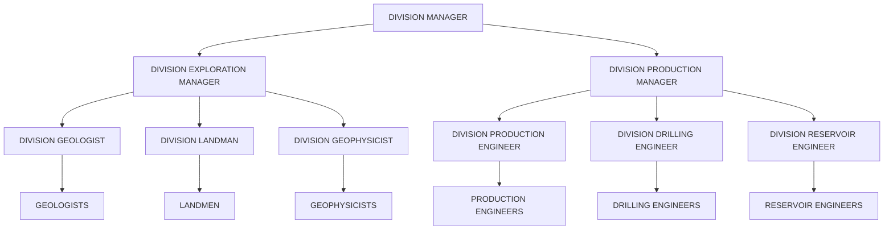
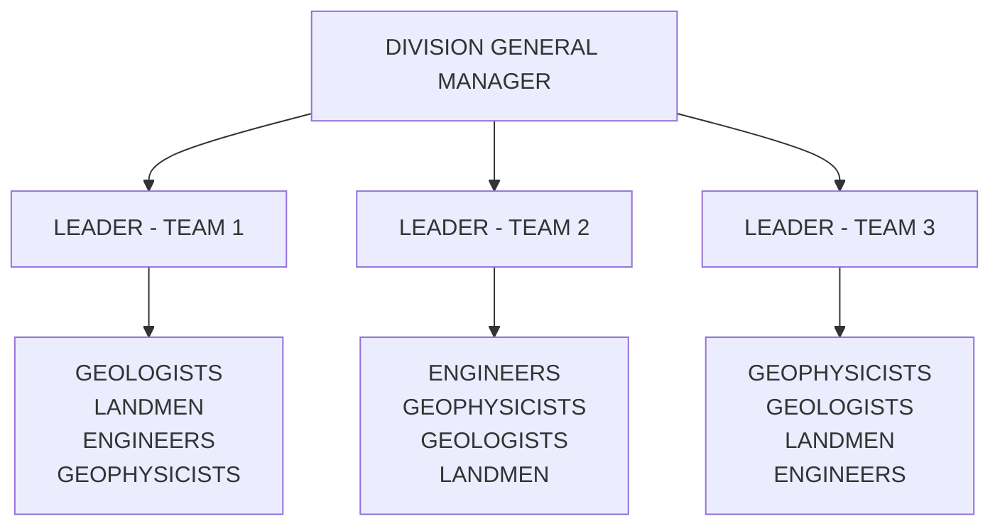
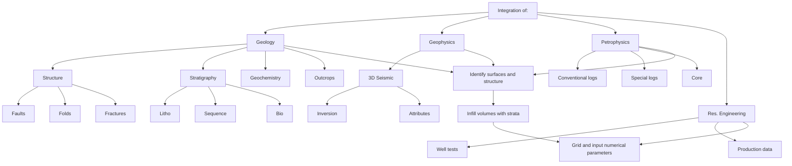

# Stratigraphic reservoir characterization for petroleum -- Roger M  Slatt (Eds ) -- Developments in P

*OCR: mistral-ocr-latest  |  рисунки: gpt-5.6-terra  |  2026-08-22*

---

<!-- page 1 -->
Elsevier
Radarweg 29, PO Box 211, 1000 AE Amsterdam, The Netherlands
The Boulevard, Langford Lane, Kidlington, Oxford OX5 1GB, UK

Second edition 2013

Copyright © 2013, 2006 Elsevier B.V. All rights reserved

No part of this publication may be reproduced, stored in a retrieval system or transmitted in any form or by any means electronic, mechanical, photocopying, recording or otherwise without the prior written permission of the publisher

Permissions may be sought directly from Elsevier's Science & Technology Rights Department in Oxford, UK: phone (+44) (0) 1865 843830; fax (+44) (0) 1865 853333; email: permissions@elsevier.com. Alternatively you can submit your request online by visiting the Elsevier web site at http://www.elsevier.com/locate/permissions, and selecting Obtaining permission to use Elsevier material

Notice

No responsibility is assumed by the publisher for any injury and/or damage to persons or property as a matter of products liability, negligence or otherwise, or from any use or operation of any methods, products, instructions or ideas contained in the material herein. Because of rapid advances in the medical sciences, in particular, independent verification of diagnoses and drug dosages should be made

British Library Cataloguing in Publication Data

A catalogue record for this book is available from the British Library

Library of Congress Cataloging-in-Publication Data

A catalog record for this book is available from the Library of Congress

ISBN: 978-0-444-56365-1

ISSN: 0376-7361

For information on all Elsevier publications
visit our web site at store.elsevier.com

Printed and bound in Great Britain

13 14 15 16 17 10 9 8 7 6 5 4 3 2 1


<!-- page 2 -->
## Dedication

This book is dedicated to my loving wife of 26 years—Linda Gay Slatt (1944–2013)—who was, and always will be, my source of inspiration, courage, motivation, encouragement, and guidance. She touched and brightened the lives of many with her grace, wisdom, generosity, and kindness.

v
<!-- page 3 -->
## Preface

Much has changed in the field of reservoir characterization, as well as in the world, since the first edition of this book was published in 2006. Technological advances, coupled with new directions in exploration and development of hydrocarbons, increasing global energy demand and new energy sources and energy-related issues, prompted this updated second edition. In addition to replacing some of the older case histories and other aspects of the first edition, two new chapters have been added to this second edition.

The first addition is on shales (i.e., “mudrocks”) as an unconventional resource (Chapter 12). Not many would have believed in 2006 that the most abundant rock type in the stratigraphic record would be capable of producing vast quantities of gas and oil, enough to make countries energy independent, and net exporters instead of importers of hydrocarbon fuels. The second addition is on the basics of geological and engineering modeling (Chapter 13). A chapter on this subject was not included in the first edition because the field was expanding too rapidly. The pace of advancement in modeling concepts, programs, and applications has not really diminished since 2006, so it was decided to include this chapter (mainly written by Dr. Fuge Zou) as background material for someone just needing to know the modeling basics.

I have been very fortunate in having experienced a dual career spanning 14 years in the petroleum industry and 29 years in academia. Thus, this book carries with it my experience in the scientific and technical aspects of reservoir characterization as well as my understanding of the necessity for explaining a concept or practice in a manner that is understandable to technical people from a variety of experience levels and interests. To accomplish this, I have drawn upon personal experiences in reservoir characterization and also upon both classic and recently published comprehensive literature, including graduate student theses and dissertations. The course from which this book evolved is actually a flexible series of topics presented to graduate-level students, to domestic and international petroleum companies, to petroleum societies and organizations, and formerly as a public, online Web (distance-learning) course.

Reservoir characterization as a discipline grew out of the recognition that more oil and gas could be extracted from reservoirs if the geology of the reservoir was understood. Prior to that awakening, reservoir development and production were the realm of the petroleum engineer. In fact, geologists of that time would have felt slighted if asked by corporate management to move

xi
<!-- page 4 -->
xii

Preface

from an exciting exploration assignment to a more mundane assignment working with an engineer to improve a reservoir's performance.

Slowly, reservoir characterization came into its own as a quantitative, multidisciplinary endeavor requiring a vast array of skills and knowledge sets. Perhaps, the biggest attractor to becoming a reservoir geologist was the advent of fast computing, followed by visualization programs and theaters, all of which allow young geoscientists to practice their computing skills in a highly technical, rewarding work environment. Also, the discipline grew in parallel with the evolution of data integration and the advent of asset teams in the petroleum industry. With the ever-increasing global demand for energy, partly alleviated by extracting more hydrocarbons from existing or young fields, the science of reservoir characterization is now flourishing. Quantum improvements in geophysical acquisition and processing techniques allow geophysicists to image internal reservoir complexities, quantitative geological reservoir models can now be based on extensive outcrop and mature field studies, and the computing capabilities are in place to relatively quickly build computer-simulation models of reservoirs for performance prediction and volumetric calculations.

As was the case in 2006, universities still lag behind this discipline's growth in the petroleum industry. With the exception of some geosciences departments in U.S., European, and Australian universities, young geoscience students typically do not get much opportunity to interact and study with their engineering counterparts. Students at those universities now are reaping the benefits of relatively steady industry recruitment that aims to avoid the demographic trap of workers collectively approaching retirement age at a time when energy demand is increasing globally.

Thus, this book is intended as a primer for geologists and geophysicists whose education and careers have taken them to this fascinating, multifaceted discipline. The book is also for petroleum engineers who seek to understand what geologists and geophysicists do and to explore how all three groups can help improve reservoir performance in a team setting.

The book focuses on stratigraphic aspects of characterization, with particular emphasis on understanding the primary control that depositional processes and systems exert on reservoir performance, and the extent (or sometimes the limits) to which stratigraphic features can be predicted away from the wellbore. Unlike the first edition, this second edition is built around a sequence stratigraphic framework since that discipline has matured to a point of common usage in subsurface prediction of the occurrence of source, seal, and reservoir rocks of all types and in most places.

I have purposefully avoided much discussion of structural aspects of reservoirs because it is a vast field in itself. For the same reason, I apply engineering principles in only a peripheral manner.

Yes, the discipline of reservoir characterization is complex, comprehensive, multidisciplinary, and exciting. It promises many careers for young
<!-- page 5 -->
Preface

xiii

people entering the petroleum industry and for more experienced individuals seeking to broaden their horizons.

I would like to acknowledge individuals with whom I have had the honor and pleasure to work with, and learn from, during my years in petroleum geoscience. These people include, but are not limited to, Hamid Al-Hakeem, Al Barnes, Greg Browne, Mike Burnett, Dave Campbell, John Castagna, Bob Davis, Marlan Downey, Jim Ebanks Jr., Eric Eslinger, Camilo Goyeneche, Neil Hurley, Cretis Jenkins, Doug Jordan, John Kaldi, T.K. Kan, Marcus Milling, Shankar Mitra, Clyde Moore, Matthew Pranter, Dave Pyles, Bill Reed, Mark Scheihing, Bob Sneider, Charles Stone, Rod Tillman, Lew and Myra Ward, John Warme, Bob and Paul Weimer, Jon Withrow, Alan Witten, and Fuge Zou. I also thank the 70+ graduate students that I have so far had the pleasure to work with and graduate while at OU. The patience and encouragement of my late-wife Linda Gay during the writing of this book is also greatly acknowledged. My son Andrew Slatt, and Ms. Lingxin (Cindy) Meng completed most of the excellent graphics used in the book and Carol Drayton spent many long and sometimes frustrating hours editing chapters and securing permissions to publish figures. My other son Tom Slatt frequently provided food for thought and nourishment at his restaurant. Finally, I am especially indebted to Robert Stephenson for providing the incentive for me to take up residence at the University of Oklahoma in 2000 to enhance its energy program, and for providing continued financial support that has allowed me to complete both the first and second editions of this book.

**Roger M. Slatt**

School of Geology and Geophysics and Institute  
of Reservoir Characterization  
University of Oklahoma Norman  
Oklahoma 73019
<!-- page 6 -->
# Series Editor's Preface

In the latest book published in this series, *Geophysics for Petroleum Engineers*, written by Professor F. Aminzadeh and Dr. S.N. Dasgupta, I had the pleasure of providing a brief preface that emphasized the strong need to maintain and improve lines of communication among and between modern reservoir, drilling, and production engineers and geophysicists, geologists, and petrophysicists. That volume, produced by experts in the geosciences and engineering within industry and academia, was designed and written with alleviating the traditional communication gap between the disciplines and asset team members firmly in mind.

Now in the second edition of Professor Roger Slatt's popular book on *Stratigraphic Reservoir Characterization for Petroleum Geologists, Geophysicists, and Engineers*, we have the ability to build on that important message. He realized that reservoir characterization as a discipline grew out of the recognition that more oil and gas could be extracted from reservoirs if the detailed geology of those reservoirs was better understood by both geoscientists and engineers. Over the past 30 years, it has developed into a multidisciplinary technical activity employing the very latest in computer, data management, and visualization technologies. In the new business world of asset teams, the use of reservoir characterization leapt forward when 3D and 4D geophysical acquisition and processing allowed geoscientists and engineers to image and model reservoir complexities and even the flow of hydrocarbons through reservoirs.

Professor Slatt has in the light of numerous technical advances in reservoir characterization over the past 10 years put together a book that emphasizes stratigraphic aspects of reservoir characterization in particular the role depositional processes and environments have on reservoir performance and the prediction of stratigraphic features away from the well bore. This edition also has an enlarged section on modern sequence stratigraphy and its role in improving our understanding of reservoir intricacies and the resulting impact on production of hydrocarbons.

Nowhere is there greater demand for this understanding than in the vitally important and rapidly growing world of unconventional reservoirs including gas and oil shales, tight gas sandstones, and coal-bed methane. So a new chapter on this topic has been added to this edition.

In the preface to the first edition of his book, Professor Slatt stated that "this book is intended as a primer for geologists and geophysicists whose education and careers have taken them into this fascinating, multifaceted

xv
<!-- page 7 -->
xvi

Series Editor's Preface

discipline. The book is also for petroleum engineers who seek to understand what geologists and geophysicists do and to explore how all three groups can help reservoir performance in a team setting.” These important intentions apply as much to this edition and will help to improve communication between these three technical areas.

This preface also provides an opportunity to remind readers that the *Developments in Petroleum Science* series will now incorporate the *Handbook of Petroleum Exploration and Production* series going forward. As currently Series Editor of the *Handbook of Petroleum Exploration and Production*, I will continue as Series Editor of the *Developments in Petroleum Science* series and hope that readers will enjoy the combined series.

John Cubitt Holt, Wales
<!-- page 8 -->
Chapter 1

# Basic Principles and Applications of Reservoir Characterization

# Chapter Outline

1.1. General Introduction 2
1.2. Integrating Expertise for Reservoir Characterization 3
1.3. Oil and Gas: The Main Sources of Global Energy 4

1.3.1. Resources and Reserves 4
1.3.2. Predicting the Remaining Resource 5
1.3.3. The Global Energy Resource 7
1.3.4. The "Shale Gale" 10
1.3.5. Gas Hydrates (Clathrates) 11
1.3.6. Energy Consumption 12

1.4. The Added Value of Reservoir Characterization 13

1.4.1. Examples of Added Value by Reservoir Characterization 14
1.4.2.Brownfields 19

1.5. Compartmentalization of Oil and Gas Reservoirs 20

1.5.1. Compartmentalization: The Exception or the Rule? 20
1.5.2. The Significance of Compartmentalization 21
1.5.3. The Nature of Compartmentalization and Architectural Elements 23

1.6. Clastic Depositional Environments and Types of Deposits 25

1.6.1. Scales and Styles of Geologic Reservoir Heterogeneity 26
1.6.2. Hierarchical Scales of Geologic Heterogeneity (Levels) 29

Developments in Petroleum Science, Vol. 61. http://dx.doi.org/10.1016/B978-0-444-56365-1.00001-8

Copyright © 2013 Elsevier B.V. All rights reserved.

1
<!-- page 9 -->
2

Stratigraphic Reservoir Characterization for Petroleum Geologists

|  **1.7. When Is Reservoir Characterization Important in the Life Cycle of a Field?** | **1.7.2. Applying Reservoir Characterization** | **34**  |
| --- | --- | --- |
|  **1.7.1. The Life Cycle of a Field** | **1.8. The Value of Case Studies References** | **36** **37**  |
|  |   |   |
|  |   |   |
|  |   |   |

## 1.1 GENERAL INTRODUCTION

The volume of information that is being generated and made publicly available about oil and gas reservoirs is increasing at an exponential rate, as is most “knowledge.” The “information age” applies equally to oil and gas exploration and development as to other global issues, as evidenced by the almost unlimited amount of information that can be gathered from the Internet on both general and specific aspects of basic and applied geoscience and engineering.

In addition to the Internet revolution, specific technology advances over the past few years include improved seismic processing and imaging for 3D and 4D seismic surveys, drilling in deeper offshore waters and onshore horizontal drilling and completions, and continued understanding of the physiochemical makeup of reservoirs at finer-and-finer detail.

Since publication of the first edition of this book, exploration for and extraction of oil and gas from shales and tight sands has revolutionized the global energy balance and the petroleum industry’s response to that revolution. Although it has long been recognized that there is an abundance of oil and gas in shales, they were generally considered to be hydrocarbon source rocks and seals. Advances in horizontal drilling, artificial fracturing (required of almost all shales to make them productive), and passive seismic monitoring provided the capability to economically extract oil and gas from these ultratight rocks. It has been suggested that there currently is a 100+-year supply of natural gas from North American shale (at current consumption rates), thus reducing the dependence on international sources of energy. In the early stages of development of shale gas, principally from the Barnett Shale, so much gas was produced that market price declined substantially. At the same time, oil prices were rising. As a result, the development of gas declined substantially, gas-rich shale plays were abandoned or sold off, and petroleum industry exploration moved toward liquid-rich intervals in the shales. An example is the Eagle Ford play of South Texas, which has a downdip dry gas window, an updip oil window, and an intermediate wet gas/condensate window (Fig. 1.1).

Although new engineering and geophysical technologies were the driving forces behind shale development, our understanding of the basic physiochemical and stratigraphic makeup of shales lags far behind that of sandstone and carbonate reservoirs. New measurement methodologies and workflows are
<!-- page 10 -->
Chapter | 1 Reservoir Characterization

3


----
━━━ FORMAT 3: MAP ━━━
**Eagle Ford Shale Play, Western Gulf Basin, South Texas**

Map type: regional map of the Eagle Ford Shale play, Western Gulf Basin, South Texas.

Mapped elements:
- Eagle Ford producing wells (HPD): oil and gas well locations.
- Eagle Ford petroleum windows (Petrohawk, EOG, DI): oil, wet gas/condensate, and dry-gas areas.
- Top Eagle Ford subsea depth structure, ft (Petrohawk): contour lines; visible labelled contour: −4000 ft. Subsea-depth values use a negative sign convention.
- Eagle Ford Shale thickness, ft (EOG): black filled/hatched areas.
- Eagle Ford Shale–Austin Chalk outcrops (TRIS): black line/area symbol.

Petroleum-window distribution:
- Oil window: green zone, extending across the central and southwestern part of the mapped trend.
- Wet gas/condensate window: narrow yellow band between the oil and dry-gas areas.
- Dry gas window: broad pink to red zone in the southeastern part of the play.

Producing wells:
- Red dots — Oil.
- Black dots — Gas.
- Numerous wells are plotted; individual well identifiers are not shown.

Map labels visible:
- Austin
- San Antonio
- Laredo
- Houston
- Corpus Christi
- Mexico
- New Mexico
- Texas
- Louisiana
- Arkansas
- Gulf of Mexico

Inset location map:
- Shows New Mexico (NM), Texas (TX), Oklahoma (OK), Arkansas (AR), Louisiana (LA), and the Gulf of Mexico.
- The mapped area is outlined by a purple rectangle in south Texas.

Scale and orientation:
- Scale bar: Miles; 0, 25, 50.
- North arrow shown; north is toward the top of the map.

Legend:
- Red dot — Oil.
- Black dot — Gas.
- Green fill — Oil.
- Yellow fill — Wet Gas/Condensate.
- Pink fill — Dry Gas.
- Thin contour line — Top Eagle Ford Subsea Depth Structure, Ft (Petrohawk).
- Black filled/hatched symbol — Eagle Ford Shale Thickness, Ft (EOG).
- Thick black line/symbol — Eagle Ford Shale–Austin Chalk Outcrops (TRIS).

Map date: May 29, 2010.

KEYWORDS: Eagle Ford Shale, Western Gulf Basin, South Texas, нефтегазоносность, нефтяное окно, газовое окно, глубинная структура, добывающие скважины, Austin Chalk
----


**FIGURE 1.1** Distribution of oil, wet gas, and dry gas in the Eagle Ford Shale Play of South Texas. *Figure provided by EIA.*

just being developed for characterizing shale reservoirs (Slatt et al., 2012). Chapter 12 in this second edition is devoted to characterization of shale and tight sand reservoirs.

Engineering and geophysical advancements, coupled with higher-resolution computing capabilities, have led to steady improvements in our capacity to build quantitative 3D geologic models for reservoir performance simulation and volumetric calculations. All of these advances have come about in large part because of the greater emphasis being placed upon enhanced hydrocarbon recovery from existing, mature fields (“brownfields”) and shale/tight sand reservoirs. As AAPG President Ted Beaumont stated, “The shale/tight sand reservoir play changed the concept of a hydrocarbon reservoir forever and the key to the evolution of our knowledge and understanding of this incredible play is reservoir characterization, the collaboration of geology, geophysics, and engineering.”

## 1.2 INTEGRATING EXPERTISE FOR RESERVOIR CHARACTERIZATION

Today, the field of reservoir characterization routinely involves disciplines of geology, geophysics, petrophysics, petroleum engineering, geochemistry,
<!-- page 11 -->
4

Stratigraphic Reservoir Characterization for Petroleum Geologists

biostratigraphy, geostatistics, and computer science. Even behavioral science must be included in this list, because people in the different disciplines do not think or act similarly and sometimes must be encouraged to work together in a team setting. A popular quote (of unknown origin) is very appropriate to the oil and gas industry: *Two stonecutters were asked what they were doing. The first said, “I’m cutting this stone into blocks.” The second replied, “I’m on a team that’s building a cathedral.”* The concept behind this latter statement is now fully ingrained within the petroleum industry, as evidenced by the organizational subdivision of exploration and development personnel into “asset teams.”

Different disciplines even use their own technical language, so that effective communication is sometimes lacking, leading to costly mistakes such as the Macondo blowout in April 2010 (http://en.wikipedia.org/wiki/Macondo_Prospect). A more mundane example is the term “deep water,” which is used by a geologist to indicate deposition of sediments in water depths beneath storm wave base (slope and basinal depths) and by an offshore drilling engineer to indicate present-day water depths >500 m (1500 ft.) above the mudline (seafloor).

Visualization technologies and instrumentation introduced in earnest in the mid-1990s (Slatt et al., 1996) and now routinely used in all large and midsize companies have provided an effective means of breaking down some of the communication barriers among the disciplines. In part, this is due to the greater willingness of young entrants into the petroleum industry—geoscientists who were raised with home and school computers and sophisticated video games—to seek out, be comfortable with, and use computers for most tasks. Although we all acknowledge the advances that have been made in oil and gas exploration and development as a result of computers, there are a number of occasions of computer overuse (i.e., using the computer instead of knowledge to attempt to solve a problem). University professors are sometimes chided for producing “Nintendo geologists” (a term first introduced to me by W. Camp, a long-time petroleum industry geologist).

Thus, the field of reservoir characterization is quite comprehensive and challenging. In fact, definitions of reservoir characterization now vary according to the technologies available for characterization and the skills of the technologists. A rather vague definition that I like (perhaps because it is vague) has been provided by Halderson and Damsleth (1993): “The principal goal of reservoir characterization is to outsmart nature to obtain higher recoveries with fewer wells in better positions at minimum cost through optimization.”

## 1.3 OIL AND GAS: THE MAIN SOURCES OF GLOBAL ENERGY

### 1.3.1 Resources and Reserves

The volume of oil and gas that is present beneath the Earth’s surface can be classified in several ways. Figure 1.2 illustrates one classification, from the resource (undiscovered, total estimated) to the reserves (either proven or probable at a
<!-- page 12 -->
Chapter | 1 Reservoir Characterization

5


----
━━━ FORMAT 12: CONCEPTUAL DIAGRAM ━━━
A right-pointing horizontal arrow across the top indicates progressive classification from left to right.

Four vertical rectangles are arranged from left to right:
- Red rectangle: “RESOURCES” (vertical text).
- Red-orange rectangle: “Accessible to exploration”; a dashed horizontal line near its lower part separates an unlabelled lower portion.
- Orange rectangle: upper portion “Identified”; lower portion “Not Identified”, separated by a dashed horizontal line.
- Light-orange rectangle: upper portion “Technically exploitable”; lower portion “Technically not exploitable”, separated by a dashed horizontal line.

To the right are two yellow rectangles:
- Upper: “Economically profitable”.
- Lower: “Economically profitable”.

A separate pale-yellow rectangle at the far right is labelled: “RESERVES”.

The diagram communicates that RESERVES are the economically profitable part of technically exploitable, identified resources accessible to exploration.
KEYWORDS: resources, reserves, exploration, identified resources, technically exploitable, economically profitable, classification
----


**FIGURE 1.2** A visual definition of resources and reserves. *Modified from Favennec (2002). Reprinted with permission of Institut Francais du Petrole.*

given price). Determining the resource and reserves at any one time is a difficult task, and the values will change over time. As shown in Fig. 1.2, undoubtedly, the total anticipated resource is not accessible to exploration, for geographic, political, and economic reasons and technological challenges.

Also, what is not accessible today may become accessible in the future, so that the total resource can change with time. Then, once the resource is identified and discovered, only a percentage of it may be technically recoverable. However, future technologies (some of which will focus on improved reservoir characterization) will modify this percentage from time to time. Finally, although the resource might be technically recoverable, economics will dictate how much is produced at a given time and price. Because global and local economics change more or less continually, the amount of resource that is actually extracted or extractable will also vary with time. It is this amount of the resource that can be considered the reserves, both proven and probable. A good example of the economic effect of supply and demand on exploration and production is the recent revelation and development of vast quantities of technically recoverable gas and liquids from shales (see Chapter 12 and as discussed earlier).

### 1.3.2 Predicting the Remaining Resource

Over the years, many estimates and calculations have been made regarding when the global supply of oil and gas will be exhausted. Perhaps, the most
<!-- page 13 -->
6

Stratigraphic Reservoir Characterization for Petroleum Geologists

widely cited set of predictions are those of M. K. Hubbert. The “Hubbert curve,” which attracted significant attention, was published in 1957, when Hubbert predicted that annual U.S. oil production would peak as early as 1965 and no later than 1970, based on reserve estimates at that time of 150–200 billion barrels (bbl) of oil. In fact, U.S. oil production did peak in 1970 at 3.44 billion bbl (Deming, 2001).

Hubbert’s prediction was based on the assumptions of (1) a finite supply of oil and (2) exponential growth, peak, and decay of the production rate. Such predictions can be fraught with difficulty because of the inaccuracy or unavailability of data from which to estimate the finite supply. Aside from Hubbert’s two assumptions, his production predictions were based solely upon time. However, other factors that can affect supply and production rates include ever-changing economics, global politics, complex reporting procedures, and technological advancements for both exploration and production. Some of the estimates made during the past 30 years, using different philosophies and information are summarized in Table 1.1.

**TABLE 1.1** Some Estimates of Ultimate Recovery (EUR) and Peak Production, Made in Different Years

|  Year of Estimate | EUR (billion bbl) | Year of Peak Production  |
| --- | --- | --- |
|  1969 | 2100 | 2000  |
|  1978 | 3200 | 2004  |
|  1983 | 3000 | 2025  |
|  1989 | 2000 | 2010  |
|  1993 | 3000 | 2010  |
|  1994 | 1650 | 1997  |
|  1994 | 1750 | 2000  |
|  1996 | 2600 | 2007–2019  |
|  1997 | 2836 | 2020  |
|  1998 | 2800 | 2010–2020  |
|  1998 | 4700 | 2030  |
|  1999 | 2700 | 2010  |
|  2000 | 2659 |   |
|  2001 | 3670 | 2020–2030  |

Modified from Edwards (2001). Reprinted with permission of AAPG, whose permission is required for further use.
<!-- page 14 -->
Chapter | 1 Reservoir Characterization

7

These data show that the estimated ultimate recovery predictions vary by a factor of $2 \times$, without a systematic increase or decrease over the 30-year time span of predictions. Most predictions place peak production within the next 5–25 years. If this proves to be true, there is still uncertainty as to how long production would continue on a downward exponential trend, because that would depend on the various nongeologic factors mentioned earlier, in addition to the size of the resource. The more pessimistic predictions of the end of significant oil and gas production have fueled the debate over conservation, industrialization, environmentalism, alternate energy sources, hydrogen economy, and fusion, to name a few. They have also stimulated research, development, and advancements in these areas. Again, research into shales as reservoirs is a recent example.

### 1.3.3 The Global Energy Resource

An excellent, up-to-date listing of global energy resource is available from *BP Statistical Review of World Energy, June 2013* (bp.com/statisticalreview), and this Web publication is recommended to readers. An example from that publication is the trend of reserves/production ratio for oil reserves from 1981 to 2011, by global region (Fig. 1.3).

A statistical review of global resources by the U.S. Geological Survey (2000) revealed that on both a global and a U.S. basis, reserve growth (defined as the increase in known petroleum volume that commonly occurs as oil and gas fields are developed and produced; it refers to oil and gas that are recoverable by current technology, through improved reservoir management; chapter 1) is about equal to the volumes of undiscovered conventional oil and gas. This point is particularly significant for a number of reasons. First, it raises the issue of the economics of exploration versus development. Because approximately the same volume of reserves is thought to remain undiscovered as is presently left in existing fields, is it better to place more emphasis on exploring for new resources or on exploiting the existing reserves? Repeated studies have shown that over the past few decades in the United States, greater additions to oil and gas reserves came from discovered fields than from new field discoveries. In the United States, for example, about twice the volume of reserves of both oil and gas is derived from reserve growth, compared with remaining reserves (chapter 1; table 1.2), which suggests that initial estimates of field reserves are often too conservative.

A 2012 review by the U.S. Geological Survey (published in the AAPG Explorer) placed the “... potential undiscovered US reserves additions total at 32 billion bbl of crude oil, 291 tcf of natural gas, and 10 billion bbl of technically recoverable domestic oil and gas. This estimate did not include reserve growth estimates for federal offshore areas, nor economically recoverable accumulations of shale gas, tight gas, tight oil, and tar sands. Unlike past
<!-- page 15 -->
8

Stratigraphic Reservoir Characterization for Petroleum Geologists

# History


----
━━━ FORMAT 6: XY PLOT / CHART WITH DATA ━━━

Legend:
- North America — yellow line.
- S. & Cent. America — dark green line.
- Europe & Eurasia — light green line.
- Middle East — bright green line.
- Africa — orange line.
- Asia Pacific — pale yellow line.
- World — grey line.

Axes:
- X-axis: years, labelled 81, 86, 91, 96, 01, 06, 11; linear scale.
- Y-axis: unlabeled quantity; linear scale from 0 to 160, with grid interval 10. Values increase upward.

Curves (values снято с графика, приблизительно):

| Series | Anchor points |
|---|---|
| North America | 1981: ~26; 1986: ~24; 1991: ~23; 1996: ~23; 1998: ~25; 2001: ~33; 2004: ~40; 2007: ~39; 2011: ~47 |
| S. & Cent. America | 1981: ~14; 1985: ~20; 1986: ~46; 1988: ~51; 1991: ~47; 1996: ~43; 1998: ~41; 2001: ~38; 2005: ~40; 2008: ~49; 2010: ~126; 2011: ~124 |
| Europe & Eurasia | 1981: ~16; 1986: ~15; 1991: ~15; 1996: ~18; 2001: ~20; 2006: ~20; 2008: ~23; 2011: ~24 |
| Middle East | 1981: ~73; 1984: ~109; 1986: ~120; 1988: ~127; 1991: ~112; 1994: ~101; 1997: ~95; 1999: ~90; 2002: ~103; 2005: ~90; 2008: ~88; 2010: ~85; 2011: ~82 |
| Africa | 1981: ~22; 1986: ~21; 1989: ~16; 1991: ~17; 1996: ~20; 2001: ~17; 2006: ~17; 2011: ~16 |
| Asia Pacific | 1981: ~26; 1986: ~25; 1991: ~24; 1996: ~24; 1998: ~47; 2001: ~46; 2004: ~43; 2007: ~49; 2011: ~41 |
| World | 1981: ~26; 1986: ~47; 1988: ~51; 1991: ~48; 1996: ~43; 1998: ~49; 2001: ~52; 2004: ~49; 2007: ~48; 2011: ~55 |

> Trend: Middle East is the highest series until approximately 2008 and declines overall after its late-1980s maximum. S. & Cent. America rises sharply after approximately 2008 to the chart maximum. World shows a moderate long-term increase, while Europe & Eurasia rises gradually and Africa remains nearly stable.

KEYWORDS: regional trends, North America, S. & Cent. America, Europe & Eurasia, Middle East, Africa, Asia Pacific, World, time series
----


**FIGURE 1.3** Thirty-year history (1981–2011) of reserves to production ratio for global oil, by region. Vertical axis is in BBO. http://www.bp.com/assets/bp_internet/globalbp/globalbp_uk_english/reports_and_publications/statistical_energy_review_2011/STAGING/local_assets/pdf/statistical_review_of_world_energy_full_report_2012.pdf.

reserve growth estimates which relied entirely on statistical extrapolations of growth trends, this one is partly based on detailed analysis of geology and engineering practices used in the assessed producing accumulations, the report said. The assessment used published and commercial, proprietary geologic information and field production data. By providing geologically based, domestically consistent estimates of the potential additions of oil and gas from the growth in reserves in known fields, and placing that information in the public domain, we are furnishing a valuable projection on how much and where fossil fuels may be produced in the future. When combined with our estimates of undiscovered resources, policymakers can obtain a more complete picture of domestic, technically recoverable oil and gas,” said USGS Director Marcia K. McNutt.
<!-- page 16 -->
Chapter | 1 Reservoir Characterization

9

At a more regional U.S. scale, Grace (2006) correlated reserve growth with field size in the northern Gulf of Mexico shelf and found that a field containing > 10 MMBOE (barrels of oil equivalent) (to convert gas to BOE, one BOE = 5620 ft.$^{3}$ of gas) had a 75% chance of growing its reserves with time. There, the causes of reserve growth include (a) discovery and development of new reservoirs or compartments within a field, (b) recognition of larger volumes of productive rock than predicted, (c) increase in recovery factor from discovered reservoirs, and (d) amalgamation of fields formerly recognized as being separate hydrocarbon accumulations (Grace, 2006).

As one moves from exploration to discovery, then to appraisal and development/production, more and more data are generated that provide a better understanding of the reservoir. Improved understanding increases the accuracy of resource estimates and reduces uncertainty about reserve calculations and ultimate recovery (Fig. 1.4). Reservoir characterization plays a significant role in reserve growth, particularly when the price of oil and gas is high, and companies have more money to spend on field development (Fig. 1.4).

Some companies have reduced exploration budgets in favor of acquiring and further developing properties with known reserves. The success of exploration is not simple and varies according to the geography and the remoteness of exploration and field locations, the potential for infrastructure to move hydrocarbons once they have been discovered, and the fluctuating price of oil and gas over the short term. On the other hand, an incremental increase


----
━━━ FORMAT 6: XY PLOT / CHART WITH DATA ━━━

Horizontal axis: YEARS; linear scale, 0–12 (curve extends slightly beyond 12 years).

Vertical axis: EUR (Mbbl); linear scale, 0–80. Labelled ticks: 0, 20, 40, 60, 80.

Data-acquisition stages:
- 0–2 years: Comparative Data; Exploration.
- 2–approximately 4,4 years: Volumetric Data; Appraisal.
- Approximately 4,4 years onward: Performance Data; Development/Production.

Vertical stage-boundary lines: 2 years; approximately 4,4 years.

Curves (not labelled in image):
- Dotted curve:
  - 0–2 years: 80 Mbbl.
  - approximately 4,4 years: approximately 62 Mbbl.
  - 6 years: approximately 61 Mbbl.
  - 8 years: approximately 59 Mbbl.
  - 10 years: approximately 58 Mbbl.
  - 12–13 years: approximately 56 Mbbl.
- Solid curve:
  - 0–2 years: 50 Mbbl.
  - approximately 4,4 years: approximately 43 Mbbl.
  - 6 years: approximately 46 Mbbl.
  - 8 years: approximately 49 Mbbl.
  - 10 years: approximately 52 Mbbl.
  - 12–13 years: approximately 56 Mbbl.
- Dashed curve:
  - 0–2 years: 20 Mbbl.
  - approximately 4,4 years: approximately 28 Mbbl.
  - 6 years: approximately 35 Mbbl.
  - 8 years: approximately 42 Mbbl.
  - 10 years: approximately 48 Mbbl.
  - 12–13 years: approximately 56 Mbbl.

> Trend: the EUR estimate range narrows through time; the dotted upper estimate declines, the dashed lower estimate rises, and all three curves converge at approximately 56 Mbbl during Development/Production.

KEYWORDS: EUR, Mbbl, years, exploration, appraisal, development, production, comparative data, volumetric data, performance data
----


**FIGURE 1.4** Evolution of uncertainty in resource estimation with time; the vertical axis represents the estimated ultimate recovery (EUR). *Modified from Ross (1997). Reprinted with permission of Society of Petroleum Engineers.*
<!-- page 17 -->
10

Stratigraphic Reservoir Characterization for Petroleum Geologists


----
━━━ FORMAT 6: XY PLOT / CHART WITH DATA ━━━
X-axis: calendar year, linear scale; labelled years: 1978, 1981, 1986, 1991, 1996, 2001.

Left Y-axis: Reserve Change, MM BOE; linear scale, 0–3000, labelled at 0, 500, 1000, 1500, 2000, 2500, 3000.

Right Y-axis: Real Price $/BOE; linear scale, $0–$12, labelled at $0, $2, $4, $6, $8, $10, $12.

- Grey outlined bars: Reserve Change, MM BOE.
- Blue line: Real Price $/BOE.

Reserve-change bars show strongly variable annual values, including high positive values near 2500 MM BOE in the late 1970s and approximately 2100 MM BOE in the early 1980s, with one negative value in the late 1990s.

Real Price $/BOE line, read from graph approximately:
- 1978: $1,5
- 1980: $2,0
- 1982: $4,0
- 1984–1985: $5,0
- 1987: $2,0
- 1989: $3,0
- 1992: $2,7
- 1995: $4,0
- 1997: $4,5
- 1998: $2,5
- 1999: $4,5
- 2000: $9,5
- 2001: $8,8
- 2002: $9,0

> Trend: Real oil price rose from about $1,5/BOE in the late 1970s to about $9/BOE by 2002, with major declines in the mid-1980s and late 1990s; annual reserve change fluctuates substantially and does not show a consistent direct relationship with price.

KEYWORDS: reserve change, MM BOE, real price, $/BOE, annual reserves, oil price
----


**FIGURE 1.5** Total reserve additions/reductions for the northern Gulf of Mexico shelf in relation to the real price of oil and gas (BOE) for the years 1976–2001. *Figure provided by Grace (2006).*

in production, above what was expected from the remaining reserves in a mature field, can add significantly to the field’s livelihood and the operating company’s profits (Fig. 1.5).

### 1.3.4 The “Shale Gale”

The effect of unconventional resources on overall production and reserve growth is, at the moment, an unknown part of the energy mix, particularly for shales. This is mainly because relatively little is understood about producing oil and gas from shales (see Chapter 12 for details of resource shales). In North America alone, there are about 60 potentially economic shale gas plays and several shale oil plays. As recently as 2007, it was widely believed that natural gas was in tight supply in the United States and that the United States was going to become a growing importer of gas. This outlook has now been turned on its head by the “shale gale” as it is called by D. Yergin. Thus, recent supply-side estimates have been more encouraging than those published a mere few years ago. For example, there is now an estimated 500 TCF of recoverable gas in the United States. Shale gas currently accounts for 33% of U.S. natural gas production, and by 2035, it is predicted to account for 60% (HIS Global Insight, referenced in Ramchand, 2012). Globally, such countries as Argentina, Australia, Canada, China, Colombia, India, Poland, and Saudi Arabia are currently active in shale gas exploration. In Argentina, 927 MMBOE (80% oil) have been estimated from a widespread shale formation (*Oil and Gas Journal*, November 8, 2011).
<!-- page 18 -->
Chapter | 1 Reservoir Characterization

11

Shale resources are so new that technologies to accurately measure hydrocarbons-in-place remain to be developed and there are relatively few long-term production histories to reliably accept some of the calculated estimates (Nehring, 2010). Other technologies are still evolving to better locate and produce from these reservoirs. For example, horizontal drilling commenced in the Barnett Shale of North Texas, United States, in 2003 and now almost all wells there are drilled horizontally and then artificially fractured. These two technologies combined have led to an increase in Barnett production from 0.2 BCFG/day in 2000 to 4.8 BCFG/day in 2010, along with a corresponding decrease in required drilling days and well costs and an increase in horizontal well length and average fracture stages (Henning, 2010).

### 1.3.5 Gas Hydrates (Clathrates)

Another unconventional resource with tremendous potential is gas hydrate. Gas hydrate is a naturally occurring, “icelike,” solid combination of natural gas and water with a crystalline structure of a hydrocarbon molecule (usually methane; CH₄) surrounded by a cage of water molecules (Fig. 1.6).

Gas hydrate deposits are found along the world’s ocean margins and in Arctic regions (Fig. 1.7). A current inventory of gas hydrate occurrences is published by the U.S. Geological Survey (Kvenvolden and Lorenson, 2010). Hydrates might be twice as abundant as all the worlds’ current fossil fuel reserves and 10–20 times the total remaining global reserves and undiscovered resources of conventional natural gas. Large deposits have been found onshore in Alaska, Canada, and Russia, and offshore deposits have been mapped in the northern Gulf of Mexico, Japan, India, and China.

Because of the potential size of the global gas hydrate resource base, there are many governmental and multinational research teams assessing properties of gas hydrates and ways to produce the gas. The U.S. Department of Energy/National Energy Technology Laboratory (DOE/NETL) is one of several such organizations whose goal is to characterize the in-place methane hydrate reserves on Alaska’s North Slope (http://www.netl.doe.gov/technologies/oil-gas/FutureSupply/MethaneHydrates/projects/DOEProjects/Alaska-41332.html; 2011).

Seismic reflection surveys are the principle means by which gas hydrate deposits have been discovered and mapped offshore. The major constraints to production are both technical and economic. Because the gas occurs under very high pressure and low temperature, the gas must be separated from the water and extracted very carefully to avoid its release into the ocean or atmosphere, perhaps catastrophically. An international research program has demonstrated the technical feasibility of producing the gas from gas hydrates through pressure reduction (Space Daily, 2003; http://www.spacedaily.com/news/energy-tech-03zz.html). Nevertheless, much still needs to be learned about gas hydrates before they can be added to the global energy mix.
<!-- page 19 -->
12

Stratigraphic Reservoir Characterization for Petroleum Geologists


----
━━━ FORMAT 12: CONCEPTUAL DIAGRAM / КОНЦЕПТУАЛЬНАЯ СХЕМА ━━━
Three-dimensional ball-and-stick crystal-structure model. Large green spheres occupy cavities within a repeating framework. Red spheres form the principal interconnected framework; smaller blue spheres and pale blue connecting rods occur at central and bridging positions. Grey rods show bonds between spheres. No chemical-element labels, crystallographic axes, unit-cell dimensions, or scale are shown.

The diagram illustrates a porous or cage-like repeating crystal framework containing larger atoms/ions in internal voids.

KEYWORDS: crystal structure, ball-and-stick model, unit cell, framework, cavities, lattice
----


Clathrate Hydrate


----
━━━ FORMAT 15: ФОТОГРАФИЯ ━━━
Предмет: фотография образца. В центре видна округлая светлая бело-голубая масса с неровной бугристой поверхностью; по периферии — более тёмные серо-зелёные участки. Масштабная метка отсутствует.
KEYWORDS: фотография образца, светлая масса, бугристая поверхность, серо-зелёные участки, масштаб отсутствует
----


----
━━━ FORMAT 15: PHOTOGRAPH / ФОТОГРАФИЯ ━━━
Класс объекта: фотография опыта/оборудования. Руки удерживают белый округлый объект, над которым виден вертикальный оранжевый язык пламени. На заднем плане — металлическое оборудование, трубки и панели с тёмными прямоугольными индикаторами. Масштабная метка отсутствует.
KEYWORDS: фотография, пламя, горение, лабораторный опыт, оборудование
----


FIGURE 1.6 The upper left picture shows the cage-like structure of gas hydrate with a central methane molecule surrounded by water molecules. The upper right picture shows the specific structure of a piece of the hydrate from the subduction zone off Oregon, United States. The lower left picture shows a naturally burning piece of gas hydrate owing to the decrease in pressure and increase in temperature. From http://chem.ps.uci.edu/~kcjanda/Group/gas_hydrate_structure.html; http://en.wikipedia.org/wiki/Methane_clathrate.

### 1.3.6 Energy Consumption

Figure 1.8 illustrates the past and predicted future trends of global consumption of various energy sources, to the year 2035 (Newall, 2009). Consumption trends, which are directly related to population growth, suggest that, at least for the foreseeable future, oil and natural gas will provide the bulk of global energy. Thus, the need exists for continued global exploration and exploitation of this valuable resource. Irrespective of predictions, it is a certainty that oil and natural gas are finite resources that must be exploited efficiently to give maximum benefit to a global population whose growth rate is also exponential (Edwards, 2001).
<!-- page 20 -->
Chapter | 1 Reservoir Characterization

13


----
━━━ FORMAT 3: MAP / КАРТА ━━━
Карта мира с цветовой заливкой рельефа суши и батиметрии океанов. Ориентация стандартная: север в верхней части карты.

Цветовая шкала расположена внизу слева; числовые значения и единицы на шкале неразборчивы. Визуально: тёмно-синие тона соответствуют глубоководным областям, голубые и зелёные — мелководным областям и низменностям, жёлтые–красные — возвышенным и горным областям.

На карте нанесены многочисленные точечные символы:
- чёрные круги различного размера;
- белые круги с тёмной обводкой;
- отдельные красные/оранжевые точки.
Значение символов не определяется без легенды.

Подписаны отдельные точки/объекты, но большинство подписей неразборчиво. Контуры, сечение изогипс, масштаб, северная стрелка и легенда условных обозначений отсутствуют или неразборчивы.

В нижнем правом углу напечатано: `20150`.

KEYWORDS: карта мира, рельеф, батиметрия, океаническое дно, цветовая шкала, точечные символы, топография
----


**FIGURE 1.7** Known (black circles) and potential (white circles) gas hydrate deposits of the world (Kvenvolden and Lorenson, 2010).


----
━━━ FORMAT 6: XY PLOT / CHART WITH DATA ━━━
Stacked area chart of gas production projections.

- Vertical axis: Trillion cubic feet; linear scale; labelled range 0–25.
- Horizontal axis: years; linear scale; 1990–2035.
- Historical / projected-data division: vertical black line between 2005 and 2010 (approximately 2007); left label “History”, right label “Projections”.

Stacked components, bottom to top:
1. Net imports — grey.
2. Associated with oil — pale yellow.
3. Non associated offshore — dark red.
4. Non associated onshore — light blue.
5. Coalbed methane — red.
6. Shale gas — dark blue-purple.
7. Alaska — turquoise.

Printed labels:
- Trillion cubic feet
- History
- Projections
- Alaska
- Shale gas
- Coalbed methane
- Non associated onshore
- Non associated offshore
- Associated with oil
- Net imports

Approximate total stacked volume, read from graph:
| Year | Total, trillion cubic feet |
|---|---:|
| 1990 | approximately 19 |
| 1995 | approximately 21 |
| 2000 | approximately 22 |
| 2002 | approximately 23 |
| 2005 | approximately 21 |
| 2008 | approximately 23 |
| 2010 | approximately 21 |
| 2015 | approximately 21 |
| 2020 | approximately 22 |
| 2025 | approximately 23 |
| 2030 | approximately 24 |
| 2035 | approximately 25 |

Source text at bottom: “Richard Newell, SAIS, December 14, 2009”.

> Trend: Total gas supply rises from about 19 trillion cubic feet in 1990 to about 25 trillion cubic feet by 2035; projected growth is primarily represented by shale gas and Alaska, while coalbed methane and non-associated offshore contributions decline or remain relatively limited.

KEYWORDS: gas production, projections, shale gas, coalbed methane, associated gas, offshore gas, onshore gas, net imports
----


**FIGURE 1.8** Energy consumption by fuel and area, 1990–2035 (trillion cubic feet, TCF). *After Newell (2009). Annual Energy Outlook, 2010.*

## 1.4 THE ADDED VALUE OF RESERVOIR CHARACTERIZATION

The preceding discussion illustrates the value of reservoir characterization. If a proper reservoir characterization is conducted for a field and it leads to an incremental improvement in production beyond what was anticipated, then there is economic value to the characterization. For example, if the
<!-- page 21 -->
14

Stratigraphic Reservoir Characterization for Petroleum Geologists


----
━━━ FORMAT 12: CONCEPTUAL DIAGRAM ━━━
(a) Idealised waterflood schematic. A horizontal reservoir interval is shown between an upper yellow layer and lower pale-orange layer; lithology is not determined without a legend. A left vertical well is labelled “INJECTION WELL” and injects water downward into the dark horizontal reservoir zone. A right vertical well is labelled “PRODUCTION WELL” and has an upward production arrow. Blue areas labelled “Water” occur around both wells within the reservoir zone. “WATERFLOOD” is shown above the reservoir.

━━━ FORMAT 12: CONCEPTUAL DIAGRAM ━━━
(b) Conceptual schematic labelled “The ‘Real World’”. An “INJECTION” well at left injects downward through a brown upper interval into a yellow lower interval; lithology is not determined without a legend. A “PRODUCTION (?)” well is at right. Black arrows show injected-fluid movement initially laterally from the injector, then preferentially along an inclined zigzagging high-conductivity pathway toward the production well. A pink irregular body or pathway crosses the yellow interval and extends toward the production well. The diagram contrasts non-uniform, channelled flow in the “Real World” with the idealised waterflood in panel (a).

KEYWORDS: waterflood, injection well, production well, water injection, preferential flow, reservoir heterogeneity, channelled flow
----


FIGURE 1.9 (a) Simplistic perception of a continuous reservoir sandstone undergoing waterflood. (b) Stratigraphic and structural complexities between wells that can affect the waterflood. Figure provided by Ebanks.

characterization of a field that was originally estimated to contain 100 MMB of recoverable oil improves that field's recovery by an additional 5%, an extra 5 MMBO is produced. Production improvements can come about through a better understanding of the geologic complexities of the field (Fig. 1.9), which may result from either sound geologic evaluation or new technologies applied to the field (i.e., from improved reservoir characterization). 3D seismic technology can image fine-scale stratigraphic and structural features that were previously unnoticed by mapping from well control but were highlighted after application of seismic attributes (Chopra and Marfurt, 2007) (Fig. 1.10). Horizontal drilling is now widely used to improve recovery over a larger area of a reservoir, either in highly compartmentalized reservoirs or in blanket-type deposits (Fig. 1.11). Thus, the characterization of reservoirs has evolved from a simple engineering evaluation to one developed by multidisciplinary teams of geologists, geophysicists, petrophysicists, and petroleum engineers.

### 1.4.1 Examples of Added Value by Reservoir Characterization

It is difficult to find information on value added or costs saved by reservoir characterization, because such information normally is not provided by companies nor is it often tracked sufficiently. Examples are presented in the
<!-- page 22 -->
Chapter | 1 Reservoir Characterization

15


----
━━━ FORMAT 12: CONCEPTUAL DIAGRAM ━━━
Three-panel conceptual diagram relating coloured deformation fields to a photographed folded rock exposure.

Left upper panel: red–white–blue field map with blue linear and branching features. Colour scale: Pos (red) — 0 — Neg (blue).

Left lower panel: blue–white–red field map with the same blue linear and branching features. Red areas are limited; blue areas dominate.

Right panel: photograph of layered, folded rocks. A yellow dashed curved line follows the fold geometry. White arrows normal to this line vary in direction and spacing; labels along the line are: K=0, K>0, K<0. Turquoise annotations: “Dilatant Plane”, “Displacement Plane”, “Syncline”, and “R”. Lower-left orientation/coordinate marker: x, y, N. A white scale bar is shown at lower right.

The diagram illustrates spatial variation of deformation around a syncline, including zones labelled by K and associated dilatant and displacement planes.
KEYWORDS: deformation, syncline, displacement plane, dilatant plane, strain field, curvature, fold
----


**FIGURE 1.10** Stratal slices through most positive (red) and (c) most negative (blue) curvature attribute volumes. Right figure illustrates the concepts of positive (convergent) and negative (divergent) attribute with a syncline–anticline structure in the background (channels and their margins can give the same attribute response, Chopra and Marfurt, 2007). *Reprinted with permission of Society of Exploration Geophysicists (SEG).*

succeeding text that do provide some insights into the economic value of integration and use of technologies that were new at the time.

The first example went a long way toward breaking the petroleum industry out of its traditional “silo” mold, whereby technical personnel would apply their particular expertise to a project, often in isolation, and seldom as part of a coordinated team. This example, publicized by Sneider (1999), concerns a major oil and gas company that, for many years, was organized in a traditional manner (Fig. 1.12). As an experiment in the value of integration, the company formed a small subsidiary organization composed of personnel with different skills and expertise who worked in synergistic teams (Fig. 1.13). At
<!-- page 23 -->
16

Stratigraphic Reservoir Characterization for Petroleum Geologists


----
━━━ FORMAT 12: CONCEPTUAL DIAGRAM ━━━
Two well configurations are compared above layered subsurface strata: a “Slant-hole well” at left and a “Horizontal well” near centre-right. The vertical direction is downward into the subsurface; no depth scale is shown.

The slant-hole well begins vertically at the surface, then deviates rightward and downward, intersecting several isolated pink, lens-shaped bodies labelled “Lenticular reservoir.” The lenticular bodies occur within a grey overlying interval and are laterally discontinuous.

The horizontal well is vertical from the surface through the grey interval, then curves to a near-horizontal trajectory within a continuous yellow layer labelled “Blanket reservoir.” The horizontal section extends to the right within this reservoir layer.

The yellow blanket reservoir is laterally continuous and is shown as vertically segmented by short black lines. A grey horizontal layer separates the upper blanket reservoir from a lower yellow layered interval. The slant-hole trajectory continues downward through the upper reservoir and into the lower interval.

The diagram demonstrates that a slant-hole well can intersect discontinuous lenticular reservoirs, whereas a horizontal well provides extended reservoir contact within a laterally continuous blanket reservoir.

KEYWORDS: slant-hole well, horizontal well, lenticular reservoir, blanket reservoir, well trajectory, reservoir continuity
----


FIGURE 1.11 Slant and horizontal wells can lead to improved recovery over vertical wells, both in compartmentalized reservoirs such as the lenticular sandstones shown in the figure and in blanket deposits such as resource shales. From http://paulpereira.wordpress.com/category/oil-and-gas/.


----
━━━ FORMAT 11: FLOW / PROCESS DIAGRAM ━━━

KEYWORDS: division manager, exploration, production, geologist, landman, geophysicist, drilling engineer, reservoir engineer
----


FIGURE 1.12 Traditional discipline organization within the petroleum industry up to the late 1980s, when companies began to form more integrated organizations. After Sneider (1999). Reprinted with permission of AAPG, whose permission is required for further use.

the end of a 5-year trial period, the finding costs and proven reserves of the major company and the small subsidiary were compared, with startling results (Fig. 1.14). Not only did the synergistic company find 2.8 times the reserves of the large company, but also they did so at less than half the finding cost! Experiments like this paved the way for the modern organizational unit within the petroleum industry—often called the “asset team” (or similar titles). This example demonstrates the positive value of teamwork, in both exploration and production settings.
<!-- page 24 -->
Chapter | 1 Reservoir Characterization

17


----
━━━ FORMAT 11: FLOW / PROCESS DIAGRAM ━━━

KEYWORDS: organizational chart, division general manager, team leader, geologists, landmen, engineers, geophysicists, exploration team, petroleum geology, management structure
----


**FIGURE 1.13** The early 1990s concept of integrated teams, of which members with different expertise could move in and out of as required. This organizational structure was the forerunner of today's "asset teams" (or similar names) that form the main upstream organizational structure of major petroleum companies. *After Sneider (1999). Reprinted with permission of AAPG, whose permission is required for further use.*


----
━━━ FORMAT 12: CONCEPTUAL DIAGRAM ━━━
SYNERGISTIC COMPANY

LARGE DIVISION

Two blue vertically segmented barrel icons are shown: a smaller icon at left and a larger icon at right. The larger division is labelled as producing 2.8 times the barrels of the smaller division.

- Left: barrel icon; below, “X” above a dollar sign; value: 8.97.
- Centre: “BARRELS”; to the right: “2.8 X”.
- Bottom centre: “FINDING COST” and “$/bbl”.
- Right: dollar sign; value: 4.31.

Key idea: a large division produces 2.8 times more barrels than the smaller division, while its finding cost is lower ($4.31/bbl versus $8.97/bbl).

KEYWORDS: synergistic company, large division, barrels, finding cost, $/bbl, production scale, cost per barrel
----


**FIGURE 1.14** Proved reserves and finding costs after the 5-year experimental term of the subsidiary company. Almost three times as much oil was found by the synergistic company as was discovered by the large exploration division of the company and at a finding cost of less than half that of the large division. *After Sneider (1999). Reprinted with permission of AAPG, whose permission is required for further use.*

The second example is of a Cretaceous low-porosity/low-permeability, fluviolacustrine field in China (Sneider et al., 2006). Early appraisal wells and reservoir prediction had disappointing results, so a detailed reservoir characterization was initiated in 2001. Production improved in the first 6 months of 2002 by 21% and by an additional 24% in the first 6 months of 2003 (Fig. 1.15). In the first 6 months of 2004, as field development accelerated, drill sites were selected on the basis of a grid pattern rather than on geologic reservoir prediction, and the new well production declined by 51%. As a consequence of this drop, drill sites were again selected on a geologic basis, and after that, new well production increased by 47% after the first 6 months of 2005.

The third example demonstrates the value of 3D seismic in field development. In 1995, a 3D seismic survey was shot over a small field in the Rocky
<!-- page 25 -->
18

Stratigraphic Reservoir Characterization for Petroleum Geologists


----
━━━ FORMAT 6: XY PLOT / CHART WITH DATA ━━━

Ось X: Months on production, линейная шкала, 1–7 мес.  
Ось Y: Cumulative production (bbl), линейная шкала, 0–12,000 bbl; шаг основных горизонтальных линий — 2,000 bbl.

| Months on production | 2005, bbl | 2004, bbl | 2003, bbl | 2002, bbl | Pre-2002, bbl |
|---:|---:|---:|---:|---:|---:|
| 1 | ≈1,000 | ≈600 | ≈500 | ≈800 | ≈800 |
| 2 | ≈2,400 | ≈1,500 | ≈1,500 | ≈2,200 | ≈2,100 |
| 3 | ≈3,900 | ≈2,500 | ≈2,500 | ≈3,400 | ≈3,700 |
| 4 | ≈5,200 | ≈3,100 | ≈3,200 | ≈4,400 | ≈4,500 |
| 5 | ≈6,600 | ≈3,700 | ≈3,900 | ≈5,500 | ≈5,300 |
| 6 | ≈8,200 | ≈4,200 | ≈6,000 | ≈6,700 | ≈6,100 |
| 7 | ≈9,700 | ≈4,700 | ≈7,000 | ≈7,800 | ≈6,100 |

Значения сняты с графика, приблизительно.

Обозначения кривых:
- 2005 — тёмно-синяя линия, маркеры-звёздочки.
- 2004 — красная линия, маркеры-звёздочки.
- 2003 — жёлтая линия, маркеры-звёздочки.
- 2002 — пурпурная линия, маркеры-звёздочки.
- Pre-2002 — тёмная линия, маркеры-звёздочки.

> Тренд: накопленная добыча возрастает с продолжительностью эксплуатации для всех серий; к 7-му месяцу наибольшая накопленная добыча показана для 2005 года (≈9,700 bbl), наименьшая — для 2004 года (≈4,700 bbl).

KEYWORDS: cumulative production, bbl, months on production, production history, 2005, 2004, 2003, 2002
----


FIGURE 1.15 Daan Field, China, cumulative production normalized to first month of production and showing monthly production during the years pre-2002 to first half 2005 (Sneider et al., 2006).

Mountains (Montgomery, 1997; Sippel, 1996). Prior to the survey, the field was mapped from well logs and production information as a continuous sandstone body (Fig. 1.16). After the 3D seismic shoot, analysts recognized that the field was subdivided into a number of "functional compartments" that were mutually isolated. This finding prompted realignment of the initial waterflood design and selective emplacement of additional infill wells, which led to a greater than 100% increase in daily unit production, an increase in estimated OOIP from 5.9 to 6.9 MMBO, and an increase in projected total recovery to 32.6% of OOIP. Also, costs were reduced and expenditures became more efficient. This example provides clear proof of economic success through the use of seismic technology.

The fourth example is of the Northeast Betara Field, which is discussed in detail in Chapter 7 of this book and in Suta et al. (2006). Detailed reservoir characterization during early field development led to a depositional model that more accurately identified areas for reservoir sandstone accumulation. The model was proven valid by new wells. As of 2011, 80 wells had been drilled at an average \(500\mathrm{m}\) well spacing to account for compartmentalized sandstone bodies with different fluid contacts, pressures, and \(\mathrm{CO}_{2}\) contents. About \(90\%\) of the well locations were based upon the depositional model. As planned, the field produced the most oil in the first 5 years of production, after which gas and condensate were produced (Fig. 1.17).
<!-- page 26 -->
Chapter | 1 Reservoir Characterization

19


----
━━━ FORMAT 3: MAP ━━━
(a) Contour map with an elongated, approximately north–south-trending closed anomaly. Contours are unlabelled; contour interval and property mapped are not shown. The mapped area is shown on a rectangular coordinate grid; coordinate values are not printed.

- Closed nested contours occupy the central part of the map; the innermost closure is in the south-central part of the anomaly.
- Colour/shading zones: yellow central zone; surrounding light-orange zone; outer darker-orange contour band.
- Black filled circles occur both within and around the contoured area.
- White circles with a small black central mark occur inside and outside the contoured area.
- White star-like symbols occur principally outside the contoured area.
- Open triangles occur mainly along the western side of the anomaly.
- One filled black square is located near the lower-right corner.
- Symbol meanings are not given in the image.
- No north arrow, section line, fault, well names, contour values, or fluid contacts are shown.

Scale in feet: 0, 2000, 4000, 6000, 8000.

━━━ FORMAT 3: MAP ━━━
(b) Contour map with multiple closed local anomalies and a broad central elongated anomaly. Contours are unlabelled; contour interval and property mapped are not shown. The map is on a rectangular coordinate grid; coordinate values are not printed.

- Yellow areas form several irregular closed zones, including a broad north–south-oriented central zone and smaller closures near the north, west, east, and south margins.
- Light-orange and darker-orange areas surround the yellow zones; numerous closely spaced unlabelled contour lines occur throughout.
- Black filled circles are concentrated along the central elongated anomaly and in the southern-central area.
- White circles with a small black central mark occur across the map, including near the northern, eastern, and southern margins.
- White star-like symbols occur predominantly around the map margins.
- Open triangles occur in the western-central and central parts.
- One filled black square is located near the lower-right part of the map.
- Symbol meanings are not given in the image.
- No north arrow, contour values, section line, fault labels, well names, or fluid contacts are shown.

KEYWORDS: contour map, closed contours, anomaly, scale in feet, grid, black circles, triangular symbols, map symbols
----


**FIGURE 1.16** (a) Net pay thickness determined from well control only and from (b) 3D seismic and well control. Contour interval is 5 ft., from 0 to 25 ft. The 3D seismic clearly shows the high degree of compartmentalization of the reservoir sandstone, unlike the more continuous nature of the sandstone as mapped from only the well control. Note that some sandstone thicks have not been penetrated by wells (black dots) and represent untapped parts of the total reservoir. *After Sippel (1996) and Montgomery (1997). Reprinted with permission of American Association of Petroleum Geologists and European Association of Geoscientists and Engineers.*

## 1.4.2 Brownfields

Reservoir characterization is particularly applicable to “brownfields.” This is a relatively new term in the oil industry, which is synonymous with “old field,” “mature field,” and “marginal field” (Hassam, 2008). Brownfields are fields that have passed their peak production and are now on significant production and economic decline. Some companies restrict the term brownfield to those fields that have been on production for >30 years. About 60% of the world’s oil production comes from brownfields. Operating companies try to extend the economic life of the field by cost-effective, low-risk technologies such as stimulation, refracturing, completing additional zones, infill drilling, use of artificial lift, and reinterpreting old data, such as well logs and well tests (Schlumberger, 2012). Because the infrastructure is already in place, such fields can be made to be economic with only an incremental
<!-- page 27 -->
20

Stratigraphic Reservoir Characterization for Petroleum Geologists


----
━━━ FORMAT 6: XY PLOT / CHART WITH DATA ━━━

FIELD — PRODUCTION PROFILE

**PRODUCTION SCENARIO:**
1. 5 YEAR : OIL PRODUCTION  
2. 10 YEAR : OIL & GAS (+CONDENSATE) PRODUCTION  
3. 10 YEAR : GAS (+CONDENSATE) PRODUCTION  

- X-axis: Year; linear scale; range 0–30.
- Y-axis: BOEPD; linear scale; numerical range not printed.
- Curves:
  - Solid green curve: Oil. Rises during approximately years 0–4, then declines to approximately zero by year 8.
  - Solid yellow curve: Condensate. Rises to a maximum at approximately year 5–6, then declines toward zero by approximately year 26.
  - Solid red curve: Gas and marked for sale. Rapid increase to a high plateau at approximately year 6–18; labelled “Prediction” near year 14; thereafter shown as a red dashed declining forecast curve, approaching a low value by approximately year 28.
  - Green dashed curve: low-level continuation after oil production decline, approximately years 8–18.
  - Yellow dashed curve: declining condensate forecast, approximately years 7–26.
- Annotation: “Source Rock: Kerogen Type-II & III”.

> Trend: Oil production is early and short-lived; condensate peaks after oil and declines gradually; gas production rapidly reaches the dominant production level, remains near a plateau, then declines in the predicted period.

KEYWORDS: production profile, BOEPD, oil production, gas production, condensate, kerogen Type-II, kerogen Type-III, prediction
----


FIG. 1.17 Northeast Betara field production profile. See Chapter 7 for details of the field. Data provided by Suta (2011).

increase in production. A problem associated with characterizing a brownfield is that over time, field data have been lost or destroyed and such data sets as well logs are old and not readily amenable to advanced characterization. In such cases, it is wise to drill a new well for calibration of the wellbore geology with the older well data.

## 1.5 COMPARTMENTALIZATION OF OIL AND GAS RESERVOIRS

### 1.5.1 Compartmentalization: The Exception or the Rule?

Integration of technical disciplines over the past few decades has changed our perception of the characteristics of oil and gas reservoirs. Whereas it used to be commonly perceived that oil and gas reservoirs were relatively simple geologic features, the reality is that they are quite complex and they can be subdivided into architectural elements or compartments on the basis of several structural and stratigraphic features (Figs. 1.9 and 1.16). Part of the misconception comes from the fact that one cannot actually see a reservoir, because it is beneath ground level, in the subsurface. Slatt (1998) had claimed that in Rocky Mountain basins, compartmentalized reservoirs are the rule, rather than the exception. With increased flow of information into the public domain concerning reservoirs worldwide, this claim appears to be valid beyond the
<!-- page 28 -->
Chapter | 1 Reservoir Characterization

21

Rockies. Thus, in the initial through final stages of characterization, investigators should assume that the field will be compartmentalized and segmented, even at scales too small to recognize by normal between-well, subsurface technologies. By integrating the various disciplines mentioned earlier, it is possible to more accurately quantify the characterization process.

Often, the most limiting factor to a proper reservoir characterization is time. For a variety of reasons, the integrated team may not have sufficient time to complete the required work before drilling or other production steps are initiated (i.e., “the cart is placed before the horse”). Sometimes, this results in well placement based on a faulty reservoir description, which ultimately wastes time and money.

### 1.5.2 The Significance of Compartmentalization

A compartmentalized shoreface reservoir is illustrated in Fig. 1.18. Various isolated components that together comprise the entire sandstone body are illustrated. Hypothetical wells have been equally spaced.


----
━━━ FORMAT 12: CONCEPTUAL DIAGRAM ━━━
Conceptual three-dimensional schematic of a barrier-island/coastal depositional system. Depositional strike is indicated by a horizontal arrow pointing left; dip is indicated by an oblique arrow pointing down-left.

Upper schematic elements, from left to right:
- B.C. [abbreviation not expanded on image]: small elongated yellow body with reddish-brown margins.
- FLOOD-TIDAL DELTA: yellow lobate body with reddish-brown basal/marginal areas.
- INLET FILL: elongate yellow body, locally underlain and margined by reddish-brown material.
- BARRIER CORE: elongate yellow body with reddish-brown lower and lateral margins.
- WASHOVER / BARRIER FLAT: broad yellow sheet-like body, with a small arrow indicating landward-directed washover geometry.
- SHOREFACE: broad inclined yellow body with reddish-brown lower margin.

Lower block diagram shows the spatial arrangement of these depositional elements: a yellow barrier/shoreface complex overlies a reddish-brown basal unit; an inlet-cut/channel-like depression occurs at left, with a lobate deposit adjacent to it. Dashed internal lines indicate lateral continuity or internal depositional surfaces. Vertical black leader lines identify elements but are not labelled in the lower block.

TYPICAL SCALES:
- Vertical: 10–60 ft (3–20 m).
- Horizontal: 1–2 mi (1.5–3 km).

Key idea: the diagram illustrates the plan-view forms and three-dimensional stacking of flood-tidal delta, inlet-fill, barrier-core, washover/barrier-flat, and shoreface depositional elements along depositional strike and dip.

KEYWORDS: depositional strike, dip, flood-tidal delta, inlet fill, barrier core, washover, barrier flat, shoreface
----


**FIGURE 1.18** A coastal sandstone sequence that might be considered to be a continuous deposit. However, it is broken into component parts, deposited within different depositional environments of the coastal zone. Some of these sandstone (yellow) deposits are encased in shale (orange) and are thus isolated or compartmentalized from other sandstone deposits. Six equally spaced wells illustrate that, in this hypothetical example, two deposits, the inlet fill and the barrier core, would not have been penetrated by a well and would thus contain untapped reserves. *Modified from Galloway and Hobday (1983). Reprinted with permission of Springer Science and Business Media.*
<!-- page 29 -->
22

Stratigraphic Reservoir Characterization for Petroleum Geologists

Because of this equal well spacing, some of the isolated compartments (e.g., barrier core and inlet fill) will not be drilled or produced, and the field will not live up to its production prediction or potential. Even if barriers to fluid communication—such as the shales in this example—break as a result of production pressure drawdown, production of the hydrocarbons within the isolated compartment will have been delayed.

Lack of understanding of compartmentalization can have a very profound effect on waterflood performance. For example, the upper sandstone shown in Fig. 1.19 was mapped originally as a single sandstone body, on the basis of well control. A waterflood was designed on this basis, and it failed to provide the anticipated results. When a geologist reexamined the log and core characteristics, he recognized that notches in the log response (Fig. 1.20) represented thin shales that could be mapped across the field and that mutually separated the sandstone into a series of isolated sandstone lenses (Fig. 1.21). The shales prevented the injected water from reaching the targeted sandstones.


----
━━━ FORMAT 3: MAP / КАРТА ━━━
Contour map with an irregular enclosed area; mapped property is not labelled. Contour interval appears to be 2 units. Labelled contour values: 0, 4, 8, 10, 12, 14, 16, 18.

The contours define an elongated, approximately W–E-trending closure. Highest labelled value, 18, is located in the north-central part of the closure. Lower values occur toward the margins; contours labelled 0 occur at the southern, eastern, and southeastern margins.

Numerous solid black circular point symbols are plotted within and around the contoured area; their meaning is not stated. Several small cross symbols are also shown; meaning is not stated.

A dashed cross-section trace runs from A in the southwest to A′ in the southeast, crossing the mapped area. A grey-filled area along the southwest side is labelled “CROSS SECTION”; the grey fill has no legend, so lithology/property is not determined without a legend.

Orientation: north arrow labelled N points upward. W is marked at the western side of the map.

Scale bar: 0.5 mi.

KEYWORDS: contour map, contours, closure, cross section, A–A′, scale bar, north arrow, map symbols
----


FIGURE 1.19 Net pay isopach map of a reservoir sandstone. Contour interval is in feet. This map and the cross section assume that the sand is one uniform and continuous body. Figure courtesy of Ebanks.
<!-- page 30 -->
Chapter | 1 Reservoir Characterization

23


----
━━━ FORMAT 2: WELL LOG / КАРОТАЖНАЯ ДИАГРАММА ━━━
Depth scale: approximately 5600–[illegible] ft; depth increases downward.

Tracks, left to right:
1. **S.P.** — spontaneous-potential curve; scale values not printed. Solid curve; dashed horizontal reference lines.
2. **Depth** — labelled 5600 and 5650 ft.
3. **MICROLOG** — two superposed curves, solid and dashed; scale not printed.
4. **POROSITY** — porosity, %; scale: 20 (left) to 10 (right). Black dots with short horizontal bars; horizontal ruled intervals.
5. **PERMEABILITY** — md; scale: 500, 100, 50, 10. Black dots with short horizontal bars; horizontal ruled intervals.

Marked boundaries / labels:
- Pfs. — upper labelled interval.
- Pfs. — middle labelled interval.
- P.B.T.D.
- T.D.

| Interval, ft | Lithology (from column) | Curves: behaviour | Interpretation (if labelled) |
|---|---|---|---|
| 5600–approximately 5620 | lithology not shown | S.P. curve shows a broad deflection; microlog curves are separated; porosity points occur in several thin ruled intervals; permeability values are generally toward the higher-permeability side of the scale. | Pfs. |
| Approximately 5620–5650 | lithology not shown | S.P. curve becomes less strongly deflected and irregular; microlog curves show alternating separation and convergence; porosity and permeability points are shown in several discrete intervals. | Pfs. |
| Approximately 5650–P.B.T.D. | lithology not shown | S.P. curve is irregular; microlog curves show strong variable separation; porosity points are scattered; permeability includes values extending toward 500 md. | P.B.T.D. |
| P.B.T.D.–T.D. | lithology not shown | No porosity or permeability point intervals shown; microlog curve continues to T.D. | T.D. |

KEYWORDS: S.P., microlog, porosity, permeability, md, depth, P.B.T.D., T.D.
----


FIGURE 1.20 Electric log and core-derived porosity and permeability values for two reservoir sandstones. The upper sandstone is the one that is mapped in Fig. 1.13. Note the notches on the SP and microlog curves (highlighted by horizontal dashes) and low porosity and permeability zones. Figure courtesy of Ebanks.


----
━━━ FORMAT 3: MAP / КАРТА ━━━
Field-outline map with an accompanying cross-section trace.

- North arrow: N, directed upward.
- Section line: A–A′, shown as a dashed diagonal line from upper left toward lower right.
- Scale bar: 0.5 mi.
- Field outline: labelled “FIELD OUTLINE”; irregular outline enclosing the mapped coloured bodies.
- Labelled areas/bodies:
  - F-LENS — pale yellow body in the northwestern/central part.
  - G — orange-yellow body east of F-LENS.
  - H — brown body beneath F-LENS and G.
  - I — orange body east of H.
  - J — dark red body in the southeastern part of the field outline.
  - K — pale pink body south/southeast of J.
  - F — pale yellow body shown in the lower cross-section-related view.
- Two small cross symbols are shown within the map area; meaning not defined in the image.
- Coloured fills are present; lithology is not determined without a legend.

━━━ FORMAT 4: CROSS-SECTION / РАЗРЕЗ ━━━
Cross section labelled “CROSS SECTION”, along A–A′.

- Orientation: A at the left/upper end; A′ at the right/lower end.
- Vertical axis: not shown; depth/elevation scale and sign convention are not given.
- Horizontal scale: 0.5 mi scale bar shown on the figure.
- Bodies shown in cross section, from left to right:
  - F — pale yellow, upper lens-shaped body.
  - G — narrow orange-yellow body beneath/adjacent to F.
  - H — broad brown body below F and G.
  - I — narrow orange body extending to the right from H.
  - J — dark red body below/right of I.
  - K — pale pink body at the far right/lower end.
- The section is represented as a tapering, elongated profile from A toward A′.
- Coloured fills are present; lithology is not determined without a legend.

KEYWORDS: field outline, cross section, A–A′, lens, map, north arrow, scale bar
----


FIGURE 1.21 Isopach map showing the six (F–K) isolated (by shales) sandstone lenses that comprise the sandstone reservoir. Figure provided by Ebanks.

### 1.5.3 The Nature of Compartmentalization and Architectural Elements

A good analogy for reservoirs is a pocketknife with a number of attachments or component parts (Fig. 1.22). The total volume and shape of the knife is
<!-- page 31 -->
24

Stratigraphic Reservoir Characterization for Petroleum Geologists


----
━━━ FORMAT 12: CONCEPTUAL DIAGRAM ━━━
Верхняя часть: изображён закрытый складной нож с одним лезвием; подпись: «Perception».

Нижняя часть: изображён раскрытый многофункциональный складной инструмент с несколькими выдвинутыми элементами, включая зубчатое лезвие, плоскогубцы, отвёртку/шило и штопор; подпись: «Reality».

Схема сопоставляет упрощённое восприятие объекта с его фактической сложной многоэлементной структурой.
KEYWORDS: восприятие, реальность, складной нож, многофункциональный инструмент, концептуальная схема
----


**FIGURE 1.22** Perception of a relatively simple, single-bladed pocketknife and the reality of a multicomponent, multifunctional knife.

analogous to a new field discovery in which the data are only sufficient to estimate the total volume, external shape, and gross internal properties. Once the field is discovered, the different components of the knife are analogous to the different “architectural elements,” compartments, and internal properties of the reservoir, because each is characterized by a different size, shape, orientation, and performance capability.

Even within a mature field that contains a large number of wells and production information, the undrilled areas between the wells (“the interwell areas”)—even if they are small—represent areas of geologic uncertainty. The interwell area can offer surprises that may hinder or enhance oil and gas production. For example, faults and stratigraphic pinchouts can prevent fluid communication between a waterflood injection well and a producing well, thus reducing the effectiveness of the waterflood plan (Fig. 1.9). Many failed waterfloods are a result of such common, but undetected features inside a reservoir.

Even 3D seismic reflection surveys, which are commonly acquired for reservoir characterization (Fig. 1.10), do not image all of the features inside a reservoir that may control performance. Such features, termed “subseismic-scale” features (Slatt and Weimer, 1999), may be beneath the resolution or detection limits of the seismic survey. The Hess Building in Houston, Texas, United States (Fig. 1.23), serves as a modern analog to a compartmentalized reservoir; it consists of rooms that are analogous to reservoir sands, floors, and ceilings, which are analogous to horizontal shale barriers, and walls that are analogous to faults or stratigraphic pinchouts. A seismic amplitude (yellow curve) can resolve the entire building, but not the smaller compartments in that building. Yet, such subseismic-scale components can—in an analog reservoir—affect or even control reservoir performance.

Thus, reservoirs typically consist of a number of component parts or architectural elements that, together, comprise the reservoir but that individually
<!-- page 32 -->
Chapter | 1 Reservoir Characterization

25


----
━━━ FORMAT 12: CONCEPTUAL DIAGRAM / КОНЦЕПТУАЛЬНАЯ СХЕМА ━━━
**The Perfect Reservoir Analog**

A high-rise building is used as an analogy for a petroleum reservoir:

- Rooms = Reservoir sands
- Floors and ceilings = Reservoir seals (compartments)
- Walls = Sealing faults/stratigraphic pinchouts

But.........Not all rooms are the same:
- Offices
- Dining area
- Rest rooms (WC)
- Conference rooms
- Commercial stores

The diagram communicates that reservoir sands are divided into compartments by seals, faults, or stratigraphic pinchouts, and that individual reservoir compartments may differ in character and function.

KEYWORDS: reservoir analog, reservoir sands, reservoir seals, compartments, sealing faults, stratigraphic pinchouts, reservoir heterogeneity
----


FIGURE 1.23 Hess Building, Houston, TX, as an analogue to a reservoir consisting of component compartments and sealing compartment boundaries. The seismic amplitude is too coarse to identify reservoir compartments (rooms in this case). Photo provided by D. Minken.

control the volume of hydrocarbons present and the production behavior of the reservoir. These architectural elements are defined by the size, geometry, orientation, internal continuity, and vertical connectivity of reservoir and seal beds and by their reservoir quality.

## 1.6 CLASTIC DEPOSITIONAL ENVIRONMENTS AND TYPES OF DEPOSITS

Many environments on the Earth's surface experience sediment deposition in the form of detrital and biological particles (shells, etc.) and chemical precipitates. In this book, we are concerned with sediments that are derived by weathering and erosion of preexisting rock and are transported to a final depositional site by wind, water, and/or ice—that is, "clastic sediments." Sediments from different depositional environments can be grouped broadly into continental, transitional, and marine deposits (Fig. 1.24).
<!-- page 33 -->
26

Stratigraphic Reservoir Characterization for Petroleum Geologists


----
━━━ FORMAT 12: CONCEPTUAL DIAGRAM / КОНЦЕПТУАЛЬНАЯ СХЕМА ━━━
Three-dimensional depositional-system block diagram. Deposits are arranged from continental (upper land area) through mixed deposits (coastal transition) to marine deposits (submerged basin).

Labels:
- Continental deposits — brown upland and fluvial plain.
- Mixed deposits — narrow coastal belt.
- Marine deposits — blue offshore basin.
- FLUVIAL SYSTEM — branching channel system crossing the continental area toward the coast.
- [illegible] LAGOON — coastal water body behind the shoreline.
- SAND RIDGE SYSTEM — elongate nearshore sandy body.
- SLOPE SYSTEM — basinward inclined depositional zone.
- SUBMARINE FAN SYSTEM — lobate yellow sediment bodies on the basin floor.
- [illegible] SYSTEM — offshore/upper-slope zone at right.
- SLOPE APRON — basinward apron at right.

Yellow bodies indicate separate sediment accumulations; blue indicates marine-water areas; brown indicates continental and subsurface strata. The scheme communicates the lateral transition and sediment routing from continental fluvial systems through coastal mixed environments into marine slope and submarine-fan systems.
KEYWORDS: continental deposits, mixed deposits, marine deposits, fluvial system, sand ridge system, slope system, submarine fan system, depositional systems
----


FIGURE 1.24 Major clastic sedimentary environments (yellow). The three major depositional environments (level 1) are continental (nonmarine), mixed (marine to nonmarine or coastal setting), and marine (submarine). Each of these deposits has a characteristic set of processes and resulting deposits that form different reservoir types. Modified from Brown (1972). Reprinted with permission of the Texas Bureau of Economic Geology.

Each of the different depositional systems exhibits different architectural elements, with different features resulting from the processes of sediment transport and subsequent deposition into the various environments. Shapes, sizes, net/gross values, continuity, orientation, and other reservoir characteristics are all related to the nature of transport and depositional processes, basin configuration, climate, tectonic and eustatic sea-level fluctuations, and the like (Fig. 1.25). Petroleum engineers must understand the geologic complexities that control reservoir performance if they wish to maximize the placement, orientation, and number of delineation and development wells to improve ultimate production and reservoir management.

### 1.6.1 Scales and Styles of Geologic Reservoir Heterogeneity

A variety of types and scales of heterogeneity are found in most reservoirs. Figure 1.26 classifies heterogeneities according to scale. From the smallest to the largest scale, they are microscopic, mesoscopic, macroscopic, and megascopic heterogeneities (Krause et al., 1987).

Microscopic or pore/grain-scale heterogeneities are related to pores and arrangement of grains, including pore volume (porosity), pore sizes and shapes, grain-to-grain contacts that control permeability, and grain types.

Mesoscopic or well-scale heterogeneities can be recognized in the vertical dimension, such as in cores or well logs. Such heterogeneities include bedding and lithologic types, stratification styles, and the nature of bedding contacts.

Macroscopic or interwell-scale heterogeneities occur at the scale of well spacing. Such heterogeneities include lateral bed continuity or discontinuity
<!-- page 34 -->
Chapter | 1 Reservoir Characterization

27


----
━━━ FORMAT 12: CONCEPTUAL DIAGRAM ━━━
Circular conceptual diagram: factors controlling **CLASTIC DEPOSITIONAL SYSTEMS** converge toward the central field as black inward-pointing arrows.

Outer circumferential factor groups, clockwise from top:
- RATE, TYPE, AND SOURCE OF SEDIMENT SUPPLY
- SEA-LEVEL FLUCTUATIONS
- REGIONAL BASIN TECTONICS

Inner controlling factors:
- HINTERLAND TYPE AND CLIMATE
- NEARSHORE SYSTEMS, SHAPE, AND TYPE
- SHELF SYSTEM, SHAPE, AND TYPE
- VARIATIONS IN CLASTIC INPUT
- TECTONICALLY INDUCED CHANGES
- EUSTATIC CHANGES
- ENTRY POINT DISTRIBUTION
- BASIN MARGIN AND BASIN GEOMETRY
- BASIN BATHYMETRY
- LOCAL TECTONICS
- DEPOSITIONAL PROCESSES

The diagram communicates that clastic depositional systems are governed by interactions among sediment supply, sea-level fluctuations, and regional basin tectonics, through the listed environmental, geomorphic, tectonic, and depositional controls.
KEYWORDS: clastic depositional systems, sediment supply, sea-level fluctuations, basin tectonics, eustatic changes, clastic input, basin bathymetry
----


FIGURE 1.25 Factors that influence clastic depositional systems. From Richards et al. (1998). Reprinted with permission of Geological Society, London.


----
━━━ FORMAT 12: CONCEPTUAL DIAGRAM ━━━
SCALES OF RESERVOIR HETEROGENEITY

Horizontal scale: METERS; logarithmic scale increasing left to right from $10^{-3}$ to $10^{5}$.

- $20\ \mu m$ — THIN SECTION — MICROSCOPIC. Rectangular field with orange background and irregular yellow patches.
- $4"$ — CORE — MESOSCOPIC. Rectangular field with orange background, yellow wavy and discontinuous layers; grey transition wedge at right.
- $1000'$ — INTERWELL — MACROSCOPIC. Rectangular field with laterally extensive yellow subhorizontal layers within orange background; grey transition wedge at right.
- 10 MI. — FIELDWIDE — MEGASCOPIC. Rectangular field with orange background and several laterally continuous to lensing yellow layers.

The diagram communicates that reservoir heterogeneity is observed across nested scales, from microscopic thin-section scale through core and interwell scales to fieldwide scale.

KEYWORDS: reservoir heterogeneity, thin section, core, interwell, fieldwide, microscopic, mesoscopic, macroscopic, megascopic
----


FIGURE 1.26 Classification of heterogeneities in reservoirs according to scale. From the smallest to the largest, these are microscopic, mesoscopic, macroscopic, and megascopic heterogeneities. From Krause et al. (1987). Reprinted with the permission of AAPG, whose permission is required for further use.
<!-- page 35 -->
28

Stratigraphic Reservoir Characterization for Petroleum Geologists

as a result of stratigraphic pinchout, erosional cutout, or faulting. This is the most difficult scale of heterogeneity to quantify, because the technologies required to image interwell-scale heterogeneities often exhibit resolutions that are too coarse for one to observe the feature (subseismic) (Figs. 1.9 and 1.23). Cross-hole tomography, 4D (time-lapse) seismic, and well tests can provide direct information on the presence or absence of such heterogeneities, but the inherent resolution of definable features with 2D or 3D seismic often is too high to be able to resolve important subseismic-scale, interwell heterogeneities. The use of seismic attributes such as shown in Fig. 1.10 is providing much better imaging of small-scale features (Chopra and Marfurt, 2007).

Megascopic, or field-wide heterogeneities, such as overall geometry and large-scale reservoir architecture (related to structure and/or depositional environment), normally can be delineated by 2D or 3D seismic, well tests, production information, and field-wide well log correlation. However, it is important to note that the size of the depositional system that comprises a field normally exceeds the size of the field itself. For this reason, regional mapping and field correlations should be extended beyond the geographic confines of the field and should be understood prior to focusing in at the macroscopic or smaller scales.

Recently, with the application of high-resolution scanning electron microscopy (SEM), a new scale has been added to the vocabulary, the nanoscale. Figure 1.27 shows an SEM example of a calcareous shale, which contains calcite and the clay mineral kaolinite. Pore spaces between the grains and where the kaolinite grain edges have expanded are at the nanoscale level. It is for this reason—the small size and limited connectivity of the pores—that


----
━━━ FORMAT 15: PHOTOGRAPH ━━━
Subject class: SEM image; conditions of imaging are not otherwise stated.

Visible morphology: overlapping platy and elongated particles; a red square highlights a small dark elongated feature near the centre. Several leader-line annotations are present, but their text is [illegible].

Instrument/data strip (bottom): Carl Zeiss; LEI; 15.0 kV; X15,000; WD 8.0 mm; scale bar 1 µm.

KEYWORDS: SEM image, particles, platy morphology, elongated particles, scale bar, Carl Zeiss
----


----
━━━ FORMAT 15: PHOTOGRAPH ━━━
Subject class: SEM image.

Grayscale image showing intersecting elongated, flat-faced prismatic/plate-like particles or fragments. A prominent linear boundary runs diagonally from lower centre toward upper right. Dark shadowed gaps separate the overlapping objects.

Visible image annotations at bottom: “Carl Zeiss”; “LEO”; “15.0 kV”; other acquisition parameters [illegible]; scale bar/value [illegible].

Scale reference: printed scale bar present; value [illegible].
KEYWORDS: SEM image, grayscale, particles, planar faces, shadow, scale bar
----


FIGURE 1.27 The left-hand figure is a high-resolution scanning electron microscope (SEM) image of a calcareous shale. Calcite and kaolinite clay grains are visible, as is the small pore spaces between and at the edges of the grains. The right figure is an enlargement of the area outlined by the red square. Note the scales are in micrometer (left image) and nanometer (right image).
<!-- page 36 -->
Chapter | 1 Reservoir Characterization

29

porosity and permeability are low in resource shales, requiring artificial fracturing to produce the hydrocarbons from them.

### 1.6.2 Hierarchical Scales of Geologic Heterogeneity (Levels)

Mesoscopic, macroscopic, and megascopic heterogeneities of sandstone reservoirs can be subdivided further, according to the scale of the feature (Slatt and Mark, 2004). For fluvial systems (as an example), these subdivisions, or levels, are as follows: level 1, regional environments of deposition (i.e., continental, mixed, or marine; Fig. 1.24); level 2, major type of deposit (continental: fluvial, eolian, lacustrine, or alluvial deposit; Fig. 1.24); level 3, more specific types of deposit (continental, fluvial: meandering river, braided river, anastomosing river) (Fig. 1.28); level 4, architectural elements of specific reservoir types comprising a continental (level 1), fluvial (level 2), and meandering river deposit (level 3) composed of floodplain, point bar, cut bank, mud plug, fining upward, and cross-bedded elements (level 4) (Fig. 1.29). As will


----
━━━ FORMAT 15: PHOTOGRAPH ━━━
Subject class: photograph; oblique view of a fan-shaped branching pattern.

Visible features: a broad upper zone of light brown and beige material transitions downward into numerous narrow, diverging dark channels or streaks. A bluish-purple branching zone occupies the central-right part of the image. The lower part contains closely spaced dark linear branches extending toward the bottom edge. The photograph is labelled “(a)” in the upper-right corner.

Scale reference: not visible.

KEYWORDS: photograph, branching pattern, channels, fan-shaped geometry, sediment distribution
----


----
━━━ FORMAT 15: PHOTOGRAPH ━━━
Subject class: aerial photograph.

Label: (b)

A sinuous dark-water channel forms two large bends across a vegetated floodplain. Curving inner-bend zones show multiple closely spaced arcuate ridges and swales. Surrounding areas include green vegetation and light-coloured cultivated or bare fields. No scale reference is visible.

KEYWORDS: aerial photograph, sinuous channel, meander bends, floodplain, arcuate ridges, vegetation
----


----
━━━ FORMAT 15: PHOTOGRAPH ━━━
Класс объекта: аэрофотоснимок/вид сверху.

На изображении показана территория с извилистыми светло-бежевыми полосами и линзовидными участками, разделёнными тёмными извилистыми водными протоками или каналами. В верхней части видны участки зелёного и тёмно-коричневого цвета. В нижней части расположена широкая тёмно-коричневая зона. В правом верхнем углу: «(c)». В нижней части имеется неразборчивая подпись: [illegible].

Масштабная линейка и условия съёмки не указаны.
KEYWORDS: аэрофотоснимок, вид сверху, русловые формы, водные протоки, светлые полосы, (c)
----


----
━━━ FORMAT 15: PHOTOGRAPH ━━━
Subject class: aerial photograph.

Aerial view of a branching channel network with multiple sinuous watercourses. Light-coloured sediment bars and islands occur between channels. Dark green vegetated areas occupy the margins and some islands; a broad dark water body is visible at lower left. The right side includes a large dark-toned landmass bordered by curved channels and light sediment strips. Label in upper-right corner: “(d)”.

Scale reference: not visible.
KEYWORDS: aerial photograph, channels, sinuous channels, sediment bars, islands, watercourses, vegetation
----


FIGURE 1.28 Level 3 environments that may occur within each level 2 environment. In this example, level 2 fluvial environments and deposits occur as (a) alluvial fans, (b) meandering river, (c) braided river, and (d) anastomosing systems. Each system has its own unique characteristics and trends. The four photos are of modern surficial deposits. Photos (a) and (d) were provided by Holbrook.
<!-- page 37 -->
30

Stratigraphic Reservoir Characterization for Petroleum Geologists


----
━━━ FORMAT 12: CONCEPTUAL DIAGRAM / КОНЦЕПТУАЛЬНАЯ СХЕМА ━━━

Composite conceptual diagram of meandering-river depositional architecture, shown in six panels.

Top-left panel: aerial view labelled “Meandering River Overbank (floodplain)”. A sinuous channel belt is surrounded by vegetated floodplain areas. Red arrows indicate overbank/floodplain deposits adjacent to the channel and within abandoned channel-loop areas.

Top-centre panel: plan-view depositional model labelled “Mud plug”. A meandering channel system contains yellow point-bar bodies and green abandoned-channel fills. The “Mud plug” label points to a fine-grained infill within a cut-off/abandoned channel.

Top-right panel: aerial view labelled “Point bar” and “Cutbank”. The inner bend contains elongated light-coloured point-bar deposits; the outer bend is marked as the cutbank. Red arrows identify both features.

Bottom-left panel: sedimentary texture photograph labelled “Cross-bedded sand”. Inclined, curved cross-bed sets are visible in sand.

Bottom-centre panel: diagram labelled “Vertical stratigraphy”. It presents a vertical succession associated with channel and point-bar deposits, with curved grain-size/trend profiles at left and a coloured stratigraphic column at right. Readable facies labels include:
- “CHANNEL FILL”
- “POINT BAR”
- “OVERBANK”
- “MUD PLUG”
- “VERTICAL FACIES SUCCESSION”

Bottom-right panel: block diagrams labelled “3D architecture”. Two three-dimensional reservoir/depositional models show laterally discontinuous, sinuous channel/point-bar bodies embedded within surrounding strata. Upper model: a sinuous green body beneath a light-blue upper layer and above an orange basal layer. Lower model: a vertically stacked, channelised green/yellow body cuts through layered blue, orange, and yellow units.

Key idea: meandering fluvial systems comprise erosional cutbanks, accretionary point bars with cross-bedded sand, muddy abandoned-channel plugs, and floodplain/overbank deposits; these elements create complex three-dimensional heterogeneity and vertically variable facies successions.

KEYWORDS: meandering river, floodplain, mud plug, point bar, cutbank, cross-bedded sand, vertical stratigraphy, 3D architecture, fluvial deposits
----


FIGURE 1.29 Level 4 environments and deposits are composed of smaller-scale features that are part of level 3 deposits. In this example, the meandering river (level 3) is composed of a series of features. From upper left to lower right, these features are a modern meandering river and floodplain, a map reconstruction of part of the modern Mississippi River showing point bar (reservoir) sands isolated by mud plugs, the point bar and cut bank sides of a meander bend, cross-bedded, point bar sands along a trench wall, the ideal vertical stratigraphy of a point bar deposit, and a 3D model showing the complexities of the modern Mississippi River example. *Figure provided by Jordan.*

be discussed in subsequent chapters, all depositional systems can be subdivided at these levels and within the context of sequence stratigraphy.

Microscopic heterogeneities also can be subdivided according to features such as grain-size distribution, porosity, permeability, capillarity, grain-packing arrangements, and well log signature, as is also discussed in subsequent chapters.

The discussion earlier refers only to stratigraphic and sedimentologic features of reservoirs and not to tectonic or structural features. Tectonic features include folds, faults, fractures, diapirs (salt and shale), microfractures, and stylolites (chemical compaction). Such features can have a profound effect on reservoir performance. For example, at one end of the scale, faults can isolate rock bodies into compartments, particularly if a fault offset juxtaposes sandstone against shale or a significant amount of fault gouge builds up within the fault zone (Fig. 1.30). At the other end of the scale, open faults can facilitate hydrocarbon migration into reservoir intervals and can enhance fluid communication across the faulted intervals. Reservoirs that produce hydrocarbons directly from fractures are common, but high flow rates often may be relatively short-lived (e.g., "fractured reservoirs") if the rock matrix is not sufficiently permeable to replenish the fractures with hydrocarbons (Fig. 1.31). Whether or not an artificially fractured well is profitable will depend not only upon the flow rate but also upon cost of artificially fracturing and the current price of the commodity (Fig. 1.31).
<!-- page 38 -->
Chapter | 1 Reservoir Characterization

31


----
━━━ FORMAT 15: PHOTOGRAPH ━━━
Subject class: outcrop.

Roadside exposure showing a laterally continuous, thinly layered grey rock body on the left. Bedding/lamination is predominantly subhorizontal to gently inclined and is locally cut by irregular fractures and weathered seams. At the right side of the exposure, the layered body terminates against a steep, light-coloured, unconsolidated-looking slope with sparse grass and shrubs. Dense vegetation occupies the upper right margin. A paved road is visible along the bottom edge.

Scale reference: road width visible; no printed scale.
KEYWORDS: outcrop, bedding, lamination, fractures, roadside exposure, weathering, vegetation
----


**FIGURE 1.30** A sealing fault separates oil-stained outcrop to the left and a soil-covered rock to the right. The soil has not developed on the left side of the fault because of the oil stain, but on the right side, without the oil, soil has developed. Pismo Beach area, California. *Photo provided by P. Eichhubl (Antonelli et al., 1999).*

In addition to structural and pore-level characteristics, level 4 is probably the most important in reservoir characterization because properties at this scale often control or influence the reservoir’s performance (see, e.g., the various complexities in Fig. 1.29) and because they are often subseismic in scale (Fig. 1.23). Therefore, geologic knowledge must replace direct imaging and measurement. Unfortunately, even with geologic information, many reservoirs are only described at levels 1–3 and are understood structurally only in the broadest sense.

## 1.7 WHEN IS RESERVOIR CHARACTERIZATION IMPORTANT IN THE LIFE CYCLE OF A FIELD?

### 1.7.1 The Life Cycle of a Field

Figure 1.32 shows the phases of an oil or gas field’s life cycle. Initially, mapping and reconnaissance are conducted by exploration geologists and
<!-- page 39 -->
32

Stratigraphic Reservoir Characterization for Petroleum Geologists


----
━━━ FORMAT 6: XY PLOT / CHART WITH DATA ━━━

**Antero 11-1H Spartan SW SE 11, 6N-15E**  
Completed 4-2008

EUR: *  
2964 MMCF

- Y-axis: Monthly Gas Production (MCF); logarithmic scale; labelled range 1,000–1,000,000 MCF.
- X-axis: Year (end); linear scale; range 1–20 years.
- Red curve: monthly gas-production decline.
- Green dashed horizontal line: “Average second full-month daily production =3973 MCF”.
- Purple annotation: “49% decline in 6 mo. ≈70% annually”.
- Green horizontal line: “Payout at $2/mcf (never)”.
- Green boxed annotation at approximately year 7: “Payout at $3.5/mcf”.
- Green boxed annotation at approximately year 2: “Payout at $5/mcf”.
- Blue arrow and annotation at lower left: “Economic limit OPEX=$6000/mo”.
- Asterisk note: “* Please see disclaimer statement in text”.

| Year (end) | Monthly gas production, MCF |
|---:|---:|
| 1 | approximately 65,000 (снято с графика, приблизительно) |
| 2 | approximately 32,000 (снято с графика, приблизительно) |
| 3 | approximately 21,000 (снято с графика, приблизительно) |
| 5 | approximately 12,000 (снято с графика, приблизительно) |
| 7 | approximately 8,000 (снято с графика, приблизительно) |
| 10 | approximately 5,500 (снято с графика, приблизительно) |
| 15 | approximately 3,800 (снято с графика, приблизительно) |
| 20 | approximately 2,800 (снято с графика, приблизительно) |

**Horizontal well**
- TVD: 8179 ft
- BHL: ~4800 ft N-NW
- IP: 4846 MCF/CF
- FTP: 700 psi
- Frac: ?? Stages, total 351K# sand

> Тренд: Monthly gas production declines sharply during the first months (49% in 6 months; approximately 70% annually), then continues declining gradually over the 20-year period; payout occurs at $5/mcf and $3.5/mcf but not at $2/mcf.

KEYWORDS: monthly gas production, decline curve, EUR, horizontal well, payout, MCF, annual decline, hydraulic fracturing
----


**FIGURE 1.31** Twenty-year decline curve for a Woodford shale well in Oklahoma. During the first 6 months of production, there was a 49% decline, which reached 70% decline at the end of the first year. Whether or not the well is profitable (“payout” = the cost of drilling and completing the well) depends upon the price of the gas (e.g., at a gas price of $3.50/mcf, this will payout (recover its cost) after 7 years of production; at $2/mcf, the well will not payout over a 20-year lifespan). *After Andrews (2009). Published with permission of the Shale Shaker.*

geophysicists. They gather data from outcrops, old wells, seismic, and any other information that is available, and they use it to develop a regional understanding of the area’s geology. Of prime concern at this stage are the structure of the basin and the subregional features (i.e., are there fault and/or fold traps for hydrocarbons?), the stratigraphy (are there reservoir rocks with porosity and permeability, and are there organic shales that can generate hydrocarbons in the basin? Are there shale seals?), and the burial history of the basin (have the source rocks been buried sufficiently for hydrocarbon generation, and have the reservoir rocks been cemented during burial?). By addressing these questions, investigators may identify and focus on parts of the larger area for further study and ultimately may generate a prospect (prospect-generation phase).

To evaluate the prospect further, seismic is shot if none is available, or if the vintage of existing seismic is too old, it may be reprocessed using more modern processing technologies. The seismic is then reviewed and a decision is made whether or not to drill a well. If the seismic further suggests the potential for hydrocarbon accumulation, a well is drilled. About 10–30% of
<!-- page 40 -->
Chapter | 1 Reservoir Characterization

33


----
━━━ FORMAT 12: CONCEPTUAL DIAGRAM ━━━
Phases of a Typical Oil Field Life Cycle

A circular clockwise cycle is shown with coloured arrow segments. The phases, clockwise from the top, are: Mapping & reconnaissance → Prospect generation → Discovery → Reservoir delineation → Facilities → Primary production → Enhanced recovery → Acquire/divest → Mapping & reconnaissance. The diagram communicates that oil-field development is a repeating life cycle, with acquisition/divestment linked back to mapping and reconnaissance.

KEYWORDS: oil field life cycle, mapping, prospect generation, discovery, reservoir delineation, production, enhanced recovery, facilities
----


**FIGURE 1.32** Phases of a typical oil (or gas) field life cycle. *Modified from the Oil Gas J.*

the exploratory wells that are drilled actually discover oil and/or gas. Sometimes, the success rate is higher; for example, the year 2010 produced a 41% success rate for notable discoveries (Fig. 1.33). Once a well discovers hydrocarbons (in the discovery phase), the well is logged with logging tools (most wells, even those without hydrocarbons, normally are logged) to evaluate the fluids and rocks and to determine the reservoir interval and its potential.

Assuming that the initial tests are positive and a decision is made to spend more money on the discovery, the reservoir delineation phase begins, which involves drilling delineation wells and usually shooting 3D seismic. This new information allows reservoir engineers and geologists to calculate the volume of oil and/or gas that is probably present in the reservoir. Once the volume and flow rates can be determined, facilities engineers design and build appropriate facilities for collecting, separating, refining, and delivering the hydrocarbon products. By this time, a reservoir management plan has been developed, production wells are put in place, and primary production begins (Fig. 1.32).

As the hydrocarbons are extracted from the reservoir, the reservoir pressure drops, making it increasingly difficult to extract primary hydrocarbons. Usually, the field then is waterflooded (water is injected into the reservoir interval to push more hydrocarbons toward a production wellbore; Fig. 1.9). Waterfloods (in this enhanced-recovery phase) can extend the life of a field for many years. At some point, when the waterflood production declines significantly, a decision must be made either to apply a tertiary recovery process (such as carbon dioxide injection and fire flood) or to abandon/sell the field.
<!-- page 41 -->
34

Stratigraphic Reservoir Characterization for Petroleum Geologists

|  Notable Discoveries of 2010  |   |   |   |
| --- | --- | --- | --- |
|  Country | Operator | Well name | Location  |
|  Brazil | Petrobras | Libra | Santos Basin—Offshore Oil  |
|  Brazil | Petrobras | Franco | Santos Basin—Offshore Oil  |
|  Brazil | OGX | Waimea | Campos Basin—Offshore Oil  |
|  Brazil | OGX | Etna | Campos Basin—Offshore Oil  |
|  Brazil | OGX | Krakatoa | Campos Basin—Offshore Oil  |
|  Mozambique | Anadarko | Windjammer 2 | Ruvuma Basin—Offshore Gas  |
|  Mozambique | Anadarko | Lagosta 1 | Ruvuma Basin—Offshore Gas  |
|  Angola | Pluspetrol | Castana 1 | Cabinda South—Onshore Oil  |
|  Ethiopia | Petronaus | Genale B2X | Samali Basin—Onshore Gas  |
|  Azerbaijan | Socor | Umid | South Caspian Basin—Offshore Gas  |
|  Turkmenistan | CNPC | Agayry | Afghan-Tajik Basin—Onshore Gas  |
|  Iran | NIOC | Forooz 3 | Rub'Al Khjali Province—Offshore Gas  |
|  United States | BP | Mocondo | GOM—Mississippi Canyon  |

**FIGURE 1.33** Notable global discoveries in the year 2010. Most discoveries were in deepwater reservoirs (AAPG Explorer, 2011, January).

Abandonment does not necessarily mean closure of the field. More typically, the operating company will try to sell the reservoir to another company that has a better enhanced-recovery process or that has finances for additional production (this is the acquire/divest phase).

As might be expected, individuals and teams with different backgrounds are responsible for the different phases. Entrepreneurial geologists tend to be in charge of mapping through prospect generation and discovery. When hydrocarbons are discovered, reservoir engineers, geologists, and geophysicists (i.e., asset team) are responsible for the development and production phases. Facilities engineers are responsible for building the facilities into which the hydrocarbons are collected and processed. Production is managed by production engineers. Divesture of a field is usually handled by the financial and legal branches of an organization. Large companies have specialists in each area. However, smaller companies, particularly independent operators, often require their people to wear several hats and conduct several, if not all of the activities.

### 1.7.2 Applying Reservoir Characterization

Thus, with all of these activities, when is reservoir characterization most important? Many professionals will answer this question by stating that characterization begins as soon as the discovery is made and the first data become available (usually from seismic and the discovery well and perhaps from
<!-- page 42 -->
Chapter | 1 Reservoir Characterization

35


----
━━━ FORMAT 12: CONCEPTUAL DIAGRAM ━━━
Четыре квадратные схемы расположены 2×2; чёрные кружки обозначают скважины.

- Верхний левый квадрат: 1 чёрный кружок, расположенный приблизительно в центре.
- Верхний правый квадрат: 5 чёрных кружков — четыре около углов квадрата и один в центре.
- Нижний левый квадрат: 9 чёрных кружков, размещённых регулярной сеткой 3×3.
- Нижний правый квадрат: 25 чёрных кружков, размещённых регулярной сеткой 5×5.

Подпись: “From top to bottom and left to right: field discovery, primary recovery, secondary recovery, and infill drilling.”

Смысл схемы: последовательное увеличение плотности сетки скважин от открытия месторождения к первичной добыче, вторичной добыче и уплотняющему бурению.
KEYWORDS: скважины, открытие месторождения, первичная добыча, вторичная добыча, уплотняющее бурение, плотность сетки
----


**FIGURE 1.34** Well locations (black dots) at discovery (upper left), appraisal/primary production (upper right), primary/secondary production (lower left), and tertiary recovery or postinfill drilling. *Modified from Al-Qahtani and Ershaghi (1999). Reprinted with permission of AAPG, whose permission is required for further use.*

earlier dry holes in the area). As more wells are drilled (Fig. 1.34), more information becomes available. Therefore, reservoir characterization is an ongoing process, and the characterization is (or should be) updated as new data are acquired. It is important to reiterate that, even with a large number of wells drilled in the field, the majority of the field acreage is still undrilled, and there can be many surprises at the interwell scale. The smaller the well spacing, the fewer the surprises (but the greater the expense).

The goal of many reservoir characterization studies is to provide a 2D or 3D geologic model to petroleum engineers for reservoir performance simulation, for performance prediction, and for well planning. The stages of model building are shown in Fig. 1.35 and include defining the regional-to-local geologic structure and stratigraphy and then more localized layer boundaries, filling the volume between the boundaries with strata, and gridding the model and inputting numerical values of reservoir parameters into the grid blocks. The first edition of this book did not include geological model building as it is a discipline in itself. In this second edition, a chapter on modeling has been added (Chapter 13) to provide some basic information.

The chapters in this book are geared toward reservoir characterization and model building within a sequence stratigraphic framework. Sequence stratigraphy is now a well-entrenched discipline that, when done properly and
<!-- page 43 -->
36

Stratigraphic Reservoir Characterization for Petroleum Geologists


----
━━━ FORMAT 12: CONCEPTUAL DIAGRAM / КОНЦЕПТУАЛЬНАЯ СХЕМА ━━━
Three-stage block-model schematic. Upper stage: four superposed, irregular stratigraphic surfaces, labelled “Four key stratigraphic surfaces”; surfaces are shown in red, green, yellow, and grey/brown. Middle stage: the volume between the key surfaces is grouped into three coloured layers, labelled “Three model zones defined by key surfaces”. Lower stage: the same three-zone model is discretised by a regular three-dimensional grid, labelled “Model is subdivided into numerous cells”; cells follow the red upper zone, green middle zone, and yellow lower zone.

The diagram communicates construction of a gridded geological model: key stratigraphic surfaces define model zones, which are then subdivided into numerous cells.
KEYWORDS: stratigraphic surfaces, model zones, gridded model, cells, geological modelling, reservoir model
----


FIGURE 1.35 Three stages in development of a 3D stratigraphic model for reservoir performance simulation. The first stage is to define key stratigraphic surfaces to subdivide the model into layers. The second stage is to fill the space between the layers with facies or architectural elements. The third stage is to grid the model and fill the grid blocks with reservoir parameters. Input of structural properties to the model is not illustrated here, but is equally important to building a final geologic model. Figure provided by Pranter.

completely, can provide a powerful mapping and predictive tool for reservoir characterization and for exploration at the regional-to-local scales. Thus, Chapters 2 and 3 present some basic information for nongeologists, Chapter 4 discusses commonly used tools and techniques for reservoir characterization, and Chapter 5 presents an overview of sequence stratigraphy concepts and vocabulary that are used in later chapters. Subsequent chapters deal with different clastic depositional systems as reservoirs, including shales, geologic modeling principles, and some example case studies.

### 1.8 THE VALUE OF CASE STUDIES

Because reservoir characterization is a comprehensive field, with many disciplines involved, it is difficult to compile all its various components into a single book. This book is intended to provide an overview, or introduction, to the field of reservoir characterization. Although the theme is heavily geologic, other aspects and disciplines are discussed. The strategy of this book is to
<!-- page 44 -->
Chapter | 1 Reservoir Characterization

37

present various reservoir characterization procedures, tools, and knowledge, in brief fundamental segments, and to follow these segments with case histories that provide examples of the fundamentals. In my personal experience, the best way to make a point and ensure that it is understood is to present a case study. However, there is a downside to this approach, because it has also been my experience that people too often reject or do not learn from case studies because they are “not in my geographic or geologic area.” I was once asked why I wanted to take a petroleum company asset team to study spectacular outcrops of thin-bedded turbidites in New Zealand when the team was tasked with developing a thin-bedded turbidite reservoir in the northern Gulf of Mexico in which several dry holes had been drilled! It is a mistake to reject case studies because of their location (either geographic or geologic), because the principles that apply in a case study from one area usually also apply more globally, as long as the depositional system is the same or similar. Thus, I encourage the readers of this book to be open to more widespread applications of the individual case studies presented in this book.

## REFERENCES

Al-Qahtani, M.Y., Ershaghi, I., 1999. Characterization and estimation of permeability correlation structure from performance data. In: Schatzinger, R.A., Jordan, J.F. (Eds.), *Reservoir Characterization: Recent Advances*, American Association of Petroleum Geologists Memoir 71, pp. 343–358.Andrews, R.D., 2009. Production decline curves and payout thresholds of horizontal Woodford wells in the Arkoma Basin, Oklahoma. *Shale Shaker* 60, 103–112.Antonelli, M., et al., 1999. Geophysical Monograph 113, American Geophysical Union, Tulsa, Oklahoma, pp. 7–26.Chopra, S., Marfurt, K.J., 2007. Seismic attributes for prospect identification and reservoir characterization. In: *SEG Geophysical Development Series* No. 11, p. 464.Deming, D., 2001. Oil: are we running out? In: Downey, M.W., Threet, J.C., Morgan, W.A. (Eds.), *Petroleum Provinces of the Twenty-First Century*, American Association of Petroleum Geologists Memoir 74, pp. 45–55.Edwards, J.D., 2001. Twenty-first century energy: decline of fossil fuel increase of renewable nonpolluting energy sources. In: Downey, M.W., Threet, J.C., Morgan, W.A. (Eds.), *Petroleum Provinces of the Twenty-first Century*, American Association of Petroleum Geologists Memoir 74, pp. 21–34.Favennec, J.P., 2002. Recherche et Production du Petrole et du Gaz-Reserves. Couts, contrats. In: *Institut Francais du Petrole*, Editions Technip, Paris.Galloway, W.E., Hobday, D.K., 1983. Terrigenous Clastic Depositional Systems. Application to Petroleum, Coal, and Uranium Exploration. Springer-Verlag, New York.Grace, J.D., 2006. A closer look at field reserve growth: science, engineering, or just money? In: Slatt, R.M., Rosen, N.C., Bowman, M., Castagna, J., Good, T., Loucks, R., Latimer, R., Scheihing, M., Smith, R. (Eds.), *Reservoir Characterization: Integrating Technology and Business Practices*, 26th Annual Gulf Coast Section Society of Sedimentary Geologists (GCSEPM) Bob F. Perkins Research Conference, December 3–6, pp. 1–23.
<!-- page 45 -->
38

Stratigraphic Reservoir Characterization for Petroleum Geologists

Halderson, H.H., Damsleth, E., 1993. Challenges in reservoir characterization. Am. Assoc. Pet. Geol. Bull. 77, 541–551.
Hassam, A., 2008. Brown-fields development, where opportunities emerge. www.egyptoil-gas.com.
Krause, F.F., Collins, H.N., Nelson, D.A., Machemer, S.D., French, P.R., 1987. Multiscale anatomy of a reservoir: geological characterization of Pembina-Cardium Pool, west-central Alberta, Canada. Am. Assoc. Pet. Geol. Bull. 71, 1233–1260.
Kvenvolden, K.A., Lorenson, T.D., 2010. A global inventory of natural gas hydrate occurrence. http://walrus.wr.usgs.gov/globalhydrate/poster.pdf.
Montgomery, S.L., 1997. Sooner Unit, Denver Basin, Colorado: improved waterflooding in a fluvial estuarine reservoir (Upper Cretaceous D Sandstone). Am. Assoc. Pet. Geol. Bull. 81, 1957–1974.
Nehring, R., 2010. Uncertainty clouds gas resource estimates. Am. Assoc. Pet. Geol. Explorer.
Newall, R., 2009. Annual national energy outlook. Energy Institute of America (EIA).
Ramchand, L., 2012. The bigger problem with shale. http://blogs.epmag.com/guests/2012/01/10/the-bigger-problem-with-shale/.
Richards, M., Bowman, M., Reading, H., 1998. Submarine-fan systems I: characterization and stratigraphic prediction. Mar. Pet. Geol. 15, 687–717.
Ross, J.G., 1997. The philosophy of reserve estimation. SPE Paper 37960.
Schlumberger, 2012. http://www.glossary.oilfield.slb.com/Display.cfm?Term=brownfield.
Sippel, M.A., 1996. Integration of 3-D seismic to define functional reservoir compartments and improve waterflood recovery in a Cretaceous reservoir, Denver Basin. In: Longacre, S., Katz, B., Slatt, R., Bowman, M. (Eds.), AAPG/EAGE Research Symposium, Compartmentalized Reservoirs: Their Detection, Characterization, and Management. The Woodlands, Texas.
Slatt, R.M., 1998. Foreword: compartmentalized reservoirs—the exception or the rule? In: Slatt, R.M. (Ed.), Compartmentalized Reservoirs in Rocky Mountain Basins, Rocky Mountain Association of Geologists, pp. v–vii.
Slatt, R.M., Mark, S., 2004. Geologic knowledge key to reservoir characterization. Am. Oil Gas Report. 111–113.
Slatt, R.M., Weimer, P., 1999. May. Petroleum geology of turbidite depositional systems: part II, sub-seismic scale reservoir characteristics. The Leading Edge 562–567.
Slatt, R.M., Thomasson, M.R., Romig Jr., P.R., Pasternack, E.S., Boulanger, A., Anderson, R.N., Nelson Jr., H.R., 1996. Visualization technology for the oil and gas industry: today and tomorrow. Am. Assoc. Pet. Geol. Bull. 80, 453–459.
Slatt, R.M., Philp, P.R., Abousleiman, Y., Singh, P., Perez, R., Portas, R., Marfurt, K.J., Madrid-Arroyo, S., O’Brien, N., Eslinger, E., Baruch, E.T., 2012. Pore to regional scale integrated characterization workflow for unconventional gas shales. In: Breyer, J.A. (Ed.), Shale Reservoirs—Giant Resources for the 21st Century, American Association of Petroleum Geologists Memoir 97, pp. 127–150.
Sneider, R., 1999. December. Teams usually win competition. Am. Assoc. Pet. Geol. Explorer 24–27.
U.S. Geological Survey, 2000. World Petroleum Assessment. In: U.S. Geological Survey Digital Data Series No. 60.
<!-- page 46 -->
Chapter 2

# Basic Sedimentary Rock Properties

Chapter Outline

2.1. Introduction 39

2.2. Classification and Properties of Sediments and Sedimentary Rocks 40

2.2.1. Siliciclastic Sediments and Sedimentary Rocks 41

2.2.2. Chemical and Biogenic Sedimentary Rocks 55

2.3. Sedimentary Structures and Their Significance 61

2.3.1. Physical Sedimentary Structures 66

2.3.2. Biogenic Sedimentary Structures 76

2.3.3. Chemical Sedimentary Structures 84

2.4. Summary 91
References 92

## 2.1 INTRODUCTION

In this chapter, the basic properties of sedimentary rocks are discussed: their texture (grain size), sedimentary structures, and composition. We need to be able to recognize and characterize these features in cores and borehole-image logs of reservoir formations so that we can use them to predict the reservoir's external geometry and internal architecture, the reservoir rock's orientation and trend, and potential interactions between reservoir fluids and reservoir rock. The subject of rock properties is very comprehensive, and this chapter simply introduces the subject. For a more in-depth treatment, the reader is referred to numerous textbooks on the subject.

Developments in Petroleum Science, Vol. 61. http://dx.doi.org/10.1016/B978-0-444-56365-1.00002-X

Copyright © 2013 Elsevier B.V. All rights reserved.

39
<!-- page 47 -->
40

Stratigraphic Reservoir Characterization for Petroleum Geologists

## 2.2 CLASSIFICATION AND PROPERTIES OF SEDIMENTS AND SEDIMENTARY ROCKS

The Glossary of Geology (Bates and Jackson, 1980) defines sediment as “solid fragmental material that originates from weathering of rocks and is transported or deposited by air, water, or ice, or that accumulates by other natural agents, such as chemical precipitation from solution or secretion by organisms, and that forms in layers on the Earth’s surface at ordinary temperatures in a loose, unconsolidated form.” Sedimentary rock is defined as “a rock resulting from the consolidation of loose sediment that has accumulated in layers.”

From this classification, three groups of sediments and sedimentary rocks can be defined: siliciclastic material (fragmental materials that originate from weathering), biogenic material (material originating from secretion by organisms), and chemical material (material produced by chemical precipitation).

The origins, formative processes, and depositional environments of sediments are shown schematically in Fig. 2.1. Sandstones and shales (and conglomerates) are collectively called siliciclastic sedimentary rocks because they are derived by weathering of preexisting rocks into fragments of various sizes. Weathering normally occurs in mountainous regions where rain, snow, and ice can react with the rock to physically fragment it. Fragments are transported and deposited in various environments. As new deposits occur, older


----
━━━ FORMAT 12: CONCEPTUAL DIAGRAM ━━━
THE SEDIMENT FACTORY

Precipitation falls on mountains composed of PREEXISTING ROCKS. WEATHERING produces CHEMICAL and MECHANICAL products: DISSOLVED IONS and NEW PARTICLES. New particles are TRANSPORTED and DEPOSITED in SEDIMENTARY BASINS. Dissolved ions undergo INORGANIC PRECIPITATION and are USED BY ORGANISMS TO BUILD SHELLS.

RESULTS:
- SANDSTONE/SHALE
- EVAPORITES (SALT, GYPSUM)
- CARBONATE (LIMESTONE)

The diagram communicates that sedimentary rocks form in basins from transported weathering particles, chemically precipitated dissolved ions, and biologically produced shells.
KEYWORDS: sediment factory, weathering, sedimentary basins, dissolved ions, inorganic precipitation, sandstone, shale, evaporites, carbonate
----


FIGURE 2.1 The three common groups of sedimentary rocks and how they form. Details are provided in the text. Figure provided by T. Cross.
<!-- page 48 -->
Chapter | 2 Basic Sedimentary Rock Properties

41

material becomes buried under the new sediments. Upon burial, sediments become lithified into a conglomerate, sandstone, or shale, depending upon the size of the individual fragments or grains.

Evaporites form by inorganic precipitation of elements from solution, such as might occur in arid basins or along shorelines where saltwater evaporates and minerals such as salt (halite) and gypsum precipitate. Organisms in the oceans form calcium carbonate shells, or tests, that ultimately go into making biogenic sediments. Most organisms secrete the minerals aragonite or calcite to form their shells, and when the organisms die, their shells fall to the ocean floor and accumulate. With time, the shell-containing sediments lithify, and the resulting rock is limestone.

More details of the transport and depositional processes of sediment are presented later and in the chapters devoted to the different reservoir types.

### 2.2.1 Siliciclastic Sediments and Sedimentary Rocks

Siliciclastic sediments are produced by weathering processes that break down preexisting rock into smaller particles (Fig. 2.2). This breakdown of rock into constituent particles is accelerated by the rock’s reaction to water or ice.


----
━━━ FORMAT 15: PHOTOGRAPH ━━━
Panel (a). Subject class: outcrop. Low exposed rocky ridge with irregular, blocky surfaces and sparse vegetation in the foreground; mountainous relief in the background. No scale reference visible.

━━━ FORMAT 15: PHOTOGRAPH ━━━
Panel (b). Subject class: outcrop. Exposure of light-coloured, irregularly weathered rock with large rounded-to-angular blocks and cavities; a tree stands above the exposure. No scale reference visible.

━━━ FORMAT 15: PHOTOGRAPH ━━━
Panel (c). Subject class: outcrop close-up. Light-coloured exposed surface with irregular discontinuities and darker linear markings; a person’s hand holds a geological hammer against the exposure. Hammer provides a relative scale.

━━━ FORMAT 15: PHOTOGRAPH ━━━
Panel (d). Subject class: outcrop close-up. Dark, strongly irregular exposed material with cavities and rough clotted texture; a red vertical scale object is inserted near the centre. Scale value not readable.

KEYWORDS: outcrop, weathering, rock exposure, geological hammer, cavities, field photograph, scale reference
----


**FIGURE 2.2** Example of physical weathering of a granite to produce sedimentary particles of quartz, feldspar, and mica. (a) Granitic hillside in southern Arizona. (b) Roadside outcrop showing the cross-sectional characteristics of the granite. (c) Upon close inspection, the rock is very soft and crumbles easily into individual grains. (d) Pile of loose grains that have weathered out of the rock and been deposited at its base.
<!-- page 49 -->
42

Stratigraphic Reservoir Characterization for Petroleum Geologists


----
━━━ FORMAT 12: CONCEPTUAL DIAGRAM ━━━
Conceptual block diagram of sedimentary depositional systems from mountainous land areas to an offshore basin. Brown elevated terrain occupies the rear of the block; blue water-covered basin extends basinward. The block sides show inclined and layered subsurface strata; lithology is not determined without a legend.

Labels and spatial relationships:
- MOUNTAINOUS LAND AREA: unlabelled brown uplands at the back; channels and sediment pathways descend basinward.
- STRIKE-FEED SYSTEM: narrow yellow sediment body along the shoreline, left-central part of the diagram.
- LAGOON-BAY SYSTEM: yellow nearshore embayment body, landward of the shoreline, left-central part.
- SAND PRISM (BSS) SYSTEM: elongated yellow shoreline-parallel body in the central nearshore zone.
- DELTA SYSTEM: yellow sediment body projecting from the shoreline into the basin, central-right part.
- FAN DELTA SYSTEM: yellow fan-shaped deposits at the basin margin, upper-right part.
- SLOPE SYSTEM: blue inclined basin-margin zone between shallow-water deposits and deeper basin; labelled in the central and right parts.
- SUBMARINE FAN SYSTEM: yellow fan-shaped deep-water sediment bodies on the basin floor, lower-central and lower-left parts.

Yellow areas indicate schematic sedimentary bodies or depositional-system elements. Arrows and branching channels show sediment transport from terrestrial source areas through coastal and deltaic settings, across the slope, and into submarine-fan deposits.

Key idea: sediment is transferred from upland source regions through strike-fed, lagoon-bay, sand-prism, delta, and fan-delta systems to slope and submarine-fan systems in the deeper basin.
KEYWORDS: depositional systems, delta system, fan delta, slope system, submarine fan, lagoon-bay system, sediment transport, sand prism
----


**FIGURE 2.3** Major clastic sedimentary environments. Details are provided in individual chapters on reservoir types. *Modified from Fisher and Brown (1984). Reprinted with permission from the Texas Bureau of Economic Geology.*

For example, rain falling on rock over time loosens the rock until particles break off and fall to the ground surface. At high elevations, in winter, the expansion of water as it freezes in cracks in the rock further widens those cracks and breaks the rock into particles. Glaciers also can grind rock into smaller particles. In desert areas, a wide fluctuation between daytime and nighttime temperatures generates expansion–contraction stresses on rock, weakening it and breaking it into particles.

Once rock particles form, they are transported away from their site of origin by water (e.g., rivers), wind, and/or ice (e.g., glaciers) (Fig. 2.1). Eventually, the transported rock particles reach a final resting site within a “depositional environment” (Fig. 2.3). In that environment, new layers of particles are added repeatedly, one after another, and the underlying deposits are buried deeper and deeper. When they have been buried over geologic time, these deposits of siliciclastic material ultimately may become oil and gas reservoirs, as well as source rocks and seal rocks.

### 2.2.1.1 Texture

The primary basis for classification of siliciclastic sediments and sedimentary rocks is the size of the constituent grains or particles (Table 2.1). If one considers a grain as having long-, short-, and intermediate-size axes (diameters), the term particle size refers to the intermediate diameter. Sand-size particles can be further subdivided (Table 2.2). Sometimes, an even further subdivision is used. The term “upper” refers to the upper half of a sand-size range, such as
<!-- page 50 -->
Chapter | 2 Basic Sedimentary Rock Properties

43

**TABLE 2.1 Grain-Size Classification of Sedimentary Particles**

|  Name of Sediment | Sedimentary Rock Type | Particle Size (mm)  |
| --- | --- | --- |
|  Gravel | Conglomerate | >2  |
|  Sand | Sandstone | 0.063–2  |
|  Silt | Siltstone | 0.004–0.063  |
|  Clay | Claystone | <0.004  |
|  Mud | Mudstone | <0.063  |
|  Shale | Although it is a commonly used term, shale normally refers to a mudstone that has a specific fabric called fissility | <0.063  |

**TABLE 2.2 Subdivisions of Sand Particles by Size**

|  Name | Size (mm)  |
| --- | --- |
|  Very coarse sand | 1–2  |
|  Coarse sand | 0.5–1  |
|  Medium sand | 0.25–0.5  |
|  Fine sand | 0.125–0.25  |
|  Very fine sand | 0.063–0.125  |

upper fine sand (0.187–0.250 mm), and the term “lower” refers to the lower half of a sand-size range, such as lower fine sand (0.125–0.187 mm).

Only rarely is a sediment composed entirely of grains of a single, uniform size—almost all sediments occur in a range of particle sizes. Sorting is an important property that describes the range of particle sizes comprising a particular sediment (Fig. 2.4). A sediment composed of grains of a wide range of sizes is termed “poorly sorted,” and one with a narrow range of grain sizes is termed “well sorted.” Two other measureable properties used to characterize sediments are “roundness” and “sphericity” (Fig. 2.4). Together, these properties comprise the main “textural attributes” of siliciclastic sedimentary rocks.

Figures 2.5–2.7 show some examples of the various properties of sediments and sedimentary rocks. All of these properties are important in controlling the storage and flow of fluids through the sedimentary rocks in a reservoir. Each property will be discussed in more detail in subsequent chapters.
<!-- page 51 -->
44

Stratigraphic Reservoir Characterization for Petroleum Geologists


----
━━━ FORMAT 12: CONCEPTUAL DIAGRAM ━━━
Four comparative grain-property schematics, arranged vertically.

1. **Grain size**
   - Left panel: **COARSE SAND** — few large circular yellow grains.
   - Right panel: **FINE SAND** — numerous small circular yellow grains.

2. **Grain Sorting**
   - Left panel: **WELL SORTED** — grains of approximately uniform large size.
   - Right panel: **POORLY SORTED** — mixture of large, medium, and small grains.

3. **Grain Roundness**
   - Sequence of four yellow grains from irregular angular outline to circular outline, linked by red arrows.
   - Horizontal red arrow: **ANGULAR** → **ROUNDED**.

4. **Grain Sphericity**
   - Sequence of four yellow grains from elongated/flattened form to nearly circular form, linked by red arrows.
   - Horizontal red arrow: **LOW** → **HIGH**.

The diagram shows that grain size describes particle diameter; sorting describes grain-size uniformity; roundness increases from angular to rounded grain outlines; and sphericity increases from elongate to equant grain shape.
KEYWORDS: grain size, coarse sand, fine sand, grain sorting, well sorted, poorly sorted, grain roundness, grain sphericity
----


FIGURE 2.4 Various textural properties of clastic sediments and sedimentary rocks. *Figure provided by T. Cross.*


----
━━━ FORMAT 15: PHOTOGRAPH / ФОТОГРАФИЯ ━━━
Полевой снимок: вид сверху на неровную обнажённую поверхность с многочисленными округлыми и угловатыми фрагментами различного размера, распределёнными в мелкозернистой массе. В нижней части кадра виден человек, частично закрытый обломочным материалом; используется как визуальный масштаб, численный масштаб не указан. Маркировка панели: (a).

KEYWORDS: полевая фотография, обломочный материал, округлые фрагменты, обнажённая поверхность, масштаб человеком
----


----
━━━ FORMAT 15: PHOTOGRAPH ━━━
Subject class: photograph of a coarse clastic sample/fragmental material.

Label: (b).

Visually verifiable features: angular to subangular light grey, grey-green and brown fragments of variable size are embedded in a finer reddish-brown matrix. Several elongated tabular fragments and larger irregular fragments are visible. No scale reference is shown. Conditions of photography are not indicated.

KEYWORDS: фотография, обломки, угловатые фрагменты, матрица, крупнообломочный материал, текстура
----


FIGURE 2.5 (a) Poorly sorted conglomerate, with a boy for scale. Note the large size of the clasts that make up the conglomerate. Most of these are larger than 2 mm in size. (b) A special kind of conglomerate called a breccia. The sizes of the clasts all exceed 2 mm, but this rock differs from the conglomerate because individual clasts are very angular. The high degree of angularity indicates that the clasts did not travel very far from their source, for if they had, the edges would have been rounded off. There is a coin in the center of the photo for scale.
<!-- page 52 -->
Chapter | 2 Basic Sedimentary Rock Properties

45


----
━━━ FORMAT 15: PHOTOGRAPH ━━━
(a) Subject class: field photograph. Flat, wet-looking sandy surface extending to the horizon; low waves or surf are visible in the background. Dark irregular objects lie on the surface in the foreground and midground. No scale reference is visible.

━━━ FORMAT 15: PHOTOGRAPH ━━━
(b) Subject class: photograph of an object/sample. Green rectangular object with a circular dark hole near its upper part and a small light circular mark near its lower part. No scale reference is visible.

KEYWORDS: field photograph, sandy surface, waves, sample, circular hole
----


FIGURE 2.6 (a) Sand on a beach. In this photo, the sand has partially buried an automobile. (b) Core photograph of a well-sorted, medium-grained sandstone. The circular hole is of a core plug that was extruded from the core for porosity and permeability measurement.


----
━━━ FORMAT 15: PHOTOGRAPH ━━━
Panel (a)

Subject class: field photograph.

Coastal exposure or shoreline at low water; a group of people stands and walks on a dark, flat rocky surface beside water. Low relief land is visible in the background. No scale reference is visible.

━━━ FORMAT 15: PHOTOGRAPH ━━━
Panel (b)

Subject class: close-up photograph.

Dark grey surface with numerous light-coloured, irregularly distributed small elongate and rounded marks; local mottled texture. No scale reference is visible.

━━━ FORMAT 15: PHOTOGRAPH ━━━
Panel (c)

Subject class: core photograph.

Two vertical core boxes are shown beside a depth scale. Readable labels: “Box 5”, “B115”, “Box 6”; “Sh”; “SS”. The left box contains broken, horizontally arranged greenish-grey core pieces. The right box contains long, more continuous yellowish-brown core sections. A vertical depth scale is present; depth values are partly illegible.

KEYWORDS: field photograph, shoreline, close-up texture, core, core boxes, depth scale, Sh, SS
----


FIGURE 2.7 (a) Mudflat during low tide. The geologists in this photo are looking at the lumps of mud (b) that have been produced by organisms that burrow into the mud. (c) Core from 4516 to -4529 ft. within a Cretaceous interval. The interval above the red line at 4520 ft. is light-colored sandstone (SS). The interval below 4520 ft. is darker-colored mudstone (Sh). Light-colored blobs within the mudstone are silt-filled burrows.
<!-- page 53 -->
46

Stratigraphic Reservoir Characterization for Petroleum Geologists

### 2.2.1.2 Composition

The secondary basis for classification of siliciclastic sediments and sedimentary rocks is their mineral composition. The mineral components that comprise a siliciclastic sediment or sedimentary rock are related to the source rock, or “provenance,” from which the sedimentary particles were derived by weathering (Fig. 2.2). The primary minerals that comprise siliciclastic sediments and sedimentary rocks are listed in Table 2.3.

With the exception of cements, all of these minerals contain the framework element silica (Si). The word “clastic” means particles or fragments; thus, the adjective “siliciclastic” means rock particles that contain silica.

Many classifications of siliciclastic sediments and sedimentary rocks are based on their texture and mineral composition (Fig. 2.8). For example, a quartz sandstone is a sandstone that is composed mainly of grains of the mineral quartz. A feldspathic sandstone is one that contains a large number of feldspar grains. A lithic sandstone is one that contains many lithic clasts.

### 2.2.1.3 Porosity and Permeability

The two main microscopic-scale rock properties that control fluid storage and flow in a reservoir are porosity and permeability (Fig. 2.9). Collectively, these

TABLE 2.3 Primary Mineral Components of Siliciclastic Sediments and Sedimentary Rocks

|  Major components  |
| --- |
|  Quartz  |
|  Feldspar (orthoclase, microcline, plagioclase)  |
|  Lithic clasts (multimineral fragments of the source rock)  |
|  Micas  |
|  Minor components  |
|  Heavy minerals (amphiboles, pyroxenes, garnet, etc.)  |
|  Clay minerals (smectite, illite, chlorite, kaolinite)  |
|  Cements and matrix (sedimentary rocks)  |
|  Calcite and dolomite  |
|  Quartz  |
|  Hematite  |
|  Clay minerals (same as above)  |
<!-- page 54 -->


----
━━━ FORMAT 8: TERNARY DIAGRAM / ТРОЙНАЯ ДИАГРАММА ━━━
Треугольная классификационная диаграмма. Верхняя вершина: Q; шкала % QUARTZ возрастает к вершине Q. Основание: F/R RATIO, слева FIELDSpars (F) 3:1, в центре 1:1, справа ROCK FRAGMENTS (R) 1:3; отношение F/R возрастает в направлении от левой части основания к правой.

Подписанные значения по шкале кварца: 25, 50, 75, 95.

Поля классификации:
- QUARTZITE — верхняя часть диаграммы, при содержании кварца более 95.
- SUBARKOSE — верхняя левая область, между 75 и 95 % QUARTZ.
- SUBLITHARENITE — верхняя правая область, между 75 и 95 % QUARTZ.
- ARKOSE — левая нижняя область, при преобладании FIELDSpars над ROCK FRAGMENTS.
- LITHIC ARKOSE — центральная левая область.
- FELDSPATHIC LITHARENITE — центральная правая область.
- LITHARENITE — правая нижняя область, при преобладании ROCK FRAGMENTS над FIELDSpars.

KEYWORDS: ternary diagram, quartz, feldspars, rock fragments, arkose, litharenite, quartzite
----


FIGURE 2.8 Ternary classification of sandstones on the basis of their mineral composition. The three end-members (100%) of the triangle are quartz, feldspar, and rock (lithic) fragments. To name a sandstone (arkose, litharenite, quartzite, etc.), the proportion of each member is determined and the resulting composition is plotted as a point on the triangle. Where the point plots on the triangle defines the name of the sandstone. *Classification after Folk (1968)*.


----
━━━ FORMAT 12: CONCEPTUAL DIAGRAM ━━━
(a) **Porosity (Storage Capacity)**

A yellow porous solid block is shown in three-dimensional view. Numerous black oval and elongated voids are distributed throughout the block, representing pore spaces. The diagram communicates that porosity is the capacity of a material to store fluid within its pore volume.

━━━ FORMAT 12: CONCEPTUAL DIAGRAM ━━━
(b) **Permeability (Flow Capacity)**

A yellow cylindrical sample is shown horizontally. A connected, winding black pathway runs through the cylinder from left to right. The left side is labelled **Fluid Out** with an arrow directed outward; the right side is labelled **Fluid In** with an arrow directed into the sample. The diagram communicates that permeability is the capacity of a material to transmit fluid through connected pore pathways.

KEYWORDS: porosity, storage capacity, permeability, flow capacity, pore space, fluid flow, connected pores
----


FIGURE 2.9 (a) Porosity, or the percentage of the total rock volume that is pore (void) space. The pore spaces of the rock are where the fluids are contained. In this picture, the black ovals are pores and the yellow is rock matrix. (b) Permeability is a measure of the ease with which a fluid can flow through the pore spaces of a rock. The arrow shows a hypothetical flow path for reservoir fluids as they travel through pores. The rock in (a) has good porosity (high percentage of pore spaces), which can contain a large amount of fluid. However, none of the pores are interconnected, so the fluids will not be able to move from one pore to another (the rock has poor permeability). Better permeabilities result when more pores are interconnected. *Figure provided by T. Cross.*
<!-- page 55 -->
48

Stratigraphic Reservoir Characterization for Petroleum Geologists

two properties are often referred to as “reservoir quality.” The reservoir quality of a sedimentary rock is the product of the texture and composition of the original sediment. The original texture and composition are then modified by burial, compaction, diagenesis, and deformation. The geologic controls on reservoir quality are discussed in more detail in a subsequent chapter and are only summarized briefly later.

Unless it is eroded away, a sedimentary layer eventually becomes buried beneath another sedimentary layer (Fig. 2.10). This process of new deposition and subsequent burial is repeated throughout long periods of geologic time. Because temperature and pressure increase with depth beneath the Earth’s surface, the sedimentary particles become susceptible to modification and lithification (the processes by which a sediment becomes a sedimentary rock) as they are buried deeper and deeper.

Generally, the first effect of burial on a layer of sediment is simple compaction (Fig. 2.11). However, different minerals compact differently. For example, ductile minerals such as lithic fragments of shale will compact much more than will rigid grains, like quartz and feldspar. For this reason, plus the greater abundance of platy micas and clays, muds generally compact to a


----
━━━ FORMAT 12: CONCEPTUAL DIAGRAM ━━━
Four vertically stacked time stages show progressive sediment accumulation and lithification. Time increases upward from Time 1 to Time 4.

- Time 1: orange layer labelled “Layer 1 — Sediment”.
- Time 2:
  - orange layer: “Layer 1 — Sediment”;
  - yellow layer above: “Layer 2 — Sediment”.
- Time 3:
  - yellow layer at base: “Layer 1 — Partial Lithification”;
  - orange layer: “Layer 2 — Sediment”;
  - red layer at top: “Layer 3 — Sediment”.
- Time 4:
  - orange layer at base: “Layer 1 — Sedimentary rock”;
  - yellow layer: “Layer 2 — Partial Lithification”;
  - red layer: “Layer 3 — Sediment”;
  - green layer at top: “Layer 4 — Sediment”.

The diagram demonstrates that, as new sediment layers are deposited above, older underlying sediment progressively undergoes partial lithification and becomes sedimentary rock.
KEYWORDS: sediment, sedimentary rock, lithification, partial lithification, layers, deposition, time
----


**FIGURE 2.10** The principle of sediment burial is illustrated. Starting at time 1 (below), a layer of sediment is deposited. At time 2, a second layer has been deposited on top of layer 1, and layer 1 becomes partially compacted. At time 3, a third layer is deposited, and the first layer begins to become lithified (turned into rock) by the increased pressure and temperature associated with the overlying layers. At time 4, a fourth layer is deposited, and the lowermost layer of sediment has become lithified into sedimentary rock. This process continues in the same manner. The processes of burial and lithification may take millions of years for a sediment to be completely lithified.
<!-- page 56 -->
Chapter | 2 Basic Sedimentary Rock Properties

49


----
━━━ FORMAT 12: CONCEPTUAL DIAGRAM ━━━
Sediment → Lithification → Sedimentary rock

**Compaction**
- At the surface, sediment particles are shown loosely packed with pore spaces.
- Burial (arrow to the right) compacts the sediment into a thinner layer; pore space is reduced.
- Vertical arrows indicate downward burial/loading and reduced sediment thickness.

**Cementation**
- Fluids with dissolved ions flow into pore space between sediment particles.
- Fluids minus dissolved ions → Cement.
- Cement precipitates in pore spaces, binding particles together.

The diagram shows lithification of sediment into sedimentary rock through compaction during burial and cementation by minerals precipitated from pore fluids.

KEYWORDS: sediment, lithification, sedimentary rock, compaction, burial, cementation, pore space, dissolved ions
----


FIGURE 2.11 The burial processes of compaction and cementation are illustrated in this figure. Initial compaction upon very early burial reduces the thickness of a deposit from T to t. But not all of the pore spaces are eliminated. There is still pore space available for fluids to move through the sediment in the subsurface. These fluids contain dissolved ions that can precipitate in the pore spaces to form cement. Both of these processes lithify sediments.

much greater extent than do sands. Compacted mud forms mudstone or shale when it is buried to sufficient depths (Fig. 2.7).

Because quartz and feldspar grains are more rigid than lithic fragments, layers of sand retain more pore space during their burial compaction. At relatively shallow depths, subsurface fluids can flow through the pore spaces. If the physicochemical conditions within the shallowly buried sediment are suitable, mineral cements, such as quartz, can form (Figs. 2.11 and 2.12). The quartz cement usually precipitates onto grains of quartz, forming “quartz overgrowths” (Fig. 2.12). With increased burial, additional cements (Figs. 2.13 and 2.14) or clay minerals (Fig. 2.15) can precipitate in the pore spaces, until the sediment is lithified.

Also, certain minerals are susceptible to chemical breakdown or dissolution in subsurface conditions of high temperature and pressure. For example, feldspar grains and calcite cement both are relatively unstable under such conditions, and given enough depth and time, their grains dissolve and create “secondary” porosity and permeability (Figs. 2.16 and 2.17). The dissolved elements are then free to react with other minerals in the sediment to form new (“authigenic”) minerals, such as clays. One such important reaction is the dissolution of feldspar, which releases potassium ions (K⁺) into the
<!-- page 57 -->


----
━━━ FORMAT 15: PHOTOGRAPH ━━━
Subject class: thin section; conditions of imaging not indicated.

Visible features: pale, irregular grain bodies separated by interconnected blue areas. Grain boundaries are distinct; darker narrow rims and local black marks occur along boundaries. Blue regions are labelled as pore space.

Labels on image:
- “Quartz Grain”
- “Original Rim of grain”
- “Quartz overgrowths”
- “Pore space (blue)”

Scale reference: not visible.

KEYWORDS: thin section, quartz grain, quartz overgrowths, pore space, grain rim
----


FIGURE 2.12 Thin-section photomicrograph under a polarizing microscope of a quartz sandstone, showing the grains (white) and pore space (blue epoxy that was injected into the pore space prior to cutting the thin section). Note that individual grains are cemented together by quartz overgrowths (quartz cement that has precipitated around the original grain). If it were not for these overgrowths, fluids could move freely between pores. Thus, the quartz overgrowth cement has reduced the permeability, as well as the porosity, of the sandstone.


----
━━━ FORMAT 15: PHOTOGRAPH ━━━
Subject class: photomicrograph; imaging conditions not indicated.

Visible labelled components:
- “Lithic clast” — dark, irregular clast in the upper part of the image.
- “Calcite cement” — yellowish material surrounding grains/clasts.
- “Quartz grain” — large pale grain in the lower-central part of the image.

A horizontal scale bar is shown at the bottom; the printed scale value is [illegible].

KEYWORDS: photomicrograph, lithic clast, calcite cement, quartz grain, scale bar
----


FIGURE 2.13 Thin-section photomicrograph under a polarizing microscope of a sandstone cemented by calcite (yellowish material). This sandstone contains grains of both detrital quartz and lithic or rock fragments (clasts).
<!-- page 58 -->
Chapter | 2 Basic Sedimentary Rock Properties

51


----
━━━ FORMAT 15: PHOTOGRAPH / ФОТОГРАФИЯ ━━━
Subject class: thin section photomicrograph. Panel label "(a)" printed in the upper left corner.

Scale reference: scale bar in the lower right corner, labeled "0.2 mm".

Visually verifiable features:
- Framework grains are white to translucent, of varying size, with angular to subangular outlines; smaller grains are present in the interstices of larger grains (poorly sorted texture).
- Interstitial material between grains is dark brown to black; porosity is not quantified in the image and is not estimated here.
- A single grain in the upper right quadrant is blue in color.
- A grain in the lower left quadrant carries a red printed label "Qz" (as printed on the image); no other grains carry labels.

Imaging conditions (plane-polarized or crossed-polars) are not specified on the image.

KEYWORDS: thin section, photomicrograph, quartz, Qz, framework grains, porosity, scale bar, petrography
----


----
━━━ FORMAT 15: PHOTOGRAPH / ФОТОГРАФИЯ ━━━
Subject class: microphotograph; imaging conditions not indicated.

Panel label: (b).

Visible field contains numerous light-grey, rounded to irregular grains separated by a bright interconnected boundary network. Several darker, mottled patches occur between grains. Red annotation: “Qz”.

Printed image field/scale: 1580×1580 μm (50×).

KEYWORDS: microphotograph, grains, grain boundaries, Qz, scale, 50×
----


----
━━━ FORMAT 15: PHOTOGRAPH ━━━
Предмет: микрофотография шлифа; условия съёмки не указаны.

Видны светлые и тёмно-бурые зернистые участки, чёрные непрозрачные включения и голубой участок в нижней центральной части. На изображении нанесена подпись: «Qz».

KEYWORDS: шлиф, микрофотография, Qz, зернистая текстура, непрозрачные включения
----


----
━━━ FORMAT 15: ФОТОГРАФИЯ ━━━
Предмет: микрофотография; условия съёмки не указаны.

В левом верхнем углу: «(d)». На изображении видна зернистая светлая матрица с неровной тёмной полостью/участком в центральной части. Внутри тёмного участка различимы слоистые или пластинчатые светлые элементы. Красные обозначения: «Qz» слева, «F» в центральной части, «S» внизу слева.

Масштабная подпись: «158×158 µm (500×)».
KEYWORDS: микрофотография, Qz, F, S, масштаб, мкм, увеличение
----


FIGURE 2.14 (a) Thin-section photomicrograph of siderite-cemented (dark mineral), quartz (Qz) sandstone. (b) Cement and grains viewed through an electron microprobe. (c) Close-up of the thin section and the individual siderite crystals (orange). (d) Siderite crystals (S) that fill the pore space between a quartz grain and a feldspar grain, viewed through an electron microprobe. Photographs provided by G. Romero.

subsurface waters. If the clay smectite (which swells when it absorbs water) is present in the sediment, the K⁺ reacts to convert the smectite into the clay mineral illite (which does not swell). This reaction, in turn, frees some silica ions (Si⁴⁺) into solution, and they can precipitate later to form quartz cement. This process generally occurs at significant burial depths, on the order of a few thousand meters.

Another common and important cementation process is pressure solution (Fig. 2.18). As burial of quartz-rich sediments proceeds, pressure and temperature can be sufficiently high at localized point contacts of grains, so the quartz-rich sediments dissolve at those contacts. The free Si⁴⁺ can then move into the adjacent pore space, where it reprecipitates as a quartz cement or “overgrowth” around another quartz grain (Fig. 2.18).

A trained petrographer can recognize combinations of these features in thin sections of rock (slices of the rock, generally 30 μm in thickness, cemented to a glass microscope slide) and can determine the order in which each of
<!-- page 59 -->
52

Stratigraphic Reservoir Characterization for Petroleum Geologists


----
━━━ FORMAT 15: PHOTOGRAPH ━━━
Subject class: SEM image.

Visible features: large smooth angular grains at left and upper centre; a densely clustered aggregate of fine platy to irregular grains occupies the right side. No scale reference is visible.

Labels on image:
- “Quartz overgrowth” — on the large grain at left.
- “Clay mineral grains” — on the fine-grained aggregate at right.

KEYWORDS: SEM image, quartz overgrowth, clay mineral grains, grain surface, pore space
----


FIGURE 2.15 Scanning electron microscope view of a quartz sandstone at very high magnification. Large crystal faces are quartz overgrowths (cement). Small crystals are clay minerals that have precipitated in the pore spaces.


----
━━━ FORMAT 15: PHOTOGRAPH ━━━
Subject class: thin section; imaging conditions not indicated.

Visible features: blue-coloured pore spaces surround irregular grains. A large elongated grain is located centrally, with fine parallel internal banding and a small circular feature near its lower centre. Dark green to dark blue material occurs around and between grains. No scale reference is visible.

Labels on image:
- “Pore space blue”
- “Leached fossil grain”
- “[illegible] fill”

KEYWORDS: thin section, pore space, leached fossil grain, blue pore space, grain texture
----


FIGURE 2.16 Chemically leached feldspar grain. The outline of the original grain is apparent, but almost all of the interior of the grain has been dissolved, as shown by the blue pore space (epoxy) within the grain outline.
<!-- page 60 -->
Chapter | 2 Basic Sedimentary Rock Properties

53


----
━━━ FORMAT 15: PHOTOGRAPH ━━━
Subject class: thin section; imaging conditions not stated.

Visible features: pink to pale grains of varied size, dark blue-green intergranular areas, and dark brown to black patches. Several grain boundaries and cement-filled spaces are visible. Red leader lines identify specific features.

Labels on image:
- “Calcite cement”
- “Sulphide cement”
- “Quartz grain”
- “Quartz overgrowth”
- “Compacted lithic [illegible] grain”

Scale reference: not visible.

KEYWORDS: thin section, quartz grain, quartz overgrowth, calcite cement, sulphide cement, lithic grain
----


FIGURE 2.17 Thin-section photomicrograph showing quartz grains with sutured contacts and quartz overgrowths. Brightly colored calcite cement and the outline of a completely leached grain are also visible. The shape of the pore suggests that it was a feldspar grain that was totally dissolved.


----
━━━ FORMAT 12: CONCEPTUAL DIAGRAM ━━━
PRESSURE SOLUTION AND REPRECIPITATION

Верхняя схема: белые округлые зерна разделены синим межзерновым материалом.

Стрелки от подписи «BEFORE BURIAL» ведут к двум нижним схемам.

Слева внизу — «PRESSURE SOLUTION»: белые зерна имеют участки прямолинейных контактов; синий межзерновый материал сохраняется между зернами.

Справа внизу — «PRESSURE SOLUTION AND REPRECIPITATION»: у контактов белых зерен показаны жёлтые участки; в межзерновых промежутках присутствуют жёлтые кристаллоподобные/клиновидные выделения. Синий межзерновый материал также присутствует.

Схема показывает преобразование межзернового пространства при растворении под давлением и последующем переосаждении вещества.
KEYWORDS: pressure solution, reprecipitation, burial, grains, intergranular space, diagenesis
----


FIGURE 2.18 Illustration of the cementing process called pressure solution. Pressure solution reduces the porosity and permeability of sandstones. *Figure provided by T. Cross.*
<!-- page 61 -->
54

Stratigraphic Reservoir Characterization for Petroleum Geologists


----
━━━ FORMAT 15: PHOTOGRAPH ━━━
Subject class: thin section / photomicrograph. Conditions of imaging not indicated.

Visible features: large light-coloured angular to subangular grains separated by dark brown to black fine-grained intergranular material. Dark material forms an irregular matrix and grain-boundary contacts. A white elongated pore-like or grain-like area is visible near the lower centre. No scale reference is visible.

Labels on image:
- “Sutured contact” — irregular interlocking contact between grains at left.
- “Clay matrix” — dark fine-grained material between grains.
- “Feldspar grain” — large light-coloured grain in upper centre.
- “Quartz” — light-coloured grain in lower right.

KEYWORDS: шлиф, микрофотография, кварц, полевой шпат, глинистая матрица, сутурный контакт, зерна
----


FIGURE 2.19 Thin-section photomicrograph showing different quartz and feldspar grains and a matrix of darker-colored clay minerals. The “sutured” grain contacts in the upper left are a result of pressure solution. Because of the clay matrix in the rest of the rock, none of the other grains were in mutual contact during burial, so there are no other sutured grain–grain contacts. Also, the curvature of the matrix around some of the grains is a result of compaction of the clay matrix.

the processes occurred. For example, Fig. 2.19 shows the combined effects of compaction and cementation on a poorly sorted sandstone. The clay matrix was probably deposited at the same time as the mineral grains, and together, they became compacted soon after initial burial. Two quartz grains in mutual contact became cemented by pressure solution at the sutured grain boundary. Figure 2.17 shows quartz grains with both quartz and calcite cement, sutured quartz grains, and secondary pore spaces that resulted from the dissolution of feldspar grains.

With continued burial and/or the application of tectonic stresses, brittle rocks can fracture, thereby creating fracture porosity and permeability (Fig. 2.20). Minerals in fluids circulating through the fractures can precipitate and seal the fractures from further fluid migration, or the fractures can remain open and act as conduits for hydrocarbon migration.

All of the processes described earlier are collectively termed “diagenetic” processes, and they are associated with sediment burial and lithification. By noting crosscutting relationships of different diagenetic features in rocks, often, the petrographer can reconstruct the burial history of the sediment and, from this, predict at which depths porosity and permeability might still be preserved to form a reservoir (Fig. 2.21). He or she may also be able to examine cuttings samples from a well to determine the vertical distribution of rocks with different diagenetic properties (Fig. 2.22).
<!-- page 62 -->
Chapter | 2 Basic Sedimentary Rock Properties

55


----
━━━ FORMAT 15: PHOTOGRAPH ━━━
(a) Subject class: core photograph. Several longitudinal core pieces are arranged vertically in a tray; visible are planar breaks, irregular fractures, and colour variation from yellow-brown to dark brown. A yellow scale/reference strip at lower right bears the visible number “17”.

━━━ FORMAT 15: PHOTOGRAPH ━━━
(b) Subject class: outcrop/road-cut photograph. A steep exposed slope above a road displays light-coloured inclined to irregular planar bands and darker intervening zones. Trees are visible along the upper edge of the exposure.

━━━ FORMAT 15: PHOTOGRAPH ━━━
(c) Subject class: close-up photograph. A brown, granular-looking surface contains numerous light-coloured irregular linear traces and scattered small red markings. No scale reference is visible.
KEYWORDS: core, outcrop, road cut, fractures, planar bands, texture
----


**FIGURE 2.20** (a) Core of quartz-cemented sandstone showing long vertical, and smaller random fractures that are filled with hematite cement (red color). (b) Fracture pattern on a bedding plane of brittle, quartz-cemented, quartz sandstone. (c) Thin-section photomicrograph of a fracture that is almost completely filled with mineral cement (white). Small, remaining open-fracture porosity appears as blue (epoxy) areas within the fracture fill.

### 2.2.1.4 *Significance to Reservoirs*

The features described earlier have a major impact on reservoir performance. As will be discussed in more detail in a subsequent chapter, porosity and permeability are controlled by the geologic processes and features described here. Porosity provides the storage space for reservoir fluids, and permeability provides the fluid-flow properties of the reservoir. Some of the processes, such as development of secondary porosity, can be beneficial to a reservoir. Other processes, like cementation, are detrimental. Thus, it is important that these properties be included in a reservoir characterization.

### 2.2.2 Chemical and Biogenic Sedimentary Rocks

Chemical sedimentary rocks (e.g., halite) are those that form by direct precipitation of minerals from seawater or, under certain conditions, from freshwater. Biogenic sedimentary rocks are those that consist of the tests secreted (i.e., precipitated) by organisms such as foraminifera and diatoms. Neither of these types of sedimentary rocks is the main focus of this book, and they are only mentioned here.

The primary minerals that form by direct precipitation from seawater are calcite and aragonite. Both belong to the mineral group called “carbonates,”
<!-- page 63 -->
56

Stratigraphic Reservoir Characterization for Petroleum Geologists


----
━━━ FORMAT 12: CONCEPTUAL DIAGRAM ━━━
Title: Origin of Porosity.

Axes:
- Horizontal axis: Porosity (%), linear scale from 0 to 50.
- Vertical axis: Depth, increasing downward.

Porosity-origin factors and relationships:
- Depositional Factors — Texture, Matrix, Minerals (yellow box): source of Primary Porosity; arrow leads downward-left to Compaction.
- Compaction (green box, approximately 9–29% porosity): arrows lead to Cementation, New Clay Matrix, and Leaching.
- Cementation (cyan box, approximately 2–17% porosity): associated with porosity reduction during diagenesis.
- New Clay Matrix (light blue box, approximately 4–15% porosity): associated with diagenesis.
- Leaching (orange box, approximately 18–50% porosity): produces Secondary Porosity; right edge is shown as multiple wedge-shaped arrows indicating increasing porosity.
- Fracturing (blue box, approximately 10–30% porosity): contributes to Secondary Porosity.

Right-side classification:
- Primary Porosity occupies the upper depth interval.
- Secondary Porosity occupies the lower depth interval.
- “Diagenesis” is labelled between the compaction-related processes and leaching.

The diagram communicates that depositional texture, matrix, and minerals establish primary porosity, whereas compaction, cementation, clay-matrix development, leaching, and fracturing modify porosity with burial depth and can create secondary porosity.
KEYWORDS: porosity, primary porosity, secondary porosity, compaction, cementation, diagenesis, leaching, fracturing, depositional factors
----


FIGURE 2.21 Plot showing the several stages that a rock goes through as it is buried. The vertical axis is depth. The original porosity and permeability of sediment are those at the ground surface. With early burial, the sediment will compact, so that the porosity decreases substantially. With further burial, processes of chemical diagenesis replace physical compaction. Mineral cements are precipitated in the pore spaces, further reducing the porosity. However, some fluids can actually work in reverse by dissolving certain chemically unstable mineral grains. This process is called "leaching," and it actually forms secondary porosity (see Fig. 2.16). With further burial, the rock becomes brittle under the heavy weight of overlying rock, at which point it may fracture to produce fracture porosity.

because they contain the complex-anion molecule ($\mathrm{CO}_{3}$). Microorganisms are capable of using these minerals to form their shells (Fig. 2.23). Larger organisms, such as corals, also use calcium carbonate ($\mathrm{CaCO}_{3}$) in their skeleton and can build extensive coral reefs (Figs. 2.24–2.26) that, upon burial, can become oil and gas reservoirs. Chemically precipitated grains are often mud-size and can form carbonate mudflats (Fig. 2.27).

A comparison of some of the important features of carbonates and siliciclastics is shown in Fig. 2.28. One important difference is the geographic locations in which the mineral groups form. Siliciclastics can form anywhere that has source rock to be weathered (Fig. 2.1). Because chemical and biochemical reactions normally require warm-water conditions, most carbonates form in
<!-- page 64 -->
Chapter | 2 Basic Sedimentary Rock Properties

57


----
━━━ FORMAT 2: WELL LOG / КАРОТАЖНАЯ ДИАГРАММА ━━━
Depth range: 5400–5900 ft; depth increases downward.

Tracks, left to right:
1. **Cuttings log** — header: “100% Sandstone percentage”; scale shown from 100% (left) to 0% (right). Columns contain grey, yellow, and light-green fills; lithology is not determined without a legend. Labels: “Friable” and “Cemented”.
2. **Gamma ray [GAPI]** — linear scale: 0, 50, 150 GAPI. Black continuous curve.

| Interval, ft | Lithology (from column) | Curves: behaviour | Interpretation (if labelled) |
|---|---|---|---|
| 5400–[illegible] | Grey, yellow, and light-green column fills; lithology not determined without legend | Gamma-ray curve fluctuates, generally moderate values | — |
| [illegible]–[illegible] | Labelled “Friable”; predominantly light-green fill with yellow and grey intervals | Gamma-ray curve variable | Friable |
| [illegible]–[illegible] | Grey, yellow, and light-green column fills; lithology not determined without legend | Gamma-ray curve strongly variable | — |
| [illegible]–5900 | Labelled “Cemented”; predominantly light-green fill with yellow and grey intervals | Gamma-ray curve variable; high-amplitude fluctuations near 5850–5900 ft | Cemented |

━━━ FORMAT 15: PHOTOGRAPH / ФОТОГРАФИЯ ━━━
Subject class: thin-section photographs; imaging conditions are not stated.

Upper photograph:
- Caption: “Friable (porous) sandstone”.
- Visible features: light grey to white angular and subangular grains, dark intergranular areas, and scattered brown/orange grains or patches. Dark areas occur between numerous grains.

Lower photograph:
- Caption: “Quartz-cemented sandstone”.
- Visible features: predominantly light grey to white grains in a darker grey matrix/background; grains appear closely packed, with fewer conspicuous dark intergranular areas than in the upper photograph.

KEYWORDS: cuttings log, gamma ray, GAPI, sandstone, friable, porous sandstone, quartz-cemented sandstone, depth
----


FIGURE 2.22 In this example, different varieties and proportions of sandstones and shale in cuttings from 3.3 m (10 ft.) intervals in a well were determined. The cuttings log shows the proportions of cemented sandstone, friable sandstone, mudstone (gray), and shale (black) in a 167 m (500 ft.) interval in this well. Thin-section photomicrographs of the two types of sandstones are shown. After Romero (2004).

shallow tropical waters (Fig. 2.29). However, in shallow marine waters where microorganisms with carbonate tests thrive, thick accumulations of the tests of dead microorganisms can form carbonate mudstones downslope, on the deeper seafloor. Upon diagenesis, these carbonate mudstones become chalks.

Carbonate rocks are also classified on the basis of their textural and compositional characteristics (Fig. 2.30). As the ratio of mud- to sand-size grains decreases, the carbonate rocks are referred to as mudstones, wackestones, packstones, and, finally, grainstones (Table 2.1). These various classes of rocks occur in different depositional subenvironments of reefs, which allow geoscientists to reconstruct reef environments in ancient rock sequences (Fig. 2.31).

Carbonate minerals are relatively unstable when buried and can react with subsurface fluids to dissolve and/or to form new minerals. For example, at very shallow burial depths, the primary carbonate mineral aragonite converts to the more stable crystal structure of calcite, although both have the same mineral composition, CaCO₃. With deeper burial, dissolution of carbonate minerals produces secondary porosity (Fig. 2.32). Also, with burial and the
<!-- page 65 -->
58

Stratigraphic Reservoir Characterization for Petroleum Geologists


----
━━━ FORMAT 15: ФОТОГРАФИЯ ━━━
Subject class: line drawings of fossils or crystal habits.

Labelled specimens and views:
- **ENDOTHYRA (Dev.-Perm.)** — ×40; rounded segmented form.
- **FUSULINA (L. & M. Penn)** — ×6; elongate oval form.
- **SCHWAGERINA (L. & M. Perm)** — ×6; elongate oval form.
- **STREBLUS (Miocene - Recent)** — ×33; views labelled “ventral” and “apertural”.
- **AMMOBACULITES (Miss. - Rec)** — ×40; views labelled “top” and “side”.
- **TETRATAXIS (Penn - Perm)** — ×30; conical, tiered form.
- **ROBULUS (LENTICULINA) (Perm - Rec)** — ×35; spiral form and elongate apertural view.
- **VAGINULINA (Jur - L. Eoc)** — ×20; narrow elongate segmented form.
- **NODOSARIA (Jur - Rec)** — ×50; elongate chambered form.
- **GLOBIGERINA (L. Cret - Recent)** — ×45; labelled “fossil”; adjacent drawing labelled “living form with pseudopodia”.
- **VALVULINERIA (L. Cret - Rec)** — ×50; views labelled “dorsal”, “apertural”, and “ventral”.
- **AMPHISTEGINA (U. Cret - Rec)** — ×20; two spiral rounded views.
- **PYRGO (Jur - Rec)** — ×55, view labelled “side”; ×20, view labelled “top”.
- **AMMODISCUS (Sil - Rec)** — ×20; spiral coiled form.
- **ELPHIDIUM (Eoc - Rec)** — ×35; views labelled “apertural” and “side”.
- **QUINQUELOCULINA (Jur - Rec)** — ×40; views labelled “apertural” and “side”.
- **BOLIVINA (Jur - Rec)** — ×70; elongate chambered form.
- **BULIMINA (Jur - Rec)** — ×40; rounded chambered form.
- **UVIGERINA (Cret - Rec)** — ×50; elongate chambered form.

KEYWORDS: fossils, foraminifera, Endothyra, Fusulina, Globigerina, stratigraphic range, line drawings
----


FIGURE 2.23 Some of the many different types of plankton that live within the ocean water column. These are different species of foraminifera. Although they exhibit many sizes and shapes, their outer shells are composed of calcium carbonate (as the minerals calcite and aragonite). The soft body parts within the shells (stomach, etc.) contain organic molecules. When the foraminifera die and fall through the water column to the seafloor and become buried, the shells will be preserved, but the soft parts (guts) will decompose and can form hydrocarbon molecules. *Source of figure is unknown.*

reaction of $\mathrm{CaCO_3}$ with seawater, dolomite $(\mathrm{Ca},\mathrm{MgCO}_3)$ forms. This subsurface mineral transformation results in a decrease in rock volume and an increase in porosity and permeability. Many hydrocarbon reservoirs are composed of dolomite.
<!-- page 66 -->


----
━━━ FORMAT 15: ФОТОГРАФИЯ ━━━
Класс объекта: подводная фотография.

Видно мелководное дно с неровной светлой поверхностью; в центральной нижней части расположены несколько округлых зеленовато-бурых объектов. На заднем плане — более тёмная подводная среда. Масштабная метка отсутствует.

KEYWORDS: подводная фотография, дно, мелководье, округлые объекты, подводная среда
----


FIGURE 2.24 The upper surface of a coral reef, as viewed from beneath the sea surface. Various types of living corals are shown in growth position. The fine dustlike material between patches of coral is sediment composed of pieces of coral and algae that have been broken off the living organisms by wave action and by feeding fish.


----
━━━ FORMAT 12: CONCEPTUAL DIAGRAM ━━━
Title: HIGHSTAND SYSTEMS TRACT

Block diagram of a carbonate platform during a highstand systems tract. A broad, shallow central water body is labelled “SHELF”; isolated features within it are labelled “PATCH REEF.” The platform rim contains a “GRAIN-SHOAL ISLAND” on the upper-left side and an “AGGRADING REEF” along the right-hand margin.

An arrow labelled “WIND” points from right to left across the platform. The right-hand edge is labelled “WINDWARD MARGIN”; the opposite left-hand edge is labelled “LEEWARD MARGIN.” The windward margin is shown as a steep, layered outer slope, whereas the leeward margin is shown as a lower-gradient margin.

The outer platform area on the right contains elongate, yellow-coloured shallow-water bodies and numerous outlined subdivisions. The platform-rim reef and grain-shoal areas are highlighted in yellow; magenta patches occur along the reef rim and locally on the shelf.

Inset photograph: aerial/oblique view of a shallow blue-water platform or reef area with lighter-toned submerged zones; no scale or caption is shown.

The figure communicates the spatial distribution of carbonate-platform environments during highstand: windward aggrading reef development, sheltered leeward margin, grain-shoal island, patch reefs, and a shallow shelf.
KEYWORDS: highstand systems tract, carbonate platform, shelf, patch reef, aggrading reef, grain-shoal island, windward margin, leeward margin
----


FIGURE 2.25 Schematic diagram of a coral reef (red) forming an atoll. Patch reefs form within the shallow waters encircled and protected by the reef. Inset shows a modern pinnacle reef. From *Handford and Loucks (1993)*. Reprinted with permission from *AAPG*, whose permission is required for further use.
<!-- page 67 -->
60

Stratigraphic Reservoir Characterization for Petroleum Geologists


----
━━━ FORMAT 12: CONCEPTUAL DIAGRAM ━━━
LOWSTAND SYSTEMS TRACT

Three-dimensional depositional schematic. A broad, shallow upper surface is labelled “KARST PLAIN.” Along the basinward margin, narrow elongated reef bodies are labelled “LS REEF”; the reef belt is shown in yellow with magenta flanks/adjacent zones.

Below the margin is a steep slope with an indicated “SLIDE.” Basinward depositional bodies include “DEBRIS FLOW” deposits at the slope base and “TURBIDITE” deposits farther basinward. Internal inclined and lobate line patterns represent sediment-routing and depositional geometries.

Inset photograph: vegetated steep landform/slope; two black arrows indicate apparent slide/scarp features.

The diagram communicates deposition during a lowstand, including karst development on the exposed plain, lowstand reef growth at the margin, slope failure, debris-flow emplacement, and basinward turbidite deposition.
KEYWORDS: lowstand systems tract, karst plain, LS reef, slide, debris flow, turbidite, slope deposition
----


FIGURE 2.26 Schematic diagram of a fringing coral reef (red) that forms at the edge of the continental shelf. Inset shows the silhouette of two reef edges. *From Handford and Loucks (1993). Reprinted with permission from AAPG, whose permission is required for further use.*


----
━━━ FORMAT 15: ФОТОГРАФИЯ ━━━
Класс: полевая фотография.

Горизонтальный вид открытой ровной поверхности светло-коричневого цвета, занимающей большую часть кадра. На дальнем плане — ровная линия горизонта; справа от центра расположен небольшой тёмный участок древесно-кустарниковой растительности. Слева на горизонте видны мелкие тёмные силуэты растительности. В верхней части кадра — розовато-фиолетовое небо с отдельными светлыми облаками. Масштабная линейка и подписи отсутствуют.
KEYWORDS: полевая фотография, ровная поверхность, горизонт, растительность, облака, ландшафт
----


FIGURE 2.27 Modern carbonate mudflat.
<!-- page 68 -->
Chapter | 2 Basic Sedimentary Rock Properties

61

|  Carbonates | Siliciclastics  |
| --- | --- |
|  majority occur in shallow, tropical environments | occur worldwide and at all depths and in every climate  |
|  majority are marine | terrestrial and marine  |
|  grain size reflects size of skeleton and its calcified hard parts | grain size reflects hydraulic energy  |
|  presence of lime mud often indicates organic origin | presence of mud indicates settling out of suspension  |
|  shallow-water sand bodies result from localized physicochemical or biological fixation of carbonate | shallow-water sand bodies result from current and wave action  |
|  localized buildups without change in hydraulic energy | changes in sedimentary environment occur with changes in hydraulic environment  |
|  sediments are commonly cemented on the sea floor and subject to subaerial diagenesis | sediments are rarely cemented on sea floor and relatively unaltered by subaerial exposure  |
|  variable pore types at deposition | depositional porosity is intergranular  |

FIGURE 2.28 Comparison of features of carbonate and clastic processes, sediments, and environments of deposition. From Sarg (1988). Reprinted with permission from Society for Sedimentary Geology (SEPM).

Evaporites comprise another class of chemically precipitated minerals that are quite important to hydrocarbon reservoirs. Salt (NaCl), gypsum ($\mathrm{CaSO_4nH_2O}$), and anhydrite ($\mathrm{CaSO_4}$) are the three common evaporite minerals that form in environments that are conducive to evaporation of saline water. When the water becomes supersaturated with dissolved minerals, precipitation occurs. These precipitated minerals are important because they form impermeable rock masses such as salt pillows and domes, or extensive blanket deposits. In the former case, salt domes make excellent structural traps for hydrocarbons in such places as the deepwater Gulf of Mexico and parts of offshore West Africa (Fig. 2.33). In the latter case, blanket deposits can become topseals to reservoirs. One example is the Permian Zechstein salt, which forms an areally extensive topseal to the Permian Rotliegendes sandstone reservoir in parts of the North Sea. Not only is the Zechstein salt a topseal, but, in the geologic past, evaporite-bearing fluids have permeated the sandstones to form gypsum cement within them (Fig. 2.34).

## 2.3 SEDIMENTARY STRUCTURES AND THEIR SIGNIFICANCE

Sedimentary structures are treated separately in this section, because most of the same types of structures are found in siliciclastic, chemical, and biogenic sedimentary rocks. There are three categories of sedimentary structures: (1) those that are produced by physical interaction of sedimentary particles with
<!-- page 69 -->
62

Stratigraphic Reservoir Characterization for Petroleum Geologists


----
━━━ FORMAT 3: MAP / КАРТА ━━━
Physical-relief map of the Atlantic Ocean floor and adjacent continents. Shaded bathymetric relief is shown; no contour interval, numerical contour values, scale bar, north arrow, or legend is visible.

Visible labels:
- ARCTIC OCEAN FLOOR
- NORTH AMERICA
- EUROPE
- AFRICA
- SOUTH AMERICA

Central structural feature: a continuous north–south-trending elevated, segmented ridge system occupies the middle of the Atlantic Ocean floor. Numerous approximately east–west-trending linear offsets and fracture-zone-like lineaments cross the ridge.

Two thick red horizontal lines extend across the map from west to east:
- upper line: crosses the North Atlantic between North America and Europe/Africa;
- lower line: crosses the central Atlantic between South America and Africa.

Map orientation is conventional: north is at the top (not explicitly indicated).
KEYWORDS: Atlantic Ocean floor, bathymetric relief, mid-ocean ridge, fracture zones, North America, Europe, Africa
----


FIGURE 2.29 The warm-water, equatorial regions of the Earth, bounded by the two red lines in the map, are where carbonate-bearing organisms thrive. The organisms build individual shells as personal homes (Fig. 2.23) by secreting aragonite or calcite. Other organisms, like algae, have small, needlelike skeletons made of the same minerals. These organisms live in colonies and sometimes grow into reefs, such as coral reefs (Figs. 2.24 and 2.25). After National Geographic magazine.
<!-- page 70 -->
Chapter | 2 Basic Sedimentary Rock Properties

63


----
━━━ FORMAT 12: CONCEPTUAL DIAGRAM ━━━
Sedimentary-texture classification diagram. The horizontal progression is from depositional texture not recognizable (left) to depositional texture recognizable (right).

Left group: **Original components not bound together during deposition**.
- Contains mud (clay and fine silt-size carbonates): **Mud-supported**; less than 10% grains — **Mudstone**.
- Contains mud (clay and fine silt-size carbonates): **Mud-supported**; more than 10% grains — **Wackestone**.
- Contains mud (clay and fine silt-size carbonates): **Grain-supported** — **Packstone**.
- Lacks mud and is grain supported — **Grainstone**.

Right group: **Original components were bound together** — **Boundstone**.

Far-right group: **Depositional texture not recognizable** — **Crystalline**.

The lower row contains schematic textures: mudstone has sparse grains in fine dotted matrix; wackestone contains more dispersed grains in mud matrix; packstone is grain-supported with mud present; grainstone is grain-supported and lacks mud; boundstone shows originally bound components; crystalline shows an interlocking polygonal crystal texture.
KEYWORDS: depositional texture, mud-supported, grain-supported, mudstone, wackestone, packstone, grainstone, boundstone, crystalline
----


FIGURE 2.30 Carbonate rock classification of Dunham (in Moore, 2001). The classification is based primarily on depositional texture, with the five major classes being boundstone, grainstone, packstone, wackestone, and mudstone. Secondary basis of classification is on the proportion and type of grains. From Dunham (1962).


----
━━━ FORMAT 12: CONCEPTUAL DIAGRAM ━━━
CARBONATE FACIES BELTS WITH REPRESENTATIVE TEXTURAL TYPES

Conceptual cross-section from left to right: BASIN → SLOPE → SEA LEVEL/SLOPE MOUNDS → SHELF CREST → REEF → SHELF → DESICCATED TIDAL-SUPRATIDAL FLAT. The sea-floor profile rises from the basin across a slope to the shelf crest and reef, then continues as a shallow shelf toward the tidal-supratidal flat.

Representative textural types are positioned by facies belt:
- BASIN: LIME MUDSTONE.
- SLOPE: FLOATSTONE; RUDSTONE.
- SEA LEVEL/SLOPE MOUNDS: SKELETAL WACKESTONE.
- SHELF CREST: GRAINSTONE/PACKSTONE, with OOLIDS indicated.
- REEF: BOUNDSTONE/GRAINSTONE.
- SHELF: WACKESTONE; PELLET GRAINSTONE.
- DESICCATED TIDAL-SUPRATIDAL FLAT: laminated texture shown.

The figure illustrates the lateral transition of carbonate depositional belts and associated carbonate textural types from deep basin through slope and reef/shelf environments to shallow desiccated tidal-supratidal flats.
KEYWORDS: carbonate facies, basin, slope, shelf crest, reef, grainstone, wackestone, tidal flat
----


FIGURE 2.31 Carbonate rock types and the locations within a carbonate shelf-to-basin environment in which they are deposited. From Sarg (1988). Reprinted with permission from Society for Sedimentary Geology (SEPM).
<!-- page 71 -->
64

Stratigraphic Reservoir Characterization for Petroleum Geologists


----
━━━ FORMAT 15: PHOTOGRAPH ━━━

Subject class: photomicrograph; imaging conditions not indicated.

Visible labels:
- “Pore space (blue)”
- “Carbonate (calcite)”

The image shows irregular blue areas identified as pore space within a mottled granular matrix identified as carbonate (calcite). A scale bar at lower right is labelled “0.1 mm”.

KEYWORDS: pore space, carbonate, calcite, photomicrograph, scale bar, reservoir porosity
----


FIGURE 2.32 Thin-section photomicrograph of a limestone showing moldic (discontinuous, dissolved) pore space (blue epoxy) within calcite (greenish-yellow) grains.


----
━━━ FORMAT 3: MAP / КАРТА ━━━
Карта района побережья и шельфа Мексиканского залива; показан рельеф/батиметрия цветовой отмывкой.

Подписи на карте:
- Houston
- New Orleans
- Tahoe
- Ram/Powell
- Auger

Красная линия проходит вдоль побережья и шельфовой зоны; в районе Auger показана красная стрелка, направленная к юго-востоку, к вставке.

Подписанные значения изобат: 1500′, 6000′. Направление увеличения/уменьшения глубины по изображению явно не подписано.

У побережья показаны условные границы штатов; на суше — зелёная заливка, на море — цветная рельефная отмывка. Литология не определяется без легенды.

━━━ FORMAT 4: CROSS-SECTION / РАЗРЕЗ ━━━
В нижней правой части приведена вставка: вертикальный разрез с горизонтально- и наклоннослоистым серо-чёрным фоном. В правой части выделено зелёное тело неправильной вытянутой формы; его верхняя часть расширена, нижняя сужается. Через тело проходит тонкая наклонная линия, идущая снизу слева вверх направо.

Масштабы, ориентация, вертикальная ось, глубины, стратиграфические индексы и тип выделенного зелёного тела не подписаны.

KEYWORDS: карта, Мексиканский залив, батиметрия, Auger, Tahoe, Ram/Powell, изобаты, разрез
----


FIGURE 2.33 Map view of the continental shelf off of the northern Gulf of Mexico. The pock-marked outer shelf surface results from numerous salt domes and pillows that underlie the seafloor. Inset is a seismic line showing a salt dome (highlighted in green). *Map view is from Diegel et al. (1996). Reprinted with permission from AAPG, whose permission is required for further use.*
<!-- page 72 -->
Chapter | 2 Basic Sedimentary Rock Properties

65


----
━━━ FORMAT 15: PHOTOGRAPH ━━━
Subject class: core/sample photograph.

A cylindrical sample is shown standing vertically on a cardboard box. The sample has a grey surface with several diagonal, lighter-coloured bands. Two red arrows identify areas of the sample.

Text on image:
- “Not much cement” — arrow points to the upper part of the cylindrical sample.
- “Completely cemented with gypsum” — arrow points to a lower-left part of the sample and to an adjacent small labelled object.

No scale reference is clearly visible. A small printed card/label is present at the lower left, but its fine text is illegible.

KEYWORDS: sample, cement, gypsum, cylindrical core, diagonal bands, photograph
----


**FIGURE 2.34** Core slab from a Permian-age (*Rotliegendes*) eolian (sand dune) reservoir in the North Sea. The sandstone is finely laminated. The white streaks are thin individual laminae that have been tightly cemented with the evaporite gypsum. The orange laminae are porous and permeable, because they have not been tightly cemented by gypsum. In this case, the actual reservoir rock (which is porous and permeable) is the thin orange laminae. The white laminae act as micro-permeability barriers to the free flow of reservoir fluids.

their environment, (2) those that are produced by organisms interacting with the sediment, and (3) those that result from chemical interactions of fluids and sediments.

Many books and papers have been published on the subject of sedimentary structures, and only a brief review is presented here. The primary goal is to explain the importance of sedimentary structures in reservoir characterization,
<!-- page 73 -->
66

Stratigraphic Reservoir Characterization for Petroleum Geologists

rather than to present a thorough understanding of their formative processes. Sedimentary structures are extremely important in reservoir characterization, because they provide information on the nature of the depositional environment, which in turn controls such reservoir properties as size, areal extent, geometry, thickness, internal architecture, and reservoir quality.

### 2.3.1 Physical Sedimentary Structures

#### 2.3.1.1 Structures Formed by Currents and Waves

Many different physical sedimentary structures form as a result of sedimentary particles interacting with their surrounding environment. One simple example is a modern lake that has dried up, so that the mud on the bottom of the lake has lost its water by evaporation and has desiccated and developed a pattern of polygonal cracks (Fig. 2.35a). Dead fish or other organisms can litter the dry mud bottom (Fig. 2.35b). When new sediment is deposited on top of this horizon, such as when the lake is replenished with muddy water, the polygonal desiccation cracks are filled with deposited mud, and eventually, the cracks are preserved by lithification (Fig. 2.35c). The skeletal remains of the fish, or at least a cast of the shape of the remains, can also


----
━━━ FORMAT 15: PHOTOGRAPH ━━━
(a) Photograph: flat reddish surface with a dense polygonal network of dark cracks. Horizontally layered reddish terrain and low dark hills are visible in the background. No scale reference is visible.

━━━ FORMAT 15: PHOTOGRAPH ━━━
(b) Photograph: pile of dark grey angular rock fragments with visible planar faces and fractures. A geological hammer is placed vertically near the centre as a scale reference.

━━━ FORMAT 15: PHOTOGRAPH ━━━
(c) Photograph: green-blue flat slab showing a polygonal to irregular network of pale intersecting lines. A round coin is placed near the lower centre as a scale reference.

KEYWORDS: photograph, polygonal cracks, fractures, surface texture, hammer scale, coin scale
----


**FIGURE 2.35** (a) Modern mud cracks that have formed on a dry lake bed. When the lake went dry, the mud on the lake bottom lost water from within its pore spaces and mineral structures and then shrank, creating mud cracks. (b) Modern mud cracks with dead fish atop the mud. At some future time, if new mud is deposited on top of the fish and mud cracks, imprints of these fish skeletons will remain. (c) Surface of a Paleozoic mudstone bed, showing lithified mud cracks.
<!-- page 74 -->
Chapter | 2 Basic Sedimentary Rock Properties

67

be preserved as a body or trace fossil (described later). Polygonal mud cracks can also form on tidal flats that are deprived of water seasonally, so that in dry seasons, the mud desiccates.

Wind is an important agent of transport of both sand-size and mud-size sedimentary particles (Fig. 2.36a). In any given area, there is a single dominant wind direction, and often, that direction can easily be interpreted by the telltale direction of cross-bedding in sedimentary rocks (Fig. 2.36b and c). Knowing the direction of transport of wind-blown (eolian) sand can be important for predicting the areal extent and trend of eolian reservoirs, which are discussed in a later chapter. The process of wind transport tends to segregate rock grains into a limited range of particle sizes, thus providing excellent sorting, which in turn can provide excellent reservoir quality of an eolian reservoir (unless it is heavily cemented).

Water is the most widespread and important agent of transport of sedimentary particles. As a result, many types of sedimentary structures are formed by sediment that has been transported by and deposited in water. Only a few types are discussed here, and others are discussed in later chapters on specific types of reservoirs. Grains are transported along the river or sea bottom by


----
━━━ FORMAT 15: PHOTOGRAPH ━━━
(a) Photograph of a steep sand slope with distinct inclined lamination on the foreground slope. A recessed, shadowed cavity occurs beneath an overhanging upper layer. Label: “(a)”.

━━━ FORMAT 12: CONCEPTUAL DIAGRAM ━━━
(b) Schematic of wind transport and flow separation over a sand slope. Wind blows from left to right; the air-flow arrow above the slope is labelled “(faster)” and the near-surface wind arrow is labelled “(slower)”. Sand movement is upslope from left to right (“Movement of sand”). The crest is labelled “Fallout of sand”; the lee side contains a “Flow separation” zone and a “Pocket of lower-velocity air”, shown by recirculating arrows. The depositional slope is labelled “Slip face”; its basal angle is labelled “Angle of repose”. Label: “(b)”.
Key idea: wind-driven sand accumulates at the crest and avalanches down the lee-side slip face at the angle of repose.

━━━ FORMAT 15: PHOTOGRAPH ━━━
(c) Photograph of a steep, inclined sand slope with closely spaced lamination dipping from upper left toward lower right. A dark vegetated area is visible behind the slope. Label: “(c)”.

KEYWORDS: wind, sand movement, slip face, angle of repose, flow separation, lamination, lower-velocity air
----


FIGURE 2.36 (a) The geologist in this picture has excavated the face of a sand dune. Note the different angles of the cross-beds. This indicates that the sand dune formed in an area of alternating wind directions. (b) Schematic cross section that illustrates the movement of sand grains to form sand dunes. Grains move across the top of the windward side of the dune and fall over the steeper lee side. Over time, the continual downwind movement of grains causes the entire dune to migrate. (c) Wind-blown (eolian) sedimentary rock. Direction of transport of the sand by the wind was from left to right, as shown by the orientation of the dune's cross stratification.
<!-- page 75 -->
68

Stratigraphic Reservoir Characterization for Petroleum Geologists

various processes that depend partly upon the size and weight of the grains (Fig. 2.37). Gravel-size grains are too heavy to be lifted into the current, so they roll along on the bottom. Sand-size grains are light enough to be projected into the water column but heavy enough to follow a downward trajectory under the influence of gravity; when the grains hit the bed again, they are projected upward and the process is repeated. This process of forward movement by a series of short intermittent jumps is called “saltation” (from the Latin word meaning to jump) (Fig. 2.37). Silt- and clay-size grains are light enough to be lifted into the current and remain suspended there. All of the grains are transported by these processes in the downcurrent direction.

When currents move sand along a riverbed or the seabed, the sand tends to form structures, called “bedforms,” that are dependent upon the velocity of the flow and the size of the grains being transported. As a collection of grains moves downcurrent on the river- or seabed, the grains bunch into bedforms. Flow velocities are classified into a lower flow regime and an upper flow regime, according to their strength (Fig. 2.38a). Generally, the faster the flow, the larger the bedform that develops in sandy deposits (increasing in size from ripples to sand waves to dunes; Fig. 2.38b). This is because the faster the flow velocity, the harder the grains hit the bed, the farther up into the flow they are projected, and the longer their downward trajectory is to where they hit the bed again. The bedforms take the shape of asymmetrical ripples and waves, with a shallow-dipping side and a steeper downcurrent side (Fig. 2.38b). Examples of bedforms are shown in Fig. 2.39.

A cross-bed is the configuration of grains, within a bedform, that results from the preceding processes. Cross-beds are inclined at an angle to the main


----
━━━ FORMAT 12: CONCEPTUAL DIAGRAM ━━━
Diagram of movement of rock particles in a stream. The horizontal water surface is labelled “SURFACE OF STREAM”; beneath it, particles move by curved and looping paths with arrows, labelled “MOVEMENT OF ROCK PARTICLES IN A STREAM”.

Left vertical load classification:
- “SUSPENDED LOAD” — upper zone, labelled “SUSPENDED”; particles are dispersed through the water column.
- “BED LOAD” — lower zone, subdivided into “SALTATING” and “ROLLING AND SLIDING”; white particles follow short hopping trajectories, and yellow particles move along the bed.

Right side: “SCHEMATIC VELOCITY PROFILE”. A dark-blue vertical profile has horizontal arrows increasing in length upward, indicating stream velocity is lowest near the bed and greatest near the water surface.

Key idea: particles are transported as suspended load, by saltation, and by rolling/sliding along the bed; flow velocity increases upward from the stream bed toward the surface.
KEYWORDS: stream, suspended load, bed load, saltation, rolling, sliding, velocity profile, sediment transport
----


**FIGURE 2.37** Movement of sedimentary particles in a stream by rolling/sliding, saltation, and suspension. Different-size particles are transported within the current by these different processes, depending upon the weight and shape of the particles. *Source of figure is unknown.*
<!-- page 76 -->
Chapter | 2 Basic Sedimentary Rock Properties

69


----
━━━ FORMAT 12: CONCEPTUAL DIAGRAM ━━━
(a) Diagram of bedforms versus mean sediment size and mean flow velocity. Horizontal axis: MEAN SEDIMENT SIZE (mm), logarithmic-like scale; labelled 0.1, 0.2, 0.4, 0.6, 0.8, 1.0, 1.5, 2.0. Vertical axis: MEAN FLOW VELOCITY (cm/sec), increasing upward; labelled 20, 40, 60, 80, 100, 150, 200.

Fields and boundaries:
- NO MOVEMENT — below the lower dashed boundary.
- SMALL RIPPLES — field A, at approximately 20–40 cm/sec and 0.1–0.6 mm.
- LARGE RIPPLES — field B, above the small-ripple field.
- LOWER PLANE BED — field D, at higher sediment sizes and approximately 40–55 cm/sec.
- UPPER PLANE BED — field C, at approximately 90–110 cm/sec.
- ANTIDUNES — upper field, above approximately 150 cm/sec.
- Boundary annotations: 2D and 3D are shown along the ripple/bedform transition lines.

The diagram communicates the change from no sediment movement through ripples and larger bedforms to plane beds and antidunes as flow velocity increases; the boundaries vary with mean sediment size.

━━━ FORMAT 12: CONCEPTUAL DIAGRAM ━━━
(b) Block-diagram representation of sedimentary bedforms and their associated internal structures. At the right side, vertical arrows indicate INCREASING FLOW VELOCITY upward and DECREASING GRAIN SIZE downward.

From top to bottom:
- A — CURRENT RIPPLES AND PARALLEL LAMINATIONS: small ripple-crested bed surface; internally laminated layers.
- B — SAND WAVES AND TABULAR CROSS BEDS: larger, laterally continuous inclined foreset beds; tabular cross-bedding.
- C — DUNES AND TROUGH CROSS BEDS: irregular dune crests and concave-upward cross-bed sets; trough cross-bedding.
- D — FLAT BEDS AND PLANAR BEDS: flat, horizontally layered bed surface and planar lamination.

Letters A, B, C and D correspond to the labelled bedform fields in panel (a).
KEYWORDS: bedforms, mean flow velocity, mean sediment size, ripples, dunes, plane bed, antidunes, cross-bedding
----


FIGURE 2.38 (a) Graph showing the different types of water-deposited bedforms that form as a function of current flow velocity and sediment grain size. (b) Block diagrams showing the types of bedforms. Different bedforms are labeled a–d. *Source of figure is unknown.*


----
━━━ FORMAT 15: PHOTOGRAPH / ФОТОГРАФИЯ ━━━
(a) Subject class: aerial/oblique field photograph. A narrow sinuous water channel occupies the centre and lower part of the image; light-coloured exposed sediment borders the channel. Green vegetated ground occurs on both sides, with dense trees/shrubs at right. A curved dark bank is visible at left. No scale reference is visible.

━━━ FORMAT 15: PHOTOGRAPH / ФОТОГРАФИЯ ━━━
(b) Subject class: field photograph. A person stands on a broad exposed, light-coloured wet sediment surface. The foreground displays closely spaced, small-scale ripple-like ridges and troughs. Water and a low distant shoreline are visible in the background. The person provides a visual scale reference.

━━━ FORMAT 15: PHOTOGRAPH / ФОТОГРАФИЯ ━━━
(c) Subject class: aerial/oblique field photograph. Curving light- and dark-toned sediment belts form a broad sinuous pattern. A dark water-filled channel follows the left side and curves toward the upper centre. Pale branching streaks occur along the inner side of the bend. No scale reference is visible.

━━━ FORMAT 15: PHOTOGRAPH / ФОТОГРАФИЯ ━━━
(d) Subject class: close-up field photograph. The surface consists of repeating small, rounded-to-elongate ridges separated by darker troughs; illumination produces strong alternating bright and shadowed bands. No scale reference is visible.

KEYWORDS: field photograph, sediment surface, channel, exposed sediment, ripple-like ridges, water channel, aerial view
----


FIGURE 2.39 (a) Ripples moving in a streambed. (b) Asymmetrical ripples exposed on a tidal flat. Direction of the current is from right to left (steep sides of ripples are in the downcurrent direction). (c) Sand waves forming at the mouth of a river channel as it enters the marine environment. Direction of the current was from upper right to lower left. (d) Asymmetrical ripples exposed on a sand flat; direction of the current was from right to left.
<!-- page 77 -->
70

Stratigraphic Reservoir Characterization for Petroleum Geologists

planes of stratification and are a common product of flow along a river- or seabed. The process of grain movement is similar to that described earlier for the movement of wind-blown sand. Like the beds in eolian dunes, the cross-beds of water-deposited sands dip downward in the direction that the current is moving when viewed internally, parallel to the current direction (Figs. 2.36–2.38). When they are viewed internally, but perpendicular to the flow direction, the cross-beds can take several forms, depending upon how much the strength and direction of the current varied at the time of deposition (Figs. 2.40 and 2.41).

Although river currents are unidirectional (they flow in one general direction), marine currents can be unidirectional or bidirectional. Bidirectional currents result from tidal action, where the current moves in one direction during the incoming tide and in the opposite direction during the outgoing tide. The resulting bedding surface takes the shape of symmetrical ripples (with equal dip on both sides of the ripple crest) (Fig. 2.42a–c), and internally, the cross-beds dip in opposing directions (Fig. 2.42d).

Bedforms and internal sedimentary structures both provide important clues to the environment of sediment deposition. Vertical variations in sedimentary texture and bedding style are also important indicators of processes and environments of deposition. Figure 2.43 illustrates vertical variations in sedimentary structures; these variations are a result of the decrease in velocity of the current that, in this case, deposited sandstone at that one spot on the sea-floor or riverbed. Two sedimentary structures occur: a lower plane-bedded sandstone and an upper ripple cross-bedded sandstone. The grain size of the lower unit averages 0.2 mm and that of the upper unit averages 0.15 mm.


----
━━━ FORMAT 12: CONCEPTUAL DIAGRAM ━━━
(a) Block diagram of tabular cross-bedding. Multiple inclined laminae form three stacked sets. Labels: “Set”; “Set (Tabular)”; “Set”. A bracket groups the sets as “Coset”. The bounding surfaces between sets are approximately planar and subhorizontal.

━━━ FORMAT 12: CONCEPTUAL DIAGRAM ━━━
(b) Block diagram of wedge-shaped cross-bedding. Inclined laminae form three stacked sets whose bounding surfaces converge laterally. Labels: “Set”; “Set (Wedge-shaped)”; “Set”. A bracket groups the sets as “Coset”.

━━━ FORMAT 12: CONCEPTUAL DIAGRAM ━━━
(c) Block diagram of trough cross-bedding. Curved, concave-up laminae form trough-shaped sets. Labels: “Set (Trough-shaped)”; “Set”; “Trough Cross-Bedding”. A bracket groups the sets as “Coset”.

━━━ FORMAT 15: PHOTOGRAPH ━━━
Subject class: outcrop photograph. A light brown to grey exposed sedimentary surface shows laterally discontinuous, curved to inclined laminae and set boundaries. Darker material occurs along the lower edge. A dark object near the bottom provides an apparent scale reference, but no scale value is visible.
KEYWORDS: cross-bedding, tabular set, wedge-shaped set, trough cross-bedding, set, coset, lamination, outcrop
----


FIGURE 2.40 Three-dimensional views of different types of cross-beds. From Blatt et al. (1972). Reprinted with permission from Prentice-Hall, New Jersey.
<!-- page 78 -->
Chapter | 2 Basic Sedimentary Rock Properties

71


----
━━━ FORMAT 15: ФОТОГРАФИЯ ━━━
Класс объекта: обнажение в выемке.

В обнажении видна крупная наклонная слоистая пачка с косоориентированными тонкими прослоями. Верхняя поверхность неровная; слоистое тело перекрыто более светлым массивным материалом. В нижней части видны участки осыпи. Справа на верхней поверхности расположен светлый продолговатый предмет; внизу слева установлен тонкий вертикальный масштабный ориентир без читаемых делений. Цветное изображение с зеленоватым оттенком.

KEYWORDS: обнажение, слоистость, наклонные слои, косая слоистость, выемка, масштабный ориентир
----


FIGURE 2.41 Cross-bedded sand exposed in a trench on a beach. The dominant current direction was from left to right, as indicated by the direction of slope of the cross-beds.


----
━━━ FORMAT 15: PHOTOGRAPH ━━━
Subject class: field photograph.

(a)

View across a broad water surface toward a low, dark shoreline on the horizon. The foreground water surface shows closely spaced, approximately parallel ripple-like texture. Cloudy sky occupies the upper part of the image. No scale reference is visible.

KEYWORDS: field photograph, water surface, shoreline, ripple-like texture, cloudy sky, sedimentary structures
----


----
━━━ FORMAT 15: PHOTOGRAPH / ФОТОГРАФИЯ ━━━
Subject class: photograph of a layered rock exposure or specimen surface.

Panel label: (d).

Visually observable features: pale greenish-grey surface with numerous thin, subparallel to gently undulating laminae. Laminae locally intersect, truncate, and form inclined sets. Darker discontinuous streaks and small irregular dark patches occur along some laminae. A narrow diagonal dark line crosses the upper-right part of the image. No scale reference is visible.

KEYWORDS: photograph, lamination, inclined laminae, cross-cutting laminae, sedimentary structures, panel (d)
----


FIGURE 2.42 (a) Ripples exposed on a tidal sand flat during low tide. Note the washboard-like appearance. (b) Symmetrical ripples on the surface of a Cretaceous-age sandstone. (c) Close-up view of the symmetrical ripples on the top of the sandstone bed shown in (b). (d) Herringbone cross-bedding in the vertical dimension of a sand bed, indicating alternating directions of currents, as occurs on a tidal sand flat.
<!-- page 79 -->
72

Stratigraphic Reservoir Characterization for Petroleum Geologists


----
━━━ FORMAT 15: PHOTOGRAPH ━━━
Subject class: core/sample photograph.

Rectangular rock sample with numerous thin, subparallel to wavy brown layers. Upper part shows inclined, undulating laminae and locally truncated laminae; lower part shows predominantly horizontal, closely spaced lamination. A metric ruler is placed along the lower edge of the sample.

Visible scale reference: ruler labelled “METRIC”, with numbered divisions 0–7.

KEYWORDS: photograph, core sample, lamination, layering, metric scale, sedimentary structures
----


FIGURE 2.43 Horizontally bedded sandstone overlain by cross-bedded sandstone. These two sedimentary structures indicate that the sand was deposited from a flow of progressively decreasing velocity (plane beds to rippled beds) (Fig. 2.38).

Comparing these sizes with the graph in Fig. 2.38 shows that the upper flow regime's plane-bedded sedimentary structure, which formed the lower unit, must have been deposited by a flow velocity on the order of 80 cm/s. The flow velocity then diminished to less than 60 cm/s, giving rise to the lower flow regime's small ripples being deposited atop the plane-bedded sandstone.

When a wide range of particle sizes is carried within a flow, progressive reduction in flow velocity at one location on the river- or seabed produces an upward decrease in the size of grains that are deposited over time (Fig. 2.44). The well-known "Bouma sequence" (Bouma, 1962) is an example of progressively upward-fining sediment deposition at one location on the deep seafloor, as a result of combined turbulent suspension and traction as flow velocity diminishes progressively from early high-energy flow to subsequent calmer flow (Fig. 2.45). Bouma defined five rock divisions of the Bouma sequence, which he called Ta to Te. T stands for turbidity, and "a" through "e" represent the various divisions. Ta is the coarsest-grained part of the bed and is deposited under fairly high current velocities, so that only the coarsest of grains could be deposited. Bouma Ta beds are characterized by "size grading," wherein grains become finer from the base of Ta to the top of Ta. Tb is slightly finer-grained and characterized by parallel bedding. Tc and Td are even finer-grained. Tc is characterized by cross-bedding. Td is characterized by parallel laminations, as is Te, which represents deposition of clay from suspension during a quiescent period of time between depositions from sandy turbidity currents.

### 2.3.1.2 Structures Formed by Sediment Loading

Another group of physical sedimentary structures comprises "load structures." Load structures form when a layer of sediment is deposited on top of another,
<!-- page 80 -->
Chapter | 2 Basic Sedimentary Rock Properties

73


----
━━━ FORMAT 15: PHOTOGRAPH ━━━
Panel (a)

Subject class: outcrop photograph.

A near-vertical exposed surface contains a lower zone of abundant visible angular to rounded light-coloured clasts of varied sizes in a finer grey-brown material. The upper zone is comparatively finer-textured, grey-brown, irregularly fractured and vertically streaked. The boundary between the zones is uneven and approximately horizontal. Small patches of green vegetation are visible.

Scale reference: none visible.

━━━ FORMAT 15: PHOTOGRAPH ━━━
Panel (b)

Subject class: sediment sample photograph.

A vertical rectangular sample is divided into two visually distinct portions by a horizontal red line. Above the red line: coarse, light-brown granular material containing abundant visible grains and small clasts. Below the red line: finer, more uniform light grey-green material with sparse visible grains.

A vertical scale is shown at right, with alternating dark and light divisions and visible labels: 2, 4, 6, 8, 10.

KEYWORDS: outcrop, sediment sample, clasts, grains, stratification, scale, photograph
----


FIGURE 2.44 (a) Fluvial (river) channel deposit. The size of grains comprising the sediment decreases (fines) upward, indicating a progressive loss of river power or energy, through time, within the river channel. In this way, finer and finer-grained, lighter-weight grains could be deposited as the flow velocity decreased progressively. (b) A cored interval composed of two individual gravelly sand beds, each one becoming finer-grained upward. The boundary between the two beds (red line) is a "bedding plane" or surface between two individual deposits. Each of the two beds was deposited from flows of progressively waning velocity, so that progressively finer-size grains were deposited over coarser grains.

softer sediment layer. If the overlying layer is denser than the underlying layer (such as sand overlying mud), the sand can sink into the underlying mud, forming a characteristic pattern of downward protrusions of sand called load structures or load casts. The mud preserves this multiple-protrusion load structure, so that it becomes lithified along with the flat, horizontal sandstone, and mudstone layers (Fig. 2.46). In rock formations that have been tilted or overturned by tectonic activity, load structures indicate whether a particular sedimentary bed has been overturned or is in the same position that it was in when it was deposited (right-side up).

### 2.3.1.3 Erosional Sedimentary Structures

Not all physical sedimentary structures are depositional in nature; some can be erosional. In fact, strong currents and waves can erode sediment that was
<!-- page 81 -->
74

Stratigraphic Reservoir Characterization for Petroleum Geologists


----
━━━ FORMAT 12: CONCEPTUAL DIAGRAM ━━━
(a) **BOUMA SEQUENCE**

Idealised vertical Bouma sequence, with beds arranged from bottom to top:

- Ta — basal division; yellow fill with scattered dots near the base; interpreted process: **SUSPENSION**.
- Tb — yellow fill with parallel horizontal lamination; interpreted process: **TRACTION**.
- Tc — yellow fill with inclined, curved and discontinuous laminae; interpreted process: **TRACTION**.
- Td — dark grey/black fill with thin horizontal lamination; interpreted process: **MIXED**.
- Te — dark grey/black fill with fine horizontal lamination; interpreted process: **SUSPENSION**.

The yellow turbidite bed is thickest in its lower Ta–Tb part and narrows upward toward the Te division. Black horizontal bars at left mark division boundaries.

━━━ FORMAT 12: CONCEPTUAL DIAGRAM ━━━
(b) Photograph of a vertically oriented layered sample/section.

Visible labelled intervals, from top to bottom:
- Ta
- Tc
- Tb
- Ta

The lower Ta interval is pale grey and relatively massive in appearance. The Tb interval contains visible thin, near-horizontal lamination. The Tc interval is a thin darker layer between labelled Ta and Tb intervals. A circular white scale/object is visible near the lower part of the Tb interval.

━━━ FORMAT 12: CONCEPTUAL DIAGRAM ━━━
(c) Photograph of a vertically oriented layered sample/section.

Visible Bouma divisions, from top to bottom:
- Te
- Td
- Tc
- Tb
- Ta

Te is a dark upper interval. Td is a darker, laminated interval below Te. Tc contains inclined and curved laminae. Tb is a thin, more regularly laminated interval. Ta is the lower, comparatively massive interval. A small rectangular label is present within the Td interval.

━━━ FORMAT 12: CONCEPTUAL DIAGRAM ━━━
(d) Schematic of turbidity-current generation and transport.

A brown inclined slope occupies the left side. A yellow sediment body moves downslope from a labelled **Slide** into a laterally spreading, bed-parallel flow labelled **TURBIDITY CURRENT**. Black spiral symbols within the yellow flow represent turbulent circulation. The turbidity current thins and tapers toward the right.

Key idea: a slope failure (slide) transforms into a downslope-moving turbidity current, producing a graded Bouma sequence with basal traction-related divisions (Ta–Tc), mixed deposition (Td), and upper suspension settling (Te).

KEYWORDS: Bouma sequence, Ta, Tb, Tc, Td, Te, turbidity current, slide, suspension, traction
----


FIGURE 2.45 (a) The typical type of deposit that is associated with deposition of sediment from a turbidity current in deep ocean waters. The sediment records a progressive decrease in flow velocity over time, so that progressively finer-grained sediment is deposited over coarser-grained sediment. This sequence of sediments or rocks is called a Bouma sequence, after Arnold Bouma, who first described the rocks (Bouma, 1962). (b) Rock outcrop showing the Bouma divisions. (c) Core showing the Bouma divisions. In both (b) and (c), the grain size of the sand decreases upward, as it does in (a). Also note the different types of sedimentary structures in both the cartoon and the rocks. (d) Process of generation of a turbidity current (turbulent flow) down a slope in the marine environment; part or all of the Bouma sequence commonly is the product of deposition from turbidity currents. Panel (a) is from Jordan et al. (1991) and reprinted with permission from the Dallas Geological Soc. Panel (d) is modified from Morris (1971) and reprinted with permission from AAPG, whose permission is required for further use.

previously deposited on river- or seabeds. Figure 2.47 shows a large erosional surface that downcuts an underlying sandstone from a different depositional environment. Figure 2.48 shows a smaller erosional scour surface on a sandstone bedding plane. Ripples occur on part of the surface, indicating that currents that eroded the sediment surface also were capable of moving the eroded sediment.

Tool and groove marks are another set of features produced by erosion of sediments (Fig. 2.49).
<!-- page 82 -->


----
━━━ FORMAT 15: ФОТОГРАФИЯ ━━━
Класс объекта: обнажение.

Видна слоистая толща с чередованием тонких тёмных и светло-серых, зеленовато-серых и буровато-красных прослоев. В центральной части выделяется светло-серый слой с многочисленными уплощёнными округлыми и неправильной формы включениями/обломками, ориентированными преимущественно вдоль напластования. Слои в целом субгоризонтальны; отдельные прослои имеют неровные, волнистые границы. В нижней части присутствует мощный тёмный почти чёрный прослой, под которым виден буровато-красный слой.

Масштаб: розовый карандаш, расположенный горизонтально в центральной левой части изображения.

KEYWORDS: обнажение, слоистость, прослои, включения, обломки, напластование, масштабный карандаш
----


FIGURE 2.46 Outcrop showing a “loaded” sandstone. The various bulbous features were originally a sand bed that was deposited on top of a wet, soupy mud. The sand was heavier than the mud and began to sink into the mud. The resulting detached, bulbous-shaped sandstone features now are encased in the reddish mudstone. Such features indicate very rapid deposition of sand onto a mudflat.


----
━━━ FORMAT 15: PHOTOGRAPH / ФОТОГРАФИЯ ━━━
Класс объекта: обнажение.

Видна поверхность обнажения с массивным светло-бежевым слоем в левой и верхней частях изображения и наклонной светло-серой поверхностью в нижней части. Граница между ними выделена красной пунктирной линией, наклонённой вверх вправо. На переднем плане — разреженный растительный покров и обломочный материал. В верхней части — голубое небо с облаками.

Масштабная метка отсутствует.
KEYWORDS: обнажение, граница слоя, наклонная поверхность, пунктирная линия, слоистость, растительный покров
----


FIGURE 2.47 Two sandstone bodies separated by an erosional surface (red dashed line) produced when distributary channel sands (above the erosional surface) eroded into underlying shoreface sands (beneath the erosional surface).
<!-- page 83 -->
76

Stratigraphic Reservoir Characterization for Petroleum Geologists


----
━━━ FORMAT 15: PHOTOGRAPH ━━━
Subject class: outcrop photograph.

Exposed laterally continuous, light grey to tan rock surface in a wooded area. The foreground surface contains shallow, closely spaced wavy ridges visible beneath a red dashed curved line. A red vertical arrow at right points upward from the surface toward a dark, irregular vertical feature at the edge of the exposure.

Annotation on image: “Ripples on Scour surface”.

No scale reference visible.
KEYWORDS: outcrop, ripples, scour surface, sedimentary structures, exposure
----


FIGURE 2.48 Erosional scour carved into the top of a sand (now sandstone) bed. Red dashed line shows the surface of the scour. Within the scoured surface are ripples, indicating that moving currents transported the sand within the scour, once the scour was formed. Black walking stick for scale.

### 2.3.1.4 Sandstone Injectites

Sandstone injection dikes (injectites) are an unusual but very important physical sedimentary structure (Figs. 2.51 and 2.52) that can increase reservoir performance above expectations in fields where they are abundant. Sandstone dikes form in rapidly deposited sediment, when the sediment load on a wet sand body is sufficient to force the sand into an overlying (or sometimes underlying) wet mud. In several North Sea fields, examination of cores has revealed the presence of sandstone injection dikes (Fig. 2.51b) that apparently crosscut shales and connect sandstone beds that otherwise would have been separated by the shale interbeds (Fig. 2.53) (Cossey, 1994; Lonergan et al., 2000). Thus, reservoir connectivity is enhanced by their presence.

Injection and remobilization features can also be of much larger scale (Fig. 2.54). These form by remobilization of sand bodies due to differential pressures and fluidization of original sediment bodies (Lonergan et al., 2000).

### 2.3.2 Biogenic Sedimentary Structures

#### 2.3.2.1 Body Fossils

Biogenic sedimentary structures are those produced by organisms when they were living in sediment or on the sediment surface. Body fossils, such as
<!-- page 84 -->
Chapter | 2 Basic Sedimentary Rock Properties

77


----
━━━ FORMAT 15: PHOTOGRAPH ━━━
(a) Subject class: outcrop photograph. A horizontally layered rock exposure is visible. The upper surface has several rounded depressions/holes. Two people are partly visible; one person places a hand on the rock surface. No scale reference is visible.

━━━ FORMAT 15: PHOTOGRAPH ━━━
(b) Subject class: annotated photograph/diagram fragment. Uniform green-blue background. A small white circular point is shown near the left-centre. Two red arrows extend from the point: one approximately horizontal to the right and one obliquely upward to the right.

━━━ FORMAT 15: PHOTOGRAPH ━━━
(c) Subject class: outcrop photograph. A dark, roughly planar rock surface is bounded by lighter-toned rock. A red curved line/arrow is drawn from the lower-left portion toward the upper-central portion of the surface. No scale reference is visible.

KEYWORDS: outcrop, rock surface, depressions, red arrows, annotated photograph, layering
----


**FIGURE 2.49** (a) A geologist looking underneath a sedimentary bed, because this is where tool and groove marks tend to be located. (b) The figure shows how an erosional groove mark might form. A shell on the beach acts as a barrier to incoming surf. When the surf reaches the shell, turbulent flow is generated on the downcurrent side of the shell, eroding the sand there. If another layer of sediment is deposited on top of the eroded sand, lithification will preserve that feature beneath the overlying sand bed. (c) The figure shows tool marks on the underside of a sandstone bed. These marks were produced by a pebble being moved along by a current on a muddy sea-floor; the pebble scoured into the mud, and later, the scour was filled in with a sand bed, which, when lithified, preserved the trace of the tool's movement. Figure 2.50a shows a commonly found groove mark on the underside of sandstone beds originally deposited in deep marine environments. The feature is called a "flute mark." Turbulent flow on the bed eroded out a scour surface that splays outward in the downcurrent direction (Fig. 2.50b). Subsequent infilling by sand, followed by lithification, preserved this feature. Tool and groove marks are excellent indicators of the direction of sand transport and can provide important clues to the direction in which sand might have accumulated to form a reservoir.

the Cretaceous-age oyster shells shown in Fig. 2.55, are direct indicators of the presence of organisms. There are many body fossils contained within rocks, such as dinosaur bones, mammal teeth and tusks, fish scales, and shells.

### 2.3.2.2 Trace Fossils

There also are indirect indicators of the presence of organisms living in and on sediment that has lithified. Such indirect indicators are called "trace fossils." The footprints of dinosaurs in Figs. 2.56 and 2.57 are one example; bird footprints on a beach are another example (Fig. 2.58a). A leaf impression is a third example (Fig. 2.58b).
<!-- page 85 -->
78

Stratigraphic Reservoir Characterization for Petroleum Geologists


----
━━━ FORMAT 15: PHOTOGRAPH ━━━
Subject class: outcrop photograph.

Panel label: (a).

A brown to grey exposed rock surface is shown. A red arrow points downward-right toward a pale, elongated, diagonal feature in the central part of the exposure. The surface contains irregular light-grey patches, darker mottled zones, and visible fractures or discontinuities. Loose angular fragments occur along the base of the exposure. A small white circular scale reference is visible near the lower centre-right.

KEYWORDS: outcrop, exposed surface, fracture, discontinuity, red arrow, scale reference
----


----
━━━ FORMAT 12: CONCEPTUAL DIAGRAM ━━━
Верхняя схема: жёлтая горизонтальная зона над коричневым основанием с неровной эрозионной поверхностью. Над понижением поверхности показана замкнутая петлеобразная стрелка; над ней — стрелка вправо. В рамке показан увеличенный фрагмент с многочисленными извилистыми, субгоризонтальными линзовидными прослоями.

Нижняя схема, обозначенная «(b)»: прямоугольная зона с точечным крапом; под ней показаны наклонные линзовидные прослои с точечным заполнением. Стрелка с подписью «CURRENT DIRECTION» направлена влево.

Ключевая идея: схема показывает связь направления течения с формированием неровной поверхности и линзовидной внутренней слоистостью.
KEYWORDS: направление течения, CURRENT DIRECTION, слоистость, линзовидные прослои, эрозионная поверхность, осадочные структуры
----


**FIGURE 2.50** (a) Flute mark on the underside of a sandstone bed. (b) The flute mark forms by scouring of a bed, then infilling by sand. The flute mark splays outward in the downcurrent direction, making it an excellent indicator of paleocurrent flow direction (red arrow).

Unlike these examples, however, most trace fossils are small and were produced by small organisms such as worms and crabs (or their ancient equivalents). These small trace fossils generally fall into one of two groups: those that are found on bedding planes of rocks (Fig. 2.59) and those found perpendicular to the bedding surface (Fig. 2.60). There are environmental reasons for these two groups. Organisms such as worms, living in a relatively sheltered, quiet water environment, such as might occur on a mudflat, are free to roam that surface looking for food. They will leave the trace of their movement on the sediment surface. But, in a higher-energy environment, such as a tidal flat that is subjected to wet (high-tide) and dry (low-tide) fluctuations, the organism is not free to roam the surface and instead burrows beneath the surface and waits for food to come to it on the incoming tide (Fig. 2.61). Such an organism will leave as its trace a more or less vertical
<!-- page 86 -->
Chapter | 2 Basic Sedimentary Rock Properties

79

(a)


----
━━━ FORMAT 12: КОНЦЕПТУАЛЬНАЯ СХЕМА ━━━
Горизонтальная тёмная прослойка заключена между двумя светло-коричневыми зернистыми слоями. Через тёмную прослойку проходят несколько светлых извилистых вертикальных каналов различной ширины и формы; часть каналов соединяет верхний и нижний слои. Литология не определяется без легенды. Схема иллюстрирует вертикальные извилистые пути сообщения между двумя слоями через промежуточную прослойку.
KEYWORDS: прослойка, вертикальные каналы, фильтрационные пути, межслоевое сообщение, схематический разрез
----


(b)


----
━━━ FORMAT 15: PHOTOGRAPH ━━━
Subject class: four vertically oriented rock/core photographs; no scale reference visible.

Left to right:
1. Pinkish to brown material with irregular pale, branching and ribbon-like bands; a dark vertical band along the right edge.
2. Pale greenish material above brown material, separated by an irregular boundary. Black arrow and printed labels: “injection”; “top reservoir”.
3. Brown, finely layered-looking material with pale, irregular cross-cutting bands. Black arrow and printed label: “veins”.
4. Yellow-green and bluish-grey material with irregular pale, branching bands and dark fractures. Black arrow and printed label: “shale clast”.

KEYWORDS: core photograph, injection, top reservoir, veins, shale clast, fractures, layering
----


**FIGURE 2.51** (a) Schematic illustration of how sandstone injection dikes can connect sandstone beds (brown) that would otherwise be isolated by shale beds (black). (b) Core photographs showing sandstone injection dikes and related features. *Panel (a) is from Davidson (2011). Panel (b) is from Lonergan et al. (2000). Reprinted with permission from Society for Sedimentary Geology (SEPM).*

burrow or a network of burrows. Thus, trace fossils are very good indicators of the environment of deposition of the sedimentary rock in which they are found.

There are many different types of trace fossils, with different sizes and shapes. Scientists who have studied trace fossils have been able to categorize them into groups called “ichnofacies,” which are defined as assemblages of trace fossils that are diagnostic of a particular set of conditions in the depositional environment, such as water depth, current energy, and tidal influence (Fig. 2.62).

When one is examining cores through a reservoir, all trace fossils should be identified, because they provide knowledge of the depositional
<!-- page 87 -->
80

Stratigraphic Reservoir Characterization for Petroleum Geologists


----
━━━ FORMAT 15: PHOTOGRAPH ━━━
Панель (a). Класс объекта: обнажение. Видны наклонные тонкие светло-коричневые слои и пластинчатые фрагменты на фоне тёмно-бурого материала. В нижней части изображения присутствует небольшая зелёная растительность. Масштабная метка отсутствует.

━━━ FORMAT 15: PHOTOGRAPH ━━━
Панель (b). Класс объекта: обнажение. На тёмно-сером слоистом фоне видна светлая почти вертикальная неровная полоса, пересекающая слои. Масштабная метка отсутствует.
KEYWORDS: обнажение, слоистость, наклонные слои, светлая полоса, геологическая фотография
----


**FIGURE 2.52** (a) Sandstone injection dike that connects the light-colored sandstone bed below to the light-colored, thicker sandstone bed above. Thin shale beds (darker color) have been intruded by the sandstone dike. (b) Sandstone injection dike that has not completely penetrated the shale, at least as can be seen in two dimensions. Note the compaction features in the adjacent shale. Both photos are of the Jackfork Sandstone, Arkansas.


----
━━━ FORMAT 12: CONCEPTUAL DIAGRAM ━━━
(a) Laterally continuous, subhorizontal yellow layers are shown between several vertical black wavy traces. Individual layers maintain comparatively uniform thickness and continuity across the panel. Thin grey/black irregular horizontal lines occur within and between the yellow layers. Yellow fill: lithology не определяется без легенды.

━━━ FORMAT 12: CONCEPTUAL DIAGRAM ━━━
(b) Yellow layers are more laterally discontinuous and irregular than in panel (a), with variable thickness, local splitting, lensing and inclined/undulating boundaries. Several vertical black wavy traces cross the layered interval. Thin grey/black irregular horizontal lines occur within and between the yellow layers. Yellow fill: lithology не определяется без легенды.

KEYWORDS: слоистость, корреляция, латеральная непрерывность, линзовидность, неоднородность, вертикальные профили
----


**FIGURE 2.53** (a) Interpreted sandstone distribution in a reservoir prior to recognizing the presence of sandstone injection dikes. (b) Reinterpreted sandstone distribution with the dikes connecting individual sandstone beds. *Modified from Cossey (1994). Reprinted with permission from Society for Sedimentary Geology (SEPM).*

environment (Fig. 2.62). For example, *Cruziana* and *Skolithos* ichnofacies (Fig. 2.63) are very good indicators of conditions within a shallow marine–shoreface depositional environment, and they also provide a means of differentiating subenvironments (Fig. 2.64). This is very important in reservoir characterization. The *Skolithos* ichnofacies is indicative of a sandier
<!-- page 88 -->
Chapter | 2 Basic Sedimentary Rock Properties

81

(a) Change in reservoir geometry


(b) Change in reservoir properties


(c) Change in connectivity


(d) Change in top reservoir surface and in reservoir volumetrics


----
━━━ FORMAT 12: CONCEPTUAL DIAGRAM / КОНЦЕПТУАЛЬНАЯ СХЕМА ━━━

Две схематические панели, разделённые стрелкой вправо.

Левая панель: зелёный фон; жёлтое линзовидное тело с точечным крапом расположено над красной горизонтальной линией, подписанной «OWC». В центре тела показана вертикальная скважина со стрелкой вверх; над ней подпись «Producer».

Правая панель: зелёный фон; красная почти горизонтальная линия, подписанная слева «OWC», пересекает несколько разобщённых жёлтых тел с точечным крапом. Над двумя вертикальными скважинами со стрелками вверх приведены подписи «No» и «Yes»: скважина «No» расположена над малым жёлтым телом, скважина «Yes» — над следующим жёлтым телом.

Схема сопоставляет единую линзовидную залежь с вариантом, где жёлтые тела разобщены относительно уровня OWC; показано различие между вариантами «No» и «Yes» для размещения добывающей скважины.

KEYWORDS: Producer, OWC, добывающая скважина, линзовидное тело, разобщённость, залежь
----


FIGURE 2.54 Schematic cross sections of sandstone reservoirs illustrating the remobilization of sand to give new geometries. (a) remobilization after burial changes the shape of the sand body. (b) remobilization and shape change also often removes mud and improves reservoir quality. (c) remobilization may connect previously unconnected sand bodies. (d) remobilization changes shape and volume of sand body, and position of oil-water contact within the sand body relative to the top and sides of the body. After Lonergan et al. (2000).

depositional environment than is a Cruciana ichnofacies (Figs. 2.63 and 2.64). When Skolithos is found in a core of a reservoir sandstone, predictions can be made as to the direction in which more sand might be present.

Trace fossils also can affect the reservoir quality and the thickness and continuity of reservoir sandstones. For example, if sand infills burrows
<!-- page 89 -->
82

Stratigraphic Reservoir Characterization for Petroleum Geologists


----
━━━ FORMAT 15: ФОТОГРАФИЯ ━━━
Класс: полевые работы; фотография поверхности обнажения.

На светлой неровной поверхности видны два тёмных изогнутых предмета; возле верхнего предмета находится светлый круглый объект. Справа видна тень человека. Слоистость, минералы, возраст и тип породы не определяются по изображению. Масштабная линейка отсутствует.

KEYWORDS: фотография, обнажение, полевые работы, поверхность породы, тень человека, масштаб
----


FIGURE 2.55 Two oyster shells within a Cretaceous sandstone. The organisms died while living in the sand, and the shells were preserved when the sand was lithified. Coin for scale.


----
━━━ FORMAT 15: ФОТОГРАФИЯ ━━━
Предмет: обнажение.

В обнажении видны наклонные и субгоризонтальные тонкие слои светло-серого, бежевого и буроватого цвета. Верхняя часть представлена массивным буроватым слоем с неровной нижней границей. Ниже наблюдается пакет тонкослоистого материала со слабоволнистыми, местами наклонёнными поверхностями напластования. На фото красными крестами отмечены две точки на светлой слоистой части.

Слева и справа установлены синие масштабные/опорные стойки. В правой нижней части расположен информационный щит; читаемый заголовок: «Brandenburger …» [нрзб]. На щите показана зелёная схематическая диаграмма; остальной текст неразборчив.

Литология не определяется без легенды.
KEYWORDS: обнажение, слоистость, наклонное напластование, тонкослоистость, красные метки, информационный щит
----


FIGURE 2.56 The "bulge" in this Jurassic age rock is the infilled footprint of a large dinosaur. The dinosaur was walking on the sand bed (red X) and left a footprint that was later filled in with younger sand. Dinosaur Ridge, Colorado.
<!-- page 90 -->
Chapter | 2 Basic Sedimentary Rock Properties

83


----
━━━ FORMAT 15: PHOTOGRAPH / ФОТОГРАФИЯ ━━━
Класс объекта: фотография обнажённой светло-серой скальной поверхности.

На поверхности видны многочисленные тёмные округлые и неправильной формы пятна/углубления, распределённые неравномерно. В правой части прослеживаются извилистые тёмные линейные формы и участки неровной поверхности. В нижней и левой части кадра расположены лестница, металлические ограждения и площадки; у нижнего края видна растительность. Масштабная линейка отсутствует.
KEYWORDS: фотография, обнажение, скальная поверхность, углубления, ограждение, лестница, текстура
----


FIGURE 2.57 Footprints of two types of dinosaurs, on the surface of a Cretaceous muddy sandstone bed. Dinosaur Ridge, Colorado.


----
━━━ FORMAT 15: PHOTOGRAPH ━━━
(a)

Subject class: photograph.

A light green-blue, fine-textured surface with numerous small, dark, repeated V-shaped to three-pronged impressions distributed across the image. Several impressions form roughly diagonal alignments. Near the centre is a small elongated light-coloured object with a darker irregular cluster at one end. No scale reference is visible.

KEYWORDS: photograph, surface impressions, trace-like marks, sediment surface, alignment
----


----
━━━ FORMAT 15: PHOTOGRAPH ━━━
Subject class: photograph of a hand specimen.

Panel label: (b).

A light greenish-grey, angular block-shaped specimen is shown on a darker coarse granular surface. The specimen displays numerous closely spaced, subparallel pale bands/laminae across its upper-left to central area, with faint irregular planar surfaces and fractures. Small dark and light angular fragments are visible around the specimen. No scale reference is visible.

KEYWORDS: hand specimen, lamination, banding, fractures, sedimentary texture, photograph
----


FIGURE 2.58 (a) Footprints of a bird walking on a sandy beach. When this sand layer is covered by another layer, the footprints will be preserved as a trace fossil. (b) Palm leaf imprint in a rock. The imprint was preserved when the leaf was buried by a layer of sediment and the organic remains decayed, leaving a mold that was later filled with sediment, thus preserving the cast of the leaf.
<!-- page 91 -->
84

Stratigraphic Reservoir Characterization for Petroleum Geologists


----
━━━ FORMAT 15: ФОТОГРАФИЯ ━━━
Класс объекта: фотография поверхности образца.

Серовато-серая мелкозернистая поверхность с неравномерным рельефом. Видны многочисленные короткие извилистые тёмные линии и углубления, отдельные мелкие светлые точки, а также редкие желтовато-бурые пятна и тонкие полосы. Масштабная метка отсутствует.
KEYWORDS: фотография образца, поверхность, серый цвет, мелкозернистая текстура, извилистые линии, пятна
----


----
━━━ FORMAT 15: ФОТОГРАФИЯ ━━━
Предметный класс: фотография образца.

Серо-зелёная поверхность с многочисленными светлыми мелкими удлинёнными и изогнутыми включениями/отпечатками. Видны несколько субгоризонтальных тёмных неровных линий, разделяющих поверхность на полосы. В нижней левой части — тёмная область.

Масштаб: круглая монета, расположенная в нижней левой части изображения.

KEYWORDS: фотография образца, слоистость, светлые включения, текстура, масштабная монета
----


FIGURE 2.59 Horizontal burrows on the surfaces of muddy sandstone beds. Coins for scale.

significantly on an underlying mud bed, the effective thickness of the bed is increased (Fig. 2.65a). If a sandstone bed contains an abundance of mud-filled burrows, the effective permeability and porosity of the bed are reduced (Fig. 2.65b). If thin interbeds of sandstone and shale contain sand-filled burrows that extend across shale beds, then, the vertical connectivity of beds can be increased (Fig. 2.65c). Alternatively, if burrows are filled with mud, the sand beds can become discontinuous (Figs. 2.65c and 2.66).

### 2.3.3 Chemical Sedimentary Structures

Chemical sedimentary structures are the product of chemical precipitation of minerals that occurs within a sediment before it lithifies. Concretions are
<!-- page 92 -->
Chapter | 2 Basic Sedimentary Rock Properties

85


----
━━━ FORMAT 15: PHOTOGRAPH ━━━
(a)

Subject class: photograph of a layered rock surface.

Visible features: closely spaced, subhorizontal dark and pale greenish-blue layers; layers are laterally discontinuous in places and locally wavy. Numerous thin, light-coloured vein-like or fracture-like traces cut across the layering, predominantly steep to near-vertical. A white circular scale marker is visible near the centre.

━━━ FORMAT 15: PHOTOGRAPH ━━━
(b)

Subject class: photograph of a pale rock surface.

Visible features: pale yellowish-grey, uneven surface with dark branching fracture-like lines, including a major dark line along the left side and several shorter discontinuous dark traces. A circular coin-like scale marker is visible near the upper centre. Faint linear and irregular surface markings occur across the photograph.

KEYWORDS: photograph, layering, lamination, fractures, scale marker, rock surface
----


**FIGURE 2.60** (a) Vertical section of alternating thin sandstones and shales deposited in a tidal flat environment. The abundance of vertical burrows indicates that many organisms occupied this environment and they had to burrow to prevent themselves from being washed away by strong tidal currents. The burrows are now filled with sand. (b) This vertical section of rock has vertical trace fossils called *Ophiomorpha*. It is thought that the organism that produced this burrow was a wormlike creature that burrowed into the sand. It would stick its head up out of the sand to catch food that washed by in the marine currents. When the organism left its burrow to find a new home, the burrow became filled with sediment. Vertical burrows usually occur in areas of strong marine wave or current action. The organism must burrow into the sediment to prevent itself from being washed away. Coins for scale.

the most common of these structures (Fig. 2.67). Concretions form by precipitation of a mineral from solutions traveling through the sediment. Often, a sand grain or a shell fragment will act as a nucleus onto which such precipitation will proceed. The result is a concretion or series of concretions within the sedimentary bed (Fig. 2.68).
<!-- page 93 -->
86

Stratigraphic Reservoir Characterization for Petroleum Geologists

(a)

General Characteristics of the Glossifungites Ichnofacies

1. vertical, cylindrical, tear- or U-shaped dwelling burrows
2. protrusive spreiten burrows resulting from animal growth
3. suspension feeders or animals that leave the burrow to feed
4. low diversity but individual structures may be abundant
5. burrow walls may display scratch marks


----
━━━ FORMAT 12: CONCEPTUAL DIAGRAM ━━━
Three-dimensional cutaway block diagram showing interconnected burrow structures within layered sediment. Labels identify **Thalassinoides** as a branching, cylindrical tunnel network; **Rhizocorallium** as an inclined to subhorizontal U-shaped/curved burrow; and **Diplocraterion** as vertical U-shaped shafts with paired openings at the upper surface. Dark horizontal bands in the right-hand block face indicate sedimentary layering; several vertical and inclined burrows intersect these layers. The lower-left cropped text reads: “hnogenera”.
Key idea: different ichnogenera produce distinctive three-dimensional burrow geometries and relationships to sedimentary bedding.

KEYWORDS: ichnogenera, burrows, Thalassinoides, Rhizocorallium, Diplocraterion, sedimentary bedding, bioturbation
----


Characteristics of the ichnogenera


----
━━━ FORMAT 15: PHOTOGRAPH ━━━
Subject class: core photograph.

Cylindrical core segment, shown vertically. A scale bar at the top is labelled “3 cm”. The core has a dark upper portion, a light-coloured central portion with irregular rounded darker patches, and a darker lower portion. Subhorizontal colour bands are visible in the middle and lower parts. Two narrow, vertically oriented, irregular light-toned features extend downward from the central portion into the lower part; they branch or merge near the bottom. A curved dark discontinuity separates the upper part from the central portion.

Panel label: (b).

KEYWORDS: core, core photograph, scale bar, layering, discontinuity, vertical features, sedimentary texture
----


----
━━━ FORMAT 15: PHOTOGRAPH ━━━
Предмет: фотография вертикально ориентированного образца с видимой слоистостью.

В нижней части образца наблюдаются тонкие волнистые субгоризонтальные прослои и светло-тёмная полосчатость. В средней части — тёмный неровный прослой, над которым расположен более светлый слой с пятнистой текстурой. В верхней части — грубопятнистая неоднородная текстура с отдельными светлыми включениями. На изображении отмечена панель (c).

Масштабная линейка: 3 cm.
KEYWORDS: photograph, sample, layering, lamination, scale bar, 3 cm
----


FIGURE 2.61 Examples of dwelling burrows. Modified after Pemberton et al. (1992).

Concretions are very important in log analysis, because often they are composed of the mineral siderite, which is an iron-rich carbonate (Fig. 2.67). Because the density of this mineral is greater than that of the surrounding sandstone, the concretion can provide erroneous or misleading well-log responses. Also, concretions can form a layer within a sedimentary rock sequence (Fig. 2.68); if the layer contains enough concretions, it can act as a baffle or permeability barrier to fluid flow (Fig. 2.69). Concretions are easily seen in core or on borehole-image logs (Fig. 2.70).
<!-- page 94 -->


----
━━━ FORMAT 12: CONCEPTUAL DIAGRAM ━━━
(a)

Lateral distribution of ichnofacies from rocky coast to neritic environment:

- Rocky Coast — *Trypanites*
- Semi-consolidated ground — *Glossifungites*
- Sandy Shore — *Skolithos*
- Shelf — *Cruziana*
- Slope — *Zoophycos*
- Neritic — *Nereites*

Each environmental zone contains schematic examples of characteristic trace-fossil morphologies. The sequence is arranged horizontally from coastal rocky and sandy substrates toward shelf, slope, and neritic settings.

━━━ FORMAT 12: CONCEPTUAL DIAGRAM ━━━
(b)

Vertical schematic representation of trace-fossil morphologies:

- SKOLITHOS — predominantly vertical cylindrical and U-shaped burrows; examples include straight vertical tubes, paired U-shaped structures, and segmented vertical traces.
- CRUZIANA — horizontal to oblique trails, branching traces, bilobate forms, and layered or meandering traces.
- ZOOPHYCOS / NEREITES — inclined to horizontal laminated, spiral, looping, meandering, and branching traces; examples are shown within vertical sediment columns and as isolated schematic forms.

The diagram contrasts the mainly vertical dwelling structures of the Skolithos ichnofacies with the more horizontal, meandering, branching, and laminated trace forms of Cruziana and Zoophycos/Nereites.

KEYWORDS: ichnofacies, Trypanites, Glossifungites, Skolithos, Cruziana, Zoophycos, Nereites, trace fossils, sedimentary environment
----


FIGURE 2.62 (a) Various groups of trace fossils form ichnofacies. The ichnofacies are diagnostic of different sedimentary environments that usually are based on wave and current energy. In this figure, the current energy (and marine water depth) generally increases from left to right. Examples of Glossifungites are shown in Fig. 2.61. (b) Ichnofacies as observed in core. Reprinted with permission from Society for Sedimentary Geology (SEPM).


----
━━━ FORMAT 12: CONCEPTUAL DIAGRAM ━━━
(a) **Cruziana Ichnofacies**

Block diagram showing horizontal to inclined burrows and surface trails within a gently inclined sedimentary layer; a small inset depicts a slab surface with trace markings. The label **Cruziana Ichnofacies** is beneath the block.

The associated shore-profile diagram places **Cruziana** toward the offshore to middle-shoreface setting (arrow directed left), grading toward **Skolithos** in shallower shoreface settings.

━━━ FORMAT 12: CONCEPTUAL DIAGRAM ━━━
(b) **Skolithos Ichnofacies**

Block diagram showing predominantly vertical, cylindrical to U-shaped burrows penetrating downward from the sediment surface. The label **Skolithos Ichnofacies** is beneath the block.

The associated shore-profile diagram places **Skolithos** toward the upper shoreface and foreshore (arrow directed right).

Shore-profile labels, from left to right: **OFFSHORE**; **LOWER SHOREFACE**; **MIDDLE SHOREFACE**; **UPPER SHOREFACE**; **FORESHORE**; **BACKSHORE**; **LAGOON**.

Water-level and wave-base labels: **MHW**; **MLW**; **SWB**; **MWB**. The seabed profile rises landward from offshore through shoreface and foreshore, then continues into backshore and lagoon settings.

KEYWORDS: Cruziana Ichnofacies, Skolithos Ichnofacies, offshore, shoreface, foreshore, backshore, lagoon, burrows
----


FIGURE 2.63 Cruziana and Skolithos ichnofacies and the shallow marine environments in which these trace fossils occurred. From Pemberton (1992). Reprinted with permission from Society for Sedimentary Geology (SEPM).
<!-- page 95 -->
88

Stratigraphic Reservoir Characterization for Petroleum Geologists


----
━━━ FORMAT 15: PHOTOGRAPH ━━━

Subject class: core photograph.

Visible labels:
- Box-5
- B115
- Box-6
- Skolithos trace fossils
- Erosion surface. Sharp based sandstone overlying shale.
- Cruziana trace fossils
- Sand (light color)
- Shale (darker color)

The image shows vertically arranged core segments in two boxes, separated by a narrow central depth/measurement strip. The left core is lighter coloured in several intervals; darker coloured intervals occur near the lower part and as thin bands. The right core column contains mostly light-coloured material with darker, thin horizontal bands and a distinct sharp contact indicated by an arrow.

Red arrows identify visible features and lithological colour contrast:
- upper interval: “Skolithos trace fossils”;
- central sharp contact: “Erosion surface. Sharp based sandstone overlying shale.”;
- middle interval: “Cruziana trace fossils”;
- lighter material: “Sand (light color)”;
- darker material: “Shale (darker color)”.

A scale/measurement strip is visible between the core boxes; individual numerical markings are not fully legible.

KEYWORDS: core, Skolithos trace fossils, Cruziana trace fossils, erosion surface, sandstone, shale, sedimentary structures
----


FIGURE 2.64 Core of Cretaceous rock showing different physical and biogenic sedimentary features, including darker (shale) and lighter (sandstone) rocks, a sharp erosional surface just beneath the number 20, and numerous examples of trace fossils (burrows) in both the sandstone and shale (light dots and lines in the darker matrix rock).


----
━━━ FORMAT 12: CONCEPTUAL DIAGRAM / КОНЦЕПТУАЛЬНАЯ СХЕМА ━━━
(a) Rectangular two-layer schematic. Upper layer is yellow; lower layer is brown. Three rounded brown downward protrusions extend from the upper boundary into the brown layer. Each protrusion contains a cluster of small yellow circles. Label: (a).

━━━ FORMAT 12: CONCEPTUAL DIAGRAM / КОНЦЕПТУАЛЬНАЯ СХЕМА ━━━
(b) Yellow rectangular field containing several separate irregular brown shapes of varying size and geometry. Label: (b).

━━━ FORMAT 12: CONCEPTUAL DIAGRAM / КОНЦЕПТУАЛЬНАЯ СХЕМА ━━━
(c) Three-dimensional block schematic with a yellow upper layer, a brown middle layer, and a yellow lower layer. Several cylindrical or U-shaped outlined bodies extend vertically through the layers; one central body is filled yellow and extends downward from the upper surface through the brown layer into the lower yellow layer. Dashed outlines indicate continuations on the rear/right block face. Label: (c).

KEYWORDS: schematic, layered medium, inclusions, irregular bodies, three-dimensional block, vertical bodies
----


FIGURE 2.65 Schematic illustrations of thickness, the effect of biogenic sedimentary structures on permeability, porosity, and connectivity of sedimentary beds. (a) Vertical burrows on the upper part of a shale bed have been infilled with sand, effectively increasing the thickness of the sandstone bed. (b) Burrows within a sandstone bed have been infilled with shale, effectively reducing the net sandstone. (c) Vertical sedimentary structures can either connect or disconnect sandstone beds, depending upon whether the burrows are filled with sandstone or shale.
<!-- page 96 -->
Chapter | 2 Basic Sedimentary Rock Properties

89


----
━━━ FORMAT 15: PHOTOGRAPH ━━━
Subject class: photograph of a bedding-plane surface.

A green-toned, planar surface displays faint, subparallel wavy laminae. Near the lower-central part, a pale curved to elongate feature is indicated by a white arrow and labelled “Burrow”. A white circular scale reference is visible at the upper left; its dimension is not stated.

KEYWORDS: burrow, bedding plane, lamination, sedimentary structure, scale reference
----


FIGURE 2.66 Vertical burrow that is filled with dark colored mud, thus dividing the lighter-colored sand bed into two disconnected parts on either side of the burrow in Miocene rock.


----
━━━ FORMAT 15: ФОТОГРАФИЯ ━━━
Класс объекта: обнажение.

Светлая обнажённая поверхность с пологими неровными слоями. В центральной части видны два крупных округло-овальных углубления/выступающих фрагмента с более тёмной буровато-серой окраской; справа расположен более крупный объект с тёмной полостью или тенью у основания. На переднем плане — разреженная кустарниковая растительность. Масштабная метка отсутствует.

KEYWORDS: обнажение, слоистость, эрозия, углубления, растительность
----


FIGURE 2.67 Sideritic concretions in a sandstone bed. Lewis Shale, Wyoming.
<!-- page 97 -->
90

Stratigraphic Reservoir Characterization for Petroleum Geologists


----
━━━ FORMAT 15: ФОТОГРАФИЯ ━━━
Класс объекта: обнажение.

Светлоокрашенная обнажённая толща с многочисленными тонкими субгоризонтальными слоями и ламинами. В левой и центральной частях видны локально наклонённые, волнистые и прерывистые прослои. Верхняя часть обнажения неровная, частично закрыта тёмным растительным покровом. Справа — тёмная вертикальная зона, разделяющая светлые обнажённые участки. У подножия — ровная светлая площадка. Масштабная метка отсутствует.

KEYWORDS: обнажение, слоистость, ламины, прослои, наклонная слоистость, растительный покров
----


FIGURE 2.68 Row of concretions (globular features extruding from the cliff face) along a single bedding plane. Miocene Mt. Messenger Formation, New Zealand. Browne and Slatt (2002).


----
━━━ FORMAT 2: WELL LOG / КАРОТАЖНАЯ ДИАГРАММА ━━━
Depth scale: not labelled; depth increases downward. Scale bar: 100 ft.

Tracks, left to right:
1. Core — vertical core/lithology strip with alternating black and white intervals; lithology is not determined without a legend.
2. Delta T — green filled curve; printed label: “Delta T”.
3. Resistivity — red filled curve; printed label: “Resistivity”.

No numerical scales are printed for Delta T or Resistivity. Several blue horizontal correlation markers cross the Delta T and Resistivity tracks.

| Interval, m | Lithology (by column) | Curves: behaviour | Interpretation (if labelled) |
|---|---|---|---|
| [not labelled] | Alternating black and white intervals; lithology is not determined without a legend | Delta T and Resistivity curves vary; several horizons are marked by blue bars | O, W |

━━━ FORMAT 4: CROSS-SECTION / РАЗРЕЗ ━━━
Correlation cross-section, orientation NW–SE. Horizontal scale: 3000 ft / 500 m. Vertical scale bar: 100 ft / 25 m. Vertical axis is not numerically labelled; depth is shown increasing downward.

Wells along the section, NW to SE:
- 12
- 11
- B9
- B8
- B3
- 2
- 16

Each well is shown with two narrow log traces labelled “GAMMA RAY” and “Res”.

Correlation markers / labelled intervals, from top downward and as displayed:
- AB
- AA
- B
- E
- EG
- GC
- D
- F
- FH
- G
- H
- HI

The section contains laterally continuous to discontinuous layered units. Fill patterns include horizontal lineation, dense dashed/short-line ornament, and grey shading; lithology is not determined without a legend. A broad grey-shaded body occupies the lower central to southeastern part of the section, thickening toward wells B8–B3 and extending toward well 16. Horizons are locally warped and offset in the central part near wells B9–B8; fault type and displacement are not labelled.

KEYWORDS: correlation cross-section, gamma ray, resistivity, wells, stratigraphic markers, NW–SE, scale bar, core
----


FIGURE 2.69 Concretion zones in the Balmoral field, North Sea (Slatt and Hopkins, 1991). The concretion zones are characterized by anomalous spikes on sonic and resistivity logs (blue on the logs). These spikes can be correlated across several wells (dashed lines), indicating that the concretions form as continuous layers such as that shown in Fig. 2.68.
<!-- page 98 -->
Chapter | 2 Basic Sedimentary Rock Properties

91


----
━━━ FORMAT 15: PHOTOGRAPH ━━━
Core photograph used for FMI log calibration. A vertically arranged slabbed core is shown in a core tray, alongside a depth ruler; numerical depth markings are not legible. The core contains visible horizontal to subhorizontal breaks, inclined planar discontinuities, and several dark, irregular fractures. Yellow handwritten or painted depth/sample annotations occur on the core surface but are not legible.

A blue horizontal arrow marks the correlated core interval. A narrow vertical colour strip beside the core shows black, white, red, yellow, blue, and grey segments; its meaning is not labelled.

━━━ FORMAT 2: WELL LOG / КАРОТАЖНАЯ ДИАГРАММА ━━━
**Core to FMI Log Calibration Example**

FMI borehole-image calibration panel. Depth increases downward; depth range and units are not legible. The image is displayed as vertical unrolled borehole-wall strips; azimuth orientation and conductivity/resistivity scale values are not shown.

Tracks, left to right:
1. **Static Image** — multiple narrow vertical image strips; predominantly yellow, orange, red and light-coloured horizontal to subhorizontal bands.
2. **Dynamic Image** — multiple narrow vertical image strips; predominantly dark red, black, pink and white horizontal to subhorizontal bands.

A blue horizontal arrow labelled **Core Interval** correlates the photographed core interval with the FMI static and dynamic images. Red leader lines connect the core photograph to the FMI image panel.

| Интервал, м | Литология (по колонке) | Кривые: поведение | Интерпретация (если подписана) |
|---|---|---|---|
| Core Interval; exact depth not legible | Not shown | Static and dynamic FMI images show laterally continuous, mainly horizontal to subhorizontal colour/conductivity bands | Core to FMI log calibration |

KEYWORDS: core, FMI, static image, dynamic image, borehole image log, calibration, core interval, fractures
----


FIGURE 2.70 Core and a borehole-image log, through the cored interval in the wellbore both showing a spherical, calcareous concretion. Dad Sandstone Member, Lewis Shale, Wyoming. Picture provided by S. Goolsby.

## 2.4 SUMMARY

In summary, physical, biogenic, and chemical sedimentary structures are important to many aspects of reservoir characterization and should be included in every characterization, whether the analyst is using cores, borehole-image logs, or an analog outcrop. Sedimentary structures provide important information about the depositional environment of the reservoir rock, and from that information, one can determine the extent and geometry of the reservoir, its trend, and any likely impediments to hydrocarbon production. Porosity and permeability and, in particular, fluid-flow paths are also affected and guided by how the sediment grains are arranged into specific structures. Finally, one should bear in mind that some sedimentary structures can produce misleading or erroneous well-log results.
<!-- page 99 -->
92

Stratigraphic Reservoir Characterization for Petroleum Geologists

## REFERENCES

Bates, R.L., Jackson, J.A. (Eds.), 1980. Glossary of Geology. second ed. American Geological Institute, Virginia, 751 pp.Blatt, H., Middleton, G., Murray, R., 1972. Origin of Sedimentary Rocks. Prentice-Hall, New Jersey, 634 pp.Bouma, A.H., 1962. Sedimentology of Some Flysch Deposits. Elsevier, Amsterdam, 168 pp.Browne, G.H., Slatt, R.M., 2002. Outcrop and behind-outcrop characterization of a late Miocene slope fan system, Mt. Messenger Formation, New Zealand. Am. Assoc. Pet. Geol. Bull. 86, 841–862.Cossey, S.P.J., 1994. Reservoir modeling of deep-water clastic sequences: mesoscale architectural elements, aspect ratios, and producibility. In: Weimer, P., Bouma, A.H., Perkins, B.F. (Eds.), Submarine Fans and Turbidite Systems, GCS—SEPM Foundation 15th Annual Research Conference, pp. 83–93.Davidson, R.C., 2011. The origin and significance of sandstone injectites within the Pennsylvanian Jackfork Group deepwater depositional system (unpublished M.Sc. thesis). University of Oklahoma, 55 pp.Diegel, F.A., Karlo, J.F., Schuster, D.C., Shoup, R.C., Tauvers, P.R., 1996. Cenozoic structural evolution and tectonostratigraphic framework of the northern Gulf Coast continental margin. In: Jackson, M.P.A., Roberts, D.G., Snelson, S. (Eds.), Salt Tectonics, a Global Perspective, American Association of Petroleum Geologists Memoir 65, pp. 109–151.Dunham, R.J., 1962. Classification of carbonate rocks according to depositional texture. In: Ham, W.E. (Ed.), Classification of Carbonate Rocks. Amer. Assoc. Petrol. Geol. Memoir, pp. 108–121.Fisher, W.L., Brown Jr., L.F., 1984. Clastic Depositional Systems—A Genetic Approach to Facies Analysis: Annotated Outline and Bibliography. Texas Bureau of Economic Geology, Austin, reprinted and revised, 105 pp.Folk, R.L., 1968. Petrology of Sedimentary Rocks. Hemphill's Book Store, Austin, TX, 170 pp.Handford, C.R., Loucks, R.G., 1993. Carbonate depositional sequence and systems tracts—responses of carbonate platforms to relative sea-level changes. In: Loucks, R.G., Sarg, J.F. (Eds.), Carbonate Sequence Stratigraphy: Recent Developments and Applications, American Association of Petroleum Geologists Memoir 57, pp. 3–42.Jordan, D.W., Lowe, D.R., Slatt, R.M., Stone, C.G., D'Agostino, A.E., Schiebing, M.H., Gillespie, R.H., 1991. Scales of geological heterogeneity of Pennsylvanian Jackfork Group, Ouachita Mountains, Arkansas: applications to field development and exploration for deep-water sandstones. In: Dallas Geological Society Field Guidebook for 1991 AAPG/SEPM Annual Convention, Dallas.Lonergan, L., Lee, N., Johnson, H.D., Cartwright, J.A., Jolley, R.J.H., 2000. Remobilization and injection in deepwater depositional systems: implications for reservoir architecture and prediction. In: Weimer, P., Slatt, R.M., Coleman, J.L., Rosen, N., Nelson, C.H., Bouma, A.H., Styzen, M., Lawrence, D.T. (Eds.), Global Deep-Water Reservoirs, GCS—SEPM Foundation 20th Annual Bob F. Perkins Research Conference, pp. 515–532.Moore, C.H., 2001. Carbonate reservoirs porosity evolution and diagenesis in a sequence stratigraphic framework. Developments in Sedimentology, vol. 55.Morris, R.C., 1971. Stratigraphy and sedimentology of the Jackfork Group, Arkansas. Am. Assoc. Pet. Geol. Bull. 55, 387–402.
<!-- page 100 -->
Chapter | 2 Basic Sedimentary Rock Properties

93

Pemberton, S.G. (Ed.), 1992. Applications of Ichnology to Petroleum Exploration, A Core Workshop, SEPM Core Workshop 17, 317 pp.
Pemberton, S.G., Frey, R.W., Ranger, M.J., MacEachern, J., 1992. Applications of ichnology to petroleum exploration. In: Pemberton, S.G. (Ed.), The Conceptual Framework of Ichnology. Soc. Sediment. Geologists (SEPM) Core Workshop No. p. 17.
Romero, G., 2004. Stratigraphy and composition of turbidite deposits, Jackfork group, Lynn Mountain syncline, Pushmataha and Leflore Counties, Oklahoma. (M.S. thesis). University of Oklahoma, 238 pp.
Sarg, J.F., 1988. Carbonate sequence stratigraphy. SEPM Special Publication No. 42, pp. 155–181.
Slatt, R.M., Hopkins, G.L., 1991. Scaling geologic reservoir description to engineering needs. J. Pet. Techol. 202–210.
<!-- page 101 -->
Chapter 3

# Geologic Time and Stratigraphy

Chapter Outline

3.1. Introduction 95

3.2. North American Geologic Time Scale 97

3.3. Determining the Time Frame in Which a Rock Formed 98

3.3.1. Radiometric Age Dating (The Clocks in Rocks) 98

3.3.2. Relative Age Dating 99

3.4. Micropaleontology and Biostratigraphy in Reservoir Characterization 102

3.4.1. High-Resolution Biostratigraphic Zonation (Biozones) 104

3.4.2. High-Resolution Well Log and

Seismic Correlation from Biostratigraphy 105

3.4.3. Determining Sedimentation Rates from Biostratigraphy 108

3.4.4. Biostratigraphy and Condensed Sections 111

3.4.5. Biostratigraphy and Depositional Environments 112

3.4.6. Palynology 114

3.5. Walther's Law and the Succession of Sedimentary Facies 114

3.6. Summary 118
References 120

## 3.1 INTRODUCTION

The concept of geologic time is central to an understanding of all geologic phenomena and features. Many nongeologists find it difficult to grasp the idea that the earth is a dynamic environment that changes over long time intervals, because daily, and even lifetime, changes on and beneath the earth's surface are imperceptibly small. However, there is a large body of evidence that geologic processes do operate over vast periods of time to continually shape and reshape the earth. This chapter presents an overview of some fundamentals of geologic time, so that the reader can better comprehend topics in later chapters concerning the origins of sedimentary environments and their deposits

Developments in Petroleum Science, Vol. 61. http://dx.doi.org/10.1016/B978-0-444-56365-1.00003-1
Copyright © 2013 Elsevier B.V. All rights reserved.

95
<!-- page 102 -->
96

Stratigraphic Reservoir Characterization for Petroleum Geologists

(including reservoirs) and postdepositional processes that modify these deposits. Also, the broad field of biostratigraphy is touched upon in this chapter, because it is so indelibly linked with geologic time.

Table 3.1 lists some of the key events in the origin of the earth and its inhabiting organisms, including humans. The earth is thought to have formed about 4.5 billion years ago, although this date is subject to change as new evidence is uncovered. The oldest age-dated rocks (again, subject to change as older rocks are discovered and verified) are thought to have formed on the order of 3.8 billion years ago, suggesting a long time interval between the earth's formation in a molten state and its cooling to form solid rock. The atmosphere formed a few hundreds of thousands of years afterward.

Life on earth is thought to have begun about 3.3 billion years ago, with the birth of single-cell plant organisms. Between that time and approximately 540 million years ago (Ma), simple life-forms evolved. Significant evidence of more advanced life-forms does not appear in the rock record until about 540 Ma. Rocks deposited since that time contain a record of progressively developing life-forms, up to and including modern plant and animal species.

**TABLE 3.1** Timing of Major Geological Events in Earth's History

|  Million Years Ago (Ma) | Major Event  |
| --- | --- |
|  4550 | Formation of planet Earth  |
|  3800 | Oldest dated rocks  |
|  3500 | Oceans and atmosphere begin to form  |
|  3300 | Oldest dated fossils; single-cell plants  |
|  540 | Abundant fossil record; first multicell and shelled organisms  |
|  440 | First land plants  |
|  400 | First amphibians  |
|  265 | First reptiles  |
|  245 | Pangaea supercontinent begins to form  |
|  200 | Pangaea supercontinent formed  |
|  65 | Extinction of dinosaurs  |
|  50 | Ancestors of horses appear in North America  |
|  40 | Himalayas begin to form by collision of India and Asia  |
|  2+ | Great Ice Age; humanoids appear  |

Data from Davidson et al. (2002). Reprinted with permission from Prentice Hall, New Jersey.
<!-- page 103 -->
Chapter | 3 Geologic Time and Stratigraphy

97

Global environmental events, such as mountain-building and glacial cycles, and extraterrestrial events, such as meteor impacts, periodically have led to the decline and sometimes even the destruction of groups of life-forms (i.e., to “mass extinctions”) and to the development of other groups that fill the new or recently vacated environmental niches. One example is the extinction of dinosaurs about 70 Ma and the subsequently rapid and rich expansion of mammalian species.

### 3.2 NORTH AMERICAN GEOLOGIC TIME SCALE

The North American geologic time scale (Table 3.2) provides a classification of geologic time on the basis of important events in the evolution of earth and its inhabitants. The time scale is divided into three “post-Precambrian” eras:

**TABLE 3.2 North American Geological Time Scale**

|  Start of Interval:  |   |   |   |
| --- | --- | --- | --- |
|  Million Years Ago (Ma) | Era | Period | Epoch  |
|  0.01 | Cenozoic | Quaternary | Holocene  |
|  1.8 |   |   | Pleistocene  |
|  5.3 |   | Tertiary | Pliocene  |
|  23.8 |   |   | Miocene  |
|  33.7 |   |   | Oligocene  |
|  54.8 |   |   | Eocene  |
|  65 |   |   | Paleocene  |
|  144 | Mesozoic | Cretaceous |   |
|  206 |   | Jurassic |   |
|  251 |   | Triassic |   |
|  286 | Paleozoic | Permian |   |
|  325 |   | Pennsylvanian |   |
|  360 |   | Mississippian |   |
|  410 |   | Devonian |   |
|  440 |   | Silurian |   |
|  505 |   | Ordovician |   |
|  544 |   | Cambrian |   |

Data from Davidson et al. (2002). Reprinted with permission from Prentice Hall, New Jersey.
<!-- page 104 -->
98

Stratigraphic Reservoir Characterization for Petroleum Geologists

the Paleozoic, Mesozoic, and Cenozoic. These eras are subdivided into a number of periods. The Tertiary and Quaternary periods are further subdivided into epochs. These names are used to denote the times in which various geologic events occurred. For example, a rock deposited during Cretaceous time would be a rock originally deposited as sediment somewhere during the time interval 144 to 65 Ma (Table 3.2). A mountain-building event that occurred about 180 Ma would have occurred during Jurassic time (Table 3.2).

### 3.3 DETERMINING THE TIME FRAME IN WHICH A ROCK FORMED

The age range during which a sedimentary rock was originally deposited can be determined either by direct measurement or by relative dating techniques that establish the order in which geologic events occurred.

#### 3.3.1 Radiometric Age Dating (The Clocks in Rocks)

Many of the earth's natural chemical elements are stable once they are formed. Other elements have more than one species. Chemical species that contain the same number of protons in the nucleus that the stable elemental form has but that contain a different number of neutrons are called isotopes (Jackson, 1997). Because of slight differences in physiochemical properties of isotopes relative to their stable elemental relatives, radioactive isotopes tend to be unstable and over time will "decay" and form more stable "daughter" elements or products. Radiometric dating is a process that determines the age in years of geologic materials by using various techniques that are based on nuclear decay of naturally occurring radioactive isotopes.

Some examples of unstable isotopes and their stable daughter products are given in Fig. 3.1. For example, an isotope of uranium (U) is U$^{235}$. Its daughter product is lead (Pb$^{207}$). The conversion from U$^{235}$ to Pb$^{207}$ also releases helium (He) atoms. It has been determined that it takes 704 m.y. for half of an original amount of U$^{235}$ isotope to convert to Pb$^{207}$. Thus, if a rock contains equal amounts of U$^{235}$ and Pb$^{207}$, the rock must have formed 704 Ma. The amount of time necessary for a radioactive isotope to lose half of its radioactivity is termed the "half-life" of the isotope. Carrying the U$^{235}$ example further, if a rock contains three times the amount of Pb$^{207}$ that it does of U$^{235}$, the rock formed 1408 Ma (i.e., two half-lives of U$^{235}$ have elapsed).

Different isotopes have different half-lives. Of those listed in Fig. 3.1, Rb$^{87}$–Sr$^{87}$ has a half-life of 48,800 m.y., K$^{40}$–Ar$^{40}$ has a half-life of 1300 m.y., U$^{238}$–Pb$^{206}$ has a half-life of 4470 m.y., and Th$^{232}$–Pb$^{208}$ has a half-life of 14,000 m.y.

In practice, minerals containing these elements are extracted from a rock and the ratios are measured from the mineral. The numerical age that is determined from radioisotope analysis is the time of formation of the radioactive
<!-- page 105 -->
Chapter | 3 Geologic Time and Stratigraphy

99


----
━━━ FORMAT 14: FORMULA ━━━

AGE DATING OF ROCKS  
(THE CLOCKS IN ROCKS)

PRINCIPLE:  
CERTAIN UNSTABLE ELEMENTS (ISOTOPES) BREAK DOWN (DECAY) TO PRODUCE STABLE ELEMENTS

SOME EXAMPLES:

$$\mathrm{Rb}^{87} \rightarrow \beta \rightarrow \mathrm{Sr}^{87}$$

$$\mathrm{U}^{235} \rightarrow \mathrm{Pb}^{207} + 7\mathrm{He}$$

$$\mathrm{U}^{238} \rightarrow \mathrm{Pb}^{206} + 8\mathrm{He}$$

$$\mathrm{Th}^{232} \rightarrow \mathrm{Pb}^{208}$$

$$\mathrm{K}^{40} + e \rightarrow \mathrm{Ar}^{40}$$

$$\mathrm{K}^{40} \rightarrow \beta \rightarrow \mathrm{Ca}^{40}$$

KEYWORDS: age dating, rocks, isotopes, radioactive decay, stable elements, rubidium-strontium, uranium-lead, potassium-argon
----


FIGURE 3.1 Primary rocks (igneous) contain a certain amount of unstable elements (radioactive isotopes) that break down (decay) with time to form new, more stable elements (and in the process, the isotopes emit radioactive particles). Experimental studies have allowed scientists to determine the rate at which the radioactive elements break down to form stable elements. Thus, by measuring the amount of a radioactive element and the amount of the stable "daughter" product in a rock, scientists can determine when (how long ago) the rock formed. Some examples are provided in the figure and are discussed further in the text.

mineral in the rock, that is, the time at which the mineral (and rock) solidified. Because siliciclastic sedimentary rocks are formed by the breakdown of pre-existing rocks into mineral components, absolute age dating of the minerals in a sedimentary rock does not give the time that the sedimentary particles were deposited. Rather, such determinations are of the age of the source rock from which the sedimentary particles were derived. The exception to this rule is for chemically precipitated minerals, such as those precipitated directly from seawater, those forming the shells of organisms, and those comprising cements that precipitated out of the subsurface waters moving through sediments.

Some isotopes have short half-lives. One important example is carbon ($\mathrm{C}^{14}$), which has a half-life of 5730 years. This short half-life, coupled with the fact that carbon accumulates in plant and shell material that then becomes incorporated into a sedimentary deposit, allows the dating of deposition of very young Holocene (Table 3.2) sediments.

### 3.3.2 Relative Age Dating

Because of the limitations of using radiometric age determination to identify the time during which sedimentary rocks formed, relative age-dating techniques commonly are used. Several geologic "laws" have been developed to date the relative age of formation of a sedimentary rock.
<!-- page 106 -->
100

Stratigraphic Reservoir Characterization for Petroleum Geologists

The law of original horizontality states that because stratified rocks are deposited as sediments from water, ice, or air, they must be deposited with an originally horizontal attitude on an originally horizontal surface (Fig. 3.2).

The law of superposition states that in an undisturbed sequence of rocks, the bottom layer is the oldest and the top layer is the youngest (Fig. 3.3). When one is examining a suite of stratified rocks in order to date their relative ages of formation, it is important first to ascertain that the rocks are right-side up and have not been overturned as a result of tectonic activity. This can be accomplished by looking for various sedimentary features that occur only on the tops or bottoms of individual beds. Some of these features were discussed in Chapter 2—for example, mud cracks (Fig. 2.35), ripples (Figs. 2.38–2.43), size-graded beds such as Bouma sequences (Figs. 2.44 and 2.45), load structures (Fig. 2.46), erosional scour surfaces (Figs. 2.47 and 2.48), flute and groove marks (Figs. 2.49 and 2.50), and some body and trace fossils (Figs. 2.55–2.66).

The law of faunal succession states that characteristic fossils have succeeded one another throughout geologic time (Fig. 3.4). By knowing the order of succession of fossils in a suite of sedimentary rocks, it is possible to determine the relative ages of the strata that contain the fossils.

An “unconformity” is an important rock surface that is defined as a substantial break, or time gap, in the geologic record. An unconformity occurs either when sediment was not deposited over a long period of time or when it was deposited and then eroded away. Thus, an unconformity is the surface where one rock unit is overlain by another rock unit that is not next in


----
━━━ FORMAT 12: CONCEPTUAL DIAGRAM ━━━
Because stratified rocks are deposited as sediments from water or air, they must be deposited with an originally horizontal attitude.

Weathering provides sediment → Zone of transport → Zone of deposition (basin).

A curved profile descends from the weathering/source area through the transport zone and levels into the depositional basin. Two photographs at right show inclined/tilted layered rock exposures; no further labels are present.

LAW OF ORIGINAL HORIZONTALITY

The figure communicates that sedimentary strata are initially deposited horizontally, with sediment supplied by weathering, transported, and deposited in a basin.

KEYWORDS: stratified rocks, sediments, weathering, transport, deposition, basin, original horizontality
----


FIGURE 3.2 The law of original horizontality states that sediments must be deposited with an originally horizontal attitude. The sedimentary particles originate in mountainous areas as a result of weathering processes; are transported to lower areas by wind, water, and/or ice and under the influence of gravity; and are deposited onto a horizontal surface. The upper inset shows steeply dipping beds that have been tilted by tectonic activity, rather than having been deposited on a steep slope. The lower inset shows a sequence of horizontally bedded strata; these strata have not been tilted significantly following their deposition.
<!-- page 107 -->
Chapter | 3 Geologic Time and Stratigraphy

101


----
━━━ FORMAT 12: CONCEPTUAL DIAGRAM ━━━
LAW OF SUPERPOSITION

“In an undisturbed sequence of rocks the bottom layer is oldest, and the top layer is youngest”

Left: four horizontal layers, from top to bottom: Layer 4, Layer 3, Layer 2, Layer 1. A vertical arrow beside the layers points upward and is labelled “YOUNGER,” indicating that relative age decreases upward; Layer 1 is oldest and Layer 4 is youngest.

Right: photograph of an exposed succession of approximately horizontal rock layers, illustrating superposition.

The figure communicates the law of superposition: in an undeformed, undisturbed stratigraphic sequence, progressively younger strata overlie older strata.
KEYWORDS: law of superposition, stratigraphy, relative age, rock layers, youngest, oldest, undisturbed sequence
----


FIGURE 3.3 The law of superposition states that in a sequence of sedimentary rocks, the lowest layer was deposited before overlying layers and therefore must be older. In the figure, the oldest or earliest deposited layer is Layer 1, and the youngest is Layer 4.


----
━━━ FORMAT 12: CONCEPTUAL DIAGRAM ━━━
LAW OF FAUNAL SUCCESSION

Characteristic fossils have succeeded one another over geological time

Organism: A → B → C → D  
Time: 1 → 2 → 3 → 4

Vertical succession shown from top to bottom:
- Organism D
- Organism C
- Organism B
- Organism A

The diagram illustrates that characteristic fossil organisms occur in a definite chronological sequence: Organism A corresponds to time 1, B to time 2, C to time 3, and D to time 4. In the vertical sequence, older organisms are at the bottom and younger organisms are at the top.

KEYWORDS: law of faunal succession, characteristic fossils, geological time, fossil succession, stratigraphy, organisms
----


FIGURE 3.4 The law of faunal succession relates to the relative ages of fossils. It is well known from a study of ancient fossils that particular organisms, such as clams and oysters, have changed over time. According to the law of superposition, the layer that contains Organism A is the oldest and the layer that contains Organism D is the youngest. By examining the fossil forms from the oldest to the youngest layer, any temporal changes or progressions in the life-form can be noted. The importance of this is that particular organisms (A, B, C, or D in this case) live during a particular time interval. By knowing that time interval, it is possible to determine the age of the rock in which the organism occurs.

stratigraphic or age succession. There are three types of unconformity: disconformity, angular unconformity, and nonconformity (Figs. 3.5 and 3.6). It is critical to recognize unconformities in the stratigraphic record, because they represent an interval of geologic time for which there is no rock record at a particular location. During such a time, geologic processes like tectonic uplift or sea-level fluctuation may have occurred that, in fact, may have been responsible for the formation of the unconformity surface.

Another useful law for dating rock sequences is the law of crosscutting relations. This law sometimes can be used in conjunction with radiometric
<!-- page 108 -->
102

Stratigraphic Reservoir Characterization for Petroleum Geologists


----
━━━ FORMAT 12: CONCEPTUAL DIAGRAM ━━━
Three schematic stratigraphic relationships illustrating unconformities.

Top diagram:
- Horizontal **CRETACEOUS SHALE** overlies horizontal **MISSISSIPPIAN LIMESTONE AND SHALE**.
- Contact is labelled **DISCONFORMITY**.
- Bedding above and below the contact is parallel; the contact is irregular.

Middle diagram:
- Horizontal **CRETACEOUS SHALE** overlies tilted **MISSISSIPPIAN LIMESTONE AND SHALE**.
- Contact is labelled **ANGULAR UNCONFORMITY**.
- The tilted underlying beds are truncated by the contact; Cretaceous shale beds are horizontal.

Bottom diagram:
- Gently inclined **PERMIAN SHALE** overlies folded and truncated **CAMBRIAN DOLOMITE**.
- Contact is labelled **ANGULAR UNCONFORMITY**.
- Cambrian dolomite bedding forms an arched fold beneath the unconformity; Permian shale bedding is subhorizontal.

The diagrams distinguish a disconformity, where bedding remains parallel across an erosional surface, from angular unconformities, where younger strata overlie eroded tilted or folded older strata.
KEYWORDS: disconformity, angular unconformity, Cretaceous shale, Mississippian limestone and shale, Permian shale, Cambrian dolomite, stratigraphic contact
----


FIGURE 3.5 Types of unconformities. A disconformity records a surface of erosion or nondeposition during a particular interval of geologic time. A time gap exists between the underlying and overlying strata, even though the beds dip at the same angle. An angular unconformity is a surface representing a gap in geologic time, during which older rocks initially were deposited and then deformed or tilted, next eroded (to form the unconformity), and finally covered by deposition of horizontal strata above. Thus, it is a situation in which younger sediments rest upon the eroded surface of tilted or folded older rocks (Jackson, 1997). Angular unconformities normally imply a long time interval between deposition and tilting of underlying strata and deposition of the horizontal overlying strata. Reprinted with permission from American Geological Institute.

age dating to apply an absolute age (or age range) to the formation of a sedimentary rock or rock succession. This law states that if a rock crosscuts another rock, the crosscutting rock must be younger than the rock being cut (i.e., a rock must have been present for it to have been later cut by another rock). This law is particularly useful when the crosscutting rock is of igneous origin, so that it can be radiometrically dated. The example shown in Fig. 3.7 illustrates this principle.

## 3.4 MICROPALEONTOLOGY AND BIOSTRATIGRAPHY IN RESERVOIR CHARACTERIZATION

The relative and absolute age dating of marine microorganisms is particularly important to reservoir characterization and to oil and gas exploration. Both plant (microflora) and animal (microfauna) microorganisms live in the oceans (Fig. 3.8). Important groups of organisms are foraminifera (Chapter 2, Fig. 2.23), radiolaria, palynomorphs, and nannoplankton. Microorganisms that
<!-- page 109 -->


FIGURE 3.6 (a) The famous Hutton (angular) Unconformity at Siccar Point, Scotland. (b) Angular unconformity of underlying Pennsylvanian Jackfork Group deepwater sandstones, which dip at $55^{\circ}$ and are overlain by Cretaceous fluvial strata (that are horizontally bedded). The white color of the Jackfork, which normally is highly cemented and brittle, is due to weathering, erosion, and soil formation during the time interval between tectonic tilting of the beds and deposition of the Cretaceous strata. Such a porous zone directly beneath an angular unconformity capped by a nonporous rock can form an excellent trap for hydrocarbons. (c) Nonconformity between Precambrian-age granites and overlying Pennsylvanian Fountain Formation fluvial sandstones, Colorado.


----
━━━ FORMAT 12: CONCEPTUAL DIAGRAM ━━━
Block diagram showing sedimentary strata and igneous bodies constrained by radiometric ages and inferred fossil ages.

Top label: “xMa Ages of igneous rocks determined by radioactivity”.

Sedimentary-rock units, from top downward: D, C, B, A. Unit D is shown with pale tan fill; C with pale yellow fill; B with yellow fill; A with grey fill. A thin dark ash layer occurs within the sedimentary succession.

Igneous rocks: red vertical “Dike”; purple “Granite pluton”; dark blue-grey “Ash layer”.

Radiometric ages shown on the diagram: 425 Ma at the left upper ash-layer level; 480 Ma at the left lower ash-layer level; 450 Ma at the right ash-layer level. The age axis convention is relative geologic age in Ma; no vertical depth axis is shown.

“Inferred Fossil Age” legend:
- spiral fossil symbol — 425 Ma;
- shell symbol — 450–480 Ma;
- segmented fossil symbol — 425–450 Ma;
- dark shell symbol — >480 Ma.

The diagram demonstrates relative dating of sedimentary strata using fossil age ranges, with absolute radiometric ages obtained from igneous rocks and ash layers; the red dike cuts older units and the granite pluton intrudes the lower strata.
KEYWORDS: radiometric dating, fossil age, sedimentary rocks, igneous rocks, dike, granite pluton, ash layer, relative dating
----


FIGURE 3.7 Illustration of the law of crosscutting relationships. Three igneous rocks have been radiometrically dated at 480, 450, and $425\mathrm{Ma}$. Because rock A underlies a $480\mathrm{-Ma}$ ash layer, it must have been deposited more than $480\mathrm{Ma}$. Rock B has been intruded by the $450\mathrm{-Ma}$ granite pluton and crosscuts the $480\mathrm{-Ma}$ ash layer, so it must have been deposited between 480 and $450\mathrm{Ma}$. Rock C is intruded by the $425\mathrm{-Ma}$ dike, so it must have been deposited more than $425\mathrm{Ma}$. But, because rock C is not intruded by the $450\mathrm{-Ma}$ granite pluton, it must have been deposited after the pluton was intruded. Thus, rock C was deposited sometime in the interval $450 - 425\mathrm{Ma}$. Rock D has not been intruded by the dike, so it must have been deposited less than $425\mathrm{Ma}$. In this case, a combination of absolute and relative age-dating techniques, coupled with analysis of how the rocks formed, has provided a geologic history of the area. From Davidson et al. (2002). Reprinted with permission from Prentice Hall, New Jersey.
<!-- page 110 -->
104

Stratigraphic Reservoir Characterization for Petroleum Geologists


----
━━━ FORMAT 15: ФОТОГРАФИЯ ━━━
Класс объекта: составная фотография.

Слева: прозрачный цилиндрический сосуд, закреплённый в тёмной рамной конструкции; в сосуде видна жидкость с мелкими светлыми точками/пузырьками. На заднем плане — светлая горизонтальная поверхность.

Справа: подводная фотография голубого оттенка; виден тёмный крупный объект неправильной формы в нижней левой части и сетчатая/линейная структура, уходящая по диагонали вправо и вверх. Масштабная метка отсутствует.

KEYWORDS: фотография, прозрачный сосуд, жидкость, пузырьки, подводная съёмка, сетчатая структура
----


FIGURE 3.8 Planktonic microorganisms living in the ocean water. Beneath the diver's fins is the side of an iceberg. The blurry material in the water is the microorganisms, some of which were captured in a jar (inset).

live within the ocean water column are called planktonic microorganisms, and those that live on the seafloor are called benthonic microorganisms. In the following sections, some applications of biostratigraphy are presented.

### 3.4.1 High-Resolution Biostratigraphic Zonation (Biozones)

In some parts of the world, the stratigraphic distribution of ocean-dwelling microorganisms has been documented in great detail. The northern Gulf of Mexico is one such location, and a detailed Cenozoic biostratigraphic zonation has been established for foraminifera, nannoplankton, radiolaria, and palynomorphs, by analyzing numerous oil and gas wells (Lawless et al., 1997). In addition to biostratigraphic zonation, measurements of oxygen isotopes from the tests (hard external structures or "homes") of these microorganisms have provided an oxygen isotope age scale that reflects paleoclimatic variations in ocean water temperatures. This oxygen isotope age scale can be related to glacial–interglacial cycles. Also, a magnetostratigraphic absolute age scale has been developed on the basis of radiometric age dating and magnetic polarity of volcanic strata interbedded with sedimentary rocks. These combined scales of relative and absolute ages provide a very detailed record of the age range in which specific microorganisms were living in Gulf of Mexico waters during the Cenozoic.

Biostratigraphers who are familiar with the Cenozoic chronostratigraphic (time) and biostratigraphic scales can examine the microorganisms in sediments from well cuttings or cores and, on the basis of which organisms are present, determine the age of deposition of the sediment in which the
<!-- page 111 -->
Chapter | 3 Geologic Time and Stratigraphy

105

microorganisms are found. In practice, a biostratigrapher will make particular note of the first and last depths at which certain diagnostic microorganisms occur in well cuttings, because these depths document the time span during which the organism lived. The stratigraphic interval in which a specific suite of microorganisms occurs is called a biozone. By comparing it with the biostratigraphic and chronostratigraphic time scales, the age range of a biozone can be determined. This method of determining first and last occurrences of diagnostic microorganisms is a particularly useful means for correlating strata in different wells in places like the northern Gulf of Mexico. Common nicknames or abbreviations for specific diagnostic microorganisms used for such correlations include “Cib Carst,” “Big Hum,” and Upper “Cris I.” In cases where only the first occurrence of the microorganism is the correlation horizon, the term “Top Cib Carst,” for example, is used.

### 3.4.2 High-Resolution Well Log and Seismic Correlation from Biostratigraphy

Once a particular biozone is identified on a series of well logs, either the entire biozone or its top represents a time-stratigraphic correlation marker. If the absolute age of the biozone horizon is known from the microorganisms, it contains that horizon’s geologic age of deposition also becomes known (Fig. 3.9). If the well crosses a seismic reflection profile, a 1D synthetic seismogram of the well can be generated and the dated horizon can be located on the seismic profile. Applying ages to seismic reflections is important for mapping geologic time horizons over longer distances than can be done from wells alone. In tectonically complex areas, determining the geologic ages represented by seismic reflections is the only way in which horizons can be correlated across structures (Fig. 3.10).

High-resolution or “high-impact” biostratigraphy generally is used at the exploration scale, but it also can be used to correlate stratigraphic intervals in reservoirs, if a good biostratigraphic zonation has been established for the particular strata (Payne et al., 1999). In the North Sea, for example, detailed biozonation of Tertiary strata has been identified and has led to more refined correlations among wells within reservoirs. This has important implications for determining lateral continuity of sandstones (reservoirs) and shales (seals and barriers) (Fig. 3.11). A particularly good example of using high-resolution biostratigraphy to characterize a Paleocene reservoir is Grane field, Norway (Mangerud et al., 1999). On the basis of the log response to lithofacies in four wells spaced 3–7 km apart, it appeared to be easy to correlate the thickest sandstone interval between Wells 4 and 3 (Fig. 3.12). One of several possible lithostratigraphic correlations is shown in Fig. 3.13. However, biostratigraphic analysis revealed a significantly different correlation pattern, with the thickest sandstone interval in Wells 4 and 3 being within different biozones and separated by a continuous shale (Fig. 3.14). This correlation pattern is particularly
<!-- page 112 -->


----
━━━ FORMAT 2: WELL LOG / КАРОТАЖНАЯ ДИАГРАММА ━━━

Well #1 — GAMMA-RAY LOG

Depth axis: DEPTH (ft), 7,000–10,000 ft; depth increases downward.

Track (left to right):
1. Gamma-ray log, API; horizontal scale 0–120 API, with labelled values 0, 60, 120. Yellow curve.
2. Stratigraphic/event markers adjacent to the gamma-ray track: green dashed MFS markers; red dashed SB markers; dotted horizontal correlation lines; black arrow symbols.

Vertical depth labels: 7,000; 8,000; 9,000; 10,000 ft.

Printed stratigraphic/biostratigraphic labels:
- Lacunosa var.
- Gephyrocapsa...
- MFS 1.02
- SeIII

Printed event labels, from top to bottom:
- MTC
- SB
- MFS
- CB
- SB
- CO
- C
- LS
- MFS
- SB
- CO
- C
- SB
- MFS
- AC
- SB
- CO
- LS
- MFS
- SB

| Interval, ft | Lithology (from column) | Curves: behaviour | Interpretation (if labelled) |
|---|---|---|---|
| 7,000–8,000 | No lithology column shown | Yellow gamma-ray curve is generally high and variable in the upper part, then decreases toward the 8,000-ft marker. | MTC; SB; MFS; CB |
| 8,000–9,000 | No lithology column shown | Strongly fluctuating gamma-ray response; several sharp excursions and changes marked by arrows and dotted correlation lines. | SB; CO; C; LS; MFS |
| 9,000–10,000 | No lithology column shown | Gamma-ray curve remains variable; comparatively elevated response around the AC marker, followed by lower and fluctuating values toward 10,000 ft. | SB; CO; LS; MFS; SB; AC |

Green dashed horizontal markers: MFS.  
Red dashed horizontal markers: SB.  
Black arrows indicate unlabelled directional/correlation annotations.

KEYWORDS: gamma-ray log, API, depth, MFS, SB, sequence stratigraphy, Well #1, biostratigraphy
----


FIGURE 3.9 Gamma-ray log from a Gulf of Mexico offshore well (orange) showing last-appearance datums (LAD) of *Lacunosa* var. (age 0.8 m.y.), *Gephyrocapsa* (1.15 m.y.), Sellia (1.35 m.y.), and an undated maximum flooding surface. LS, lowstand fan; AC, amalgamated channel; C, channel; MTC, mass transport complex; CO, channel overbank. Green lines are maximum flooding surfaces. *Figure provided by Belinda Ferraro (2011).*
<!-- page 113 -->
Chapter | 3 Geologic Time and Stratigraphy

107


----
━━━ FORMAT 4: CROSS-SECTION / РАЗРЕЗ ━━━
Сейсмический разрез NW–SE; по горизонтали: NW слева, SE справа. Скважина: Well 1, расположена в центральной части профиля. Вертикальная ось и единицы времени/глубины не подписаны; направление увеличения не указано.

Интерпретированные горизонты и границы последовательностей (сверху вниз, подписи частично неразборчивы):
- Sequence 7: Flex[illegible]
- Sequence 6: Laconian?A [illegible]
- Sequence [illegible]: [illegible]
- Sequence 4: [illegible]
- Sequence 3: [illegible]
- Sequence 2: MFS102
- Sequence 1: [illegible]

Подписанные сейсмические маркеры у скважины Well 1 (сверху вниз):
- [illegible]
- MTC2
- LS, AC
- MTC1
- LS, C
- AC, C
- LS, AC

В правой (SE) части разреза отражающие горизонты резко воздымаются и деформированы у соляного тела, подписанного Salt. Вдоль правого края соляного тела показана крутая разрывная/граница соляного диапира, выделенная фиолетовой линией. Вблизи кровли соляной структуры имеется подпись UC? [illegible]. Горизонты выделены преимущественно зелёными, местами оранжевыми линиями; у скважины Well 1 показан жёлтый вертикальный интервал/траектория.

KEYWORDS: сейсмический разрез, Well 1, последовательности, сейсмические горизонты, Salt, соляная структура, NW–SE, MTC1, MTC2
----


FIGURE 3.10 Seismic line from the Gulf of Mexico with the well in Fig. 3.9 overlain. Various horizons have been interpreted and zones labeled on the basis of well log characteristics and micropaleontological data. Symbols are the same as in Fig. 3.9. *Image provided by Belinda Ferraro.*


----
━━━ FORMAT 12: CONCEPTUAL DIAGRAM ━━━
Two schematic vertical stratigraphic columns are shown on the left and right, each divided into five broad intervals. Yellow fills and horizontally lined brown fills are repeated; lithology is not determined without a legend. Black wedge-shaped markers occur beside the outer sides of the columns.

Left panel: correlation by zones.
- Zone 1: upper horizontally lined brown interval.
- Zone 2: yellow interval, containing a thin horizontally lined brown bed toward its lower part.
- Zone 3: horizontally lined brown interval.
- Zone 4: yellow interval with several thin horizontally lined brown interbeds.
- Zone 5: lower yellow interval; a thin horizontally lined brown bed occurs near its upper part.

Right panel: the same succession is subdivided into inclined layers:
- Layer 1
- Layer 2
- Layer 3
- Layer 4
- Layer 5
- Layer 6

The inclined layer boundaries demonstrate that broad horizontal correlation zones may comprise stratigraphic layers that dip or change position laterally between the two columns.
KEYWORDS: stratigraphic correlation, zones, layers, inclined boundaries, vertical columns, interbedding, lithology not determined without legend
----


FIGURE 3.11 On the left is shown a lithostratigraphic correlation across two wells. On the right are shown the two wells, but with a more refined and accurate biozonation based upon micropaleontological analysis. *From Payne et al. (1999). Reprinted with permission from Geological Society of London.*
<!-- page 114 -->
108

Stratigraphic Reservoir Characterization for Petroleum Geologists


----
━━━ FORMAT 2: WELL LOG / КАРОТАЖНАЯ ДИАГРАММА ━━━

WELL NAME: 4

Глубина: 1650–1850; единицы глубины не указаны. Глубина увеличивается вниз.

Дорожки слева направо:
1. Неназванная кривая; шкала и единицы не указаны.
2. Глубинная сетка; подписанные отметки: 1650, 1700, 1750, 1800, 1850.
3. Неназванная кривая; шкала и единицы не указаны.

Через верхнюю часть диаграммы проведена толстая горизонтальная корреляционная линия, продолжающаяся через все скважины.

| Интервал, м | Литология (по колонке) | Кривые: поведение | Интерпретация (если подписана) |
|---|---|---|---|
| 1650–1850 | Колонка литологии отсутствует | Две неназванные кривые с изменчивыми показаниями; на правой кривой выделяются ступенчатые участки | Не подписана |

━━━ FORMAT 2: WELL LOG / КАРОТАЖНАЯ ДИАГРАММА ━━━

WELL NAME: 3

Глубина: 1700–1820; единицы глубины не указаны. Глубина увеличивается вниз.

Дорожки слева направо:
1. Неназванная кривая; шкала и единицы не указаны.
2. Глубинная сетка; подписанные отметки: 1700, 1750, 1800, 1820.
3. Неназванная кривая; шкала и единицы не указаны.

Толстая горизонтальная корреляционная линия пересекает верхнюю часть диаграммы.

| Интервал, м | Литология (по колонке) | Кривые: поведение | Интерпретация (если подписана) |
|---|---|---|---|
| 1700–1820 | Колонка литологии отсутствует | Левая кривая наиболее изменчива вблизи 1750; правая кривая имеет ступенчатое смещение в интервале около 1750–1800 | Не подписана |

━━━ FORMAT 2: WELL LOG / КАРОТАЖНАЯ ДИАГРАММА ━━━

WELL NAME: 2

Глубина: 1700–1900; единицы глубины не указаны. Глубина увеличивается вниз.

Дорожки слева направо:
1. Неназванная кривая; шкала и единицы не указаны.
2. Глубинная сетка; подписанные отметки: 1700, 1750, 1800, 1850, 1900.
3. Неназванная кривая; шкала и единицы не указаны.

Толстая горизонтальная корреляционная линия пересекает верхнюю часть диаграммы.

| Интервал, м | Литология (по колонке) | Кривые: поведение | Интерпретация (если подписана) |
|---|---|---|---|
| 1700–1900 | Колонка литологии отсутствует | Левая кривая имеет выраженные отклонения около 1700, 1800, 1850 и ниже 1850; правая кривая изменчива, с резкими отклонениями около 1850 | Не подписана |

━━━ FORMAT 2: WELL LOG / КАРОТАЖНАЯ ДИАГРАММА ━━━

WELL NAME: 1

Глубина: 1600–1750; единицы глубины не указаны. Глубина увеличивается вниз.

Дорожки слева направо:
1. Неназванная кривая; шкала и единицы не указаны.
2. Глубинная сетка; подписанные отметки: 1600, 1650, 1700, 1750.
3. Неназванная кривая; шкала и единицы не указаны.

Толстая горизонтальная корреляционная линия пересекает верхнюю часть диаграммы.

| Интервал, м | Литология (по колонке) | Кривые: поведение | Интерпретация (если подписана) |
|---|---|---|---|
| 1600–1750 | Колонка литологии отсутствует | Левая кривая существенно изменчива вблизи 1650; правая кривая имеет выраженное отклонение около 1650 и ступенчатое смещение ниже 1730 | Не подписана |

KEYWORDS: каротажная диаграмма, WELL NAME, корреляция скважин, глубина, каротажные кривые, межскважинное сопоставление
----


FIGURE 3.12 Four-well, north–south cross section in Grane field, Norway. The cross section is approximately 15 km across. Lithostratigraphic datum is shown by heavy black line. From Mangerud et al. (1999). Reprinted with permission from Geological Society of London.

significant to secondary or tertiary hydrocarbon recovery processes in similar fields, because the sandstones comprising the two biozones are compartmentalized by the shale. Also, the correlation pattern indicates progradation or younging of sediment toward the south.

### 3.4.3 Determining Sedimentation Rates from Biostratigraphy

It is possible to estimate the rate of sediment deposition, if the geologic ages of deposition of two stratigraphic horizons within a well or outcrop are
<!-- page 115 -->
Chapter | 3 Geologic Time and Stratigraphy

109


----
━━━ FORMAT 4: CROSS-SECTION / РАЗРЕЗ ━━━

Корреляционная панель четырёх скважин; ориентация профиля не указана. Скважины слева направо: 4, 3, 2, 1.

Вертикальная шкала — глубина; единицы не указаны. Глубина увеличивается вниз. Подписанные значения глубины: 1650, 1700, 1750, 1800.

В каждой скважине показаны два не подписанных каротажных трека с чёрными кривыми. Масштабы каротажных кривых и их наименования не указаны.

| Скважина | Подписанные глубины | Наблюдаемые границы и корреляция |
|---|---:|---|
| WELL NAME: 4 | 1650, 1700, 1750, 1800, 1850 | Чёрные горизонтальные корреляционные линии проходят через верхнюю часть разреза и интервалы около 1730, 1795 и 1820. Коричневые корреляционные линии связывают интервалы с соседними скважинами. |
| WELL NAME: 3 | 1700, 1750, 1800, 1850 | Коричневые линии коррелируют несколько границ с WELL NAME: 4 и WELL NAME: 2; линии имеют выраженные ступенчатые смещения по глубине. |
| WELL NAME: 2 | 1700, 1750, 1800, 1850 | Наиболее детально коррелированная скважина: несколько коричневых замкнутых и разветвляющихся линий выделяют интервалы около 1760–1810 и 1830–1850. Чёрные горизонтальные линии пересекают скважину в верхней части и около 1750, 1800, 1820. |
| WELL NAME: 1 | 1600, 1650, 1700, 1750 | Коричневые линии связывают верхний интервал около 1650–1670 и нижнюю границу около 1720–1730 с WELL NAME: 2. Чёрная горизонтальная линия проходит около 1720. |

Коричневые линии — корреляционные связи между скважинами; их геологическое значение не подписано. Чёрные горизонтальные линии — дополнительные корреляционные уровни или линии сопоставления; значение не указано.

Литология, стратиграфические индексы, названия пластов, флюидные контакты, масштабы по горизонтали и вертикали не указаны.

KEYWORDS: well correlation, каротаж, скважина, глубина, корреляционные линии, геологический разрез, каротажные кривые
----


FIGURE 3.13 One of several possible lithostratigraphic correlations of the strata in Grane field, shown in Fig. 3.12.

known. Using the Gulf of Mexico example (Figs. 3.9 and 3.10), depositional ages for Lacunosa var. of 0.8 m.y. and for Gephyrocapsa of 1.15 m.y. give an age difference of 0.35 m.y. The two horizons on Figs. 3.9 and 3.10 are separated by approximately 2000 ft. depth, giving a sedimentation rate of 2000 ft./350,000 year or 5.7 ft./1000 year.

This sample calculation does not take into account the amount of compaction that the sediment column has undergone since deposition, so the calculated sedimentation rate is a minimum rate. Estimation of sedimentation
<!-- page 116 -->
110

Stratigraphic Reservoir Characterization for Petroleum Geologists


----
━━━ FORMAT 1: DATA TABLE ━━━
**Biozones and well/zone depths**

| Well/Zone | A | B | C | D |
|---|---:|---:|---:|---:|
| 1 | 1741.00 | 1718.70 | 1657.15 | 1590.00 |
| 2 | 1894.30 | 1879.60 | 1753.60 | 1695.00 |
| 3 | 1830.00 | 1795.00 | 1693.00 | 1676.00 |
| 4 | 1815.00 | 1728.40 | 1678.00 | 1658.00 |

Biozones:
- A — *A. reticulata*; *S. spindensis*; *S. magnifica*
- B — *P. pyrophorum*
- C — *A. margarita*; *S. rhomboideus*
- D — *Coscinodiscus* (apex *D. oebli[illegible]ensis*)

━━━ FORMAT 4: CROSS-SECTION / РАЗРЕЗ ━━━
Correlation panel of wells, arranged from left to right: WELL NAME: 4, WELL NAME: 3, WELL NAME: 2, WELL NAME: 1.

Vertical depth values increase downward; depth unit is not printed. No horizontal or vertical scale is shown. The panel is subdivided, from top to bottom, into biozones D, C, B, and A. Thick correlation lines mark boundaries between zones.

| Well | Zone D boundary | Zone C boundary | Zone B boundary | Zone A base / lower shown depth |
|---|---:|---:|---:|---:|
| 4 | 1658.00 | 1678.00 | 1728.40 | 1815.00 |
| 3 | 1676.00 | 1693.00 | 1795.00 | 1830.00 |
| 2 | 1695.00 | 1753.60 | 1879.60 | 1894.30 |
| 1 | 1590.00 | 1657.15 | 1718.70 | 1741.00 |

Visible depth labels within log tracks:
- Well 4: 1650, 1700, 1720, 1750, 1800, 1850.
- Well 3: 1650, 1700, 1750, 1800, 1850.
- Well 2: 1700, 1750, 1800, 1850, 1890.
- Well 1: 1600, 1650, 1700, 1750.

Each well contains multiple unlabelled log curves; curve scales and mnemonics are not printed. Correlation boundaries are laterally irregular, with the base of zone B and base of zone A deepest in Well 2.

KEYWORDS: biozones, well correlation, stratigraphic correlation, A. reticulata, P. pyrophorum, A. margarita, Coscinodiscus, depth
----


FIGURE 3.14 Biostratigraphic zonation of the four wells shown in Fig. 3.12. Four biozones are defined: A–D. This more precise biozonation crosscuts the lithostratigraphic correlation of Fig. 3.13 and shows that individual, thick reservoir sandstones are compartmentalized by shale between Wells 4 and 3. This correlation also demonstrates a left-to-right progradational pattern of sedimentation, with younging toward the right.
<!-- page 117 -->
Chapter | 3 Geologic Time and Stratigraphy

111

rates is important when one is establishing a depositional sequence stratigraphic framework for an area; this topic is discussed in more detail in another chapter.

### 3.4.4 Biostratigraphy and Condensed Sections

Condensed sections are stratigraphic intervals that record a long period of relative sediment starvation in a particular marine area, where only the finest-grained, lightest-weight, siliciclastic, organic, and biogenic particles are deposited. Condensed sections form on the seafloor during periods of marine transgression, when most siliciclastic sediments are deposited on a landward-stepping shoreline. Because the rate of siliciclastic sedimentation is very low and only the finest particles reach the seafloor, condensed sections are very shaley or clay-rich and contain an abundance of microorganisms (as a result of the relative enrichment of the microorganisms during the times of low siliciclastic sedimentation). In some instances, the microorganisms can comprise the majority of the sedimentary particles, giving rise to a calcareous or siliceous stratigraphic interval.

Because of the unique characteristics and the depositional timing of condensed sections, they are very important not only for correlation purposes but also for age dating. Condensed sections are recognized by biostratigraphers on the basis of both the greater abundance and the greater diversity of microorganisms in the stratigraphic interval. These two characteristics, along with the fine grain size, define a condensed section. Figure 3.15 gives an example of the abundances of planktonic foraminifera and nannoplankton in a northern Gulf of Mexico well. Three strong and three weaker abundance peaks occur within the stratigraphic interval.

The well in Fig. 3.9 shows strong microorganism abundance peaks at about 1.95 Ma and at 2.30–2.85 Ma and a less conclusive peak (a nannoplankton peak only) at 3.60 Ma. Thus, these intervals record geologic time periods of marine transgression and condensed-section formation. Such determinations are important when one is establishing a depositional sequence stratigraphic framework for an area; this topic is discussed in more detail in another chapter.

Because of the slow sedimentation rates that are characteristic of their deposition, condensed sections also may be enriched in chemically precipitated minerals such as phosphorites, glauconite, and siderite. Bentonites, which are volcanic ash layers, may enrich condensed sections during times of volcanic activity. Because organic material is lightweight, it tends to be deposited with the finest-grained, detrital clay fraction of siliciclastic sediments. Organic matter in condensed sections can chelate and concentrate radioactive elements (as can some clay minerals), and this often gives rise to an anomalously high gamma-ray count on well logs (Fig. 3.16).
<!-- page 118 -->
112

Stratigraphic Reservoir Characterization for Petroleum Geologists


----
━━━ FORMAT 5: STRATIGRAPHIC COLUMN ━━━

| Система/Отдел/Ярус | Свита/Толща | Индекс | Мощность, м | Крап | Описание |
|---|---|---|---|---|---|
| [не указано] | B. BATHYAL | [не указано] | [не указано] | [не указано] | Верхняя часть разреза; слева показана кривая **PLANKTONIC FORAM ABUNDANCE** (шкала 0–500), справа — **NANNOFOSSIL ABUNDANCE** (шкала 0–60). Отмечен уровень “SANGAMON”. |
| [не указано] | M. BATHYAL | [не указано] | [не указано] | [не указано] | Отмечены: P. “ANNULA”; P. “ANNULA”(LARGE); SMALL GEPHYROCAPSA; K. BALTHICA; G. INCISA; H. SELLII; C. MACINTYREI; O. BROUWERI; D. PENT.; D. TAMALIS. |
| [не указано] | L. BATHYAL | [не указано] | [не указано] | [не указано] | Отмечены: G. MIOCENICA; G. ALTISPIRA; G. MARGARITAE; S. ABIES; S. ABIES ACME; A. TRICONICULATUS; G. NEPENTHES; C. ACUTUS. |

Вертикальная последовательность направлена сверху вниз; числовая шкала глубины, времени или мощности не приведена.

Шкалы содержания:
- **PLANKTONIC FORAM ABUNDANCE**: 0, 250, 500.
- **NANNOFOSSIL ABUNDANCE**: 0, 30, 60.

Условное обозначение:
- пустой прямоугольник — **COALESCED CONDENSED SECTIONS**.

KEYWORDS: батиль, планктонные фораминиферы, наннофоссилии, обилие, стратиграфическая колонка, конденсированные разрезы, биостратиграфия
----


FIGURE 3.15 Planktonic and nannofossil abundance plots in a northern Gulf of Mexico well. Three strong abundance peaks and three weaker peaks define condensed sections within this stratigraphic interval. From Shaffer (1990). Reprinted with permission from the Gulf Coast Assoc. Geol. Soc.

### 3.4.5 Biostratigraphy and Depositional Environments

Micropaleontologists and biostratigraphers have developed a classification of water depths based primarily on diagnostic benthic or bottom-dwelling microorganisms. In the broadest terms, the three main divisions or zones of water depth are neritic (from high tide to the edge of continental shelf, at 200 m
<!-- page 119 -->
Chapter | 3 Geologic Time and Stratigraphy

113


----
━━━ FORMAT 2: WELL LOG / КАРОТАЖНАЯ ДИАГРАММА ━━━
CHAMPLIN 276-D-1  
Amoco Prod. Co.  
SEC 13, T19N, R92W  
(815 ft of core = 8149 on well log)

Depth scale: FT; interval shown approximately 8000–8250 ft. Depth increases downward.

Tracks, left to right:
1. TOC wt.% inset plot: horizontal scale 0–5 wt.%; plotted black points.
2. GR (GAPI): scale 0.0–150.0 GAPI; black curve.
3. SFLA (OHMM): scale 0.0–50.0 OHMM; black curve.
4. CILD (MM/M): scale 0.0–50.0 MM/M; black curve.

Marked depths: 8000, 8050, 8100, 8150, 8200, 8250 ft.

| Interval, ft | Lithology (from column) | Curves: behaviour | Interpretation (if labelled) |
|---|---|---|---|
| 8000–8100 | No lithology column shown | GR variable; SFLA and CILD curves variable | — |
| 8100–8150 | No lithology column shown | GR shows pronounced irregular excursions; resistivity/conductivity curves vary | — |
| 8150 ft | No lithology column shown | Marker line across log tracks | Third-order condensed zone (Asquith marker) |
| 8150–8250 | No lithology column shown | GR fluctuates; SFLA and CILD curves generally variable, with a pronounced change near 8150 ft | — |

TOC wt.% inset: black data points are plotted at approximately 0–4 wt.% TOC; individual exact values are not labelled.

KEYWORDS: well log, GR, SFLA, CILD, TOC, condensed zone, Asquith marker, depth in feet
----


**FIGURE 3.16** Gamma-ray and resistivity logs of part of the Lewis Shale in the Greater Green River Basin of Wyoming, showing an anomalously high gamma-ray count in a basin-scale shale called the “Asquith Marker” Pyles (2000). Total organic carbon (TOC) measurements on cores through the interval reveal TOC concentrations of almost 4%, which is high enough to provide the high level of radioactivity relative to overlying and underlying strata that are not as organic-rich. *After Pyles (2000). Reprinted with permission from David R. Pyles.*

or 600 ft.), bathyal (from the edge of the continental shelf to the base of the continental slope, at 2000 m or 6000 ft.), and abyssal (the basin plain, deeper than 2000 m or 6000 ft.; Fig. 3.17). Further subdivisions of these three divisions are also used (Fig. 3.17). By identifying microorganisms in cores, cuttings, or outcrops that have been determined to be diagnostic of different depth zones, it is possible to identify the approximate water depth of a sediment’s deposition.

In a rock sequence, variations in water depth over geologic time intervals can be identified, so that temporal sea-level fluctuations can be documented. An example is provided in Fig. 3.18, which shows two wells and a correlation of water-depth zones between them for a specific time interval (A). During this time interval, water depth at Well #1 was deeper than that at Well #2. During this time, upper bathyal strata were deposited at Well #1, and primarily outer neritic strata were deposited at Well #2. This information alone defines the spatial position of the shoreline relative to the offshore environment during time interval A. The upper part of the figure (time interval B) shows changes in water depth at the two well sites as a result of a relative rise in sea level or a landward migration of the sediment’s depocenter. The resulting sediment deposited at the site of Well #1 would be predominantly middle bathyal strata, and at Well #2, some upper bathyal sediment would be
<!-- page 120 -->
114

Stratigraphic Reservoir Characterization for Petroleum Geologists


----
━━━ FORMAT 12: CONCEPTUAL DIAGRAM ━━━
**CLASSIFICATION OF MARINE ENVIRONMENTS**

Schematic cross-section from terrestrial land (left) to abyssal marine setting (right). Sea level is shown as a horizontal wavy line; high tide and low tide are indicated at the shoreline. Water depth increases downward and seaward; labelled depth contours are: 150' ± (50m), 300' ± (100m), 600' ± (200m), 1500' ± (500m), 3000' ± (1000m), and 6000' ± (2000m).

Marine-environment zones, from landward to basinward:
- TERRESTRIAL
- PARALIC
- SUPRALITTORAL
- LITTORAL
- SHALLOW INNER NERITIC (SIN)
- DEEP INNER NERITIC (DIN)
- SHALLOW MIDDLE NERITIC (SMN)
- DEEP MIDDLE NERITIC (DMN)
- SHALLOW OUTER NERITIC (SON)
- DEEP OUTER NERITIC (DON)
- UPPER BATHYAL
- MIDDLE BATHYAL
- LOWER BATHYAL
- ABYSSAL

Neritic subdivisions are grouped below as:
- IN — UNDIFF.
- MN — UNDIFF.
- ON — UNDIFFERENTIATED

Bathyal subdivisions are grouped as:
- BATHYAL — UNDIFFERENTIATED

The profile shows a gently sloping shelf across the inner, middle, and outer neritic zones, followed by a steep continental slope through the bathyal zones and a flatter abyssal plain. Colour and hatch patterns distinguish zones, but lithology is not determined without a legend.

KEYWORDS: marine environments, supralittoral, littoral, neritic, bathyal, abyssal, sea level, continental shelf
----


FIGURE 3.17 Classification of marine environments on the basis of water depths, from sea surface to seafloor. From Armentrout (1991). Reprinted with permission from Springer Science and Business Media.

deposited. Thus, from the bottom to the top of the strata in both wells, a deepening of water, or marine transgression, is recorded.

### 3.4.6 Palynology

Wikipedia defines palynology as the study of microscopic objects of macromolecular organic composition that includes spores, pollen, acritarchs, and chitinozoan, but excludes such siliceous or calcareous microfauna as radiolarian and foraminifera. Certain palynomorphs are very useful for age dating and/or correlating sedimentary horizons, for determining depositional environments, including differentiating terrestrial from marginal marine environments. An excellent example has been provided by Hubbard et al. (2011), who used palynology for the correlation of strata in a heavy oil deposit (Fig. 3.19).

### 3.5 WALTHER'S LAW AND THE SUCCESSION OF SEDIMENTARY FACIES

A sedimentary facies is defined as “The aspect, appearance, and characteristics of a rock unit, usually reflecting the conditions of its origin; especially as differentiating the unit from adjacent or associated units... A mappable, areally restricted part of a lithostratigraphic body, differing in lithology or
<!-- page 121 -->
Chapter | 3 Geologic Time and Stratigraphy

115


----
━━━ FORMAT 12: CONCEPTUAL DIAGRAM ━━━
Two comparative stratigraphic/geometry panels: HIGH STAND (upper) and LOW STAND (lower).

HIGH STAND:
- Left-side vertical succession labels, top to bottom: IN, MN, ON, 600', UB, 3000', MB.
- Horizontally layered upper package: green band, blue band, purple band, and a thin dark-blue basal band; layer boundaries are approximately horizontal and terminate/curve upward toward the right.
- A thick magenta-red body lies below the layered package; its upper boundary rises strongly toward the right.
- Two vertical black well lines: Well #1 at left-centre and Well #2 at right-centre.
- Arrow label at the right: (b) SHELF/SLOPE BREAK. The arrow points to the upward-curving shelf-margin break.

LOW STAND:
- Left-side vertical succession labels, top to bottom: IN, MN, ON, 600', UB, 3000'.
- Horizontally layered upper package: green band, blue band, purple band, and a thin dark-blue basal band.
- A thick red body lies below the layered package; its upper boundary rises toward the right.
- Two vertical black well lines: Well #1 at left-centre and Well #2 at right-centre.
- Arrow label at the right: (a) SHELF/SLOPE BREAK. The arrow points to the shelf-margin break.
- The upper boundary of the red body is lower and more gradually rising than the corresponding magenta-red body in the HIGH STAND panel.

The diagram compares the position and geometry of the SHELF/SLOPE BREAK during LOW STAND (a) and HIGH STAND (b). Coloured bands and bodies are not identified by a legend; lithology cannot be determined without a legend.

KEYWORDS: high stand, low stand, shelf/slope break, Well #1, Well #2, stratigraphic geometry, shelf margin
----


**FIGURE 3.18** Change in sea level is recorded by a change in water depths in strata from two wells. In the lower figure (a), the shoreline is near the shelf-slope break, and neritic strata are deposited at the location of Well #2 in the upper slope environment. With a rise in sea level (upper figure (b)), there is a thicker succession of bathyal strata in Well #1 than was the case within the older strata, and there now are upper bathyal strata in Well #2. This upward-deepening pattern indicates a landward shift in the shoreline and depocenter between the lower and upper intervals or a marine transgression. *From Armentrout (1991). Reprinted with permission from Springer Science and Business Media.*

fossil content from other beds deposited at the same time and in lithologic continuity. . . . A distinctive rock type, broadly corresponding to a certain environment or mode of origin” (Jackson, 1997). During intervals of geologic time, sedimentary facies (i.e., lithofacies) are deposited within depositional environments. The physical space in which facies are deposited is called “accommodation space” or just “accommodation.” There is more accommodation space for a sediment to be deposited in the deep-marine environment than there is in the shallow-marine environment.

Sediment that is newly transported to a depositional environment must be deposited either laterally beyond the location of previous deposition or vertically on top of the previous deposit. If there is abundant accommodation space at the depositional site, the sediment is deposited atop the previous sediment and stacks vertically. If there is little or no available accommodation space, the sediment bypasses the prior zone of deposition and is deposited laterally, resulting in basinward migration of the shoreline (Fig. 3.20). In this manner, the environments also migrate laterally over time. Lateral migration of environments, coupled with vertical stacking of deposits from different environments, gives rise to a vertical stratification sequence or succession. For example, the succession in Fig. 3.21 shows an upward increase in
<!-- page 122 -->
116

Stratigraphic Reservoir Characterization for Petroleum Geologists


----
━━━ FORMAT 2: WELL LOG / КАРОТАЖНАЯ ДИАГРАММА ━━━

Panel (a).

Depth axis: m; 325–375 m, increasing downward.

Tracks, left to right:
1. Depth, m: labelled 325, 350, 375.
2. Gamma Ray, API: scale 0–150 API; intermediate labelled value 75. Two unlabelled curves are shown: solid line and dashed line.
3. Six circular sector diagrams, without a legend or stated parameter: 4%, 2%, 8%, 10%, 4%, 2%.

Marked boundaries:
- channel package top;
- channel package base.

| Interval, m | Lithology (by column) | Curves: behaviour | Interpretation (if labelled) |
|---|---|---|---|
| 325–channel package top | [not shown] | Gamma Ray curves fluctuate | — |
| channel package top–channel package base | [not shown] | Gamma Ray curves show irregular, alternating deflections | channel package |
| channel package base–375 | [not shown] | Gamma Ray curves fluctuate; solid curve shifts toward lower API values near the base | — |

Circular diagrams, top to bottom:
- 4%
- 2%
- 8%
- 10%
- 4%
- 2%

KEYWORDS: Gamma Ray, API, depth, channel package, well log, curve
----


----
━━━ FORMAT 2: WELL LOG / КАРОТАЖНАЯ ДИАГРАММА ━━━
Panel (b).

Depth axis: m; depth increases downward. Visible depth labels: 0, 275, 300.

Tracks, left to right:
1. Gamma Ray, API; linear scale 0–150 API, with labelled value 75 API. Single solid curve.
2. Dashed correlation lines extending rightward from selected depths.

| Interval, m | Lithology (from column) | Curves: behaviour | Interpretation (if labelled) |
|---|---|---|---|
| 0–275 | Not shown | Gamma Ray curve is variable, with several narrow deflections. | — |
| 275–300 | Not shown | Gamma Ray curve remains variable; a pronounced rightward deflection occurs in the lower part of the interval. | — |

━━━ FORMAT 2: WELL LOG / КАРОТАЖНАЯ ДИАГРАММА ━━━
Panel (c).

Four circular composition diagrams are connected to the Gamma Ray log by dashed lines. Printed values beside the diagrams, from top to bottom: 3%, 3%, 1%, 2%.

Legend:
- black fill — bisaccate pollen;
- white fill — spores;
- grey fill — dinoflagellates.

KEYWORDS: Gamma Ray, API, depth, bisaccate pollen, spores, dinoflagellates, palynology, well log
----


----
━━━ FORMAT 2: WELL LOG / КАРОТАЖНАЯ ДИАГРАММА ━━━

Depth range: 275–325 m; depth increases downward.

Track, left to right:
1. Depth, m: labelled 275, 300, 325; intermediate tick marks are shown.
2. Gamma Ray, API: linear scale 0–150 API, with 75 API marked at centre. Solid curve; strongly variable values through 275–315 m and a relatively high, smoother response below approximately 315 m.

Dashed tie lines link selected depths on the Gamma Ray curve to four circular sector diagrams at right. Printed values beside the diagrams: 1%, 2%, 4%, 3%. The sectors are grey and white; their meaning is not labelled within the visible image.

| Interval, m | Lithology (by column) | Curves: behaviour | Interpretation (if labelled) |
|---|---|---|---|
| 275–300 | [illegible; lithology cannot be determined without a legend] | Gamma Ray curve fluctuates markedly. | — |
| 300–approximately 315 | [illegible; lithology cannot be determined without a legend] | Gamma Ray curve remains variable, with several sharp deflections. | — |
| Approximately 315–325 | [illegible; lithology cannot be determined without a legend] | Gamma Ray response becomes relatively smooth and shifts toward higher API values. | — |

Partially visible legend at lower left: three horizontal rectangular symbols; associated text is cropped and only “ates” is readable.

KEYWORDS: Gamma Ray, API, depth, well log, circular diagrams, lithology legend
----


FIGURE 3.19 Summary of palynological data from a tidally influenced fluvial deposit. Log responses and distribution of gymnosperm pollen, trilete spores, and marine dinoflagellates for each sample are indicated within an abandoned channel fill (a), counter point bar (b), and point bar (c). (d) is the trilete spore *Appendicisporites* sp., (e) is bisaccate pollen grain *Alisporites bilateralis*, (f) is marine dinoflagellate *Muderongia asymmetrica*, (g) is marine dinoflagellate *Nykericysta* sp., (h) is the marine dinoflagellate *Balmula* sp., and (i) is a marine acritarch. After Hubbard et al. (2011).

sandstone content and bed thickness, indicating an environmental change over time from one in which shaley sediment was deposited (under low-energy water conditions) to one in which thick sands were deposited (under high-energy conditions). Such a vertical change represents a shallowing of marine water over time.
<!-- page 123 -->
Chapter | 3 Geologic Time and Stratigraphy

117


----
━━━ FORMAT 15: ФОТОГРАФИЯ ━━━
Класс объекта: аэрофотоснимок береговой зоны.

Видна вытянутая светлая аккумулятивная форма суши, ограничивающая водоём с левой стороны изображения; справа — открытая водная акватория. На конце формы развита светлая веерообразная зона с серповидными грядами/полосами. На суше различимы извилистые водотоки и несколько мелких замкнутых водоёмов.

Стрелки без подписей:
- красная стрелка указывает на внешнюю границу светлой береговой формы и тёмной водной акватории;
- жёлтая стрелка указывает на светлую узкую полосу в центральной части веерообразной зоны;
- синяя стрелка указывает на нижнюю часть веерообразной зоны у береговой линии.

Масштабная линейка и условия съёмки не указаны.
KEYWORDS: аэрофотоснимок, береговая зона, аккумулятивная форма, береговая линия, водоём, водотоки
----


FIGURE 3.20 An example of deposition over time. A river is shown entering the sea. Waves are shown on the right. The various linear features highlighted with the arrows point to old shorelines that have built outward over time. In this case, the sediment is transported by the river to the river mouth, where waves then move the sand to the south along the shoreline. In this way, the shoreline builds in the seaward direction over time. The oldest shoreline is the one outlined by the red arrow, and the youngest is the shoreline outlined by the blue arrow.


----
━━━ FORMAT 15: PHOTOGRAPH ━━━
Subject class: outcrop photograph.

Visible features: laterally continuous, subhorizontal to gently undulating layered beds. Lower part shows thinner, closely spaced laminae; upward, beds appear thicker and more massive. Greenish-grey colour contrast is visible between layers. No scale reference is visible.

Подписано на изображении: “Thickening- and coarsening-upward progradational sequence”.

KEYWORDS: outcrop, bedding, lamination, thickening-upward, coarsening-upward, progradational sequence
----


FIGURE 3.21 Rock succession composed of fine-grained, shaley beds deposited in relatively deep, quiet marine water. With progradation, additional sand beds (thicker, lighter colored beds) were deposited over the older beds. This gives rise to what is called a “thickening- and coarsening-upward progradational sequence.” The succession is capped by additional shaley beds, indicating a return to deeper-water (transgressive) conditions.
<!-- page 124 -->
118

Stratigraphic Reservoir Characterization for Petroleum Geologists

The general law that describes the origin of depositional sequences is Walther’s law of succession of facies, which is illustrated in Fig. 3.21. According to the original statement by Walther, “The various deposits of the same facies area and, similarly, the sum of the rocks of different facies areas were formed beside each other in space, but in a crustal profile we see them lying on top of each other . . . it is a basic statement of far-reaching significance that only those facies and facies areas can be superimposed, primarily, that can be observed beside each other at the present time” (Blatt et al., 1972). Stated more simply, facies sequences that are observed vertically are also found laterally. The vertical sequence shown in Fig. 3.21 records an upward change in sedimentary environments over one particular location over a period of time (i.e., it is important to emphasize here that any vertical succession of rocks or sediments seen in outcrop or in a well represents deposition over a time interval at one particular location, be it somewhere on the seafloor, shoreline, or land—or a combination thereof). In Fig. 3.21, the upward change is from nonmarine facies (basal fluvial sandstone), to muddy alluvial plain, to shoreline environments (mudflats and coal swamps), to marine facies (shale and limestone). This vertical stacking pattern records a period of marine transgression or landward migration of the shoreline and its related environments of deposition.

A second example, this time of delta progradation, is illustrated in Fig. 3.22. In this example, the shoreline and offshore environments migrate progressively seaward over time, as sediment is deposited (from Time 1 to Time 3), so progressively shallower-water sediments are deposited atop the deeper-water sediments. As the environments change over time at one location, they migrate laterally. Strata deposited in each environment are deposited in a horizontal fashion (law of original horizontality). In this manner, imaginary or virtual geologic time lines crosscut lithostratigraphic boundaries and facies. This important point is elaborated upon in the sequence stratigraphy chapter (Fig. 3.23).

### 3.6 SUMMARY

The concept of long periods of time being required for reservoirs to assume their present form is difficult to grasp, particularly for those individuals who track daily oil and gas production from reservoirs. However, the lengthy formative processes for hydrocarbon reservoirs can be understood, and this understanding is important for proper knowledge of why a reservoir is configured the way it is.

The geologic time scale is divided into a series of time intervals that are based on significant events in the geologic record. Various temporal names applied to rock units commonly are used and must be recognized by people studying reservoirs. For a simple example, a Cretaceous reservoir rock was not deposited at the same time as a Devonian reservoir rock.
<!-- page 125 -->


----
━━━ FORMAT 12: CONCEPTUAL DIAGRAM ━━━
J. WALTHER’S LAW OF SUCCESSION OF FACIES (1894)

“Facies sequences observed vertically are also found laterally.” We see rocks in vertical sequence that were deposited beside each other at the same time.

Depositional environments are arranged laterally from left to right:
- Sea
- Mud flat to brackish for coal swamp
- Waterlogged mud flat
- Silt-clay alluvial plains
- Sand filling drowning river channels

A block diagram shows laterally adjacent depositional belts and their corresponding vertically stacked facies succession. The vertical facies column, from top to bottom, is:
- Marine limestone
- Brackish to marine shale
- Coal
- Underclay
- Fresh-water limestone
- Lower shale
- Basal sand

Lines connect each facies in the vertical sequence to its contemporaneous lateral depositional environment. The figure demonstrates Walther’s Law: a conformable vertical succession of facies reflects lateral migration of depositional environments through time.

KEYWORDS: Walther’s Law, facies succession, lateral facies change, vertical sequence, depositional environments, marine limestone, coal swamp, alluvial plain
----


FIGURE 3.22 Walther’s law is an important principle upon which the origin of vertical rock successions is explained. Sediments are deposited in environments that change over time as a result of relative sea-level fluctuations. As the environments change, so does the nature of the sediments deposited at any one location. The vertical succession thus records the lateral changes in environments over time.


----
━━━ FORMAT 12: CONCEPTUAL DIAGRAM ━━━
Conceptual depositional-profile diagram showing seaward progradation of depositional surfaces. Sea level is a horizontal blue wavy line at the top; an arrow labelled “SEAWARD” points to the right.

A curved black “DEPOSITIONAL SURFACE” slopes downward seaward from the marsh/delta-front area into offshore water. Three dashed inclined “TIME LINES” are shown: “Time 1”, “Time 2”, and “Time 3 = Present surface”; arrows on the time lines indicate seaward migration.

The lower inclined boundary is labelled “ORIGINAL DEPOSITIONAL SURFACE” and dips seaward. Sediment bodies above this original surface are arranged from landward to seaward: green “MARSH”, pale yellow “DELTA FRONT SILTS AND SD”, ochre “PRO-DELTA SILTY CLAY”, and orange-red “OFFSHORE CLAY”.

The diagram communicates seaward progradation: depositional environments and their associated sediment bodies migrate basinward through time while successive depositional surfaces build outward over the original depositional surface.

KEYWORDS: depositional surface, time lines, progradation, sea level, marsh, delta front, pro-delta, offshore clay
----


FIGURE 3.23 Illustration of the principle of progradation of sediments over time. At any one instant in time, the seafloor becomes the depositional site for sediments. Normally, with an increase in water depth, a progressively finer-grained sediment is deposited. In this picture, pink is sand, brown is silt, and red is mud. Time 3 in the picture shows the present-day ocean floor in front of a delta. Because the delta builds outward and upward with time as a result of progradation, the positions of some older seafloor surfaces are shown (Times 1–3). As the sediments prograde with time, each of the sedimentary deposits is laid down in a flat or horizontal manner, even though the imaginary or virtual time lines (or old seafloor surfaces) are inclined. The seaward buildup of the delta deposit is the result of the process of “progradation.”
<!-- page 126 -->
120

Stratigraphic Reservoir Characterization for Petroleum Geologists

The time during which a rock formed is dated by two means: absolute dating and relative dating. Absolute dating refers to the analysis of radioactive components in a mineral (within a rock), which provides the age at which the mineral formed (solidified) in the rock. Such techniques are used mainly for igneous rocks that cool directly from magma, but some chemically precipitated minerals and cements in sedimentary rocks can be dated in this manner. More common to the study of sedimentary rocks is relative age dating, where the age of a particular rock is determined relative to its position within a stratigraphic succession. If sedimentary rocks are crosscut by datable igneous rocks, sometimes the absolute age range of deposition of the sedimentary rock can be determined.

An analysis of microorganisms in sediments and sedimentary rocks can provide a useful means of establishing rock zonations (biozones) and sometimes for determining absolute age. Micropaleontology, biostratigraphy, and palynology are critical disciplines in the petroleum industry, for exploration and for reservoir characterization. In addition to providing a means for absolute dating of sedimentary rocks, high-resolution biostratigraphy and palynology can aid in (1) interpreting stratigraphic intervals and their ages on seismic reflection profiles, (2) correlating between-well stratigraphic and temporal relationships, (3) determining sedimentation rates, and (4) determining depositional environments and changes in environments over time.

Walther's law of succession of sedimentary facies is key to understanding the origin of sedimentary deposits and reservoirs. It is a fundamental principle that is the backbone of stratigraphy. Stratigraphic sequences, such as those that comprise reservoirs, exhibit systematic and somewhat predictable vertical stacking patterns that are explained by Walther's law. By understanding the vertical stratigraphy of a reservoir, one can make improved interpretations of the lateral (dis)continuity of reservoir intervals.

## REFERENCES

Armentrout, J.M., 1991. Paleontologic constraints on depositional modeling: examples of integration of biostratigraphy and seismic stratigraphy, Pliocene-Pleistocene, Gulf of Mexico. In: Weimer, P., Link, M.H. (Eds.), Seismic Facies and Sedimentary Processes of Submarine Fans and Turbidite Systems. Springer-Verlag, New York, pp. 137–170.
Blatt, H., Middleton, G., Murray, R., 1972. Origin of Sedimentary Rocks. Prentice Hall, Englewood Cliffs, NJ, p. 187.
Davidson, J.P., Reed, W.E., Davis, P.M., 2002. Exploring Earth: An Introduction to Physical Geology, second ed. Prentice Hall, Englewood Cliffs, NJ, 549 pp.
Hubbard, S.M., Smith, D.G., Nielsen, H., Leckie, D.A., Fustic, M., Spencer, R.J., Bloom, L., 2011. Seismic geomorphology and sedimentology of a tidally influenced river deposit, Lower Cretaceous Athabasca oil sands, Alberta, Canada. Am. Assoc. Pet. Geol. Bull. 95, 1125–1145.
Jackson, J.A. (Ed.), 1997. Glossary of Geology. fourth ed. American Geological Institute, Alexandria, VA, 769 pp.
<!-- page 127 -->
Chapter | 3 Geologic Time and Stratigraphy

121

Lawless, P.N., Fillon, R.H., Lytton III., R.G., 1997. Gulf Coast Cenozoic biostratigraphic, lithostratigraphic and sequence stratigraphic event chronology. In: Transactions of the 47th Annual Meeting on Gulf Coast Association of Geological Societies, pp. 271–282.
Mangerud, G., Dreyer, T., Soyseth, L., Martinsen, O., Ryseth, A., 1999. High-resolution biostratigraphy and sequence development of the Paleocene succession, Grane Field, Norway. In: Underhill, J.R. (Ed.), Development and Evolution of the Wessex Basin. Geological Society of London, London, pp. 167–184, Special Publication 133.
Payne, S.N.J., Ewen, D.F., Bowman, M.J., 1999. The role and value of ‘high-impact biostratigraphy’ in reservoir appraisal and development. In: Jones, R.W., Simmons, M.D. (Eds.), Biostratigraphy in Production and Development Geology. Geological Society of London, London, pp. 5–22, Special Publication 152.
Pyles, D.R., 2000. A high frequency sequence stratigraphic framework for the Lewis Shale and Fox Hills Sandstone, Great Divide and Washakie Basins, Wyoming. (M.S. thesis), Colorado School of Mines, Colorado, 256 pp.
Shaffer, B.L., 1990. The nature and significance of condensed sections in the Gulf Coast late Neogene sequence stratigraphy. In: Kinsland, G., Cagle, T. (Eds.), Transactions 40th Annual Meeting on Gulf Coast Association of Geological Societies, pp. 767–776.
<!-- page 128 -->
Chapter 4

# Tools and Techniques for Characterizing Oil and Gas Reservoirs

Chapter Outline

4.1. Introduction 123

4.1.1. Static and Dynamic Properties of Reservoirs 124

4.2. Measuring Properties at Different Scales 125

4.3. Computers and the Computing Environment 127

4.4. Seismic-Reflection and Subsurface Imaging 130

4.4.1. Two-Dimensional Seismic 130

4.4.2. Three-Dimensional Seismic 133

4.4.3. Four-Dimensional Seismic 136

4.4.4. Spectral Decomposition 141

4.4.5. Seismic Inversion 142

4.4.6. Crosswell Seismic Investigation 145

4.4.7. Multicomponent Seismic Investigation 145

4.4.8. Some Pitfalls in Seismic Analysis 146

4.4.9. Seismic Attribute Analysis (Written by Michael Burnett) 148

4.5. Logging and Sampling a Well 169

4.5.1. Sampling 169

4.5.2. Conventional Logs 175

4.5.3. Unconventional and Specialized Logs 180

4.6. Summary 199
References 199

## 4.1 INTRODUCTION

The oil and gas industry is a technology-driven industry. Our ability to locate and extract hydrocarbons from beneath the ground's surface is tied directly to the evolution of technologies, concepts, and interpretative sciences. Figure 4.1 illustrates how petroleum-recovery efficiency has improved since 1950.

Developments in Petroleum Science, Vol. 61. http://dx.doi.org/10.1016/B978-0-444-56365-1.00004-3

Copyright © 2013 Elsevier B.V. All rights reserved.

123
<!-- page 129 -->
124

Stratigraphic Reservoir Characterization for Petroleum Geologists


----
━━━ FORMAT 6: XY PLOT / CHART WITH DATA ━━━

Вертикальная ось: “Discovery and Recovery efficiencies”; числовая шкала и единицы не указаны.  
Горизонтальная ось: “Year”; линейная шкала, 1950–2010.

Кривые:
- Красная ломаная кривая — показатель не подписан; выраженные колебания, общий рост к концу 2000-х гг.
- Синяя плавная кривая — показатель не подписан; монотонный ускоряющийся рост, особенно после приблизительно 1985 г.

Подписанные этапы и технологии (слева направо):
- 1950-е: “Process sedimentology, facies models”.
- около 1960: “Depositional systems”.
- около 1965: “CDP Seismic”.
- около 1968: “Digital recording”.
- около 1971: “Bright Spot, Fluid responses”.
- около 1978: “Seismic Stratigraphy”.
- около 1983: “Sequence Stratigraphy”.
- около 1985: “3-D SI, Multi-well stations”.
- около 1990: “4-D SI”.
- около 1990-х: “3-D Seismic Stratigraphy, sequence stratigraphy”.
- около 1995–2005: “3-D Seismic Stratigraphy, seismic geomorphology, flumes, numeric models, analogue models based on multiple data sets”.
- около 2000–2010: “Imaging earth; LRS, Photo Draping”.
- около 2000-х: “Multicomponent Seismic”.

Стрелки:
- Зелёные стрелки вниз: CDP Seismic; Digital recording; Bright Spot, Fluid responses; 3-D SI, Multi-well stations; 4-D SI; Multicomponent Seismic.
- Жёлтые стрелки вверх: Process sedimentology, facies models; Depositional systems; Seismic Stratigraphy; Sequence Stratigraphy; 3-D Seismic Stratigraphy, sequence stratigraphy; 3-D Seismic Stratigraphy, seismic geomorphology, flumes, numeric models, analogue models based on multiple data sets; два поздних этапа около 2000-х гг.

> Тренд: развитие сейсмических методов, стратиграфической интерпретации, цифровой регистрации и 3-D/4-D seismic сопровождается общим повышением discovery and recovery efficiencies, несмотря на кратковременные колебания красной кривой.

KEYWORDS: discovery efficiency, recovery efficiency, CDP Seismic, seismic stratigraphy, sequence stratigraphy, 3-D SI, 4-D SI, multicomponent seismic
----


FIGURE 4.1 Graph showing the U.S. discovery and recovery efficiencies since 1950. Blue line is a normalized curve. Also plotted are the timing of major technology developments (green arrows) and new interpretive disciplines (yellow arrows). *Modified significantly from Fisher (1991). Reprinted with permission from The Leading Edge.*

Interpretation techniques and concepts are listed by year beneath the red curve, and related new technologies are listed above the curve. The technologies are mainly seismic-based methods for imaging features beneath the ground’s surface. Other technologies that also have vastly improved our ability to extract hydrocarbons include advances in well logging techniques, improvements in our ability to drill in deep water beyond the continental shelf, and the advent of horizontal drilling and hydraulic fracturing of shale reservoirs, to name a few.

This chapter provides an overview of the common techniques for characterizing oil and gas reservoirs. The techniques can be subdivided into those that measure static reservoir properties and those that measure dynamic reservoir properties.

### 4.1.1 Static and Dynamic Properties of Reservoirs

Static reservoir properties are those rock and fluid properties that normally do not change during the life of a field. They are the result of primary
<!-- page 130 -->
Chapter | 4 Characterizing Oil and Gas Reservoirs

125

depositional processes coupled with postdepositional burial, diagenesis, and tectonics (Fig. 1.25). Static properties include

- stratigraphy,
- geometry,
- size,
- lithologies,
- structure,
- initial porosity and permeability,
- temperature.

Dynamic properties are those that do change significantly during the life of a field. For example, fluid saturations, compositions, and contacts, as well as reservoir pressure, change as the field is produced. Porosity and permeability can change as the reservoir pressure changes over time or as injected fluids react with formation minerals (either to precipitate new minerals that fill pore spaces or to dissolve minerals and thereby provide new pore spaces). Dynamic properties include

- fluid saturations;
- fluid contacts;
- production and fluid-flow rates;
- pressure;
- fluid compositions, including gas-to-oil ratio and water-to-oil ratio;
- acoustic (seismic) properties.

Acoustic properties, which are measured and documented as seismic attributes, are dependent upon porosity, fluid type and content, and the nature of the reservoir rock. Seismic attributes are dynamic, because fluid type and content change during oil and gas production. By comparing seismic attributes at different times in the life of a field, it is possible to indirectly measure fluid movement in the reservoir (four-dimensional (4D) or time-lapse seismic).

## 4.2 MEASURING PROPERTIES AT DIFFERENT SCALES

The three main stages of field development are exploration (through to discovery), appraisal, and production. In exploration, one starts with a conceptual geologic model (Fig. 4.2), which may be based on geologic knowledge of the area, including basin evolution, structure, and stratigraphy (labeled 1 in Fig. 4.3). Conventional two-dimensional (2D) or three-dimensional (3D) seismic-reflection analysis (Fig. 4.2) normally is the next phase of exploration, because subsurface seismic profiles and 3D volumes can provide a regional-scale image of the area being explored (labeled 2 in Fig. 4.3). If the seismic data reveal potential drill sites, and a well is drilled, the well is logged with conventional logging tools (Fig. 4.2) to determine rock and fluid properties in the wellbore (labeled 3 in Fig. 4.3).
<!-- page 131 -->
126

Stratigraphic Reservoir Characterization for Petroleum Geologists


----
━━━ FORMAT 12: CONCEPTUAL DIAGRAM ━━━
Tools for reservoir characterization

Six reservoir-characterization tools are shown in a 2 × 3 arrangement:

- Top left: “Conventional logs” — a well-log panel with depth labels 4600, 4700, and 4800.
- Top centre: “Conceptual model” — a three-dimensional block schematic with layered internal bodies and curved surfaces.
- Top right: “Seismic reflection” — a seismic-reflection image with layered reflectors and interpreted red and blue horizon/fault-like lines.
- Bottom left: “Outcrops” — a photograph of an exposed layered rock face.
- Bottom centre: “Cores and borehole image logs” — core slabs beside a coloured borehole-image-log panel.
- Bottom right: “Computer 3D geologic models” — a coloured three-dimensional geological-property model.

The figure communicates that reservoir characterization integrates conventional well logs, conceptual geological models, seismic reflection data, outcrop analogues, core and borehole-image-log observations, and computer-based 3D geological models.
KEYWORDS: reservoir characterization, conventional logs, conceptual model, seismic reflection, outcrops, cores, borehole image logs, 3D geologic models
----


FIGURE 4.2 Diagram showing some of the different data types used in the study of reservoirs. Clockwise from upper left are conventional well logs, a conceptual geologic model, 2D and 3D seismic-reflection data (shallow and deep), outcrops, cores and borehole-image logs, and geologic reservoir models. Not shown are geochemical and biostratigraphic data, which are also important in reservoir characterization.


----
━━━ FORMAT 12: CONCEPTUAL DIAGRAM ━━━
Horizontal axis: Time, increasing to the right. Vertical axis: Man hours, increasing upward.

Three overlapping work-effort curves are shown:
- Yellow curve: Geophysics; early peak and decline. Numbered stages: 1, 2.
- Orange curve: Geology; peaks after geophysics and overlaps both geophysics and petroleum engineering. Numbered stage: 3.
- Light-orange curve: Petroleum engineering; begins near the geology peak, reaches its maximum during early production, then declines through later production. Numbered stages: 4, 5, 6, 7, 8, 9.

Project milestones along the time axis, left to right:
- First well drilled
- Discovery made
- Production begins

Activity phases:
- Exploration: left-pointing arrow with dashed line, extending from the early period to approximately the discovery stage.
- Development: left-pointing arrow with dashed line, extending from the first-well/discovery period through early petroleum-engineering activity.
- Production: left-pointing arrow with solid line, extending from the production-begins stage through the late-time decline.

The diagram communicates the changing relative contribution of geophysics, geology, and petroleum engineering over the exploration, development, and production life cycle.
KEYWORDS: exploration, development, production, geophysics, geology, petroleum engineering, man hours, discovery
----


FIGURE 4.3 Exploration, discovery, development, and production stages in the evolution of a reservoir over time (steps 1–9). Geophysics, geology, and petroleum engineering all play dominant roles at different times in the life of a field.
<!-- page 132 -->
Chapter | 4 Characterizing Oil and Gas Reservoirs

127

If potentially economic accumulations of hydrocarbons are found in the exploratory well (labeled 4 in Fig. 4.3), the decision may be made to drill more wells and/or to shoot more seismic (particularly 3D seismic) to appraise the field (labeled 5 in Fig. 4.3). Some of these appraisal wells may be cored through selected intervals, and/or borehole-image logs might be acquired to evaluate the downhole structure and stratigraphy (Fig. 4.2).

If this delineation phase is favorable, more detailed knowledge of the reservoir is required. Outcrop analog studies (Fig. 4.2) to determine the depositional environment and the reservoir's stratigraphy are particularly valuable at this point in order to build a 3D geologic model of the reservoir's stratigraphic continuity and connectivity (labeled 6 in Fig. 4.3). Of course, to appropriately compare outcrop features with a reservoir, the outcrop must be of the same depositional system as is the reservoir. This will be discussed more fully in subsequent chapters.

Also at this time, well tests, such as initial potential flow rates and pressure tests, are acquired to aid in the characterization process (labeled 7 in Fig. 4.3). With addition of hard data from wells and outcrops and perhaps with additional 3D seismic-reflection analysis, the model can be quantified and a scaled, graphic, 3D reservoir geologic model (Fig. 4.2) can be built that petroleum engineers can use to simulate the reservoir's performance (labeled 8 in Fig. 4.3).

This workflow, from exploration to reservoir characterization to geologic modeling and field development, progresses from examining features at a large scale to examining very small features, using a variety of tools (Fig. 4.4). Once production begins, production information and new well data should be updated continually to refine the reservoir characterization (labeled 9 in Fig. 4.3).

### 4.3 COMPUTERS AND THE COMPUTING ENVIRONMENT

Computers have permeated the entire spectrum of oil and gas company activities. Rarely, some individuals and companies still prefer to make cross-sections and maps by hand so as to include their personal knowledge of the geology of the study area. One must always be aware that a beautifully illustrated, computer-generated map may not be geologically reasonable or realistic. So, computer-generated maps and cross-sections should be checked for validity so as not to propose a drill site that appears beautiful, but is not present in the subsurface.

It is essential for a new college graduate seeking a career in the oil and gas industry to be computer-literate and comfortable in the computing environment.

Computers are used to collect and manipulate seismic data for generating images, to generate well logs, to make maps, to evaluate numerical variables, to develop mathematical formulations, and to simulate fluid flow in a numerical reservoir model, to name a few applications. "Data mining" is a discipline
<!-- page 133 -->
128

Stratigraphic Reservoir Characterization for Petroleum Geologists


----
━━━ FORMAT 6: Geoscience Scales ━━━

Horizontal axis: Scale (Feet), logarithmic scale, labelled range $10^{-6}$ to $10^{6}$.  
Vertical axis: Investigative Technique; no numerical scale shown.

| Investigative technique | Scale range (feet, read from graph approximately) |
|---|---:|
| Image Analysis | $10^{-6}$ to approximately $10^{-3}$ |
| X-Ray | approximately $10^{-3}$ to $10^{-1}$ |
| Core Analysis | $10^{-6}$ to $10^{0}$ |
| Well Logs | approximately $10^{-2}$ to $10^{1}$ |
| Outcrop Studies | approximately $10^{-1}$ to $10^{4}$ |
| Fm. Tests | $10^{0}$ to approximately $10^{3}$ |
| Pressure Test | approximately $10^{1}$ to $10^{3}$ |
| VSP’s | approximately $10^{1}$ to $10^{4}$ |
| Basin Studies | approximately $10^{4}$ to $10^{6}$ |
| Surface Geophysics | approximately $10^{1}$ to $10^{5}$; dotted arrow extends toward smaller scales |

> Trend: Investigative methods cover overlapping spatial scales, from microscopic image analysis at $10^{-6}$ ft to basin studies at $10^{6}$ ft; surface geophysics spans a broad intermediate-to-regional range.

KEYWORDS: geoscience scales, image analysis, X-Ray, core analysis, well logs, pressure test, VSP’s, surface geophysics, basin studies
----


FIGURE 4.4 Scales of measurement for different investigative techniques. The scales range from basin scale to pore scale. Different types of instruments are used to measure properties at these different scales. Diagram courtesy of D. Minken.

that is a direct result of the ability of computers to search for data in efficient, rapid ways not previously possible or practical.

Improving computing speed is a constant challenge for hardware developers, because geoscientists always want to see the results of their studies as soon as possible. Even more importantly, geoscientists want to be able to input ever-larger volumes of data in order to build more sophisticated and detailed (realistic) reservoir models for fluid-flow simulation.

Commercial software is now readily available for working with most industry data types. Some software is very simple to learn and utilize and another software is sophisticated and requires a relatively steep learning curve. Most companies retain internal computing capabilities and IT (information technology) centers for development and application of proprietary software for specific purposes.

A key asset of modern computing is its ability to provide visual 3D images of features and processes that used to be displayed in either 2D space or verbally or numerically (Slatt et al., 1996). Advances in computer storage capacity and speed of data manipulation now allow rapid analysis of vast amounts of information for exploration and production (however, there is still the need for more and faster data gathering and manipulation). The old adage
<!-- page 134 -->
Chapter | 4 Characterizing Oil and Gas Reservoirs

129

“A picture is worth a thousand words” is certainly true for animation and visualization technology. “Seeing is believing” is another expression that applies to these advancements.

Visualization is a form of communication that bridges the gap between verbal and technical languages (Fig. 4.5). This communication gap is one reason why many companies have invested large sums of money to develop visualization theaters, including those in which a team can stand in a semienclosed area that provides an “insider’s” look at a reservoir (Fig. 4.6). In this way, a seismically defined reservoir can be examined from the inside, and drilling scenarios can be simulated and calculated. These “CAVEs” require high-speed computing capabilities, so they are relatively expensive. However, their high cost can be offset by the improvement in integrating disciplines and in the speed of solving reservoir problems (Shiralkar et al., 1996). Visualization theaters (Fig. 4.7) are also popular among companies. Screen projections that are slightly offset merge into a single 3D image for the viewer wearing special 3D glasses.

The same is true in education. Online internet distance learning is now global and, in many cases, more convenient and less expensive than traditional university education. For example, the author (Slatt) taught an online Reservoir Characterization class for several years through the American Association of Petroleum Geologists. This course, and others like it, was able to reach people across the globe, who could interact among themselves and the instructor. Most companies also now have some sort of internal “intranet” for rapid global transfer of information among employees in different satellite offices.


**FIGURE 4.5** Picture showing one of the principal values of computing in the petroleum industry: that of improving communication among disciplines. The picture illustrates a geologist (left) examining a computer geologic model built from well control and a geophysicist (right) examining a seismic section on the computer screen. Both are attempting to develop a realistic geologic model of the petroleum reservoir, and they can be aided in this endeavor by iterating their visions of the reservoir on their computer screens. *Diagram courtesy of P. Romig.*
<!-- page 135 -->
130

Stratigraphic Reservoir Characterization for Petroleum Geologists


----
━━━ FORMAT 12: CONCEPTUAL DIAGRAM ━━━
Верхняя часть: схематическое изображение системы трёхмерной визуализации. Несколько вертикальных проекционных экранов образуют угловое пространство; справа показан наклонный экран или проекционная панель на опоре. Перед экранами расположены несколько рабочих мест с мониторами. На центральных экранах отображается объёмная геологическая/сейсмическая модель.

Нижняя часть: объёмная визуализация внутри прямоугольного трёхмерного блока. Видны два выделенных жёлто-зелёных горизонтообразных или тела-объекта: верхний протяжённый неровный объект и нижний более компактный объект. Через объём проходят вертикальные цветные линии/плоскости. Красные стрелки показывают связь между отображением на экранах и увеличенной трёхмерной моделью.

Ключевая идея: интерактивное отображение и анализ трёхмерной геологической или сейсмической модели в многoэкранной системе визуализации.
KEYWORDS: трёхмерная визуализация, геологическая модель, сейсмический объём, горизонты, объёмное отображение, проекционные экраны
----


FIGURE 4.6 Visualization theater (CAVE). Images, such as from a 3D seismic survey, are projected onto three walls, the floor, and the ceiling of the theater so that individuals and teams can appear to stand inside the seismic volume. The lower-right figure shows a person inside the theater evaluating potential drilling sites (near-vertical lines) through high-amplitude seismic intervals. Diagrams courtesy of G. Dorn.

## 4.4 SEISMIC-REFLECTION AND SUBSURFACE IMAGING

### 4.4.1 Two-Dimensional Seismic

Figure 4.8a shows a flat ground surface. By looking at the surface, there is no way that someone can truly know the geologic structure and stratigraphy that lie beneath it. The Grand Canyon (Fig. 4.8b) provides one rare example of being able to see the geology in a vertical section to a depth of about 1.6 km (1 miles) beneath the ground surface. Seismic-reflection acquisition, or “shooting,” provides an image of the subsurface that is not as detailed as the true geology but that is adequate for imaging large- to medium-scale geologic structures and stratigraphy. Seismic-reflection analysis has become the dominant tool used in hydrocarbon exploration, and with some resolution limitations, it is becoming widely used for characterizing reservoirs (Chopra and Marfurt, 2007).

The seismic-reflection method is based on the principle that an energy source, such as dynamite, generates sound waves that travel through the earth (Fig. 4.9a). When the sound waves reach an interface between two rocks that
<!-- page 136 -->
Chapter | 4 Characterizing Oil and Gas Reservoirs

131


----
━━━ FORMAT 15: PHOTOGRAPH / ФОТОГРАФИЯ ━━━
Subject class: equipment / software visualisation in a control-room or interpretation-room setting.

Four seated people are facing a large projected computer display. The projection shows a three-dimensional block model with a coloured horizontal surface (blue–green–yellow–red colour variation), vertical block faces with textured and coloured internal volumes, and a separate smaller software window at left containing a coloured map-like image and plotted grid. A colour scale and numerical annotations are visible at upper right but are illegible. Interface text in the software windows is illegible.

No physical scale reference is visible.

KEYWORDS: software visualisation, 3D model, projected display, interpretation room, colour scale, block model
----


**FIGURE 4.7** Curved-screen visualization theater where viewers use 3D glasses to merge into a single image. Compare this figure with Fig. 4.5 to give an idea of how visualization technology has advanced. This figure is a picture of Marathon Oil Corporation's Visionarium. Marathon is thanked for allowing use of this picture.

have different acoustic properties, some of the waves' energy will continue to penetrate through the rock beneath that interface, but some of the energy will be reflected off of the interface and will travel back toward the earth's surface (Fig. 4.10a). This reflected energy is recorded at the earth's surface by electronic receivers called "geophones" (Fig. 4.9b and c). The receivers are wired to a computer, inside a vehicle, that collects the reflected wave energy (Fig. 4.9d). The large amount of data that are collected during a seismic shoot can be processed either on site or at a facility that has more powerful computing capabilities. The resulting image shows seismic reflections that mimic features in the subsurface (Fig. 4.10b). The vertical axis is recorded not in depth beneath the ground surface, but rather as two-way travel time (TWT). TWT is the amount of time (in seconds) that a sound wave takes to travel from its point of generation by the source at the ground's surface, to the subsurface interface that reflects it, and then back to the ground's surface where it is recorded by the geophones.

On land, other techniques are also available for generating the energy necessary to send waves traveling deep below the ground's surface. For example, the source truck shown in Fig. 4.10a uses a heavy metal plate that is repeatedly dropped to the ground's surface, creating vibrations that travel through the earth. This energy source is called a "vibroseis." In Fig. 4.10a, the
<!-- page 137 -->
132

Stratigraphic Reservoir Characterization for Petroleum Geologists


----
━━━ FORMAT 15: PHOTOGRAPH ━━━
Класс объекта: полевая фотография ландшафта.

Панель: (a).

На переднем и среднем плане видна поверхность, покрытая низкой кустарниковой растительностью и участками оголённого грунта. Рельеф преимущественно ровный, с невысокими холмами на горизонте. В правой части горизонта виден отдельный возвышенный участок. Над ландшафтом — облачное небо.

Масштабная привязка отсутствует.
KEYWORDS: полевая фотография, ландшафт, кустарниковая растительность, оголённый грунт, рельеф, горизонт
----


----
━━━ FORMAT 15: PHOTOGRAPH ━━━
Subject class: outcrop photograph.

Label: (b).

Visually verifiable features: broad exposed cliff and canyon landscape; laterally persistent, near-horizontal layered strata form the background escarpment. Foreground comprises steep, dissected slopes with contrasting pale grey, beige, reddish-brown, and dark beds. Several prominent dark, resistant-looking horizontal to subhorizontal bands occur in the middle and upper background cliff. Bedding is visibly layered and locally forms ledges; erosional gullies and ravines cut the slopes.

Scale reference: none visible.

KEYWORDS: обнажение, слоистость, горизонтальные пласты, уступы, эрозионные овраги, каньон
----


FIGURE 4.8 (a) A typical ground surface, with no indication of the geology that lies beneath the surface. (b) The Grand Canyon, which shows the internal structure and stratigraphy that is present beneath the ground surface at this locale. The roles of the geologist and the geophysicist are to image and evaluate the subsurface geology when it is not readily observable.

vibroseis truck generates wave energy that travels downward until it is reflected off of the rock interfaces and back up to the geophones, which are wired to the receiving truck on the right. If just the shallow subsurface is to be imaged, a sledgehammer can be used to hit a plate on the ground (Fig. 4.11a), thereby generating waves that reflect off of a shallow underground interface and travel back to be recorded by geophones wired to a laptop computer (Fig. 4.11b).

Seismic reflection is also the primary tool used for characterizing the structure and stratigraphy beneath the seafloor in the marine environment (Fig. 4.12). A large volume of seismic data has been collected in the nearshore and continental shelf areas of the world's ocean basins. In several offshore areas of the world, seismic shooting has gone well beyond the shelf edge as the search for oil and gas has extended into deeper, modern-day water depths, beneath which many reservoirs reside. Energy sources include generating electrical charges between metal plates (a "sparker") and using an air gun to generate vibrating air bubbles (a "pressure gun"). A boat tows the sound source via a
<!-- page 138 -->
Chapter | 4 Characterizing Oil and Gas Reservoirs

133


----
━━━ FORMAT 15: PHOTOGRAPH / ФОТОГРАФИЯ ━━━
(a)

Subject class: field photograph.

A narrow, dark vertical vortex-like column extends from a broad, diffuse cloud formation downward to the ground surface. The upper part is pale grey-blue and widened within the cloud; the lower part is darker and nearly columnar. A flat horizon and dark foreground are visible at the base. No scale reference is visible.

KEYWORDS: photograph, vortex, cloud, atmospheric column, horizon
----


----
━━━ FORMAT 15: PHOTOGRAPH ━━━
Класс объекта: полевые работы / автомобиль на открытой местности.

Подписано на изображении: «(d)».

На фотографии показан светлый внедорожник, стоящий на сухой открытой поверхности с редкой низкой растительностью. На задней части автомобиля закреплено запасное колесо. На заднем плане видны столбы линии электропередачи и ровный горизонт. Масштабная метка отсутствует.
KEYWORDS: полевая фотография, внедорожник, открытая местность, линия электропередачи, сухая поверхность
----


FIGURE 4.9 Seismic-reflection analysis has become the dominant tool for characterizing reservoirs and for exploring for subsurface hydrocarbon accumulations. It is based upon the principle that (a) an energy source such as dynamite generates sound waves that travel through the earth. When the sound waves reach a boundary in which acoustic rock properties vary significantly (such as off the interface of two different rock types), some of the wave energy will continue to penetrate rock beneath the interface, but some of the energy will be reflected back toward the earth's surface. This reflected energy is recorded at the earth's surface by electronic receivers called "geophones" (b and c), which are wired to a (d) receiving truck.

cable attached to the stern, while another cable holds the hydrophones (the marine equivalent of a geophone) that receive the reflected waves.

## 4.4.2 Three-Dimensional Seismic

In the early 1980s, the technology for acquiring and processing seismic data had improved enough that the costs were reduced and it became practical and economic to shoot 3D rather than 2D seismic surveys (Fig. 4.1). The advantage of a 3D survey is obvious—a 3D image of the subsurface is much more useful for exploration and field development than is one or more 2D vertical images. 3D seismic is designed to image a large area of the subsurface, including up to and beyond the size of a reservoir, both aerially (horizontally) and stratigraphically (vertically; Fig. 4.13).

Shooting a 3D seismic survey on land or in the marine environment requires rigorous planning, particularly in positioning the source and receivers. For land surveys, a 3D grid of geophones is placed on the ground surface
<!-- page 139 -->
134

Stratigraphic Reservoir Characterization for Petroleum Geologists


----
━━━ FORMAT 9: TECHNICAL SCHEMATIC ━━━
Схема наземной сейсморазведки: на поверхности блока показаны два транспортных средства; от точек на поверхности проведены несколько наклонных лучей в толщу слоистых пород.

- Слева сверху — машина с вибрационным/сейсмическим оборудованием; от её положения показаны наклонные лучевые траектории.
- Справа сверху — грузовой автомобиль; рядом с ним на поверхности показаны две чёрные точки.
- В объёме блока — субгоризонтальные, волнистые слои различной окраски: сверху вниз красный, голубой, жёлтый, оранжевый, красный, фиолетовый, жёлтый, тёмно-синий, серый. Литология не определяется без легенды.
- Несколько тонких серых линий пересекают слои; они изображают пути сейсмических волн между поверхностными точками и отражающими границами.
- Справа — вертикальная шкала/линейка; числовые подписи неразборчивы.
- Внизу слева: «(a)».

Схема демонстрирует распространение сейсмических лучей от поверхностных источников/приёмников через многослойную геологическую среду.

KEYWORDS: сейсморазведка, сейсмические лучи, отражающие границы, слоистая среда, поверхностный источник, геологическая модель
----


----
━━━ FORMAT 4: CROSS-SECTION / РАЗРЕЗ ━━━
Панель (b): сейсмический временной разрез (wiggle-трассы).

Вертикальная ось: TWT; двустороннее время пробега, с увеличением вниз. Подписанные значения: 0.0; 1.04; 2.09; 3.13.

Горизонтальная ось, ориентация профиля, горизонтальный масштаб и вертикальный масштаб не указаны.

На разрезе показаны многочисленные субгоризонтальные и слабо волнистые отражающие события. В верхней части (около 0.0–1.04 TWT) прослеживаются относительно непрерывные параллельные отражения. В интервале около 1.04–2.09 TWT отражения местами имеют изменчивую непрерывность и слабую волнистость. В нижней части, около 2.09–3.13 TWT, отражения преимущественно субгоризонтальны; отдельные события имеют локальные изменения формы и непрерывности. Подписанные интерпретированные горизонты, разломы и литологические границы отсутствуют.
KEYWORDS: seismic section, TWT, reflection events, wiggle traces, time section
----


FIGURE 4.10 (a) Cartoon showing the travel path of seismic energy down to rock interfaces and then back to the ground surface. (b) A 2D seismic line from the Alberta Basin of western Canada. The seismic amplitudes are representations of energy reflected off stratal boundaries. The vertical axis on this seismic line is the typical “two-way travel time (TWT).” Notice the high-amplitude (dark) reflections at about 1.3 s TWT. At about 366 on the horizontal axis (which represents distance), these reflections are offset, indicating the presence of a thrust fault that cuts through the strata and dips toward the left.

(Fig. 4.14). Sound waves reflecting off of individual stratal boundaries will be picked up by this 3D array of geophones, and a 3D image of the subsurface will be generated as a series of seismic reflections. Generating the image requires a significant number of “processing” steps to reduce the effects of noise, topography, depth, and so forth. Color scales have become the common processing and display tool for enhancing features of the 3D seismic image (Fig. 4.14). In addition to imaging the 3D volume of data, it is possible to extract a 2D image in any orientation: a vertical profile (called either “crossline,” “inline,” or “arbitrary line” depending on the orientation of the line), a horizontal plane (called a “time slice or seiscrop,” “stratal slice,” or “horizon slice”), or a diagonal image (Fig. 4.14).

Because of the large quantity of data collected during a 3D seismic survey, high-speed computers are essential for data display and for acquisition and processing procedures. Many displays are possible, including 2D crossline and inline displays for imaging planar features in 3D space (Fig. 4.15) and full 3D volume and “chair” displays (Fig. 4.16). Figures 4.17 and 4.18 show examples of 3D seismic displays along with modern environmental analogs.
<!-- page 140 -->
Chapter | 4 Characterizing Oil and Gas Reservoirs

135


----
━━━ FORMAT 15: PHOTOGRAPH ━━━
Subject class: field work / equipment.

(a) Two persons operating equipment outdoors on grassy, uneven terrain. In the foreground, one person raises a long-handled hammer-like tool above a vertical rod or ground-mounted device. A second person stands behind beside coiled cables and a vertical piece of equipment. Several cables or rods lie on the ground in the lower part of the image. Low hills are visible in the background.

Scale reference: people; no printed scale.

KEYWORDS: field work, equipment, cable, ground surface, hammer, survey
----


----
━━━ FORMAT 15: PHOTOGRAPH ━━━

Класс объекта: полевые работы.

Фотография показывает трёх человек на открытом участке с горизонтально выраженными слоями/уступами на заднем плане. На переднем плане человек сидит рядом с раскрытым переносным компьютером и полевым оборудованием; видны кабели, небольшие приборы и наклонённая панель/антенна. На среднем и заднем плане два человека стоят или наклонились у поверхности грунта. Масштабная линейка, молоток и подписанные измерительные значения не видны.

Маркировка панели: (b).

KEYWORDS: полевые работы, переносной компьютер, полевое оборудование, кабели, измерения, обнажение, слоистость
----


FIGURE 4.11 (a) Seismic energy can also be generated by hitting a metal plate with a sledgehammer. Behind the person is a geophone attached to a cable. (b) The reflected energy captured by the geophone is recorded on a laptop computer.


----
━━━ FORMAT 9: TECHNICAL SCHEMATIC ━━━
Marine seismic-reflection acquisition schematic.

- Towed linear hydrophone array: a horizontal receiver cable towed below the water surface, left of the vessel.
- Programmed sound source: located beneath the vessel.
- Pressure gun or sparker: sound source producing seismic energy downward into the water.
- Water: blue layer between the water surface and sea floor.
- Sea floor: irregular boundary at the base of the water layer.
- Subsurface: layered units beneath the sea floor, shown by different literal ornaments; lithology not determined without a legend.
- Dashed raypaths with arrows: seismic waves travel downward from the sound source, reflect from subsurface interfaces, and return upward to the towed hydrophone array.
- The central elevated subsurface body is bounded by sloping flanks and overlain/adjacent to layered reflectors.

The schematic demonstrates acquisition of reflected seismic signals using a marine sound source and a towed linear hydrophone array.

KEYWORDS: marine seismic, hydrophone array, programmed sound source, pressure gun, sparker, seismic reflection, sea floor, water
----


FIGURE 4.12 In bodies of water, a seismic boat tows a cable that pulls a sound source, which may be an electrical charge from what is called a “sparker” or an air bubble from a pressure gun. Another cable, which contains “hydrophones,” trails behind the boat at a set distance from the sound source and captures the waves that are reflected off the seafloor and subsea interfaces. Source of figure is unknown.
<!-- page 141 -->
136

Stratigraphic Reservoir Characterization for Petroleum Geologists


----
━━━ FORMAT 12: CONCEPTUAL DIAGRAM ━━━
Диаграмма сопоставляет вертикальное разрешение и охват пласта для различных методов исследования.

Горизонтальная ось: **Vertical Resolution**; значения слева направо: 1 mm, 10 mm, 10 cm, 1 m, 10 m, 100 m, 1 km.

Вертикальная ось: **Reservoir Coverage**; значения сверху вниз: 0.0001%, 0.01%, 1.00%, 100%. Охват пласта увеличивается вниз.

Показаны диапазоны применимости методов: **Cores** (примерно 1 mm–1 km при минимальном охвате); **Wireline Logs** (примерно 10 mm–1 km); **Sonic Logs** (примерно 1 m–1 km); **Geostatistics versus Data** (примерно 10 mm–1 m, около 0.01%–1.00%); **Crosswell Seismic Imaging** (примерно 1 m–1 km, около 0.01%–1.00%); **Vertical Seismic Profiling** (примерно 10 m–1 km, около 1.00%); **3D Surface Seismic** (примерно 100 m–1 km, около 1.00%–100%).

Горизонтальная стрелка направлена влево и подписана **Increasing Resolving Power**: разрешающая способность возрастает справа налево.

Ключевая идея: методы с высоким вертикальным разрешением характеризуются малым охватом пласта, тогда как 3D surface seismic обеспечивает большой охват при более низком вертикальном разрешении.
KEYWORDS: вертикальное разрешение, охват пласта, керн, wireline logs, sonic logs, crosswell seismic imaging, VSP, 3D surface seismic
----


FIGURE 4.13 Graph showing the vertical resolution of a reservoir on the horizontal axis and the horizontal coverage of the reservoir on the vertical axis. Cores can exhibit sedimentary features down to the scale of a millimeter or less, but the aerial coverage is very small (15 cm or 6 in. diameter). At the other extreme, 3D surface seismic covers a large area of a reservoir, but the features must be on the order of tens of meters to be fully resolved and imaged. Various other tools measure properties between these two end members. Diagram courtesy of B. Marion and Z-Seis Corporation.

### 4.4.3 Four-Dimensional Seismic

3D seismic data represent static reservoir properties, because the data are collected during one instant in time. 4D or “time-lapse” seismic data offer the opportunity to monitor the movement of reservoir fluids while they are being produced. Thus, 4D seismic measures dynamic reservoir properties. The underlying principle of 4D seismic is that acoustic properties of reservoir strata will change as a function of change in fluid content and type within the rock’s pore spaces. Thus, 3D seismic surveys that are shot in the same (or similar) manner, at the same location, and at successive times during the life of a field record rock–fluid changes that result from fluid movement.

ARCO Oil and Gas Company performed one of the earliest, if not the first, test of 4D seismic—in the Holt Sand Unit of North Texas (Greaves and Fulp, 1988; Fig. 4.19). ARCO’s goal was to conduct a combustion pilot test by igniting downhole air and gas to increase fluid (reservoir) temperature and thereby reduce the oil’s viscosity so that it could flow more easily from injector to producer wells. Figure 4.19 shows seismic horizon slices for three separate 3D seismic surveys: one shot before the fireflood (burn) was initiated,
<!-- page 142 -->
Chapter | 4 Characterizing Oil and Gas Reservoirs

137


----
━━━ FORMAT 12: CONCEPTUAL DIAGRAM ━━━
DATA VOLUME

Central three-dimensional rectangular data volume is shown with axes X, Y, and “T or Z”. The X axis points to the right; the Y axis points upward-left; the T or Z axis points downward. The volume has three coloured visible faces: yellow upper face, cyan left face, and green lower/right face; white dots represent sampled data points within the volume.

Arrows indicate extraction or viewing of orthogonal slices:
- left-pointing cyan arrow: vertical slice displayed at left;
- right-pointing yellow arrow: vertical slice displayed at upper right;
- downward-pointing green arrow: horizontal slice displayed below.

The three slices show laterally variable banded and mottled image patterns. At lower right, multiple intersecting slices are assembled into a three-dimensional block representation of the data volume.

Key idea: a three-dimensional data volume can be examined as mutually perpendicular X-, Y-, and T/Z-oriented slices and visualized as a stacked block.

KEYWORDS: data volume, X axis, Y axis, T or Z, orthogonal slices, three-dimensional visualization, seismic data
----


**FIGURE 4.14** Diagram showing three of many possible 2D images that can be generated from a 3D seismic survey. The two “crosslines” are vertical sections at different orientations within the 3D data volume. The “seiscrop” section is a horizontal section through the 3D data volume. In addition to these orientations, 2D sections can be generated at any orientation within the 3D data grid (diagonal, tilted, etc.) and a 3D image can also be generated. *After Brown (1988). Reprinted with permission from AAPG.*

one shot during midburn (after several months), and one shot after the fireflood was completed. Air and gas were injected into the injection well and ignited (red triangle in the three figures). This injection well was surrounded by four production wells (red dots in the three figures). The concept was that the heated reservoir fluids would move outward in all directions from the well (arrows in the preburn seismic horizon). The bar scale shows the relative scale of seismic amplitude. At preburn conditions, there was little variation in seismic amplitude throughout the field. By midburn time, amplitude had changed significantly near the western production well, indicating fluid movement in that direction (arrow). By postburn time, amplitude had changed even more, and a new amplitude anomaly had developed near the eastern producer well, indicating some flow in that direction (arrow). The fact that amplitude changes recorded nonuniform fluid movement over the field indicates reservoir-rock heterogeneity or compartmentalization that preferentially “channeled” or focused reservoir fluids in certain directions.

An early, popularized 4D seismic survey was completed in the Eugene Island area offshore Gulf of Mexico (He et al., 1996; Fig. 4.20). Here, three companies had run independent 3D seismic surveys at different times, using
<!-- page 143 -->


----
━━━ FORMAT 4: CROSS-SECTION / РАЗРЕЗ ━━━
Панель (a).

Сейсмический временной разрез с цветными отражающими горизонтами; оси, масштаб, направление профиля и значения времени не показаны.

В верхней части разреза прослеживаются субгоризонтальные непрерывные отражения. В центральной части показана наклонная чёрная линия, подписанная: “Fault trace”.

Разлом: трасса разлома (“Fault trace”) направлена от нижней центральной части разреза к верхней правой части. Тип, падение и амплитуда смещения не подписаны.

KEYWORDS: seismic section, fault trace, отражающие горизонты, разлом, временной разрез
----


----
━━━ FORMAT 12: CONCEPTUAL DIAGRAM ━━━
Панель (b). Трёхмерный прямоугольный объём с отображёнными вертикальными и горизонтальными сечениями сейсмических данных. На сечениях видны субгоризонтальные разноцветные отражающие события, нарушенные наклонной плоскостью.

Красная наклонная поверхность, пересекающая объём сверху вниз, подписана: “Fault plane”. Она показывает плоскость разлома. Зелёные контуры на верхней и боковых гранях обозначают границы/сечения объёма; красная и зелёная стрелки или маркеры присутствуют у граней объёма без текстовых подписей.

Ключевая идея: трёхмерная визуализация позволяет проследить плоскость разлома через сейсмический объём и связанные со смещением отражающие горизонты.
KEYWORDS: seismic volume, fault plane, seismic section, reflections, three-dimensional interpretation
----


----
━━━ FORMAT 16: SCREENSHOT / СКРИНШОТ ПО ━━━
Панель (c): трёхмерная визуализация сейсмического объёма в проволочном кубе. Показаны две взаимно перпендикулярные вертикальные сейсмические плоскости с цветными непрерывными отражающими горизонтами; верхняя поверхность выделена красным цветом. Внутри и по границам куба отображены зелёные наклонные линейные элементы. Шкала цветов, названия свойства, координатные оси, размеры сетки и значения не указаны.

KEYWORDS: трёхмерная визуализация, сейсмический объём, вертикальные сечения, отражающие горизонты, структурная поверхность
----


----
━━━ FORMAT 9: TECHNICAL SCHEMATIC ━━━
(d)

Three-dimensional block/grid schematic showing a red, inclined fault plane cutting through several horizontally layered surfaces. The fault plane is labelled “Fault plane” with an arrow pointing to the red planar surface. Layered horizon slices are displaced across the fault plane. A wireframe rectangular volume encloses the model; its upper edges are highlighted in green.

The schematic demonstrates a fault plane intersecting and displacing layered subsurface horizons.
KEYWORDS: fault plane, three-dimensional model, fault displacement, horizons, wireframe grid
----


FIGURE 4.15 (a) A single seismic profile from a 3D seismic survey. A fault trace is shown. (b) Crossing profiles from the survey with the fault plane are highlighted. (c) Another view of the crossing profiles and the fault plane (red). (d) A horizontal plane or seiscrop section has been added, and the fault plane (red) mapped into the 3D volume.


----
━━━ FORMAT 12: CONCEPTUAL DIAGRAM ━━━
Panel (a). Three-dimensional block display consisting of intersecting vertical seismic sections and a horizontal slice through the volume. Vertical faces show dense layered, laterally continuous red-and-white seismic reflections. The horizontal red slice contains irregular black and light-coloured elongated features. A dashed line traces a diagonal path across the horizontal slice; thin vertical guide lines extend upward from the block corners and slice edges. The figure illustrates a 3D seismic-volume visualization with vertical sections intersecting a time/depth slice.
KEYWORDS: 3D seismic volume, seismic section, horizontal slice, seismic reflections, block display, interpretation
----


----
━━━ FORMAT 12: CONCEPTUAL DIAGRAM ━━━
Panel (b). Three-dimensional block with layered, inclined seismic-reflection-style bands on the vertical faces. A horizontal red planar slice intersects the block. Irregular black linear features on the red slice are indicated by arrows and labelled “Fault traces”. The figure illustrates the map-view expression of faults as traces on a horizontal section through layered subsurface data.
KEYWORDS: fault traces, faults, horizontal slice, seismic reflections, three-dimensional block
----


----
━━━ FORMAT 12: CONCEPTUAL DIAGRAM / КОНЦЕПТУАЛЬНАЯ СХЕМА ━━━
Панель (c): трёхмерный куб с вертикальными и боковыми срезами, показанными красно-бело-серыми полосами. Внутри куба отображена цветная объёмная/поверхностная область: нижняя часть красная, выше — зелёная, верхняя часть — жёлтая; на верхней границе видны несколько серых пиковидных элементов. На передней нижней поверхности присутствует нерегулярная красная область с бело-серыми пятнами. Числовые шкалы, оси, легенда цветов и подписи свойств не показаны.
KEYWORDS: трёхмерная визуализация, куб данных, срезы, цветная поверхность, объёмная модель, панель (c)
----


----
━━━ FORMAT 9: TECHNICAL SCHEMATIC / ТЕХНИЧЕСКАЯ СХЕМА ━━━
(d)

Блоковая трёхмерная схема с горизонтально-слоистой текстурой вмещающего массива. В центральной части показан наклонный цветной объём, пересечённый двумя поверхностями разломов.

1. «Fault planes» — плоскости разломов; указаны двумя чёрными стрелками.
2. Цветная поверхность/объём: красный, жёлтый, зелёный и голубой участки.
3. Вмещающий блок: горизонтальная красно-коричневая слоистость.
4. В нижней центральной части цветного объёма показана нерегулярная светлая пятнистая зона.

Схема демонстрирует положение плоскостей разломов в трёхмерном слоистом геологическом объёме.
KEYWORDS: плоскости разломов, разлом, 3D-блок, слоистость, структурная геология
----


FIGURE 4.16 Cutaway image of part of a 3D seismic-reflection volume showing fault traces in 2D space (a and b) and fault planes in 3D space (c and d).
<!-- page 144 -->
Chapter | 4 Characterizing Oil and Gas Reservoirs

139


----
━━━ FORMAT 12: CONCEPTUAL DIAGRAM ━━━
(a) Plan-view coloured map. Irregular red, white, and blue areas form a sinuous central pattern within a predominantly red background. A north arrow is shown at lower right. Scale bar: 0–5 KILOMETERS.

━━━ FORMAT 12: CONCEPTUAL DIAGRAM ━━━
(b) Three-dimensional perspective surface/block view. A prominent sinuous red feature extends across a light-blue, uneven surface. Axes/edges are labelled LINE and CDP.

━━━ FORMAT 12: CONCEPTUAL DIAGRAM ━━━
(c) Aerial/satellite-style image showing a dark, strongly meandering channel bordered by darker and lighter blue-green areas. Straight pale linear traces cross the image diagonally and vertically.

KEYWORDS: map view, 3D surface, CDP, line, meandering channel, kilometres, north arrow
----


**FIGURE 4.17** (a) A 3D seiscrop or horizon slice showing a buried meandering river channel. The quality of the seismic image is so good that it gives almost the same appearance of the subsurface feature as if one were looking out of an airplane window at a similar feature on the ground surface. (b) A gas-charged fluvial sandstone in its true structural position—structural dip is toward the lower left. The red coloration (amplitude strength) increases updip because of the presence of more gas, and consequently, there is greater acoustic contrast between the gas-filled channel sandstone and adjacent strata. (c) Aerial photograph of a meandering river, similar in shape to that imaged in (a). The light-colored areas on (c) are accumulations of sand. By knowing where sand accumulates in modern meandering channels, one can predict the occurrence of sandstone accumulations on the horizon slice of a similar subsurface feature (a). *Panels (a) and (b) are after Brown (1988). Reprinted with permission from AAPG.*

reasonably similar acquisition parameters. The earliest survey was shot by Pennzoil/Mobil/BP in 1985, the next was done by Texaco/Chevron in 1988, and the third was done by Shell/Exxon in 1992. Comparison of the 3D surveys, in the area where all three surveys overlapped, formed the basis for a 4D seismic survey.

The results of the analysis were quite dramatic. Figure 4.21a shows the 3D survey area of the reservoir interval. Different colors represent seismic-amplitude change and lack thereof among the three 3D surveys. The data highlight a fairway in which there was no change in amplitude, suggesting the presence of oil that was bypassed or untapped. A horizontal well was drilled into the bypassed area. During the period 1972–1994 (prior to the seismic survey), 1.2 million barrels of oil had been produced from the interval,
<!-- page 145 -->
140

Stratigraphic Reservoir Characterization for Petroleum Geologists


----
━━━ FORMAT 3: MAP / КАРТА ━━━
Panel (a).

Colour-coded map of an unspecified property. The mapped area is approximately rectangular, with dark blue to purple, light blue, green, yellow, orange and red colour classes. A large light-blue area occupies the lower-right part of the map. Several isolated orange-red high-value anomalies are visible in the upper, central and lower-central parts.

Map axes, coordinate values, property name, units, colour-scale values, contour interval, north arrow, scale bar and labels are [illegible]. No wells, faults, contours, section line, or legend can be reliably extracted.

KEYWORDS: colour map, spatial distribution, anomaly, raster map, panel (a)
----


----
━━━ FORMAT 15: PHOTOGRAPH ━━━
Класс объекта: аэрофотография/вид сверху на водную поверхность и светлые подводные или приповерхностные участки.

В левом верхнем углу: «(b)».

Видны голубые и тёмно-синие зоны воды; в центральной и нижней частях — светлые голубовато-белые пятна и вытянутые полосы. В верхней части кадра проходит тёмная горизонтальная полоса; у её нижней границы заметен узкий светлый извилистый участок. Масштаб и условия съёмки не указаны.

KEYWORDS: аэрофотография, водная поверхность, подводные участки, светлые пятна, горизонтальная полоса
----


FIGURE 4.18 (a) 3D seismic horizon slice showing a series of discontinuous high-amplitude (red, orange, and yellow) areas that are interpreted to be pinnacle reefs. (b) Modern-day pinnacle reef for comparison. Panel (a) is after Brown (1988). Reprinted with permission from AAPG.


----
━━━ FORMAT 3: MAP / КАРТА ━━━
**COMBUSTION PILOT**

Карта участка: контур **HOLT SAND UNIT** показан жёлтой заливкой. Внутри контура расположен участок combustion pilot.

Справа приведены карты амплитуды кровли Holt Sand: **ENVELOPE AMPLITUDE AT TOP OF HOLT SAND, TIME SLICE 0.385 S.**

Панели слева направо:
- **PRE BURN**
- **MID-BURN**
- **POST BURN**

Координатные отметки на панелях:
- вертикальная: 10, 50, 90;
- горизонтальная: 10, 14, 30, 50.
Единицы координат не указаны.

Шкала амплитуды: **AMPLITUDE**, от **−8** до **0**; цветовая последовательность от тёмно-синего через светлые тона к красно-фиолетовому.

Условные обозначения:
- звезда — **INJECTION**;
- красный круг — **PRODUCTION**;
- линия — **LINE**.

На каждой из трёх временных карт показаны красные круги добывающих скважин и звёзды нагнетательных скважин; между скважинами изображены белые линейные элементы.

Ориентация: стрелка **N** направлена вверх. Масштабная линейка: **0—200 FEET**.

Контурные изолинии и численные значения амплитуд внутри карт не подписаны.

KEYWORDS: combustion pilot, Holt Sand, envelope amplitude, time slice, injection well, production well, amplitude map, 200 feet
----


FIGURE 4.19 Diagram showing the same seismic horizon slice for three separate 3D seismic surveys in the Holt Sand Unit, northern Texas: One shot before a fireflood (burn) was initiated, one shot during midburn (after several months), and one shot after the fireflood was completed. The relative measures of amplitude are shown on the bar scale. Variations in amplitude from pre- to postburn time indicate migration of reservoir fluids as a result of the fireflood. After Greaves and Fulp (1988). Reprinted with permission from AAPG.

but during the postsurvey years of 1994–1996, an additional 1 million barrels were produced from the horizontal well (Fig. 4.21b). The combination of 4D seismic and horizontal drilling paid off in dividends to the operators and demonstrated a technique that is now commonly used.
<!-- page 146 -->
Chapter | 4 Characterizing Oil and Gas Reservoirs

141


----
━━━ FORMAT 3: MAP / КАРТА ━━━
Map type: location map of a 3D seismic survey and well paths. No contour lines or mapped-property values are shown.

- Yellow dotted-outline polygon with yellow fill — 3D Seismic Survey.
- Black line — Well Path.
- Scale: 3 miles (4.8 km).
- North arrow: N, directed upward.

Main map labels:
- SHELL/EXXON
- TEXACO/CHEVRON
- PENNZOIL/MOBIL/BP
- 1992
- 1985
- 1988
- 329, 330, 331, 328, 340, 339, 352, 351, 353, 354, 336, 337
- 306, 307, 308, 309, 314, 315, 316, 317

Well-path symbols:
- Numerous black well paths, including groups of radiating paths around locations labelled 331, 330, 329, 339 and 352.
- Red well-path configuration near labels 337, 339 and 352; one red path extends northward from the central junction and another extends westward.
- Blue well-path configurations are shown among the black paths.

Inset location map:
- MISSISSIPPI
- LOUISIANA
- New Orleans
- Study area
- 29°
- 91°
- 100 m
- Red star — study area location.
- Black outline and coastal/water-area depiction shown; no legend for these patterns is present.

KEYWORDS: 3D seismic survey, well path, study area, Mississippi, Louisiana, Shell/Exxon, Texaco/Chevron, Pennzoil/Mobil/BP
----


FIGURE 4.20 One of the earliest 4D seismic surveys was done in the Eugene Island area offshore Gulf of Mexico. An early 3D seismic survey was shot in 1985, followed by another survey nearby in 1988 and then a third survey in 1992. The area where all three surveys overlap (red triangle) formed the basis for a 4D seismic survey that was done by comparison of the three 3D surveys. Modified from He et al. (1996). Reprinted with permission from Oil and Gas Journal.

### 4.4.4 Spectral Decomposition

Spectral decomposition is another technique that is proving to be quite valuable in improving the clarity and resolution of seismic images of reservoirs. A seismic waveform is composed of a series of sinusoidal components that have variable frequencies and amplitudes (Fig. 4.22). The spectral decomposition process separates the seismic signal very precisely into individual frequencies, so that the associated amplitudes can be observed one at a time. Acoustic properties of rock and the fluids contained in that rock also vary with frequency. Thus, by decomposing the seismic signal into individual spectral components, associated amplitudes can be observed that vary with frequency as a function of the reservoir-rock and reservoir-fluid properties. Figure 4.22 shows the amplitude spectrum of gas and brine at different frequencies. Also shown are three seismic profiles of differing frequency. The amplitude variations with frequency represent the response of specific rock and fluid properties to the seismic signal. Figure 4.23 shows the same frequency-dependent amplitudes for horizon slices of a particular subsurface interval.
<!-- page 147 -->
142

Stratigraphic Reservoir Characterization for Petroleum Geologists


----
━━━ FORMAT 16: SCREENSHOT / СКРИНШОТ ПО ━━━
Panel (a)

New horizontal well finds sweet spot

3D reservoir-model view showing an elongated coloured property anomaly within a transparent rectangular grid volume. Two white arrows indicate well trajectories or target directions toward the anomaly. A red north arrow is labelled “N”.

KEYWORDS: horizontal well, reservoir model, sweet spot, 3D view, north arrow
━━━ FORMAT 6: XY PLOT / CHART WITH DATA ━━━
Panel (b)

**New Well into Old Reservoir**

- X-axis: Years in Production; linear scale; range 0–25.
- Y-axis: Production (Mbbl/d); linear scale; range 0–500.
- Labelled annotation: After 4D.
- Black production curve: initially rises to approximately 130 Mbbl/d at about 1 year, declines to near 0 Mbbl/d by approximately 5 years, remains low and variable until about 20 years, then rises sharply to approximately 430 Mbbl/d at approximately 22 years and declines slightly thereafter.

Anchor points (read from graph, approximately):
- 0 years: 0 Mbbl/d
- 1 year: 100 Mbbl/d
- 2 years: 130 Mbbl/d
- 5 years: 0 Mbbl/d
- 20 years: 20 Mbbl/d
- 21 years: 330 Mbbl/d
- 22 years: 430 Mbbl/d
- 23 years: 410 Mbbl/d

> Тренд: production declines from an early peak to very low values, then increases sharply after the 4D-related intervention.

KEYWORDS: production history, 4D, horizontal well, old reservoir, production rate, Mbbl/d
━━━ FORMAT 6: XY PLOT / CHART WITH DATA ━━━
Panel (c)

**A-8ST Production History**

- X-axis: Years in Production; linear scale; labelled values 10, 20, 30, 40, 50, 60, 70, 80.
- Left Y-axis: Net Oil (B/D); linear scale; range 0–2000; labelled values 500, 1000, 1500, 2000.
- Right Y-axis: Choke ([illegible]); linear scale; range 0–300; labelled values 15, 30, 150, 300.
- Legend:
  - red filled circles — NET OIL (B/D)
  - open squares — CHOKE ([illegible])

Red NET OIL data points increase from approximately 700–900 B/D at about 7–10 years to approximately 1300–1500 B/D at about 15–35 years. Later points fluctuate mainly around approximately 1400–1600 B/D, with a peak of approximately 1700 B/D near 60 years.

Open-square CHOKE data points are mainly between approximately 30 and 60 on the right-hand scale, with scattered later values near approximately 45–60.

Caption: The production history of the A-8ST horizontal well

> Тренд: net oil production rises rapidly during early production and subsequently remains broadly stable at about 1400–1600 B/D, while choke settings vary within a relatively narrow range.

KEYWORDS: A-8ST, production history, net oil, choke, horizontal well, B/D
----


FIGURE 4.21 The results of the 4D Eugene Island seismic survey. (a) The 3D block shows the reservoir area, and the different colors represent areas in which seismic amplitudes changed or remained the same among the three 3D surveys. A fairway is highlighted in which there was no change in amplitude, which suggests the presence of bypassed or untapped oil. Red denotes areas in which acoustic impedance decreased from 1985 to 1992. Blue denotes areas in which impedances increased over time. Green and yellow denote areas with unchanged (<10%) impedances (where bypassed oil is most likely to occur). (b) In this case, a horizontal well was drilled into the zone that appeared to contain bypassed oil and, as is shown on the lower left graph, production improved dramatically. (c) During the period 1972–1994 (prior to the seismic survey), 1.2 MMBO were produced from the interval, but during just the two postsurvey years of 1994–1996, an additional 1.0 MMBO were produced. Modified from He et al. (1996). Reprinted with permission from Oil and Gas Journal.

### 4.4.5 Seismic Inversion

An offshoot of the spectral decomposition technique is seismic inversion, a technique that provides excellent lithology resolution when it is compared with extracted seismic amplitudes. Figure 4.24 shows an amplitude profile from a 3D seismic surface that crossed wells A and B. Figure 4.25 shows the same profile but as an acoustic impedance profile. Acoustic impedance is defined as the product of rock velocity (obtained from a sonic log) and rock density (obtained from a density log). The resulting acoustic impedance profile for each well is then related to seismic amplitude, thus “inverting” the seismic-amplitude profile to an acoustic impedance profile. Note that some of the individual seismic intervals illustrate significant lateral variations in
<!-- page 148 -->
Chapter | 4 Characterizing Oil and Gas Reservoirs

143


----
━━━ FORMAT 6: XY PLOT / CHART WITH DATA ━━━

**Amplitude versus frequency**

- X-axis: Frequency; linear scale, 0–100.
- Y-axis: Amplitude; linear scale, 0–1000.
- Labelled curves:
  - Brine — light grey line.
  - Gas — dark line.

| Frequency | Brine amplitude | Gas amplitude |
|---:|---:|---:|
| 0 | approximately 60 | approximately 50 |
| 10 | approximately 260 | approximately 130 |
| 20 | approximately 680 | approximately 175 |
| 30 | approximately 520 | approximately 175 |
| 40 | approximately 120 | approximately 100 |
| 50 | approximately 90 | approximately 80 |
| 60 | approximately 110 | approximately 95 |
| 70 | approximately 70 | approximately 60 |
| 80 | approximately 70 | approximately 60 |
| 90 | approximately 35 | approximately 35 |
| 100 | approximately 20 | approximately 20 |

Values are снято с графика, приблизительно.

> Тренд: The brine curve has a pronounced maximum of approximately 680 at frequency approximately 20–25, then declines sharply; the gas curve reaches a much lower, broad maximum of approximately 175 between frequencies approximately 15 and 30, followed by gradual decline. Both curves converge toward low amplitudes at high frequencies.

KEYWORDS: amplitude, frequency, brine, gas, spectral response, curve comparison
----


----
━━━ FORMAT 16: SCREENSHOT / СКРИНШОТ ПО ━━━
Upper false-colour raster panel. Label: **30 Hz**. A vertical colour bar is at right, ranging visually from dark blue/purple through cyan, green and yellow to red; numerical colour-scale labels are [illegible]. Horizontal and vertical axes with tick marks are present; axis titles and values are [illegible].

━━━ FORMAT 16: SCREENSHOT / СКРИНШОТ ПО ━━━
Middle false-colour raster panel. Label: **45 Hz**. A vertical colour bar is at right, ranging visually from dark blue/purple through cyan, green and yellow to red; numerical colour-scale labels are [illegible]. Horizontal and vertical axes with tick marks are present; axis titles and values are [illegible].

━━━ FORMAT 16: SCREENSHOT / СКРИНШОТ ПО ━━━
Lower false-colour raster panel. Label: **65 Hz**. A vertical colour bar is at right, ranging visually from dark blue/purple through cyan, green and yellow to red; numerical colour-scale labels are [illegible]. Horizontal and vertical axes with tick marks are present; axis titles and values are [illegible].

KEYWORDS: frequency, 30 Hz, 45 Hz, 65 Hz, colour scale, raster display, seismic attribute
----


FIGURE 4.22 Graph that shows the frequency dependence of seismic amplitude. The three seismic profiles on the right show amplitudes at 30, 45, and 65 Hz frequencies. Different features are highlighted at each frequency. *After Sanchez (2004).*


----
━━━ FORMAT 3: MAP / КАРТА ━━━
Map panel labelled “20 Hz”.

- Map type/property: gridded colour map; displayed property is not labelled.
- Colour distribution: predominantly dark blue; cyan, green and local yellow anomalies occur in the upper and central parts of the mapped rectangle.
- Grid: regular square grid over the rectangular mapped area; external surrounding mesh/boundary is shown.
- Coordinate labels: partially legible numeric coordinate annotations are present; exact values are [illegible].
- Colour scale/legend: not shown.
- North arrow, scale bar, contour values, wells, faults and section trace: not shown.

━━━ FORMAT 3: MAP / КАРТА ━━━
Map panel labelled “30 Hz”.

- Map type/property: gridded colour map; displayed property is not labelled.
- Colour distribution: predominantly dark blue in the lower part; cyan and green anomalies occupy the upper and central parts, with a small yellow-green anomaly near the centre.
- Grid: regular square grid over the rectangular mapped area; external surrounding mesh/boundary is shown.
- Coordinate labels: partially legible numeric coordinate annotations are present; exact values are [illegible].
- Colour scale/legend: not shown.
- North arrow, scale bar, contour values, wells, faults and section trace: not shown.

━━━ FORMAT 3: MAP / КАРТА ━━━
Map panel labelled “50 Hz”.

- Map type/property: gridded colour map; displayed property is not labelled.
- Colour distribution: dark blue around the margins and lower part; cyan-to-green anomalous area in the upper-central part; a broad muted green/grey central zone.
- Grid: regular square grid over the rectangular mapped area; external surrounding mesh/boundary is shown.
- Coordinate labels: partially legible numeric coordinate annotations are present; exact values are [illegible].
- Colour scale/legend: not shown.
- North arrow, scale bar, contour values, wells, faults and section trace: not shown.

KEYWORDS: frequency, 20 Hz, 30 Hz, 50 Hz, gridded map, colour anomaly, spatial distribution
----


FIGURE 4.23 The same seismic horizon slice, displayed at 20, 30, and 50 Hz frequencies. Different features are highlighted at each of the three frequencies. *After Sanchez (2004).*
<!-- page 149 -->
144

Stratigraphic Reservoir Characterization for Petroleum Geologists


----
━━━ FORMAT 4: CROSS-SECTION / РАЗРЕЗ ━━━
Seismic amplitude profile.

Orientation, horizontal scale, vertical scale, and vertical exaggeration: not shown.

Vertical axis: not labelled; time/depth units and direction are not shown.

Wells along the profile, left to right:
1. Well A — vertical well trace with black well-log/marker traces; no depths labelled.
2. Well B — vertical well trace with black well-log/marker traces; no depths labelled.

Seismic display: laterally continuous red, white, and blue reflection events. A red-to-blue amplitude colour scale is shown:
- blue: 10
- blue–white: 5
- white: 0
- white–red: −5
- red: −10

A red inclined interpreted line crosses the lower-central part of the seismic profile. Two black arrows adjacent to this line point upward; the feature is not labelled. A set of strong, subhorizontal red/blue reflection events occurs across the middle of the profile and is locally disrupted near Well A and Well B.

KEYWORDS: seismic amplitude, seismic profile, Well A, Well B, reflection events, interpreted line
----


FIGURE 4.24 Seismic-amplitude profile from a 3D seismic survey that crossed two wells. The color scale is in amplitude units. Vertical scale is provided in well B. *Modified from Amorocho (2012).*


----
━━━ FORMAT 4: CROSS-SECTION / РАЗРЕЗ ━━━
Seismic impedance profile.

Vertical axis: Time (ms); time increases downward. Labelled time marks: [illegible] ms.

Colour scale: P-Impedance, from 20,000 to 37,500:
- 37,500
- 35,000
- 32,500
- 30,000
- 27,500
- 25,000
- 22,500
- 20,000

Wells along the profile, left to right:
1. Well A — vertical well trace shown.
2. Well B — vertical well trace shown.

The section displays laterally varying coloured impedance layers. A high-impedance red–orange interval occurs in the middle part of the profile; lower-impedance blue–purple intervals occur above and below it. Reflector/impedance layering is locally warped around Well A and rises toward Well B.

Horizontal scale bar: present; value [illegible].

KEYWORDS: seismic impedance, P-Impedance, time, ms, Well A, Well B, seismic profile
----


FIGURE 4.25 Seismic impedance profile from a 3D seismic survey that crossed two wells. The color scale is in impedance units $(\mathrm{m / s})\times (\mathrm{g / cc})$. Vertical scale is provided. *Modified from Amorocho (2012).*
<!-- page 150 -->
Chapter | 4 Characterizing Oil and Gas Reservoirs

145

acoustic impedance, meaning that there is significant lateral variability in rock types within the interval.

#### 4.4.6 Crosswell Seismic Investigation

Crosswell seismic is a technique designed to image subseismic-scale lateral and vertical attributes at interwell spacings. The method involves placing a seismic source string down one well and a set of geophone receivers down another well and then shooting the seismic to obtain images between the wells (Fig. 4.26). Because the source and receivers are beneath the surficial weathering zone and are spaced closely, the resolution is an order of magnitude higher than that from surface seismic in the vertical dimension, though the aerial coverage is less (Figs. 4.13 and 4.27). Small faults and stratigraphic features, as well as porous (and nonporous) zones, can be imaged clearly with crosswell seismic (Figs. 4.28 and 4.29). Drawbacks to the method include its expense and the small aerial extent of its coverage.

#### 4.4.7 Multicomponent Seismic Investigation

Multicomponent seismic combines P (compressional)-wave and S (shear)-wave seismic energy. These two very different types of waveforms travel at different velocities through media, so that Vp (P-wave velocity) and Vs (S-wave velocity) can be measured and compared. Different Vp/Vs ratios are diagnostic of different rock/fluid combinations (Fig. 4.30).


----
━━━ FORMAT 9: TECHNICAL SCHEMATIC ━━━
Crosswell Data Acquisition

Two vertical boreholes are shown, with surface trucks positioned above each well. The left borehole contains a red source at mid-depth. The right borehole contains several blue receivers arranged vertically over an interval.

1. Source — red downhole source in the left borehole.
2. Receivers — blue downhole receivers in the right borehole.
3. Reflector — curved subsurface reflecting boundary in the lower part of the section.

Black arrows indicate seismic-wave paths from the source to receivers: direct paths across the interwell space and a reflected path from the reflector to a receiver.

The schematic demonstrates crosswell seismic data acquisition between a source well and a receiver well.

KEYWORDS: crosswell seismic, data acquisition, source, receivers, reflector, boreholes
----


**FIGURE 4.26** Crosswell seismic provides an energy source that generates sound waves within a borehole. Receivers arranged in a series are placed down another well to detect the sound waves. Behavior of the waves from source to receiver can be related back to rock and fluid properties, such as lateral and vertical variations in porosity, at much higher resolutions than can be acquired from conventional surface seismic reflection.
<!-- page 151 -->
146

Stratigraphic Reservoir Characterization for Petroleum Geologists


----
━━━ FORMAT 12: CONCEPTUAL DIAGRAM ━━━
Comparison of seismic resolution: crosswell seismic (left) and surface seismic (right).

Left panel: a vertically elongated coloured seismic image labelled “Crosswell Seismic”. The vertical dimension is marked by a downward arrow as “250 m”. A horizontal dimension at the top is marked “1400 m”. Closely spaced, laterally continuous alternating black seismic wiggles are shown over a colour background varying from yellow at the top through green to orange-red at the base.

Right panel: a black-and-white seismic display labelled “Surface Seismic”. Several laterally continuous, broad seismic wavelets are shown as black filled lobes with black trace outlines. The wavelets have substantially lower vertical resolution and thicker apparent reflections than in the crosswell-seismic panel. Faint horizontal grid lines are present.

The diagram demonstrates that crosswell seismic provides higher-resolution imaging over a vertical interval of 250 m than surface seismic.
KEYWORDS: crosswell seismic, surface seismic, seismic resolution, seismic reflections, vertical resolution, seismic imaging
----


FIGURE 4.27 A comparison of the resolution of crosswell seismic to that of surface seismic. The crosswell seismic provides much better resolution of features that can be related back to properties of the reservoir. Diagram courtesy of B. Marion and Z-Seis Corporation.

### 4.4.8 Some Pitfalls in Seismic Analysis

Although seismic-reflection analysis provides a means of imaging subsurface features, one must remember that the technique, though mature, is not without its flaws, and nonunique features are sometimes imaged. Dipping surfaces, such as faults and fold limbs, disperse seismic energy such that considerable postacquisition processing of data is required, and even then, an uncertain image emerges. Because the seismic energy is in the form of wave fronts, the velocity of the waves and the medium through which they travel in a surveyed area must be determined if one is to be able to accurately convert the vertical seismic interval from TWT to depth.

In detailed reservoir characterization, the greatest weaknesses of seismic-reflection analysis are the limits on the data's vertical resolution and on detection of small-scale features. Resolution is the ability of a seismic wave to identify and image both the top and base of a layer, and it usually is considered to be 1/4 the thickness of the seismic wavelength (Fig. 4.31). Detection is the ability of a seismic wave to "feel" and "respond" to a layer, even though
<!-- page 152 -->
Chapter | 4 Characterizing Oil and Gas Reservoirs

147


----
━━━ FORMAT 12: CONCEPTUAL DIAGRAM ━━━
Three vertically arranged seismic-style reflector panels illustrate faulting and termination of a high-porosity zone. The upper panel is labelled “Termination of High Porosity Zone” and shows “1–2 meter Faulting”; a vertical double-headed arrow at right indicates 100′.  
The middle panel is labelled “Reef Mound,” with an arrow pointing to a mound-shaped reflector geometry; short faults or reflector offsets occur near the right side of the mound.  
The lower panel shows a reflector package cut by a near-vertical fault, with offset/disrupted reflectors; several surrounding continuous and dotted reflector traces extend laterally outside the panel.  
The figure communicates that small-scale (1–2 meter) faulting and reef-mound geometry can terminate or compartmentalize a high-porosity zone.

KEYWORDS: high porosity zone, faulting, 1–2 meter faulting, reef mound, seismic reflectors, reservoir compartmentalization
----


FIGURE 4.28 Reservoir heterogeneities imaged from carbonate structures. The vertical and lateral extent of individual buildups requires crosswell seismic resolution to detect the buildups and to help target horizontal wells. *Diagram courtesy of B. Marion and Z-Seis Corporation.*


----
━━━ FORMAT 2: WELL LOG / КАРОТАЖНАЯ ДИАГРАММА ━━━
Сейсмико-каротажная корреляционная панель. Вертикальная шкала: числовые отметки от 1900 до 2300; единицы не указаны. Глубина увеличивается вниз.

Слева направо:
1. Скважина PR-310: вертикальная красная линия ствола; рядом каротажные кривые зелёного, синего и чёрного цветов; сейсмические отражения показаны цветными волновыми пакетами.
2. Скважина PR-354: вертикальная красная линия ствола; каротажные кривые зелёного, синего и чёрного цветов.
3. Скважина PR-389: вертикальная красная линия ствола; каротажные кривые зелёного, синего и чёрного цветов.
4. Скважина PR-310: вертикальная красная линия ствола; каротажные кривые зелёного, синего и чёрного цветов.
5. В нижней части панели подписана скважина PR-888.

Сейсмическое изображение:
- Цветные непрерывные и прерывистые отражающие события прослеживаются преимущественно в интервале около 1900–2150.
- Наиболее контрастные красно-чёрно-синие волновые пакеты наблюдаются около отметок 1950–2050.
- Ниже около 2100 отражения становятся менее непрерывными и менее контрастными.
- Через панель проведены наклонные красные линии; назначение линий не подписано.
- Вдоль некоторых скважин показаны зелёные пунктирные/штриховые линии и горизонтальные зелёные маркеры; их значение не указано.

| Интервал, м/шкала без единиц | Литология (по колонке) | Кривые: поведение | Интерпретация (если подписана) |
|---|---|---|---|
| 1900–2050 | литология не показана | Контрастные цветные сейсмические отражения; каротажные кривые изменчивы | не подписана |
| 2050–2150 | литология не показана | Менее непрерывные отражения; заметные отклонения синей и зелёной кривых в скважинах | не подписана |
| 2150–2300 | литология не показана | Слабоконтрастные, преимущественно желтовато-серые отражения; локальные отклонения каротажных кривых | не подписана |

Справа расположена вертикальная цветовая шкала с переходом от тёмно-синего через светлые тона к красному; численные значения шкалы [illegible].

KEYWORDS: seismic section, well logs, seismic-to-well tie, PR-310, PR-354, PR-389, PR-888, depth correlation
----


FIGURE 4.29 Crosswell seismic showing small offset faults between wells and amplitude discontinuities representing stratigraphic discontinuities. These features are all beneath the resolution of conventional seismic data. *Diagram courtesy of B. Marion and Z-Seis Corporation.*
<!-- page 153 -->
148

Stratigraphic Reservoir Characterization for Petroleum Geologists


----
━━━ FORMAT 3: Sandstone Thickness - GR < 75 ━━━
Карта мощности песчаника при GR < 75.

Площадь: Sorrento Field 3-D Seismic Survey.

Контуры мощности показаны линиями; подписанные значения: 0, 10, 20, 30. Цветовая заливка изменяется от светло-зелёной по периферии через жёлто-коричневую к красно-коричневой в центральной части; числовая легенда цветовой шкалы отсутствует.

Структурные/картируемые элементы:
- Центральная вытянутая зона повышенной мощности, ориентированная приблизительно запад—восток; максимум выделен красно-коричневой заливкой.
- Северная и южная периферийные области имеют малую мощность, включая контуры 0.
- Красная линия пересекает карту приблизительно с запада на восток.
- Зелёная линия/сетка показана в пределах площади съёмки.
- Чёрные точки обозначают скважины; номера большинства скважин неразборчивы.
- Справа показаны подписи T 13 S и T 14 S.
- Внизу: R 49 W.
- В нижней правой части: Cross-line 42; рядом показан условный знак в виде чёрной звезды и красного треугольника/указателя.
- В левом нижнем углу обозначение панели: (a).

Направление на север не показано. Масштабная линейка отсутствует.

KEYWORDS: мощность песчаника, GR, карта изопахит, Sorrento Field, 3-D seismic survey, скважины, Cross-line 42
----


----
━━━ FORMAT 3: MAP / КАРТА ━━━
**Compressional Wave Mid-Morrow Amplitudes**

Colour amplitude map; units not stated. The colour scale ranges from 0 at the red upper end through negative values to approximately −540 at the black lower end.

- Vertical coordinate axis: 0–90, increasing upward; north arrow (N) points upward.
- Horizontal coordinate axis: 0–120, increasing to the right.
- Colour-bar labels: 0, −30, −60, −90, −120, −150, −180, −210, −240, −270, −300, −330, −360, −390, −420, −450, −480, −510, −540.
- Map pattern: predominantly yellow–orange background, with a broad red/orange high-amplitude area in the upper-left to central part; green–blue lower-amplitude zones occur mainly along the left margin and locally in the upper-central and right-central parts.
- Panel label: (b).

KEYWORDS: compressional wave, Mid-Morrow, amplitudes, colour map, seismic attribute, north arrow
----


----
━━━ FORMAT 3: MAP / КАРТА ━━━
**Vp/Vs Top of Morrow to Mississippian Interval**

Карта свойства Vp/Vs для интервала от кровли Morrow до Mississippian. Координатная сетка: горизонтальная ось 0–120, вертикальная ось 0–90; направление осей и единицы измерения не указаны.

Цветовая шкала Vp/Vs:
- синий/фиолетовый — 210;
- голубой — 215;
- зелёно-голубой — 220;
- зелёный — 225;
- жёлто-зелёный — 230;
- жёлтый — 235;
- оранжевый — 240;
- красный — 245;
- тёмно-красный — 250;
- пурпурный — 255;
- тёмно-синий — 260;
- почти чёрный — 265;
- чёрный — 270;
- чёрный (нижний предел шкалы) — 275;
- чёрный (нижний предел шкалы) — 280.

На карте показаны неоднородные зоны Vp/Vs: преимущественно зелёно-жёлто-красные области в западной и центральной частях, крупная сине-голубая аномалия в восточно-центральной части, тёмная низкозначная зона в юго-восточной части. Контуры, скважины, масштаб, стрелка севера и легенда координат не показаны.

(c)

KEYWORDS: Vp/Vs, интервальная карта, Morrow, Mississippian, сейсмический атрибут, цветовая шкала, аномалия
----


FIGURE 4.30 (a) A sandstone-thickness isopach map based on well control. (b) P-wave seismic horizon slice of the interval, showing some variability across the smaller area outlined in (a) by a green square. (c) A horizon map of Vp/Vs, which images a greater level of heterogeneity than was mapped from either the well control or the horizontal seismic horizon slice. Panel (a) is after Mark (1998). Panel (c) is from Blott et al. (1999). Reprinted with permission from The Leading Edge.

the layer boundaries cannot be imaged (Fig. 4.31). The detection limit is considered to be 1/30 the thickness of the wavelength.

Many features that control, or at least affect, fluid flow in a reservoir are smaller than the seismic-reflection resolution and detection limits and, thus, are subseismic in scale. No single definition of the term subseismic exists, because resolution varies with wavelength and frequency of the waveform, subsurface depth of the reflecting surface, and other factors. But, if the wavelength is much longer than the thickness of the interval of interest, that interval will not be imaged (Fig. 4.32).

### 4.4.9 Seismic Attribute Analysis (Written by Michael Burnett)

The earlier-mentioned discussion has been aimed at a general overview of the principles, varieties, and application of seismic-reflection analysis in the petroleum industry. Because of the ever-increasing importance of imaging subsurface features for detailed reservoir characterization, research into improved acquisition, processing, and interpretation has continued at a rapid pace. The technology of Seismic Attribute Analysis, first introduced in the
<!-- page 154 -->
Chapter | 4 Characterizing Oil and Gas Reservoirs

149


----
━━━ FORMAT 12: CONCEPTUAL DIAGRAM ━━━
Title: Surface Seismic Scale: Definitions.

Horizontal diagram showing the relationship between seismic detection, seismic resolution, and the surface seismic scale.

- A double-headed horizontal arrow labelled “Surface Seismic Scale” spans across both the “Seismic Detection” and “Seismic Resolution” zones.
- Left zone: yellow rectangle with dotted border, labelled “Seismic Detection”.
- Right zone: blue rectangle, labelled “Seismic Resolution”.
- The boundary between detection and resolution is a vertical dashed line.
- At the left of the detection zone, a left-pointing arrow is labelled “"Invisible"”.
- Beneath the detection zone, a dotted black arrow points left; a yellow arrow points right toward the detection–resolution boundary.
- Beneath the resolution zone, a yellow arrow points left toward the boundary, and a black arrow points right.
- Along the bottom is an “Arbitrary Scale” with evenly spaced tick marks.
- A blue marker at approximately the left part of the scale is labelled “λ/30”.
- A blue marker near the detection–resolution boundary is labelled “λ/4”.
- A blue box above the right side of the scale is labelled “Limit of Interpretation/Data”.

The diagram communicates that seismic detection extends below the conventional resolution limit, whereas seismic resolution begins approximately at λ/4; features at smaller scales may be detectable but are limited in interpretability and available data.
KEYWORDS: surface seismic scale, seismic detection, seismic resolution, λ/30, λ/4, limit of interpretation, arbitrary scale
----


**FIGURE 4.31** Seismic resolution and detection are determined as a function of the wavelength of the seismic waveform. A complete image that includes the top and base of a sedimentary bed requires the bed to be a minimum of $\lambda/4$ the wavelength of the seismic waveform. Beds thinner than this will not be fully imaged, but if they are thicker than $\lambda/30$ wavelength, the seismic reflection will exhibit some amplitude response. *Diagram courtesy of D. Minken.*

1970s (Chopra and Marfurt, 2007), has become an extremely important advancement in geophysics for characterizing smaller-scale seismic features. Chopra and Marfurt (2007), in an excellent book on the subject, define a seismic attribute as "...any measure of seismic data that helps us visually enhance or quantify features of interpretation interest ... seismic attributes are now used widely for lithological and petrophysical prediction of reservoir properties." Because of the advances in computational ability, in both machine power and numerical methods, modern seismic interpreters have at their disposal a virtually limitless number of ways to mathematically manipulate the seismic signal recorded in 3D data. For these reasons, this section of the chapter is presented in more depth.

Seismic attributes generally fall into two classes. The *prestack* attributes investigate behavior of the migrated seismic gathers whose locations are described by four dimensions containing surface position: $X$, $Y$, offset (or angle), and time. The prestack investigation generally focuses on amplitude variation as a function of source–receiver separation expressed as either offset or angle. Examples of this class include the amplitude versus offset (AVO) intercept and gradient (sometimes called AVO-A and AVO-B, and prestack inversion), which infer such characteristics as fluid and rock type. These use the seismic gathers as input and as output create volumes of attribute data with the more familiar three dimensions of $X$, $Y$, and seismic time. These
<!-- page 155 -->
150

Stratigraphic Reservoir Characterization for Petroleum Geologists


----
━━━ FORMAT 12: CONCEPTUAL DIAGRAM ━━━
(a)

Схема сопоставления методов изучения внутренней архитектуры слоистого объекта.

В верхней части, слева направо, показаны: «Seismic Ray», «Wireline Logs and Core», «FMI'S», «Interpreted Column». Через объект проведены горизонтальные линии корреляции; серые стрелки направлены слева направо и обозначают последовательный переход от сейсмического наблюдения к скважинным данным, FMI и интерпретированной колонке.

«Seismic Ray» представлен одной сглаженной волнистой кривой. «Wireline Logs and Core» включает каротажную кривую, вертикальные линии и выделенный жёлто-чёрный интервал керна/разреза. «FMI'S» показаны несколькими вертикальными волнистыми кривыми. «Interpreted Column» — вертикальная колонка жёлтых слоёв с чёрными границами и линзовидными/клиновидными телами.

В нижней части показан «Outcrop Analog»: увеличенная слоистая модель с жёлтыми пластами, серыми и чёрными прослоями. Пласты преимущественно субгоризонтальные, имеют невыдержанные границы, локальные выклинивания и линзовидную геометрию. Слева расположена соответствующая интерпретированная вертикальная колонка.

Ключевая идея: разрешающая способность и детализация геологического строения возрастают при переходе от сейсмических данных к каротажу, керну, FMI и обнажённому аналогу.

━━━ FORMAT 15: PHOTOGRAPH ━━━
(b)

Subject class: photograph of a multi-storey building.

A tall rectangular building occupies the centre-right of the photograph. The facade has a dense regular grid of square windows; the upper part narrows or steps back slightly. A lower attached building is visible at the base. Street level, vehicles, and adjacent dark high-rise buildings are visible. The sky is blue with white clouds.

A curved blue connector line links the building photograph to panel (a), indicating that the building is used as an architectural analogue for the layered/interpreted subsurface model.

KEYWORDS: seismic ray, wireline logs, core, FMI, interpreted column, outcrop analog, layered architecture
----


FIGURE 4.32 (a) Conventional well log and a section of core. The response of the log can be calibrated to the different rock types comprising the core, so that the remainder of the well can be interpreted in terms of rock type. An FMS (Formation MicroScanner borehole-image log, which will be discussed later in this chapter) is also added. From these data, the geologist works to predict the rock types and their geometry away from the wellbore, where there are no real data. This is difficult and often is not assisted by seismic data if the rock stratification is beneath the resolution of the seismic wavelet, as is the case on the left. (b) This common situation is analogous to a seismic wavelet being superimposed upon the building. Internally, the building consists of a series of rooms separated by floors, ceilings, and walls, but none of these compartments can be imaged because they are beneath the resolution (and detection) of the seismic wavelet. *Picture (b) provided by D. Minken.*

volumes are loaded to the workstation as an auxiliary to the stacked seismic-amplitude volume that is the primary one for structural and stratigraphic interpretation. This first set will be covered briefly at the end of this section.

The second class, *poststack* attributes, includes those attributes that investigate the behavior of the data after the gathers are stacked and ready for structural and stratigraphic mapping. Poststack data have within the last 10 years undergone a revolution in terms of the number of attributes and their uses in aiding the interpreter. These attributes precisely measure various characteristics of the seismic trace and variation in the characteristics from one trace to its neighbors. As such, they can be exceedingly powerful because they
<!-- page 156 -->
Chapter | 4 Characterizing Oil and Gas Reservoirs

151

reveal those changes in the seismic trace that are usually caused by geologic variability but are far too subtle to be seen in the traditional poststack amplitude volume used for mapping. These attributes are divided into measurements that are sensitive to structural changes in the geology and others that respond to variations in the properties of the seismic waveform such as frequency, phase, and amplitude (these being mainly driven by stratigraphy or rock properties). Within both of these groups, there are additional classes that provide directional sensitivity to the observations. Finally, there are novel ways to combine selected attributes into a single volume that combines the most relevant aspects of each of the attributes. The resulting volume can be sensitive to reservoir properties such as porosity or thickness or can be sensitive to facies changes, depending on the attribute volumes selected for input.

Before illustrating examples of these attributes, it is relevant to briefly review the migration of seismic data. Which migrated volume is chosen for attribute generation can make a big difference in the features revealed by the volume. Migration is a step in seismic processing that focuses the scattered reflections in the gathers and moves them to their proper location in the seismic volume. The seismic (stacking) velocities, which are sparsely estimated during the processing flow leading up to the migration step, are used to accurately locate the reflections. Primarily, three forms of migration are currently in practice in the industry. The most basic is *poststack migration*. In this form, the unmigrated gathers are stacked and this volume is migrated via the appropriate processing program using the aforementioned velocities. This method is often used as a quality control step to preview the expected form that the final migration will take. *Prestack time migration* (PSTM) is the workhorse for onshore seismic surveys today. In this method, the same sparsely determined velocities are interpolated and smoothed and then are used in the prestack domain to migrate the gathers. The migrated gathers are stacked to produce a PSTM volume for the workstation. In areas with dip, the PSTM process improves the imaging of the geology over the poststack migration. This is the source of the prestack attributes noted in the preceding text.

The latest migration technique now used more often onshore is *prestack depth migration* (PSDM). In this method, the time-migrated gathers are used to reestimate velocities in a more dense and accurate fashion using the well control and interpreted horizons from the PSTM volume. Then, either ray-tracing or tomographic techniques are used to refine the estimate of earth velocity to a high degree. This improved velocity is then used to migrate the gathers in depth, with the result that the geology is better focused. Whereas depth is nonlinear with time migration, it is linear in depth migration—there is no need to convert time maps to depth when mapping the depth-migrated data.

A 3D survey from northern Kansas illustrates the idea of depth migration versus time migration and the attributes described earlier. This particular
<!-- page 157 -->
152

Stratigraphic Reservoir Characterization for Petroleum Geologists

dataset has an aerial extent of 40 km² (15 miles²) with a trace spacing of 34 m × 34 m (110 ft. × 110 ft.). It images layer-cake geology in a shallow basinal setting that was gently warped by compression sometime in the early Cretaceous. As such, it offers a good illustration of the ideas behind the attributes discussed in the preceding text. Figure 4.33 is an inline from the 3D plus a stratigraphic column for the geology.

Figure 4.34 compares in a vertical section the PSTM with the equivalent PSDM. Notice that the reflections appear sharper in the depth migration—the improved velocities allow the depth migration process to better focus the geology. Figure 4.35 illustrates this with a comparison of the maps from the two volumes. The contour interval in the map from the depth migration volume is 3 m (10 ft.) and from the time migration volume is 2 ms, approximately the same when converted to depth. More detail is shown on the map from the depth-migrated volume because the reflections are more precisely imaged and the Arbuckle surface is expected to be quite rugose. Other horizons that do not exhibit high rugosity, such as the Ft. Hays, will show more similarity between the depth and time volumes. PSDM processing is generally much more accurate in a structural sense but, depending on the algorithm used, can suffer from amplitude issues. For this reason, the attributes generated from the time-migrated volume were used in this portrayal of seismic interpretation. For the structural attributes, however, depth-migrated data are preferred as input.

It is important to qualify this description a bit. PSDM volumes will not necessarily initially tie the well control in a precise way. The structural picture is much more accurate and the tie to the wells must be done by iterating the final velocities to matching the well control. PSDM should not be expected to produce perfection in the match to the well control without several iterations between interpretation and velocity adjustment.

Figure 4.36 is a time and amplitude map of the Arbuckle (red) horizon. The Arbuckle is one of the major stratigraphic markers in northern Kansas and is a major contributor to oil production in the state. Arbuckle reservoirs in Kansas are fracture-controlled karstic, carbonate reservoirs with porosity and permeability influenced by basement structural patterns and subaerial exposure. The weathering and secondary solution of the upper Arbuckle beds, due to subaerial exposure, is thought to have significantly enhanced porosity and permeability and created petroleum reservoirs in these strata (Franseen et al., 2003).

The attribute class that is most sensitive to the structural geology contains, among others, two attributes: coherence and curvature. Coherence calculates the similarity of waveforms from trace to trace inside a 3D window of data that is defined in both terms of seismic time and number of traces. Values range from zero to one, with one meaning that the trace is maximally similar to the neighbors in the window used for the calculation. This attribute volume has very little usefulness when viewed in a vertical section—like the other
<!-- page 158 -->


----
━━━ FORMAT 4: CROSS-SECTION / РАЗРЕЗ ━━━
Seismic reflection section correlated with a stratigraphic chart. Orientation is not indicated. Horizontal scale: 6000′. Vertical scale at left is marked 0.100 to 1.100; the quantity and unit are not printed. Values increase downward.

Marked seismic horizons, from top downward:
- Niobrara
- Ft. Hays
- Stone Corral
- Stotler
- Mississippian
- Arbuckle
- Precambrian

Coloured interpreted horizons:
- Ft. Hays — magenta line.
- Stotler — green line.
- Arbuckle — red line.

Black correlation lines connect the interpreted seismic horizons to positions in the stratigraphic chart.

━━━ FORMAT 5: STRATIGRAPHIC COLUMN / СТРАТИГРАФИЧЕСКАЯ КОЛОНКА ━━━
| Era | Period | Series (where applicable) | Stage (where applicable) | Major petroleum-producing rock group | Approximate basement depth (feet × 10³) |
|---|---|---|---|---|---|
| Cenozoic | Quaternary |  |  |  |  |
| Cenozoic | Tertiary |  |  |  |  |
| Mesozoic | Cretaceous | Upper |  | Niobrara Formation | 66 |
| Mesozoic | Cretaceous | Lower |  |  |  |
| Mesozoic | Jurassic |  |  |  | 144 |
| Mesozoic | Triassic |  |  |  | 206 |
| Paleozoic | Permian |  | Custerian | Sumner Group | 245 |
| Paleozoic | Permian |  | Guadalupian | Council Grove Group |  |
| Paleozoic | Permian |  | [illegible] | Chase Group |  |
| Paleozoic | Permian |  | [illegible] | Admire Group |  |
| Paleozoic | Permian |  | Wolfcampian | Wellington Group | 296 |
| Paleozoic | Permian |  | Leonardian | [illegible] Group |  |
| Paleozoic | Pennsylvanian | Upper | Virgilian | Douglas Group |  |
| Paleozoic | Pennsylvanian | Upper | Missourian | Lansing Group |  |
| Paleozoic | Pennsylvanian | Middle | Desmoinesian | Kansas City Group |  |
| Paleozoic | Pennsylvanian | Middle | Desmoinesian | Pleasanton Group |  |
| Paleozoic | Pennsylvanian | Middle | Desmoinesian | Marmaton Group |  |
| Paleozoic | Pennsylvanian | Lower | Atokan | Cherokee Group | 320 |
| Paleozoic | Pennsylvanian | Lower | Morrowan | “Morrow rocks” |  |
| Paleozoic | Pennsylvanian | Lower |  | “Morrow basin Pennsyl. conglomerates” (possibly) |  |
| Paleozoic | Mississippian | Upper | Meramecian | “Chester” rocks | 360 |
| Paleozoic | Mississippian | Upper | Osagian | “Chert”, Miss. limestone |  |
| Paleozoic | Mississippian | Lower | Kinderhookian | [illegible] |  |
| Paleozoic | Devonian | Upper |  | Hunton limestone | 406 |
| Paleozoic | Devonian | Middle |  |  |  |
| Paleozoic | Devonian | Lower |  |  |  |
| Paleozoic | Silurian | Upper |  | Hunton limestone | 438 |
| Paleozoic | Silurian | Lower |  |  |  |
| Paleozoic | Ordovician | Upper |  | Maquoketa Formation |  |
| Paleozoic | Ordovician | Upper |  | Viola Formation |  |
| Paleozoic | Ordovician | Middle |  | Simpson Group |  |
| Paleozoic | Ordovician | Lower |  | Arbuckle Group | 505 |
| Paleozoic | Cambrian | Upper |  | Reagan, Lamotte Sandstone | 570 |
| Paleozoic | Cambrian | Middle |  |  |  |
| Paleozoic | Precambrian |  |  | Fractured basement rocks |  |

KEYWORDS: seismic reflection section, Niobrara, Ft. Hays, Stone Corral, Stotler, Arbuckle, Precambrian, stratigraphy, petroleum-producing rock groups
----


FIGURE 4.33 Seismic section showing horizons and the stratigraphic column for Kansas.
<!-- page 159 -->
154

Stratigraphic Reservoir Characterization for Petroleum Geologists


----
━━━ FORMAT 4: CROSS-SECTION / РАЗРЕЗ ━━━
**Prestack DEPTH**

Vertical seismic section in depth domain; vertical axis values and units are [illegible]. Depth increases downward.

Interpreted horizons, from top to bottom:
- Stone Corral — red picked horizon.
- Topeka — red picked horizon.
- Miss — red picked horizon.
- Arbuckle — yellow picked horizon.
- Bsmt — green picked horizon.

A near-vertical black well/control trace is shown in the central part of the section. A second near-vertical black trace is present at the right margin. Seismic reflections are displayed as variable-amplitude black, white and grey wiggle/variable-density events.

━━━ FORMAT 4: CROSS-SECTION / РАЗРЕЗ ━━━
**Prestack TIME**

Vertical seismic section in time domain; vertical axis values and units are [illegible]. Two-way time increases downward.

Interpreted horizons, correlated with the depth-domain section:
- Stone Corral — red picked horizon.
- Topeka — red picked horizon.
- Miss — red picked horizon.
- Arbuckle — yellow picked horizon.
- Bsmt — green picked horizon.

A near-vertical black well/control trace is shown in the central part of the section. A second near-vertical black trace is present at the right margin. The figure compares seismic interpretation in prestack depth and prestack time domains for velocity adjustment.

KEYWORDS: prestack depth, prestack time, seismic section, velocity adjustment, interpreted horizons, Stone Corral, Topeka, Arbuckle, basement
----


FIGURE 4.34 Comparison of time and depth migration. Notice the reflections in the depth image are clearer due to better focusing of the geology. *From Newell et al. (1987).*


----
━━━ FORMAT 16: SCREENSHOT / СКРИНШОТ ПО ━━━

Two side-by-side coloured map displays with contour overlays, each with a vertical panel labelled “Color Bar” and a horizontal scale bar.

Left display:
- Label: “Prestack Depth Migration”.
- Map area: irregular outlined area with coloured property distribution and contour lines.
- Colour range visually transitions from red/orange at the lower end through yellow, green, cyan and blue to purple at the upper end.
- Vertical colour-bar numerical labels: [illegible].
- Horizontal scale bar: present; numerical labels [illegible].

Right display:
- Label: “Prestack Time Migration”.
- Map area: irregular outlined area with coloured property distribution and contour lines.
- Colour range visually transitions from red/orange at the lower end through yellow, green, cyan and blue to purple at the upper end.
- Vertical colour-bar numerical labels: [illegible].
- Horizontal scale bar: present; numerical labels [illegible].

KEYWORDS: prestack depth migration, prestack time migration, colour bar, contour map, seismic migration, depth, time
----


FIGURE 4.35 Comparison of Arbuckle horizon mapped on PSDM volume and PSTM volume. Although generally similar, the PSDM volume provides more details. Additionally, there is no need to convert the time maps to depth.

seismic attributes showcased here. The horizontal views and horizon slices of these volumes allow the lateral changes in the attributes to bring additional clues about the geology. Figure 4.37 has a vertical section of the seismic amplitudes and corresponding vertical view of the coherence attribute. Recall
<!-- page 160 -->
Chapter | 4 Characterizing Oil and Gas Reservoirs

155


----
━━━ FORMAT 3: MAP / КАРТА ━━━
Map type: time-structure map.

Mapped property: time structure, shown by coloured contours. Contour values are not legible.

Scale bar: One mile.

Orientation: north direction not indicated.

━━━ FORMAT 3: MAP / КАРТА ━━━
Map type: horizon-amplitude map.

Mapped property: Horizon amplitude, displayed as a colour-coded raster map with superimposed contour lines.

Colour scale: vertical colour bar from blue through green and yellow to red; numerical values and units are [illegible].

Orientation: north direction not indicated.

KEYWORDS: time structure, horizon amplitude, contour map, seismic horizon, colour scale, structural map
----


FIGURE 4.36 Arbuckle time-structure and horizon amplitude maps.


----
━━━ FORMAT 2: WELL LOG / КАРОТАЖНАЯ ДИАГРАММА ━━━

Вертикальная шкала: 0.300–1.100; единицы не указаны. Значения увеличиваются вниз.

Трассы слева направо:
1. **Seismic Amplitude** — сейсмическая амплитуда; серое изображение с непрерывными отражающими горизонтами.
2. **Coherence** — когерентность; цветное изображение. Справа показана шкала **Color Bar**: чёрный/синий → зелёный → жёлтый → красный; числовые значения шкалы [illegible].

Отмеченные горизонты:
- **Ft Hays** — прослеживаемый горизонт в верхней части разреза, приблизительно на уровне 0.48–0.50.
- **Stone Corral** — прослеживаемый горизонт в средней части разреза, приблизительно на уровне 0.70.
- **Arbuckle** — прослеживаемый горизонт в нижней части разреза, приблизительно на уровне 1.05.

| Интервал, м | Литология (по колонке) | Кривые: поведение | Интерпретация (если подписана) |
|---|---|---|---|
| 0.300–около 0.50 | Не показана | Seismic Amplitude: субгоризонтальные отражения. Coherence: преимущественно тёмно-синие/зелёные значения с локальными цветными неоднородностями. | До горизонта Ft Hays |
| около 0.50–около 0.70 | Не показана | Seismic Amplitude: пакет относительно непрерывных отражений. Coherence: зелёно-жёлтые и локально красные зоны, неоднородное распределение когерентности. | Ft Hays–Stone Corral |
| около 0.70–около 1.05 | Не показана | Seismic Amplitude: серия субпараллельных отражений. Coherence: чередование зелёных, жёлтых, оранжевых и красных участков; локальные низкокогерентные тёмные зоны. | Stone Corral–Arbuckle |
| около 1.05–1.100 | Не показана | Seismic Amplitude: выраженный отражающий горизонт вблизи Arbuckle. Coherence: яркие красно-оранжевые и жёлтые участки, пересекаемые локальными тёмными зонами. | Arbuckle |

KEYWORDS: seismic amplitude, coherence, Ft Hays, Stone Corral, Arbuckle, seismic horizon, colour bar
----


FIGURE 4.37 Vertical amplitude section (left) compared to coherence attribute (right). Vertical sections of most structural attributes are of limited interpretation value.

from the discussion earlier that the values of coherence range from 0 to 1 with 1 being a perfect copy of the waveform of the candidate trace to its neighbors in the window. One can observe bands of higher coherence that fall roughly in the same place as high-amplitude reflections in the conventional section.
<!-- page 161 -->
156

Stratigraphic Reservoir Characterization for Petroleum Geologists

However, because of the lack of vertical resolution, vertical displays of attributes are of limited interpretational value. The exception might be where an attribute is displayed in color and the input seismic volume is overlaid in wiggle trace to directly observe the correlation between the attribute and the seismic data.

Figure 4.38 shows a map view (horizon slice) of the coherence attribute from a few tens of feet below the top of the Arbuckle formation. A schematic of the karsted environment present during Arbuckle time illuminates the likely source of the patterns observed in the attribute. Collapsed cavern events would be expected to reduce the coherence of the data from that of undisturbed limestone. Incoherence at the Arbuckle level reveals details that are unavailable from simple reflection amplitude as shown in Fig. 4.39. As would be expected, the material in the collapsed cavern system is likely to be less dense than undisturbed limestone. Seismic amplitudes will be affected by this change in lithology; cave-fill is most likely to diminish seismic amplitude. Because seismic amplitude is driven also by thickness, the variations in amplitude seen in the succeeding text do not correlate directly to the patterns in the coherence map, although some of them are similar. In order to examine the areas of overlap, the images can be blended using PowerPoint to render the coherency image semitransparent and then overlay the two maps as shown in Fig. 4.40. Given the color bar selection, the dark areas of the maps will overlap while the warmer colors in the amplitude map (low amplitude) will show through the white area of the coherence. In this simple fashion, areas are highlighted where both attributes should be responding to areas of collapsed cavern events (white arrows; Fig. 4.41).

Figure 4.43 compares positive and negative structural curvature for the Arbuckle. Because the attribute is sensitive to the smallest change in structural dip, a common pattern seen in the curvature attribute is the aforementioned acquisition footprint. Red arrows in the displays point to this artifact. Blue arrows, on the other hand, refer to structural features. In the positive curvature panel, the blue arrows point to broad, dark features that are caused by the large structural ridges oriented southwest–northeast and southeast–northwest. In the negative curvature panel, blue arrow “A” denotes the change in dip at the base of the west edge of the prominent ridge running to the northeast. The dark linear event at the blue arrow “B” is interpreted to be a fracture or fault; it is not associated with a change in structural elevation.

These curvature attributes were computed using parameters that best illuminate large-scale structural features. Parameterization can be altered so that smaller-scale features will be enhanced at the expense of the larger-scale features. Figure 4.44 compares a “long-wavelength”-negative curvature map with one parameterized for “short-wavelength.” This short-wavelength calculation, while clearly retaining the footprint artifact of the long-wavelength map, shows structural features of relatively small size. Given the depositional and structural history of the Arbuckle here, it is likely that small-scale fracturing
<!-- page 162 -->


----
━━━ FORMAT 3: MAP / КАРТА ━━━
Карта в контуре участка; тип картируемого свойства не указан.

Масштабная надпись: One mile.

На карте показано плотное распределение чёрных точек/пятен, особенно в центральной и южной частях контура. Границы участка обозначены сплошной чёрной линией.

Красными стрелками выделена зона: collapsed cavern network.

Цветовая шкала: Color Bar. Градации серого; верхняя часть шкалы чёрная, нижняя — белая. Числовые значения шкалы: [нрзб].

Масштабная линейка внизу: Scale 1:48000 [нрзб].

KEYWORDS: карта, цветовая шкала, масштаб, collapsed cavern network, каверновая сеть, распределение точек
----


----
━━━ FORMAT 12: CONCEPTUAL DIAGRAM ━━━
Схематический блок-диаграмма пещерной системы с разделением на вадозную и фреатическую зоны. Масштаб: 5 meters; указана линейка Scale.

Верхняя часть массива: Doline; Terra Rossa; Vertical Shaft; Vadose Canyon; Cave-Sediment Fill; Solution-Enlarged Fracture. Справа показаны несколько Cave Levels.

Граница между зонами обозначена как Fluctuating Water Table. Выше неё расположена Vadose Zone, ниже — Phreatic Zone.

В нижней части показаны Phreatic Tube, Stream Sediment и Chamber. В правой части камеры и ходов подписаны Sediment-Filled Passages, Breakout Dome, Breakdown Pile, Cave-Ceiling Breakdown Breccia и Cave-Floor Breakdown Breccia.

Крап и штриховка массива показаны без легенды; литология не определяется без легенды. Схема демонстрирует образование и развитие подземных карстовых полостей, вертикальных шахт, фреатических труб и обвальных брекчий относительно колеблющегося уровня воды.

KEYWORDS: карст, пещера, вадозная зона, фреатическая зона, уровень воды, вертикальная шахта, обвальная брекчия, пещерные ходы
----


FIGURE 4.38 Horizon slice of coherence attribute (left) and schematic for Arbuckle paleokarst (Kansas Geological Survey). Patterns in coherence image are likely due to elements shown in the schematic. *From Loucks (2004)*.
<!-- page 163 -->
158

Stratigraphic Reservoir Characterization for Petroleum Geologists


----
━━━ FORMAT 3: MAP / КАРТА ━━━
Map type: coherence attribute map.

Scale: “One mile” (scale bar shown).

Displayed area: irregular map outline. Grayscale coherence image, with dark mottled and linear-to-curvilinear features within the outline.

Annotation:
- Red arrows → “collapsed cavern network”.

Legend:
- “Color bar” — grayscale scale; numerical values are [illegible].

North arrow: not shown.
Contour interval and contour values: not shown.

━━━ FORMAT 3: MAP / КАРТА ━━━
Map type: seismic amplitude map.

Scale: scale bar shown; values are [illegible].

Displayed area: irregular map outline. Seismic-amplitude attribute is displayed by a multicolour raster: dark blue, blue, cyan, green, yellow, orange, and red.

Legend:
- “Color bar” — colour scale from dark blue through cyan/green/yellow to red; numerical values are [illegible].

North arrow: not shown.
Contour interval and contour values: not shown.

KEYWORDS: coherence, seismic amplitude, attribute map, collapsed cavern network, colour bar, scale
----


FIGURE 4.39 Comparison of coherence attribute and seismic amplitude. Generally, the detail of paleokarsting is not as evident in the amplitude map.


----
━━━ FORMAT 3: MAP / КАРТА ━━━
Map of an irregularly bounded area showing a multicolour spatial distribution of an unspecified property. No title, coordinate grid, north arrow, contour values, colour legend, or labelled wells are shown.

Scale bar: 0–One mile.

Colour distribution: dark blue zones are concentrated mainly in the central, north-central, southwest, and southeast parts of the mapped area; green, yellow, red, and pink zones occur as interspersed patches. Property meaning and colour-value range are not defined without a legend.

Three white arrows indicate directions toward the southwest, northwest, and northwest, respectively.

KEYWORDS: map, spatial distribution, scale bar, one mile, colour map, directional arrows
----


FIGURE 4.40 Blending of images from coherency and amplitude to reinforce elements of paleokarsting.
<!-- page 164 -->
Chapter | 4 Characterizing Oil and Gas Reservoirs

159


----
━━━ FORMAT 12: CONCEPTUAL DIAGRAM ━━━
Title: CURVATURE

“Curvature of a surface at a particular point is the inverse of a circle’s radius which is tangent to that point.”

Left panel: schematic of surface curvature in an X–Z coordinate system (Z upward, X to the right). An anticline is shown on the left, a dipping plane in the centre, and a syncline on the right. Upward arrows over the anticline are labelled “Positive curvature”; downward arrows within the synclinal trough are labelled “Negative curvature”; vertical upward arrows over the planar surface are labelled “Zero curvature.” Labels also indicate “Positive curvature,” “Zero curvature,” “Negative curvature,” “Anticline,” “Dipping plane,” and “Syncline.”

Right panels: two block-like surface/property visualizations showing a network of red and blue linear features. A vertical colour scale is labelled “Pos” at the red upper end, “0” near the centre, and “Neg” at the blue lower end. The upper visualization is predominantly red/pale with blue linear features; the lower visualization is predominantly blue/pale with red local features.

The diagram communicates that curvature identifies convex-upward, concave-upward, and planar surface geometries, and that positive and negative curvature values may be displayed with contrasting colours.

KEYWORDS: curvature, positive curvature, negative curvature, zero curvature, anticline, syncline, dipping plane, colour scale
----


FIGURE 4.41 This figure is a very effective illustration of structural curvature. Mathematically, dip is calculated throughout the volume as the first derivative of structural dip. In practical terms, this measurement is related to the rate of change of the structure. The curvature attribute is exquisitely sensitive to small changes in dip that are obscured by the overall structural picture when viewed in normal contoured color displays. Figure 4.42 illustrates this point. A chair diagram shows the Arbuckle horizon on the left and the positive curvature attribute on the right. The dark areas in the attribute are anticlinal features, but they are not scaled as to size as they are in the color map. The advantage is that very small structural details such as fractures or karsting (as would be expected here) can be seen in the attribute where they are overwhelmed by the scale of the larger features in the contoured color map. Curvature can reveal faults and fracturing that extend the limits of seismic sensitivity. After Chopra and Marfurt (2007).

abounds. Therefore, it is reasonable to interpret the pattern seen in the short-wavelength panel as caused by fracturing at reservoir scale.

The preceding examples illustrate curvature that is calculated from changes in structural dip, while other curvature measurements are calculated from seismic amplitude. Figure 4.45 (Chopra and Marfurt, 2011) illustrates the idea behind amplitude curvature. Absolute value of amplitude across an amplitude anomaly (raised amplitude between x1 and x4) is highlighted by taking the second derivative of the absolute value of amplitude.

Figure 4.46 compares negative structural and amplitude curvatures for the Arbuckle horizon. As can be seen, there is little to no effect on the amplitude
<!-- page 165 -->
160

Stratigraphic Reservoir Characterization for Petroleum Geologists


FIGURE 4.42 Chair diagram of Arbuckle horizon comparing structural display of color and contour with positive curvature.


----
━━━ FORMAT 3: MAP / КАРТА ━━━
Map: Positive Curvature.

- Scale bar: “One mile”.
- Map area is shown as an irregular polygon filled with grayscale, mottled raster values.
- Colour scale: labelled “Color Bar”; vertical grayscale ramp from black at the upper end to white at the lower end. Individual numerical values are [illegible].
- Arrows:
  - Red arrow at the western edge, pointing eastward.
  - Cyan arrow near the southwestern edge, pointing northeastward.
  - Cyan arrow in the central part of the map, pointing southeastward.
- A horizontal graphic scale bar is shown below the map; labels are [illegible].
- No contour values, coordinates, north arrow, wells, or geological legend are shown.

KEYWORDS: positive curvature, curvature map, colour bar, grayscale raster, scale bar, arrows
━━━ FORMAT 3: MAP / КАРТА ━━━
Map: Negative Curvature.

- Map area is shown as an irregular polygon filled with grayscale, mottled raster values.
- Colour scale: labelled “Color Bar”; vertical grayscale ramp from black at the upper end to white at the lower end. Individual numerical values are [illegible].
- Letter labels:
  - “A” — in the southern projection of the mapped area.
  - “B” — in the northern-central part of the mapped area.
- Arrows:
  - Red arrow in the northwestern part, pointing eastward.
  - Red arrow in the western-central part, pointing northeastward.
  - Red arrow at the eastern edge, pointing westward.
  - Cyan arrow in the northwestern-central part, pointing southeastward.
  - Cyan arrow in the southern-central part, pointing northeastward.
- A horizontal graphic scale bar is shown below the map; labels are [illegible].
- No contour values, coordinates, north arrow, wells, or geological legend are shown.

KEYWORDS: negative curvature, curvature map, colour bar, grayscale raster, anomalies, arrows
----


FIGURE 4.43 Comparison of positive and negative curvature for the Arbuckle horizon. Red arrows indicate probable seismic acquisition footprint. Blue arrows indicate valid structural features.

curvature from the footprint that plagues the structural attribute. Also, the maps give different impressions of the geology, and yet there are areas where the response is similar (blue arrows). These would suggest geologic features that change both amplitude and structure, such as faulting or fracturing. The amplitude curvature is simply a different way to look at the same data and is neither superior nor inferior to structural curvature.

Yet another class of helpful attributes examines the spectral behavior of the data. The spectral behavior is driven largely by changes in fluid type and rock properties. These attributes are calculated from the resulting convolution of the wavelet with the reflectivity in the survey. Figure 4.47 reveals the source of these attributes. The computation (generally a wavelet transform of some type) effectively measures the attributes of the wavelet as it changes from trace to trace and as a function of time in response to the changes in
<!-- page 166 -->
Chapter | 4 Characterizing Oil and Gas Reservoirs

161


----
━━━ FORMAT 16: СКРИНШОТ ПО ━━━
Displayed data: grayscale map/image of a spatial surface attribute.

Main caption: **Negative Curvature—long wavelength**

- Map area: irregular polygonal extent; internal dark linear and branching features are visible.
- Attribute display: grayscale; light tones to black tones.
- Right-side panel: titled “Color Bar”; contains small colour-palette icons and a vertical grayscale colour bar with a numerical value list. Numerical labels are [illegible].
- Bottom-right: horizontal graphical scale bar; numeric labels are [illegible].

KEYWORDS: negative curvature, long wavelength, curvature attribute, grayscale map, color bar, spatial data
----


----
━━━ FORMAT 3: MAP ━━━
Map type: attribute map.

Mapped property: “Negative Curvature—short wavelength”.

Scale bar: “One mile” (upper left); additional unlabeled graphic scale bar at lower right.

Map area: irregular outlined area filled with dense black-and-white, short-wavelength mottled pattern. Attribute values are represented by a vertical grayscale colour bar at right, labelled “Color Bar”; individual numerical labels are [illegible].

No contour lines, wells, faults, north arrow, section line, or fluid contacts are shown.

KEYWORDS: curvature, negative curvature, short wavelength, attribute map, colour bar, spatial distribution
----


FIGURE 4.44 Comparison of long versus short wavelength for negative structural curvature. Hints of the footprint can be seen in both images.


----
━━━ FORMAT 6: XY PLOT / CHART WITH DATA ━━━

(a) Amplitude ($u$)

- Horizontal axis: $X$, linear scale; direction increases to the right.
- Vertical axis: $u$; zero reference marked $0$.
- Marked positions on the $X$ axis: $X1$, $X2$, $X3$, $X4$.
- Curve: amplitude is approximately zero before $X1$; rises between $X1$ and $X2$; remains at a broad positive plateau between $X2$ and $X3$; decreases between $X3$ and $X4$; returns approximately to zero after $X4$.

> Trend: A positive, smooth, step-like amplitude anomaly occurs between $X1$ and $X4$.

━━━ FORMAT 6: XY PLOT / CHART WITH DATA ━━━

(b) First derivative

- Horizontal axis: $X$, linear scale; direction increases to the right.
- Vertical axis: $du/dx$; positive direction marked $(+)$ upward, negative direction marked $(−)$ downward; zero reference marked $0$.
- Marked positions on the $X$ axis: $X1$, $X2$, $X3$, $X4$.
- Curve: approximately zero before $X1$; positive lobe between $X1$ and $X2$; returns to zero near $X2$; approximately zero between $X2$ and $X3$; negative lobe between $X3$ and $X4$; returns approximately to zero after $X4$.

> Trend: The first derivative is positive at the rising amplitude edge and negative at the falling amplitude edge.

━━━ FORMAT 6: XY PLOT / CHART WITH DATA ━━━

(c) Second derivative

- Horizontal axis: $X$, linear scale; direction increases to the right.
- Vertical axis: $d^2u/dx^2$; positive direction marked $(+)$ upward, negative direction marked $(−)$ downward; zero reference marked $0$.
- Marked positions on the $X$ axis: $X1$, $X2$, $X3$, $X4$.
- Curve: positive peak near $X1$; negative peak near $X2$; negative peak near $X3$; positive peak near $X4$; approximately zero outside these transition zones.

> Trend: The second derivative emphasizes curvature changes at the beginning and end of the amplitude rise and fall.

KEYWORDS: amplitude, first derivative, second derivative, signal, anomaly, X1, X2, X3, X4
----


FIGURE 4.45 Illustration of amplitude curvature. From Chopra and Marfurt (2011).

geology. The frequency and phase spectrum for one wavelet is shown on the right side of Fig. 4.47 as a red trace that changes amplitude and phase with frequency. The peak attributes are simply those that correspond to maximum spectral amplitude for that wavelet.

Many of the attributes available for use are quite sensitive to noise, both coherent (seismic footprint) and incoherent. Another excellent use for the
<!-- page 167 -->
162

Stratigraphic Reservoir Characterization for Petroleum Geologists


----
━━━ FORMAT 3: MAP / КАРТА ━━━
Карта пространственного распределения линейной сети в пределах нерегулярного контура территории. Основная сеть показана чёрными линиями; отдельные участки выделены голубым цветом.

Легенда в правой верхней части: «Color Bar»; цветовая шкала и её подписи [illegible].

Вертикальная шкала справа: градиент от чёрного внизу к белому вверху; числовые значения [illegible].

Горизонтальная цветовая шкала внизу справа: фиолетово-сине-белый градиент; подписи [illegible].

Направление на север, масштаб, координатная сетка, контурные значения, скважины и разрезные линии не показаны.
KEYWORDS: карта, линейная сеть, пространственное распределение, цветовая шкала, легенда
----


Negative Amplitude Curvature


----
━━━ FORMAT 3: MAP / КАРТА ━━━
Map with an irregular mapped-area boundary. The mapped property and map title are not legible.

Scale reference: “One mile” (upper left).

A vertical colour bar is shown at upper right. Its heading and numerical labels are [illegible]. The bar grades from light at the top to dark at the bottom.

Within the mapped area, a dense dark branching linear network is displayed. Several linear to irregular zones are highlighted in cyan/blue, mainly in the northern and central parts of the area.

A small horizontal colour scale/legend is present at lower right; labels are [illegible].

North arrow, contour interval, contour values, well symbols, coordinate grid, and section line are not visible or not legible.
KEYWORDS: map, colour bar, one mile scale, linear network, highlighted zones, mapped area
----


Negative Structural Curvature

FIGURE 4.46 Negative amplitude curvature compared with negative structural curvature. Note the absence of 3D footprint in the amplitude curvature.

attributes calculated from the seismic data is to remove such noise. The dip attribute that is used as an input to the structural curvature volumes can be used to estimate signal in the seismic data and remove anything (noise) that does not conform to the dip determined for the signal in the volume. When applied to this dataset, the improvement in the horizon slices is noticeable. Figure 4.48 illustrates this. While not an issue for the peak frequency attribute, much of the footprint that contaminates the structural curvature attributes has been removed with this filter.

Interpretation of the spectral attributes requires knowledge of likely variations in the geology and how such variations should impact the seismic wavelet. For example, it has been shown that porous gas sands in a younger unconsolidated section will produce both a peak amplitude and a corresponding peak frequency anomaly when high gas saturation increases reflectivity by driving the acoustic impedance below the background shale impedance (Burnett and Castagna, 2003). To illustrate the usefulness of the spectral attributes, the response of these attributes to the Morrow formation is presented in this dataset. Figure 4.49 locates the study area to be slightly downdip of a Morrow highstand shoreline. In this position, Morrow deposition would be expected to be primarily marine shale with shoreline deposits and fluvial channeling associated with falling sea level embedded in the background shale. From Fig. 4.49, any fluvial channel deposits identified would have an approximate orientation approximately toward the west or southwest as they drain toward the basin center.

Figure 4.50 shows the spectral attributes at the Morrow level along with coherence and seismic amplitude. The probable channel seen in the peak amplitude (a) is much better defined than in the seismic amplitude (e). Peak
<!-- page 168 -->
Chapter | 4 Characterizing Oil and Gas Reservoirs

163


----
━━━ FORMAT 6: XY PLOT / CHART WITH DATA ━━━

Panel (a).

Horizontal axis: Time (s), linear scale, range −0.2 to 0.2; labelled ticks: −0.2, −0.1, 0, 0.1, 0.2.

Vertical axis: unlabeled amplitude, linear scale, range −1 to 1; labelled ticks: −1, −0.5, 0, 0.5, 1.

Black oscillatory trace centred near time 0 s. A narrow dominant positive spike occurs at 0 s, reaching approximately 1.0. Adjacent oscillations decrease in amplitude away from zero time.

Curve anchor points (снято с графика, приблизительно):
- −0.20 s: 0
- −0.10 s: approximately 0
- −0.04 s: approximately 0.08
- −0.015 s: approximately −0.20
- 0 s: 1.0
- 0.015 s: approximately −0.22
- 0.04 s: approximately 0.08
- 0.10 s: approximately 0
- 0.20 s: 0

> Тренд: симметричный колебательный сигнал с максимальным положительным импульсом при времени 0 s и затухающими боковыми колебаниями.

KEYWORDS: time, amplitude, oscillatory signal, impulse, waveform, zero time
----


----
━━━ FORMAT 6: XY PLOT / CHART WITH DATA ━━━
Panel labels: (b), (c).

| Axis | Quantity | Unit | Scale | Range |
|---|---|---:|---|---:|
| X-axis | Frequency | Hz | linear | 0–120 |
| Left Y-axis | Amplitude | — | linear | 0–1 |
| Right Y-axis | Phase | degrees | linear | −180–180 |

Curves:
- Red line — Wavelet Spectra.
- Blue line — Wavelet Phase.

Wavelet Spectra: maximum amplitude of approximately 1 at approximately 28 Hz; secondary maximum approximately 0.52 at approximately 47 Hz. Dotted vertical reference lines are shown at approximately 27 Hz and 30 Hz.

Wavelet Spectra anchor points (read from graph, approximately):
| Frequency, Hz | Amplitude |
|---:|---:|
| 0 | 0 |
| 10 | 0.27 |
| 20 | 0.45 |
| 28 | 1.00 |
| 38 | 0.12 |
| 47 | 0.52 |
| 58 | 0.12 |
| 68 | 0.14 |
| 80 | 0.05 |
| 90 | 0.00 |

Wavelet Phase anchor points (read from graph, approximately):
| Frequency, Hz | Phase, ° |
|---:|---:|
| 0 | 180 |
| 10 | 35 |
| 20 | −15 |
| 30 | −35 |
| 40 | −40 |
| 50 | −10 |
| 60 | 0 |
| 70 | −5 |
| 80 | −70 |
| 90 | −145 |
| 100 | −180 |

> Trend: Wavelet spectral amplitude has a dominant peak near 28 Hz and declines toward zero above approximately 90 Hz; phase decreases overall from +180° at 0 Hz to −180° near 100 Hz.

KEYWORDS: wavelet spectra, wavelet phase, frequency, amplitude, phase, Hz, spectral peak
----


FIGURE 4.47 Seismic wavelet illustrating the source of the spectral attributes. For this wavelet, the peak amplitude (a) is the greatest amplitude in the spectral plot, while peak frequency (b) is the frequency at this point. Peak phase (c) is the corresponding phase angle.

frequency (b) shows a drop in frequency from background in the vicinity of a channel. Peak phase (c) shows a finger that appears in the same vicinity as the channel deposit; however, there are other elements that do not correlate with anything in the peak amplitude. Coherency (d) in this case has the best correlation to the probable channel deposit seen in the peak amplitude plot; however, there is not a perfect relationship because amplitude and coherence are measuring different aspects of the wavelet.
<!-- page 169 -->
164

Stratigraphic Reservoir Characterization for Petroleum Geologists


----
━━━ FORMAT 16: SCREENSHOT / СКРИНШОТ ПО ━━━
Left panel: coloured raster/map view labelled **Before**. Irregular polygonal mapped area filled with a pixelated colour distribution. A floating window titled **Color Bar** is positioned to the right of the map; it contains small toolbar icons, a vertical colour scale and a numeric scale whose values are [illegible]. Colour bar grades from dark blue/black at the top through blue, cyan, green, yellow, orange to red at the bottom.

━━━ FORMAT 16: SCREENSHOT / СКРИНШОТ ПО ━━━
Right panel: coloured raster/map view labelled **After**. The same irregular polygonal mapped area is shown with a modified pixelated colour distribution. A floating **Color Bar** window is at the right; numeric labels are [illegible]. Colour bar grades from dark blue/black at the top through blue, cyan, green, yellow, orange to red at the bottom. A white arrow within the lower-central part of the mapped area points upward-left.

KEYWORDS: raster map, colour bar, Before, After, spatial distribution, pixelated attribute
----


FIGURE 4.48 Peak frequency attribute at Morrow level without and with structural noise filter applied. More stratigraphic detail can be observed with noise removed.

As with Fig. 4.48, the two images from Fig. 4.50, which appear to support the interpretation of a channelized feature (a and d), are coblended using PowerPoint (first flipping both color bars) and shown in Fig. 4.51. The PowerPoint approach is a low-tech solution to the task. Many workstations can cobblend or, better, corender images such that color intensity of one attribute is driven by the amplitude of the other attribute. With the combining of images, the opportunity for creativity when using these attributes is limitless.

Figure 4.52 shows a synthetic seismogram for one of the Morrow wells in the area. The vertical display is in depth rather than the usual time domain, and the reflections caused by the top and base of the Morrow shale interval are shown at the arrows. The impedance of the shale is less than that of the overlying rocks as shown by the sonic, density, resistivity logs, so the seismic response is a trough for the top of the shale while the underlying Mississippian Lime generates a peak (for data that have been rotated to zero phase). Because the thickness of the shale is approximately 15 m (50 ft.; 10 ms TWT), the reflection is either at or close to tuning thickness, per the tuning thickness charts on the left side of the display. As these charts show, when the reflection is either slightly above or below tuning thickness, the thickness of the bed will drive the amplitude either higher or lower, depending on the tuning response of the wavelet. The figure illustrates this with a tuning chart for a very simple wavelet used in the synthetic—the 35 Hz Ricker wavelet. As the time thickness of the reflection varies, the amplitude will rise or fall by a maximum of about 30% until the thickness grows to approximately 25 ms. Peak frequency is also perturbed by time thicknesses that vary around the tuning thickness; as the thickness approaches tuning, the peak frequency elevates and then stays constant. Peak phase also varies with thickness when the bed is near tuning thickness. If the embedded wavelet looks more like the bandpass
<!-- page 170 -->
Chapter | 4 Characterizing Oil and Gas Reservoirs

165


----
━━━ FORMAT 3: MAP / КАРТА ━━━
Schematic map showing the Ancestral Front Range, Transcontinental Arch, uplifts, abandoned highstand shoreline positions, and lowstand shorelines.

- Yellow areas with black dot ornament: lithology not determined without a legend.
- Light-blue sinuous lines: unlabeled linear features.
- Red solid and dashed lines: unlabeled reference lines/positions.
- Red arrows:
  - arrow labelled “175 miles”, directed from the central area toward the northwest;
  - red arrow in the southern-central area, directed approximately southeast.
- Black arrow: points to “Study Area” on the eastern flank of the yellow dotted belt.

Labels:
- Ancestral Front Range
- Transcontinental Arch
- Abandoned Highstand Shoreline Position
- Cambridge Arch
- Nebraska
- Study Area
- Colorado
- Sierra Grande Uplift
- Oklahoma
- Texas
- Amarillo Uplift
- Lowstand Shorelines
- Wichita Uplift

Scale bar:
- 100 miles
- 160 km

North arrow: not shown.

KEYWORDS: schematic map, Transcontinental Arch, Ancestral Front Range, highstand shoreline, lowstand shorelines, uplift, study area, Colorado
----


**FIGURE 4.49** Paleodeposition for Lower Pennsylvanian Morrow age sediments. *After Bowen and Weimer (2003).*

example, the response grows more complicated, and the real wavelet embedded in the seismic volume is likely more complex than these simple ones. This relationship is just for the shale reflection. When sand is added, the response is further perturbed and the seismic reaction of these channelized deposits that produce hydrocarbons becomes unpredictable. Nonetheless, spectral attributes contribute to geologic understanding because they react in a causal (yet complex) way to changes in geology.

Finally, we examine briefly the idea of prestack attributes via AVO. The synthetic seismogram in Fig. 4.52 shows the acoustic response of the geology to the seismic wave. The acoustic impedance of the rock is a product of the rock’s compressional velocity and density only. The reflections estimated
<!-- page 171 -->
166

Stratigraphic Reservoir Characterization for Petroleum Geologists


FIGURE 4.50 Various attributes at the Morrow level: (a) peak amplitude, (b) peak frequency, (c) peak phase, (d) coherence, and (e) seismic amplitude.


----
━━━ FORMAT 3: MAP / КАРТА ━━━
Map of an unspecified spatial property, displayed as a coloured raster within an irregular mapped-area boundary.

Scale bar: One mile.

Orientation: not indicated; north arrow absent.

Colour distribution: dark blue to black, blue, cyan, green, yellow, orange and locally red areas. Property represented by colours is not identified because no legend or colour scale is shown.

Contours, contour interval, labelled values, wells, faults, section lines, and fluid contacts: not shown.

KEYWORDS: map, raster display, colour scale, spatial distribution, one mile, mapped area
----


FIGURE 4.51 Coblended images from the peak amplitude and coherence horizon slices at the Morrow level showing channelized features expected in this area.
<!-- page 172 -->


Tuning Thickness Chart


----
━━━ FORMAT 6: XY PLOT / CHART WITH DATA ━━━
**35 Hz Ricker**

Top horizontal axis: Normalized Peak-Trough Amplitude, linear scale; labelled values: 0; 0.5; 1; 1.5; 2.

Horizontal axis: Apparent Time Thickness (s), linear scale, range 0–0.06 s; labelled values: 0; 0.01; 0.02; 0.03; 0.04; 0.05; 0.06.

Vertical axis: Actual Time Thickness (s), linear scale, range 0–0.06 s; labelled values: 0; 0.01; 0.02; 0.03; 0.04; 0.05; 0.06. Values increase upward.

Curves:
- Black curve: Actual Time Thickness versus Apparent Time Thickness. Approximate anchor points, read from graph: (0, 0); (0.01, 0.012); (0.02, 0.021); (0.03, 0.030); (0.04, 0.040); (0.05, 0.050); (0.06, 0.060).
- Red curve: Normalized Peak-Trough Amplitude versus Actual Time Thickness. The curve rises to a maximum normalized amplitude of approximately 1 near actual time thickness 0.01 s, then decreases; at approximately 0.03 s it is near 0.5. A black left-pointing arrow indicates the red-curve position near actual time thickness approximately 0.01 s.

> Trend: apparent time thickness increases nonlinearly with actual time thickness at small thicknesses and approaches a near 1:1 relationship at greater thicknesses; normalized peak-trough amplitude reaches a maximum at thin-bed tuning thickness and declines for thicker beds.
KEYWORDS: Ricker wavelet, 35 Hz, apparent time thickness, actual time thickness, normalized peak-trough amplitude, tuning
----


Tuning Thickness Chart


----
━━━ FORMAT 6: XY PLOT / CHART WITH DATA ━━━
**Bandpass**

- Upper scale: Normalized Peak-Trough Amplitude; labelled values: 0,5; 1; 1,5; 2.
- Vertical axis: Actual Time Thickness (s), linear scale, 0 to 0,06 s; values increase upward.
- Horizontal axis: Apparent Time Thickness (s), linear scale, 0 to 0,06 s; values increase to the right.
- Black diagonal line: from approximately (0 s, 0 s) to (0,06 s, 0,06 s).
- Red curve: normalized peak-trough amplitude, plotted against actual time thickness using the upper amplitude scale.
- Black left-pointing arrow at approximately Actual Time Thickness = 0,01 s and Apparent Time Thickness = 0,055 s.

Red curve anchor points (read from graph, approximately):
| Actual Time Thickness, s | Normalized Peak-Trough Amplitude |
|---:|---:|
| 0 | 0 |
| 0,01 | 1,25 |
| 0,02 | 0,95 |
| 0,03 | 0,95 |
| 0,04 | 1,00 |
| 0,05 | 0,92 |
| 0,06 | 0,92 |

> Trend: apparent time thickness follows the 1:1 black diagonal, while normalized peak-trough amplitude rises sharply at low actual thickness, then fluctuates near approximately 1.
KEYWORDS: bandpass, normalized peak-trough amplitude, actual time thickness, apparent time thickness, seismic resolution
----


----
━━━ FORMAT 2: WELL LOG / КАРОТАЖНАЯ ДИАГРАММА ━━━

Depth reference: TVD (m) from surface; depth range 4600–5800 m. Depth increases downward.

Time axis: Time (ms), 1000–1150 ms; time increases downward.

Tracks, left to right:
1. *DT Deep str-sq V1*; printed scale: 5000–20000 [unit illegible]. Black and red curves.
2. *DT Deep*; printed scale: 5000–20000 [unit illegible]. Black curve.
3. *Rho Deep*; 1.5–3 g/cc. Black curve.
4. *GR Deep*; 0–500 API. Green and blue curves.
5. Seismic trace panel; variable-area black seismic wiggle traces, aligned to the Time (ms) axis.

Stratigraphic markers / labelled boundaries:
- Cherokee: approximately 4620 m TVD.
- Morrow: approximately 4680 m TVD.
- [illegible]: approximately 4740 m TVD.
- Warsaw: approximately 4760 m TVD.
- Osagian: approximately 4850 m TVD.
- Arbuckle: approximately 5100 m TVD.
- Reagan: approximately 5400 m TVD.
- Basement: approximately 5500 m TVD.

| Interval, m | Lithology (by column) | Curves: behaviour | Interpretation (if labelled) |
|---|---|---|---|
| 4600–4620 | Not shown | Variable DT, density and GR responses; seismic reflectors near 1000 ms. | — |
| 4620–4680 | Not shown | Cherokee–Morrow interval; GR curves fluctuate, with locally elevated blue GR readings. | Cherokee |
| 4680–4740 | Not shown | Morrow interval; variable log responses. | Morrow |
| 4740–4760 | Not shown | Narrow interval between labelled markers. | [illegible]; Warsaw |
| 4760–4850 | Not shown | Irregular GR response, including high blue-GR excursions; seismic reflectors around 1020–1030 ms. | Warsaw |
| 4850–5100 | Not shown | Variable DT and density curves; blue GR curve has multiple pronounced excursions. | Osagian |
| 5100–5400 | Not shown | Arbuckle interval; generally lower green-GR readings, with variable blue-GR excursions. Seismic reflections at approximately 1070–1100 ms. | Arbuckle |
| 5400–5500 | Not shown | Reagan interval; log curves change near the lower boundary; yellow horizontal marker at approximately 1100 ms. | Reagan |
| 5500–5800 | Not shown | Basement interval; relatively smooth DT/density responses and low green-GR curve; strong seismic event at approximately 1120 ms. | Basement |

Seismic annotations:
- Two black arrows point leftward toward seismic events at approximately 1015 ms and 1025 ms.
- A yellow horizontal line is drawn at approximately 1100 ms.
- Strong, laterally continuous black seismic event occurs near 1120 ms, approximately corresponding to the Basement marker.

KEYWORDS: well log, TVD, sonic log, density log, gamma ray, seismic tie, Cherokee, Morrow, Arbuckle, Basement
----


FIGURE 4.52 Synthetic seismogram for well in the 3D area showing reflection at the Morrow. Thickness of the shale is about 50 ft. or 10 ms. Tuning charts show that for this reflection, seismic amplitude will be influenced by thickness and that the imbedded wavelet will control this relationship.
<!-- page 173 -->
168

Stratigraphic Reservoir Characterization for Petroleum Geologists

from the changes of acoustic impedance do not include the real-world effects of angle of incidence of the reflection, as does the elastic impedance. Nonetheless, acoustic response is a useful way to tie the reflections observed in the stacked seismic volume to the beds that generated them as observed in the well logs. Usually, the stacked section (except in the case of the astute interpreter) will consist of all of the offsets, and the results will be an approximation of the reflections that have no offset. The one-dimensional synthetic seismogram represents only the acoustic response of the changes in impedance in the well, so the modeling of the seismic response using the well logs works nicely—both the synthetic and stacked seismic sections are responding to the rocks in the same way.

Figure 4.53 shows the data for three traces of an inline before stack on the left side and compares these traces to the stacked results on the right side. The term “stack” describes how the transformation takes place—all the digital values of amplitude for each offset and each time sample get averaged or “stacked” into one amplitude value for each time sample. The result is the traces of the stacked section shown in Fig. 4.53. As can be seen, the reflections in the gathers are quite weak compared to the stack—noise of various kinds interferes with the reflections (the stack is one of the most powerful tools when dealing with noise). Nonetheless, there can be seen in the stronger reflections a variation in the amplitude from the trace on the left side (near offset) to the right side of the gather (far offset). This behavior is related to the elastic properties of the rocks, the compressional velocity, the shear


----
━━━ FORMAT 4: CROSS-SECTION / РАЗРЕЗ ━━━
Seismic gather comparison.

Left panel: three seismic gathers labelled **Migrated Gathers**. Each gather comprises multiple variable-area wiggle traces, with black fill on one polarity. Trace/header values are printed above the gathers but are not fully legible.

Right panel: seismic stack labelled **Stacked Gathers**, shown as a variable-area wiggle section. Two diagonal tie lines connect the migrated gathers to corresponding positions in the stacked section.

Vertical scale: values approximately 2.400–3.200 are printed; axis title and units are [illegible]. Values increase downward.

Labelled seismic horizons, from top to bottom:
- Ft Hays
- Stone Corral
- Arbuckle

The figure demonstrates migration of seismic gathers and their stacking, with correlated reflectors traced between migrated-gather displays and the stacked seismic section.

KEYWORDS: seismic gathers, migrated gathers, stacked gathers, seismic reflection, Ft Hays, Stone Corral, Arbuckle, variable-area wiggle
----


FIGURE 4.53 Migrated gathers shown next to the stacked section. Prestack attributes use the amplitude behavior found in the traces of the prestack data.
<!-- page 174 -->
Chapter | 4 Characterizing Oil and Gas Reservoirs

169

velocity, and the density. These properties in turn are driven by lithology, porosity, and fluid type.

Figure 4.54 shows how the AVO attributes are calculated. For each sample in the gather, the amplitudes are analyzed for their behavior as a function of offset. AVO-A (sometimes referred to as “intercept”) is the value of the regressed line through the amplitude points projected back to the y-axis. This is the estimate of amplitude at zero offset or the acoustic response. AVO-B (gradient) is the value of the slope of the line. Note how the noise in the gather is causing the scatter of the amplitude points on the plot; obviously, the more attention that is paid to minimizing the noise during processing, the clearer will be the expression of the elastic response of the rocks by the prestack attributes. As a rule, onshore seismic is noisier than offshore surveys, so the issue of noise is always a problem for onshore prestack attributes.

Figure 4.55 then illustrates the results of the calculations shown in Fig. 4.54. The AVO attributes are shown both in vertical section (Fig. 4.44) and as a map extraction (Morrow horizon; Fig. 4.56). Note that AVO-B is noisier than AVO-A, which resembles the full stack used for interpretation shown on the left side of the upper part of the figure. Per the initial discussion of acoustic versus elastic impedance, it should make sense that AVO-A resembles the PSTM stack used for interpretation. As a rule of thumb, AVO attributes respond best to fluid when applied in younger, less compacted rocks (compressional velocity less than 3700 m/s (12,000 ft./s) and porosity 15% and greater) and best to lithology (e.g., dolomite vs. limestone) in older basin fill.

The material in this chapter should explain why quantitative stratigraphic interpretation of seismic data in stratigraphically complex areas is not always straightforward. Particular care must be taken in processing to ensure that the algorithms employed to separate signal and noise and then focus and migrate the reflections do not alter the seismic wavelet and that any such alterations be repaired as best as possible. The processing workflow of the seismic data is probably the weakest part of the chain because lack of knowledge or control of these steps by the interpreter can provide the opportunity to degrade the ability of the attributes described here to illuminate the subtle geologic details contained in the seismic volume.

The examples here showcase only a few of the attributes available to most interpreters today. Future gains in recording fidelity and techniques, along with improvements in seismic processing, will allow these attributes to provide even more clues to the subtle architecture of hydrocarbon reservoirs.

## 4.5 LOGGING AND SAMPLING A WELL

### 4.5.1 Sampling

The only real way to identify subsurface rock types and their contained fluids is to drill a well and sample what is in the wellbore. Wells can be drilled on
<!-- page 175 -->


----
━━━ FORMAT 4: CROSS-SECTION / РАЗРЕЗ ━━━
Seismic wiggle-trace section.

- Horizontal axis: Offset (m), increasing from left to right; printed scale values are partially illegible.
- Vertical axis: time/depth-like scale, values increase downward; labelled values: 950, 1000, 1050, 1100, 1150, 1200, 1250.
- The section consists of closely spaced black variable-area seismic traces.
- Strong, laterally continuous high-amplitude reflections occur approximately at 1060–1140 on the vertical scale.
- Three coloured interpreted horizons are drawn across the section near 1100: upper red line, central blue line, lower red line.
- Above approximately 1050, reflections are moderately continuous and locally variable in amplitude.
- Between approximately 1060 and 1140, reflections have the highest amplitudes and locally disrupted/variable continuity.
- Below approximately 1150, reflections are lower to moderate amplitude and generally subhorizontal to gently undulating.
- No stratigraphic horizon names, well names, orientation, or seismic time units are printed legibly.

KEYWORDS: seismic section, wiggle traces, offset, interpreted horizons, reflection continuity, amplitude
----


----
━━━ FORMAT 6: XY PLOT / CHART WITH DATA ━━━
Ось Y: Amplitude; линейная шкала, диапазон приблизительно от −0.250 до 0.250.

Ось X: [illegible]; линейная шкала, диапазон от 0 до 4500, основные деления через 250.

Красная серия/линия:
- Метки: A — в левой части графика при амплитуде около 0.10; B — в верхней средней части при амплитуде около 0.22.
- Трендовая линия возрастает: приблизительно 0.13 при X = 0; 0.14 при X = 1000; 0.16 при X = 2000; 0.19 при X = 3000; 0.22 при X = 3500; 0.25 при X = 4500.
- Красные точки: приблизительно от 0.09 до 0.28.

Синяя серия/линия:
- Метки: A — в левой части графика при амплитуде около −0.12; B — в нижней средней части при амплитуде около −0.16.
- Трендовая линия убывает: приблизительно −0.09 при X = 0; −0.10 при X = 1000; −0.12 при X = 2000; −0.17 при X = 3000; −0.20 при X = 3500; −0.24 при X = 4500.
- Синие точки: приблизительно от −0.03 до −0.24.

> Тренд: красная зависимость имеет положительный наклон с ростом X; синяя зависимость имеет отрицательный наклон с ростом X.

KEYWORDS: амплитуда, XY-график, линейный тренд, положительная корреляция, отрицательная корреляция, A, B
----


FIGURE 4.54 Single gather and calculation of AVO-A (intercept) and AVO-B (gradient) for the reflections shown. Amplitudes from the individual traces for the events shown are plotted in the right-hand panel.
<!-- page 176 -->
Chapter | 4 Characterizing Oil and Gas Reservoirs

171


PSTM Stack


AVO-A (intercept)


AVO-B (gradient)

FIGURE 4.55 AVO volumes and horizon slices from the Morrow compared to seismic amplitude. Note the similarity of AVO-A to seismic amplitude.


Seismic amplitude


AVO-A (intercept)


AVO-B (gradient)

FIGURE 4.56 AVO volumes and horizon slices from the Morrow compared to seismic amplitude. Note the similarity of AVO-A to seismic amplitude.

land with a land rig or at sea from a floating platform or drillship (Fig. 4.57). The basic parts of a drill rig are shown in Fig. 4.58a. The drill bit is attached to a drill string of pipe that rotates through a turntable on the rig floor. At the end of the drill string is a drill bit that cuts through the rock. A water–mud mixture (slurry) is continuously pumped down the hole to provide lubrication for the drilling and also to catch pieces of the borehole as it is cut. These pieces, called “cuttings,” are carried upward to the ground surface by the circulating mud and are caught in a trap. Normally, a mud logger examines the cuttings on the drill floor, records the lithology, measures the contained reservoir fluids, and then bags the cuttings for future, more detailed examination. To facilitate a thorough examination of cuttings samples for their lithology and composition and for the presence of microflora and microfauna, the drilling mud must be washed from the cuttings to provide a clean sample (Fig. 4.59). Cuttings analysis may include relative proportions of rock types, biostratigraphy, geochemistry, and mineralogy (Fig. 4.60).

If one wishes to obtain a core from a subsurface formation, a different assembly is attached to the drill string and a whole core of the subsurface rock
<!-- page 177 -->
172

Stratigraphic Reservoir Characterization for Petroleum Geologists


----
━━━ FORMAT 15: PHOTOGRAPH / ФОТОГРАФИЯ ━━━
Класс объекта: нефтегазовая буровая установка на открытой площадке.

Высокая металлическая решётчатая буровая вышка расположена в центре изображения. В нижней части видны основание вышки, горизонтальная рабочая площадка и наземное оборудование. Справа расположены два светлых вертикальных цилиндрических резервуара. На переднем плане — ровная светлая поверхность площадки; на заднем плане — низкий горизонт. Масштабная линейка и подписи отсутствуют.
KEYWORDS: буровая установка, буровая вышка, наземное оборудование, резервуары, буровая площадка, нефтегазовая скважина
----


----
━━━ FORMAT 15: PHOTOGRAPH ━━━
Subject class: offshore equipment photograph.

An offshore drilling/production platform is shown surrounded by open water. A tall derrick rises from the central deck; additional deck structures and a projecting crane-like boom are visible. The platform casts a dark shadow/reflection on the water. No scale reference, labels, or technical dimensions are visible.

KEYWORDS: offshore platform, drilling rig, derrick, marine facility, open water
----


FIGURE 4.57 The only real way to determine the types of rocks in the subsurface is to drill a well. Except in very structurally complex areas, seismic-reflection data normally are acquired before an expensive well is drilled. Wells are drilled both on land and in the ocean, as is shown in these pictures.

formations is cut through a predetermined depth interval. When a core is obtained, it too is described at the wellsite. However, the cylindrical shape of the core's perimeter (Fig. 4.58b), coupled with the grooves and furrows produced by the coring operation, often makes an adequate description of the geologic features of the core difficult. After the core is described at the wellsite, normally, it is stored for later shipping to a laboratory for further treatment and examination. Core plugs, which generally are 2.54 cm (1 in.) in diameter, are routinely obtained (Fig. 4.58d), normally at 0.3 m (1 ft.) intervals along the length of the core, for analysis of porosity, permeability, and fluid saturation. If one desires, the core can then be cut into two vertical slabs. One slab is used for sampling, and the surface of the other slab is ground to a smooth finish and is used for detailed geologic description and photographing (Fig. 4.58c).
<!-- page 178 -->
Chapter | 4 Characterizing Oil and Gas Reservoirs

173


----
━━━ FORMAT 9: TECHNICAL SCHEMATIC ━━━
(a) Rotary drilling rig schematic.

Components and labels:
- Derrick — vertical tower above the drill floor.
- Blowout Preventer — installed at the wellhead below the drill floor.
- Spare Pipe — pipe stored at the left side of the rig.
- Turntable — rotary table on the drill floor.
- Engines turn turntable — engines located to the right of the turntable.
- Casing — casing string lining the upper wellbore.
- Drill String — vertical drill string extending from the turntable into the well.
- Drill Collar — heavier lower section of the drill string.
- Electric Generator — located right of the wellhead area.
- Mud and Casings — mud/casing handling area at right.
- Bit — at the bottom of the drill string.

The schematic demonstrates a rotary drilling arrangement: the derrick supports the drill string; the turntable, driven by engines, rotates the string; the drill collar and bit are at the bottom of the wellbore; casing is installed in the upper interval and a blowout preventer is positioned at the wellhead.

━━━ FORMAT 15: PHOTOGRAPH ━━━
(b) Core photograph.

A core box contains multiple cylindrical core sections arranged vertically in parallel compartments. The core shows alternating dark and light longitudinal bands and visible fractures or bedding-like planar features. A white curved annotation line is drawn across the image. No scale is visible.

━━━ FORMAT 15: PHOTOGRAPH ━━━
(c) Core photograph.

Core box with two visible compartments:
- Left compartment: several cylindrical core sections with dark and light banding.
- Right compartment: longitudinally cut core/slab with numerous closely spaced inclined planar bands.

A vertical colour scale is visible between the compartments. White label strips are present at the top and bottom right, but their text is illegible. No readable scale value is visible.

━━━ FORMAT 15: PHOTOGRAPH ━━━
(d) Core/sample photograph.

Green-coloured cylindrical or slab-like sample with dark, subhorizontal to inclined bands. A dark circular feature is visible near the lower centre. Handwritten/printed marking at the top: “2290”. No scale reference is visible.

KEYWORDS: drilling rig, derrick, rotary table, drill string, drill collar, drill bit, casing, blowout preventer, core, core box
----


FIGURE 4.58 (a) Basic parts of a drilling rig, including the derrick, the turntable that turns the drill string, and the bit that rotates and cuts through the rock. (b) Whole core that is boxed and ready to be shipped to a core analysis facility after being washed. (c) Slabbed core that has been cut lengthwise in two, with the side shown having been polished. (d) Close-up of a core piece from which a core plug has been obtained for porosity and permeability measurement. These plugs are obtained while the core is still whole (b).


----
━━━ FORMAT 15: ФОТОГРАФИЯ ━━━
Предметный фотоснимок: пять светло-серых зернистых образцов прямоугольной формы, размещённых в чёрном держателе с пятью отдельными ячейками. На передней части держателя под образцами нанесены красные цифровые маркировки; читаются не полностью: «050», «60», [нрзб], «80», «90». Масштабная линейка отсутствует.  
KEYWORDS: образцы, зернистая текстура, держатель образцов, маркировка, фотография
----


FIGURE 4.59 The least expensive sample of subsurface rock that can be obtained from the borehole is a collection of “cuttings” or chips of the rock formations that were drilled through. This figure shows five trays of cuttings from a well. The cuttings have been thoroughly washed and cleaned and are ready for examination by a geologist, who will determine the proportions of different rock types comprising the cuttings. The red numbers on the sides of the trays are the depth in feet at which the cuttings were obtained. In this case, the cuttings represent a composite of rocks over 10 ft. (3 m) intervals. *After Garich (2004)*.
<!-- page 179 -->
174

Stratigraphic Reservoir Characterization for Petroleum Geologists


----
━━━ FORMAT 2: WELL LOG / КАРОТАЖНАЯ ДИАГРАММА ━━━
Глубина: 5400–5900 feet; ось глубины направлена вниз, глубина увеличивается вниз.

Каротажные дорожки слева направо:
1. **Cuttings log — Sandstone percentage**: шкала 0%–50%; столбчатая композиция с чёрными, серыми, жёлтыми и светло-зелёными участками. Литология не определяется без легенды. Подписи: *Friable* (около 5460–5510 feet); *Cemented* (около 5825–5900 feet).
2. **Gamma ray (GAPI)**: шкала 0–150 GAPI; чёрная кривая.
3. **DPHI and NPHI (V/V)**: совмещённые кривые; шкала 0.3, 0.2, 0.1, 0, −0.1 V/V. Голубая кривая подписана *NPHI*; красная кривая подписана *DPHI*.
4. **Dipmeter log — Dip magnitude (degrees)**: шкала 0–80 degrees, с отметками 0, 20, 40, 60, 80; чёрные точки/короткие штрихи. Справа показана зелёная вертикальная двунаправленная стрелка.

| Интервал, feet | Литология (по колонке) | Кривые: поведение | Интерпретация (если подписана) |
|---|---|---|---|
| 5400–5450 | Чёрный, серый, светло-зелёный и жёлтый крап/заливка; литология не определяется без легенды | Gamma ray изменчивый; DPHI и NPHI изменчивы; dipmeter-точки преимущественно в низких значениях | — |
| 5450–5510 | Серые, жёлтые и светло-зелёные участки | Gamma ray сильно изменчивый | *Friable* |
| 5510–5600 | Серые, светло-зелёные, жёлтые и чёрные участки | Gamma ray изменчивый; DPHI/NPHI расходятся и сближаются | — |
| 5600–5700 | Преимущественно светло-зелёные участки с жёлтыми и серыми прослоями | Gamma ray колеблется; DPHI/NPHI изменчивы; dipmeter в основном низкоамплитудный | — |
| 5700–5800 | Светло-зелёные, жёлтые, серые и чёрные участки | Gamma ray изменчивый; DPHI/NPHI изменчивы | — |
| 5800–5900 | Светло-зелёные и жёлтые участки; внизу тонкие серые/жёлтые прослои | Gamma ray изменчивый; DPHI/NPHI изменчивы; отдельные dipmeter-значения повышены | *Cemented* |

KEYWORDS: cuttings log, sandstone percentage, gamma ray, GAPI, DPHI, NPHI, dipmeter log, dip magnitude, depth
----


FIGURE 4.60 Example showing different types of sandstones (friable and cemented; shades of yellow and green), mudstone (gray), and shale (black) that were determined from cuttings and whose proportions were counted through 10 ft. (3 m) intervals. The cuttings log shows the proportions of each rock type throughout the entire 500 ft. interval in this well. Various well logs are shown to the right. Red areas on the DPHI and NPHI logs show intervals of gas crossover effect. From Romero (2004).

Horizontal well drilling has expanded considerably in recent years because of improved technology and reduced costs (Fig. 4.61). Although it is more expensive to drill a horizontal well than a vertical well, horizontal wells are particularly efficient for reaching compartmentalized reservoirs, such as sandstone lenses that are separated by impermeable shales or sandstones that are crosscut by impermeable fault zones. As of this writing, horizontal wells are now drilled laterally for distances up to about 3000 m (10,000 ft.), thus providing for very efficient drainage of hydrocarbon-rich strata. An associated technology—geosteering—is defined by Wikipedia™ as “... the act of adjusting the borehole position (inclination and azimuth angles) on the fly to reach one or more geological targets.” For example, when a horizontal well-bore in a hydrocarbon zone crosses a fault with vertical displacement, the target zone may be offset, and the wellbore must be adjusted up or down to extend back into the target (Fig. 4.61). Such changes are often detected by
<!-- page 180 -->
Chapter | 4 Characterizing Oil and Gas Reservoirs

175


----
━━━ FORMAT 4: CROSS-SECTION / РАЗРЕЗ ━━━
Cross-section parallel with UP955 (vertical exaggeration = 2).

Orientation: West–East. Horizontal axis: distance, ft, from 0 to 2000 ft, increasing eastward. Vertical axis: vertical subsea, ft; values are negative and decrease downward from −2150 ft to −2650 ft.

Labelled vertical-axis values: −2150, −2200, −2250, −2300, −2350, −2400, −2450, −2500, −2550, −2600, −2650 ft.

Labelled horizontal-axis values: 0, 200, 400, 600, 800, 1000, 1200, 1400, 1600, 1800, 2000 ft.

Stratigraphic/structural surfaces, top to bottom:
- Dark purple band.
- Purple band.
- Blue band.
- Light-blue band.
- Green band.
- Orange band.
- Pink/red band.
- Yellow band.
- Green lower unit.

Lithology is not determined without a legend; units are distinguished only by colour.

Labelled line:
- UP955 — oblique line extending from approximately 900 ft horizontal distance and −2510 ft vertical subsea toward approximately 1750 ft and −2460 ft vertical subsea.

Structural features:
- Stratigraphic surfaces rise from west toward east.
- At approximately 1600–1750 ft, several steeply inclined discontinuities offset the coloured horizons.
- A fault label is present near the eastern discontinuities: “Fault [illegible]”.
- Another steep line near approximately 1800 ft is labelled “Fault [illegible]”.
- A black curved line on the western part of the section descends from approximately −2440 ft to approximately −2570 ft vertical subsea.

Right-side unit labels, top to bottom: T, T, T, T, DU, DU, D, D, D, D, EV; intermediate characters are partially illegible.

KEYWORDS: cross-section, vertical subsea, ft, West–East, UP955, vertical exaggeration, faults, stratigraphic horizons
----


----
━━━ FORMAT 12: CONCEPTUAL DIAGRAM / КОНЦЕПТУАЛЬНАЯ СХЕМА ━━━
Panel (b). Three-dimensional structural/geological block diagram with a blue upper surface, coloured stratigraphic/horizon layers, a white deviated well trajectory, and a north-direction arrow.

The well enters from the upper surface near the left side, curves toward the right, and is labelled [illegible]. A black line on the upper surface delineates an elongated closure/structural contour around a red area; a smaller green area occurs at its right side. Internal black arrows indicate directions/relationships; labels adjacent to them are partly illegible.

Visible horizon/layer labels include: Hx₁, Hx₂, Hx₃, Hx₄, Hx₅, Hx₆, Hx₇, Hx₈, Hx₉, Hx₁₀, Hx₁₁, Hx₁₂ [subscripts partly illegible]. The vertical coordinate axes are Z upward, X and Y horizontal. The north arrow points toward the upper right.

Printed parameters:
- Z exaggeration: 2.0
- Azimuth: 51.4
- Inclination: 22.3

Colour key, top to bottom:
- light blue — Hx₁
- green — Hx₂
- pale green — Hx₃
- pink — Hx₄
- red — Hx₅
- yellow — Hx₆
- dark blue — Hx₇
- magenta — Hx₈
- dark red — Hx₉  
[remaining legend labels illegible]

KEYWORDS: structural block diagram, deviated well, azimuth, inclination, vertical exaggeration, horizons, north direction, geological model
----


FIGURE 4.61 (a) Schematic cross-section showing the horizontal well course of well UP 955 through the thin D1 sand and across two faults, Long Beach Unit, Wilmington Oil Field, California. (b) Horizontal well trace in the Hxo sandstone of the Long Beach Unit. Note the $180^{\circ}$ curved well path across a fault. After Clarke and Phillips (2003). Reprinted with permission from AAPG.

logging while drilling the horizontal well or by analyzing cuttings for mineral and/or fossil content when the cuttings are first brought to the drill-rig floor.

## 4.5.2 Conventional Logs

It is expensive and time-consuming to obtain cores, so drilling engineers and exploration/field managers prefer to avoid that cost, if possible. The most
<!-- page 181 -->
176

Stratigraphic Reservoir Characterization for Petroleum Geologists

common method of determining subsurface rock and fluid properties is from conventional wireline logs. A variety of tools that measure different properties of the rock and fluid can be attached to the end of the drill string, in both vertical and horizontal wells, lowered to the bottom of the hole, and retrieved at a steady rate, thereby obtaining a continuous record of the various properties being measured (Fig. 4.62). Table 4.1 provides a list of the conventional types of well logs and the sorts of measurements they make. These tools measure static or dynamic reservoir properties at an instant in time. On a well log (Fig. 4.63), the vertical axis is the driller's depth (i.e., the depth below the ground's elevation, usually measured from the surveyed elevation of the kelly bushing on the drill-rig floor). The log shown in Fig. 4.63 exhibits a gamma-ray curve on the left track, density-porosity and neutron-porosity curves on the middle track, and a dipmeter (tadpole) plot on the right track.

Gamma-ray and SP logs provide indicators of lithology (Fig. 4.63a). On a typical gamma-ray log, the logging tool measures natural gamma radiation of the rock formation. Higher gamma-ray counts indicate the presence of shale, because shale constituents, including clay minerals, K-feldspar, and organic material, emit natural gamma radiation. With the exception of arkoses (K-feldspar), sandstones contain fewer, if any, of these components and therefore emit less radiation and have a lower gamma-ray count. Similar trends hold for SP logs (Fig. 4.63a).


----
━━━ FORMAT 9: TECHNICAL SCHEMATIC ━━━

(a)

A wireline well-logging operation: a truck-mounted winch unit is positioned at the wellhead. A cable runs from the winch over a sheave at the top of a derrick and down the wellbore. A logging sonde is suspended on the cable in the open-hole interval below casing.

Components, left to right / top to bottom:
1. Wireline logging truck with winch drum and operator unit.
2. Surface wireline cable from truck to derrick.
3. Derrick with crown sheave.
4. Wellhead and casing strings.
5. Wireline cable descending inside the well.
6. Logging sonde at the bottom of the borehole.
7. Brown stippled horizontal layer intersected by the uncased borehole; lithology not determined without a legend.

Text in image: “Making a wireline well log”.

The schematic demonstrates deployment of a wireline logging tool in a well using a surface winch and derrick.

KEYWORDS: wireline logging, logging truck, winch, derrick, wellhead, casing, logging sonde, borehole
----


----
━━━ FORMAT 1: DATA TABLE ━━━

**ATLAS WIRELINE SERVICES — DUAL INDUCTION FOCUSED LOG**

| Field | Value |
|---|---|
| Company | PRESIDIO EXPLORATION, INC. |
| Well | HAY RESERVOIR 8 [illegible] |
| Field | HAY RESERVOIR |
| County | [illegible] |
| State | WYOMING |
| Location | [illegible] |
| Elevation | [illegible] |
| Drilling [illegible] | [illegible] |
| Logger | [illegible] |
| Date | [illegible] |
| Type log | [illegible] |
| Fluid level | [illegible] |
| Permanent datum | [illegible] |
| Bit size | [illegible] |
| Casing | [illegible] |
| Casing shoe | [illegible] |
| Mud | [illegible] |
| Mud resistivity | [illegible] |
| Mud filtrate resistivity | [illegible] |
| Mud cake | [illegible] |
| Temperature | [illegible] |
| Bottom-hole temperature | [illegible] |
| Maximum recorded depth | [illegible] |
| Logging speed | [illegible] |
| Recording equipment | [illegible] |
| Remarks | [illegible] |

KEYWORDS: wireline log, dual induction focused log, Atlas Wireline Services, Presidio Exploration, Hay Reservoir, Wyoming
----


FIGURE 4.62 (a) Electrical recording tools are sent down the wellbore to the bottom and then returned up the hole at a slow, constant rate on a wireline-winch assembly. (b) At the top of each well log (whether it be a paper or electronic copy) is a "log header" that provides basic information about the well, including the company that drilled and logged the well, the location of the well, the types of logs that were run, logging conditions, and depths of the logging runs.
<!-- page 182 -->
Chapter | 4 Characterizing Oil and Gas Reservoirs

177

TABLE 4.1 Conventional Well Logs and Their Applications

|  Type | Measures | Vertical Resolution (m) | Uses  |
| --- | --- | --- | --- |
|  *Electrical log spontaneous potential resistivity | Electrical properties of rocks and fluids | 1.5–2.0 | Calculation of $S_w$, fluids; correlation  |
|  *Gamma-ray log | Natural radioactivity in rocks | 0.2–0.3 | Lithology indicator; shaliness; correlation  |
|  *Neutron log | Hydrogen atom density | 0.4 | Porosity, gas  |
|  *Density log | Rock density (includes pore space) | 0.4 | Porosity; sometimes lithology  |
|  *Sonic log | Velocity of sound waves through rock; measured at transit time | 0.6 | Porosity; sometimes lithology  |
|  *Caliper log | Size of wellbore |  | Calibration of other logs; sometimes lithology; stress orientations  |
|  *Dipmeter log | Orientation of subsurface rocks | 0.01 | Structure and depositional environment  |

Density logs measure the density of the formation, which is generally in the range of 2.00–3.00 g/cm³ (Fig. 4.63b). Variations in formation density reflect the mineral composition of the rock, the porosity of the rock, and the fluids contained within the rock’s pore spaces. Usually, a mineral density, such as that of quartz, with a density of 2.67 g/cm³, is chosen to be the standard matrix or rock density, and variations from that value are attributed to porosity and fluid content (Fig. 4.63b).

Sonic velocities are a function of the rock’s mineralogy, the amount of pore space in the rock, and the types of fluids in the pore spaces. The log measurement is called “sonic transit time,” and it is measured in seconds per foot (i.e., the sound wave takes X seconds to travel 1 ft.). The reciprocal of sonic transit time is rock velocity, which is a measure of the amount of rock, in feet, through which the sound wave travels over a 1-s time span. Sonic logs measure the velocity of waves that pass through the rock (Fig. 4.64a). Formation values are recorded as sonic transit time—which is the reciprocal of velocity—recorded in meters per second. The sonic characteristics of a rock respond to the same components as does the density log; thus, denser minerals normally exhibit higher sonic velocities, whereas pore spaces and contained fluids reduce the velocities (Fig. 4.64a).
<!-- page 183 -->
178

Stratigraphic Reservoir Characterization for Petroleum Geologists


----
━━━ FORMAT 2: WELL LOG / КАРОТАЖНАЯ ДИАГРАММА ━━━
(a)

Depth scale and depth range are not printed; depth increases downward.

Tracks, left to right:
1. GAMMA RAY — scale 0–150 API UNITS; single solid curve.
2. SP — scale −10/+ [illegible] MILLIVOLTS; single solid curve.
3. LITHOLOGY — column with labelled intervals.

| Interval, m | Lithology (by column) | Curves: behaviour | Interpretation (if labelled) |
|---|---|---|---|
| Depth values not printed; upper interval | SH | Gamma ray relatively high; SP curve deflects rightward in the lower part | SH |
| Depth values not printed | SS | Gamma ray lower; SP shows a rightward deflection | SS |
| Depth values not printed | SH | Gamma ray relatively high | SH |
| Depth values not printed | SS | Gamma ray lower; SP deflects rightward | SS |
| Depth values not printed | SH | Gamma ray relatively high | SH |
| Depth values not printed | DOL | Gamma ray shows variable, generally lower values | DOL |
| Depth values not printed; lower interval | SH | Gamma ray relatively high and variable | SH |

Lithology labels: SH; SS; DOL.

━━━ FORMAT 2: WELL LOG / КАРОТАЖНАЯ ДИАГРАММА ━━━
(b)

Depth scale and depth range are not printed; depth increases downward.

Tracks, left to right:
1. LITHOLOGY — column with labelled intervals.
2. DENSITY LOG — solid curve. Printed scales: 30%–15% (POROSITY); 2.0–3.0 gm/cc, with 2.5 marked. The 30%–15% porosity scale decreases from left to right; the 2.0–3.0 gm/cc density scale increases from left to right.

| Interval, m | Lithology (by column) | Curves: behaviour | Interpretation (if labelled) |
|---|---|---|---|
| Depth values not printed; upper interval | SH | Density curve near 2.5 gm/cc, locally shifts rightward | SH |
| Depth values not printed | SS | Density curve shifts rightward, then has a near-vertical segment | SS |
| Depth values not printed | SH | Density curve shifts leftward | SH |
| Depth values not printed | SS | Density curve remains leftward; horizontal annotation line crosses track | SS; NO Ø |
| Depth values not printed | SH | Density curve shifts rightward | SH |
| Depth values not printed | LS | Density curve rightward; horizontal annotation line crosses track | LS; NO Ø |
| Depth values not printed | SH | Density curve shifts leftward | SH |
| Depth values not printed | DOL | Density curve rightward | DOL |
| Depth values not printed; lower interval | SH | Density curve shifts leftward; horizontal annotation line crosses track | SH; NO Ø |

Fluid labels at the upper right of the density-log track:
- Gas — red.
- Oil — green.
- Water — blue.

Lithology labels: SH; SS; LS; DOL.

KEYWORDS: gamma ray, SP, density log, porosity, lithology, shale, sandstone, dolomite, limestone, gas-oil-water
----


FIGURE 4.63 (a) Figure showing gamma-ray and SP (self-potential or spontaneous potential) logs through an interbedded interval of sandstone (SS), shale (SH), limestone (LS), and dolomite (DOL). The effects of lithology are seen on the two logs in the picture. Gamma-ray counts (in API units of measure) are high for shales and low for sandstones and dolomites. The same is true for the SP log curve. Thus, both logs are lithology indicators. The gamma-ray log has a better resolving power than the SP log for detecting beds of a certain thickness, so the gamma-ray log provides a better characterization of lithology and bed thickness than does the SP log. (b) The density log measures the density of the rock and its contained fluids. Thus, the density log is sometimes referred to as a porosity log. Different fluids, particularly gas, can have a pronounced effect on the density measurement, as is shown on the diagram. Limestones and dolomites tend to have a higher density than do sandstones of the same porosity. Figure provided by T. Cross.

Neutron logs measure the concentrations of hydrogen atoms (held in water and hydrocarbons) that are present in formation pores and records them in units of percent porosity (Fig. 4.64b). A combination neutron–porosity density–porosity log plots both curves together (Fig. 4.64). Such information is useful in determining lithology and also the presence of gas-bearing rocks. The gas effect is represented by an increase in density–porosity and a decrease in neutron–porosity, such that the two curves cross each other (Asquith, 1982). The twofold reason for this “crossover” is that (1) gas is lighter than oil or water, so the density log records an anomalously high porosity and (2) gas has a lower concentration of hydrogen atoms than does water or oil, so the neutron log’s reading is anomalously low.
<!-- page 184 -->
Chapter | 4 Characterizing Oil and Gas Reservoirs

179


----
━━━ FORMAT 2: WELL LOG / КАРОТАЖНАЯ ДИАГРАММА ━━━

(a) SONIC LOG

Depth scale is not shown; lithological sequence is arranged from top downward (depth increases downward).

Track, left to right:
1. LITHOLOGY: SH; SS; SH; SS; SH; LS; SH; DOL; SH.
2. SONIC LOG, μSEC/ft: scale 110 (left) — 70 — 30 (right). One jagged curve.
3. Fluid/response annotations: NO Ø; GAS; OIL; WATER; Ø; NO Ø; Ø; NO Ø.

| Interval, m | Lithology (as printed) | Curves: behaviour | Interpretation (as printed) |
|---|---|---|---|
| Depth not labelled, upper SS interval | SS | Curve shifts toward lower sonic-log values | NO Ø |
| Depth not labelled, middle SS interval | SS | Variable jagged curve | GAS |
| Depth not labelled, middle SS interval | SS | Curve continues with local shift | OIL |
| Depth not labelled, middle SS interval | SS | Curve at relatively higher sonic-log values | WATER |
| Depth not labelled, LS interval | LS | Curve shifts toward lower sonic-log values | Ø; NO Ø |
| Depth not labelled, DOL interval | DOL | Variable curve with a shift toward higher sonic-log values in the lower part | Ø; NO Ø |

(b) NEUTRON LOG RESPONSE  
LS MATRIX (POROSITY)

Depth scale is not shown; lithological sequence is arranged from top downward (depth increases downward).

Track, left to right:
1. LITHOLOGY: SH; SS; SH; SS; SH; LS; SH; DOL; SH.
2. NEUTRON LOG RESPONSE, LS MATRIX (POROSITY): scale 45% (left) — 15% — −15% (right). One jagged curve.
3. Fluid/response annotations: GAS; OIL; WATER; NO Ø; Ø; NO Ø; Ø; NO Ø.

| Interval, m | Lithology (as printed) | Curves: behaviour | Interpretation (as printed) |
|---|---|---|---|
| Depth not labelled, upper SS interval | SS | Curve shifts strongly toward the low/negative porosity side | GAS |
| Depth not labelled, upper–middle SS interval | SS | Curve at intermediate response | OIL |
| Depth not labelled, upper–middle SS interval | SS | Curve at relatively high porosity-side response | WATER |
| Depth not labelled, thin SS interval | SS | Curve shifts toward the low/negative porosity side | NO Ø |
| Depth not labelled, LS interval | LS | Curve variable; lower part shifts toward the low/negative porosity side | Ø; NO Ø |
| Depth not labelled, DOL interval | DOL | Curve variable | Ø; NO Ø |

KEYWORDS: sonic log, neutron log, lithology, porosity, gas, oil, water, LS matrix
----


FIGURE 4.64 (a) Sonic logs measure the velocity of sound waves as they travel through a rock. Note again the influence of gas on the sonic-log properties of the sandstone (SS) in the figure. Shales (SHs) generally exhibit a large sonic transit time because it takes a long time for sonic waves to travel through them (i.e., they have a low sonic velocity). (b) The neutron log measures concentrations of hydrogen (water and hydrocarbons) in pores, expressed in units of percent porosity, and is also an indicator of gas content. Figure provided by T. Cross.

Subsurface geologic analysis relies heavily on well logs and in particular on the gamma-ray log, because it indicates lithology. Not only can sandstones and shales be differentiated, but also upward variations in “shaliness” or “sandiness” can be determined by the shape of the gamma-ray curve (Fig. 4.65). Specific shapes of the gamma-ray curve (and, to a lesser extent, the SP curve) have been classified (Fig. 4.66) and often are related to the deposits of different sedimentary environments. For example, bell-shaped (fining-upward) intervals often are considered to represent deposition within a channel, where the lower fill is relatively coarse-grained and the upper fill is finer-grained. Funnel-shaped (coarsening/cleaning-upward) intervals are interpreted to represent upward shallowing of water and an increase in energy levels in the depositional environment. However, one must be cautious when using well logs to make genetic interpretations of vertical stratigraphy, because rarely is there a single depositional process that results in a unique stratigraphy. Also, the same type of deposit can present different well log signatures, depending on where in the deposit the well is drilled and the log is run (Fig. 4.67).
<!-- page 185 -->
180

Stratigraphic Reservoir Characterization for Petroleum Geologists


----
━━━ FORMAT 12: CONCEPTUAL DIAGRAM ━━━
Vertical facies/structure succession, from bottom to top: Prodelta; Frontal splays — “turbidites,” slumps; Proximal mouth bar-troughs, deformed bedding; Bar crest — planar laminations; Subaqueous levee — ripple and climbing ripple laminations; Delta plain.

Left column: STRUCTURES. Each interval is shown with a distinct black line ornament; lithology is not determined without a legend.

The vertical label PRESERVED is shown beside the lower-to-upper succession.

Middle panel: AVERAGE GRAIN SIZE. The arrow labelled “Increase” points left. The red grain-size trend is step-like: relatively fine at the base, with alternating short horizontal steps in the Frontal splays interval, then progressively coarser upward through Proximal mouth bar-troughs, Bar crest, Subaqueous levee, to Delta plain.

Right panel: GAMMA-LOG PROFILE. The arrow labelled “Increase” points right. The red gamma-log curve is strongly serrated in the lower succession, smoother through the Proximal mouth bar-troughs, and shifts toward higher gamma-log values upward in the uppermost interval.

A diagonal red arrow beside the lower gamma-log profile points upward-left. Label at the base: U.C.

Key idea: conceptual vertical succession of preserved deltaic depositional elements, their sedimentary structures, average grain-size trend, and corresponding gamma-log profile.
KEYWORDS: delta plain, prodelta, mouth bar, frontal splays, sedimentary structures, average grain size, gamma-log profile, turbidites
----


FIGURE 4.65 Vertical profiles from well logs or from core or outcrop descriptions indicate changes in sedimentary facies that resulted from different depositional processes and environments. In this example, extending upward from the prodelta through the distributary mouth bar, grain size and the abundance of sand relative to shale (clay) both increase upward as a result of increased energy of the sedimentary environment. Upward-coarsening (cleaning) sequences are common in prograding shorelines. Various sedimentary structures are shown by different symbols. Modified from Galloway and Hobday (1996).

Passey et al. (1990) provided a technique for estimating the weight \(\%\) of the total organic carbon (TOC) in stratigraphic intervals using a combination of sonic (DT) and resistivity logs (Fig. 4.68). The procedure consists of establishing a baseline depth interval where the two logs overlap, determining the spread between the two logs (termed deltaLogR), and by relating that value to the thermal maturity of the rock, calculate the wt.% TOC (right-side graph).

### 4.5.3 Unconventional and Specialized Logs

#### 4.5.3.1 Borehole-Image Logs

In addition to conventional well logs, more advanced types of logs provide specialized information. Because these logs normally are more expensive to run than conventional log suites, they are not used as frequently.
<!-- page 186 -->
Chapter | 4 Characterizing Oil and Gas Reservoirs

181


----
━━━ FORMAT 12: CONCEPTUAL DIAGRAM ━━━
**ELECTROFACIES CLASSIFICATION**

Top direction: grain size decreasing; shale percentage increasing, from left to right.

The diagram classifies electrofacies curve shapes by upper and lower contacts of sand.

**UPPER CONTACT OF SAND**
- **ABRUPT**
  - **CYLINDER SHAPE**
    - SMOOTH
    - SERRATED
- **GRADUAL**
  - **BELL SHAPE = fining upward sequence**
    - SMOOTH: CONCAVE, LINEAR, CONVEX
    - SERRATED: three serrated bell-shaped variants

**LOWER CONTACT OF SAND**
- **ABRUPT**
  - **FUNNEL SHAPE = coarsening upward sequence**
    - SMOOTH
    - SERRATED
- **GRADUAL**
  - **EGG SHAPE = cycle**
    - SMOOTH
    - SERRATED

The schematic demonstrates electrofacies log motifs: cylindrical curves indicate abrupt sand contacts; bell-shaped curves indicate fining-upward sequences; funnel-shaped curves indicate coarsening-upward sequences; egg-shaped curves indicate cycles. Smooth and serrated forms represent non-serrated and irregular curve patterns.

KEYWORDS: electrofacies classification, sand contact, grain size, shale percentage, bell shape, funnel shape, fining upward sequence, coarsening upward sequence, log motif
----


FIGURE 4.66 Diagram showing the generalized range of gamma-ray or SP log responses. It represents an “electrofacies” classification of curve shapes. These responses often are interpreted in terms of rock types and depositional environments. For example, the vertical rock sequence shown in the previous figure would be classed as a funnel-shaped, serrated to smooth shape, and could be representative of deposition of the rocks in a prodelta-to-delta environment. *Source of figure is unknown.*


----
━━━ FORMAT 12: CONCEPTUAL DIAGRAM ━━━
Facies Tract Diagram

A schematic stratigraphic panel with laterally continuous, undulating black and yellow bands; lithology is not determined without a legend. No scale is implied.

Four vertical reference positions are labelled, from left to right: C, A, B, D. Each position is marked by a light-blue vertical line through the stratigraphic panel and a green curved arrow indicating vertical facies movement. Small facies-tract symbols above the panel show yellow horizontal bars beside a black vertical bar; green arrows indicate differing vertical migration directions or trajectories.

At C, the green arrow curves downward. At A and B, green arrows curve upward. At D, multiple dashed green arrows occur beside the facies-tract symbol, and a green arrow is shown within the panel.

The diagram communicates lateral variation in facies-tract stacking trajectories across a stratigraphic succession.

KEYWORDS: facies tract, stratigraphic panel, stacking pattern, facies migration, vertical trajectory, no scale implied
----


FIGURE 4.67 Schematic illustration of compensation-style bedding. When sand is deposited on the seafloor, it creates a topographic high on the seafloor such that younger sand flows will seek the adjacent lower areas on the seafloor and be deposited there. The result is a series of lens-shaped sand bodies (yellow) separated by shale beds (black) that exhibit this compensation style of bedding. Four pseudowell logs (A–D) show the vertical sequence at each of the four locations. This example points to the difficulty in interpreting one-dimensional data (a well log vertical section) of a 3D object (a sediment body). Arrows point to the thinning- or thickening-upward nature of the bedding. *Modified from Mutti (1985).*
<!-- page 187 -->
182

Stratigraphic Reservoir Characterization for Petroleum Geologists


----
━━━ FORMAT 2: WELL LOG / КАРОТАЖНАЯ ДИАГРАММА ━━━

Well: W-5.

Depth scale: depth labels are partly illegible; depth increases downward. Depth unit not printed or illegible.

Tracks, left to right:
1. GR: scale 0–800 (printed graduations: 0, 200, 400, 600, 800). Blue curve.
2. DT / Resistivity:
   - DT scale: 120–40, decreasing from left to right (printed values include 120, 110, 100, 90, 80, 70, 60, 50, 40). Blue curve.
   - Resistivity scale: 1–100. Red curve.
   - Labels: “RT90”, “ΔLogR”, “DT”, “Baseline”.
3. Calculated TOC wt%: scale 0–20 (printed graduations: 0, 5, 10, 15, 20). Blue curve.

Marked stratigraphic and interpreted divisions:
- Woodford Top.
- Upper.
- Middle.
- Lower.
- Hunton limestone.
- Sylvan shale.
- Baseline: green diagonal reference line in the lower part of the DT / Resistivity track.

| Interval, м | Lithology (as labelled) | Curves: behaviour | Interpretation (if labelled) |
|---|---|---|---|
| Above Woodford Top | [not labelled] | GR curve varies; DT and resistivity curves show moderate separation; calculated TOC is generally low. | — |
| Woodford Top to upper internal green boundary | [not labelled] | DT (blue) and resistivity (red) curves diverge locally; calculated TOC increases relative to overlying interval. | Upper |
| Upper internal boundary to middle internal boundary | [not labelled] | Noticeable DT–resistivity separation; resistivity curve is displaced rightward relative to DT in places; calculated TOC has local higher values. | Middle; RT90; ΔLogR |
| Middle internal boundary to lower internal boundary | [not labelled] | Strong ΔLogR separation shown by double-headed horizontal arrow; resistivity is substantially right of DT; calculated TOC reaches its highest displayed values, approaching 20 wt%. | Lower |
| Lower internal boundary to Hunton limestone | [not labelled] | DT and resistivity curves converge and cross locally; calculated TOC decreases. | — |
| Hunton limestone | Hunton limestone | GR is low; DT and resistivity curves are comparatively close; calculated TOC remains near the low end of scale. | — |
| Sylvan shale | Sylvan shale | GR curve remains toward the low-to-moderate side of its track; DT curve follows the green “Baseline” reference; calculated TOC is low. | Baseline |

The figure illustrates calculation of TOC wt% from the separation between the DT and resistivity curves, labelled ΔLogR; the red resistivity curve is marked “RT90”.

KEYWORDS: well log, GR, DT, resistivity, ΔLogR, calculated TOC, Woodford, Hunton limestone, Sylvan shale
----


FIGURE 4.68 Use of sonic transit time log (DT) and resistivity log for estimating weight % of the total organic carbon (TOC; shown on the right graph for the depth interval in the well). The right column provides an example from a Woodford Shale interval in Oklahoma. This procedure is discussed further in Chapter 12. After Amorocho (2012).

One such logging tool is the borehole-imaging tool. This logging tool (Fig. 4.69) creates an image of the borehole wall by mapping the wall's resistivity using an array of small, pad-mounted button electrodes (Bourke et al., 1989). These buttons examine successive lateral increments of the formation and also small vertical increments (every 2.5 mm or 0.1 in.), while the tool is pulled uphole at a constant rate. A comprehensive book on the many applications of borehole and dipmeter technology is provided by Poppelreiter et al. (2010). In the book, they state that borehole-image logging is becoming a mature technology, now used across the spectrum from exploration through the production life cycle.

Figure 4.70 illustrates an inclined plane as it would appear in 3D space (the cylinder represents the borehole wall). The image is viewed in 2D by flattening it onto a plane on a computer screen, so that the inclined plane appears as a sinusoidal waveform. The steeper the dip of the inclined plane, the higher the amplitude of the sine wave representing that surface. The inclined planes that normally are imaged are faults, fractures, and dips of bedding planes (Fig. 4.70). The angle of dip and the strike orientation of the dip of an inclined
<!-- page 188 -->
Chapter | 4 Characterizing Oil and Gas Reservoirs

183


----
━━━ FORMAT 15: PHOTOGRAPH ━━━
Subject class: equipment photograph.

Printed label: “Formation MicroImager (FMI)”.

The image shows a cylindrical borehole logging tool section oriented diagonally from upper left to lower right. A central metallic tool body contains several elongated articulated arms extending outward around the body. The arms terminate in dark cylindrical pad/electrode-like components. A larger dark circular end component is visible at the lower-right end. No dimensions, scale reference, operating depth, or technical specifications are printed.

KEYWORDS: Formation MicroImager, FMI, borehole logging tool, imaging log, tool arms, electrodes, well logging
----


FIGURE 4.69 Photograph of the $\mathrm{FMI}^{\mathrm{TM}}$ tool showing the pads of 192 electrodes that provide a resistivity image of the wellbore wall. $\mathrm{FMI}^{\mathrm{TM}}$ is a Schlumberger trademark. *Figure provided by Elizabeth Witten-Barnes.*


----
━━━ FORMAT 12: CONCEPTUAL DIAGRAM ━━━
A cylindrical borehole is intersected by an inclined planar surface (green plane). The cylinder top is labelled with orientation arrows N and E. The intersection of the plane with the cylindrical borehole wall forms a sinusoidal trace when the borehole wall is unrolled.

At right, the unrolled borehole-wall diagram is titled “Orientation”. The horizontal azimuth axis runs from 0° through 90°, 180°, 270° to 360°; the corresponding directions below are N, E, S, W, N. A green sinusoid is shown on an orange background.

The vertical separation between the crest and trough is labelled $h$. “Dip azimuth is trough of sinusoid”. “Dip angle = tan⁻¹(h/d)”, where $d$ is the borehole diameter.

The diagram communicates that the trough position of a sinusoidal feature on an unrolled borehole image indicates dip azimuth, while sinusoid amplitude relative to borehole diameter is used to determine dip angle.
KEYWORDS: borehole image, unrolled borehole wall, sinusoid, dip azimuth, dip angle, orientation, borehole diameter
----


FIGURE 4.70 Diagram illustrating an inclined plane as it would appear in 3D space, cutting through a cylinder (representing the borehole wall). The image is flattened for viewing on a 2D workstation screen or on paper, so the inclined plane appears as a sinusoidal surface. The steeper the dip of the inclined plane, the higher the amplitude of the sine curve $(h)$ representing that surface. The orientation of the dipping plane with respect to north (azimuth) is also measured and recorded on the borehole-image log.
<!-- page 189 -->
184

Stratigraphic Reservoir Characterization for Petroleum Geologists

plane are also routinely measured and recorded on the borehole-image log. Measurement of orientation information is a big advantage that borehole-image logs provide over conventional logs or even cores (unless a more expensive, oriented core is obtained).

Borehole-image logs image beds at a vertical resolution of a few millimeters, which is much better than the resolution of conventional logs (Table 4.1). Thus, many sedimentary features can be identified in addition to faults (Fig. 4.71), such as erosional surfaces (Fig. 4.72), specific lithofacies (Fig. 4.73), internal physical and biogenic sedimentary structures (Fig. 4.74), bedding (Fig. 4.75), and stratification styles (Fig. 4.76). These features have proven useful in identifying depositional processes and environments (Fig. 4.77), from which we can predict sandstone trends, geometries, and


----
━━━ FORMAT 2: WELL LOG / КАРОТАЖНАЯ ДИАГРАММА ━━━

Borehole image log. Depth range: 55.8–56.5; depth units not printed. Depth increases downward. Four adjacent image strips are shown; azimuth orientation and colour/conductivity scale are not printed.

Printed dip annotations (TD: dip/azimuth):
- TD:10/297
- TD:5/278
- TD:10/295
- TD:9/328
- TD:21/282
- TD:57/110
- TD:18/280
- TD:8/283
- TD:10/270
- TD:7/262
- TD:9/236

| Interval, depth | Lithology (from column) | Image-log feature behaviour | Interpretation (if labelled) |
|---|---|---|---|
| 55.8–56.0 | Not shown | Predominantly mottled reddish-brown image texture; several thin light subhorizontal to gently inclined bands. | — |
| 56.0–56.2 | Not shown | Distinct light band near 56.05; inclined planar feature traced across the image strips. TD:10/295, TD:9/328, TD:21/282. | — |
| 56.15–56.30 | Not shown | A prominent curved/sinusoidal feature is outlined across the strips. TD:57/110. | — |
| 56.2–56.4 | Not shown | Alternating reddish-brown and pale thin bands; several inclined planar features. TD:18/280 and TD:8/283. | — |
| 56.4–56.5 | Not shown | Thin light, laterally continuous to inclined bands within mottled dark and reddish-brown texture. TD:10/270, TD:7/262, TD:9/236. | — |

KEYWORDS: borehole image log, TD dip, azimuth, sinusoidal feature, depth, planar features, bedding
----


FIGURE 4.71 This borehole-image log shows thin sandstones (light color) interbedded with mudstones (dark color). Tops and bases of bedding planes have been highlighted manually on a workstation and appear as sinusoidal curves (green and blue). These curves are matched to a standard set of curves from which dip magnitudes are determined. Orientations of the bedding planes are measured with a downhole compass. The notations on the far left (56.0, 56.2, etc.) are depths in meters beneath the ground surface. The notations TD (10/297, 5/278, etc.) represent the dip magnitude and the azimuth of the dipping bed, respectively. In this example, a fault, shown by the higher-amplitude sine wave with dimensions of $57^{\circ}$ dip and $110^{\circ}$ azimuth, crosscuts the more gently dipping sedimentary beds. This example is from the Miocene Mt. Messenger Formation, New Zealand (Browne and Slatt, 2002).
<!-- page 190 -->
Chapter | 4 Characterizing Oil and Gas Reservoirs

185


----
━━━ FORMAT 15: PHOTOGRAPH ━━━
Subject class: core photographs with an adjacent vertically oriented colour image.

Left panel:
- Vertical depth labels: 41.0 m, 42.0 m, 43.0 m, 44.0 m, 45.0 m.
- Depth increases downward.
- Elongated colour image composed of alternating red, dark green/black, pale green, and light-coloured vertical to subhorizontal bands.
- Several laterally continuous pale bands are visible, including near approximately 42.0 m, 43.4 m, and 44.3 m.
- No legend is present; the meaning of the colour bands is not stated.

Right panel:
- Two vertically arranged core photographs.
- Upper core interval is intersected by a horizontal line labelled 43.0 m.
- Lower core interval is intersected by a horizontal line labelled 44.0 m.
- A label “Erosion surface” with an arrow points to an irregular, subhorizontal boundary in the upper core photograph.
- A bracket beside the lower core photograph marks an interval labelled “Erosion surface”.
- Core material is grey, with visible horizontal to gently inclined lamination and irregular darker patches.
- Small scale cards are visible; scale text is [illegible].

KEYWORDS: core photograph, erosion surface, depth, metres, lamination, colour image, sedimentary boundary
----


FIGURE 4.72 Borehole-image log showing an unconformity (erosion) surface that separates thin-bedded strata of relatively steep dip (19–27°) from underlying, less steeply dipping (6–8°) thin-bedded strata. A basal conglomerate bed immediately overlies the unconformity surface as shown on the core photographs. The black blobs just above the unconformity surface on the log are conglomerate clasts that can be seen in the core. The core depths differ from the log depths because no core-log correction has been applied. This example is from the Miocene Mt. Messenger Formation, New Zealand. From Browne and Slatt (2002).

reservoir quality at a distance from the borehole. Also, the ability to resolve thin beds using a borehole-image log has, in several instances, resulted in an upward recalculation of reserves. This has occurred with reservoir intervals that conventional log analysis had indicated to be shaley, prior to a borehole-image log revealing the presence of low-resistivity, low-contrast, thin-bedded pay (Fig. 4.78).
<!-- page 191 -->


----
━━━ FORMAT 15: PHOTOGRAPH ━━━
Subject class: outcrop.

A vertically exposed layered rock section with alternating light beige, grey, and dark bands. Bedding appears predominantly subhorizontal to gently inclined; several irregular, laterally discontinuous dark layers and ledges are visible. A red vertical scale rod is shown beside the exposure; printed scale: “6 ft”.

KEYWORDS: outcrop, bedding, stratification, sedimentary layers, scale rod, 6 ft
----


7.0 ft.


----
━━━ FORMAT 15: ФОТОГРАФИЯ ━━━
Предмет: фотографическое изображение пяти узких вертикальных полос образца, разделённых широкими белыми промежутками. В каждой полосе видны чередующиеся жёлто-оранжевые, красно-коричневые, тёмно-коричневые и светлые горизонтально ориентированные неоднородности; местами присутствуют пятнистые и прерывистые тёмные прослои. Масштабная линейка, подписи и условия съёмки не указаны.
KEYWORDS: фотография, вертикальные полосы, слоистость, цветовая неоднородность, тёмные прослои
----


FIGURE 4.73 Comparison of an outcrop of alternating turbidite sandstones and shale-clast (debrite) conglomerates with a borehole-image log of the same general stratigraphic interval from a well in a nearby gas field. Shale clasts appear on the image log as black blobs. Some erosional scour surfaces are also observable on the image log. This example is from the Cretaceous Lewis Shale, Wyoming. *From Witton-Barnes et al. (2000). Reprinted with permission from Society of Sedimentary Geology (SEPM).*


----
━━━ FORMAT 15: PHOTOGRAPH ━━━
Subject class: core photographs and vertically displayed dynamically normalized image strips.

Labels:
- Core Photos
- Dynamically normalized
- (a)

Left panel: stacked core photographs showing horizontal to slightly inclined dark bands, mottled light-brown and grey intervals, and several thin dark laminae.

Right panel: six narrow vertical dynamically normalized image strips. Colours range from yellow and orange to red, dark brown and black. A prominent dark inclined band crosses the strips in the lower-middle part; alternating dark and light subhorizontal bands occur below it. Depth direction is not labelled.

KEYWORDS: core photographs, dynamically normalized, image strips, lamination, inclined band, core
----


----
━━━ FORMAT 15: PHOTOGRAPH ━━━
Subject class: core photographs.

Two vertical panels:
- Left panel label: “Core Photos”. A vertically oriented core image with horizontal bedding/lamination visible; colour varies from pale brown to darker brown. Several faint yellow depth or interval annotations are present but illegible.
- Right panel label: “Dynamically normalized”. The same core interval displayed with enhanced colour contrast, subdivided by several vertical white strips. Alternating light yellow, red-brown, dark brown and pale bands form curved to subhorizontal laminated patterns.

Panel label: “(b)”.

Scale reference: not visible.
KEYWORDS: core photos, dynamically normalized, core, lamination, bedding, image enhancement
----


FIGURE 4.74 (a) Borehole-image log illustrating an erosional surface lined with shale clasts, as calibrated to a core in the same interval. (b) Borehole-image log illustrating a contorted (slumped) bedset; the slumped beds are more easily recognized on the borehole-image log than in the core! This example is from the Cretaceous Lewis Shale, Wyoming. *Images and photographs provided by S. Goolsby.*
<!-- page 192 -->


----
━━━ FORMAT 2: WELL LOG / КАРОТАЖНАЯ ДИАГРАММА ━━━

Depth interval shown: 7590–7596; depth units not printed. Depth increases downward.

Tracks, left to right:
1. Depth track with labelled values 7590, 7592, 7594, 7596.
2. Narrow unlabelled track.
3. Red-and-white vertically striped image panel, labelled “Sheet Sandstone”.
4. Red-and-white vertically striped image panel, labelled “Channel Sandstone”.
5. Narrow unlabelled track.

| Interval, m | Lithology (as labelled) | Curves/images: behaviour | Interpretation (if labelled) |
|---|---|---|---|
| 7590–7596 | Sheet Sandstone | Red bands are laterally continuous and approximately horizontal across adjacent vertical strips. | Sheet Sandstone |
| 7590–7596 | Channel Sandstone | Red bands show discontinuous, irregular lateral continuity and variable vertical arrangement between adjacent strips. | Channel Sandstone |

KEYWORDS: well log, sandstone, sheet sandstone, channel sandstone, depth, image panel
----


FIGURE 4.75 Image (on left) showing what Lewis Shale deepwater sheet sandstones look like on a borehole-image log. The image on the right shows what Lewis Shale deepwater channel sandstones look like on a borehole-image log. The channel sandstones contain shale-clast conglomerates (clasts appear as black blobs; Fig. 4.50), which are not present in the Lewis Shale sheet sandstones. These differences can be used to differentiate deepwater sheet sandstones from channel sandstones in the Lewis Shale and elsewhere. From Witton-Barnes et al. (2000). Reprinted with permission from Soc. Sedimentary Geology (SEPM).


----
━━━ FORMAT 2: WELL LOG / КАРОТАЖНАЯ ДИАГРАММА ━━━
Panel (a). Borehole image log / gamma-ray-log comparison.

Depth reference: a vertical scale bar marked 5 m; depth increases downward. Absolute depth values and depth units are not printed.

Tracks, left to right:
1. GAMMA RAY LOG — red curve; horizontal numeric scale not shown.
2. ORIENTATION NORTH — 360° unrolled borehole-wall image. Azimuth scale: 0, 40, 80, 120, 160, 200, 240, 280, 320, 360. The image is displayed as repeated vertical strips with brown-to-dark colour variation; colour/conductivity scale is not shown.

Printed labels:
- Pugh
- Sharon sandstone

| Interval, m | Lithology (from column) | Curves: behaviour | Interpretation (if labelled) |
|---|---|---|---|
| Upper interval | lithology not determined without legend | Gamma-ray curve shows variable readings; borehole image contains closely spaced inclined dark bands | Pugh |
| Lower interval | lithology not determined without legend | Gamma-ray curve remains variable; borehole image contains inclined dark bands with locally contrasting light and dark zones | Sharon sandstone |

━━━ FORMAT 15: PHOTOGRAPH / ФОТОГРАФИЯ ━━━
Panel (b). Outcrop photograph.

A steeply inclined exposed bedded succession is visible. Numerous closely spaced planar layers dip from upper left toward lower right across the exposure. The exposed surface is grey to light brown, with dark narrow bedding-parting lines; scattered green vegetation occurs on the slope and along the top of the exposure. Dense trees form the background. No scale reference is visible.

KEYWORDS: gamma ray log, borehole image, orientation north, 360° unrolled borehole wall, bedding, outcrop
----


FIGURE 4.76 (a) Borehole-image log from Pliocene deepwater deposits in the Northern Gulf of Mexico. Beds become progressively thicker and cleaner upward, as also seen on the associated gamma-ray log (orange curve). The thick, dark-appearing sandstone near the top of the sequence is oil-filled. (b) An interpreted outcrop analog to this sequence is the Pennsylvanian Jackfork Sandstone at DeGray Lake Spillway, Arkansas. This is a $27\mathrm{m}$ (80 ft.) thick, thickening- and cleaning-upward stratigraphic interval (stratigraphic top is to the right). After Slatt et al. (1994).
<!-- page 193 -->


----
━━━ FORMAT 15: PHOTOGRAPH ━━━
(a)

Subject class: composite vertical photographic/graphic strip.

A narrow vertical strip contains alternating dark brown, pale yellow, and white horizontal to subhorizontal bands. Thin ruled horizontal lines are visible along the left margin. A black arrow points toward the strip. No scale, depth values, or lithological legend are visible.

━━━ FORMAT 15: PHOTOGRAPH ━━━
(b)

Subject class: photographs of exposed layered material, with an adjacent narrow vertical strip.

Upper photograph, labelled “Aa”: a steeply inclined succession of numerous light and dark parallel layers is exposed on a slope; vegetation occurs above and locally across the exposure.

Lower photograph, labelled “Bb”: a near-vertical rock face displays contrasting light and dark irregular layers and discontinuous planar features. White square labels mark locations “1”, “2”, “3”, and “4”.

At right: a narrow vertical composite strip with repeated dark, light, and patterned bands; no readable lithological legend is present. Lithology cannot be determined without a legend.

KEYWORDS: inclined bedding, layered exposure, outcrop photograph, vertical strip, Aa, Bb, labelled features
----


FIGURE 4.77 (A) Borehole-image log of deepwater Pliocene sands from the northern Gulf of Mexico. Note the upward thickening of the beds and the uniform bedding. (Aa) Sheet sandstone outcrop analog of (A) from Jackfork Group turbidites, DeGray Lake Spillway, Arkansas. Stratigraphic top is toward the right. (B) Borehole-image log of deepwater Pliocene turbidites in the Gulf of Mexico showing irregular bedding indicative of channel strata. (Bb) Channel sandstone outcrop analog of (B) from Jackfork Group turbidites, Big Rock Quarry, Arkansas. 1 = massive sandstone of a channel thalweg; 2 = slumped and contorted channel-margin strata; 3 = erosional base of slumped channel margin; 4 = bedded levees. After Slatt et al. (1994).


----
━━━ FORMAT 2: WELL LOG / КАРОТАЖНАЯ ДИАГРАММА ━━━
Label: THIN BEDS.

Depth scale is vertical and increases downward; depth units and numerical range are [illegible].

Tracks, left to right:
1. Narrow curve track with a single thin grey curve; scale and mnemonic [illegible].
2. 360° unrolled borehole-wall image log, displayed as a colour image with yellow, orange, brown, black and white tones; azimuth scale and colour/conductivity scale [illegible].
3. Narrow right-side depth/annotation column; individual interval labels are [illegible].

The borehole-image panel contains repeated inclined-to-curved, laterally continuous light and dark bands. Several bands form broad sinusoidal geometries; no printed dip or azimuth values are readable.

| Interval, м | Литология (по колонке) | Кривые: поведение | Интерпретация (если подписана) |
|---|---|---|---|
| [illegible] | THIN BEDS | Repetitive thin, laterally continuous contrasting bands on the borehole image; grey curve shows minor fluctuations. | [illegible] |

━━━ FORMAT 15: PHOTOGRAPH / ФОТОГРАФИЯ ━━━
Subject class: outcrop photographs.

Upper photograph: steep exposure with numerous thin, inclined, alternating light-grey and dark-grey layers. A small pale vertical scale/object is visible near the centre-right. Scale value is not readable.

Lower photograph: close view of densely spaced, steeply inclined thin dark and light laminae/beds.

Caption inside the image: “Thin bedded low-density turbidity current deposits.”

KEYWORDS: thin beds, borehole image log, 360° unrolled borehole wall, sinusoidal bedding, outcrop, turbidity current deposits
----


FIGURE 4.78 Borehole-image log of thin-bedded, deepwater Pliocene strata from the northern Gulf of Mexico. Note the relatively smooth gamma-ray log curve on the left. Outcrop photographs are of thin-bedded turbidite strata from the Jackfork Group, DeGray Lake Spillway, Arkansas, analogous to the strata imaged on the log. After Slatt et al. (1994).
<!-- page 194 -->
Chapter | 4 Characterizing Oil and Gas Reservoirs

189

### 4.5.3.2 Dipmeter Logs

Although dipmeter logs, or “tadpole plots” as they are sometimes called, are not uncommon or unconventional. They usually are obtained to gather information on subsurface structure (Fig. 4.79). A dipmeter log is a microre-sistivity measurement that records bed boundaries around a borehole wall, so that dip magnitudes and directions can be calculated from them. However, dip patterns can also be used to determine depositional trends and environments. Such determinations require calculating the structural trends of dip magnitude and orientation within the wellbore (usually measured from thick shale intervals) and then removing the structural dip from each measurement to determine residual dip magnitude and orientation (Fig. 4.80). Once residual dips are plotted, different trends and styles of dip patterns can be recognized and interpreted in terms of their sedimentary environments (Figs. 4.81–4.84). In one published example, dipmeter (and borehole-image) log patterns obtained from a shallow logged and cored borehole about 100 m (300 ft.) inland from a coastal cliff section of Miocene turbidites revealed distinctive dip patterns for different facies. Those patterns in turn led to identification of hydrocarbon-productive facies from similar dip patterns in a Gulf of


----
━━━ FORMAT 2: WELL LOG / КАРОТАЖНАЯ ДИАГРАММА ━━━
**NORMAL FAULT — Flat Dip — Downthrown East**

Глубина: 14,500–14,700; единицы не указаны. Глубина увеличивается вниз.

Треки слева направо:
1. GR — кривая гамма-каротажа; числовая шкала не указана.
2. Dip Magnitude — величина падения, шкала 0–90°; нанесены точечные значения.

| Интервал, м | Литология (по колонке) | Кривые: поведение | Интерпретация (если подписана) |
|---|---|---|---|
| 14,500–14,700 | Не показана | GR-кривая изменчива; значения Dip Magnitude преимущественно низкие в верхней и нижней частях, повышаются в средней части интервала | NORMAL FAULT; Flat Dip; Downthrown East |

KEYWORDS: normal fault, GR, dip magnitude, downthrown east, well log, depth
━━━ FORMAT 4: CROSS-SECTION / РАЗРЕЗ ━━━
Ориентация разреза: W–E, запад слева, восток справа. Горизонтальный и вертикальный масштаб не указаны. Вертикальная ось отсутствует; глубинные отметки не приведены.

Показан нормальный разлом с пологим падением к востоку. Восточный блок опущен относительно западного (Downthrown East). Серые субгоризонтальные горизонты пересечены и смещены разломом. Жёлтый пласт/тело показан в западном блоке выше по разрезу и в восточном блоке ниже по разрезу; литология не определяется без легенды.

В центральной части изображена вертикальная стрелка вверх; её обозначение не указано.

KEYWORDS: normal fault, cross-section, W–E, downthrown east, fault displacement, bedding
----


**FIGURE 4.79** Gamma-ray and dipmeter log from a well that penetrated a normal fault. Each “tadpole” denotes the strike and dip of strata at that particular footage in the well. The black dot or “head” of the tadpole provides the dip magnitude (see horizontal axis) from 0° to 90°, and the straight line or “tail” of the tadpole represents the orientation of the plane of bedding from 0° to 360°, with 0° being oriented to the north. Note how the dip magnitude increases as the fault is approached. The orientation of the beds does not change from a 90° azimuth.
<!-- page 195 -->
190

Stratigraphic Reservoir Characterization for Petroleum Geologists


----
━━━ FORMAT 2: WELL LOG / КАРОТАЖНАЯ ДИАГРАММА ━━━
(a)

Depth scale and units are not printed; the vertical direction is downward.

Tracks, left to right:
1. GR — scale and units not printed; grey curve.
2. TRUE DIPS — dip picks shown as black points on a gridded track.
3. RESIDUAL DIPS — residual dip picks shown as black points on a gridded track.
4. Coloured vertical interval bar — individual coloured intervals; no legend is printed.

A horizontal red line near the top is labelled: Fault.

| Interval, м | Lithology (by column) | Curves: behaviour | Interpretation (if labelled) |
|---|---|---|---|
| [illegible] | No lithological column; lithology is not determined without a legend | GR curve and dip-point distributions are shown | Fault |
| [illegible] | No lithological column; lithology is not determined without a legend | TRUE DIPS and RESIDUAL DIPS point distributions vary with depth | — |

━━━ FORMAT 6: XY PLOT / CHART WITH DATA ━━━
(b)

**Cumulative Dip Plot**

- Horizontal axis: cumulative value; linear scale; labelled values 25,000, 30,000, 35,000, 40,000.
- Vertical axis: values increase downward; labelled values 1100, 1300, 1500, 1700, 1900, 2100; unit not printed.
- A multicoloured cumulative line trends from approximately 27,000 at 1100 to approximately 37,000 at 2100.
- Horizontal red reference line: approximately 25,000–30,000 at approximately 1100.

Legend:
- 4736–4750
- 4759–[illegible]
- 4789–4831
- 4831–4854
- 4854–4864
- 4864–4915
- 4915–4948
- 4949–5021
- 5021–5106
- 5106–5139

**Vector Plot**

- Horizontal axis: values and units are illegible; linear scale.
- Vertical axis: labelled negative values; direction downward; visible range approximately −300 to −2600; unit not printed.
- A multicoloured vector line changes from the lower-left part of the plot near −2500 to the upper-right part near the top of the plot.
- Horizontal red reference line: near the bottom of the plot, approximately −2500.

> Trend: The cumulative dip curve increases with depth; the vector trajectory changes direction progressively upward.

KEYWORDS: dip plot, true dips, residual dips, GR, fault, cumulative dip, vector plot, depth
----


FIGURE 4.80 (a) Dipmeter logs with the true measured dips (left) and the residual (sedimentary) dips after structural dip has been removed. (b) Cumulative-dip and vector plots with different depths and genetic intervals coded to different colors. After Romero (2004).

Mexico reservoir (Figs. 4.83 and 4.84; Clemenceau et al., 2000; Slatt et al., 1998).

Hurley (1994) has developed techniques for correlating dip magnitude and direction of sedimentary beds, based on mathematical calculations applied to digital dipmeter or borehole-image data (Table 4.2). Cumulative-dip plots (Hurley, 1994) are crossplots of dip magnitude versus evenly spaced sample numbers, which are a function of depth. Depths are converted to sample numbers for plotting, in order to account for unequally spaced depth measurements (Table 4.2). The shallowest depth is designated as number 1, and each subsequent depth is given the next highest integer. Each sample number then has its own dip magnitude associated with it. To obtain cumulative dip, each dip magnitude is added to the sum of the preceding dip magnitudes. The rationale behind this plot is that beds within a genetically related
<!-- page 196 -->
Chapter | 4 Characterizing Oil and Gas Reservoirs

191


----
━━━ FORMAT 2: WELL LOG / КАРОТАЖНАЯ ДИАГРАММА ━━━

Depth range: 8500–9000 feet. Depth increases downward.

Tracks, left to right:
1. **Gamma ray (GAPI)** — scale: 0, 50, 100, 150, 200 GAPI. Black continuous curve.
2. **DPHI and NPHI (V/V)** — scale: 0.3, 0.2, 0.1, 0, −0.1 V/V. DPHI: red curve/fill; NPHI: blue curve.
3. **Dipmeter log** — dip magnitude scale: 0, 20, 40, 60, 80 degrees. Black filled and open circular dip picks; grey connecting traces; green dotted vertical reference line; green arrow; yellow outlined ellipse.

| Interval, feet | Lithology (by column) | Curves: behaviour | Interpretation (if labelled) |
|---|---|---|---|
| 8500–8700 | [illegible / no lithology column] | Gamma-ray curve fluctuates strongly. DPHI and NPHI generally track near the centre of the porosity scale, with local separation. Dipmeter picks are scattered. Grey vertical double-headed arrow spans approximately 8500–8700 ft. | — |
| 8700–8950 | [illegible / no lithology column] | Gamma-ray readings are generally lower than above, with local peaks near approximately 8800 ft and 8850 ft. NPHI (blue) and DPHI (red) show substantial separation and overlap; red DPHI fill becomes broad from approximately 8750 to 8950 ft. Dipmeter picks occur within a yellow outlined elliptical area. | Labels: “NPHI”; “DPHI”. Green downward arrow spans approximately 8500–8730 ft. |
| 8950–9000 | [illegible / no lithology column] | Gamma-ray curve rises sharply near approximately 8950 ft and remains variable to 9000 ft. DPHI and NPHI remain separated locally. Dipmeter picks continue. | — |

Dipmeter-log annotations:
- Green dotted vertical line: approximately 55–60 degrees on the dip-magnitude scale.
- Green arrow points downward.
- Yellow ellipse encloses approximately 8730–9000 ft interval.

KEYWORDS: gamma ray, GAPI, DPHI, NPHI, dipmeter log, depth, porosity, dip magnitude
----


FIGURE 4.81 Gamma-ray log on the left track, density–porosity (DPHI) and neutron–porosity (NPHI) logs in the middle track, and a dipmeter log on the right track. The red areas in the middle track represent the gas-bearing interval in the formation (density–porosity and neutron–porosity crossover). The dipmeter log shows two patterns. The upper half of the well has a relatively consistent dip pattern, suggestive of a deepwater sheet-sandstone interval. The lower (circled) interval exhibits more diversity in its dip pattern, suggestive of a deepwater channel-sandstone interval. After Romero (2004).

depositional sequence will exhibit uniform dip magnitudes. Therefore, genetically related strata can be identified as straight-line segments on a cumulative-dip plot. Abrupt or subtle changes in dip magnitude indicate the presence of a fault, unconformity, or genetic difference in stratigraphic intervals (Fig. 4.80).
<!-- page 197 -->
192

Stratigraphic Reservoir Characterization for Petroleum Geologists


----
━━━ FORMAT 2: WELL LOG / КАРОТАЖНАЯ ДИАГРАММА ━━━

Depth scale: FT; labelled interval 11,400–11,500 ft; depth increases downward.

Tracks, left to right:
1. **GAMMA**, API; scale 40–120 API. Yellow filled gamma-ray curve. Unit labelled **MEMBER 5**; bracketed thickness: **15 m**.
2. Depth track, FT: 11,400; 11,450; 11,500.
3. **RESTORED DIP**; scale 0°–40°. Black dip-point symbols with short azimuth ticks. Intervals labelled **STRUCTURAL DIP** near approximately 11,480 ft and below 11,500 ft.
4. Coloured interval column: **a**, **b**, **c**, **d**, **e**. Colours: a—blue; b—pink-purple; c—green; d—blue; e—white.
5. **AZIMUTH**: schematic dip-direction symbols for upper and lower surfaces; arrows indicate directions. Bottom arrow labelled **FLOW**.

| Interval, ft | Lithology (from column) | Curves: behaviour | Interpretation (as labelled) |
|---|---|---|---|
| 11,400–approximately 11,430 | Yellow filled column; lithology not determined without legend | Gamma curve variable; restored dip points concentrated at low to moderate dip values | Member 5; interval a |
| approximately 11,430–11,455 | Yellow filled column; lithology not determined without legend | Gamma curve remains variable; restored dip points show changing azimuth directions | Interval b |
| approximately 11,455–11,475 | Yellow filled column; lithology not determined without legend | Gamma curve variable; restored dip points present | Interval c |
| approximately 11,475–11,490 | Yellow filled column; lithology not determined without legend | Restored dip points near low dip values; labelled structural dip | Interval d; STRUCTURAL DIP |
| approximately 11,490–below 11,500 | Yellow filled column; lithology not determined without legend | Gamma decreases toward lower values; restored dip points form near-vertical cluster; labelled structural dip | Interval e; STRUCTURAL DIP; FLOW direction shown |

Azimuth sketches:
- Interval a: **UPPER** and **LOWER** surfaces shown with opposing black arrows.
- Interval b: **UPPER** and **LOWER** surfaces shown with arrows.
- Interval c: **UPPER** and **LOWER** surfaces shown with arrows.
- Interval e: **LOWER** and **UPPER** surfaces shown; arrow labelled **FLOW** points down-left.

KEYWORDS: gamma ray, API, restored dip, azimuth, structural dip, Member 5, flow, depth
----


FIGURE 4.82 Gamma-ray and dipmeter logs of member 5 of the A3 sandstone, Indian Draw field, New Mexico, showing the variability in dip patterns, which provided a means of subdividing the sandstone into five separate intervals (a–e). Reservoir fluid flow will be very complex in this sandstone because of the variable dip magnitudes and orientations of beds. After Phillips (1987). Reprinted with permission from the SEPM.

Vector-azimuth plots (Hurley, 1994) use the azimuthal dip orientation or directional data (Table 4.2; Fig. 4.80). A vector-azimuth plot is a crossplot of the cosine and sine of the dip direction (azimuth). These plots are designed to mimic the borehole trajectory as it would appear in plain view. To create such a plot, the azimuth data are converted into radians, and the sine and cosine functions are applied to each azimuth reading. Next, cumulative functions are assigned to both the “sine” and the “cosine” columns, and the resulting digits are plotted as a scatter plot, with the cosine on the x-axis and sine on the y-axis.

Cumulative-dip and vector-azimuth plots aid in the identification of dip domains, which are genetically related stratigraphic intervals defined on the basis of their dip characteristics (Fig. 4.80). Inflection points in the plots indicate boundaries of dip domains and represent faults, unconformities, or major facies changes. The boundaries are determined by anomalies in both of the dip plots and by examining the lithology associated with the inflection point. Figure 4.80 illustrates how subtle changes in dip domains can be recognized by a combination of the two plots. These dip domains could then be interpreted in terms of sedimentary facies and depositional environments and processes (Fig. 4.85).
<!-- page 198 -->
Chapter | 4 Characterizing Oil and Gas Reservoirs

193


----
━━━ FORMAT 2: WELL LOG / КАРОТАЖНАЯ ДИАГРАММА ━━━
Depth scale and depth units: [illegible]. Depth increases downward.

Log/correlation panel, left to right:
1. Channel-fill — narrow log track; curve mnemonic and printed scale are [illegible].
2. Proximal levee — log track with two superimposed curves: solid dark curve and dashed curve; mnemonics, scales and units are [illegible].
3. Inset seismic/correlation display — vertical rectangular panel with several vertically aligned seismic traces; alternating dark and light reflectors, with coloured horizontal correlation markers at the sides. Panel label: (a).

Interpreted depositional elements:
- Channel-fill — upper left part of the panel; interpreted from the left log track.
- Proximal levee — upper right part of the panel; interpreted from the right log track.
- Distal Levee — central and lower part of the panel; arrow points toward the left log track.

| Interval, м | Литология (по колонке) | Кривые: поведение | Интерпретация (если подписана) |
|---|---|---|---|
| Верхняя часть, глубина [illegible] | литология не показана | В левом треке кривая неровная; в правом треке показаны сплошная и штриховая кривые | Channel-fill |
| Верхняя часть, глубина [illegible] | литология не показана | Правый трек: заметное расхождение сплошной и штриховой кривых | Proximal levee |
| Средняя–нижняя часть, глубина [illegible] | литология не показана | Кривые обоих треков преимущественно колебательные, без подписанных численных отбивок | Distal Levee |

KEYWORDS: channel-fill, proximal levee, distal levee, well log, seismic correlation, depositional elements
----


----
━━━ FORMAT 15: PHOTOGRAPH ━━━
Subject class: outcrop photograph.

Visible labels:
- “Pleistocene fluvial” — upper left.
- “Channel-fill” — upper central part.
- “Proximal levee” — lower left.
- “(b)” — lower left corner.

A layered exposed sedimentary section is shown. A red curved line outlines a concave channel-shaped body labelled “Channel-fill.” A blue line marks an upper inclined-to-subhorizontal boundary near the label “Pleistocene fluvial.” A lower, lighter-coloured inclined layer/body is labelled “Proximal levee.” A narrow vertical waterfall occurs at the right side of the exposure. Scale reference is not visible.

KEYWORDS: outcrop, Pleistocene fluvial, channel-fill, proximal levee, sedimentary layering, channel geometry
----


----
━━━ FORMAT 15: PHOTOGRAPH ━━━
Предмет: фотография обнажённой слоистой толщи с нанесёнными интерпретационными линиями.

На изображении видны преимущественно субгоризонтальные тонкие слои и прослои; в центральной части наблюдается светлая почти вертикальная зона. Красными линиями обведены несколько прослеживаемых слоистых поверхностей, местами слабоволнистых и прерывающихся. В нижней части показаны фигуры людей как масштабный ориентир.  

Подписи на изображении: “(c)”; “Distal Levee”.

KEYWORDS: фотография, слоистость, обнажение, красные интерпретационные линии, Distal Levee, масштабные фигуры
----


FIGURE 4.83 (a) Two dipmeter logs taken in wellbores drilled behind the outcrop shown in (b). Three dip patterns are illustrated. Dips of channel-fill strata decrease from the base toward the top, as is shown in (b). Proximal-levee dip patterns are relatively high angle, as is seen in outcrop (b). Distal-levee dip patterns have a lower dip magnitude and more uniform orientation, as shown in outcrop (c). The inset is a borehole-image log of the contact between channel fill and the distal levee. After Browne and Slatt (2002).

### 4.5.3.3 Nuclear Magnetic Resonance Logs

The basic theory behind nuclear magnetic resonance (NMR) logging is as follows. Protons in hydrogen atoms within pore spaces of a rock react to an induced magnetic field by precessing at characteristic frequencies and by aligning themselves with the induced field. When the induced magnetic field is switched off, the protons respond by realigning themselves with the Earth's natural magnetic field. The process of realignment or relaxation is controlled by pulse sequences and amplitudes generated in the logging tool. The strength and rate of alignment are proportional to the volume of hydrogen atoms, the amount of water, and the effective size of the pore in which the protons are located. The rate of relaxation is modeled as a sum of exponentials whose characteristic time is inversely proportional to the pore size. The amplitude at any relaxation time, therefore, corresponds to the contribution made by the volume of protons existing in that pore size. The sum of all contributions
<!-- page 199 -->
194

Stratigraphic Reservoir Characterization for Petroleum Geologists


----
━━━ FORMAT 2: WELL LOG / КАРОТАЖНАЯ ДИАГРАММА ━━━
**channel-levee “gull-wing” model**

Depth is in ft TVD and increases downward.

| Log position / interval | Tracks, left to right | Printed scale | Curve behaviour / interpretation |
|---|---|---|---|
| Proximal levee-overbank | GR; CALI; additional black curve(s) in gridded track | GR: 0–10; vertical interval: 210 ft TVD | Yellow GR fill is highly variable and irregular. Bed dips are labelled as high and variable. An enlarged interval is indicated: “enlarged Fig 9.3”. |
| Distal levee-overbank | GR; black curve in gridded track | GR: 0–10; vertical interval: 60 ft TVD | Yellow GR fill is comparatively uniform. Bed dips are labelled as low and uniform. |

Horizontal separation between the proximal and distal log positions: **11,000 ft**.

Labels:
- proximal
- distal levee-overbank
- proximal core
- distal core
- High and variable dip magnitudes of beds
- Low and uniform dip magnitudes of beds

Core-image comparison:
- **Proximal core:** visually shows numerous inclined, closely spaced light and dark bands; dip directions and dip magnitudes vary substantially.
- **Distal core:** visually shows more nearly planar, laterally continuous, subhorizontal-to-gently inclined bands; dip magnitudes are low and relatively uniform.
- Small labelled examples beneath proximal core: “plastic” and “black light” [partly illegible].
- Vertical arrows beside core photographs indicate upward direction; scale values are [illegible].

KEYWORDS: channel-levee model, gull-wing, GR, CALI, TVD, levee-overbank, bed dip, proximal core, distal core
----


FIGURE 4.84 Gamma-ray and borehole-image logs of proximal- and distal-levee beds in a well from the Ram-Powell L sand field, Gulf of Mexico. The proximal-levee beds exhibit a relatively high angle of dip, as also is seen in the proximal-levee core (inset). Distal-levee dip patterns have a lower magnitude, as also is seen in the core. These patterns are the same as those observed in the New Zealand outcrop (Fig. 4.60). After Clemenceau et al. (2000). Reprinted with permission from Soc. Sedimentary Geology (SEPM).

TABLE 4.2 Calculations of Cumulative Dip Magnitude and Direction

|  Sample | Depth (ft.) | Dip (°) | Cumulative Dip (°) | Dip Direction (°)  |
| --- | --- | --- | --- | --- |
|  1 | 3767 | 2 | 2 | 257  |
|  2 | 3775 | 6 | 8 | 221  |
|  3 | 3776 | 5 | 13 | 240  |
|  4 | 3782 | 4 | 17 | 247  |
|  5 | 3791 | 4 | 21 | 234  |
|  6 | 3793 | 3 | 24 | 226  |
|  7 | 3797 | 5 | 29 | 230  |
<!-- page 200 -->
Chapter | 4 Characterizing Oil and Gas Reservoirs

195


----
━━━ FORMAT 2: WELL LOG / КАРОТАЖНАЯ ДИАГРАММА ━━━

Depth scale: labelled 1, 2, 3, 4; depth units not shown. Depth increases downward.

Tracks, left to right:
1. Unlabelled curve track; coloured interpreted intervals.
2. GR track; scale and units not shown.
3. Unlabelled curve track.
4. GR track; scale and units not shown.
5. Crossplot panel labelled “GR” and “RESIDUAL GR”; axis scales and units not legible.

| Интервал, м | Литология (по колонке) | Кривые: поведение | Интерпретация (если подписана) |
|---|---|---|---|
| Верхняя часть разреза | Синяя заливка; литология не определяется без легенды | GR-кривые с высокими показаниями; в центральной части выраженное расширение кривых | Fault Zone |
| Ниже Fault Zone | Белый интервал с тонкой жёлтой прослойкой; литология не определяется без легенды | Относительно низкие показания GR | — |
| Интервал между отметками 1–2 | Оранжевая заливка; литология не определяется без легенды | GR-кривые повышаются по сравнению с нижележащим жёлтым интервалом | Distal Levee; Proximal Levee |
| Интервал между отметками 2–4 | Жёлтая заливка; литология не определяется без легенды | Кривые GR преимущественно низкие; справа отмечаются колебания и локальные повышения | Channel |
| Нижняя часть, ниже отметки 4 | Светлая заливка с горизонтальной штриховкой; литология не определяется без легенды | Низкие показания GR; неровная нижняя граница интервала | Channelized Sheet |

Правая панель: два точечных графика, разделённые вертикальными сетками. Левый график подписан “GR”; правый — “RESIDUAL GR”. Точки чёрные; рядом с правым графиком расположен вертикальный цветовой индикатор с фиолетовыми, синими, голубыми, зелёными, красными и розовыми сегментами.

KEYWORDS: каротаж, GR, остаточный GR, фации, канал, прирусловой вал, fault zone, channelized sheet
----


FIGURE 4.85 Interpretation of components of a lowstand-to-highstand depositional sequence within the Jackfork Group of southeastern Oklahoma, based on dipmeter patterns. After Romero (2004).

is a measure of porosity. Thus, this distribution of relaxation times, referred to as a $T_{2}$ distribution, can be interpreted as a pore-size frequency distribution, which yields insights into reservoir quality and producibility.

Interpretations of these distributions in terms of free and bound water have helped geoscientists develop empirical methods for predicting permeability from NMR logs (Coates et al., 1999). Additionally, changing the fluids to oil or gas alters the relaxation times significantly.

For example, for two equal-size pores, one filled with water and the other filled with oil in a water-wet pore, $T_{2}$ for oil is much greater than $T_{2}$ for water (Fig. 4.86). Fluids within a higher-permeability rock exhibit a longer $T_{2}$ than do fluids in a lower-permeability rock, thereby suggesting the presence of hydrocarbons (Fig. 4.87). $T_{2}$ distributions differ among clay-bound and capillary-bound (irreducible) water and between producible water and hydrocarbons, thereby allowing us to differentiate them in a reservoir rock (Fig. 4.88).

NMR can be measured both by a downhole logging tool and in the laboratory. In fact, to improve the accuracy of determinations of rock and fluid properties in a wellbore, it is best to calibrate the log response by first measuring the same properties on core samples.

Figure 4.89 shows an example of a well log suite that includes an NMR track. Producible and nonproducible fluids can be differentiated on the basis of $T_{2}$ distribution. This figure's example is from a thin-bedded, low-resistivity, low-contrast pay interval. NMR logging has proved to be particularly useful in differentiating fluids within such thin-bedded strata.
<!-- page 201 -->
Introduction Well Logging for Geological Applications


----
━━━ FORMAT 12: CONCEPTUAL DIAGRAM ━━━
Blue irregular area at left; a red arrow points right toward a horizontal baseline. At right, a narrow blue peak rises above the baseline.

Labels: $S_w = 100\%$; $T_2$.

The diagram shows transformation from a broad blue distribution/shape to a narrow peak along the $T_2$ axis.
KEYWORDS: water saturation, Sw, T2, distribution, schematic
----


----
━━━ FORMAT 12: CONCEPTUAL DIAGRAM ━━━
Слева показан нерегулярный объект с зелёной центральной областью, тонкой жёлтой переходной каймой и внешней голубой оболочкой. Красная стрелка направлена слева направо.

Справа показан схематический спектр/распределение по оси $T_2$: горизонтальная ось подписана $T_2$. Над кривыми указано: $S_w < 100\%$. На оси представлены три пика: малый голубой пик слева, средний белый контурный пик в центральной части и высокий зелёный пик справа.

Схема иллюстрирует разделение компонентов объекта с неполной водонасыщенностью ($S_w < 100\%$) по временам поперечной релаксации $T_2$.
KEYWORDS: водонасыщенность, Sw, T2, ЯМР, релаксация, распределение пиков, поровое пространство
----


FIGURE 4.86 Relaxation times $T_{2}$ for oil and water. Water in a pore space is shown in blue, and a water-wet pore, with oil filling the interior of the pore space, is shown in green. The amplitudes for $T_{2}$ show that $T_{2}$ is much greater (longer) for oil than for water. *Figure provided by C. Sondergeld.*


----
━━━ FORMAT 12: CONCEPTUAL DIAGRAM ━━━
Introduction Well Logging for Geological Applications

Upper example:
- Circular pore-scale image: light-coloured rounded to irregular areas separated by dark material.
- Porosity = 20%
- Permeability = 75 md
- Signal distribution plot: horizontal direction indicated by arrow, “Increasing relaxation time”.
- Vertical label: Signal distribution.
- Horizontal label: $T_2$ time.
- Distribution is a single broad peak at intermediate $T_2$ time.
- $k$ = 75 md
- Low permeability, nonproducer

Lower example:
- Circular pore-scale image: light-coloured rounded to irregular areas separated by dark material.
- Porosity = 19.5%
- Permeability = 279 md
- Signal distribution plot: horizontal direction indicated by arrow, “Increasing relaxation time”.
- Vertical label: Signal distribution.
- Horizontal label: $T_2$ time.
- Distribution is shifted toward longer $T_2$ time, with a broad high-amplitude peak at the long-relaxation-time end.
- $k$ = 279 md
- High permeability, producer

The diagram compares two samples with similar porosity but substantially different permeability. The higher-permeability producer is associated with a $T_2$ signal distribution shifted toward longer relaxation times; the lower-permeability nonproducer has a distribution concentrated at shorter to intermediate relaxation times.

KEYWORDS: well logging, $T_2$ relaxation time, signal distribution, porosity, permeability, producer, nonproducer
----


FIGURE 4.87 Figure illustrating the contrasting magnetic resonance data for two rock samples, each with about $20\%$ porosity. The bottom sample, with permeability of $279~\mathrm{md}$, shows most of the magnetic resonance signal occurring with a large pore diameter and free fluid that is producible. The top sample, with permeability of $7.5~\mathrm{md}$, shows almost all the magnetic resonance signal occurring as bound water. *Figure provided by C. Sondergeld.*
<!-- page 202 -->
Chapter | 4 Characterizing Oil and Gas Reservoirs

197


----
━━━ FORMAT 15: PHOTOGRAPH ━━━
Subject class: circular photomicrograph; imaging conditions not stated.

Visually visible: light-coloured rounded to subrounded grains separated by dark intergranular areas; one darker central grain/area. No scale reference is visible.

━━━ FORMAT 12: CONCEPTUAL DIAGRAM ━━━
Definitions

A signal-distribution curve is plotted against $T_2$(ms), increasing to the right (arrow direction). Printed $T_2$ reference values: 0.3, 3.0, 33, 3000. The vertical dashed reference line is at 33 ms.

The distribution curve is labelled “Sandstone” and has a smaller blue peak at shorter $T_2$ values and a larger teal-to-green peak at longer $T_2$ values.

A horizontal colour bar beneath the curve progresses from pale pink through blue and teal to green. Its pore-fluid regions are:
- Clay bound water — short-$T_2$ pink region.
- Capillary bound water — blue region.
- Producible fluids — teal-to-green region.

Porosity definitions shown by horizontal arrows:
- Total CMR Porosity — extends from the 0.3 ms lower cutoff to the 3000 ms upper cutoff.
- CMR porosity 3 ms — extends from 3.0 ms to 3000 ms.
- CMR free fluid porosity — extends from 33 ms to 3000 ms.

The diagram communicates separation of clay-bound water, capillary-bound water, and producible/free fluids from the $T_2$ distribution of sandstone measured by CMR.
KEYWORDS: sandstone, CMR porosity, T₂, clay bound water, capillary bound water, producible fluids, free fluid porosity, signal distribution
----


FIGURE 4.88 Frequency distribution of $T_{2}$ for clay-bound and capillary-bound water and producible fluids. The different fluids can be identified by this $T_{2}$ distribution. Figure courtesy of C. Sondergeld.

### 4.5.3.4 Other Specialized Logs

With the increased need for more detail at the borehole scale, logging manufacturing and oilfield service companies have developed a plethora of specialized logging tools for exploration, reservoir characterization, and production. For example, websites for Schlumberger, Halliburton, and Baker Hughes all list their various specialized downhole logging tools and services.
<!-- page 203 -->


----
━━━ FORMAT 2: WELL LOG / КАРОТАЖНАЯ ДИАГРАММА ━━━

Depth reference: labels shown as x500', x550', x600'; depth increases downward. Depth unit appears to be feet (′).

Tracks, left to right:
1. Depth track with horizontal grid; labelled depth marks: x500', x550', x600'.
2. Curve track with red and black curves; header and scale partly illegible. Printed scale endpoints visible: 0 and 15 [unit illegible].
3. Multi-curve track with red, blue and black curves; dense vertical grid. Header partly legible: “Resistivity …”; scale endpoints include 0 and 1000 [unit illegible].
4. Curve track with blue dotted/segmented curve and red curve; header partly illegible.
5. Green-filled track with black curve and blue shaded area; header partly legible: “SMI”. Green fill varies strongly with depth.
6. Green variable-area waveform/trace track; header illegible.
7. FMI borehole image track. Azimuth scale at top: 120, 240, 360. Header: “FMI Image Sandstone” [last word partly illegible]. The image is a 360° unrolled borehole-wall display; azimuth direction is represented by the horizontal scale, with 360° at the right. Brown, tan and white conductive/resistive texture bands are displayed. Several continuous, subvertical to gently sinuous light bands occur through the interval.

| Interval, m | Lithology (by column) | Curves: behaviour | Interpretation (if labelled) |
|---|---|---|---|
| x500'–x550' | Lithology not determined without legend | Black curve is irregular; red curve shows repeated lateral excursions. Blue/red curves in the adjacent track fluctuate strongly. Green-filled track is variable, with several narrow low-fill intervals. | [illegible] |
| x550'–x600' | Lithology not determined without legend | Black curve remains irregular. Blue and red curves show numerous sharp deflections. Green-filled track contains alternating broad and narrow green-filled zones; waveform track has changing trace amplitude. | [illegible] |
| Below x600' | Lithology not determined without legend | Green-filled track becomes generally broader in places; waveform/trace amplitudes remain variable. FMI image continues with brown background and discontinuous to continuous pale sinuous bands. | [illegible] |

FMI image features: multiple light, approximately vertical and locally wavy bands are visible against a brown mottled background. No printed dip or azimuth values for individual features are readable.

KEYWORDS: well log, depth, resistivity, FMI image, borehole image, azimuth, curves, sandstone
----


FIGURE 4.89 Figure showing a log presentation for a very thin-bedded sand–mud interval, as shown by the borehole-image log on track 6. Track 5 is the magnetic resonance log. The continuous green band to the left of track 5 indicates bound water. The segments of green to the right in the track represent producible fluid. Track 4 shows in green the intervals that would be expected to produce oil, based on this magnetic resonance tool interpretation. The interval was perforated and tested at more than 1000 BOPD.
<!-- page 204 -->
Chapter | 4 Characterizing Oil and Gas Reservoirs

199

## 4.6 SUMMARY

There are many tools and techniques for characterizing oil and gas reservoirs. Seismic-reflection techniques include conventional 2D and 3D seismic, 4D time-lapse seismic, multicomponent seismic, crosswell seismic, seismic inversion, and seismic attribute analysis, all designed to enhance stratigraphy/structure detection, resolution, and characterization. These techniques are constantly being improved. Drilling and coring a well provides the “ground truth” for seismic interpretation. Rock formations are directly sampled by cuttings and by core and indirectly characterized with a variety of conventional and specialized well logs. To maximize characterization and optimize production, many of these tools as possible should be employed. It is often less expensive to utilize a wide variety of tools that directly image or measure reservoir properties at different scales than to drill one or two dry holes.

## REFERENCES

Amorocho, J.D., 2012. Sequence stratigraphy and seismic interpretation of the upper Devonian-lower Mississippian Woodford Shale in the Cherokee platform: a characterization approach for unconventional resources. (unpublished M.S. thesis). University of Oklahoma, 109.Asquith, G.B., 1982. Basic Well Log Analysis for Geologists, AAPG Methods in Exploration Series No. 3, 216 pp.Blott, J.E., Davis, T.L., Benson, R.D., 1999, March. Morrow Sandstone reservoir characterization: a 3-D multicomponent seismic success. *Lead. Edge* 394–397.Bourke, L., Delfiner, P., Trouiller, J.-C., Fett, T., Grace, M., Luthi, S., Serra, O., Standen, E., 1989. Using formation microscanner images. *Technical Rev.* 37 (1), 16–40.Bowen, D.W., Weimer, P., 2003. Regional sequence stratigraphic setting and reservoir geology of Morrow incised-valley sandstones (lower Pennsylvanian), eastern Colorado and western Kansas. *AAPG Bull.* 87, 781–815.Brown, A.R., 1988. Interpretation of Three-Dimensional Seismic Data, second ed. *AAPG Memoir* 42, 253 pp.Browne, G.H., Slatt, R.M., 2002. Outcrop and behind-outcrop characterization of a late Miocene slope fan system, Mt. Messenger Formation, New Zealand. *AAPG Bull.* 86, 841–862.Burnett, M., Castagna, J., 2003. ISA method spotted gas anomalies. *AAPG Explor. January*.Chopra, S., Marfurt, K.J., 2007. Seismic Attributes for Prospect Identification and Reservoir Characterization, SEG Geophysical Development Series No. 11, 464 pp.Chopra, S., Marfurt, K.J., 2011, November. Curvature computations enhance exploration. *AAPG Explor.*Clarke, D.D., Phillips, C.C., 2003. Three-dimensional geologic modeling and horizontal drilling bring more oil out of the Wilmington oil field of southern California. In: Carr, T.R., Mason, E.P., Feazel, C.T. (Eds.), *Horizontal Wells: Focus on the Reservoir*, AAPG Methods in Exploration Series No. 14, pp. 27–48.Clemenceau, G.R., Colbert, J., Edens, D., 2000. Production results from levee-overbank turbidite sands at Ram/Powell Field, deepwater Gulf of Mexico. In: Weimer, P., Slatt, R.M., Coleman, J.L., Rosen, N., Nelson, C.H., Bouma, A.H., Styzen, M., Lawrence, D.T. (Eds.), *Global Deep-Water Reservoirs, Gulf Coast Section SEPM Foundation Bob F. Perkins 20th Annual Research Conference*, pp. 241–251.
<!-- page 205 -->
200

Stratigraphic Reservoir Characterization for Petroleum Geologists

Coates, G.R., Xiao, L., Prammer, M.G., 1999. NMR Logging Principles and Applications. In: Gulf Publishing Co., Houston, TX, 234 pp.Fisher, W.R., 1991. Future supply potential of U.S. oil and natural gas. *Lead. Edge* 11, 15–21.Franseen, E.K., Byrnes, A.P., Cansler, J.R., Steinhauff, D.M., Carr, T.R., Bubois, M.K., 2003. Geologic controls on variable character of Arbuckle reservoirs in Kansas; an emerging picture. *Kansas Geological Survey—Open File Report No. 2003-59*. 1.Galloway, W.E., Hobday, D.K., 1996. Terrigenous Clastic Depositional Systems. In: Springer-Verlag, Heidelberg, 489 pp.Garich, A.M., 2004. Porosity types and relation to deepwater sedimentary facies of subsurface Jackfork Group sandstones, Latimer and LeFlore Counties, Oklahoma. (unpublished M.S. thesis). University of Oklahoma, 94.Greaves, R.J., Fulp, T.J., 1988. Three-dimensional seismic monitoring of an enhanced oil recovery process. In: Brown, A.R. (Ed.), *Interpretation of Three-Dimensional Seismic Data*, second ed. AAPG Memoir 42, pp. 198–211.He, W., Anderson, R.N., Xu, L., Boulanger, A., Meadow, B., Neal, R., 1996. 4D seismic monitoring grows as production tool. *Oil Gas J.* 41–46.Hurley, N.F., 1994. Recognition of faults, unconformities, and sequence boundaries using cumulative dip plots. *AAPG Bull.* 78, 1173–1185.Loucks, R.G., Mescher, P.K., McMechan, G.A., 2004. Three-dimensional architecture of a coalesced, collapsed-paleocave system in the Lower Ordovician Ellengurger Group, central Texas. *Amer. Assoc. Petrol. Bull.* 88, 545–564.Mark, S.M., 1998. Reservoir compartmentalization of the Morrow Sandstone at Sorrento Field, southeastern Colorado. In: Slatt, R.M. (Ed.), *Compartmentalized Reservoirs in Rocky Mountain Basins. Rocky Mountain Association of Geologists (RMAG)*, Denver, CO, pp. 99–130.Mutti, E., 1985. Turbidite systems and their relations to depositional sequences. In: Zuffa, G.G. (Ed.), *Provenance of Arenites*. Reidel, Holland, pp. 65–93.Newell, K.D., Watney, W.L., Cheng, S.W.L., Brownrigg, R.L., 1987. Stratigraphic and Spatial Distribution of Oil and Gas Production in Kansas. *Subsurface Geology Series 9*. Kansas Geological Survey, p. 86.Passey, Q.R., Creaney, S., Kulla, J.B., Moretti, F.J., Stroud, J.D., 1990. A practical model for organic richness from porosity and resistivity logs. *AAPG Bull.* 74, 1777–1794.Phillips, S., 1987. Dipmeter interpretation of turbidite-channel reservoir sandstones, Indian Draw Field, New Mexico. In: Tillman, R.W., Weber, K.J. (Eds.), *Reservoir Sedimentology*. Gulf Coast Section SEPM, Austin, pp. 113–128, Special Publication 40.Poppelreiter, M., Garcia-Carballido, C., Kraaijveld, M.A., 2010. Dipmeter and borehole image log technology. *AAPG Memoir* 92, 357.Romero, G., 2004. Stratigraphy and composition of turbidite deposits, Jackfork Group, eastern Oklahoma. (unpublished M.S. thesis). University of Oklahoma, 238.Sanchez, M.E., 2004. Integrating seismic inversion, spectral decomposition and other seismic attributes in the Furrial area, Venezuela and Stratton Field, Texas. (unpublished M.S. thesis). University of Oklahoma, 134.Shiralkar, G.S., Volz, R.F., Stephenson, R.E., Valle, M.J., Hird, K.B., 1996. Parallel computing alters approaches, raises integration challenges in reservoir modeling. *Oil Gas J.* 48–56.Slatt, R.M., Jordan, D.W., Davis, R.J., 1994. Interpreting formation microscanner log images of Gulf of Mexico Pliocene turbidites by comparison with Pennsylvanian turbidite outcrops, Arkansas. In: Weimer, P., Bouma, A.H., Perkins, B.F. (Eds.), *Submarine Fans and Turbidite Systems*, Gulf Coast Section SEPM Foundation 15th Annual Research Conference, pp. 105–114.
<!-- page 206 -->
Chapter | 4 Characterizing Oil and Gas Reservoirs

201

Slatt, R.M., Thomasson, M.R., Romig, P.R., Pasternack, E.S., Boulanger, A., Anderson, R.N., Nelson Jr., H.R., 1996. Visualization technology for the oil and gas industry: today and tomorrow. AAPG Bull. 80 (4), 453–459.
Slatt, R.M., Browne, G.N., Davis, R.J., Clemenceau, G.R., Colbert, J.R., Young, R.A., Anxionna, N., Spang, R.J., 1998. Outcrop-behind-outcrop characterization of thin-bedded turbidites for improved understanding of analog reservoirs: New Zealand and Gulf of Mexico. In: Society of Petroleum Engineers Annual Meeting, New Orleans, pp. 845–853, Paper SPE49563.
Witton-Barnes, E.M., Hurley, N.F., Slatt, R.M., 2000. Outcrop characterization and subsurface criteria for differentiation of sheet and channel-fill strata: example from the Cretaceous Lewis Shale, Wyoming. In: Weimer, P., Slatt, R.M., Coleman, J.L., Rosen, N., Nelson, C.H., Bouma, A.H., Styzen, M., Lawrence, D.T. (Eds.), Global Deep-Water Reservoirs, Gulf Coast Section–SEPM Foundation Bob F. Perkins 20th Annual Research Conference, pp. 1087–1104.
<!-- page 207 -->
Chapter 5

# Basics of Sequence Stratigraphy for Reservoir Characterization

Chapter Outline

|  5.1. Sequence Stratigraphic Approach to Reservoir Characterization | 204 | 5.3. Evolution and Applications of Sequence Stratigraphy | 215  |
| --- | --- | --- | --- |
|  5.2. Definitions and Basic Concepts | 205 | 5.4. Scales of Cyclicity | 221  |
|  5.2.1. Transgressions and Regressions | 213 | 5.5. Procedure for Developing a Sequence Stratigraphic Framework | 223  |
|   |  | 5.6. Summary | 225  |
|   |  | References | 227  |

Much has changed in the science of sequence stratigraphy since the publication of the first edition of this book. Many definitions and basic concepts remain the same, but there have also been many advances in our understanding of depositional systems within a sequence stratigraphic framework. In this chapter, the basic definitions that were presented in the first edition are repeated, and this is followed by evolution of more modern sequence stratigraphic thought. In particular, in this second edition, I use sequence stratigraphy as the basic framework for the characterization of clastic reservoirs.

Much of reservoir characterization ultimately relates to building a geological model for reservoir performance simulation, attempting to minimize wells and maximize well placement, orientation, and type (vertical, horizontal, slant). The best geological models are those that integrate multiple data sets (Fig. 5.1) in an organized manner, and that are updated frequently as new data are gathered during field development.

As Chamberlin stated in 1897 “there is really no ‘right answer’ until all of the data is in . . . and, of course, as geologists, this will NEVER happen as long as we are drilling, inventing, interpreting, and seeing new data. We are constantly seeing the change in the evidence, building new interpretations,

Developments in Petroleum Science, Vol. 61. http://dx.doi.org/10.1016/B978-0-444-56365-1.00005-5
Copyright © 2013 Elsevier B.V. All rights reserved.

203
<!-- page 208 -->
204

Stratigraphic Reservoir Characterization for Petroleum Geologists


----
━━━ FORMAT 11: FLOW / PROCESS DIAGRAM ━━━


The diagram demonstrates integration of geological, geophysical, petrophysical, and reservoir-engineering information to identify surfaces and structure, fill volumes with strata, and construct a grid with numerical input parameters.

KEYWORDS: integration, geology, geophysics, petrophysics, reservoir engineering, 3D seismic, well tests, numerical grid
----


FIGURE 5.1 Building a geological model for field development (and exploration). Figure provided by M. Pranter.

and gathering additional data.” In this chapter, a systematic approach to reservoir characterization is outlined within the confines of depositional sequence stratigraphy.

## 5.1 SEQUENCE STRATIGRAPHIC APPROACH TO RESERVOIR CHARACTERIZATION

The first step in a characterization is to learn about the regional tectonostratigraphy of the field area. The reservoir might be a relative “postage stamp” size within the larger tectonostratigraphic, basinal-scale framework, but the larger features will ultimately affect the local structural and stratigraphic attributes of the reservoir. Learning about the regional attributes of the field area should start with a review of the literature, followed by interpretation of regional 2D (or 3D) seismic lines and any available well data. If logistically possible, venturing into the field area for outcrop examination is also very useful, if for no other reason than to get a “feel” of the area.

Upon determining the regional geology, one can focus more closely on the reservoir scale. A local structural study is an essential first step in characterizing the reservoir; it is much easier to identify and correlate stratigraphic units once the structural complexities have been determined.

The next step after completing a structural analysis is to identify key surfaces upon which to build the geological model (Fig. 5.1). It is this step that
<!-- page 209 -->
Chapter | 5 Sequence Stratigraphy for Reservoir Characterization

205

can utilize sequence stratigraphy most effectively. As stated later, there are key sequence stratigraphic surfaces that are identifiable on seismic and well logs that provide this second level of detail in establishing the geologic model (Fig. 5.1).

Once the surfaces have been identified, the space between the surfaces can be determined through depositional system analysis (Fig. 5.1). Because depositional systems have unique characteristics depending upon their mode of formation, it is imperative to use well and seismic data to identify the depositional system and, thus, the architecture of the rock bodies that are to be input between the sequence stratigraphic surfaces (Fig. 5.1).

The final step in the model-building process is to add petrophysical properties such as porosity, permeability, and water saturation into the model by standard gridding and/or geostatistical techniques (Fig. 5.1). Rock facies and other stratigraphic features can also be input at this time. The end product of this procedure, the geological model, will have been built around a sequence stratigraphic framework. A more detailed approach to model building is provided, with examples, in Chapter 13.

## 5.2 DEFINITIONS AND BASIC CONCEPTS

Many books provide definitions related to sequence stratigraphy (Catuneanu, 2006; Emery and Myers, 1996; Miall, 1997; Van Wagoner et al., 1990). In this chapter, we mainly conform to, but shorten, the definitions provided by Van Wagoner et al. (1990).

*Sequence stratigraphy* is the study of sedimentary rock relationships within a chronostratigraphic or geologic-time framework. Stratal (rock body) surfaces and the deposits between the surfaces are defined on the basis of stratigraphic intervals and horizons that are generally time synchronous, laterally continuous, and regionally correlative (e.g., bentonites or time-equivalent biozones) (Fig. 5.2). These surfaces provide the framework or skeleton for a sequence stratigraphic-based geological model, as mentioned earlier.

Sequence stratigraphy differs fundamentally from *lithostratigraphy*, which identifies stratigraphic units and their vertical stacking patterns on the basis of their physical, compositional, and biogenic properties. The chronostratigraphic surfaces often crosscut lithostratigraphic boundaries (Fig. 5.3), so subsurface well log correlations will differ depending upon the correlation strategy used. The choice of correlations (chronostratigraphic or lithostratigraphic) can have a profound effect on reservoir performance (Fig. 5.4). Chronostratigraphic correlations are the recommended strategy.

*A depositional stratigraphic sequence*, as originally defined, is a “relatively conformable succession of strata bounded at their base and top by unconformities (surfaces of erosion) or their correlative conformities” (Fig. 5.2). These surfaces and associated strata between them form in response to a combination of temporal and spatial eustatic sea level, tectonic
<!-- page 210 -->
206

Stratigraphic Reservoir Characterization for Petroleum Geologists

- Sequence stratigraphy is the study of depositional sequences (consisting of reservoir, source, and seal rocks) within a geologic time framework.
- A "sequence" is a relatively conformable succession of strata bounded by unconformities (surfaces of erosion). These surfaces & the associated strata form in response to a combination of eustatic sea level, tectonic subsidence, and sediment supply.
- It is based upon the premise that through geologic time, the oceans have risen and fallen in a cyclic manner (i.e., rise and fall of sea level). Because of this, strata are deposited in a predictable, cyclic manner. Thus, it is a powerful tool for identifying on seismic or logs (or outcrops) hydrocarbon source, reservoir and seal.


----
━━━ FORMAT 12: CONCEPTUAL DIAGRAM ━━━
Vertical yellow rectangle labelled “Depositional sequence”, bounded above and below by irregular red wavy surfaces. Leader lines from the label identify both bounding surfaces as “Unconformity (sequence boundary—SB)”. The diagram communicates that a depositional sequence is enclosed between two unconformities (sequence boundaries, SB).

KEYWORDS: depositional sequence, unconformity, sequence boundary, SB, stratigraphy
----


FIGURE 5.2 Sequence stratigraphy first principles. *After sepmstrata.org/.*


----
━━━ FORMAT 12: CONCEPTUAL DIAGRAM ━━━
Sea-level reference line at the top: “SEA LEVEL”.

A laterally variable, wedge-shaped depositional succession is shown beneath sea level. Three depositional complexes are labelled from left to right:
- “LAST PLIOCENE DEPOSITIONAL COMPLEX”
- “PLIO-PLEISTOCENE DEPOSITIONAL COMPLEX”
- “PLEISTOCENE DEPOSITIONAL COMPLEX”

Dashed inclined internal lines represent lithostratigraphic boundaries/correlation surfaces. A blue dashed horizontal line, labelled “Lithostratigraphic correlation”, correlates strata across the depositional complexes.

Several inclined erosional or non-depositional boundaries are labelled “HIATAL SURFACE”; these surfaces truncate or separate the depositional complexes and dip generally to the right. The basal/lowermost boundary is also labelled “HIATAL SURFACE”.

Bottom label: “Chronostratigraphic (geologic time) correlation”.

The diagram communicates that lithostratigraphic correlation follows laterally variable depositional units and may cut across chronostratigraphic time-equivalent surfaces because of hiatuses.
KEYWORDS: lithostratigraphic correlation, chronostratigraphic correlation, depositional complex, hiatal surface, sea level, Pliocene, Pleistocene
----


FIGURE 5.3 Comparison of a lithostratigraphic and a chronostratigraphic correlation for a series of progradational depositional complexes. Hiatal surfaces represent time intervals with no significant deposition. *After Frasier (1974). Reprinted with permission of AAPG, whose permission is required for further use.*

subsidence, and sediment supply. As such, sequence stratigraphy is based upon the premise that through geologic time, the oceans have risen and fallen with respect to the adjacent landmass in a cyclic manner (i.e., the rise and fall of relative sea level). The key figure to illustrate this was published in AAPG Memoir 26 (Fig. 5.5).

*Eustatic sea level* is the term used for global sea level as measured between the sea surface at any given time and a fixed datum, normally the
<!-- page 211 -->
Chapter | 5 Sequence Stratigraphy for Reservoir Characterization

207


----
━━━ FORMAT 12: CONCEPTUAL DIAGRAM / КОНЦЕПТУАЛЬНАЯ СХЕМА ━━━
Two schematic correlation panels compare lithostratigraphic and chronostratigraphic correlation in a delta-front to pro-delta depositional setting.

Upper panel — “Lithostratigraphic correlation”: a yellow wedge-shaped unit is labelled “Delta-front sand and silt”; the blue basinward unit is labelled “Pro-Delta silty mud”. A horizontal line at the water surface is labelled “Sea level”. The lower inclined boundary is labelled “Original depositional surface”. Vertical black correlation lines cut through the delta-front unit at different positions.

Lower panel — “Chronostratigraphic correlation”: the same yellow delta-front wedge and blue pro-delta unit are shown below a horizontal “Sea level” line. Three inclined correlation surfaces, labelled “T1”, “T2”, and “T3”, extend through the yellow unit and are approximately parallel to depositional time surfaces rather than following lithologic boundaries.

The diagram demonstrates that lithostratigraphic correlation follows rock-unit boundaries, whereas chronostratigraphic correlation follows time-equivalent surfaces that may cross lithologic units.
KEYWORDS: lithostratigraphic correlation, chronostratigraphic correlation, delta front, sand and silt, pro-delta, silty mud, sea level, depositional surface
----


FIGURE 5.4 Comparison of a lithostratigraphic and a chronostratigraphic correlation and stratigraphic interpretation of two pseudo-wells. After Bashore et al. (1994). Reprinted with permission of AAPG, whose permission is required for further use.


----
━━━ FORMAT 12: CONCEPTUAL DIAGRAM ━━━
(a) HIGHSTAND

Relative reference level: SEA LEVEL (horizontal line at top).

Depositional geometry:
- Yellow unit: HIGHSTAND DEPOSITS.
- Red unit: LOWSTAND DEPOSITS.
- Grey unit: OLDER ROCKS.
- Platform-to-basin profile labels: COASTAL PLAIN → 200 m SHELF → 1000 m SLOPE → RISE → 3000 m.
- COASTAL ONLAP occurs at the basinward edge of the coastal plain/shelf.
- MARINE OFFLAP is indicated by a basinward-prograding arrow at the lower left.
- Scale: 200 km.

━━━ FORMAT 12: CONCEPTUAL DIAGRAM ━━━
(b) LOWSTAND

Depositional geometry:
- Green area: SUBAERIAL EXPOSURE.
- Red unit: LOWSTAND DEPOSITS, forming a MARINE FAN and COASTAL ONLAP.
- Grey unit: OLDER ROCKS.
- EXPOSED SHELF is labelled across the green shelf area.
- 700 m contour/depth label is shown within the marine-fan area.
- MARINE ONLAP is indicated at the lower left.
- Unconformities are represented by: SUBMARINE unconformity — solid black line; SUBAERIAL unconformity — wavy black line.

The diagram compares sedimentary accommodation and shoreline/shelf response during HIGHSTAND and LOWSTAND conditions: highstand deposition includes coastal onlap and marine offlap, whereas lowstand conditions expose the shelf and produce subaerial and submarine unconformities, coastal onlap, and marine-fan deposition.

KEYWORDS: highstand, lowstand, coastal onlap, marine offlap, marine fan, subaerial exposure, unconformity, shelf, slope
----


FIGURE 5.5 Environments of deposition, sediment deposits, and erosion surfaces related to (a) highstands and (b) lowstands of sea level. After Vail et al. (1977). Reprinted with permission of AAPG, whose permission is required for further use.
<!-- page 212 -->
208

Stratigraphic Reservoir Characterization for Petroleum Geologists


----
━━━ FORMAT 12: CONCEPTUAL DIAGRAM ━━━
Sea surface is shown as an irregular upper boundary. Beneath it, blue water overlies a curved orange-brown accumulated-sediment body, underlain by a darker brown basal band.

Labels and spatial relationships:
- “Sea surface” — upper left, pointing to the water surface.
- “Relative sea level” — shown at left and right; arrows indicate the vertical distance from the sea surface to the sediment surface/local datum.
- “Water depth” — shown twice near the centre; vertical double-headed arrows from the sea surface down to the sediment surface.
- “Local datum” — lower left, aligned with the curved lower boundary of accumulated sediment.
- “Accumulated sediment” — lower right, pointing to the orange-brown sediment body.
- “Eustatic sea level” — central horizontal reference line extending from a vertical datum line.
- “Fixed datum, e.g., center of the Earth” — bottom centre, marked by a grey circle.
- A central vertical line links the fixed datum to the sea surface; the eustatic sea-level line is referenced to this fixed datum.

The diagram distinguishes relative sea level and water depth, both measured relative to the sediment surface/local datum, from eustatic sea level, measured relative to a fixed datum such as the centre of the Earth. Accumulated sediment changes the elevation of the local datum and therefore affects relative sea-level and water-depth measurements.

KEYWORDS: sea surface, relative sea level, water depth, eustatic sea level, local datum, accumulated sediment, fixed datum
----


FIGURE 5.6 Definitions of sea level. After Jervey (1988), Eustatic sea level is the distance or depth measured between the sea surface and a fixed datum, normally the center of the earth. Relative sea level is the distance or depth between the sea surface and a mobile surface, such as the top of a basement or a horizon in the sediment column. Water depth is the distance or depth between the sea surface and the seafloor at a given time. Definitions modified from Emery and Myers (1996). Reprinted with permission of Blackwell Science Ltd.

center of the Earth (Fig. 5.6). Eustatic sea-level changes occur because of changes in the volume of the ocean basins (by varying ocean-ridge volume or young oceanic crust) or because of variations in the volume of ocean water (such as by glaciation and deglaciation).

Relative sea level is the distance or depth between the sea surface and a local moving datum, such as a basement or a surface within a submarine sediment accumulation (Fig. 5.6). The relative sea level may change as a result of tectonic subsidence or uplift of a basement datum, subsidence of a datum within the sediment accumulation caused by compaction, or vertical eustatic movements of the sea surface. Relative rises in sea level result from subsidence, compaction, addition of new oceanic crust, and/or eustatic sea-level rises. Relative falls in sea level result from tectonic uplift and/or eustatic sea-level fall. The term relative is used since it is not often possible to distinguish the proportion of each cause of sea-level change.

Water depth is the distance or depth between the sea surface and sea floor (marine sediment surface) at any given time (Fig. 5.6).

Relative sea-level cycle is a complete cycle of sea-level fall and rise (Fig. 5.5).

Highstand of sea level is the maximum elevation of sea level within a relative sea-level cycle (Fig. 5.5)
<!-- page 213 -->
Chapter | 5 Sequence Stratigraphy for Reservoir Characterization

209

*Lowstand of sea level* is the minimum elevation of sea level within a relative sea-level cycle (Fig. 5.5).

*Accommodation or accommodation space* is the amount of space available in which sediment can accumulate at any point in time and space. In the vertical sense, it is analogous to water depth, and in 2D space it represents the distance between the sea surface and sea floor at any position along that surface.

*Sediment supply* is the volume and rate of supply of sediment that is available to fill accommodation space.

*Progradation* is the basinward (seaward) migration of facies belts when the rate of sediment supply exceeds the rate of generation of accommodation space. Progradation is expressed by the basinward shift in clinoforms (Figs. 5.3, 5.7, and 5.8). Basinward movement of the shoreline is referred to as *regression*.

*Aggradation* is the vertical accretion of strata when sediment supply and rate of generation of accommodation space are approximately balanced (Fig. 5.8).

*Retrogradation* is the landward migration of facies belts when the rate of sediment supply is less than the rate at which accommodation space is generated (Fig. 5.8). Landward movement of the shoreline is referred to as *transgression*.

*Depositional profile* is the cross-sectional profile—from the shoreline or onshore to the basin—of a stratigraphic interval. In a progradational system, it is composed of topset, foreset (clinoform), and bottomset stratal surfaces (Figs. 5.3, 5.7, and 5.8).

*Coastal onlap* is the landward termination of the topset (i.e., the updip limit of coastal-plain facies) (Fig. 5.7).

*Offlap break* is associated with progradational strata and represents the point at which the gradient changes between topset and clinoform surfaces (Fig. 5.7).


----
━━━ FORMAT 12: CONCEPTUAL DIAGRAM ━━━
“Coastal onlap” (or bay line)

A schematic cross-section illustrates successive shoreline/offlap-break positions during coastal onlap. The sea level is shown as a horizontal dashed line. From left to right, the labelled shoreline lies near the upper left; the labelled topset is a near-horizontal surface below sea level; successive curved depositional surfaces prograde/step basinward to the right. Open circles mark successive positions of the offlap break, progressing rightward and downward. Clinoforms are the inclined internal surfaces extending from the topset toward the basin. Bottomsets are the low-angle to near-horizontal distal portions at the lower right.

Key:
- Open circle — Successive positions of the offlap break.

The diagram communicates basinward migration of the offlap break and development of clinoforms and bottomsets beneath a constant indicated sea level.
KEYWORDS: coastal onlap, bay line, shoreline, topset, offlap break, clinoforms, bottomsets, sea level
----


**FIGURE 5.7** Typical profile of a prograding margin, showing bottomset, foreset clinoform, and topset surfaces, as well as the position of the offlap break and the coastal onlap or bay line. *After Emery and Myers (1996). Reprinted with permission of Blackwell Science Ltd.*
<!-- page 214 -->
210

Stratigraphic Reservoir Characterization for Petroleum Geologists


----
━━━ FORMAT 12: CONCEPTUAL DIAGRAM ━━━
Conceptual diagram relating depositional stacking patterns to sediment influx, basin space, and sea-level behaviour. The vertical label at left shows sediment influx from Low (top) to High (bottom); basin space is labelled Rise, Stillstand, and Fall; sea level is indicated by a vertical arrow.

- **Transgressive:** thin orange depositional body is overlain by a grey curved shoreline/trajectory line that shifts landward (left-pointing arrow). Basin profile deepens basinward to the right.
- **Retrogradational:** successive orange depositional units step landward (to the left), with grey shoreline trajectories shifting leftward (left-pointing arrow). The upper basinward profile is curved downward to the right.
- **Aggradational:** multiple orange layers stack predominantly vertically, with near-vertical shoreline trajectory (upward arrow). Orange strata then dip basinward/rightward along the slope; grey lines separate successive depositional positions.
- **Aggradational:** orange depositional body thickens and extends basinward along a low-gradient profile. A short horizontal black arrow points rightward; a black arrow points downward at the upper slope. Grey trajectories are nearly horizontal to gently basinward dipping.
- **Progradational:** orange depositional units progressively advance basinward/rightward, forming a clinoform package that thins to the right. Black arrows indicate basinward progradation (rightward and down-rightward). A grey shoreline trajectory extends rightward.

> Key idea: increasing relative sediment supply compared with available basin space produces a progression from transgressive/retrogradational stacking through aggradational stacking to basinward-prograding clinoforms.

KEYWORDS: transgressive, retrogradational, aggradational, progradational, sediment influx, basin space, sea level, clinoforms
----


FIGURE 5.8 Depositional architecture as defined by sediment influx, subsidence, and sea level (i.e., accommodation). After Emery and Myers (1996). Reprinted with permission of Blackwell Science Ltd.

Unconformity is a surface separating younger strata (above) from older strata (below), along which there is evidence of subaerial erosional truncation and possibly correlative submarine erosion, or subaerial exposure, with a significant hiatus indicated (Figs. 5.2 and 5.5).

Conformity is a surface separating younger from older strata, along which there is no evidence of erosion or nondeposition, and along which no significant hiatus (geologic time gap) is indicated. A correlative conformity is a conformable submarine surface that correlates updip with an unconformity.
<!-- page 215 -->
Chapter | 5 Sequence Stratigraphy for Reservoir Characterization

211

*Parasequence* is a term originally used for a relatively conformable, genetically related succession of beds or bedsets bounded by marine-flooding surfaces or their correlative surfaces. Siliciclastic parasequences are generally progradational in nature, resulting in an upward-shoaling (upward-coarsening and cleaning) association of shallow marine lithofacies. Figure 5.9 is a classic cartoon of a parasequence, with its component environments and deposits, which progrades basinward during the interval Time 1 to Time 2. The gamma-ray log response varies laterally according to position within the parasequence.

A *parasequence set* consists of at least two stacked parasequences separated by a flooding surface and shale. Figure 5.10 illustrates three styles of parasequence sets, each depositional style dependent upon the relation between sediment supply and accommodation space (Van Wagoner et al., 1990). A *progradational parasequence set* in this figure is one that developed


----
━━━ FORMAT 12: CONCEPTUAL DIAGRAM / КОНЦЕПТУАЛЬНАЯ СХЕМА ━━━
Seaward to right.

A shore-profile / parasequence schematic is shown from left to right: BEACH [illegible], FORESHORE, UPPER SHOREFACE, LOWER SHOREFACE, and PARASEQUENCE BOUNDARIES. Three vertical well positions are marked: WELL A, WELL B, and WELL C.

Two inclined time lines are labelled Time 1 and Time 2; they rise toward the right. Parasequence boundaries are drawn as laterally continuous dark horizontal lines. The vertical scale at left includes “60” [context/units not shown].

Dominant bedding [illegible] is indicated by coloured vertical successions at each well:
- Yellow — TROUGH/CROSS BEDDING.
- Pale green — HUMMOCKY BEDDING.
- Orange-red — BIOTURBATED MARINE MUDSTONE.

WELL A, WELL B, and WELL C each have a simplified log/core column beneath the profile, labelled respectively: “WELL A WELL LOG AND CORE”, “WELL B WELL LOG AND CORE”, and “WELL C WELL LOG AND CORE”.

The diagram communicates seaward lateral change in bedding character and stacking of shoreface deposits through Time 1 and Time 2, bounded by parasequence boundaries.

━━━ FORMAT 15: PHOTOGRAPH / ФОТОГРАФИЯ ━━━
Subject class: aerial coastal photograph.

The photograph shows a light-coloured, elongate sandy strip bordering dark blue water in the foreground. Pale turquoise shallow-water areas occur landward of the strip. Irregular green-toned land/wetland areas occupy the upper part of the image. No scale reference, annotations, or caption are visible.

KEYWORDS: shoreface, foreshore, parasequence, trough cross bedding, hummocky bedding, bioturbated marine mudstone, well log, core
----


**FIGURE 5.9** This figure illustrates a *progradational parasequence*. It is a conformable succession of genetically related beds or bedsets bounded by marine-flooding surfaces or their correlative surfaces. A seaward-prograding parasequence is shown, with its various facies from foreshore to upper and then to lower shoreface and finally to offshore shelf (left to right). Corresponding well-log patterns are also shown. Note that between geologic Times 1 and 2, the different environments and sedimentary deposits will move from left to right. After Van Wagoner et al. (1990). Reprinted with permission of AAPG, whose permission is required for further use. The bottom picture shows a foreshore interval of beach and dune sands with a lagoon on the landward side.
<!-- page 216 -->
212

Stratigraphic Reservoir Characterization for Petroleum Geologists


----
━━━ FORMAT 12: CONCEPTUAL DIAGRAM ━━━
Conceptual diagram of progradational, retrogradational, and aggradational parasequence sets in relation to the rate of deposition and rate of accommodation. The vertical succession at left shows a stack of individual parasequences; arrows indicate relative changes in accommodation and deposition.

**PROGRADATIONAL PARASEQUENCE SET**
- Rate of deposition > rate of accommodation.
- Individual parasequences step seaward (regression).
- Sandstone bodies (yellow) progressively extend basinward/rightward over shelf mudstones (blue-green).
- Schematic well-log response: SP and RES curves show a progradational stacking pattern.

**RETROGRADATIONAL PARASEQUENCE SET**
- Rate of deposition < rate of accommodation.
- Individual parasequences step landward (transgression).
- Shallow-marine sandstone bodies (yellow) progressively shift landward/leftward.
- Schematic well-log response: SP and RES curves show a retrogradational stacking pattern.

**AGGRADATIONAL PARASEQUENCE SET**
- Rate of deposition = rate of accommodation.
- Individual parasequences stack vertically with little lateral shift.
- Shallow-marine sandstone bodies (yellow) maintain approximately the same lateral position.
- Schematic well-log response: SP and RES curves show an aggradational stacking pattern.

Legend:
- Yellow fill — SHALLOW MARINE SANDSTONES.
- Blue-green fill — SHELF MUDSTONES.
- Circled symbol — INDIVIDUAL PARASEQUENCES.
- Left-side yellow wedge/stack: label partly illegible, includes “ALLU…”, “DEPOSITION”, and “ACCOMMODATION”.

Arrows:
- Seaward step (regression) — arrow directed leftward.
- Landward step (transgression) — arrow directed rightward.

KEYWORDS: parasequence set, progradation, retrogradation, aggradation, accommodation, deposition, regression, transgression, SP, RES
----


FIGURE 5.10 Schematic illustration showing four parasequences stacked to form parasequence sets, and their well log characteristics. For the *progradational parasequence set*, each parasequence progrades seaward to a greater extent than did the preceding parasequence, giving rise to a coarsening- and thickening-upward well log pattern. Such a parasequence set forms when the rate of deposition exceeds the rate of accommodation over the time interval represented by the parasequence set. The overall progradation is punctuated periodically by a rise in relative sea level, which results in a flooding surface upon which the next younger parasequence is deposited. For the *retrogradational parasequence set*, each parasequence progrades seaward to a lesser extent than did the preceding parasequence, giving rise to a fining- and thinning-upward well log pattern. Such a parasequence set forms when the rate of deposition is less than the rate of accommodation over the time interval represented by the parasequence set. The overall retrogradation is punctuated periodically by a stillstand in relative sea level, which results in progradation of the next younger parasequence. For the *aggradational parasequence set*, each parasequence progrades seaward the same distance as did the preceding parasequence, giving rise to a uniform well log pattern for the four parasequences. Such a parasequence set forms when the rate of deposition is equal to the rate of accommodation over the time interval represented by the parasequence set. After Van Wagoner et al. (1990). Reprinted with permission of AAPG, whose permission is required for further use.

during four periods of progradation, with each parasequence being deposited farther seaward than the preceding one, and each separated by a transgressive marine shale. A *retrogradational parasequence set* is the opposite, with each parasequence deposited somewhat farther landward than the preceding one. An *aggradational parasequence set* is one in which the four parasequences prograde about the same distance in the basinward direction. Figure 5.11 shows a gamma-ray log of a series of sandstones; the lower three sandstones become thinner upward, followed by thickening and cleaning-upward
<!-- page 217 -->
Chapter | 5 Sequence Stratigraphy for Reservoir Characterization

213


----
━━━ FORMAT 2: WELL LOG / КАРОТАЖНАЯ ДИАГРАММА ━━━

Well OCS-G-5721 No. 1  
(Block 222 Main Pass)

Depth scale: feet; labelled depths 1200 ft, 1300 ft, 1400 ft, 1500 ft. Depth increases downward.

Tracks, left to right:
1. Gamma Ray — scale 10–110 API units; irregular curve with alternating low and high readings.
2. SP — label “SP”; printed value “10” above the SP label; scale range otherwise not shown. Irregular curve.

Flooding surfaces: five horizontal arrowed markers are shown across the log; their depths are not numerically labelled.

| Interval, ft | Lithology (by column) | Curves: behaviour | Interpretation (if labelled) |
|---|---|---|---|
| Above 1200–approximately 1230 | Not shown | Gamma Ray: variable, generally low to moderate readings; SP: irregular | — |
| Approximately 1230–1280 | Not shown | Gamma Ray: alternating excursions; SP: relatively irregular | Flooding surface arrowed at the upper boundary |
| Approximately 1280–1315 | Not shown | Gamma Ray: pronounced rightward/high-reading excursion followed by lower readings; SP: irregular | Flooding surface arrowed at the upper boundary |
| Approximately 1315–1350 | Not shown | Gamma Ray: several sharp alternating excursions; SP: irregular | Flooding surface arrowed at the upper boundary |
| Approximately 1350–1420 | Not shown | Gamma Ray: predominantly lower readings, then increases; SP: irregular | Flooding surface arrowed at the upper boundary |
| Approximately 1420–below 1500 | Not shown | Gamma Ray: broad low-reading interval followed by a strong increase toward the base; SP: irregular | Flooding surface arrowed at the upper boundary |

KEYWORDS: Gamma Ray, API units, SP, flooding surfaces, well log, depth in feet, Block 222 Main Pass
----


**FIGURE 5.11** Example of a succession of Pleistocene-age parasequences from a well in the offshore Gulf of Mexico (OCS-G-5721 No. 1). The parasequences in the upper part of the section are in a setting more proximal than those in the lower part of the section. *After Posamentier and Allen (1999).*

sandstones. A comparison of Figs. 5.10 and 5.11 demonstrates that the lower three sandstones comprise a retrogradational parasequence set and the upper sandstones, a progradational parasequence set.

*Condensed section (CS)* is a shale deposited during a rapid rise in relative sea level. The top surface of the CS is termed a *maximum flooding surface (mfs)*, which represents the surface developed atop strata at the maximum landward extent of the shoreline during marine transgression. In Fig. 5.11, the CS is the shale at 1310 ft., which separates the lower and upper parasequence sets.

### 5.2.1 Transgressions and Regressions

Prior to the development of sequence stratigraphic concepts and the accompanying terminology, the notion of *marine transgression* and *regression* of the ocean shoreline was well entrenched among geologists. During marine transgression, sea level rises, the shoreline moves landward, as do the coastal and shelf sedimentary environments. With progressive deepening of water at any place on the sea floor, the sediments become finer and finer-grained, resulting in a “fining” upward succession of strata, which can be interpreted on
<!-- page 218 -->
214

Stratigraphic Reservoir Characterization for Petroleum Geologists


----
━━━ FORMAT 2: WELL LOG / КАРОТАЖНАЯ ДИАГРАММА ━━━
Depth scale and units are not shown; vertical succession is displayed from top downward.

Depositional environments, top to bottom:
- NEARSHORE MARINE
- OFFSHORE MARINE
- ESTUARY
- FLUVIAL
- OFFSHORE MARINE

Tracks, left to right:
1. Depositional event / sequence-stratigraphic interpretation column: HST, CS, mfs, TST, INF, SB (LST).
2. Gamma Ray: black curve; no printed numerical scale. Yellow-filled intervals correspond to Sandstone; unfilled intervals correspond to Shale.
3. Neutron Density: two black curves; no printed numerical scale.
4. Lithology:
   - yellow fill — Sandstone
   - white fill — Shale

| Interval, m | Lithology (by column) | Curves: behaviour | Interpretation (if labelled) |
|---|---|---|---|
| Upper NEARSHORE MARINE | Sandstone with thin shale intervals | Gamma Ray shows generally low values in sandstone; Neutron Density curves vary | HST |
| OFFSHORE MARINE | Predominantly shale | Gamma Ray generally higher and irregular | CS; mfs |
| Lower OFFSHORE MARINE | Shale with thin sandstone interval | Gamma Ray irregular | TST |
| ESTUARY | Sandstone | Gamma Ray low over yellow-filled sandstone | INF |
| FLUVIAL | Sandstone, locally shale | Gamma Ray low over sandstone | SB (LST) |
| Lower OFFSHORE MARINE | Shale | Gamma Ray irregular | HST |

Sequence stratigraphy terms:
- SB = sequence boundary
- LST = lowstand systems tract
- TST = transgressive systems tract; includes INF (incised valley fill) and CS (condensed section)
- mfs = maximum flooding surface
- HST = highstand systems tract

Modified from Kendall, 2006

KEYWORDS: sequence stratigraphy, Gamma Ray, Neutron Density, sandstone, shale, HST, TST, sequence boundary, maximum flooding surface
----


FIGURE 5.12 Well log signature showing depositional environments, lithology, and components of a depositional sequence. Modified from Kendall (2006) http://sepmstrata.org.

gamma-ray logs (Fig. 5.12). During the following regression, the shoreline and sedimentary environments migrate seaward, giving rise to a “coarsening- and cleaning-upward” stratigraphy (Fig. 5.12). The turnaround surface between transgression and regression is the mfs (Fig. 5.12). The top surface of the regressive strata is an unconformity surface that is the surface upon which the next strata will be deposited (in shallow marine waters).

The unconformity surfaces may approximate time equivalent bounding surfaces, that can be biostratigraphically age-dated (Chapter 3). Whether one uses a subsurface well correlation strategy employing lithostratigraphy or sequence stratigraphy can have a significant impact upon reservoir performance through (im)proper correlations of reservoir and nonreservoir intervals. In the example provided in Fig. 5.4, a lithostratigraphic correlation of the sand shown on the well log indicates the sand is continuous; however, an alternate, equally plausible sequence stratigraphic correlation is also shown. In this hypothetical case, if the lithostratigraphic correlation were correct, the age of shales at the base of the sand would be equivalent; but the second case would be likely if the shale beneath the first well were significantly older than the shale at the base of the second well.
<!-- page 219 -->
Chapter | 5 Sequence Stratigraphy for Reservoir Characterization

215

### 5.3 EVOLUTION AND APPLICATIONS OF SEQUENCE STRATIGRAPHY

Sequence stratigraphy had its roots in the stratigraphic interpretation of 2D seismic lines (with well logs for calibration), as first highlighted by Exxon researchers in AAPG Memoir 26 (Payton, 1977). At the time, combining seismic stratigraphic interpretation with biostratigraphy from wells revealed that relative sea-level changes were synchronous in many parts of the world, leading to the conclusion (after many years of debate), that eustatic sea-level fluctuations were global in nature. Erosional bounding surfaces termed sequence boundaries (SBs) were the result of subaerial exposure of continental shelves during a drop in sea level (Fig. 5.5). During the ensuing rise in sea level, the continental shelves and interiors were transgressed, leading to deposition of fining-upward successions of strata. Then, as another cycle began, relative sea level would drop, leading to generation of an upper erosional SB capping the depositional stratigraphic sequence.

Such rock sequences were first popularized by the late Larry Sloss, who recognized several such Paleozoic sequences at about 50 m.y. intervals as transgressive–regressive cycles (Fig. 5.13). The classic work of Vail and others in AAPG Memoir 26 (Payton, 1977) recognized eustatic sea-level fluctuations on the order of 1–3 m.y. Since that time, a conventional classification of relative sea-level cyclicity has been developed, although time spans vary among authors (Fig. 5.14); these scales are discussed in more detail later in this chapter.


----
━━━ FORMAT 12: CONCEPTUAL DIAGRAM ━━━
• At the base of each sequence, regional transgression and onlap of strata onto the craton occurred, until the entire continent was flooded. At the top of each sequence, a rapid regression occurred, with subaerial exposure (unconformity) across the central portion of the craton. The loci of sedimentation shifted to the edge of the craton, where the next sequence began to transgress (onlap) back onto the continent.

• Each sequence is about 50–100 Ma in duration.

Diagram: schematic sequence-stratigraphic cross-section from Landward (left) to Basin(sea)ward (right). The vertical dimension is not labelled. The diagram shows a wedge-shaped sedimentary succession thinning landward and basinward, bounded at the top by an “Erosion Surface (Sequence Boundary)” and at the base/landward side by an “Erosion Surface Followed by Transgressive Surface.”

Labels and relationships:
- Erosion Surface (Sequence Boundary): irregular upper boundary, extending across the section.
- REGRESSIVE PHASE: upper pink sedimentary wedge; indicated by a right-pointing arrow labelled “LONG-TERM REGRESSION.”
- PEAK OF MAXIMUM TRANSGRESSION: marked near the middle-left part of the succession.
- TRANSGRESSIVE PHASE: lower pink sedimentary wedge; indicated by a left-pointing arrow labelled “LONG-TERM TRANSGRESSION.”
- “RAPID REGRESSION” is marked along the lower landward edge of the regressive wedge.
- “RAPID TRANSGRESSION” is marked along the lower landward edge of the transgressive wedge.
- “Source of erosion”: shown beneath the landward side of the succession.
- Grey shoreline/sediment-body positions migrate through time:
  - “SMOOTH LONG-TERM SHORELINE POSITION” near the upper right.
  - “e.g. MFS # 1–5.” beside several grey shoreline positions.
  - “Maximum Flooding Surface (mfs)” on the basinward side, associated with the outermost grey body.
- Basal/landward surface is labelled “Erosion Surface Followed by Transgressive Surface.”
- Horizontal orientation: Landward → Basin(sea)ward.

Key idea: A sequence comprises a transgressive phase followed by a regressive phase, with long-term shoreline migration, maximum flooding, and erosional sequence boundaries generated during rapid regression.

KEYWORDS: sequence stratigraphy, transgression, regression, onlap, sequence boundary, maximum flooding surface, shoreline migration, unconformity
----


FIGURE 5.13 Transgressive–regressive cycle. Note that the turnaround point is at the maximum flooding surface, which in this case was age-dated at 91.5 m.y. After Emery and Myers (1996). Reprinted with permission of Blackwell Science Ltd., Oxford.
<!-- page 220 -->
216

Stratigraphic Reservoir Characterization for Petroleum Geologists

|  Type | Other Terms | Duration (m.y.) | Probable Cause  |
| --- | --- | --- | --- |
|  First order | - | 200-400 | Major eustatic cycles caused by formation and breakup of supercontinents  |
|  Second order | Supercycle (Vail et al., 1977); sequence (Sloss, 1963) | 10-100 (9-10) (Sloss; 50-100) | Eustatic cycles induced by volume changes in global midoceanic spreading ridge system  |
|  Third order | Mesothem (Ramsbottom, 1979); megacyclothem (Heckel, 1986) | 1-10 (1-3) Vail | Possibly produced by ridge changes and continental ice growth and decay  |
|  Fourth order | Cyclothem (Wanless and Weller, 1932); major cycle (Heckel, 1986) | 0.2-0.5 (0.1-0.5) | Milankovitch glacioeustatic cycles, astronomical forcing  |
|  Fifth order | Minor cycle (Heckel, 1986) | 0.01-0.2 | Milankovitch glacioeustatic cycles, astronomical forcing  |

FIGURE 5.14 Global eustatic cycles: relative rise and fall occurs on a global scale. Stratigraphic cycles and their causes. After Miall (1997).

The expression of a fall-rise relative sea-level cycle is illustrated by the sinusoidal curve of Fig. 5.15. This curve hypothesizes a symmetry of time between fall and rise of relative sea level, which may or may not be true. The original relative sea-level curves illustrated an asymmetry of relative sea-level cyclicity (Fig. 5.16). This asymmetry is, at least partly, a result of the asymmetry of the stratigraphic record. When shallow marine strata deposited during transgression or highstand time are eroded during the ensuing sea-level fall, that part of the stratigraphic record is destroyed or lost (Fig. 5.5). Also, there is no reason to necessitate a symmetry in sea-level fall-rise cycles, as pointed out by Guerrero (2002). These curves were later redefined as coastal onlap curves to recognize the extent of onlap under different accommodation space-sediment supply scenarios (Fig. 5.17).

The fall-rise cyclicity illustrated in Fig. 5.15 can readily explain the processes that occur in the deep marine environment since relative sea level does not drop that far. During a progressive fall of relative sea level, sediment is eroded by increasingly energetic rivers that carve valleys and erode the exposed shelf (i.e., the preceding highstand deposits) (Fig. 5.5). The eroded sediment is transported over the shelf and deposited on the slope and in the basin as submarine fans and related deposits (Fig. 5.5). In AAPG Memoir 26 terminology, these deposits were termed a Type I Depositional Sequence,
<!-- page 221 -->
Chapter | 5 Sequence Stratigraphy for Reservoir Characterization

217


----
━━━ FORMAT 12: CONCEPTUAL DIAGRAM ━━━
Interval of Geologic Time

Vertical relative level: HIGH at the top; LOW at the bottom.

A red cyclic curve descends from a high level at left to a low central minimum, then rises to a high level at right and begins to decline. Two vertical dashed lines mark the left and right high-level positions.

- Fall: downward segment of the curve, indicated by a blue downward arrow.
- Turnaround: central low point; transition from falling to rising trend.
- Rise: upward segment of the curve, indicated by a black upward arrow.
- FALLING LIMB: horizontal interval from the left dashed line to the Turnaround, shown by a red double-headed arrow.
- RISING LIMB: horizontal interval from the Turnaround to the right dashed line, shown by a red double-headed arrow.
- Small red right-pointing arrow above the curve: [illegible].

The diagram illustrates a cycle through a falling limb, turnaround at the low point, and rising limb within an interval of geologic time.
KEYWORDS: geologic time, cyclicity, falling limb, rising limb, turnaround, relative level
----


**FIGURE 5.15** Relative sea-level curve, comprising one complete cycle from one highstand to the next highstand. The falling limb of the curve reflects a falling stage of relative sea level, and the rising limb reflects a rising stage of relative sea level.

with its component *lowstand fan*, *early lowstand wedge* or *slope fan* (*channel-levee*), and a *late lowstand wedge* (Fig. 5.18); these collectively provide the *lowstand systems tract* (LST). More recent terminology for this stage of relative sea level is the *falling stage systems tract* (FSST), and the *LST* is relegated to the turnaround interval on the relative sea-level curve (Fig. 5.15).

In the shallow marine environment, a relatively low shelf gradient gives rise to more pronounced lateral depositional environmental changes with only a small rise or fall of sea level. Thus, the range of deposits varies significantly over a short vertical and lateral distance, much more so than in the deep marine environment. Thus, there is a more complex sequence stratigraphic framework within the shallow marine (and nonmarine) environment. According to the early sequence stratigraphic model, a small drop in sea level accompanying a shelfward migration of the shoreline to the mid- to outer-shelf resulted in deposition of a *shelf margin systems tract* (SMST) in that area (Fig. 5.18). Since the SMST is the result of a relatively small drop in sea level, it is also termed a *Lowstand Delta*, or a *Type II depositional sequence*.

Posamentier et al. (1992) expanded upon the SMST by defining a *forced regression* as a drop in sea level causing the deposition of a downward-stepping shoreline and shelf *forced regressive* deposits on the shelf. They are represented in Fig. 5.19. However, the preservation potential of these forced regressive deposits is reduced if sea level drops significantly following their deposition. Pigott et al. (2011) suggests that under these conditions, Forced Regressive deposits are most likely to be protected and preserved only within the fill of incised valleys.
<!-- page 222 -->
relative rise; - relative fall


----
━━━ FORMAT 12: CONCEPTUAL DIAGRAM ━━━
Chronostratigraphic correlation diagram for the NORTH SUMATRA BASIN and MERGUI BASIN; the age axis is vertical, with younger Holocene at the top and older Oligocene downward. Age subdivisions shown are Holocene, Pleistocene, Pliocene (U, L), Miocene (U, M, L), and Oligocene (U, L).

A central panel, “Relative Changes Sea level (EXXON 1977),” shows a red relative sea-level curve with multiple rises and falls; horizontal dashed lines extend from this panel into both basin columns.

NORTH SUMATRA BASIN units, top to bottom: JULU RAYEU; SEURULA; KUALASIMPANG; BAONG; PEUTU; ARUN; BAMPO. Units are represented by literal ornaments including fine dots, horizontal bands, brick-like stipple, diagonal hatching, coarse circular/pebble-like pattern, and irregular wavy boundaries; lithology is not determined without a legend.

MERGUI BASIN units, top to bottom: TAKUA PA; THALANG; TRANG; SURIN; KANTANG; KRABI; [illegible]. Several units pinch out laterally and are separated by irregular erosional/wavy contacts. The diagram labels a “major unconformity” near the Oligocene–Miocene boundary and a “minor unconformity” at the base.

The figure illustrates correlation of basin stratigraphic successions with relative sea-level fluctuations and unconformities.
KEYWORDS: chronostratigraphy, relative sea level, North Sumatra Basin, Mergui Basin, unconformity, Miocene, Oligocene, basin correlation
----


unconformity

Sequence Chronostratigraphy — Gulf of Thailand


----
━━━ FORMAT 5: STRATIGRAPHIC COLUMN ━━━
**SEQUENCE CHRONOSTRATIGRAPHY (From Haq et al., 1988)**

Vertical age scale is in Myp; age increases downward (older strata downward). The eustatic sea-level scale is in metres relative to Present Day. Relative coastal onlap is shown from Landward to Seaward.

| Система/Серия/Ярус | Свита/Толща | Индекс | Возраст, Myp | Последовательность | Principal depositional facies |
|---|---|---|---:|---|---|
| Quaternary / Pleistocene | Milazzian | — | [нрзб] | — | — |
| Quaternary / Pleistocene | Sicilian | — | [нрзб] | — | — |
| Quaternary / Pleistocene | Calabrian | — | [нрзб] | — | — |
| Neogene / Pliocene | Piacenzian | — | [нрзб] | SEQ. VII | Marine – Inner Neritic to Coastal – Delta Plain |
| Neogene / Pliocene | [нрзб] | — | 3.6 | SEQ. VII | Coastal Plain |
| Neogene / Miocene, Upper | Messinian | — | 6.3 | SEQ. VI | Coastal Plain |
| Neogene / Miocene, Upper | Tortonian | — | 10.2 | SEQ. V | Regression |
| Neogene / Miocene, Middle | Serravallian | — | 13.5 | SEQ. V | Coastal Plain – Alluvial Plain |
| Neogene / Miocene, Middle | Langhian | — | 16.2 | SEQ. IV | Lacustrine Plain; minor lacustrine and [нрзб] plain facies |
| Neogene / Miocene, Lower | Burdigalian | — | 20 | SEQ. III | Coastal Plain – Alluvial Plain; continental deposits “Red Beds” |
| Neogene / Miocene, Lower | Aquitanian | — | 25.2 | SEQ. III | Regression |
| Paleogene / Oligocene, Upper | Chattian | — | 30 | SEQ. II | Lacustrine – Lacustrine Plain; minor restricted marine conditions in Pattani and Malay Basins |
| Paleogene / Oligocene, Lower | Rupelian | — | 36 | SEQ. I | Lacustrine Plain – localized lacustrine facies and alluvial fans |
| Paleogene / Eocene, Upper | Priabonian | — | 38 | EOCENE? | “Unconformity surface” — No sequence [нрзб]; seismic data suggest the presence of a sequence below Eocene, in deeper portion of Pattani and Malay basins |
| Paleogene / Eocene | [нрзб] | — | 39.5 | EOCENE? | [нрзб] |
| Pre-Tertiary | — | — | — | BASEMENT | — |

**Columns shown in the diagram, left to right:**
1. STANDARD STRATIGRAPHY: SERIES; STAGES.
2. SEQUENCE CHRONOSTRATIGRAPHY (From Haq et al., 1988): RELATIVE CHANGE OF COASTAL ONLAP, with Landward–Seaward direction; irregular coastal-onlap curve.
3. WORLDWIDE EUSTATIC SEA LEVEL CURVES; scale: Present Day, 0, 100, 150 m; curves labelled Long Term and Short Term.
4. SEQUENCE: SEQ. VII, SEQ. VI, SEQ. V, SEQ. IV, SEQ. III, SEQ. II, SEQ. I, EOCENE?, BASEMENT.
5. Est. Age Myp: labelled values include 3.6, 10.5, 13.4, 17.5, 25.2, 25.5, 30, 36, 39.5.
6. PRINCIPAL DEPOSITIONAL FACIES.

KEYWORDS: sequence chronostratigraphy, coastal onlap, eustatic sea level, Myp, regression, coastal plain, lacustrine plain, Pattani Basin, Malay Basins
----


FIGURE 5.16 Relative changes in sea-level chart for North Sumatra Basin and relative change in coastal onlap chart for Gulf of Thailand. Both charts show major sequence boundaries and higher frequency cycles. Red arrows on the Gulf of Thailand chart define second-order sequences ($\sim 10$ m.y. duration). Source of figures is unknown.
<!-- page 223 -->
Chapter | 5 Sequence Stratigraphy for Reservoir Characterization

219


----
━━━ FORMAT 12: CONCEPTUAL DIAGRAM ━━━
**Relation between sea level and sediment supply**

“A transgression, regression, or stillstand can occur during a sea level rise depending upon the supply of sediment.”

- Transgression = rate of sea level rise > rate of sediment input.
- Regression = rate of sea level rise < rate of sediment input.
- Stable = rate of sea level rise = rate of sediment input.

**LOW TERRIGENOUS INFLUX — TRANSGRESSION**
- Coastal aggradation; coastal onlap.
- Initial relative rise → final relative rise.
- Final surface.
- Erosion surface.
- Normal regression.
- Coastal encroachment.
- Depositional surface.
- Relative sea level rises while sediment influx is low; shoreline shifts landward.

**HIGH TERRIGENOUS INFLUX — REGRESSION**
- Coastal onlap.
- Initial relative rise → final relative rise.
- Normal regression.
- Additional surface.
- High sediment influx produces shoreline progradation despite relative sea-level rise.

**BALANCED TERRIGENOUS INFLUX — STATIONARY SHORELINE**
- Coastal onlap.
- Initial relative rise → final relative rise.
- Additional surface.
- Sediment supply balances relative sea-level rise; shoreline is stationary.

Legend:
- Green — nonmarine coastal deposits.
- Yellow — littoral deposits.
- Blue — marine deposits.

“A modern example is the Mississippi Delta, which has prograded 150 miles in the past 500 years (relative highstand in sea level). In other areas such as the Gulf, a transgression of the shoreline has occurred at the same time.”

> Key idea: shoreline migration during relative sea-level rise depends on the balance between the rate of sea-level rise and terrigenous sediment input.
KEYWORDS: sea level, sediment supply, transgression, regression, shoreline, coastal onlap, normal regression, relative sea level
----


FIGURE 5.17 Transgression, regression, and coastal onlap during relative rise of sea level. Rate of terrigenous influx determines whether transgression, regression, or stationary shoreline is produced during relative rise of sea level. Vail et al., 1977. Reprinted with permission of AAPG, whose permission is required for further use.


----
━━━ FORMAT 12: CONCEPTUAL DIAGRAM ━━━
Схематическая модель стратиграфической архитектуры с двумя вертикальными разрезами, обозначенными (a) и (b). Горизонтальные поверхности/границы подписаны SB 1 и SB 2; числовые шкалы и оси отсутствуют.

Слева направо показаны наклонные и клиноформные тела с различным цветовым и штриховым заполнением; литология не определяется без легенды. В центральной части подписаны: (TST), HST, CONDENSED SECTION и SMST. Ниже показаны эрозионные элементы INC ISED VALLEY (IVF) и CANYON.

В правой части у разреза (b) показано клиноформное тело синего цвета над поверхностью SB 2; ниже располагаются разноцветные наклонные пакеты. На нижней правой границе присутствуют подписи [illegible], [illegible] и [illegible].

Ключевая идея схемы: пространственное соотношение системных трактов, конденсированного разреза, границ последовательностей и эрозионных врезов/каньона в пределах стратиграфической последовательности.
KEYWORDS: sequence boundary, SB, TST, HST, condensed section, SMST, incised valley, canyon, clinoforms
----


FIGURE 5.18 Sequence stratigraphic model showing the positions of sand-prone facies (yellow) within a depositional stratigraphic sequence. Colored areas record deposition of strata in different areas at specific time intervals. Pgc, prograding complex; Bf, basin floor fan; fl, fan lobe; fc, fan channel; sf, slope fan; tbsf, top basin floor fan surface; tsfs, top slope fan surface; lsw, lowstand wedge; TS, transgressive surface; ivf, incised valley; SB1, Type 1 sequence boundary; SB2, Type 2 sequence boundary; TST, transgressive systems tract; mfs, maximum flooding surface; HST, highstand systems tract; SMST, shelf margin systems tract; pgc, prograding complex. After Vail (1987). Reprinted with permission of AAPG, whose permission is required for further use.
<!-- page 224 -->
220

Stratigraphic Reservoir Characterization for Petroleum Geologists


----
━━━ FORMAT 12: CONCEPTUAL DIAGRAM ━━━

Схема последовательного развития дельтовой системы при изменениях уровня моря. Голубая волнистая линия справа в каждом верхнем профиле обозначена «Sea level». Жёлтая заливка соответствует дельтовым отложениям, красная — флювиальным/русловым.

1. HST — жёлтое клиновидное дельтовое тело, наращивающееся вправо; сверху — волнистая поверхность, снизу — наклонная поверхность.

2. SB — поверхность у левого края разреза. Над красным русловым телом расположено жёлтое дельтовое тело. Стрелка вправо: «Progradation (fall)». В правой части жёлтого клина обозначено LST.

3. Стрелка влево: «Transgression (rise)». Красное русловое тело в левой части перекрыто жёлтым телом; в центральной части жёлтого клина обозначено TSE.

4. «Continued Transgression». В левой части показано несколько чередующихся тонких красных и жёлтых слоёв, перекрытых жёлтым телом; в центральной части обозначено TST.

Нижняя часть: «Well log cross section». Корреляционный разрез по каротажным кривым с наклонными корреляционными поверхностями и вертикальными скважинами. Подписаны, слева направо: HST, LST, FS, SB, LST. В левой части HST и LST обведены.

Условные обозначения:
- красный прямоугольник — Fluvial/channel;
- жёлтый прямоугольник — Deltaic.

Ключевая идея: проградация при падении уровня моря формирует LST и поверхность SB; последующая трансгрессия формирует TSE и TST, а продолженная трансгрессия приводит к перекрыванию и корреляции этих тел в разрезе по каротажным данным.

KEYWORDS: уровень моря, проградация, трансгрессия, HST, LST, TST, TSE, SB, дельтовые отложения, русловые отложения
----


FIGURE 5.19 Formation and abandonment of a lowstand delta during a rise and fall of sea level. 1) Normal regression in the highstand systems tract (HST); 2) a fall in sea-level causes valley incision and a seaward jump in the shoreline (forced regression). The lowstand systems tract (LST) overlies a sequence boundary (SB); 3) during early transgression, delta-plain sediments accumulate landward; 4) during later transgression, the valley is backfilled as an estuary, and parts of the older SB are cut by a ravinement surface overlain by a thin veneer of diachronous, transgressive sediments. The final panel shows a hypothetical well-log cross section through the arrangement shown above. FS, flooding surface.

Catuneanu (2006) expanded upon the relative sea-level curve for shallow marine deposits (Fig. 5.20), indicating that forced regression begins at the onset of relative sea-level fall and ends at or near the turnaround position of sea level. The LST is deposited within a relatively short time interval (according to the sea-level curve), and transgression begins shortly thereafter and ends near the top of the sea-level curve, during which highstand systems tracts are deposited over a relatively short time span (again, according to the curve).
<!-- page 225 -->
Chapter | 5 Sequence Stratigraphy for Reservoir Characterization

221


----
━━━ FORMAT 12: CONCEPTUAL DIAGRAM ━━━
Columns, left to right: **Base level**, **Events**, **Surfaces**.

The vertical direction is **time upward**. The base-level curve on the left alternates between **Rise** (leftward) and **Fall** (rightward), representing a **Full cycle**. A vertical bracket within the lower part of the cycle is labelled **(−A−)**.

Event levels and corresponding surfaces, from top to bottom:
- **Onset of forced regression** → **Correlative conformity***.
- **End of transgression** → **Maximum flooding surface**.
- **End of regression** → bracketed group:
  - **Transgressive ravinement surfaces**
  - **Maximum regressive surface**
- **End of forced regression** → **Correlative conformity****.
- Bracketed interval:
  - **Subaerial unconformity**
  - **and**
  - **Regressive surface of marine erosion**
- **Onset of forced regression** → **Correlative conformity***.

The diagram shows the succession of stratigraphic surfaces associated with base-level rise and fall through a full cycle, distinguishing transgression, regression, and forced regression.

\* sensu Posamentier and Allen (1999).  
\** sensu Hunt and Tucker (1992).

KEYWORDS: base level, time, forced regression, transgression, maximum flooding surface, maximum regressive surface, correlative conformity, subaerial unconformity
----


**FIGURE 5.20** Relative sea-level curve of *Catuneanu* (2006), showing component parts of a relative sea-level cycle particularly applicable to shallow marine environments of deposition.

It can be difficult to reconcile the terminology as well as deposits associated with a sea-level cycle because processes of erosion, transport, and deposition differ across the shallow to deep marine depositional profile. An attempt at this reconciliation is given in Fig. 5.21, which shows the *forced regression* and associated *regressive systems tract* as occurring during the very early drop in sea level. If the sea-level drop is relatively small, then forced regressive deposits will be preserved, but if the sea-level drop is large, they will be eroded and the sediments will be transported to deeper water and deposited as falling stage and LSTs.

## 5.4 SCALES OF CYCLICITY

As shown in Fig. 5.14, there are at least five scales of sea-level cyclicity. One complete cycle is considered here from the top of the sea-level curve to the top of the following curve, though a cycle can be defined along any part of the cycle curve.

A *first-order cycle* has a duration on the order of hundreds of millions of years. During Phanerozoic time (post-Precambrian), there were two such cycles, a 300-m.y. cycle from the Precambrian to the Triassic, and a 225-m.y. cycle from the Triassic to the present.

A *second-order cycle* generally has a duration on the order of 9–10 m.y., but can be of a longer duration. The cycle chart for the North Sumatra Basin
<!-- page 226 -->
222

Stratigraphic Reservoir Characterization for Petroleum Geologists


----
━━━ FORMAT 12: CONCEPTUAL DIAGRAM ━━━
Relative sea-level cycle versus TIME (arrow directed to the right); vertical qualitative scale: HIGH at top, LOW at bottom. The red curve shows relative sea level; the dashed blue curve is labelled RST.

The cycle is divided into FALLING LIMB and RISING LIMB. The falling limb begins at HIGH, passes sequence boundary SB and FSST, and reaches a minimum within LST; the rising limb passes tse, TST and mfs, reaches HST, and then declines.

Labels on the red curve: “Relative sea-level fall”, “Relative sea-level rise”, “Relative sea-level fall”. Green annotations: “Accommodation space”. Additional annotations: “Sediment supply exceeds accommodation” and “Sediment supply much less than accommodation”.

Abbreviations shown: SB, FSST, LST, tse, TST, mfs, HST, RST. Vertical dashed lines mark the beginning, lowstand minimum, and later highstand position.

The diagram communicates the relationship of systems tracts and sequence-stratigraphic surfaces to relative sea-level fall and rise, accommodation space, and sediment supply.
KEYWORDS: relative sea level, sequence stratigraphy, systems tracts, accommodation space, sediment supply, falling limb, rising limb
----


FIGURE 5.21 Sea-level cycle showing revised and newer terminology. Green words refer to deep water deposits and black words refer to shallow marine deposits.

from Eocene time to the present day (Fig. 5.16) shows at least five significant cycles.

A third-order cycle generally has a duration on the order of 1–5 million years, but can be of a longer duration.

A fourth-order cycle has a duration on the order of 100,000–300,000 years.

A fifth-order cycle generally has a duration on the order of tens of thousands of years.

A sixth-order cycle general has a duration on the order of thousands of years.

Generally speaking, first- and second-order cycles are useful for seismic interpretation at the basin scale of exploration, third- and fourth-order cycles are useful for seismic and well log interpretation at the play and prospect generation levels, and fourth- through sixth-order cycles are most useful when applied at the reservoir characterization scale, although third-order SBs might also be appropriately applied to develop a reservoir geological model, particularly in Paleozoic rocks where the biostratigraphic record is not as complete as in Mesozoic and Cenozoic strata (Mitchum et al., 2002).

These cycles of different duration occur continually and mutually overlap (Fig. 5.22). Times in which two cycles are in phase will experience a large relative rise or fall in sea level, such as at 330,000 and 720,000 in
<!-- page 227 -->
Chapter | 5 Sequence Stratigraphy for Reservoir Characterization

223


----
━━━ FORMAT 12: CONCEPTUAL DIAGRAM ━━━
Axes: vertical axis — Time, increasing upward; horizontal axis — Distance, with Transgression to the left and Regression to the right.

Sequence-stratigraphic hierarchy shown:
- I — first-order TST.
- A–C — second-order T–R sequences.
- 1–5 — third-order T–R sequences.

Right-hand vertical bracket labelled I extends from the base of unit A to the top of unit D.

Stratigraphic units, bottom to top:
- A
- B
- C, containing numbered subdivisions 1, 2, 3, 4, 5
- D

Three shoreline-trajectory curves are shown:
- thick dashed curve — first-order shoreline shift;
- dotted curve — second-order shoreline shift;
- thin solid oscillating curve — third-order shoreline shift.

The figure demonstrates nested first-, second-, and third-order transgressive–regressive shoreline shifts through time, with lower-order shoreline movements superimposed on higher-order trends.

KEYWORDS: time, distance, transgression, regression, shoreline shift, TST, T–R sequences, sequence stratigraphy
----


FIGURE 5.22 Hypothetical second- and third-order sequences superimposed upon a hypothetical first-order sequence. T–R is transgressive–regressive cycles and TST is transgressive systems tract. After Catuneanu, 2006.

Fig. 5.23. It is at these times that the Type I sequence of Exxon would form. Times in which the two cycles are out of phase will experience a small relative rise or fall in sea level, such as at 810,000 and 950,000 years, respectively (Fig. 5.23). It is at these times that the Type II sequence (SMST, lowstand delta, forced regression deposit) would form.

## 5.5 PROCEDURE FOR DEVELOPING A SEQUENCE STRATIGRAPHIC FRAMEWORK

The key to developing a sequence stratigraphic framework is in identifying on well logs and/or seismic reflection records (or in outcrop) any or all of the key surfaces described earlier: SB, mfs, and/or transgressive surface of erosion (tse).

On well logs, such as the gamma-ray log, the mfs and associated CS are perhaps the most readily identifiable components of a depositional stratigraphic sequence. Because CSs represent intervals of geologic time in which fine-grained sediments are deposited over a large marine area (“blanket-like deposit”), they are often enriched in organic matter and chemically
<!-- page 228 -->
224

Stratigraphic Reservoir Characterization for Petroleum Geologists


----
━━━ FORMAT 6: XY PLOT / CHART WITH DATA ━━━
**INTERACTION OF THIRD- AND FOURTH- ORDER EUSTATIC CYCLES**

Horizontal axis: 100,000 S YEARS; linear scale, labelled 0–14.

Upper plot:
- Vertical axis: FEET; linear scale, −100 to +100; positive values upward.
- Solid black curve: COMPOSITE EUSTATIC CURVE.
- Red dashed curve: third-order cyclic component (not separately labelled in this plot).
- Solid composite curve, снято с графика, приблизительно: 0 at 0; +50 near 1; +110 near 3; 0 near 5; −120 near 6,7; −50 near 8; 0 near 10; +100 near 11; +45 near 12; +110 near 13; +20 near 14.
- Red dashed curve, снято с графика, приблизительно: 0 at 0; +50 near 1; +100 near 3; 0 near 5; −100 near 7; −50 near 8; 0 near 10; +100 near 12; +50 near 14.

Middle plot:
- Vertical axis: FEET; linear scale, −40 to +40; positive values upward.
- Solid black curve: FOURTH-ORDER EUSTATIC CYCLE.
- Curve oscillates around 0 feet with repeated amplitudes of approximately ±35–40 feet.
- Approximate positive maxima occur near 0,5; 2,8; 4,8; 7,2; 9,2; 11,2; 13,2.
- Approximate negative minima occur near 1,5; 3,7; 5,8; 8,1; 10,1; 12,1; 14.

Lower plot:
- Vertical axis: FEET; linear scale, −100 to +100; positive values upward.
- Solid black curve: THIRD-ORDER EUSTATIC CYCLE.
- Red dashed curve: dashed representation closely following the third-order cycle.
- Curve, снято с графика, приблизительно: 0 at 0; +65 near 1; +100 near 2,5; 0 near 5; −100 near 7,5; 0 near 10; +100 near 12,5; +40 near 14.

> Trend: The composite eustatic curve is the superposition of a long-wavelength third-order eustatic cycle and shorter-wavelength fourth-order eustatic oscillations.

KEYWORDS: eustatic cycles, third-order cycle, fourth-order cycle, composite eustatic curve, sea-level change, feet, 100,000 years
----


FIGURE 5.23 Hypothetical fourth-order sequences superimposed upon a hypothetical third-order sequence and the resulting composite eustatic sea-level curve. After Van Wagoner et al. (1990). Reprinted with permission of AAPG, whose permission is required for further use.

precipitated minerals (e.g., siderite, or phosphorite) (Loutit et al., 1988). Also, they are relatively enriched in microfauna and microflora (discussed in Chapter 3). Thus, on conventional well logs, such as the gamma-ray log, CSs and their upper mfs are identified as the interval with the highest gamma-ray count (Fig. 5.24).

On laterally extensive outcrops as well as regional seismic lines, CSs and their mfs are recognized by overlying highstand systems tract strata that downlap onto that surface (Fig. 5.25). The same pattern can be observed on regional to subregional well log cross-sections (Fig. 5.26).

Sometimes an SB can also be readily identified in cores, logs, and on seismic data. In cores, an SB may be an erosion surface that forms the base of a thick sandstone bed. On conventional well logs, the surface appears
<!-- page 229 -->
Chapter | 5 Sequence Stratigraphy for Reservoir Characterization

225


----
━━━ FORMAT 12: CONCEPTUAL DIAGRAM ━━━
(a) **LITHOSTRATIGRAPHY**

Left: GR log; vertical scale bracket: **100 m**. Depth increases downward.

Lithostratigraphic subdivision, top to bottom:
- FORMATION C
- Member B1
- Member B2 — within **FORMATION B**
- FORMATION A

At right: inset well-log panel, connected to the lithostratigraphic column. Readable inset heading:
- Champlin 7/6-0-1
- Amoco Prod. Co.
- B155 Sec. 13, T49N R6W
- 600' core [нрзб] well log

Inset log tracks include:
- GR (API)
- [нрзб]
- [нрзб]

The schematic shows that lithostratigraphic units may be divided into formations and members using log character and core/well-log correlation.

━━━ FORMAT 12: CONCEPTUAL DIAGRAM ━━━
(b) **CHRONOSTRATIGRAPHY**

Left: GR log; vertical arrow labelled **SEQUENCE**. Depth increases downward.

Chronostratigraphic subdivision, top to bottom:
- LOWSTAND SYSTEMS TRACT
- UNCONFORMITY B
- HIGHSTAND SYSTEMS TRACT
- MAXIMUM FLOODING SURFACE
- TRANSGRESSIVE SYSTEMS TRACT
- TRANSGRESSIVE SURFACE
- UNCONFORMITY A
- HIGHSTAND SYSTEMS TRACT

The schematic contrasts lithostratigraphic subdivision with sequence-stratigraphic subdivision: system tracts are bounded by unconformities and stratigraphic surfaces and do not coincide necessarily with formation/member boundaries.

KEYWORDS: lithostratigraphy, chronostratigraphy, GR log, formation, member, systems tract, unconformity, maximum flooding surface, transgressive surface, sequence
----


FIGURE 5.24 Schematic illustration comparing a well log interpreted on a (a) lithostratigraphic and on a (b) chronostratigraphic basis. Lithostratigraphy defines rock units on the basis of their physical characteristics. Chronostratigraphy, or sequence stratigraphy, defines rock units on the basis of significant surfaces that separate stratigraphic successions. After Posamentier and Allen (1999). The inset shows a condensed section on a gamma-ray log from the Cretaceous Lewis Shale, Wyoming. After Pyles (2000). Reprinted with permission of Soc. Sedimentary Geology (SEPM).

as the abrupt contact between finer-grained sediments below and thick sandstones above (Fig. 5.24). An SB is most readily identified on seismic reflection records as a discordance in reflection orientations (Fig. 5.27), specifically as a seismic reflection that shows an onlapping pattern onto an erosion surface beneath which reflections have a different orientation.

In shallow marine sequences, a transgressive surface of erosion (sometimes referred to as a ravinement surface) often combines with an SB to form an SB/TSE. This is a result of a drop in relative sea level (to form the SB) followed by an early rise in sea level (to form the TSE) as the shoreline migrates landward across the shelf.

## 5.6 SUMMARY

This chapter has summarized the concepts, techniques, and definitions of sequence stratigraphy. As in most subdivisions of geology, sequence stratigraphers have developed their own set of definitions and terminology, which
<!-- page 230 -->


----
━━━ FORMAT 15: PHOTOGRAPH ━━━
Subject class: outcrop photograph.

Visible steep rock exposure with a laterally continuous, gently undulating green line traced across the outcrop. Label on image: “Downlap surface”. Green arrows point toward the traced surface at several locations. Darker foreground at base; no scale reference visible.

KEYWORDS: outcrop, Downlap surface, stratigraphic surface, clinoform termination, sedimentary geometry
----


----
━━━ FORMAT 12: CONCEPTUAL DIAGRAM ━━━
Panel (b). Schematic cross-section showing sedimentary subsidence cycles and condensed sections.

Vertical scale: MILES; labelled 1.0, 2.0, 3.0. Depth increases downward.

- Left: “OLIGOCENE CONDENSED SECTION” at a thin interval near the upper part of the section.
- Upper basin-fill package: “OLIGOCENE TO RECENT REGRESSIVE SUBSIDENCE CYCLE”.
- Thin horizon within the upper package: “LATE OLIGOCENE MIOCENE CONDENSED SECTION”.
- Lower left foundation: “BASEMENT”.
- Lower central package: “CRETACEOUS TO OLIGOCENE TRANSGRESSIVE SUBSIDENCE CYCLE”.
- Right-side thickening sedimentary body: “OLIGOCENE WEDGE”.
- Thin interval beneath the wedge: “EARLY OLIGOCENE CONDENSED SECTION”.

Layer boundaries and internal horizons dip generally from left to right. The Oligocene wedge thickens toward the right, above the Early Oligocene condensed section. Arrows indicate subsidence/downward movement at selected locations.

KEYWORDS: subsidence cycle, regressive subsidence, transgressive subsidence, Oligocene wedge, condensed section, basement, sedimentary basin
----


FIGURE 5.25 (a) Outcrop in France showing the downlap pattern of a highstand systems tract onto a condensed section. (b) Seismic reflection profile showing the onlap pattern of a lowstand wedge onto underlying basement rocks, and the downlap pattern of highstand strata onto the condensed section. Panel (a): Photo courtesy of Katie Jo McDonough (1998). Panels (b): After Loutit et al. (1988). Reprinted with permission of Soc. Sedimentary Geology (SEPM).


----
━━━ FORMAT 12: CONCEPTUAL DIAGRAM ━━━
Схематическая стратиграфическая/литосомная корреляционная панель; направление транспорта показано стрелкой слева направо. Вверху слева приведена стратиграфическая колонка: **FORT UNION FORMATION**, **LANCE FORMATION**, [illegible] HILLS MEMBER, [illegible] SANDSTONE MEMBER, [illegible] MEMBER, **STEELE SHALE**; цветные интервалы соответствуют показанным литосомам.

Слева направо выделены: **Fox Hills lithosome (deltaic/interdeltaic)**, **Lewis lithosome (mud slope, muddy basin)**, **Almond lithosome (shoreface, coastal plain)** и **Dad lithosome (submarine fan)**. Литосомы изображены как клиновидные и линзовидные тела; в правой части жёлтые линзы и прослои концентрируются в пределах Dad lithosome. Литологические орнаменты и цветовые различия показаны, но литология не определяется без читаемой легенды.

В нижней левой части указаны масштаб: горизонтальный — **40 km**; вертикальный — **500 m**; **VE = 40**. Также показаны лучи с угловыми значениями **0.25°**, **0.5°**, **1°**, **2°** по обе стороны от вертикального направления.

KEYWORDS: lithosome, deltaic, muddy basin, shoreface, coastal plain, submarine fan, transport direction, vertical exaggeration
----


FIGURE 5.26 Lance, Fox Hills, and Lewis lithosomes across a $140\mathrm{km}$ , north-south stratigraphic cross-section. The organic-rich Asquith marker shale is the datum (see Fig. 5.24 for the well log expression of this shale). After Pyles and Slatt (2010). Reprinted with permission of AAPG, whose permission is required for further use.
<!-- page 231 -->
Chapter | 5 Sequence Stratigraphy for Reservoir Characterization

227


----
━━━ FORMAT 12: CONCEPTUAL DIAGRAM / КОНЦЕПТУАЛЬНАЯ СХЕМА ━━━
**Boundaries of depositional sequences**

Sequence boundaries (SB) are usually defined by discordant relationships observed in the strata when tracing the boundaries laterally, the erosion will disappear and become conformable: this is called the “correlative conformity”.

Upper panel: seismic reflection section. A red interpreted horizon follows a discordant surface from left to right; the surface becomes conformable laterally. No horizontal or vertical scale is shown.

Lower panel: schematic GR well-log correlation. Depth direction is not labelled; the log is drawn vertically. A depositional **SEQUENCE** is bracketed between two sequence boundaries:
- Upper boundary: **UNCONFORMITY B**.
- **LOWSTAND SYSTEMS TRACT**.
- **HIGHSTAND SYSTEMS TRACT**.
- **MAXIMUM FLOODING SURFACE**.
- **TRANSGRESSIVE SYSTEMS TRACT**.
- **TRANSGRESSIVE SURFACE**.
- **UNCONFORMITY A**.
- **HIGHSTAND SYSTEMS TRACT**.

“Sometimes difficult to establish on well logs”.

KEYWORDS: depositional sequences, sequence boundary, unconformity, correlative conformity, seismic reflection, GR log, lowstand systems tract, highstand systems tract, maximum flooding surface
----


**FIGURE 5.27** Sequence boundary shown on the seismic (red line) profile and as unconformities on the well log profile. *Well log after Posamentier and Allen (1999). Reprinted with permission of Soc. Sedimentary Geology (SEPM).*

have been outlined here for use in subsequent chapters. It is proposed that sequence stratigraphy form the basis for reservoir characterization, as will be expanded upon in subsequent chapters.

## REFERENCES

Bashore, W.M., Araktingi, U.G., Levy, M., Schweller, W.J., 1994. Importance of a geological framework and seismic data integration for reservoir modeling and subsequent fluid-flow predictions. In: Yarus, J.M., Chambers, R.L. (Eds.), Stochastic Modeling and Geostatistics. AAPG Computer Applications in Geology, No. 3. AAPG, Tulsa, pp. 159–176.Catuneanu, O., 2006. Principles of Sequence Stratigraphy. Elsevier, The Netherlands, 375 pp.Chamberlin, T.C., 1890. The method of multiple working hypotheses. Science 15, 92–96.Emery, D., Myers, K.J., 1996. Sequence Stratigraphy. Blackwell Science, Oxford, 297 pp.Frasier, D.E., 1974. Depositional Episodes: Their Relationship to the Quaternary Stratigraphic Framework in the Northwestern Portion of the Gulf Basin. Bureau of Economic Geology, University of Texas, Geol. Circular 4, 28 p.Guerrero, J., 2002. A proposal on the classification of systems tracts: application to the allostratigraphy and sequence stratigraphy of the Cretaceous Colombian Basin. Part 1: Berriasian to Hauterivian. Geol. Colomb. 27, 3–25.Jervey, M.T., 1988. Quantitative geological modeling of siliciclastic rock sequences and their seismic expressions. In: Wilgus, C.K., Hastings, B.S., Kendall, C.G.St.C., Posamentier, H.,
<!-- page 232 -->
228

Stratigraphic Reservoir Characterization for Petroleum Geologists

Ross, C.A., Van Wagoner, J.C. (Eds.), *Sea-Level Changes—An Integrated Approach*. Soc. Econ. Paleo. and Mineral. (SEPM), Tulsa, Oklahoma, pp. 47–69, Spec. Publ. 42.Loutit, T.S., Hardenbol, J., Vail, P.R., Baum, G.R., 1988. Condensed sections: the key to age dating and correlation of continental margin sequences. In: Wilgus, C.K., Hastings, B.S., Kendall, C.G.St.C., Posamentier, H., Ross, C.A., Van Wagoner, J.C. (Eds.), *Sea-Level Changes—An Integrated Approach*. Soc. Econ. Paleo. and Mineral, Tulsa, Oklahoma, pp. 183–213, Spec. Publ. 42.Miall, A.D., 1997. *The Geology of Stratigraphic Sequences*. In: Springer-Verlag, Berlin, 433 pp.Mitchum Jr., R.M., Vail, P.R., Sangree, J.B., 2002. Sequence stratigraphy: evolution and effects. In: Armentrout, J., Rosen, N.C. (Eds.), *Sequence Stratigraphic Models for Exploration and Production: Evolving Methodology, Emerging Models, and Application Histories*. GCS-SEPM Foundation 22nd Annual Bob F. Perkins Research Conference, pp. 1–18.Payton, C.E. (Ed.), 1977. *Seismic Stratigraphy—Applications to Hydrocarbon Exploration*. Amer. Assoc. Pet. Geol. Memoir 26, 516 pp.Pigott, J.D., Zhai, R., Pigott, K.L., Tonianse, T., 2011. Searching for the missing link: the regressive systems tract—seismic stratigraphic evidence from the southern Gulf of Thailand. In: Intl. Petrol. Tech. Conf., IPTC-1511-PP, 21 pp.Posamentier, H.W., Allen, G.P., James, D.P., Tesson, M., 1992. Forced regressions in a sequence stratigraphic framework: Concepts, examples, and exploration significance. Amer. Assoc. Pet. Geol 76, pp. 1687–1709.Posamentier, H.W., Allen, G.P., 1999. *Siliciclastic Sequence Stratigraphy—Concepts and Applications*. Concepts in Sedimentology and Paleontology, Vol. 7. Soc. Econ. Paleo. and Mineral. (SEPM), Tulsa, Oklahoma, 210 pp.Pyles, D.R., 2000. A high-frequency sequence stratigraphic framework for the Lewis Shale and Fox Hills Sandstone, Great Divide and Washakie Basins, Wyoming. Unpublished M.S. Thesis. Colorado School of Mines, Golden, Colorado, 212 pp.Pyles, D.R., Slatt, R.M., 2010. Applications to understanding shelf edge to base-of-slope changes in the stratigraphic architecture of prograding basin margines: stratigraphy of the Lewis Shale, Wyoming, USA. In: Nelsen, T., Shew, R., Steffens, G., Studlick, J. (Eds.), *Atlas of Deepwater Outcrops*. Amer. Assoc. Pet. Geol., Tulsa, Oklahoma, Special Publication.Sloss, L.L., 1963. *Sequences in the cratonic interior of North America*. Geol. Soc. Am. Bull. 74, 93–114.Vail, P.R., Mitchum Jr., R.M., Thompson III., S., 1977. Seismic stratigraphy and global changes of sea level. Part 3: relative changes of sea level from coastal onlap. In: Payton, C.E. (Ed.), *Seismic Stratigraphy—Applications to Hydrocarbon Exploration*. Amer. Assoc. Pet. Geol., Tulsa, Oklahoma, Memoir 26, pp. 63–81.Vail, P.R., 1987. Seismic stratigraphy interpretation using sequence stratigraphy. Part 1: seismic stratigraphy interpretation procedure. In: Bally, A.W. (Ed.), *Atlas of Seismic Stratigraphy*, Am. Assoc. Pet. Geol. Studies in Geology 27, Vol. 1, pp. 1–10.Van Wagoner, J.C., Mitchum, R.M., Campion, K.M., Rahmanian, V.D., 1990. *Siliciclastic Sequence Stratigraphy in Well Logs, Cores, and Outcrops*. Amer. Assoc. Pet. Geol. Methods in Exploration Series No. 7, p. 55p.
<!-- page 233 -->
Chapter 6

# Geologic Controls on Reservoir Quality

Chapter Outline

6.1. Definitions 230

6.2. Examination and Measurement of Porosity and Permeability 231

6.2.1. Direct Observation 231

6.2.2. Direct Measurement 232

6.3. Primary Grain-Size Control on Reservoir Quality 241

6.4. Diagenesis and Reservoir Quality 249

6.5. Flow-Unit Characterization for Correlation and Upscaling 251

6.5.1. Flow Units That Combine Geologic and Petrophysical Properties 252

6.5.2. Gunter et al.'s (1997) Method of Flow-Unit Characterization 254

6.5.3. Upscaling Using Flow Units 261

6.6. Capillary Pressure and Its Applications to Reservoir Characterization 264

6.6.1. Principles of Capillary Pressure 264

6.6.2. Routine Laboratory Measurement of Capillary Pressure 267

6.6.3. Relationship of $P_c$ to Pore-Throat Size and Size Distribution 267

6.6.4. Relationships Among Porosity, Permeability, Pore-Throat Size, and $P_c$ 270

6.6.5. Relations Among Capillary Pressure, Grain-Size Distribution, and Water Saturation ($S_w$) 270

6.6.6. Conversion of Air-Hg Capillary-Pressure Measurements to Reservoir Conditions 272

6.6.7. Free Water Level and Fluid

Developments in Petroleum Science, Vol. 61. http://dx.doi.org/10.1016/B978-0-444-56365-1.00006-7

Copyright © 2013 Elsevier B.V. All rights reserved.

229
<!-- page 234 -->
230

Stratigraphic Reservoir Characterization for Petroleum Geologists

|  Saturations in a Reservoir | 273 | Conventional Core-Analysis Data | 274  |
| --- | --- | --- | --- |
|  6.6.8. Capillarity and Seal Capacity | 274 | 6.7. Seismic Porosity Measurement | 277  |
|  6.6.9. Pore-Throat Size and Capillary Pressure from |  | 6.8. Summary References | 278 279  |

## 6.1 DEFINITIONS

The name reservoir quality refers to two basic geologic properties of rocks: *porosity* and *permeability*. Porosity is defined as the interstitial void space in a rock. Permeability is a property of rock (usually sedimentary rock) that characterizes the ease with which fluid can flow through it in response to an applied pressure gradient. Both of these properties control the ability of a rock to store (via porosity) and transmit (via permeability) reservoir and nonreservoir (injected) fluids. A related property is *capillarity*, which is defined as "the attraction of the surface of a liquid to the surface of the solid with which it is in contact. Capillarity affects the recovery of oil from a reservoir as it hinders the oil from flowing through the pores of the rock" (Hyne, 1991).

This chapter emphasizes the important geologic factors that control reservoir quality (porosity and permeability) in oil and gas reservoirs. These factors include primary depositional texture (grain size and grain sorting) and postdepositional processes (physical chemical) of burial diagenesis. Diagenesis controls the final geometry of the pore structure, grain orientation and packing, and the degree of cementation and clay filling of pore spaces.

Of particular importance is the recognition that porosity and permeability characteristics of rocks occur at different scales (Fig. 6.1). Microscopic pores


----
━━━ FORMAT 12: CONCEPTUAL DIAGRAM ━━━
(a) Cluster of red-brown ellipsoidal objects with different orientations; one horizontally elongated dark-red ellipsoid is linked by a red line to panel (b).

(b) Grey cylindrical core-like body shown in perspective. A red arrow points to a circular end face; the end-face area is linked by red lines to panel (c).

(c) Grey rectangular block with a cut face. A small colour/symbol key is shown at left: a red horizontal band, a brown horizontal band, a black horizontal band, and a white field; text in the key is not legible. The block is linked by red lines to panel (d).

(d) Enlarged grey rectangular block containing several inclined planar red-brown, black, and white features. A black outlined rectangular area marks an enlarged/selected region within the block.

The diagram communicates progressive magnification from a group of oriented objects, through a cylindrical sample and a block fragment, to internal inclined planar features.

KEYWORDS: conceptual diagram, oriented objects, cylindrical sample, block model, planar features, scale enlargement
----


FIGURE 6.1 Scales of measurement of porosity and permeability. a = microscopic scale with thin sections and SEM; b = macroscopic core plug scale; c = megascopic at wireline log scale; d = gigascopic well tests and seismic. Figure provided by Ramona Graves.
<!-- page 235 -->
Chapter | 6 Geologic Controls on Reservoir Quality

231

are measured at the thin-section or core plug scale. Larger sections of whole core also are porous and permeable, but the values of these parameters are measured differently and provide different answers (Figs. 1.26, 1.28, 2.9, 2.12–2.14, 2.21, and 2.32; discussion in Chapter 6). Porosity is also measured by wireline logs such as the sonic or density log (Figs. 4.63 and 4.64) and, at a still larger scale, through seismic inversion (discussion in 4–4.5 and in 6–7) and well tests (Fig. 6.1). Much of the following discussion is centered around scales A and B.

## 6.2 EXAMINATION AND MEASUREMENT OF POROSITY AND PERMEABILITY

### 6.2.1 Direct Observation

Pore spaces can be examined directly in sedimentary rocks, either in a hand sample or by cutting a “thin section” (0.030 mm thick) of the rock. To prepare a thin section, a small slab of rock is cut from the larger sample and is placed in a chamber containing colored epoxy (normally, colored blue). Then, either pressure or a vacuum is applied to the sealed chamber until the epoxy fills the pores and pore throats. This procedure is done at elevated temperature to lower the viscosity of the epoxy. The rock is allowed to cool, and the thin section is cut. Figure 6.2 shows a thin section of a sandstone with pale gray-pink quartz grains. The quartz grains exhibit quartz cement rims. Blue areas are pore spaces filled with epoxy. This sandstone has good porosity and permeability. In two dimensions, it does not appear as if many pores are in


----
━━━ FORMAT 15: ФОТОГРАФИЯ ━━━
Шлиф; условия съёмки не указаны. Видны преимущественно крупные светло-розовые угловатые и субугловатые зерна, разделённые участками тёмно-синего цвета. Между зернами присутствуют мелкие тёмные включения и буровато-тёмные участки. Масштабная метка отсутствует.
KEYWORDS: шлиф, зерна, межзерновое пространство, текстура, микрофотография
----


FIGURE 6.2 Thin-section photomicrograph of a quartz-rich sandstone. Quartz sand grains are pale-colored and the blue is dyed epoxy in pore space. Brown materials are fine cement crystals and clay minerals that partially fill pore spaces and pore throats (narrow spaces between grains). Some of the quartz grains exhibit quartz cement rims. Sand grains are about 0.150 mm in diameter.
<!-- page 236 -->
232

Stratigraphic Reservoir Characterization for Petroleum Geologists


----
━━━ FORMAT 15: ФОТОГРАФИЯ ━━━
Предмет: микрофотография шлифа; условия съёмки не указаны.

Видно зернистое строение с многочисленными угловатыми и неправильной формы светлыми, розовыми, фиолетовыми и тёмно-бурыми участками. Между крупными светлыми и окрашенными зёрнами присутствуют мелкозернистые тёмные участки и чёрные неправильные пятна. Масштабная метка отсутствует.
KEYWORDS: шлиф, микрофотография, зернистая текстура, обломки, межзерновое пространство, тёмные участки
----


FIGURE 6.3 Thin-section photomicrograph of a sandstone with abundant mud matrix (brown-yellow material) encasing quartz grains. Sand grains are about 0.150 mm in diameter. Sand grains are angular and do not exhibit cement overgrowths.

communication across pore throats, but in three dimensions, more connected pores are visible. Another thin section is shown in Fig. 6.3. This sandstone contains virtually no porosity or permeability, because the spaces between sand grains are filled with muddy matrix. Rock examples of porosity and permeability are shown in the figures.

Pores and pore throats, as well as grain boundaries, can also be observed with a scanning electron microscope (SEM). Figure 6.4 is a high-magnification, 3D scanning electron photomicrograph of quartz grains comprising a sandstone. Clay mineral crystals have accumulated in the pore throats of the sandstone and on the faces of the quartz grains. Clay crystals can grow by precipitation, sometimes lining a pore throat between two sand grains and almost bridging the grains (Fig. 6.5). By occurring within and across pores, clay minerals can significantly reduce permeability. In addition, the clay mineral chlorite is sensitive to hydrochloric acid and can dissolve in a reservoir when the reservoir is "acidized." The dissolution process generates free Fe²⁺, which then reprecipitates in the pore throats as iron hydroxide or iron hydrous oxide.

At a somewhat larger scale, cements within sandstones can be observed either by the naked eye or with a hand lens. Figure 6.6 shows a slabbed sandstone core. Individual laminae have been differentially cemented by gypsum (white); laminae that originally were more permeable now contain more gypsum cement than do the originally less permeable laminae, resulting in a locally complex stratification of porosity and permeability.

## 6.2.2 Direct Measurement

Using a thin section, it is possible to estimate the area of pore space relative to the area of rock by "point counting" pore spaces using a polarizing microscope.
<!-- page 237 -->
Chapter | 6 Geologic Controls on Reservoir Quality

233


----
━━━ FORMAT 15: ФОТОГРАФИЯ ━━━
Предмет: микрофотография; условия съёмки не указаны.

Видны крупные угловатые и субугловатые зёрна с неровной поверхностью. Между зёрнами расположен мелкозернистый рыхлый агрегат; наблюдаются тёмные межзерновые пустоты. На поверхности крупных зёрен присутствуют мелкие светлые извилистые и точечные образования. Масштабная метка отсутствует.

KEYWORDS: микрофотография, зёрна, межзерновое пространство, пустоты, поверхность зёрен
----


FIGURE 6.4 High-magnification scanning electron photomicrograph of quartz grains with crystalline overgrowths upon which lies a cluster of small clay minerals within the pore spaces. The quartz grain in the upper right corner is about 0.200 mm in diameter.

In practice, 200 or 300 equally spaced points on a thin section are counted as “grain,” “cement,” or “pore,” and the 2D percentage of pore space is calculated.

The more traditional manner in which sample values for porosity and permeability are obtained is through analysis of “plugs” obtained from rock cores (Fig. 6.6). Two and a half centimeters (1 in.) diameter, 3.75 cm (1.5 in.) long core plugs are the standard size. These plugs are drilled after a core has been obtained at the well site and has been cleaned and transported to a commercial core-analysis facility. Core plugs normally are obtained at equally spaced intervals along the core, typically every 0.3 m (1 ft.) (Fig. 6.7). It is very important to drill the core plugs either parallel to bedding/laminations (for horizontal porosity and permeability measurements) or perpendicular to bedding/laminations (for vertical porosity and permeability measurements) (Fig. 6.8). Plugs drilled at other angles will give results that are not representative of the true porosity and permeability of the core plugs.
<!-- page 238 -->
234

Stratigraphic Reservoir Characterization for Petroleum Geologists


----
━━━ FORMAT 15: PHOTOGRAPH ━━━
Subject class: SEM image.

Visible text on image: “Pore-bridging clay minerals”.

A network of thin, plate-like and elongated particles bridges pore spaces between larger irregular surfaces. Open voids are visible between the particle aggregates.

Scale reference: scale bar labelled “10” [illegible unit].

Instrument annotations: “20KV”; “X1100”; “007 09303 ENG”.
KEYWORDS: SEM image, pore bridging, clay minerals, pore space, particle aggregates, scale bar
----


FIGURE 6.5 Shown in this figure is a pore that has been lined on both walls by clay minerals. In places, the clay minerals have grown (precipitated) and merged in the form of pore-bridging clay. This mesh will retard the flow of fluids through the pore, thus reducing permeability.


----
━━━ FORMAT 15: ФОТОГРАФИЯ ━━━
Класс объекта: керн в деревянном ящике.

В ящике расположены цилиндрические образцы керна, частично обёрнутые светлым материалом. В центральной части находится прямоугольный светло-коричневый фрагмент с белыми пятнами и тёмными извилистыми линиями. Справа установлена вертикальная линейка; деления и числа неразборчивы. На левом вертикальном предмете читается надпись: «Davies». На одном из образцов виден нарисованный круговой контур.

KEYWORDS: керн, керновый ящик, образцы, линейка, фотография, кернохранилище
----


FIGURE 6.6 Photograph of a slabbed sandstone core from an aeolian (sand dune) reservoir in the North Sea. One piece of slab has been tilted vertically to illustrate the discontinuous nature of cement in this sandstone. Some, but not all, individual laminae have been cemented by gypsum (white) giving rise to a complex distribution of permeability and porosity. Plastic ruler for scale.

Various laboratory methods determine porosity (after removal of soluble hydrocarbons). Rock permeability to both fluids and gas can be measured in the laboratory, but the flow rate of air into the rock is the most commonly used method because it is easy to determine. The numerical values of porosity
<!-- page 239 -->
Chapter | 6 Geologic Controls on Reservoir Quality

235


----
━━━ FORMAT 9: ТЕХНИЧЕСКАЯ СХЕМА ━━━
Слева показан вертикальный жёлтый цилиндрический элемент с рядом коротких боковых выступов/отверстий, расположенных на разных уровнях по обеим сторонам. Размеры и назначение элементов не подписаны.

━━━ FORMAT 15: ФОТОГРАФИЯ ━━━
Показаны три прямоугольных образца с полосчатой, преимущественно горизонтальной текстурой; каждый образец имеет круглое тёмное отверстие.

A — образец с тёмным круглым отверстием в верхней части; в нижней части видна светлая наклонная полоса и тёмное округлое отверстие.  
B — образец с тёмным круглым отверстием в верхней части; видны несколько субгоризонтальных тёмных линий/границ.  
C — образец с тёмным круглым отверстием в нижней части; в верхней части нанесена надпись «7290».  

Масштаб и условия съёмки не указаны.

KEYWORDS: образец, отверстие, цилиндрический элемент, полосчатая текстура, схема, фотография
----


FIGURE 6.7 Cartoon illustrating a 3.75 cm (1.5-in.) long, horizontal core plug extracted from a full-diameter core for routine core analysis. The photograph of three pieces of core shows where core plugs were extracted. The plug from core A is representative of the entire piece of homogeneous sandstone. The plug from core B is representative only of the thin sandstone from which it was extracted. The plug from core C crosscuts different sandstone (light-colored) and shale (dark-colored) laminae, so it is representative only of the average reservoir quality of the combined laminae. Core photographs provided by Mark Scheihing.


----
━━━ FORMAT 9: TECHNICAL SCHEMATIC ━━━
I

Vertical cylindrical specimen, orange fill; upper and lower ends shown as irregular/wavy. Vertical dimension indicated at left: ~1 ft.

- Dashed rectangular outline within lower part of specimen.
- Horizontal orange rectangular sample at right labelled $K_H$.
- Vertical orange rectangular sample at bottom labelled $K_V$.

The schematic shows horizontal ($K_H$) and vertical ($K_V$) sampling orientations from a cylindrical specimen.

━━━ FORMAT 9: TECHNICAL SCHEMATIC ━━━
IIa

Partial-diameter specimen with irregular upper and lower ends; coloured inclined layers are visible at the top. Dashed diagonal outlines indicate possible sample orientations.

- Upper-right horizontal sample position is labelled “Unacceptable”.
- Lower-right inclined sample position is labelled “Suitable”.
- $K_H$ is shown beside the lower-right sample.
- $K_V$ is shown beneath the specimen beside a vertical orange sample.

The schematic distinguishes unsuitable and suitable orientations for measuring horizontal permeability in inclined layering.

━━━ FORMAT 9: TECHNICAL SCHEMATIC ━━━
IIb

Full-diameter cylindrical specimen with multiple coloured inclined layers. A dark outlined horizontal/oblique internal sample is shown across layered material.

At right:
- “?”
- Two horizontal sample representations, orange above blue.
- “Or”
- “Full diameter”

The schematic indicates an uncertain partial sample orientation and the alternative of using the full specimen diameter.

KEYWORDS: permeability, $K_H$, $K_V$, core sample, full diameter, layered specimen, anisotropy
----


FIGURE 6.8 To obtain the most accurate results, core plugs must be obtained from the core either parallel to or perpendicular to bedding planes or laminations. Core plugs that are not drilled in this manner will give porosity and permeability measurements that are not true measures of these parameters. $K_{\mathrm{H}} =$ horizontal permeability and $K_{\mathrm{v}} =$ vertical permeability. Source of figure is unknown.

and permeability measurements are partly a function of the bedding of the rock relative to the positioning of the plugged core. Figure 6.7 provides three examples to illustrate this point. The plug in core A was obtained from a sandstone with uniform properties; thus, the measurements of porosity and
<!-- page 240 -->
236

Stratigraphic Reservoir Characterization for Petroleum Geologists

permeability will be representative of that length of uniform core. The plug in core B is representative of the 2.5 cm (1 in.) thick sandstone bed through which the core plug was obtained, but the numerical values of porosity and permeability will not be representative of the greater length of the core. The plug in core C was obtained through both sandstone and shale laminations, and the numerical values of porosity and permeability not only will be some average of those two lithologies but also will not represent the greater length of the core. Sometimes, vertical permeability measurements are made, but the standard is measures of horizontal permeability (Fig. 6.8). Normally, vertical permeability values are lower than horizontal permeability measurements from the same bed, because the vertical measurements crosscut, rather than parallel, laminations and beds.

When one is using porosity and permeability data from a cored well, it is important to have photographs of the core available that show where the plugs were obtained (as in Fig. 6.7) so that the rock representations/limitations of the numerical values are known. A “whole-core analysis” of the permeability of a large piece of unslabbed core also provides a representation of the porosity and permeability of a section of rock larger than a core plug. More information on porosity and permeability measurement techniques can be found in Morton-Thompson and Woods (1992).

A rapid, reliable method to measure permeability over a very small sample of rock uses a laboratory minipermeameter (Fig. 6.9). This instrument measures the rate of flow of air from a small-diameter tube (~1 mm aperture) into and through the rock. This airflow rate can then be related to rock permeability through calibration.


----
━━━ FORMAT 15: PHOTOGRAPH / ФОТОГРАФИЯ ━━━
Оборудование: лабораторная/измерительная установка на металлической раме со столешницей. Слева расположен горизонтальный приборный блок с несколькими параллельными панелями и рядом тёмных элементов сверху; над ним — вертикальный блок управления с двумя круглыми регуляторами/индикаторами. Справа установлен монитор на поворотной подставке и клавиатура. На столешнице виден компьютерный манипулятор. Масштабная метка отсутствует. Читаемые надписи и параметры на экране неразборчивы.
KEYWORDS: оборудование, измерительная установка, приборный блок, монитор, клавиатура, лабораторный стенд
----


FIGURE 6.9 Laboratory pressure-decay minipermeameter (PDPK-400). Photo provided by Ramona Graves.
<!-- page 241 -->
Chapter | 6 Geologic Controls on Reservoir Quality

237

In Fig. 6.10, a core plug permeability value has been obtained on the slab of finely laminated sandstone; a single core plug permeability is 19 mD (millidarcys). However, the core plug was cut through several laminae, so the value is not really representative of the heterogeneous permeability resulting from this fine-scale lamination. Individual spot values of permeability shown on the diagram were taken with a minipermeameter. There are at least two orders of magnitude of variation in permeability within the laminae (from <0.5 to 38.5 mD). A set of spot measurements provides a representation of the vertical variability or heterogeneity of permeability.

A series of minipermeameter readings over a core (or outcrop; see succeeding text) provide a means of contouring permeability values and variations (Fig. 6.11).

Portable minipermeameters (Fig. 6.12) are also popular, particularly for measuring permeability on fresh outcrops (Fig. 6.13) and cores.

Unconsolidated sands in cores present a special problem, because insertion of the plugging tool into the sands will destroy the in situ arrangement and packing of the grains and thus the porosity and permeability. An example of plugs taken from unconsolidated cores is shown in Fig. 6.14. The extent to which the original reservoir-quality values are modified by the plugging


----
━━━ FORMAT 9: TECHNICAL SCHEMATIC ━━━

Наклонная многослойная пластинчатая модель с чёрными точками и подписанными значениями. В центре показан круг: `19 mD`.

Подписанные значения у точек, сверху вниз:
- 1.0; 15.5; 1.0.
- 10; 17.5.
- 12.0; 0.5.
- 2.5; 15.0.
- 36.5; 1.0.
- 0.5; 38.5.
- 21.0; 0.5.
- 20.0.

Горизонтальная масштабная линейка: `5 cm`.

Схема демонстрирует пространственное расположение точек с различными подписанными значениями в наклонной слоистой модели; единицы значений точек отдельно не указаны, кроме центрального значения `19 mD`.

KEYWORDS: слоистая модель, проницаемость, mD, неоднородность, масштаб, пластинчатая схема
----


FIGURE 6.10 Diagram of a slab of core through which a core plug permeability value of 19 mD has been obtained. Individual spot values of permeability shown on the diagram were taken with a minipermeameter. There are at least two orders of magnitude of variation in permeability within the laminae (from <0.5 to 38.5 mD). Diagram is after Weber (1987). Reprinted with permission from Soc. Sedimentary Geology (SEPM).
<!-- page 242 -->


----
━━━ FORMAT 3: MAP / КАРТА ━━━
Permeability map, mD. Horizontal axis: Depth (cm), linear scale from 0 to 16. Vertical direction: Slice 1 at bottom to Slice 7 at top; slice number increases upward.

Permeability classes (mD):
- 0–10
- 10–20
- 20–30
- 30–40
- 40–50
- 50–60
- 60–70
- 70–80
- 80–90
- 90–100
- 100–110
- 110–120

Map features:
- Predominant permeability range in the central and upper map area: 100–120 mD.
- Right-hand area, approximately Depth 13–16 cm and Slices 3–7: predominantly 10–20 mD, with a 20–30 mD zone around Slices 2–3.
- Central narrow lens near Depth 10 cm, Slices 5–7: 10–30 mD, enclosed by 100–120 mD.
- Central small lens near Depth 10 cm, Slice 3: 20–30 mD.
- Lower-central zone near Depth 11–12 cm, Slices 1–2: 90–100 mD surrounded by 100–120 mD.
- Left-central zone near Depth 2–5 cm, Slices 2–4: ranges from 40–50 to 90–100 mD, with local 70–80 mD and 80–90 mD areas.
- Lower-left zone near Depth 0–4 cm, Slice 1: nested permeability bands from 0–10 mD through 90–100 mD.
- Upper-left zone near Depth 0–2 cm, Slices 5–7: mainly 90–110 mD, with local 50–60 mD and 70–80 mD patches.

No wells, faults, contour labels, north arrow, scale bar, or section line are shown.

KEYWORDS: permeability, mD, depth, slices, property map, reservoir heterogeneity, permeability distribution
----


FIGURE 6.11 Diagram of the distribution of permeability across a 16 cm long section of slabbed core. Individual permeability measurements were obtained at each grid node. *Picture provided by Ramona Graves.*
<!-- page 243 -->
Chapter | 6 Geologic Controls on Reservoir Quality

239


----
━━━ FORMAT 15: PHOTOGRAPH ━━━
Subject class: equipment.

Photograph of a portable measurement setup mounted inside a cabinet. A cylindrical gas bottle is located at the upper centre; a black battery is mounted below it. A hand holds a probe at the right side. Green tubing/cables connect the components.

Visible labels:
- Nitrogen Gas
- Pressure Gauge
- Battery
- Probe
- Flow Meters & Toggles
- On/Off
- Quick Disconnect
- Battery Recharger Connection

KEYWORDS: nitrogen gas, pressure gauge, flow meters, battery, probe, quick disconnect, equipment
----


FIGURE 6.12 Portable minipermeameter consisting of a battery to provide electricity, a nitrogen gas tank with various flow meters and gauges, and a small-diameter ($\sim 1\mathrm{mm}$) probe with a heavy spring to provide a good seal against the core.


----
━━━ FORMAT 6: XY PLOT / CHART WITH DATA ━━━
(a)

Contour plot of thickness.

- Horizontal extent: 13 m.
- Horizontal orientation: NNW, 335° (left) to SSE, 155° (right).
- Vertical axis: Thickness (cm), linear scale; 0 at the top and 35 at the bottom. Thickness increases downward.
- Upper irregular boundary: Erosional surface.
- Labelled unit at upper right: Mudstone.
- Contoured coloured bodies occur below the erosional surface; contour values are not labelled.
- White circular markers and blue/white circular markers are plotted within and along the lower parts of the contoured bodies.
- Two main thickened/contoured lobate zones are present: a larger zone in the NNW half and a smaller zone in the SSE half.

> Trend: Thickness distribution is laterally variable beneath an erosional surface, with two principal lobate thickened zones.

━━━ FORMAT 15: PHOTOGRAPH / ФОТОГРАФИЯ ━━━
(b)

Subject class: outcrop photograph.

A laterally extensive exposed rock face displays numerous approximately horizontal to gently undulating layers, with alternating light grey, bluish-grey, and darker grey bands. An irregular, concave erosion surface is visible across the upper-central part of the exposure. A darker recessed zone occurs in the central-right part. Several people are visible at the base of the outcrop as scale references; no numerical scale is printed.

Annotations:
- Erosional surface — arrow to the upper-left irregular surface.
- Bed S7 — arrow to a bed in the lower-left part of the exposure.
- Erosional surface — arrow to the lower-right edge of the exposure.

KEYWORDS: thickness, erosional surface, mudstone, contour plot, outcrop, Bed S7, stratification
----


FIGURE 6.13 Map of the 2D distribution of permeability (a) across a single $13\mathrm{m}$ long bed, named Bed S7 (b). The permeability measurements were made with a portable minipermeameter similar to the one shown in Fig. 6.12. From Browne and Slatt (2002).
<!-- page 244 -->
240

Stratigraphic Reservoir Characterization for Petroleum Geologists


----
━━━ FORMAT 15: PHOTOGRAPH ━━━
Subject class: core photograph.

Five vertically oriented core sections are shown side by side. The top of the core is labelled “TOP”; the bottom is labelled “BOTTOM”. Depth direction is therefore downward from TOP to BOTTOM.

- Left core section: dark grey, broadly uniform appearance; several darker irregular patches; small white annotation label present but unreadable.
- Second core section: dark grey; irregular broken outer edge; darker mottled patches; small white annotation label present but unreadable.
- Central core section: dark grey, comparatively continuous; scattered darker irregular patches; two small white annotation labels present but unreadable.
- Fourth core section: dark grey; prominent irregular break/void or strongly disturbed zone in the middle; a vertical black-and-white chequered scale is placed alongside this zone; lower part has a more irregular, mottled texture.
- Right core section: dark grey; visible horizontal to subhorizontal breaks or layering contrasts; dark mottled zones; small white annotation label present but unreadable.

No scale values are readable. Lithology, mineral composition, sedimentary facies, age, and porosity cannot be determined from this photograph alone.

KEYWORDS: core, core photograph, TOP, BOTTOM, chequered scale, fractures, mottled texture, core disturbance
----


FIGURE 6.14 Five core slabs, each slab 1 m (3 ft.) long. The cores are all of unconsolidated sand. The holes are where core plugs were obtained. The plugging process caused sand grain movement, thus leading to a new packing of grains and a change in the original porosity and permeability.

process is not known, but undoubtedly, this modification is quite variable and not systematic.

A similar problem is encountered when one is attempting to obtain reservoir-quality measurements on sidewall cores. Forceful insertion of the plug into the borehole wall can severely modify the in situ rock fabric. Any measurements of porosity and permeability from sidewall cores should be considered suspect.

When core samples are submitted to a commercial laboratory for measurement of porosity and permeability, unless otherwise stated, measurements will be made at “benchtop” or atmospheric pressures rather than at pressures that resemble reservoir conditions of elevated pressure. Under increased pressure, sands become compacted, so grain-to-grain contacts become more frequent and grains become more closely packed, thus reducing the pore volume (Fig. 6.15).

A more expensive “special core analysis” is required to obtain porosity and permeability measurements under reservoir conditions. Figures 6.16 and 6.17 illustrate the reduction in porosity and permeability that accompanies measurement at increases in pressure on the plug. The reservoir-quality value is thereby reduced.
<!-- page 245 -->
Chapter | 6 Geologic Controls on Reservoir Quality

241


----
━━━ FORMAT 12: CONCEPTUAL DIAGRAM ━━━
Relationship between packing and porosity

Left: Cubic packing (48% porosity). Equal-sized circular grains are arranged in aligned horizontal and vertical rows, leaving relatively large diamond-shaped pore spaces between four adjacent grains.

Right: Rhombohedral packing (26% porosity). Equal-sized circular grains are arranged in staggered rows, with grains more closely packed; pore spaces between grains are smaller.

The diagram demonstrates that grain packing geometry affects porosity: cubic packing has higher porosity than rhombohedral packing.
KEYWORDS: packing, porosity, cubic packing, rhombohedral packing, grain arrangement, pore space
----


FIGURE 6.15 Variations in porosity as a function of cubic and rhombohedral packing of sand grains. With cubic packing, each pore is outlined by four grain-to-grain contacts (in 2D view). In the tighter rhombohedral packing, each pore is defined by three grain-to-grain contacts, so within a given area (or volume, in 3D space), the porosity and permeability will be reduced. Figure provided by T. Cross.


----
━━━ FORMAT 6: XY PLOT / CHART WITH DATA ━━━
Ось X: Pressure (psi), линейная шкала, 0–3000 psi; подписанные деления: 0, 500, 1000, 1500, 2000, 2500, 3000.

Ось Y: Porosity (%), линейная шкала, 10–30 %; подписанные деления: 10, 12, 14, 16, 18, 20, 22, 24, 26, 28, 30.

Нанесено множество не подписанных цветных кривых пористости в зависимости от давления. Для большинства кривых характерно снижение пористости с увеличением давления; наиболее выраженное снижение наблюдается в интервале примерно 0–1000 psi. При давлениях примерно 1500–2800 psi часть кривых выполаживается.

Ориентировочные крайние траектории (снято с графика, приблизительно):
- Верхняя кривая: 0 psi — 28 %; 500 psi — 27 %; 1000 psi — 26 %; 1500 psi — 26 %; 2000 psi — 26 %; 2500 psi — 26 %; 2800 psi — 26 %.
- Верхняя группа кривых: 0 psi — 26–27 %; 1000 psi — 23–25 %; 2800 psi — 21–23 %.
- Средняя группа кривых: 0 psi — 22–25 %; 1000 psi — 20–22 %; 2800 psi — 18–22 %.
- Нижняя группа кривых: 0 psi — 19–21 %; 1000 psi — 17–19 %; 2800 psi — 13–17 %.
- Нижняя кривая: 0 psi — 14 %; 500 psi — 14 %; 1000 psi — 13 %; 1500 psi — 13 %; 2000 psi — 12 %; 2500 psi — 12 %; 2800 psi — 12 %.

> Тренд: пористость уменьшается при увеличении давления; величина снижения различается между не подписанными образцами/кривыми.
KEYWORDS: porosity, pressure, psi, пористость, давление, уплотнение, петрофизика
----


FIGURE 6.16 Series of curves showing the systematic decrease in measured porosity from a suite of core plugs when the plugs were subjected to increased pressure. Porosity values generally decrease by more than 2% over the pressure range measured (0–3000 psi). Figure provided by C. Jenkins.

### 6.3 PRIMARY GRAIN-SIZE CONTROL ON RESERVOIR QUALITY

A commonly observed trend in sandstones is the increase of permeability with increasing porosity (Fig. 6.18). Such a porosity versus permeability relationship can usually be related to grain size and sorting (Figs. 6.18 and 6.19).
<!-- page 246 -->
242

Stratigraphic Reservoir Characterization for Petroleum Geologists


----
━━━ FORMAT 6: XY PLOT / CHART WITH DATA ━━━
X-axis: Pressure (psi), linear scale, 0–3000 psi; labelled ticks: 0, 500, 1000, 1500, 2000, 2500, 3000.

Y-axis: Permeability (mD), logarithmic scale, 0.10–10,000.00 mD; labelled ticks: 0.10, 1.00, 10.00, 100.00, 1000.00, 10,000.00.

Multiple unlabelled permeability-pressure curves are shown. All curves generally decline with increasing pressure. No legend, sample identifiers, or curve labels are printed.

Approximate curve-family values, read from graph:
- Upper curve family: approximately 6,000–4,500 mD at low pressure; approximately 1,000–500 mD at 2500–2800 psi.
- Intermediate-upper curve family: approximately 700–500 mD at low pressure; approximately 200–100 mD at 2500–2800 psi.
- Intermediate curve family: approximately 300–150 mD at low pressure; approximately 60–20 mD at 2500–2800 psi.
- Lower-intermediate curve family: approximately 100–50 mD at low pressure; approximately 10–4 mD at 2500–2800 psi.
- Low-permeability curve family: approximately 4–2 mD at low pressure; approximately 0.5–0.3 mD at 2500–2800 psi.

> Trend: Permeability decreases with increasing pressure; the decline is approximately monotonic across all plotted curves and spans several orders of magnitude of permeability.

KEYWORDS: permeability, pressure, psi, mD, logarithmic scale, pressure sensitivity, permeability reduction
----


FIGURE 6.17 Series of curves showing the systematic decrease in measured permeability from a suite of core plugs when the plugs were subjected to increased pressure. Permeability values may decrease by an order of magnitude over the pressure range measured (0–3000 psi). *Figure provided by C. Jenkins.*


----
━━━ FORMAT 6: XY PLOT / CHART WITH DATA ━━━
RELATIONSHIP BETWEEN POROSITY AND PERMEABILITY  
TAR SPRINGS RESERVOIR, BENTON FIELD

- X-axis: POROSITY (%), linear scale, range 6–24.
- Y-axis: AIR PERMEABILITY (MD), logarithmic scale, range 0.1–1000.

Plotted sample categories:
- ■ LOWER MEDIUM
- ● LOWER–UPPER FINE
- ▲ LOWER–UPPER VERY FINE
- ◆ SHARPWOOD VERY FINE, BURROWED
- ● SILTSTONE/SHALE

Visible axis labels:
- Porosity: 6, 8, 10, 12, 14, 16, 18, 20, 22, 24 %
- Air permeability: 0.1, 1.0, 5.0, 20, 100, 1000 MD

> Trend: Air permeability generally increases with porosity; lower-medium and lower–upper fine samples occupy the higher-porosity, higher-permeability domain, whereas siltstone/shale and very fine samples mostly show lower permeability.

KEYWORDS: porosity, air permeability, mD, Tar Springs Reservoir, Benton Field, fine-grained reservoir, siltstone/shale
----


FIGURE 6.18 Crossplot showing the typical porosity versus permeability trend for classic strata. Permeability increases with increasing porosity, usually as a result of an increase in grain size and improvement in sorting. *Sneider (1987). Reprinted with permission from AAPG, whose permission is required for further use.*
<!-- page 247 -->
Chapter | 6 Geologic Controls on Reservoir Quality

243


----
━━━ FORMAT 6: POROSITY VS. PERMEABILITY RELATION ━━━

- X-axis: POROSITY—%, linear scale, 0 to 36.
- Y-axis: PERMEABILITY (mD), logarithmic scale, approximately 1 to 10,000 mD.
- Labelled Y-axis values: 4, 10, 40, 100, 400, 1000, 4000, 10,000.

Legend:
- ● COARSE-AND VERY COARSE-GRAINED
- ◆ COARSE-AND MEDIUM-GRAINED
- ■ FINE-GRAINED
- ▲ SILTY
- ✚ CLAYEY

Plotted relationships:
- Coarse- and very coarse-grained: highest permeability at a given porosity; points extend from approximately 2% porosity and 2 mD to approximately 25% porosity and 8,000–10,000 mD.
- Coarse- and medium-grained: points extend from approximately 4% porosity and 10 mD to approximately 22% porosity and 5,000 mD.
- Fine-grained: points extend from approximately 7% porosity and 2 mD to approximately 28% porosity and 3,000 mD.
- Silty: points extend from approximately 12% porosity and 1 mD to approximately 35% porosity and 2,000 mD.
- Clayey: lowest permeability trend; points extend from approximately 13% porosity and 1 mD to approximately 21% porosity and 30 mD.

Approximate trend-curve anchor points (read from graph, approximately):
- Upper trend: 4% — 10 mD; 8% — 100 mD; 12% — 500 mD; 16% — 2,000 mD; 20% — 5,000 mD; 24% — 10,000 mD.
- Intermediate trend: 8% — 2 mD; 12% — 20 mD; 16% — 150 mD; 20% — 600 mD; 24% — 1,500 mD; 28% — 3,000 mD.
- Lower trend: 13% — 1 mD; 16% — 10 mD; 20% — 60 mD; 24% — 200 mD; 28% — 600 mD; 34% — 2,000 mD.

> Trend: Permeability increases strongly with porosity; for the same porosity, coarser-grained material generally has higher permeability, whereas silty and clayey material has lower permeability.

KEYWORDS: porosity, permeability, mD, grain size, coarse-grained, fine-grained, silty, clayey, logarithmic scale
----


**FIGURE 6.19** The relationship of porosity and permeability for sets of sands and muds of differing grain size. A constant sorting is assumed for individual core plugs measured. For any given grain size, there is a clearly positive correlation between porosity and permeability. *Sneider (1987). Reprinted with permission from AAPG, whose permission is required for further use.*

Relatively coarser-grained sandstones exhibit higher permeabilities than do relatively finer-grained sandstones, siltstones, and shales. More poorly sorted sandstones exhibit lower permeability than do better-sorted sandstones, because, in the former, small grains can infiltrate into pore throats of adjacent larger grains. Some quantitative studies of oilfield sands have confirmed these relationships.

Because of the grain-size effect on reservoir quality, it is not surprising that, in particular, vertical permeability trends in wells match vertical grain-size and gamma-ray log trends. A decrease in gamma-ray response is normally associated with an increase in sand content; thus, permeability increases in the same vertical direction (Fig. 6.20).

Reedy and Pepper (1996) clearly demonstrated the sensitive control that grain size exerts on permeability in unconsolidated turbidite reservoir sands in the Gulf of Mexico. A plot of porosity versus permeability reveals no apparent positive or negative correlation (Fig. 6.21). However, a plot of permeability versus grain size (determined by laser grain-size analysis) clearly shows a log-linear correlation of increasing permeability with increasing grain size (Fig. 6.22). The grain-size frequency distributions of individual samples from which permeability measurements were made are unimodal with similar degrees of grain sorting (Fig. 6.22). Figure 6.23 shows the relationship between modal grain size and permeability for three samples. The purple
<!-- page 248 -->
244

Stratigraphic Reservoir Characterization for Petroleum Geologists


----
━━━ FORMAT 2: WELL LOG / КАРОТАЖНАЯ ДИАГРАММА ━━━

Глубина: значения 5200 и 5250 ft; глубина увеличивается вниз.

Дорожки слева направо:
1. **Heterolithic beds** — колонка с зелёной заливкой и горизонтальными зелёными линиями; литология не определяется без легенды.
2. **Gamma Ray** — *Normalized GR (API)*, шкала 0–150 API; зелёная кривая.
3. **Depth (FT)** — глубина в футах, увеличивается вниз.
4. **Kᵥ and Kₕ, 202? psi NOB** — цветные точки (зелёные, красные и чёрные); часть заголовка [illegible].
5. **Kᵥ/Kₕ, Cored? (formation)** — чёрные точки; заголовок частично [illegible].

| Интервал, ft | Литология (по колонке) | Кривые: поведение | Интерпретация (если подписана) |
|---|---|---|---|
| Выше 5200–до Transgressive Surface | Литология не определяется без легенды; зелёная колонка | Gamma Ray: общий тренд к повышению значений вверх; стрелка направлена вверх | Fining-upward (retrogradation or marine transgression); TST |
| Transgressive Surface | Горизонтальная чёрная линия | — | Transgressive Surface |
| От Transgressive Surface до Minor Flooding Surface | Литология не определяется без легенды | Gamma Ray: общий тренд к понижению значений вверх; красная стрелка направлена вверх | Coarsening-upward (progradation or marine regression); RST |
| Minor Flooding Surface | Широкая зелёная горизонтальная зона | — | Minor Flooding Surface |
| Ниже Minor Flooding Surface | Многочисленные тонкие зелёные горизонтальные прослои; литология не определяется без легенды | Gamma Ray: общий тренд к понижению значений вверх; красная стрелка направлена вверх | Coarsening-upward (progradation or marine regression) |

Подписанные поверхности и системные тракты:
- Transgressive Surface — чёрная горизонтальная линия.
- Minor Flooding Surface — зелёная горизонтальная зона.
- TST — верхняя часть диаграммы.
- RST — нижняя часть диаграммы.

KEYWORDS: gamma ray, Normalized GR, API, TST, RST, Transgressive Surface, Minor Flooding Surface, coarsening-upward, fining-upward
----


FIGURE 6.20 A $33\mathrm{m} + (100\mathrm{ft.}+)$ stratigraphic interval showing a marine regressive (RST), cleaning-upward sequence overlain by a fining-upward, transgressive marine trend (TST), exhibited by the gamma-ray log. Note that the horizontal permeability $(K_{\mathrm{h}})$ (green squares) and vertical permeability $(K_{\mathrm{v}})$ (red squares) correlate inversely with the gamma-ray log response. $K_{\mathrm{v}} / K_{\mathrm{h}}$ trend is not as apparent. Figure provided by Marcela Hidalgo.

grain-size curve is for the finest-grained sand (the mode is at $0.08\mathrm{mm}$ diameter); this sand has a permeability of $102\mathrm{mD}$. The blue grain-size curve is for the coarsest-grained sand (the mode is $0.2\mathrm{mm}$ diameter); this sand has a permeability of $5078\mathrm{mD}$, which is extremely good reservoir quality. The orange curve is for intermediate grain size (with a mode of $0.1\mathrm{mm}$ diameter) and the permeability is $1957\mathrm{mD}$.
<!-- page 249 -->
Chapter | 6 Geologic Controls on Reservoir Quality

245


----
━━━ FORMAT 6: XY PLOT / CHART WITH DATA ━━━
Scatter plot: permeability versus porosity.

- X-axis: Porosity (%PV), linear scale, range 24–38; labelled ticks: 24, 26, 28, 30, 32, 34, 36, 38.
- Y-axis: Permeability (mD), logarithmic scale, range 10–10000; labelled ticks: 10, 100, 1000, 10000.
- Data: red circular points.
- Point distribution: most points occur at porosity approximately 27–36 %PV and permeability approximately 500–3000 mD. A lower population occurs mainly at porosity approximately 24–34 %PV and permeability approximately 10–400 mD.
- No individual points, regression equation, or correlation coefficient are labelled.

> Trend: permeability shows substantial scatter at all porosity values; the plot contains a dominant high-permeability population and a lower-permeability population, with no clearly defined single linear relationship.

KEYWORDS: porosity, permeability, %PV, mD, logarithmic scale, scatter plot, petrophysics
----


FIGURE 6.21 Crossplot of porosity and permeability measurements from core plugs obtained from a Gulf of Mexico reservoir (Reedy and Pepper, 1996). The permeability scale is logarithmic and the porosity scale is arithmetic. There is no clear relationship between porosity and permeability for these core plug samples. Reedy and Pepper (1996). Reprinted with permission from Soc. Petroleum Engineers (SPE).

Slatt et al. (1993) showed the causal relationship between grain size, sorting, porosity, and permeability. Figure 6.24 displays four histograms of porosity and permeability for two sets of genetically related, unconsolidated sands—termed “thick-bedded” (>2 ft. thick) and “thin-bedded” (<2 ft. thick) sands—from the Wilmington Oil Field of southern California. The porosities of both sets of sands are similar, but permeabilities are significantly different. Grain-size analysis of a subset of samples, using sieve methods, shows that the average grain size of the thick-bedded sands is slightly coarser (0.160 mm) than the average grain size of the thin-bedded sands (0.148 mm), yet the average numerical values of sorting are equivalent. Thus, there is a positive correlation among bed thickness (thick- vs. thin-bedded), grain size, and permeability, but not porosity.

A visual explanation of these relationships is presented in Fig. 6.25. Two equal-area squares are shown (equal-volume cubes could also be used for this demonstration). Yellow circles represent sand grains and purple areas are pore spaces. The thick-bedded sands contain coarser grains (larger yellow circles) than do the thin-bedded sands, yet the sorting is equal for both (perfect sorting, with all grains in each set being of equal size). If one were to calculate
<!-- page 250 -->
246

Stratigraphic Reservoir Characterization for Petroleum Geologists


----
━━━ FORMAT 6: XY PLOT / CHART WITH DATA ━━━

Scatter plot: permeability versus median grain size.

- X-axis: Median Grain Size (mm); logarithmic scale; range 0.010–1.000 mm.
- Y-axis: Permeability (mD); logarithmic scale; range 100–10,000 mD.
- Data series: red circular points; individual points are not labelled.

Approximate distribution of plotted data (снято с графика, приблизительно):
- Median grain size 0.035–0.050 mm: permeability 100–500 mD.
- Median grain size 0.045–0.070 mm: permeability 300–1,100 mD.
- Median grain size 0.060–0.100 mm: permeability 500–1,800 mD.
- Median grain size 0.080–0.130 mm: permeability 800–2,200 mD.
- Median grain size 0.120–0.180 mm: permeability 1,400–3,200 mD.
- Median grain size 0.170–0.280 mm: permeability 2,000–6,500 mD.

> Тренд: permeability generally increases with increasing median grain size; the relationship shows substantial scatter, particularly at median grain sizes below approximately 0.100 mm.

KEYWORDS: permeability, median grain size, mD, mm, logarithmic scale, scatter plot, reservoir quality
----


FIGURE 6.22 Median grain size versus permeability (log–log) crossplot for the same samples shown in Fig. 6.13. Grain-size analysis was conducted on the plugs after the porosity and permeability measurements had been made. There is a clear trend of increasing permeability with an increase in grain size of the plug sample. Reedy and Pepper (1996). Reprinted with permission from Soc. Petroleum Engineers (SPE).

the ratio of grains to pores (i.e., porosity) for both the thick-bedded and thin-bedded areas, the values would be the same. However, there are fewer grain-to-grain contacts in the coarser-grained sand than in the finer-grained sand, giving rise to greater ease of fluids to pass from pore to pore (i.e., higher permeability in the coarser-grained sand).

Grain size has also been shown to correlate with bed thickness of turbidite deposits, such as those discussed here (Potter and Scheidegger, 1966). This is because coarser-grained sands deposited from relatively higher-energy flows often will form thicker beds than those formed by finer-grained sands deposited from lower-energy flows.

Figure 6.26 illustrates the complex relationships among grain size, sorting, porosity, and permeability. For example, for any given grain size, permeability and porosity will increase with an improvement in sorting. Thus, for medium-grained sand, the permeabilities may be 10 mD if the sand is poorly sorted and 50 mD if it is very well sorted. For the same sands, porosities are 29% and 41% for the poorly and well-sorted sands, respectively. The causal
<!-- page 251 -->


----
━━━ FORMAT 6: XY PLOT / CHART WITH DATA ━━━
Ось Y: Relative Volume (%), линейная шкала, 0–20 %.

Ось X: Grain Size (mm), логарифмическая шкала; значения слева направо уменьшаются: 1, 0.1, 0.01 mm.

Кривые проницаемости, Perm. (mD):
- 5078 — тёмно-синяя кривая.
- 1957 — жёлтая кривая.
- 102 — фиолетовая кривая.

Ориентировочные точки, снято с графика, приблизительно:

| Perm., mD | Grain Size, mm | Relative Volume, % |
|---:|---:|---:|
| 5078 | 0.90 | 0 |
| 5078 | 0.30 | 2 |
| 5078 | 0.17 | 10 |
| 5078 | 0.15 | 13 |
| 5078 | 0.10 | 8 |
| 5078 | 0.060 | 2 |
| 5078 | 0.025 | 1 |
| 1957 | 0.25 | 0 |
| 1957 | 0.15 | 8 |
| 1957 | 0.10 | 13,5 |
| 1957 | 0.070 | 9 |
| 1957 | 0.040 | 3 |
| 1957 | 0.020 | 1 |
| 102 | 0.12 | 1,5 |
| 102 | 0.08 | 7 |
| 102 | 0.060 | 11 |
| 102 | 0.040 | 7 |
| 102 | 0.025 | 3 |
| 102 | 0.015 | 2,3 |

> Тренд: с уменьшением проницаемости максимум распределения смещается к меньшему размеру зерна; кривая 102 mD имеет наиболее широкий правый хвост в области меньших размеров зерна.

KEYWORDS: grain size, relative volume, permeability, mD, grain-size distribution, logarithmic scale
----


FIGURE 6.23 Three of the grain-size analyses conducted on the suite of samples shown in Fig. 6.16. Each analysis is a frequency curve showing the distribution of particle sizes within the sample. The median grain size is the most frequently occurring grain size in the sample and is shown by the peak in the frequency curve. For the three samples shown here, one has a median grain size of $0.2\mathrm{mm}$ , another is $0.1\mathrm{mm}$ , and the third is $0.08\mathrm{mm}$ . Permeability measurements made on these three plug samples are also provided. The coarsest-grained sand (0.2 mm median grained grain size) has a permeability of $5078\mathrm{mD}$ , the middle sand (0.01 mm median grain size) has a permeability of $1957\mathrm{mD}$ , and the finest-grained sand (0.08 mm median grain size) has a permeability of $102\mathrm{mD}$ . Reedy and Pepper (1996). Reprinted with permission from Soc. Petroleum Engineers (SPE).


FIGURE 6.24 Four histograms showing the (a) distribution of unstressed and (b) stressed core porosity and (c) unstressed and (d) stressed core permeability measurements. Number of core plugs analyzed $(N)$ , average values $(X)$ , and standard deviations $(s)$ are also provided for each histogram. Plug samples are from core of the Long Beach Unit, Wilmington Field, California. Modified from Slatt et al. (1993). Reprinted with permission from Springer-Verlag Publishing Co.
<!-- page 252 -->
248

Stratigraphic Reservoir Characterization for Petroleum Geologists


----
━━━ FORMAT 12: КОНЦЕПТУАЛЬНАЯ СХЕМА ━━━
Прямоугольная регулярная решётка одинаковых жёлтых кругов, расположенных в шахматном порядке на синем фоне. Между кругами остаются узкие синие межзерновые промежутки; в местах сближения четырёх кругов образуются ромбовидные синие участки. Подписей, масштаба и легенды нет. Схема иллюстрирует упаковку округлых частиц и связанную сеть межчастичных пустот.

KEYWORDS: упаковка частиц, округлые зёрна, межзерновое пространство, пористость, поровая сеть, регулярная решётка
----


THICK-BEDDED SAND


THIN-BEDDED SAND

FIGURE 6.25 Two equal areas with sand grains (yellow) and pore spaces (blue). The thick-bedded sand has coarser grains than the thin-bedded sand so more grains can fit into an area of the thin-bedded sand than in an equal area of the thick-bedded sand. The same would be true if we were considering 3D volume rather than 2D area. The area of grains and pores in both squares is equal, so the porosity is the same for both areas. However, because there are fewer grain-to-grain contacts per unit area in the thicker-bedded, coarser-grained sand, the permeability (flow of fluids from pore to pre) will be higher in the coarser-grained sand than in the same area of the finer-grained sand, which has more grain-to-grain contacts.


----
━━━ FORMAT 7: NOMOGRAM / ПАЛЕТКА ━━━
**RELATIONSHIP BETWEEN TEXTURE AND INITIAL POROSITY AND PERMEABILITY**

- Абсцисса: GRAIN SIZE; логарифмическая шкала, размер зерна уменьшается слева направо: 1.0, 0.5, 0.25, 0.125, 0.064, 0.044. Градации: COARSE, MEDIUM, FINE, VERY FINE, SILT.
- Ордината: SORTING (S); значения 1.0, 1.1, 1.2, 1.4, 2.0, 2.7, 5.7; сортировка ухудшается вниз.
- Качественные классы сортировки справа, сверху вниз: EXTREMELY WELL, VERY WELL, WELL, MODERATE, POOR, VERY POOR.
- Зелёное семейство кривых: PERMEABILITY IN MILLIDARCIES. Подписанные значения: 200, 100, 50, 25, 10, 5, 1.0, 0.5.
- Красное семейство кривых: POROSITY, %. Подписанные значения: 42, 40, 38, 36, 34, 32, 30, 28, 26.

Порядок считывания: по размеру зерна на абсциссе и значению SORTING (S) на ординате определяется точка. Через неё считываются начальная пористость по красным кривым POROSITY, % и проницаемость по зелёным кривым PERMEABILITY IN MILLIDARCIES.

Ориентировочные опорные точки крайних кривых:
- Кривая 200 mD: около размера зерна 1.0 и SORTING (S) 1.2; около 0.5 и 1.0.
- Кривая 0.5 mD: около 0.064 и 2.7; около 0.044 и 2.0.
- Кривая пористости 42%: около 1.0 и SORTING (S) 1.0; около 0.25 и 1.1.
- Кривая пористости 26%: около 1.0 и SORTING (S) 5.7; около 0.25 и 2.7.

KEYWORDS: texture, grain size, sorting, initial porosity, permeability, millidarcies, porosity
----


FIGURE 6.26 Complex figure illustrating general relations among grain size, sorting, porosity, and permeability. See text for explanation. *Sneider* (1987). Reprinted with permission from AAPG, whose permission is required for further use.
<!-- page 253 -->
Chapter | 6 Geologic Controls on Reservoir Quality

249

relationship is one of clogging pore spaces with finer-than-average-size particles. If the sand is very well sorted, there are no finer-size particles to fill pore spaces, but if the sand is poorly sorted (i.e., it contains an abundance of fines), the fines will filter through the sand and clog the pore spaces (throats) and reduce porosity and permeability. Beard and Weyl (1973) wrote a standard reference paper relating texture to reservoir quality.

The reader should note that one measurement of porosity or permeability within a single sandstone bed does not necessarily capture all of the variability within that bed. For example, internal variations in grain size resulting from progressive sand deposition from a waning flow can result in an order of magnitude of variation within the bed (Fig. 6.13).

## 6.4 DIAGENESIS AND RESERVOIR QUALITY

Diagenesis is defined in the Glossary of Geology (Jackson, 1997) as “All the chemical, physical, and biologic changes undergone by a sediment after its initial deposition, and during and after its lithification, exclusive of surficial alteration (weathering) and metamorphism. . . . It embraces those processes (such as compaction, cementation, reworking, authigenesis, replacement, crystallization, leaching, hydration, bacterial action, and formation of concretions) that occur under conditions of pressure (up to 1 kb) and temperature (maximum range of 100 °C to 300 °C) that are normal to the surficial or outer part of the Earth’s crust.”

Diagenetic processes and their products are discussed in Chapter 2. These processes are particularly important in oil and gas reservoirs, because they affect the development of porosity and permeability. Although the ultimate porosity and permeability of a sandstone depends largely upon primary depositional processes and sediment texture, as was discussed in the preceding text, diagenetic processes certainly exert a strong secondary influence on the final porosity and permeability of a reservoir rock. Bloch (1991) presents an excellent discussion on the controls on porosity and permeability in sandstones. In carbonate rocks, diagenesis has a far greater effect on ultimate reservoir quality because of the greater potential for chemical reactions during burial. A discussion of the effects of diagenesis on reservoir quality is provided by Grier and Marschall (1992).

An example of the influence of diagenesis in reservoir development is the Pennsylvanian Jackfork Group turbidites of western Oklahoma. In outcrop, two distinct sedimentary facies are present: deepwater sheet sandstones and channel-fill sandstones (Fig. 6.27) (Omatsola, 2003). Each of these two types exhibits different porosity and permeability characteristics. The channel-fill sandstones are porous and permeable (Fig. 6.27b), whereas stratigraphically adjacent sheet sandstones are tightly quartz-cemented and exhibit distinct, porous and permeable, open fracture sets (Fig. 6.27a). Thin-section and microscopic analysis of cuttings samples in subsurface wells through the
<!-- page 254 -->
250

Stratigraphic Reservoir Characterization for Petroleum Geologists


----
━━━ FORMAT 15: PHOTOGRAPH / ФОТОГРАФИЯ ━━━

**Subject class:** Rock outcrop / Geological cross-section (outcrop).

**Visual description:**
The image consists of two photographs of a hillside outcrop, likely in a forested region, showing a distinct contact between two different types of sandstone.
1.  **Top Photograph:** Shows a wide view of the outcrop face. The upper section (in the background) is a dark, massive, steeply dipping formation with visible sheeting planes. The lower foreground consists of talus/scree and scattered trees. A road sign (diamond-shaped, "Slippery When Wet" symbol, with a "45" speed limit shield below) is visible in the bottom left corner.
2.  **Bottom Photograph:** A closer view of the contact zone, with two people standing on the slope for scale (one in mid-ground, one on the right). The section is divided into two distinct lithological units separated by a sharp, sub-horizontal to gently dipping contact line.
    *   **Upper Unit (left side of label):** A lighter, yellowish-beige rock.
    *   **Lower/Right Unit (right side of label):** A darker, grey to brownish rock with distinct layering or sheeting visible.

**Annotations:**
The image contains two white text boxes with arrows pointing to specific zones:

1.  **Arrow pointing to the upper, lighter unit:**
    *   Text: "Porous channel fill sandstones (matrix porosity)"
2.  **Arrow pointing to the lower/darker unit:**
    *   Text: "Tight sheet sandstones (fracture porosity)"

**Printed Text / Labels (transcribed):**
*   "Porous channel fill sandstones (matrix porosity)"
*   "Tight sheet sandstones (fracture porosity)"
*   Road sign: "45" (Speed limit sign)

KEYWORDS: outcrop, channel fill sandstone, matrix porosity, tight sheet sandstone, fracture porosity, reservoir architecture, geology
----


FIGURE 6.27 Upper picture shows fracture sets on the brittle, quartz-cemented Jackfork sheet sandstones. The lower picture shows porous, friable channel sandstones overlying interbedded quartz-cemented sandstones and shales. An unconformity is interpreted at the base of the channel sandstones.

Jackfork reveals three main sandstone types: (1) porous and permeable sandstones, which tend to be poorly sorted and fine- to medium-grained, with abundant matrix; (2) moderately well-sorted, fine-grained quartz sandstones that are quartz-cemented; and (3) siderite-cemented sandstones. Thin sections of the porous and permeable sandstones and the quartz-cemented sandstones are shown in Fig. 6.28, along with a cuttings analysis of a subsurface well that contains these two sandstone types. It is interpreted that the quartz-cemented sandstones underwent normal burial cementation from silica-rich fluids, whereas the greater matrix content of the poorly sorted sandstones prevented significant cements from forming. Thus, there was a primary depositional facies control on the secondary diagenetic processes, and this control resulted in sandstones with matrix porosity and permeability and sandstones with
<!-- page 255 -->
Chapter | 6 Geologic Controls on Reservoir Quality

251


----
━━━ FORMAT 15: PHOTOGRAPH ━━━
**Porous**

Subject class: photomicrograph; imaging conditions not stated.

Visible features: mosaic of light and dark angular to rounded grains with numerous dark intergranular spaces. A large light-coloured grain is visible near the lower centre. No scale reference is shown.

━━━ FORMAT 15: PHOTOGRAPH ━━━
**Quartz Cemented**

Subject class: photomicrograph; imaging conditions not stated.

Visible features: tightly packed light and dark grains; dark intergranular spaces are much less apparent than in the image labelled “Porous”. No scale reference is shown.

━━━ FORMAT 13: LEGEND / УСЛОВНЫЕ ОБОЗНАЧЕНИЯ ━━━
- Yellow fill — Loose Quartz Grains.
- Pale yellow fill — Very Fine Sandstone.
- Light blue fill — Friable Sandstone.
- Blue fill — Cemented Sandstone.
- Dark blue fill — Quartz Cemented.
- Orange fill — [illegible] Cemented.
- Brown fill — Siderite Cemented.
- Grey fill — Siliceous Siltstone.
- Dark grey fill — Dark Mudstone.
- Light grey fill — Light Gray Mudstone.

━━━ FORMAT 2: WELL LOG / КАРОТАЖНАЯ ДИАГРАММА ━━━
**Porous**

Depth axis: depth values are printed along the panel; depth increases downward. Depth unit is not legible.

Tracks, left to right:
1. GR and CALI track; printed scale values are not legible. Several coloured curves are present.
2. Lithologic Composition track; lithology is represented by coloured blocks corresponding to the legend.
3. DPHI and NPHI track; printed scale values and units are not legible. Black and red/orange curves are shown.

| Интервал, м | Литология (по колонке) | Кривые: поведение | Интерпретация (если подписана) |
|---|---|---|---|
| [illegible] | Alternating light-grey, yellow, blue, brown and dark-grey coloured intervals | GR/CALI curves show repeated lateral excursions; DPHI/NPHI curves vary strongly, including a broad red/orange-filled interval in the middle-lower part | Porous |

━━━ FORMAT 2: WELL LOG / КАРОТАЖНАЯ ДИАГРАММА ━━━
**Quartz Cemented**

Depth axis: depth values are printed along the panel; depth increases downward. Depth unit is not legible.

Tracks, left to right:
1. GR and CALI track; printed scale values are not legible. Several coloured curves are present.
2. Lithologic Composition track; lithology is represented by coloured blocks corresponding to the legend.
3. DPHI and NPHI track; printed scale values and units are not legible. Black and red/orange curves are shown.

| Интервал, м | Литология (по колонке) | Кривые: поведение | Интерпретация (если подписана) |
|---|---|---|---|
| [illegible] | Predominantly dark-blue intervals, with subordinate turquoise, pale-yellow, grey and brown intervals | GR/CALI curves show repeated excursions; DPHI/NPHI curves are mainly closely spaced, with a red/orange-filled interval near the lower part | Quartz Cemented |

KEYWORDS: porosity, quartz cement, lithologic composition, GR, CALI, DPHI, NPHI, sandstone, mudstone
----


FIGURE 6.28 The two upper figures are thin-section photomicrographs of cuttings of the porous and quartz-cemented sandstones shown in Fig. 6.20. Note the poor sorting and somewhat coarser grain size of the porous sandstone and the good sorting of the somewhat finer-grained, quartz-cemented sandstone. The lower figures are sections of well logs for the two sandstone types. The corresponding lithologic logs were determined by cuttings analysis at 3.3 m (10 ft.) intervals (Romero, 2004). Neutron-density crossover (gas indicator) is shown by red. Note the different gamma-ray log (GR) shape of the two different sandstone types. The blocky log pattern on the left is a typical channel-fill sandstone pattern, whereas the more serrated, interbedded character on the right is of sheet sandstones. After Romero (2004).

fracture porosity and permeability within the same stratigraphic interval (Garich, 2004; Romero, 2004).

A conceptual example of change in porosity with burial and uplift is shown in Fig. 6.29. Upon burial, the sand compacts, thereby reducing porosity and permeability. At maximum burial depth, porosity is at a minimum. Upon later uplift, intergranular pores may expand somewhat, providing some secondary porosity.

## 6.5 FLOW-UNIT CHARACTERIZATION FOR CORRELATION AND UPSCALING

Flow units are a popular means of characterizing or zoning a reservoir. A flow unit is defined as a mappable portion of the total reservoir, within which
<!-- page 256 -->
252

Stratigraphic Reservoir Characterization for Petroleum Geologists


----
━━━ FORMAT 12: CONCEPTUAL DIAGRAM ━━━
① At Deposition: square pore-scale diagram with large yellow rounded grains separated by a dark-blue continuous network. Label: “Open, Interconnected pore system”.

A curved blue arrow leads downward from the initial open pore system toward the burial stage.

② At Maximum Burial: square pore-scale diagram with yellow grains in close contact; small isolated dark-blue triangular pores occur between grains. Label: “Grain crushing, pressure solution isolate intergranular pores”.

Upper inset: burial/compaction profile with layered coloured strata and a vertical colour scale at right. Two marked positions are labelled “1” and “2”; position 2 is deeper within a steeply dipping green–blue interval.

A curved red arrow leads upward from the maximum-burial stage toward the uplift stage.

③ After Partial Uplift: square pore-scale diagram with yellow grains and dark interconnected narrow pores along grain boundaries. Label: “Intergranular pores again connected through grain bounding tabular pores”.

The diagram illustrates evolution of pore connectivity: initially open interconnected pores become isolated during maximum burial by grain crushing and pressure solution, then reconnect after partial uplift through grain-bounding tabular pores.

KEYWORDS: deposition, maximum burial, partial uplift, intergranular pores, pore connectivity, grain crushing, pressure solution
----


FIGURE 6.29 Burial–uplift history of a sand (inset shows a typical burial history curve). Upon deposition and early burial, (1) the sediment is uncompacted; (2) at maximum burial depth, the intergranular porosity has been minimized; (3) upon uplift, the rock expands slightly, thereby increasing the intergranular porosity and permeability. After Billingsley and Henry (2005).

geologic and petrophysical properties that affect the flow of fluids are consistent and predictably different from the properties of other reservoir rock volumes (Fig. 6.30). (Ebanks et al., 1992). Flow units have the following characteristics in common:

- A flow unit is a specific volume of a reservoir; it is composed of one or more reservoir-quality lithologies and any nonreservoir-quality rock types within that same volume, as well as the fluids they contain.
- A flow unit is correlative and mappable at the interwell scale.
- A flow-unit zonation is recognizable on wireline logs.
- A flow unit may be in communication with other flow units. (However, flow units based on lithostratigraphic characteristics are not always in pressure communication (Fig. 6.31).)

There are various methods for defining and describing flow units. Two of those methods are presented in the succeeding text.

## 6.5.1 Flow Units That Combine Geologic and Petrophysical Properties

As the definition in Ebanks et al. (1992) implies, flow units are identified on the basis of a combination of properties, which may include qualitative
<!-- page 257 -->


----
━━━ FORMAT 12: CONCEPTUAL DIAGRAM ━━━
Conceptual correlation of core description, lithofacies, pore types, petrophysical data, gamma ray log, and flow units.

Columns, left to right:
- CORE
- LITHOFACIES
- PORE TYPES
- PETROPHYSICAL DATA
- GAMMA RAY LOG
- FLOW UNITS

Four vertically stacked flow units are shown, correlated across all columns:
- Upper unit: red. Core is red with internal horizontal banding; lithofacies is a red cylinder with a small white lateral plug; pore-type diagram shows numerous white circular pores; petrophysical-data panels show a scatter plot and a curve labelled $P_c$; gamma-ray curve is bounded below by a dashed horizontal correlation line; flow-unit block is red.
- Second unit: green. Core includes a dark green upper band and a lighter green lower interval with circular/spot ornament; lithofacies is a green cylinder with a white lateral plug; pore-type diagram has many white pores with a connected/irregular green network; petrophysical-data panels include a scatter plot and a curve labelled $P_c$; gamma-ray curve is bounded above and below by dashed horizontal correlation lines; flow-unit block is green.
- Third unit: orange. Core contains orange and brown-orange horizontal intervals; lithofacies is an orange cylinder with a white lateral plug; pore-type diagram has densely distributed small white pores; petrophysical-data panels include a scatter plot and a curve labelled $P_c$; gamma-ray curve is bounded above and below by dashed horizontal correlation lines; flow-unit block is orange.
- Lower unit: brown/grey. Core contains brown and grey-green intervals; lithofacies is a brown-grey cylinder with a white lateral plug; pore-type diagram shows sparse, horizontally elongated white pore elements; petrophysical-data panels include a scatter plot and a curve labelled $P_c$; gamma-ray curve continues downward beneath the lowest dashed correlation line; flow-unit block is brown-grey.

Dashed horizontal lines correlate boundaries between the gamma ray log and the four flow-unit blocks. The figure communicates that flow units are defined by integrating core appearance, lithofacies, pore architecture, petrophysical behaviour, and log response.

KEYWORDS: core, lithofacies, pore types, petrophysical data, gamma ray log, flow units, capillary pressure
----


FIGURE 6.30 Rock properties to classify flow units as defined by Ebanks et al. (1992).


----
━━━ FORMAT 9: TECHNICAL SCHEMATIC ━━━
**APPLICATION OF RFT TO RESERVOIR CONNECTIVITY STUDIES**

Верхняя часть: **Lithostratigraphic Correlation**.

Три скважины/точки наблюдения, слева направо: A, B, C. Каждая показана вертикальным прямоугольником с неровной каротажной кривой.

Между скважинами коррелируются четыре цветные пласта/интервала:
- верхний светло-коричневый интервал;
- жёлтый пласт, выклинивающийся/изменяющий толщину между A, B и C;
- оранжевый пласт;
- зелёный пласт, с изменением толщины и геометрии между скважинами;
- нижний светло-коричневый интервал.

Литология не определяется без легенды.

Нижняя часть: **Hydrodynamic Correlation based on RFT data**.

Те же скважины A, B, C и коррелируемые интервалы. Указаны даты и давления, полученные RFT:

| Скважина | Дата | RFT derived depletion pressures |
|---|---:|---:|
| A | 6/10/84 | 2100; 1950; 800 |
| B | 15/1/85 | 1670; 1940; 300; 80 |
| C | 6/12/84 | 1170; 1300; 1800; 1900; 0; 0 |

Стрелки/границы пластов показывают гидродинамическую корреляцию интервалов между A, B и C на основании RFT-давлений. Верхний жёлтый интервал имеет давления 2100 в A, 1670 в B и 1170 в C. Оранжевый интервал имеет давления 1950 в A, 1940 в B и значения 1300, 1800 и 1900 в C. Зелёный интервал имеет давления 800 в A, 300 и 80 в B, а также 0 в C.

Схема демонстрирует применение данных RFT для оценки гидродинамической связи пластов, дополняющей литостратиграфическую корреляцию.

KEYWORDS: RFT, reservoir connectivity, hydrodynamic correlation, lithostratigraphic correlation, depletion pressure, well correlation, reservoir compartments
----


FIGURE 6.31 Upper diagram shows a lithostratigraphic correlation of sandstones across three wells (A, B, and C). The lower diagram shows the same three wells, but with correlations based upon repeat formation tester (RFT) pressure measurements. Note that the pressure-derived correlations crosscut the lithostratigraphic boundaries and define a greater degree of compartmentalization than had been interpreted originally on the basis of lithostratigraphic parameters. *Source of figure is unknown.*
<!-- page 258 -->
254

Stratigraphic Reservoir Characterization for Petroleum Geologists


----
━━━ FORMAT 3: MAP / КАРТА ━━━
(a) **WELL LOCATIONS IN FIELD**

Map of well locations and depth distribution in a field. North arrow points upward. Scale bar: 0–1 km; 0–1 Mi.

**DEPTH**
- green fill — [illegible]
- yellow fill — 6950–7000'
- orange fill — 7000–7045' (OWC)
- pink fill — >7045'

Label: **O/W CONTACT** — oil/water contact, shown as a black line across the central part of the field.

Numerous well-location symbols are shown across the coloured field area; several black arrows point toward the field margins. Unlabelled black internal lines delineate depth/facies areas.

━━━ FORMAT 12: CONCEPTUAL DIAGRAM / КОНЦЕПТУАЛЬНАЯ СХЕМА ━━━
(b) **DISTRIBUTION OF FACIES**

Three-dimensional block diagram showing the distribution of depositional facies and the structural configuration of layered units. The diagram is cut by a central faulted/deformed zone; strata on both sides are displaced and inclined.

Legend:
- yellow — Channel Sand
- orange — Fan Lobe Sand
- brown — Shale

Labels:
- **O/W CONTACT** — oil/water contact, indicated by an arrow on the upper inclined layered body.
- **TOP SAND** — top of sand, indicated on the right-hand block.
- **N** — north direction arrow.

Scale indicators: vertical scale 0–100 ft; horizontal scale 1 km and 1 mi.

> Key idea: channel sands, fan-lobe sands, and shale are distributed as laterally variable, stacked bodies within a structurally displaced reservoir interval.

KEYWORDS: well locations, depth map, oil/water contact, channel sand, fan lobe sand, shale, facies distribution, faulted reservoir
----


FIGURE 6.32 Balmoral field, North Sea showing (a) structural depths below sea level and the location of wells and (b) a fence diagram showing the distribution of facies interpreted from cores. After Slatt and Hopkins (1991).

geologic facies and quantitative reservoir properties (Fig. 6.31). For example, Balmoral field in the North Sea (Fig. 6.32) was subdivided into deepwater channel and lobe sandstones, on the basis of excellent core control (Slatt and Hopkins, 1991). The field could also be subdivided into five distinct flow units, on the basis of a combination of geologic and petrophysical properties (Fig. 6.33; Table 6.1). The flow units crosscut sedimentary facies boundaries (compare Figs. 6.32b and 6.33a), but this classification provides a better means of subdividing the reservoir into intervals based upon similar fluid-flow properties.

## 6.5.2 Gunter et al.'s (1997) Method of Flow-Unit Characterization

Gunter et al. (1997) described a technique for combining porosity, permeability, and bed thickness data for flow-unit identification. Gunter et al. (1997) utilized the stratigraphic modified Lorenz (SML) plot for characterization. This method of flow-unit determination is quite useful, because it requires only routine porosity and permeability data (from logs and/or cores), is independent of facies information, and uses simple crossplotting techniques. The SML plot is a crossplot of "cumulative flow capacity" (defined as the product of average permeability and thickness of an interval \((kh)\)) versus "cumulative storage capacity" (defined as the product of average porosity and thickness of
<!-- page 259 -->
Chapter | 6 Geologic Controls on Reservoir Quality

255


----
━━━ FORMAT 12: CONCEPTUAL DIAGRAM ━━━
(a) DISTRIBUTION OF FLOW UNITS

Three-dimensional faulted reservoir-block schematic. Layered beds are displaced across inclined faults; arrows indicate an upward direction labelled “N”. A fluid contact is labelled “O/W CONTACT”; the upper sand interval is labelled “TOP SAND”. Scale indicator: vertical 100 ft; horizontal 1 mi × 1 mi.

FLOW UNIT legend:
- red — Excellent (E)
- orange — Good (G)
- light green — Poor: Calcite-Cemented Lenses (P)
- pale pink — Poor: Interbedded Sand/Mud (P)
- dark green — Poor: Clay/Mudstone (P)

The schematic demonstrates compartmentalized distribution of reservoir flow units and poorer-flow intervals within faulted, layered sand bodies. Bed ornaments are shown as coloured bands; lithology is not determined without a lithological legend.

━━━ FORMAT 12: CONCEPTUAL DIAGRAM ━━━
(b) FLOW-UNIT CORRELATION PANEL

Vertical correlation panel showing, from left to right:
- FLOW UNITS;
- FLOW BARRIERS;
- LAYERS;
- SCALE;
- FACIES, labelled “C” and “F”;
- GAMMA RAY;
- CORE PLUG;
- DELTA T;
- RESISTIVITY.

Flow-unit intervals are labelled E, G, P, I, II, III, IV, and V. Flow barriers are shown as black horizontal bands. Layers are represented by coloured vertical subdivisions. The GAMMA RAY trace is irregular. CORE PLUG values printed beside the curve: 0.230, 0.268, 0.183, 0.156, 0.213, 0.084, 0.083. DELTA T is shown as a dark-green trace within a green track. RESISTIVITY is shown as a dark trace with pink fill; scale label: 100 ft.

Several blue horizontal lens-shaped intervals cross the DELTA T and RESISTIVITY tracks. Two fluid labels occur at a horizontal boundary: “O” above and “W” below.

> Key idea: excellent and good flow units are intercalated with flow barriers and poor-flow intervals; log response, core-plug values, delta-T, and resistivity vary between the correlated flow units.

KEYWORDS: flow units, flow barriers, reservoir compartmentalization, gamma ray, core plug, delta T, resistivity, O/W contact
----


FIGURE 6.33 (a) Fence diagram of flow units based upon the various parameters shown in Fig. 6.30. (b) The flow-unit classification for a single well is compared with a facies and layer distribution. Gamma-ray and resistivity logs are also shown. Blue horizons are concretionary zones. After Slatt and Hopkins (1991).

the same interval ( \( \Phi h \) ). The equation for obtaining one cumulative flow-capacity value is as follows (Maglio-Johnson, 2000):

\[
(k h) \mathrm{cum} = k _ {1} (h _ {1} - h _ {0}) + k _ {2} (h _ {2} - h _ {1}) + \dots + k _ {i} (h _ {i} - h _ {i} - 1) / \Sigma k _ {i} (h _ {i} - h _ {i - 1}),
\]

where k=permeability (mD) and h=thickness of the sample interval.

A similar equation is used to determine a single cumulative storage-capacity value:

\[
(\Phi h) \mathrm{cum} = \Phi_ {1} (h _ {1} - h _ {0}) + \Phi_ {2} (h _ {2} - h _ {1}) + \dots + \Phi k _ {i} (h _ {i} - h _ {i - 1}) / \Sigma \Phi k _ {i} (h _ {i} - h _ {i - 1}),
\]

where \(\Phi =\) fractional porosity.

A sample calculation of these parameters is provided in Table 6.2, using hypothetical porosity and permeability measurements made on core plugs sampled every 0.3 m (1 ft.) over a 1.5 m stratigraphic interval. Table 6.2 lists the products of porosity ( \( \Phi \) ) and thickness (h) and of permeability (k) and thickness (h), calculated for each 0.3 m interval. Next, individual products are summed to give total porosity–thickness and total permeability–thickness values. A fractional porosity–thickness value is calculated for each interval by dividing the product of that interval by the total porosity–thickness. The same procedure is used to calculate a fractional permeability–thickness value for each interval.
<!-- page 260 -->
TABLE 6.1 Flow Unit Properties and Classification

|  Flow Unit | Abbreviation | Permeability (mD) | Porosity (%) | Med. Grain Size (mm) | Med. Pore-Throat Size (mm) | Sh at 200 psi (%) | Facies  |
| --- | --- | --- | --- | --- | --- | --- | --- |
|  Excellent | E | >1000 | 23–34 | 0.18–0.30 | 0.01 | 6–12 | Massive, sandy channel facies  |
|  Good | G | 100–1000 | 20–34 | 0.08–0.24 | 0.007 | 11–24 | Massive, sandy channel, and lobe facies  |
|  Poor I | P_{i} | 0.01–1000 | 7–32 | 0.10–0.23 | 0.002 | 31 | Interbedded sandstone and shale of channel and lobe facies  |
|  Poor C | P_{c} | 0.01–1000 | 4–28 | 0.11–0.25 | 0.002 | 30–37 | Massive sandstone with calcite-cemented zones; channel and lobe facies  |
|  Poor M | P_{m} | Imperm. | Nonpor. | – | – | – | Clay/shale  |

i, interbeds; c, cemented; m, shale; Sb, brine saturation After Slatt and Hopkins (1991).
<!-- page 261 -->
Chapter | 6 Geologic Controls on Reservoir Quality

257

TABLE 6.2 Calculation of Cumulative Storage and Flow Capacities

|  Step 1  |   |   |   |   |
| --- | --- | --- | --- | --- |
|  Depth (ft.) | Porosity | Por. (H) | Perm. | K(H)  |
|  1805 | 0.15 | (0.15)(1)=0.15 | 10 | (10)(1)=10  |
|  1804 | 0.20 | (0.20)(1)=0.20 | 20 | (20)(1)=20  |
|  1803 | 0.15 | (0.15)(1)=0.15 | 10 | (10)(1)=10  |
|  1802 | 0.10 | (0.10)(1)=0.10 | 5 | (5)(1)=5  |
|  1801 | 0.05 | (0.05)(1)=0.05 | 2 | (2)(1)=2  |
|  Summation |  | =0.65 |  | =47  |

Step 2

|  Depth (ft.) | Fract. (Por.)(H) = (X)/0.65 | Fract. (K)(H) = (Y)/47  |
| --- | --- | --- |
|  1805 | (0.15)/0.65 = 0.23 | (10)/47 = 0.21  |
|  1804 | (0.20)/0.65 = 0.31 | (20)/47 = 0.43  |
|  1803 | (0.15)/0.65 = 0.23 | (10)/47 = 0.21  |
|  1802 | (0.10)/0.65 = 0.15 | (5)/47 = 0.11  |
|  1801 | (0.05)/0.65 = 0.08 | (2)/47 = 0.04  |
|  Summation | = 1.00 | =1.00  |

Step 3

|  Depth (ft.) | Cumulative (Por.)(H) Cumulative Storage Capacity | Cumulative (K)(H) Cumulative Flow Capacity  |
| --- | --- | --- |
|  1805 | 0.23 | 0.21  |
|  1804 | 0.54 | 0.64  |
|  1803 | 0.77 | 0.85  |
|  1802 | 0.92 | 0.96  |
|  1801 | 1.00 | 1.00  |

Values are added to each successive increment, for both porosity–thickness and permeability–thickness, to obtain cumulative porosity–thickness (cumulative storage-capacity) and cumulative permeability–thickness (cumulative flow-capacity) values. These values are crossplotted, beginning with the deepest stratigraphic interval at the base (Fig. 6.34). Straight-line segments on the plot denote individual flow units.
<!-- page 262 -->
258

Stratigraphic Reservoir Characterization for Petroleum Geologists


----
━━━ FORMAT 6: MODIFIED LORENZ PLOT ━━━

Ось X: CUM. STORAGE CAP.; линейная шкала, диапазон 0.0–1.2.

Ось Y: CUM. FLOW CAP.; линейная шкала, диапазон 0.0–1.2.

| Точка/кривая | CUM. STORAGE CAP. | CUM. FLOW CAP. |
|---|---:|---:|
| Маркер 1 | ≈0.22 | ≈0.20 |
| Маркер 2 | ≈0.54 | ≈0.63 |
| Маркер 3 | ≈0.77 | ≈0.85 |
| Маркер 4 | ≈0.92 | ≈0.96 |
| Маркер 5 | 1.00 | 1.00 |

Кривая: штриховая линия, соединяющая ромбовидные маркеры.

> Тренд: cumulative flow capacity возрастает нелинейно с ростом cumulative storage capacity; в интервале CUM. STORAGE CAP. примерно 0.5–0.9 cumulative flow capacity выше cumulative storage capacity.

KEYWORDS: modified Lorenz plot, cumulative storage capacity, cumulative flow capacity, неоднородность пласта, ёмкость, фильтрационная способность
----


FIGURE 6.34 SML plot of cumulative storage capacity versus cumulative flow capacity for the data presented in Table 6.2 and described in the text. Two flow units are defined on the basis of the five data points.

Application of the Gunter et al. (1997) technique is described here for a research well drilled in Wyoming called the CSM Strat. Test #61 well. This well was drilled from the ground surface to a depth of 567 m (1700 ft.) through the Upper Cretaceous Dad Sandstone Member of the Lewis Shale. Conventional well logs down to a depth of 400 m (1200 ft.) are shown in Fig. 6.35. Samples of continuous core were obtained from the depth intervals of 50–200 m (150–600 ft.) and 290–305 m (860–915 ft.), from which core plug and minipermeameter permeabilities were measured at closely spaced intervals (Fig. 6.35).

Because the entire interval was not cored, it was not possible to develop a flow-unit zonation directly from this data set. Porosity logs were available for the entire interval, but permeability values were determined only for the cored intervals. A neural-network approach was used to develop a synthetic, continuous permeability log from the conventional well logs and then calibrated to the core permeability measurements (Maglio-Johnson, 2000). A nuclear magnetic resonance (NMR) clay-corrected porosity log (determined from an NMR log run in the well) was found to approximate true porosity more closely than a density-log-derived porosity did. On this basis, 10 flow units were identified (Fig. 6.36). The stratigraphic (depth) distribution of these flow units is shown in Fig. 6.37, and Table 6.3 lists average porosity and permeability of the flow units and the percentage contribution of each flow unit to the total cumulative storage capacity and cumulative flow capacity. On the SML plot, shaly
<!-- page 263 -->


----
━━━ FORMAT 2: WELL LOG / КАРОТАЖНАЯ ДИАГРАММА ━━━

Depth range: 150–1200; depth units not printed. Depth increases downward.

Tracks, left to right:
1. Gamma Ray / Back-Projected Gamma Ray. Printed scale: 0–150. Two overlaid curves: red and blue.
2. Bulk Density / Back-Projected Bulk Density. Printed scale: 1.95–2.95. Two overlaid curves: red and green.
3. Neutron Porosity / Back-Projected Neutron Porosity. Printed scale: 0.45–[illegible]. Two overlaid curves: red and blue.
4. Permeability / Back-Projected Permeability. Printed scale: 0.015–2000; intermediate printed value: 0.02. Red curve.

| Interval, depth | Lithology (by column) | Curves: behaviour | Interpretation (if labelled) |
|---|---|---|---|
| 150–approximately 400 | No lithology column; lithology cannot be determined without a legend | Gamma Ray curves fluctuate strongly. Bulk Density curves show repeated lateral excursions. Neutron Porosity curves are comparatively narrow in the upper part. Permeability curve is variable. | Not labelled |
| Approximately 400–approximately 850 | No lithology column; lithology cannot be determined without a legend | Gamma Ray curves remain variable. Bulk Density and Neutron Porosity curves are generally concentrated near the central part of their tracks. Permeability curve has numerous irregular excursions. | Not labelled |
| Approximately 850–1200 | No lithology column; lithology cannot be determined without a legend | Gamma Ray curves show a pronounced shift at approximately 900 and strong fluctuations below it. Bulk Density and Neutron Porosity curves show larger excursions. Permeability curve remains highly variable, with broad lateral deflections. | Not labelled |

Two horizontal green marker lines are drawn at approximately depths 400 and 850; no labels are printed for these boundaries.

KEYWORDS: gamma ray, bulk density, neutron porosity, permeability, back-projected curves, depth log, well logging
----


----
━━━ FORMAT 2: WELL LOG / КАРОТАЖНАЯ ДИАГРАММА ━━━
Permeability log comparison.

Depth range: 0–1200 ft; depth increases downward.

Track (left to right):
1. Permeability (md), logarithmic scale: 0.001, 0.01, 0.1, 1, 10, 100, 1000.
   - NMRKmp — magenta line.
   - NMRKCO — dark blue line.
   - Core — green points.

| Interval, ft | Lithology (by column) | Curves: behaviour | Interpretation (if labelled) |
|---|---|---|---|
| 0–180 | Not shown | NMRKmp and NMRKCO mostly between approximately 0.01 and 100 md; Core points near 10–100 md. | — |
| 180–280 | Not shown | Broad permeability spread; NMR curves locally approach 100 md. | — |
| 280–430 | Not shown | NMRKmp and NMRKCO fluctuate mainly from approximately 0.01 to 100 md; scattered Core points. | — |
| 430–610 | Not shown | Higher values dominate; Core points mainly approximately 10–100 md, locally approaching 1000 md. | — |
| 610–730 | Not shown | NMR curves shift toward lower permeability, locally approximately 0.001–1 md. | — |
| 730–850 | Not shown | NMR curves return mostly to approximately 1–100 md; Core points approximately 10–100 md. | — |
| 850–940 | Not shown | Distinct low-permeability interval, with curves extending to approximately 0.001–0.1 md. | — |
| 940–1080 | Not shown | Predominantly moderate to high permeability; curves commonly approximately 1–100 md. | — |
| 1080–1200 | Not shown | Wide spread from approximately 0.001 to 100 md; locally higher values. | — |

KEYWORDS: permeability, md, depth, ft, NMRKmp, NMRKCO, core, well log
----


FIGURE 6.35 (a) Shown by blue curves are gamma-ray, bulk density, and neutron porosity logs from the logged interval in the CSM Strat. Test #61 well from the Cretaceous Lewis Shale. Pyles and Slatt (2000). Blue intervals on the permeability log are from core plug data. (b) Core plug permeability measurements in green. A neural-network-derived permeability curve was developed for the entire cored interval based on minipermeameter measurements from the core (blue curve) and from minipermeameter measurements of permeability (purple curve). The resulting permeability log is shown in red (a), along with neural-network-derived gamma-ray, bulk density, and neutron porosity curves (also shown in red). Training points are at the green lines in (a). Modified from Maglio-Johnson (2000).


----
━━━ FORMAT 6: XY PLOT / CHART WITH DATA ━━━
Ось X: Cumulative Storage Capacity (φ × h), линейная шкала, 0.0–1.0.

Ось Y: Cumulative Flow Capacity (K × h), линейная шкала, 0.0–1.0.

Кривые: чёрная сплошная ломаная и наложенная фиолетовая сплошная ломаная; обозначения в легенде отсутствуют.

| Точка | Cumulative Storage Capacity (φ × h) | Cumulative Flow Capacity (K × h) |
|---:|---:|---:|
| 10 | ≈0.25 | ≈0.02 |
| 9 | ≈0.29 | ≈0.10 |
| 8 | ≈0.36 | ≈0.17 |
| 7 | ≈0.39 | ≈0.28 |
| 6 | ≈0.49 | ≈0.36 |
| 5 | ≈0.55 | ≈0.44 |
| 4 | ≈0.67 | ≈0.61 |
| 3 | ≈0.81 | ≈0.68 |
| 2 | ≈0.86 | ≈0.84 |
| 1 | ≈0.94 | ≈0.96 |

Опорные точки кривой (снято с графика, приблизительно): (0.25; 0.00), (0.35; 0.15), (0.45; 0.33), (0.55; 0.45), (0.70; 0.63), (0.80; 0.70), (0.88; 0.88), (0.95; 1.00).

> Тренд: cumulative flow capacity возрастает нелинейно с cumulative storage capacity; наиболее резкое увеличение наблюдается при φ × h приблизительно 0.35–0.55 и 0.82–0.95.

KEYWORDS: cumulative flow capacity, cumulative storage capacity, φ × h, K × h, flow capacity, storage capacity, nonlinear trend
----


FIGURE 6.36 Identification of 10 flow units for the well shown in Fig. 6.35.
<!-- page 264 -->
260

Stratigraphic Reservoir Characterization for Petroleum Geologists


----
━━━ FORMAT 2: WELL LOG / КАРОТАЖНАЯ ДИАГРАММА ━━━

Глубина: 0–1800 ft; ось глубины направлена вниз, глубина увеличивается вниз.

Каротажные дорожки слева направо:
1. **Gamma Ray (GAPI)** — шкала 0–150 GAPI, промежуточная отметка 75; синяя кривая.
2. **Cumulative Storage Capacity (%)** — шкала 100 % слева до 0 % справа; синяя кривая; вертикальная сетка.
3. **Cumulative Flow (%)** — шкала 100 % слева до 0 % справа; синяя кривая; вертикальная сетка.
4. **Flow Unit** — выделено 10 flow units, разделённых красными горизонтальными линиями.

| Интервал, ft | Литология (по колонке) | Кривые: поведение | Интерпретация (если подписана) |
|---|---|---|---|
| 0–[приблизительно 90] | Не показана | Gamma Ray: колебания преимущественно в низких–средних значениях; cumulative storage capacity и cumulative flow изменяются быстро в верхней части разреза | Flow Unit 1 |
| [приблизительно 90]–[приблизительно 220] | Не показана | Gamma Ray: значения преимущественно средние; cumulative-кривые продолжают смещаться вправо | Flow Unit 2 |
| [приблизительно 220]–[приблизительно 340] | Не показана | Gamma Ray: повышение до высоких значений в верхней части интервала, затем снижение; cumulative-кривые имеют заметное смещение вправо | Flow Unit 3 |
| [приблизительно 340]–[приблизительно 580] | Не показана | Gamma Ray: преимущественно низкие значения с отдельными пиками; cumulative storage capacity и cumulative flow плавно смещаются вправо | Flow Unit 4 |
| [приблизительно 580]–[приблизительно 680] | Не показана | Gamma Ray: повышение показаний, максимум около 650 ft; cumulative-кривые продолжают смещаться вправо | Flow Unit 5 |
| [приблизительно 680]–[приблизительно 900] | Не показана | Gamma Ray: в основном низкие–средние значения, локальные высокие пики; cumulative-кривые имеют значительное смещение вправо | Flow Unit 6 |
| [приблизительно 900]–[приблизительно 950] | Не показана | Gamma Ray: резкое повышение в нижней части; cumulative-кривые изменяются умеренно | Flow Unit 7 |
| [приблизительно 950]–[приблизительно 1010] | Не показана | Gamma Ray: высокие значения в верхней части, далее снижение; cumulative-кривые смещаются вправо | Flow Unit 8 |
| [приблизительно 1010]–[приблизительно 1070] | Не показана | Gamma Ray: низкие–средние значения; cumulative-кривые смещаются вправо | Flow Unit 9 |
| [приблизительно 1070]–1100 | Не показана | Gamma Ray: низкие–средние значения; cumulative storage capacity и cumulative flow достигают конечных вертикальных участков | Flow Unit 10 |
| 1100–1680 | Не показана | Gamma Ray: колебания преимущественно в низких–средних значениях; cumulative storage capacity и cumulative flow — вертикальные линии без дальнейшего изменения | Flow units не выделены |

Красные горизонтальные линии обозначают границы flow units. Подписанные номера flow units: 1, 2, 3, 4, 5, 6, 7, 8, 9, 10.

KEYWORDS: Gamma Ray, GAPI, depth, cumulative storage capacity, cumulative flow, flow unit, каротаж, глубина
----


FIGURE 6.37 Stratigraphic distribution of the 10 flow units shown in Fig. 6.36.

intervals plot as low-angle to horizontal-trending flow units (Fig. 6.36; flow units 3, 5, and 8). By contrast, the flow units that contribute the most to the overall cumulative storage capacity and cumulative flow capacity are sandy intervals (Fig. 6.35) that exhibit a steeper gradient–slope on the SML plot (Fig. 6.36; particularly flow units 2, 4, 6, and 7).

A flow-unit zonation is best developed and utilized when more than one well log is available. Figure 6.38 shows an example of a cored well and the
<!-- page 265 -->
Chapter | 6 Geologic Controls on Reservoir Quality

261

TABLE 6.3 Cumulative Storage and Flow Capacity for CSM Strat. Test #61 Well

|  Flow Unit | Depth (ft.) | Average Porosity (%) | Average Permeability (mD) | % Permeability XH | % Permeability XH  |
| --- | --- | --- | --- | --- | --- |
|  1 | 0–85 | 28.0 | 138 | 4 | 5  |
|  2 | 85–225 | 27.8 | 191 | 11 | 22  |
|  3 | 225–350 | 19.9 | 23 | 7 | 2  |
|  4 | 350–590 | 25.7 | 119 | 18 | 23  |
|  5 | 590–690 | 20.3 | 37 | 6 | 3  |
|  6 | 690–930 | 25.5 | 129 | 11 | 14  |
|  7 | 830–920 | 25.1 | 188 | 6 | 13  |
|  8 | 920–980 | 17.3 | 18 | 3 | 1  |
|  9 | 980–1060 | 24.2 | 141 | 6 | 9  |
|  10 | 1060–1160 | 15.8 | 97 | 4 | <1  |
|   | 1160–base | 15.6 | 0.03 | 0 | 0  |

corresponding core-gamma-ray log of a reservoir interval. Most of the interval was cored, so a flow-unit model could be developed from the porosity and permeability data (a neural-network approach was not used here to develop a permeability log in the uncored portion of the well). Twelve flow units (labeled a–l in Fig. 6.38) were identified from the flow-unit characterization. Logs from two other wells in the field, positioned 267 m (800 ft.) and 533 m (1600 ft.) from the cored well, were then correlated to the gamma-ray log in the cored well, and that allowed correlation and identification of flow units in the uncored wells (Fig. 6.39). In this instance, the three wells formed a triangular area in the field (Fig. 6.40). Building true 3D flow-unit models of a reservoir is discussed in Chapter 13.

### 6.5.3 Upscaling Using Flow Units

For reservoir characterization, it would be ideal to incorporate all geologic and petrophysical data at the scale at which the data are available. However, computing time, costs, and capabilities all limit our ability to build a data-rich characterization that can be used for reservoir fluid-flow simulation. Therefore, it is necessary to group data into a smaller set of attributes that are intended to portray the most significant aspects of the reservoir (Fig. 6.41).
<!-- page 266 -->


----
━━━ FORMAT 2: WELL LOG / КАРОТАЖНАЯ ДИАГРАММА ━━━

Глубина: ft; ось глубины направлена вниз. Подписанные отметки: 2600, 2700 ft.

Треки слева направо:
1. Литологическая колонка без легенды: серые, белые и жёлтые интервалы; присутствуют горизонтальные чёрные линии, в отдельных интервалах — жёлтая заливка. Литология не определяется без легенды.
2. GR: шкала 50–200 (единица не указана); чёрная кривая.
3. Интервалы, обозначенные буквами A–L; границы показаны горизонтальными штриховыми линиями.

| Интервал, м | Литология (по колонке) | Кривые: поведение | Интерпретация (если подписана) |
|---|---|---|---|
| Глубины не подписаны; A | Серый интервал; литология не определяется без легенды | GR: относительно низкие значения в верхней части, далее колебания | A |
| Глубины не подписаны; B | Серый интервал; литология не определяется без легенды | GR: пониженные значения, узкая аномалия | B |
| Глубины не подписаны; C | Серый интервал с тонкими светлыми горизонтальными прослоями; литология не определяется без легенды | GR: низкие значения, резкое расширение кривой | C |
| Глубины не подписаны; D | Серый интервал с тонкими светлыми горизонтальными прослоями; литология не определяется без легенды | GR: низкие значения | D |
| Глубины не подписаны; E | Серый интервал; литология не определяется без легенды | GR: умеренные значения, локальная аномалия | E |
| Глубины не подписаны; F | Тёмно-серый интервал; литология не определяется без легенды | GR: повышенные значения | F |
| Глубины не подписаны; G | Светлый интервал; литология не определяется без легенды | GR: пониженные значения | G |
| Глубины не подписаны; H | Светлый интервал с жёлтыми прослоями; литология не определяется без легенды | GR: относительно низкие значения, локальные колебания | H |
| Глубины не подписаны; I | Жёлто-светлый интервал; литология не определяется без легенды | GR: пониженные значения | I |
| Глубины не подписаны; J | Светлый интервал с жёлтыми горизонтальными полосами; литология не определяется без легенды | GR: низкие–умеренные значения | J |
| Глубины не подписаны; K | Светлый интервал; литология не определяется без легенды | GR: умеренные значения | K |
| Глубины не подписаны; L | Светлый интервал с жёлтой нижней частью; литология не определяется без легенды | GR: повышенные значения в нижней части | L |

Панель справа сверху:
- Ось X (верхняя): **Cumulative Storage capacity**, шкала от 1.0 слева до 0.0 справа; линейная.
- Ось Y (правая): **Cumulative Flow Capacity**, шкала от 0.5 вверху до 1.0 внизу; линейная.
- Показана кумулятивная зависимость с точками и буквенными интервалами A–G.
- Подписанные участки: A, B, C, D, E, F, G.

Панель справа снизу:
- Ось X (верхняя): **Cumulative Storage capacity**, шкала от 1.0 слева до 0.0 справа; линейная.
- Ось Y (правая): **Cumulative Flow Capacity**, шкала от 0.1 вверху до 0.9 внизу; линейная.
- Показана кумулятивная зависимость с точками и буквенными интервалами H–L.
- Подписанные участки: H, I, J, K, L.

KEYWORDS: GR, глубина, кумулятивная ёмкость хранения, кумулятивная пропускная способность, литологическая колонка, интервалы A–L, каротаж
----


FIGURE 6.38 Example of a cored well that was subdivided into flow units using the Gunter method. The stratigraphic distribution of the flow units is also shown. *Figure provided by D. Restrepo.*
<!-- page 267 -->
Chapter | 6 Geologic Controls on Reservoir Quality

263


----
━━━ FORMAT 2: WELL LOG / КАРОТАЖНАЯ ДИАГРАММА ━━━

Корреляционная диаграмма каротажных кривых для скважин Well 1, Well 2 и Well 3. Глубинные шкалы расположены вертикально; глубина увеличивается вниз. Единицы глубины не указаны.

Расстояния между скважинами:
- Well 1 — Well 2: 789 ft.
- Well 2 — Well 3: 1578 ft.

Каротажные дорожки слева направо:
1. Well 1: кривая без указанного мнемонического обозначения; шкала 0, 200, 400, 600. Глубинные отметки: 2650, 2700, 2750, 2800.
2. Well 2: кривая без указанного мнемонического обозначения; шкала 0, 100, 200, 300. Видимые глубинные отметки: 2550, 2600, 2700, 2750, 2800.
3. Well 3: кривая без указанного мнемонического обозначения; шкала 0, 100, 200, 300. Видимые глубинные отметки: 2600, 2650, 2700, 2750.

Коррелируемые интервалы/маркеры, сверху вниз:
- A
- B
- C
- D
- E
- F
- G
- H
- I
- J
- K
- L

| Интервал, м | Литология (по колонке) | Кривые: поведение | Интерпретация (если подписана) |
|---|---|---|---|
| A–C | Литология не показана | Well 1: серия выраженных колебаний кривой; Well 2: кривая с несколькими отклонениями; Well 3: слабоколеблющаяся кривая. | Корреляционные горизонты A, B, C |
| D–G | Литология не показана | Well 1: неравномерные колебания, включая широкое отклонение около D–E; Well 2: заметное отклонение кривой в зоне F–G; Well 3: сравнительно слабые колебания. | Корреляционные горизонты D, E, F, G |
| G–H | Литология не показана | Well 1: резкое изменение формы кривой ниже G; Well 2: кривая проходит через datum; Well 3: слабое отклонение кривой. | Datum отмечен звёздчатым символом |
| H–K | Литология не показана | Well 1: преимущественно почти вертикальная кривая с локальными отклонениями; Well 2: слабоколеблющаяся кривая; Well 3: выраженное отклонение кривой в нижней части интервала. | Корреляционные горизонты H, I, J, K |
| K–L | Литология не показана | Well 1: локальное отклонение около нижней части разреза; Well 2: слабые колебания; Well 3: крупное правостороннее отклонение кривой выше L. | Корреляционный горизонт L |

Datum обозначен контурной четырёхлучевой звездой в каждой из трёх скважин; корреляционные линии проведены через этот уровень.

KEYWORDS: каротаж, корреляция скважин, datum, глубинная шкала, каротажные кривые, корреляционные горизонты, Well 1, Well 2, Well 3
----


FIGURE 6.39 Correlation of flow units determined from cored well 2 to uncored wells 1 and 3. *Figure provided by D. Restrepo.*


----
━━━ FORMAT 3: MAP / КАРТА ━━━
Isopach map: **Isopach Unit H**. Mapped property: unit thickness, ft.

North arrow: N, directed upward.

Contour interval: 2 ft (from labelled contours). Labelled isopach contours:
- 24 ft
- 22 ft
- 20 ft

The isopach values decrease from the western/northwestern part of the map toward the east.

Wells:
- Well No. 1 — posted thickness 26 ft.
- Well No. 2 — no posted thickness value.
- Well No. 3 — posted thickness 18 ft.

Map symbols and lines:
- Wells are shown by small cross symbols.
- Thick curved black lines are isopach contours.
- Thin pale straight lines connect the well locations; purpose not labelled.

Scale bar: 0–500 ft.

KEYWORDS: isopach map, Unit H, thickness, ft, isopach contours, wells, north arrow, scale
----


FIGURE 6.40 The map view locations of the three wells in Fig. 6.39 are shown. Because the three wells do not form a straight line, it is possible to map the distribution of individual flow units between the wells, as is shown in this figure for Flow Unit H. Contour interval in $0.3\mathrm{m}$ (1 ft.). *Figure provided by D. Restrepo.*
<!-- page 268 -->
264

Stratigraphic Reservoir Characterization for Petroleum Geologists


----
━━━ FORMAT 12: CONCEPTUAL DIAGRAM ━━━
Three vertically stacked block models illustrate porosity upscaling from left to right.

Left block: “Real porosity stratification”. Five horizontal layers, from top to bottom, are labelled:
- 0.20
- 0.15
- 0.10
- 0.05
- 0.02

An arrow points to the middle block: “Upscaled porosity stratification”. Five horizontal layers, from top to bottom, are labelled:
- 0.20
- 0.15
- 0.05
- 0.05
- 0.05

A second arrow points to a right-hand block with five equal horizontal layers. Each layer is labelled 0.05.

The diagram communicates progressive vertical upscaling/smoothing of a real heterogeneous porosity distribution into uniform porosity values of 0.05 for all layers.
KEYWORDS: porosity, stratification, upscaling, heterogeneous reservoir, layered model, reservoir simulation
----


FIGURE 6.41 Example of upscaling porosity (decimals are porosity units; i.e., 0.20=20% porosity). The real porosity stratification contains five strata, each with different porosities. The first upscaling combines three strata into one porosity stratum with 0.05 porosity units. The second upscaling combines all five strata into one flow unit with 0.05 porosity units.

This process, called “upscaling,” is defined by Stephen et al. (2001) as “grid coarsening, enabled by the calculation of effective flow properties using analytical (e.g., arithmetic, geometric or harmonic averages, streamlines, etc.) and numerical (single- and two-phase flow) simulation.” An upscaled reservoir characterization is then used in reservoir simulation modeling.

The SML plot (Fig. 6.34) also provides a relatively easy technique for upscaling a reservoir on the basis of just three parameters: porosity, permeability, and stratal thickness. For the CSM Strat. Test #61 example, the 10 flow units represent an upscaling of more than 365 m (1100 ft.) of strata, on the basis of diverse reservoir fluid-flow parameters. If fewer flow units were required, flow units could be combined in the following manner: Flow Unit I=Flow Units 10–5 with Flow Unit 8 a shale break; Flow Unit II=Flow Units 4–3, where Unit 3 is a shale break; Flow Unit III=Flow Units 1–2 (Figs. 6.29 and 6.30). For the three-well example (Figs. 6.39 and 6.40), flow units can be grouped in the following manner: Flow Unit I=Flow Unit A with Flow Unit B being a shale break, Flow Unit II=Flow Units C, E, and G with Flow Units D and F being shale breaks, Flow Unit III=Flow Units H and I, Flow Unit IV=Flow Units J and K, and Flow Unit V=Flow Unit L.

## 6.6 CAPILLARY PRESSURE AND ITS APPLICATIONS TO RESERVOIR CHARACTERIZATION

### 6.6.1 Principles of Capillary Pressure

An excellent paper on the principles and applications of capillary pressure from a geologic perspective is provided by Vavra et al. (1992). Key parts of that paper are summarized here, with particular emphasis on the set of calculations required to evaluate reservoir properties for characterization purposes.
<!-- page 269 -->
Chapter | 6 Geologic Controls on Reservoir Quality

265


----
━━━ FORMAT 12: CONCEPTUAL DIAGRAM ━━━
Two conceptual panels compare buoyancy pressure with capillary pressure at a seal.

Left panel: a yellow wedge-shaped zone between two regions labelled “SEAL”; “BUOYANCY PRESSURE” increases toward the right, and “CAPILLARY PRESSURE” is shown by a rightward arrow along the upper wedge boundary.

Right panel title: “BUOYANCY VS. CAPILLARY PRESSURE”. Upper pore-scale sketch: $P_b < P_c$; $S_w = 100\%$. Lower pore-scale sketch: $P_b > P_c$; $S_w < 100\%$.

The diagram demonstrates that when buoyancy pressure is lower than capillary pressure, the pore space remains fully water-saturated; when buoyancy pressure exceeds capillary pressure, water saturation decreases.
KEYWORDS: buoyancy pressure, capillary pressure, seal, water saturation, pore space
----


FIGURE 6.42 (a, b) Buoyance pressure (upward) and capillary (downward) pressure. When $P_{\mathrm{b}} < P_{\mathrm{c}}$, a porous rock will be filled with water ($S_{\mathrm{w}} = 100\%$). When $P_{\mathrm{b}} > P_{\mathrm{c}}$, hydrocarbons will fill part of the pore spaces ($S_{\mathrm{w}} < 100\%$). After Vavra et al. (1992).

Two competing pressures (forces) control hydrocarbon entrapment (Fig. 6.42a). Buoyancy acts to displace less dense fluids (such as oil) upward, whereas capillary pressure acts to displace denser fluids (such as water) downward. In a reservoir, if $P_{\mathrm{b}}$ (buoyancy pressure) is less than $P_{\mathrm{c}}$ (capillary pressure), oil cannot migrate upward to displace water in the pore spaces and the spaces are entirely filled with water ($S_{\mathrm{w}} = 100\%$) (Fig. 6.42b). When $P_{\mathrm{b}}$ is greater than $P_{\mathrm{c}}$, the pore spaces will contain hydrocarbons that have moved upward and displaced water in the pore spaces ($S_{\mathrm{w}} < 100\%$). Wettability of a fluid–rock system is dependent upon interactions of adhesive and cohesive forces (CFs) (Fig. 6.43). Adhesive forces (AFs) are those between the fluid and solid (pore walls composed of grains). CFs are those between fluids. If CFs exceed AFs, the liquid beads up and is said to be “nonwetting.” When AFs exceed CFs, the fluid spreads out on the pore walls (grain surface) and is said to be “wetting” (Fig. 6.43). A rock can be approximated by a bundle of capillaries (pores), with formation water being the wetting phase and oil being the nonwetting phase.

Capillary pressure ($P_{\mathrm{c}}$) (i.e., buoyancy or displacement pressure) is the difference in pressure measured across the interface of a capillary or the amount of pressure required to force the nonwetting phase (oil) to displace the wetting phase (water) in a capillary (Fig. 6.44a). Mathematically, it is defined as

$$
P_{\mathrm{c}} = 2\sigma(\cos\theta)/r_{\mathrm{c}},
$$

where $\sigma =$ interfacial tension (dynes/cm), $\theta =$ contact angle, and $r_{\mathrm{c}} =$ pore (capillary) radius (cm).

Thus, $P_{\mathrm{c}}$ is inversely proportional to pore size. In smaller pores, greater $P_{\mathrm{c}}$ is required to displace wetting-phase (water) with nonwetting-phase (oil) fluids; thus, wetting-phase fluid more readily remains in or is incorporated into the pore spaces (i.e., it rises higher in a capillary tube).

In larger pores (Fig. 6.44b), nonwetting-phase fluid is more readily incorporated into the pore spaces. Because movement of fluids within a rock depends more upon the size of pore throats than on the size of pores, there is a
<!-- page 270 -->


----
━━━ FORMAT 12: CONCEPTUAL DIAGRAM ━━━
(a) Contact angle, $\theta$, at a fluid–rock interface.

Left panel:
- Blue background: Oil.
- Yellow horizontal base: Rock.
- Water occupies the lower part above the rock.
- The contact angle $\theta$ is measured through the water phase at the oil–water–rock contact line.

Right panel:
- Blue background: Air.
- Yellow horizontal base: Rock.
- A red droplet: Mercury.
- The contact angle $\theta$ is measured at the mercury–air–rock contact line.

━━━ FORMAT 12: CONCEPTUAL DIAGRAM ━━━
(b) Wettability of a rock surface.

Upper diagram: WATER WET.
- Yellow area: ROCK.
- Dark blue irregular body: WATER.
- Dark grey circular body: OIL.
- Water surrounds and contacts the rock surface; oil is enclosed within water.
- Legend: dark blue circle — WATER; dark grey circle — OIL.

Lower diagram: OIL WET.
- Yellow area: ROCK.
- Dark grey irregular body: OIL.
- Dark blue circular body: WATER.
- Oil surrounds and contacts the rock surface; water is enclosed within oil.

The figure demonstrates that the wetting phase preferentially coats the rock surface, whereas the non-wetting phase occupies the interior.

KEYWORDS: contact angle, wettability, water wet, oil wet, mercury, rock, oil, water
----


FIGURE 6.43 (a) The interaction of adhesive and cohesive forces on wettability. If adhesive forces are greater than cohesive forces, the fluid spreads out on the surface and is referred to as being “wetting” (left). If cohesive forces are greater than adhesive forces, the liquid beads up and is termed “nonwetting” (right). The contact angle is the measure of wettability. (b) When water lines the pore space, the rock is said to be water-wet. When oil lines the pore space, then the rock is said to be oil-wet. *Vavra et al. (1992). Reprinted with permission from AAPG, whose permission is required for further use.*


----
━━━ FORMAT 12: CONCEPTUAL DIAGRAM ━━━
(a) Capillary rise in a vertical tube connected to a water-filled container. The free-water level is shown at the water surface in the container. Water rises above the free-water level inside the narrow vertical tube “due to capillarity”; the arrow points upward into the tube. Labels alongside the capillary-rise zone: 30%, 34%, 50%, 100%. The tube interior is labelled “100% Water” below the capillary rise. A black vertical zone is shown within the tube below the 100% water zone.

━━━ FORMAT 12: CONCEPTUAL DIAGRAM ━━━
(b) CAPILLARY PRESSURE DEPENDS ON CAPILLARY RADIUS. A set of connected vertical capillaries with differing radii rises above a common horizontal “Free Surface.” The lower blue region is labelled “Wetting Phase”; the upper pale region is labelled “Non wetting Phase.” The wetting-phase interface rises to different elevations in each capillary: narrower capillaries show greater rise above the free surface, while wider capillaries show lower rise. Printed equation:
$$P_c=\frac{2\sigma\cos\theta}{r_c}$$
> Trend: capillary pressure and capillary rise increase as capillary radius decreases.

KEYWORDS: capillary pressure, capillary radius, wetting phase, non wetting phase, free water level, capillary rise
----


FIGURE 6.44 (a) Capillary tube in a beaker of water, showing the difference between the free water level and the $100\%$ water level and how the water rises in the capillary due to capillary pressure. (b) The $100\%$ water level will be higher in smaller pores than in larger pores due to differences in capillary pressure.
<!-- page 271 -->
Chapter | 6 Geologic Controls on Reservoir Quality

267

direct relationship between permeability (which is controlled by pore-throat size) and $P_c$, as discussed in the succeeding text.

Capillary pressure (a) controls the original static distribution of reservoir fluids and (b) provides a mechanism for hydrocarbon movement through the reservoir (Vavra et al., 1992). Its measurement can be used to calculate or estimate

- reservoir rock quality,
- net pay or nonpay and classification of pay types,
- seal capacity of rocks and faults,
- expected maximum hydrocarbon column,
- thickness and location of transition zone,
- fluid saturations at different levels in the reservoir,
- recovery efficiency of rocks of varied pore types,
- residual oil saturation after primary or secondary recovery.

### 6.6.2 Routine Laboratory Measurement of Capillary Pressure

The principle of measuring capillary pressure is illustrated in Fig. 6.45a. A rapid means of determining $P_c$ is by mercury (Hg)-injection capillary-pressure measurement. The procedure is to inject mercury into an evacuated, cleaned, and extracted core plug. Mercury-injection pressure is increased in a stepwise fashion, and the percentage of the rock's pore volume that becomes saturated with mercury at each step is recorded after equilibration (Fig. 6.45b). Pressure is then plotted against mercury saturation. The capillary pressure ($P_c$) applied in core test measurements to displace water with hydrocarbons is equivalent to the buoyancy pressure in a reservoir when hydrocarbons migrate into and charge the reservoir (Heymans, 1998). In the example provided in Fig. 6.46, each of the four different rocks (A–D) has a different entry-level pressure ($P_c$).

### 6.6.3 Relationship of $P_c$ to Pore-Throat Size and Size Distribution

The different entry-level pressures are inversely related to the sizes (radius, or $r_c$) of pore throats. The larger the pore-throat size, the smaller the $P_c$ required for nonwetting-phase fluid (oil) to displace wetting-phase fluid (water). In air–Hg systems, $2\sigma(\cos \theta)$ approximates 107.6 (after conversion of units to psi and microns), so the capillary-pressure equation becomes

$$P_c = 107.6/r_c,$$

where $P_c$ is in psi (pounds per square inch) and $r_c$ is in microns.
<!-- page 272 -->
268

Stratigraphic Reservoir Characterization for Petroleum Geologists


----
━━━ FORMAT 9: TECHNICAL SCHEMATIC / ТЕХНИЧЕСКАЯ СХЕМА ━━━
MERCURY INJECTION CAPILLARY PRESSURE

Four schematic stages of mercury injection into parallel capillary channels of radii $r_1$, $r_2$, and $r_3$. Orange circular symbols labelled $P_i$ indicate applied injection pressure; arrows indicate increasing pressure.

1. Upper left:
   - Applied pressure: $P_1$.
   - $P_c = 0$.
   - Three channels labelled, from top to bottom: $r_1$, $r_2$, $r_3$.
   - Green material occupies the left side; black region occupies the central body; yellow horizontal channels are visible at the right.

2. Upper right:
   - Applied pressure: $P_2$.
   - $P_c = \dfrac{2\sigma\cos\theta}{r_2}$.
   - Channels labelled, from top to bottom: $r_1$, $r_2$, $r_3$.
   - Yellow intrusion is shown in the channels of radii $r_2$ and $r_3$; the $r_1$ channel remains black.

3. Lower left:
   - ENTRY PRESSURE.
   - Applied pressure: $P_i$.
   - $P_c = \dfrac{2\sigma\cos\theta}{r_1}$.
   - Channels labelled, from top to bottom: $r_1$, $r_2$, $r_3$.
   - Green material penetrates through the largest channel, $r_1$.

4. Lower right:
   - Applied pressure: $P_i$.
   - $P_c = \dfrac{2\sigma\cos\theta}{r_3}$.
   - Channels labelled, from top to bottom: $r_1$, $r_2$, $r_3$.
   - Yellow intrusion is shown in all three channels.

(a)

The schematic demonstrates stepwise capillary-pressure-controlled intrusion during mercury injection: progressively smaller capillary radii are accessed as applied capillary pressure increases.

KEYWORDS: mercury injection, capillary pressure, entry pressure, capillary radius, pore throat, surface tension, contact angle
----


----
━━━ FORMAT 9: TECHNICAL SCHEMATIC ━━━
INJECTION PRESSURE FOR THREE CAPILLARIES (PORES)

Three capillaries of different radii are shown vertically, connected at their lower ends to a common injection volume.

- Vertical axis: INJECTION (CAPILLARY) PRESSURE; direction increases upward.
- Horizontal axis: VOLUME INJECTED; direction increases to the left.
- Small pore: radius $r_s$; capillary injection pressure $P_{Cs}$; labelled volume: VOLUME S PORES.
- Medium pore: radius $r_m$; capillary injection pressure $P_{Cm}$; labelled volume: VOLUME M PORES.
- Large pore: radius $r_l$; capillary injection pressure $P_{Cl}$; labelled volume: VOLUME L PORES.
- Capillary-pressure labels:
  - $P_{Cs}$: $\frac{2\sigma\cos\theta}{r_s}$
  - $P_{Cm}$: $\frac{2\sigma\cos\theta}{r_m}$
  - $P_{Cl}$: $\frac{2\sigma\cos\theta}{r_l}$

The schematic demonstrates that, as injection pressure increases, mercury enters progressively smaller pores; the injected volume increases in steps corresponding to the volumes of large, medium, and small pores.

━━━ FORMAT 6: XY PLOT / CHART WITH DATA ━━━
MERCURY INJECTION CAPILLARY PRESSURE CURVE

- Vertical axis: $P_C$ — INJECTION PRESSURE (PSI); linear scale; range 0–225 psi; values shown: 0, 75, 150, 225.
- Horizontal axis: VOLUME OF MERCURY ENTERING AS PERCENT OF PORE SPACE; linear scale; values shown from left to right: 100, 50, 0. The percentage decreases to the right.
- Curve annotation:
  - $\phi = 18.5\%$
  - $k = 120$ MD

The curve rises sharply from low injection pressure at low mercury-entry volume toward approximately 225 psi at approximately 100% of pore-space mercury volume. It is steep at high mercury-entry percentages and flattens toward low pressures at approximately 0–50% pore-space entry.

> Trend: Increasing mercury saturation of pore space requires progressively higher capillary injection pressure, reflecting entry into progressively smaller pores.

KEYWORDS: mercury injection, capillary pressure, pore volume, porosity, permeability, capillaries, pore radius
----


FIGURE 6.45 (a) Principle of capillary pressure. A piston forces mercury into pores of different sizes. When pressure is applied with the piston, oil fills the largest pore space $(r1)$ because only a low pressure is required (b: lower left diagram). With continued increase in pressure to $P_{\mathrm{c}} = 2\sigma (\cos \theta) / r2$ , the intermediate pore $(r2)$ becomes filled with oil. With continued increase in pressure to $P_{\mathrm{c}} = 2\sigma (\cos \theta) / r3$ , the smallest $(r3)$ pore becomes filled with oil (Vavra et al., 1992). (b) When results are plotted with the volume of mercury injected (nonwetting phase) as the horizontal axis and pressure as the vertical axis, stepwise pressure increases are shown. In reality, the pressure increase is progressive, giving rise to a smoother, typical capillary-pressure curve, as is shown on the right curve. Sneider (1987). Reprinted with permission from AAPG, whose permission is required for further use.
<!-- page 273 -->
Chapter | 6 Geologic Controls on Reservoir Quality

269


----
━━━ FORMAT 6: XY PLOT / CHART WITH DATA ━━━

Оси:
- Ось X: Hg Saturation (%), линейная шкала; направление значений слева направо: 100 → 0.
- Левая ось Y: $h$ и $r_c$, microns; шкала $h$: 0–1705, возрастает снизу вверх. Значения $r_c$: $\infty$–0.05 microns, уменьшаются снизу вверх.
- Правая ось Y: $P_{ci}$, Injection Pressure (psia), линейная шкала 0–2000 psia, возрастает снизу вверх.

| h | r₍c₎, microns | P₍ci₎, Injection Pressure (psia) |
|---:|---:|---:|
| 1705 | 162 | 2000 |
| 1535 | 146 | 1800 |
| 1364 | 130 | 1600 |
| 1194 | 113 | 1400 |
| 1023 | 97 | 1200 |
| 853 | 81 | 1000 |
| 682 | 65 | 800 |
| 512 | 49 | 600 |
| 341 | 32 | 400 |
| 171 | 16 | 200 |
| 0 | 0 | 0 |

Кривые без текстовой легенды:
- Жёлтая кривая с круглыми маркерами: ориентировочно Hg Saturation = 85% при $h$ = 1705; 85% при 1364; 84% при 1023; 82% при 682; 80% при 512; 77% при 341; 73% при 171; 68% при 0.
- Коричневая кривая с треугольными маркерами: ориентировочно Hg Saturation = 75% при $h$ = 1705; 72% при 1364; 67% при 1023; 61% при 682; 55% при 512; 48% при 341; 39% при 171; 30% при 0.
- Пурпурная кривая с ромбическими маркерами: ориентировочно Hg Saturation = 30% при $h$ = 1705; 30% при 1364; 28% при 1023; 25% при 682; 20% при 512; 16% при 341; 9% при 171; 0% при 0.

Обозначения внутри графика:
- A — верхняя правая область, около $P_{ci}$ = 1800 psia.
- B — правая центральная область, около $P_{ci}$ = 1400 psia.
- C — центральная область, около $P_{ci}$ = 900 psia.
- D — левая центральная область, около $P_{ci}$ = 600 psia.

> Тренд: при увеличении Injection Pressure и $h$ насыщенность Hg возрастает; три кривые расположены последовательно от высоких насыщенностей Hg (жёлтая) к низким (пурпурная).

KEYWORDS: Hg Saturation, Injection Pressure, capillary pressure, $r_c$, microns, psia, mercury intrusion
----


FIGURE 6.46 Capillary-pressure curves of four samples, A–D. The horizontal axis is nonwetting-phase (Hg) saturation. The vertical axis shows the primary measurement, Hg-injection pressure (Fig. 6.45) and derived vertical scales of pore-throat size in microns, $P_{\mathrm{cr}}$ (oil–brine capillary pressure), and $h$ (height above free water level). See text for derivations of these parameters.

Thus, the entry pressure ($P_{\mathrm{c}}$) required for nonwetting-phase fluid to enter a pore of size $r_{\mathrm{c}}$ is as follows:

|  $r_{\mathrm{c}}$ (μm) | $P_{\mathrm{c}}$ (psi)  |
| --- | --- |
|  10,000 | 0.011  |
|  1000 | 0.108  |
|  100 | 1.076  |
|  10 | 10.760  |
|  1.0 | 107.600  |
|  0.1 | 1076.000  |
|  0.05 | 2000.000  |

This scale of pore-throat sizes can be placed on the vertical axis of a capillary-pressure curve (Fig. 6.46).

The distribution of pore-throat sizes within a rock also affects the capillary properties of the rock. In the hypothetical capillary-pressure curves shown in
<!-- page 274 -->
270

Stratigraphic Reservoir Characterization for Petroleum Geologists


----
━━━ FORMAT 6: XY PLOT / CHART WITH DATA ━━━

Mercury-injection pressure versus mercury saturation and effective pore-throat size.

- Left vertical axis: Mercury-Injection Pressure (psi), linear scale, 0 to 2000 psi; pressure increases upward.
- Horizontal axis: Mercury Saturation (% pore or bulk volume), range not numerically labelled; saturation increases to the right.
- Right vertical axis: Effective Pore Throat Size (µm), logarithmic scale, 0.05 µm at top, 0.1 µm, 0.5 µm, and 1.0 µm at bottom; pore-throat size increases downward.

Curves:
- Very poorly sorted — red approximately straight declining line from about 2000 psi at zero mercury saturation to 0 psi at maximum saturation.
- Poorly sorted — green concave declining curve; steep pressure decrease at low mercury saturation, progressively flattening toward 0 psi at maximum saturation.
- Well sorted — blue curve concentrated near the bottom of the plot; rapid decline to near-zero pressure at low mercury saturation, then nearly horizontal.
- Bimodal — black dashed step-like curve: approximately horizontal at intermediate pressure, followed by a vertical decrease, then approximately horizontal at lower pressure before declining toward zero.

Approximate curve anchor points (снято с графика, приблизительно):
- Very poorly sorted: (0% saturation, 2000 psi); (50%, ~1000 psi); (100%, 0 psi).
- Poorly sorted: (0%, 2000 psi); (~15%, ~700 psi); (~40%, ~250 psi); (100%, 0 psi).
- Well sorted: (0%, 2000 psi); (~5%, ~300 psi); (~15%, ~50 psi); (100%, 0 psi).
- Bimodal: (~0%, ~700 psi); (~55%, ~700 psi); (~55%, ~300 psi); (~80%, ~300 psi); (100%, 0 psi).

> Trend: For a given mercury saturation, very poorly sorted pore systems require higher mercury-injection pressure than poorly sorted and well sorted systems; the bimodal curve indicates two distinct pore-throat populations.

KEYWORDS: mercury injection, capillary pressure, mercury saturation, pore throat size, pore sorting, bimodal pore system
----


FIGURE 6.47 Three idealized Hg-injection capillary-pressure curves for rocks with different pore-size distributions. All of the curves have identical displacement pressures and minimum unsaturated pore volumes, but the saturation profiles differ dramatically as a result of differences in pore-throat size distribution. *Vavra et al. (1992). Reprinted with permission from AAPG, whose permission is required for further use.*

Fig. 6.47, the capillary-pressure curves differ as a result of different pore-throat size distributions, even though the entry pressure is the same for all three samples. The better sorted the size distribution (i.e., the greater the uniformity of pore-throat sizes), the easier it is for the nonwetting-phase fluid (oil) to displace the wetting-phase fluid (water) (i.e., a lower $P_{\mathrm{c}}$ is required for nonwetting-phase fluid to enter the pore spaces).

### 6.6.4 Relationships Among Porosity, Permeability, Pore-Throat Size, and $P_{\mathrm{c}}$

Reservoir quality and entry-pressure $P_{\mathrm{c}}$ for rock types A–D are given in Table 6.4. Rocks with smaller porosity and permeability values require higher $P_{\mathrm{c}}$ (entry or displacement pressures) and are associated with smaller pore-throat sizes.

### 6.6.5 Relations Among Capillary Pressure, Grain-Size Distribution, and Water Saturation ($S_{\mathrm{w}}$)

As discussed earlier in this chapter, permeability is directly related to grain-size frequency-distribution parameters. Thus, it is not surprising that there is a direct relationship between $P_{\mathrm{c}}$ and grain size. In Fig. 6.48, capillary-pressure curves are shown for three different rocks: a very coarse-grained sandstone, a
<!-- page 275 -->
Chapter | 6 Geologic Controls on Reservoir Quality

271

TABLE 6.4 Reservoir Properties of Four Rocks

|  Rock Type | A | B | C | D  |
| --- | --- | --- | --- | --- |
|  Porosity (%) | 3.1 | 12 | 21 | 27.5  |
|  Permeability (mD) | 0.009 | 0.25 | 13 | 714  |
|  \( P_c \)(entry) | 400 | 75 | 30 | 10  |
|  Pressure (psi) |  |  |  |   |
|  \( r_c \)(μm) | 0.27 | 1.43 | 3.59 | 10.8  |
|  \( P_{cr} \) | 32.4 | 6.08 | 2.43 | 0.81  |


----
━━━ FORMAT 12: CONCEPTUAL DIAGRAM ━━━
Three-panel conceptual diagram relating facies grain size, individual capillary-pressure curves, and saturation distribution in a reservoir without vertical fluid-flow barriers.

Left panel: axes are $P_c$ (vertical) and $S_w$ (horizontal, 0 to 100%). Individual capillary-pressure curves are labelled 1, 2, and 3: 1 — green curve, 2 — yellow curve, 3 — red curve. Caption: “Individual capillary pressure curves for three facies”.

Central panel heading: “FACIES GRAIN SIZE (SAME TRACKING)”. Vertical facies succession, from top downward: 2 — MEDIUM; 1 — VERY COARSE; 2 — MEDIUM; 3 — VERY FINE; 1 — VERY COARSE. Caption: “Conceptual stratigraphic column of reservoir facies grain size distribution with no vertical fluid flow barriers.”

Right panel heading: “FLOWZONE”. Axes are $h$ (vertical, increasing upward from 0) and $S_w$ (horizontal, 0 to 100%). Flow zones A, B, C, D, and E are separated by horizontal dashed lines; facies intervals 2, 1, 2, 3, and 1 are shown beside the corresponding zones. Curves 1 (green), 2 (yellow), and 3 (red) show the conceptual saturation distribution; “FWL” marks the free-water level near the bottom of flow zone E. Caption: “Conceptual representation of the saturation distribution as a function of height in this reservoir.”

Key idea: different facies have different capillary-pressure behaviour and therefore different water-saturation distributions at the same height above the FWL, despite the absence of vertical fluid-flow barriers.
KEYWORDS: capillary pressure, water saturation, facies, grain size, flow zone, FWL, reservoir
----


FIGURE 6.48 Variations in  \( S_{w} \)  of sandstones of different grain size, which is controlled by capillary pressure (after Heymans, 1998). The left figure shows individual capillary-pressure curves for three facies. The middle figure shows a conceptual stratigraphic column of the three facies and their grain size. There are no vertical fluid-flow barriers (shales) between these facies. The right figure shows the conceptual representation of the  \( S_{w} \)  distribution as a function of height in this reservoir. Heymans (1998).

medium-grained sandstone, and a very fine-grained sandstone. Entry pressures are lower for the coarser-grained rocks, because the permeability will be higher in them than it is in finer-grained rocks. Thus, wetting-phase fluid saturations  \( (S_{\mathrm{w}}) \)  vary according to grain size and permeability. Figure 6.49 illustrates the variation in  \( S_{w} \)  with permeability for the Gulf of Mexico sands discussed earlier
<!-- page 276 -->
272

Stratigraphic Reservoir Characterization for Petroleum Geologists


----
━━━ FORMAT 6: XY PLOT / CHART WITH DATA ━━━

**Permeability vs. Water Saturation**

- X-axis: Permeability (mD), logarithmic scale; labelled range 10–1000 mD.
- Y-axis: Water Saturation (%PV), linear scale; labelled range 0–50 %PV.

Plotted data points (read from graph, approximately):

| Permeability, mD | Water Saturation, %PV |
|---:|---:|
| 75 | 47 |
| 80 | 39 |
| 72 | 34 |
| 96 | 24 |
| 110 | 12 |
| 170 | 16 |
| 210 | 7 |
| 300 | 10 |
| 350 | 7 |
| 410 | 12 |
| 450 | 5 |
| 480 | 9 |
| 500 | 0 |
| 530 | 14 |
| 570 | 8 |
| 620 | 6 |
| 690 | 5 |
| 760 | 3 |
| 820 | 4 |
| 900 | 2 |

> Trend: Water saturation generally decreases as permeability increases; the largest scatter and highest water-saturation values occur at permeability below approximately 150 mD.

KEYWORDS: permeability, water saturation, %PV, mD, logarithmic scale, crossplot, petrophysics
----


FIGURE 6.49 Crossplot of $S_{\mathrm{w}}$ versus permeability for the Gulf of Mexico turbidite reservoir discussed in Figs. 6.14–6.16. More permeable rocks exhibit a lower $S_{\mathrm{w}}$, because hydrocarbons can replace water more readily in the permeable rocks. The capillary-pressure measurements were adjusted to a height of 67 m (200 ft.) above the oil–water contact. *Reedy and Pepper (1996). Reprinted with permission from Soc. Petroleum Engineers (SPE).*

(Figs. 6.21–6.23). In this reservoir, $S_{\mathrm{w}}$ is related directly to permeability, but it is really the pore-throat size distribution (which is controlled by grain-size distribution) that has provided the varying $S_{\mathrm{w}}$ values.

The variation in $S_{\mathrm{w}}$ as a function of grain size and permeability is an important point, particularly when one is calculating reserves in a stratigraphic interval composed of thin sandstones of variable grain size. Fluid saturation ($S_{\mathrm{w}}$) will vary within individual beds, according to the grain-size distribution. Even at the same structural elevation in a reservoir, rocks will exhibit different fluid saturations ($S_{\mathrm{w}}$) because of the grain-size effect (Fig. 6.48). When one is upscaling stratigraphic intervals, the use of a common $S_{\mathrm{w}}$ can result in misleading reserve calculations.

### 6.6.6 Conversion of Air–Hg Capillary-Pressure Measurements to Reservoir Conditions

In order to relate air–Hg capillary-pressure data to reservoir conditions, it is necessary to convert the data to brine–hydrocarbon values, according to the following equation:

$$
P_{\mathrm{cr}} = P_{\mathrm{cl}} \chi (\sigma_{\mathrm{r}} \cos \theta_{\mathrm{r}}) / (\sigma_{\mathrm{l}} \cos \theta_{\mathrm{l}}),
$$

where $P_{\mathrm{cr}} =$ capillary pressure of brine–oil reservoir system, $P_{\mathrm{cl}} =$ capillary pressure of air–Hg system, $\sigma_{\mathrm{r}} =$ interfacial tension of reservoir system, $\sigma_{\mathrm{l}} =$ interfacial tension of air–Hg system, $\theta_{\mathrm{r}} =$ contact angle of reservoir system, and $\theta_{\mathrm{l}} =$ contact angle of air–Hg system.
<!-- page 277 -->
Chapter | 6 Geologic Controls on Reservoir Quality

273

Interfacial tension (σ) and contact angle (θ) are dependent upon many factors, including American Petroleum Institute (API) gravity of the oil, temperature, viscosity, and pressure. The following are useful approximations:

$$\sigma_{\mathrm{r}} \cos \theta_{\mathrm{r}} = 30$$

$$\sigma_{\mathrm{l}} \cos \theta_{\mathrm{l}} = 370.$$

Thus, $P_{\mathrm{cr}} = P_{\mathrm{cl}} (30)/(370) = P_{\mathrm{cl}} (0.081)$.

Once this conversion is made, a $P_{\mathrm{cr}}$ value scale can be placed on the vertical axis of the capillary-pressure plot (Fig. 6.46 and Table 6.4).

### 6.6.7 Free Water Level and Fluid Saturations in a Reservoir

Figure 6.50 shows the relationship between oil and water in a reservoir. The free water level or surface is that depth at which $P_{\mathrm{c}} = 0$ and there is 100% water production (Fig. 6.44a). This structural elevation can be determined from routine analysis of conventional well logs. The height above free water level is the height of the hydrocarbon column (i.e., the height above the free water level, where $P_{\mathrm{c}} = 0$) required to attain a particular pressure $P_{\mathrm{c}}$. It is possible to determine the height above the free water level (h) from $P_{\mathrm{c}}$ information.


----
━━━ FORMAT 12: CONCEPTUAL DIAGRAM ━━━
Vertical axis: CAPILLARY PRESSURE (Pc), increasing upward. Horizontal axis: WATER SATURATION (Sw) (%), increasing to the right.

A dome-shaped oil accumulation is shown beneath a derrick. The accumulation is subdivided vertically, from top to bottom, into:
- 100% OIL PRODUCTION
- OIL W/O SIGNIFICANT WATER PRODUCTION
- WATER AND OIL PRODUCTION
- 100% WATER LEVEL
- 100% WATER PRODUCTION
- FREE WATER SURFACE

At the right side, a vertically bracketed TRANSITION ZONE extends from the 100% WATER LEVEL upward to the dashed upper boundary.

At the left, a capillary-pressure versus water-saturation relationship is shown:
- IRREDUCIBLE WATER SATURATION
- BOUND WATER SAT.
- WATER SAT.
- RESIDUAL

The curve is labelled CAPILLARY PRES. CURVE. Dashed horizontal lines correlate capillary-pressure levels with the accumulation and transition-zone boundaries.

The figure demonstrates the relationship of capillary pressure, relative permeability, water saturation, and oil accumulation.
KEYWORDS: capillary pressure, water saturation, transition zone, oil production, water production, free water surface, relative permeability, oil accumulation
----


FIGURE 6.50 Relationships among capillary pressure, permeability, and oil accumulation. The free water surface is defined as that surface beneath which there is 100% water production. It corresponds to $P_{\mathrm{c}} = 0$ on a capillary-pressure curve. The entry pressure is the pressure at which a hydrocarbon first enters the reservoir, so that both water and oil are produced. The irreducible water saturation is that saturation (height above free water surface) above which no more water—only oil—is produced. The zone between 100% oil production and 100% water production is the transition zone. Sneider (1987). Reprinted with permission from AAPG, whose permission is required for further use.
<!-- page 278 -->
274

Stratigraphic Reservoir Characterization for Petroleum Geologists

The relationship between $h$ and $P_{\mathrm{c}}$ is defined by

$$
h(\mathrm{ft.}) = P_{\mathrm{cr}}/0.433(\rho_{\mathrm{b}} - \rho_{\mathrm{hc}}),
$$

where $0.433 = \mathrm{in. psi/ft.}$ is the pressure gradient of pure water at ambient conditions, $\rho_{\mathrm{b}} =$ density of brine (normal range is $1.0-1.2 \mathrm{~gm/cm^3}$; a commonly used value is 1.069), and $\rho_{\mathrm{hc}} =$ density of hydrocarbon (the normal range for oil is 0.51–1.00; a commonly used value is 0.850).

Because height above free water level ($h$) is related to $P_{\mathrm{c}}$, after the appropriate conversions, it can be scaled onto the vertical axis of a capillary-pressure plot. This was done in Fig. 6.46 with the equation $h = P_{\mathrm{cr}}/0.095$. So, for example, it is possible to determine the nonwetting-phase ($S_{\mathrm{o}}$) saturation $227 \mathrm{~m}$ (682 ft.) above the free water level for the four rocks as $\mathrm{A} = 3\%$, $\mathrm{B} = 26\%$, $\mathrm{C} = 58\%$, and $\mathrm{D} = 83\%$. As mentioned in the preceding text, in a highly interstratified, thin-bedded interval in which grain size varies, the fluid saturations can be quite variable.

### 6.6.8 Capillarity and Seal Capacity

Seal capacity is the capacity of a rock to hold a hydrocarbon column of a given height without leaking. The maximum seal capacity ($H_{\mathrm{max}}$) is the height of column that can be held before the seal leaks hydrocarbons. $H_{\mathrm{max}}$, which varies with rock type, is calculated by

$$
H_{\mathrm{max}} = P_{\mathrm{ds}} - P_{\mathrm{dr}} / (\rho_{\mathrm{b}} - \rho_{\mathrm{hc}}) \chi 0.433,
$$

where $P_{\mathrm{ds}} =$ brine–hydrocarbon ($P_{\mathrm{cr}}$) displacement or entry pressure of the seal (psia), $P_{\mathrm{dr}} =$ brine–hydrocarbon ($P_{\mathrm{cr}}$) displacement or entry pressure of the reservoir (psia), $\rho_{\mathrm{b}} =$ density of brine, and $\rho_{\mathrm{hc}} =$ density of the hydrocarbon.

As an example of this calculation, if rock A (Fig. 6.46) is assumed to be a seal and rock D is a reservoir sandstone, then $H_{\mathrm{max}} = P_{\mathrm{cr}}D - P_{\mathrm{cr}}A / (1.069 - 0.850)(0.433) = (32.4 - 0.81)/0.095 = 333 \mathrm{~ft}$. In other words, as long as the hydrocarbon height in this reservoir is less than 333 ft. (100 m), the seal will prevent vertical leakage of hydrocarbons through it.

### 6.6.9 Pore-Throat Size and Capillary Pressure from Conventional Core-Analysis Data

Kolodzie (1980), applying earlier unpublished research by Winland, demonstrated that pore-throat size could be accurately predicted from conventional core-analysis data. His empirically derived equation is

$$
R_{35} = 5.395 \left( K^{0.588} / \Phi^{0.824} \right),
$$

where $R_{35} =$ pore-throat size in microns at $35\%$ nonwetting-phase saturation capillary-pressure tests, $K =$ air permeability (mD), and $\Phi =$ porosity ($\%$).

Several workers have generated similar equations (Coalson et al., 1994) or have refined the original work (Pittman, 1992). The method has been found to
<!-- page 279 -->
Chapter | 6 Geologic Controls on Reservoir Quality

275


----
━━━ FORMAT 6: XY PLOT / CHART WITH DATA ━━━
**Measured versus Calculated Pore Throat Sizes**

- X-axis: Windland Calculated R35; linear scale, 0.0–2.0.
- Y-axis: Measured R35; linear scale, 0.0–2.0.
- Plotted data: unlabelled circular points.
- Regression:
$$y = 1.3354x + 0.0741$$
$$R^2 = 0.8188$$

> Тренд: Measured R35 increases linearly with Windland Calculated R35; the regression slope is 1.3354.

KEYWORDS: pore throat size, R35, Windland, regression, measured R35, calculated R35, crossplot
----


----
━━━ FORMAT 6: Measured versus Calculated Pore Throat Sizes ━━━
X-axis: Coalson (Franklin) Calculated R35; linear scale, 0.0–2.0.

Y-axis: Measured R35; linear scale, 0.0–2.0.

Plotted data points (read from graph, approximately):
- (0.20, 0.10)
- (0.30, 0.35)
- (0.32, 0.70)
- (0.55, 0.55)
- (0.65, 0.85)
- (0.78, 0.75)
- (0.92, 1.10)
- (1.00, 1.15)

Regression:
$$y = 1.2287x + 0.0372$$
$$R^2 = 0.8256$$

> Trend: Measured R35 increases linearly with Coalson (Franklin) calculated R35; the correlation is positive with $R^2 = 0.8256$.
KEYWORDS: pore throat size, R35, measured R35, calculated R35, Coalson, Franklin, regression, correlation
----


----
━━━ FORMAT 6: XY PLOT / CHART WITH DATA ━━━
Measured versus Calculated Pore Throat Sizes

- X-axis: Pittman Calculated R35; linear scale, 0.0–2.0.
- Y-axis: Measured R35; linear scale, 0.0–2.0.

Printed regression:
$$y = 1.7758x + 0.0729$$
$$R^2 = 0.8112$$

Data points (снято с графика, приблизительно):
- (0.16, 0.25)
- (0.18, 0.65)
- (0.32, 0.50)
- (0.39, 0.85)
- (0.49, 0.62)
- (0.54, 0.96)
- (0.61, 1.17)
- (0.64, 1.22)

> Тренд: Measured R35 increases linearly with Pittman Calculated R35; positive correlation, $R^2 = 0.8112$.
KEYWORDS: pore throat size, R35, Pittman calculation, measured R35, regression, correlation
----


FIGURE 6.51 Measured versus calculated R35 values for three different methods (Winland, Coalson, and Pillman). Correlation coefficients are significant in each of the three cases. See text for explanation of calculations. Figures provided by S. Goolsby.

work well with intergranular or intercrystalline rock types with conventional “Archie” pore systems. It is less reliable in rocks with moldic, vuggy, and fracture porosity.

Figure 6.51 compares $R_{35}$ values of a suite of sandstones based on actual measurements and calculation using the Winland, Coalson, and Pittman equations. There is generally good correlation between measured and calculated data for each equation, with $R^2$ always greater than 0.8. However, the calculated values are consistently lower than the measured values. Probably, a major reason for this is the low permeability of these particular sandstones when measured (<10 mD), relative to the larger database (with a wider range of permeability values) used in developing the empirical equations. Nevertheless, this test shows the feasibility of developing a pore-throat size and thus a
<!-- page 280 -->


----
━━━ FORMAT 6: XY PLOT / CHART WITH DATA ━━━

Ось X: Porosity (v/v), линейная шкала; диапазон от −0.01 до 0.22.

Ось Y (левая): Acoustic Impedance (g/(cm² s)), линейная шкала; подписанные значения: 25 000, 30 000, 35 000, 40 000, 45 000, 50 000, 55 000, 60 000, 65 000.

Ось Y (правая): линейная шкала; подписанные значения: 25 000, 30 000, 35 000, 40 000, 45 000, 50 000, 55 000, 60 000, 65 000.

График представляет облако чёрных точек и синюю линейную трендовую линию. Подписанное значение в правом верхнем углу: 2064.

Синяя линия, снято с графика, приблизительно:

| Porosity (v/v) | Acoustic Impedance (g/(cm² s)) |
|---:|---:|
| −0.01 | 57 800 |
| 0.02 | 53 500 |
| 0.05 | 49 200 |
| 0.08 | 45 000 |
| 0.11 | 40 800 |
| 0.14 | 36 500 |
| 0.18 | 30 800 |
| 0.22 | 25 200 |

Чёрные точки преимущественно сосредоточены при Porosity 0–0.14 и Acoustic Impedance около 40 000–55 000 g/(cm² s); отдельные выбросы присутствуют до Porosity 0.22.

> Тренд: с увеличением пористости акустический импеданс линейно уменьшается.

KEYWORDS: пористость, акустический импеданс, crossplot, линейный тренд, петрофизика, рассеяние данных
----


FIGURE 6.52 Crossplot of acoustic impedance (well log density) $\times$ (well log sonic velocity) and well log porosity for a stratigraphic interval in nine wells. This inverse relationship has a correlation coefficient of 0.88. *Figure courtesy of Oswaldo Davogustto.*
<!-- page 281 -->
Chapter | 6 Geologic Controls on Reservoir Quality

277

capillary-pressure relationship from conventional core-analysis data, if a set of capillary-pressure measurements are made to determine whether an appropriate correction factor is required and, if so, what that factor should be.

## 6.7 SEISMIC POROSITY MEASUREMENT

With improvements in seismic acquisition and processing, it has become possible for geoscientists to estimate and map porosities from seismic data. An example is provided in Figs. 6.52–6.54. Figure 6.52 shows a crossplot of log-derived porosity against log-derived acoustic impedance (product of density × velocity) for a 20 m (60 ft.) interval in nine wells. As expected, there is an inverse relation between the two parameters—as porosity increases, acoustic impedance decreases. Figure 6.53 is an acoustic impedance extraction from a 3D seismic survey in the area of the eight wells. A porosity distribution map was generated from the acoustic impedance distribution calibrated to the


----
━━━ FORMAT 16: СКРИНШОТ ПО ━━━
Displayed property map: Acoustic Impedance.

Colour bar (top to bottom):
- 60000.00
- 57500.00
- 55000.00
- 52500.00
- 50000.00
- 47500.00
- 45000.00
- 42500.00
- 40000.00
- 37500.00
- 35000.00
- 32500.00
- 30000.00
- 27500.00
- 25000.00

Colour scale: purple/blue represents higher acoustic-impedance values; green–yellow intermediate values; orange–red lower values.

Map view: irregularly bounded coloured property surface. A broad high-value purple–magenta area occupies the southeast; blue areas occur in the north and east-central parts; green–yellow values dominate the central and western parts.

Visible map symbols:
- 5 black filled circular points.
- 3 hollow diamond symbols.
- Green north-direction arrow at lower right; arrow points upward.

KEYWORDS: Acoustic Impedance, property map, colour scale, wells, north arrow, high impedance
----


FIGURE 6.53 Acoustic impedance extraction from a 3D seismic survey using the horizon picked for the top of the reservoir. It was generated using a 15 ms window RMS average. Well locations used for the crossplot in Fig. 6.52 are shown in black. Cool colors are relatively low impedance and hot colors are relatively high impedance. Figure courtesy of Oswaldo Davogustto.
<!-- page 282 -->
278

Stratigraphic Reservoir Characterization for Petroleum Geologists


----
━━━ FORMAT 16: SCREENSHOT / СКРИНШОТ ПО ━━━
Displayed property map: **AI Porosity**.

Colour bar (top to bottom):
- 0.25
- 0.23
- 0.20
- 0.18
- 0.15
- 0.13
- 0.10
- 0.08
- 0.05
- 0.03
- 0.00

Colour scale: red/orange = highest AI Porosity values; yellow–green = intermediate values; cyan–blue–purple/magenta = low values.

Irregularly bounded map area. A broad yellow–green, relatively higher-porosity zone extends from the central-left area toward the centre and central-upper area. Low values (blue to purple/magenta) occur mainly in the upper-left, lower-right, and locally along the lower-central margin.

Visible map symbols:
- six solid black circular points;
- four outlined diamond-shaped points, including one diamond containing a solid black centre;
- no point labels are visible.

A green arrow at the lower-right corner indicates map orientation; no readable cardinal-direction label is visible.

KEYWORDS: AI Porosity, porosity map, colour scale, property model, well locations, orientation arrow
----


FIGURE 6.54 Porosity map generated using the regression on Fig. 6.52 and the acoustic impedance distribution from Fig. 6.53. Yellow = 20% porosity and purple = 0% porosity. Well locations used in the regression are shown in black. Figure courtesy of Oswaldo Davogustto.

crossplot in Fig. 6.52. Note that the distribution of porosity across the 3D seismic area is not uniform or constant—rather, the best porosity (~20%) occurs along two north–south trends in the middle of the survey area. It should be remembered, however, that the mapped porosities represent an average over a 20 m (60 ft.) stratigraphic interval and there can be considerable variability in porosity within that interval.

## 6.8 SUMMARY

Reservoir quality controls the storage, distribution, and flow of fluids within a reservoir. Porosity and permeability are key parameters that are readily measured on rock samples and from well logs; with calibration, porosity can be mapped from 3D seismic surveys. If core material is obtained from a well and porosity and permeability measurements are made on the core, the values can be compared with porosity logs and a permeability log can be
<!-- page 283 -->
Chapter | 6 Geologic Controls on Reservoir Quality

279

developed. Although “flow units” can be determined using a suite of geologic and petrophysical parameters, Gunter et al.’s (1997) method uses only the three easily obtained wellbore parameters of porosity, permeability, and thickness to calculate flow units in terms of their capacity to store and transmit fluids within the reservoir. Three-dimensional flow-unit models of a reservoir can be used for reservoir fluid-flow and performance simulation. Flow units can be upscaled, as needed, to meet the requirements of computing time and capability.

Capillary properties of a rock also affect the storage and flow of fluids through the rock. Capillary properties are routinely measured and used to determine fluid saturations, height of the oil column above the free water level, and maximum height of the column that can be retained by a reservoir topseal. These are very important parameters for characterizing a reservoir for development and management purposes.

Values of porosity, permeability, and capillarity will vary not only according to the nature of rocks comprising a reservoir but also according to the way in which the values were obtained. Caution is the key to interpreting laboratory-derived data, and it is worth knowing just how and where on a rock sample the measurements were made prior to using them for reservoir characterization. Also, upscaling or averaging values such as $S_w$ can provide misleading results, particularly in thin-bedded stratigraphic intervals. The greater the amount of upscaling, the less realistic the reservoir geologic model becomes!

## REFERENCES

Beard, D.C., Weyl, P.K., 1973. Influence of texture on porosity and permeability of unconsolidated sand. *Am. Assoc. Petrol. Geol. Bull.* 57, 349–369.Billingsley, R.L., Henry, M.W., 2005. A dynamic approach to evolution of low permeability gas accumulations in the Greater Green and Wind River Basins, Wyoming; in AAPG Hedberg Conference, 24–29.Bloch, S., 1991. Empirical prediction of porosity and permeability in sandstones. *Am. Assoc. Petrol. Geol. Bull.* 75, 1145–1160.Browne, G.H., Slatt, R.M., 2002. Outcrop and behind-outcrop characterization of a late Miocene slope fan system, Mt. Messenger Formation, New Zealand. *Am. Assoc. Petrol. Geol. Bull.* 86, 841–862.Coalson, E.B., Goolsby, S.M., Franklin, M.H., 1994. Subtle seals and fluid-flow barriers in carbonate rocks. In: Dolson, J.C., Hendricks, M.L., Wescott, W.A. (Eds.), *Unconformity-Related Hydrocarbons in Sedimentary Sequences: Guidebook for Petroleum Exploration and Exploitation in Clastic and Carbonate Sediments*. Rocky Mountain Association of Geologists, Denver, CO, pp. 45–58.Ebanks Jr., W.J., Scheihing, M.H., Atkinson, C.D., 1992. Flow units for reservoir characterization. In: Morton-Thompson, D., Woods, A.M. (Eds.), *Development Geology Reference Manual*. Methods in Exploration Series, vol. 10. American Association of Petroleum Geologists, Tulsa, OK, pp. 282–284.Garich, A.M., 2004. Porosity Types and Relation to Deepwater Sedimentary Facies of Subsurface Jackfork Group Sandstones, Latimer and Leflore Counties, Oklahoma, Unpublished M.S. thesis, University of Oklahoma, 94 pp.
<!-- page 284 -->
280

Stratigraphic Reservoir Characterization for Petroleum Geologists

Grier, S.P., Marschall, D.M., 1992. Reservoir quality. In: Morton-Thompson, D., Woods, A.M. (Eds.), *Development Geology Reference Manual. Methods in Exploration Series*, vol. 10. American Association of Petroleum Geologists, Tulsa, OK, pp. 275–277.Gunter, G.W., Finneran, J.M., Hartmann, D.J., Miller, J.D., 1997. Early determination of reservoir flow units using an integrated petrophysical method. In: *Proc. Soc. Petrol. Eng. Ann. Tech. Conf. Exhibit.*, No. SPE 38679, pp. 373–380.Heymans, M.J., 1998. Evaluating reservoir compartmentalization by correlating laboratory and field data. In: Slatt, R.M. (Ed.), *Compartmentalized Reservoirs in Rocky Mountain Basins. Rocky Mountain Association of Geologists*, Denver, CO, pp. 207–218.Hyne, N.J., 1991. Dictionary of Petroleum Exploration, Drilling and Production. PennWell Publishing Co., Tulsa, 623 pp.Jackson, J.A. (Ed.), 1997. Glossary of Geology. fourth ed. American Geological Institute, Alexandria, VA, 769 pp.Kolodzie Jr., S., 1980. Analysis of pore throat size and use of the Waxman-Smits equation to determine OOIP in Spindle Field, Colorado. In: *Proc. Soc. Petrol. Eng. 55th Ann. Tech. Fall Conf. Paper SPE-9382*, 10 pp.Maglio-Johnson, T., 2000. Flow Unit Definition Using Petrophysics in a Deep Water Turbidite Deposit, Lewis Shale, Carbon County, Wyoming, Unpublished M.S. thesis. Colorado School of Mines, 121 pp.Morton-Thompson, D., Woods, A.M. (Eds.), 1992. Development Geology Reference Manual. In: *Methods in Exploration Series*, vol. 10. American Association of Petroleum Geologists, Tulsa, OK, 550 pp.Omatsola, T., 2003. Origin and Distribution of Friable and Cemented Sandstones in Outcrops of the Pennsylvanian Jackfork Group, Arkansas, M.S. thesis. University of Oklahoma, 227 pp.Pittman, E.D., 1992. Relationship of porosity and permeability to various parameters derived from mercury injection-capillary pressure curves for sandstone. *Am. Assoc. Petrol. Geol. Bull.* 76, 191–198.Potter, P.E., Scheidegger, A.E., 1966. Bed thickness and grain size: graded beds. *Sedimentology* 7, 233–240.Pyles, D.R., Slatt, R.M., 2000. A high-frequency sequence stratigraphic framework for shallow through deep-water deposits of the Lewis Shale and Fox Hills Sandstone, Great Divide and Washakie Basins, Wyoming. In: Weimer, P., Slatt, R.M., Coleman, J.L., Rosen, N., Nelson, C.H., Bouma, A.H., Styzen, M., Lawrence, D.T., Weimer, P., Slatt, R.M., Coleman, J.L., Rosen, N., Nelson, C.H., Bouma, A.H., Styzen, M., Lawrence, D.T. (Eds.), *Global Deep-Water Reservoirs, Gulf Coast Section-SEPM Foundation Bob F. Perkins 20th Annual Research Conference*, pp. 836–857.Reedy, G.K., Pepper, C.F., 1996. Analysis of finely laminated deep marine turbidites: integration of core and log data yields a novel interpretation model. In: *Proc. Soc. Petrol. Eng. (SPE) Ann. Tech. Conf. Exhibit*, Colo, pp. 119–127.Romero, G., 2004. Stratigraphy and Composition of Turbidite Deposits, Jackfork Group, Eastern Oklahoma, Unpublished M.S. thesis. University of Oklahoma, 238 pp.Slatt, R.M., Hopkins, G.L., 1991. Scaling geologic reservoir description to engineering needs. *J. Petrol. Technol.* 202–210.Slatt, R.M., Phillips, S., Boak, J.M., Lagoe, M.B., 1993. Scales of geologic heterogeneity of a deep-water sand giant oil field, Long Beach Unit, Wilmington Field, California. In: Rhodes, E.G., Moslow, T.F. (Eds.), *Marine Clastic Reservoirs, Examples and Analogs. Springer-Verlag, New York*, pp. 263–292.
<!-- page 285 -->
Chapter | 6 Geologic Controls on Reservoir Quality

281

Sneider, R.M., 1987. Practical Petrophysics for Exploration and Development. Am. Assoc. Petrol. Geol. Short Course Lect. Notes, variously paginated.
Stephen, K.D., Clark, J.D., Gardiner, A.R., 2001. Outcrop-based stochastic modeling of turbidite amalgamation and its effects on hydrocarbon recovery. Petrol. Geosci. 7, 163–172.
Vavra, C.L., Kaldi, J.G., Sneider, R.M., 1992. Geologic applications of capillary pressure: a review. Am. Assoc. Petrol. Geol. Bull. 76, 840–850.
Weber, K.J., 1987. Computation of initial well productivities in aeolian sandstone on the basis of a geological model, Leman Gas Field, U.K. In: Tillman, R.W., Weber, K.J. (Eds.), Reservoir Sedimentology. Soc. Econ. Paleon. and Mineral. (SEPM), Tulsa, Oklahoma, pp. 333–354, Spec. Publ. No. 40.
<!-- page 286 -->
Chapter 7

# Fluvial Deposits and Reservoirs

Chapter Outline

7.1. Introduction 283

7.2. Braided Fluvial (River) Deposits and Reservoirs 286

7.2.1. Processes and Deposits 286

7.2.2. Reservoir Examples 289

7.3. Meandering-River Deposits and Reservoirs 300

7.3.1. Processes and Deposits 300

7.3.2. Reservoir Examples 308

7.4. Incised-Valley-Fill Deposits and Reservoirs 321

7.4.1. Processes and Deposits 321
7.4.2. Reservoir Examples 322

7.5. Stratigraphy and Stacking Patterns of Fluvial

Reservoirs 326
7.5.1. General 326
7.5.2. Examples 326

7.6. Summary 364
References 367

## 7.1 INTRODUCTION

Fluvial deposits are sediments that are transported and deposited by rivers in a continental environment (Fig. 7.1). There are several types of fluvially derived deposits, including (1) alluvial fans, which are fan-shaped sediment bodies that form at the bases of mountain slopes at the mouths of rivers; (2) fan deltas, which also form at the bases of mountain slopes, but which are deposited very near a marine shoreline and in marine waters; (3) braided-river deposits, which form at and beyond the bases of mountains, where the gradient of the ground surface is relatively steeply inclined; (4) meandering-river deposits, which form on more gently inclined floodplains; and (5) incised-valley-fill deposits, which fill preexisting continental valleys (Fig. 7.1). Each of these types of deposits exhibits a unique set of properties that distinguish it from the others, including grain size, sand-body geometry, orientations, flow barriers, and the like (Fig. 7.2). An understanding of these differences is important to the evaluation of a subsurface reservoir, because these properties affect fluid flow and, ultimately, reservoir performance. It is not sufficient to

Developments in Petroleum Science, Vol. 61. http://dx.doi.org/10.1016/B978-0-444-56365-1.00007-9

Copyright © 2013 Elsevier B.V. All rights reserved.

283
<!-- page 287 -->
284

Stratigraphic Reservoir Characterization for Petroleum Geologists


----
━━━ FORMAT 12: CONCEPTUAL DIAGRAM ━━━
Block diagram of sediment-routing and depositional systems from mountainous source areas to a marine basin. Brown elevated terrain occupies the back and left margins; blue water-covered basin occupies the centre and right. Yellow bodies represent depositional elements; lithology is not determined without a legend.

Labels and spatial relationships:
- **1** — numbered yellow depositional body at the foot of the central mountainous area.
- **2** — **FAN DELTA SYSTEM**, at the right basin margin, adjacent to mountainous terrain; yellow fan-shaped deposits prograde into the blue basin.
- **3** — numbered narrow yellow depositional belt extending basinward from the left-central mountainous source area.
- **4 and 5** — boxed label over a central yellow elongate body; individual meanings of 4 and 5 are not given in the image.
- **STRIKE-FED SYSTEM** — left-central basin-margin system, associated with an elongate yellow body.
- **AGGRADING SYSTEM** — text partly overlain/obscured near the strike-fed system.
- **SAND RIDGE SYSTEM** — central shallow-water elongate yellow body, oriented approximately left–right.
- **DELTA SYSTEM** — central-right basin-margin yellow lobate deposits.
- **SLOPE-FED SYSTEM** — central basinward depositional system below the sand-ridge and delta systems.
- **SLOPE SYSTEM** — right-side inclined marine slope, between the fan-delta system and deeper basin.
- **SUBMARINE FAN SYSTEM** — deep-basin system in the lower central part; includes a large yellow fan-shaped body at lower left and smaller yellow basin-floor bodies.

Arrows in the blue basin indicate sediment transport generally from basin margins and slope areas toward the deeper central basin. The vertical left and front faces show layered subsurface strata, including inclined and horizontal bedding; yellow lenticular bodies occur within subsurface layers.

Key idea: the diagram compares multiple depositional systems—fan delta, delta, sand ridge, strike-fed, slope-fed, slope, and submarine fan—within a source-to-sink basin setting.

KEYWORDS: depositional systems, fan delta system, delta system, submarine fan system, slope-fed system, sand ridge system, sediment transport, basin
----


FIGURE 7.1 Block diagram showing the distribution of different types of nonmarine (continental) depositional environments, including (1) alluvial fan, (2) fan delta, (3) braided river, and (4 and 5) incised or nonincised meandering river. *Reprinted with permission of F. Brown.*


----
━━━ FORMAT 15: PHOTOGRAPH ━━━
Subject class: aerial/oblique photograph of a sedimentary landform.

Printed label: “Alluvial Fan”.

A fan-shaped deposit spreads outward from a narrow apex near the upper left toward the lower and right margins. Multiple dark, branching distributary channels/rills diverge radially across the fan surface. The fan has a broadly convex arcuate outer edge; lighter-toned terrain surrounds it. No scale reference is visible.

KEYWORDS: alluvial fan, branching channels, distributary channels, sedimentary landform, aerial photograph
----


----
━━━ FORMAT 15: PHOTOGRAPH ━━━
Subject class: aerial/oblique landscape photograph.

Printed caption: “Meandering River (high sinuosity)”.

A highly sinuous river channel forms multiple tight bends across a vegetated floodplain. Dark water occupies the channel; pale exposed surfaces occur on the inner sides of bends. Curving green vegetated bands follow the meander loops. Agricultural fields are visible in the background.

Scale reference: not visible.

KEYWORDS: meandering river, high sinuosity, river channel, meander bends, floodplain, aerial photograph
----


----
━━━ FORMAT 15: PHOTOGRAPH ━━━
Subject class: aerial landscape photograph.

Label: “Incised valley”.

A sinuous river channel occupies the lower and central part of the image and is enclosed by steep-sided, deeply incised valley slopes. Green vegetated terrain and lighter-coloured cultivated or cleared patches occur on the surrounding surfaces. A broad water body is visible in the foreground at lower right. No scale reference is visible.

KEYWORDS: incised valley, river channel, valley slopes, aerial photograph, fluvial landscape
----


Braided River (low sinuosity)

FIGURE 7.2 Major types of continental fluvial deposits and an incised valley, where many braided and meandering-river deposits occur.
<!-- page 288 -->
Chapter | 7 Fluvial Deposits and Reservoirs

285

know that your reservoir is a “fluvial” reservoir; you must also know the type of fluvial reservoir and its defining characteristics.

This chapter contains basic information on the processes by which the different types of deposits form, with emphasis on braided-river, meandering-river, and incised-valley-fill deposits (Fig. 7.2). There are relatively few alluvial and anastomosing river reservoirs compared to the main types; thus, they are not discussed here. Examples of modern and outcrop fluvial deposits are mentioned and compared with analog reservoirs.

A typical continental depositional profile will decrease in slope in the downcurrent direction (Figs. 7.3 and 7.4). Changes in slope gradient give rise to the downcurrent deposition of alluvial fans, then braided-river deposits, and then meandering-river deposits (Fig. 7.3), each of generally finer grain size. If the position of the shoreline migrates landward due to a rise in sea level, the environments and, thus, the type of fluvial deposit will also migrate landward (Fig. 7.4). If the position of the shoreline migrates seaward due to a fall in sea level, the rivers become more energetic and tend to erode the underlying substrate. It is during such falls in sea level that valleys are incised into the underlying (usually highstand) strata. During the ensuing turnaround and rise in sea level, rivers become less energetic and promote deposition and infilling of the incised valley.

In the following sections, the major types of deposits and reservoir analogs are discussed, followed by a section that places the deposits within a predictable sequence stratigraphic framework.


----
━━━ FORMAT 12: CONCEPTUAL DIAGRAM ━━━
Block diagram of fluvial sediment distribution from land (left) toward a standing water body/sea (right). Surface environments are labelled, from left to right: **Alluvial Fans**, **Braided Rivers**, **Meandering Rivers**.

Alluvial fans occupy the elevated left-side source area; braided river channels extend basinward across the central-left area; sinuous meandering channels and associated yellow channel-belt forms occur in the central area. The right side is shown as a blue water body with a wavy shoreline/water-surface line.

The exposed block faces show inclined and laterally extending sediment bodies beneath the surface. A red triangular marker in the legend denotes **Sea Level Position**; corresponding red marker is shown at the basinward edge. White arrows on the surface indicate basinward/down-slope transport direction.

Legend:
- yellow stipple — Sand
- green fill — Shale
- orange-brown fill — Gravel
- orange-brown diagonal graded pattern — Graded Bedding
- red triangle — Sea Level Position

The diagram communicates the downstream transition of depositional environments and sediment bodies from alluvial-fan and braided-river settings to meandering-river and basinward water-covered conditions.

KEYWORDS: alluvial fans, braided rivers, meandering rivers, sand, shale, gravel, graded bedding, sea level position, sediment transport
----


**FIGURE 7.3** Depositional profile along a continental margin showing the longitudinal distribution of alluvial fans, braided rivers, and meandering rivers. This systematic variation is a result mainly of downstream decrease in slope gradient, leading to deposition of progressively finer-grained sediments within different architectural arrangements.
<!-- page 289 -->
286

Stratigraphic Reservoir Characterization for Petroleum Geologists


----
━━━ FORMAT 12: CONCEPTUAL DIAGRAM ━━━
Two-panel schematic showing the effect of base-level rise and fall on fluvial accommodation, deposition, and erosion. The horizontal direction represents increasing distance from the initial shoreline position; the vertical pink line marks the “Initial shoreline position.” Black vertical arrows indicate the relative direction of change.

Upper panel — “Base Level Rise”:
- A blue wedge-shaped water/body region is at left, bounded above by a horizontal dark-blue line; the wedge deepens downward to the left.
- Black arrows within the blue area point upward.
- A red horizontal arrow points to the right above the pink depositional surface.
- Labels: “fluvial aggradation, gained accommodation”; “Deposition of fluvial and other deposits.”
- The pink depositional surface rises gently to the right and merges toward a red inclined line rising to the right.
- At the right, beyond a vertical grey line: “Influence of base level change becomes negligible.”

Lower panel — “Base Level Fall”:
- A blue wedge-shaped water/body region is at left, bounded above by a horizontal dark-blue line; the wedge deepens downward to the left.
- Black arrows within the blue area point downward.
- A red horizontal arrow points to the left above the pink erosional surface.
- Label: “Erosion, formation of SB, and incised valleys.”
- The pink surface rises gently to the right and merges toward a red inclined line rising to the right.
- The same vertical grey line at right marks the zone beyond which the influence of base-level change becomes negligible.

The schematic communicates that base-level rise produces fluvial aggradation and deposition through gained accommodation, whereas base-level fall causes erosion, sequence-boundary (SB) formation, and incised valleys; the effect diminishes landward/rightward from the shoreline-related zone.
KEYWORDS: base level rise, base level fall, fluvial aggradation, accommodation, deposition, erosion, sequence boundary, incised valleys, shoreline
----


FIGURE 7.4 Longitudinal depositional profile showing progressive downstream decrease in slope gradient. Gain and loss of accommodation space for deposition of fluvial deposits during a rise in base level and erosion and formation of incised valleys during a fall in base level. Modified from the figure provided by John Holbrook (2011).

## 7.2 BRAIDED FLUVIAL (RIVER) DEPOSITS AND RESERVOIRS

### 7.2.1 Processes and Deposits

Braided fluvial deposits form where sediment-laden rivers debouch from mountains and the slope gradient decreases over a relatively short distance but is still steep enough that the rivers flow at relatively high velocities (Figs. 7.3 and 7.5). Under these conditions, coarse-grained sedimentary particles (gravel) move along the river floor by rolling and sliding, coarse sand may move by saltation, and finer-grained sand and mud remain in suspension and are carried downstream beyond the confines of the braided-river system (Fig. 7.6). Thus, the typical deposit of a braided river is coarse-grained, with very little mud. Also, gravel and sand deposits typically are laterally continuous and vertically connected. Braided rivers often flow intermittently because of variations in rainfall in the adjacent mountains. With new flows, a river may change its course repeatedly, thereby giving rise to the braided pattern that is diagnostic of this type of deposit (Fig. 7.2).

The Salt Wash sandstone member of the Upper Jurassic Morrison Formation (Fig. 7.7) provides an excellent outcrop example of a braided-river deposit (Robinson and McCabe, 1997). The Salt Wash member is composed of low-sinuosity, sandy, braided-stream deposits and associated finer-grained, abandoned channel fill, along with overbank/floodplain strata that were deposited on a broad alluvial plain (Fig. 7.5).
<!-- page 290 -->
Chapter | 7 Fluvial Deposits and Reservoirs

287


----
━━━ FORMAT 12: CONCEPTUAL DIAGRAM ━━━
Alluvial plain with a radial fan-shaped built-up area produced by the river tract avulsion at the apex of the fan.

Spatial zones and depositional elements:
- Proximal Zone — at the fan apex and upper fan. Stacked pebbly channel deposits, amalgamated and interconnected.
- Proximal braidplain — immediately basinward of the proximal zone, within the dark-shaded central fan area.
- Floodplain splays — light-coloured branching lobes extending across the central fan.
- Abandoned river tracts — branching pale channels in the proximal, medial, and distal parts of the fan.
- Active river tract — main channel belt extending from the apex through the central-right fan toward the distal margin.
- Medial Zone — sandy channel deposits with floodplain mudstones and sheet sandstones.
- Terminal splay — lobate deposit at the lower fan margin.
- Distal Zone — sheet sandstone, terminal splays, small channels and poorly channelised deposits.

The diagram shows an alluvial-fan/plain depositional system in which repeated river avulsion at the fan apex builds a radially expanding, channelised proximal area and transitions outward into sheet-sandstone, terminal-splay, and poorly channelised distal deposits.

Inset diagrams:
- Upper-left inset: “Proximal Zone: stacked pebbly channel deposits, amalgamated and interconnected.” Vertical scale arrow: 0–50 m.
- Lower-left inset: “Medial Zone: sandy channel deposits with floodplain mudstones and sheet sandstones.” Vertical scale arrow: 0–50 m.
- Lower-right inset: “Distal Zone: sheet sandstone, terminal splays, small channels and poorly channelised deposits.” Vertical scale arrow: 0–50 m.
- Horizontal scale at upper right: ~10–20 km.

KEYWORDS: alluvial plain, proximal zone, medial zone, distal zone, river avulsion, channel deposits, floodplain splays, terminal splay
----


FIGURE 7.5 Alluvial fan-braided-river system and its component parts. There is a general downstream decrease in grain size and connectivity of sedimentary beds. *Figure provided by John Holbrook (2011).*


----
━━━ FORMAT 12: CONCEPTUAL DIAGRAM / КОНЦЕПТУАЛЬНАЯ СХЕМА ━━━
MOVEMENT OF ROCK PARTICLES IN A STREAM

Схема показывает перенос частиц в потоке. В верхней части обозначена SURFACE OF STREAM (поверхность потока). Скорость течения показана стрелками вправо; она наименьшая у дна и увеличивается к поверхности, что отражено справа как SCHEMATIC VELOCITY PROFILE.

В левой части выделены типы переноса:
- SUSPENDED LOAD — взвешенный перенос; мелкие частицы перемещаются в толще потока по извилистым траекториям.
- BED LOAD — донный перенос.
  - SALTATING — сальтация; частицы перемещаются скачкообразно над дном.
  - ROLLING AND SLIDING — качение и скольжение крупных частиц по дну.

Частицы разного размера показаны кружками: мелкие — во взвешенном состоянии, средние — при сальтации, крупные жёлтые — при качении и скольжении по дну. Направление общего потока — слева направо.

KEYWORDS: stream flow, suspended load, bed load, saltating, rolling and sliding, velocity profile, sediment transport
----


FIGURE 7.6 Vertical profile through a river or stream, showing the three main processes of sediment transport. The largest, heaviest grains (gravel) move along the river by rolling and sliding. Intermediate size and weight grains (sand) move by saltation (jumping). The sediments that are transported by saltation and rolling/sliding are collectively termed bed load. Suspended load consists of the finer-grained particles (mud) that remain in suspension during downstream transport. Friction between the river column and the river bed results in reduction of velocity near that interface. River-flow velocities are faster in the upper parts of the column. *Source of figure is unknown.*
<!-- page 291 -->
288

Stratigraphic Reservoir Characterization for Petroleum Geologists


----
━━━ FORMAT 15: ФОТОГРАФИЯ ━━━
Предмет: обнажение.

На фотографии виден протяжённый уступ с преимущественно горизонтально залегающими, местами слабо волнистыми слоями. В нижней части обнажения различимы тонкие светлые и тёмные прослои; верхняя часть образует неровную, выветрелую поверхность. Справа расположен эрозионный врез или понижение рельефа с более крутым склоном. Масштабная метка отсутствует.
KEYWORDS: обнажение, слоистость, горизонтальное залегание, прослои, эрозия, выветривание
----


FIGURE 7.7 Lithostratigraphic column of the Jurassic Salt Wash sandstone member of the Morrison Formation, Utah. After Robinson and McCabe (1997). Reprinted with the permission of AAPG, whose permission is required for further use.

The Salt Wash member is divided into lower and upper intervals (Fig. 7.7). Its hierarchy of sandstone and shale bodies consists of from the base, upward- (1) trough cross-bedded sandstones and pebbly sandstones as thick as 1 m (3 ft.) and as wide as 1–15 m (3–45 ft.); (2) fining-upward, single-story sandstone bodies 3 m (9 ft.) thick and 10–50 m (30–150 ft.) wide, with some abandonment shale; (3) multistory sandstone bodies 1–15 m (3–45 ft.) thick and tens to hundreds of meters wide, with floodplain and abandonment shale; and (4) multistory sandstone bodies 20 m (60 ft.) thick and 1–10 km (0.6–6 mi) wide, with overbank/floodplain strata (Fig. 7.8). A typical vertical sequence of a single-story sandstone body becomes somewhat finer-grained upward and is capped by overbank/floodplain shale (Fig. 7.9a). Due to the high sandstone content, sandstone beds are generally laterally continuous, with only a few discontinuous shale breaks (Fig. 7.9b and c).

Width-to-thickness values for single-story sandstones, overbank/floodplain mudstones, and abandoned-channel mudstones average 59:1, 68:1, and 28:1, respectively (Fig. 7.10). Such calculations are important for estimates of how far braided-river deposits extend laterally away from a wellbore, when only sandstone thicknesses measured from the well data are available. For example, based upon Fig. 7.10, a single-story, 10 m (30 ft.) thick sandstone might be expected to be 590 m (1770 ft.) wide.

As was discussed in Chapter 6, trends in permeability often parallel trends in grain size. Such is the case for the Salt Wash sandstone, as shown by mini-permeameter measurements at 5 cm (2 in.) intervals in a core obtained from behind an outcrop (Fig. 7.10). Permeabilities are generally greater than 1000 md for medium-grained and coarser sandstones and less than 1000 md for finer-grained sandstones (Fig. 7.11).

On the basis of the data set from this outcrop deposit, Robinson and McCabe (1997) were able to develop a 3D geologic model of the Salt Wash member in this area and then conduct reservoir performance simulations on the model. Creation of geologic models from outcrops for reservoir simulation is discussed in a later chapter of this book.
<!-- page 292 -->
Chapter | 7 Fluvial Deposits and Reservoirs

289


----
━━━ FORMAT 12: CONCEPTUAL DIAGRAM ━━━
Hierarchical architecture of sandstone bodies, from small fining-upward units to multistory sandstone bodies.

- Upper element: trough cross-bed with pebble lag. Basal mudstone drape or intraclast conglomerate of a fining-upward unit is shown at the base. Width: 1–15 m; thickness: 1 m.
- Second element: fining-upward units within a sandstone story. “Base of a sandstone story” is indicated at the lower boundary. Width: 10–50 m; thickness: 3 m.
- Third element: single-story sandstone bodies. The lower boundary is labelled “Base of multistory sst. body”; an “Abandoned channel fill” occurs near the upper part. Width: 10–100 m; thickness: 1–15 m.
- Lower element: multistory sandstone bodies. Internal units include “Overbank/floodplain heterolithic strata”; “Basal cgl.” is indicated at the basal part. Width: 1–10 km; thickness: 20+ m.
- Black-filled lenses and layers indicate contrasting, unlabeled internal lithologic bodies; lithology cannot be determined without a legend.
- Vertical arrows indicate upward hierarchical nesting from smaller sedimentary units into larger sandstone-body scales. Horizontal double-headed arrows indicate width; vertical double-headed arrows indicate thickness.

Key idea: fining-upward channel-fill units are nested within sandstone stories, which form single-story sandstone bodies and ultimately multistory sandstone bodies separated or associated with overbank/floodplain heterolithic strata and basal conglomeratic material.

KEYWORDS: trough cross-bed, pebble lag, fining-upward units, sandstone story, single-story sandstone bodies, multistory sandstone bodies, abandoned channel fill, overbank strata
----


FIGURE 7.8 Hierarchy of sandstone and related rock bodies in the braided-river deposit of the Salt Wash member of the Morrison Formation. At all four hierarchical levels, lenticular sandstone is the dominant geometric form. Thickness and width of the lenticular bodies increase from the individual bed scale to the single- and multistory scales. After Robinson and McCabe (1997). Reprinted with permission of AAPG, whose permission is required for further use.

### 7.2.2 Reservoir Examples

#### 7.2.2.1 Murdoch Field, North Sea

Murdoch Field in the North Sea provides one example of a Paleozoic braided fluvial gas reservoir (Green and Slatt, 1992). The field is composed mainly of conglomerates and sandstones (Fig. 7.12). Permeability of the sandstones and some of the conglomerates is generally low, whereas some conglomerates have permeabilities in the hundreds of millidarcys (Fig. 7.12). Those wells with good permeability also have excellent gas-flow rates, on the order of
<!-- page 293 -->


----
━━━ FORMAT 12: CONCEPTUAL DIAGRAM ━━━
Panel (a): vertical sedimentary log of a single-storey sandstone body. Vertical scale at left is marked 1, 2, 3, 4, 5; units not shown. Upward direction is toward the top of the log.

Right-side bracket: SINGLE-STOREY SANDSTONE BODY.

From base upward:
- Massive bedding; basal conglomerate. Basal bed contains dark, irregular clasts; overlying material is shown by sparse dot ornament.
- Granule-pebble CGL: lens-shaped, dark conglomeratic layer with pebble-sized clasts.
- Mudstone inclst CGL: mudstone interval including conglomerate clasts; dark irregular clasts occur near the lower contact.
- Trough X-BDG: inclined concave-up cross-bed sets.
- Planar-tabular X-BDG: planar inclined cross-bed sets.
- Trough X-BDG: another interval of trough cross-bedding.
- Ripple cross-lam.: thin ripple-cross-laminated beds.
- Horizontal lam.: thin horizontal lamination.
- Siltstone.
- Mudstone at the top.

Bottom grain-size/lithology abbreviations, left to right: MUD. | SILT. | SANDST. | CGL.

Ornaments are shown as horizontal black laminae, fine horizontal lines, sparse dots, diagonal cross-lamination, and dark irregular clasts; lithology is not determined from ornament without a legend beyond the printed labels.

Key idea: the diagram shows a vertically stacked, single-storey sandstone body with basal massive conglomerate and granule-pebble conglomerate, cross-bedded sandy intervals in the middle, and finer laminated siltstone and mudstone toward the top.
KEYWORDS: single-storey sandstone body, mudstone, siltstone, sandstone, conglomerate, trough cross-bedding, planar-tabular cross-bedding, ripple cross-lamination
----


----
━━━ FORMAT 15: PHOTOGRAPH ━━━
Subject class: outcrop photograph.

Panel label: (b)

A laterally exposed, reddish-brown to pale beige layered rock face beneath a clear blue sky. The exposure contains predominantly subhorizontal beds, with irregular bed thicknesses and colour variations. Several beds show discontinuous, wavy to uneven boundaries; lighter-coloured layers occur near the upper and lower parts of the exposure. A vertical to steeply inclined dark fracture or narrow break is visible slightly right of centre. The lower margin of the photograph is partly obscured by a white rectangular area.

Scale reference: not visible.

KEYWORDS: outcrop, bedding, strata, layered exposure, fracture, sedimentary structures
----


----
━━━ FORMAT 4: CROSS-SECTION / РАЗРЕЗ ━━━
Panel (c): seismic-style cross-section with laterally continuous, subhorizontal to gently undulating reflection events. Several high-amplitude black reflectors occur in the upper, middle, and lower parts of the section; intervening reflectors are thin, closely spaced, and locally discontinuous.

Orientation: not indicated.  
Horizontal and vertical axes: not labelled; no depth or time values shown.  
Scale: Meters; scale bar labelled 0, 25, 50.  
Scale statement: SCALE: Horizontal = Vertical.  
Interpreted horizons, wells, faults, stratigraphic units, and fluid contacts: not labelled.

KEYWORDS: seismic section, reflection events, horizontal scale, vertical scale, metres, equal scale
----


FIGURE 7.9 (a) Vertical stratigraphy of a single-story sandstone body. (b) Typical, high grow sandstone outcrop showing good continuity and connectivity. (c) Line drawing of outcrop shown in (b). After Robinson and McCabe (1997). Reprinted with permission of AAPG, whose permission is required for further use.
<!-- page 294 -->
Chapter | 7 Fluvial Deposits and Reservoirs

291


----
━━━ FORMAT 6: XY PLOT / CHART WITH DATA ━━━
Panel (a)

Y-axis: Thickness (m), logarithmic scale, 0.1–100.  
X-axis: Width (m), logarithmic scale, 10–10000.

Lower interval:  
Best fit: $w = 1.2t^{1.87}$  
Correl. coef. = 0.793  
$r^2$ = 0.628

Legend:
- * Story — Lower Interval
- + Multistory — Lower Interval

Average Single-Story, W:T = 59:1  
Single-Story, n = 64  
Multistory, n = 3

Data are plotted as individual Story and Multistory lower-interval points; thickness generally increases with width.

> Trend: Positive width–thickness relationship for lower-interval story and multistory deposits.

━━━ FORMAT 6: XY PLOT / CHART WITH DATA ━━━
Panel (b)

Y-axis: Thickness (m), logarithmic scale, 0.1–100.  
X-axis: Width (m), logarithmic scale, 10–10000.

Legend:
- ▲ Overbank/floodplain
- * Aban. channel-fill

Average Overbank/flood plain W:T = 68:1  
Average Abandoned Channel-fill, W:T = 28:1  
Overbank/flood plain, n = 23  
Abandoned channel-fill, n = 27

Data are plotted as individual overbank/floodplain and abandoned-channel-fill points; both groups occur mainly at widths of approximately 10–1000 m and thicknesses of approximately 1–10 m.

> Trend: Overbank/floodplain deposits have a larger average width-to-thickness ratio than abandoned channel-fill deposits.
KEYWORDS: thickness, width, lower interval, story, multistory, overbank, floodplain, abandoned channel-fill
----


FIGURE 7.10 (a) Width (W) versus thickness (T) plot for single- and multistory sandstone bodies in the lower interval of the Salt Wash member. Average W–T values are given. (b) Width versus thickness plot for overbank/floodplain and abandoned channel fill in the Salt Wash member. Average W–T values are given. After Robinson and McCabe (1997). Reprinted with permission of AAPG, whose permission is required for further use.

28 million cubic feet of gas per day (MMCFGPD). In contrast, wells with low-permeability conglomerates have much lower flow rates, approximately <2 MMCFGPD. This difference occurs because the high-permeability conglomerates are composed of quartz, feldspar, and crystalline lithic fragments, whereas the low-permeability conglomerates are enriched in red-shale clasts (Fig. 7.12). These differences indicate a dual provenance: one for the quartzose, good permeability sandstones, and one for the shale-clast-rich conglomerates. The ductile shale clasts were deformed during burial, and ultimately, they plugged most of the pore throats. Thus, in this case, diagenesis and provenance have played key roles in the performance of individual wells. Mapping the distribution of the low- and high-permeability conglomerates within the field would reduce the risk of drilling infill wells in the low-permeability conglomerates.
<!-- page 295 -->
292

Stratigraphic Reservoir Characterization for Petroleum Geologists


----
━━━ FORMAT 5: STRATIGRAPHIC COLUMN / СТРАТИГРАФИЧЕСКАЯ КОЛОНКА ━━━

| Unit | Thick (ft) | Lith. / ornament | Grain-size profile | Description |
|---|---:|---|---|---|
| 6 | 402 | dark solid fill | — | Upper boundary of shown interval; lithology not determined without a legend. |
| 5 | 403 | grey solid fill; a horizontally lined interval near the top | Ms–Slt–Fss–Mss–Css–Cgl grain-size scale shown left to right; irregular profile | A bed marked `402-8 (T.S.)` occurs in the upper part. |
| 4 | 404 | light grey/white fill; short horizontal dashes and curved scallop-like marks | Irregular profile, generally within fine-grained to coarser-grained columns | A bed marked `404-6 (T.S.)` occurs in the middle part. |
| 3 | 405 | light grey/white fill; sparse horizontal dashes and curved scallop-like marks | Irregular profile | — |
| 2 | 406 | light grey/white fill; sparse horizontal dashes and curved scallop-like marks | Irregular profile | — |
| 1 | 407 | light grey/white fill; sparse horizontal dashes and curved scallop-like marks | Irregular profile | — |
| 0 | 408 | dark solid fill | — | Lower boundary of shown interval; lithology not determined without a legend. |

Grain-size scale, left to right: `Ms`, `Slt`, `Fss`, `Mss`, `Css`, `Cgl`.

The vertical unit/thickness scale increases downward, from Unit 6 / 402 ft at the top to Unit 0 / 408 ft at the bottom.

━━━ FORMAT 6: XY PLOT / CHART WITH DATA ━━━

**AIR PERMEABILITY (md)**

- Horizontal axis: AIR PERMEABILITY (md), linear scale; labelled values: 200, 400, 600, 800, 1000, 1200, 1400.
- Vertical axis: Unit / Thick (ft); increases downward, from 402 ft to 408 ft.
- Plot: black connected points; annotation adjacent to the upper part: `No flow - Low permeability`.
- Marked intervals: `402-8 (T.S.)`; `404-6 (T.S.)`.
- Printed statistics near interval `404-6 (T.S.)`:
  - `k = 609 md`
  - `σ = [illegible] md`
  - `[illegible] = 671 md`

Approximate values read from the graph:
- Near 403 ft: approximately 200–600 md, fluctuating.
- Near 404 ft: approximately 200–800 md.
- At the `404-6 (T.S.)` interval: approximately 600–1400 md, with a maximum close to 1400 md.
- Near 405 ft: approximately 500–1050 md.
- Near 406 ft: approximately 500–1200 md.
- Near 407 ft: approximately 500–1100 md, including a sharp high-permeability point near 1100 md.
- Near 408 ft: approximately 600–900 md.

> Trend: Air permeability is highly variable with depth; low-permeability/no-flow values occur in the upper interval, while the highest plotted permeability occurs at approximately 404.6 ft.

KEYWORDS: stratigraphic column, grain size, air permeability, md, unit thickness, T.S., low permeability, lithology
----


FIGURE 7.11 Upward vertical decrease in permeability of a sandstone body. Permeability varies by an order of magnitude between the top and bottom of the body. Note that the upward decrease parallels the upward decrease in grain size of the sandstone, from medium-grained sand (Mss) at the base to mudstone (Ms) at the top. After Robinson and McCabe (1997). Reprinted with permission of AAPG, whose permission is required for further use.
<!-- page 296 -->
Chapter | 7 Fluvial Deposits and Reservoirs

293


----
━━━ FORMAT 2: WELL LOG / КАРОТАЖНАЯ ДИАГРАММА ━━━
(a)

Depth scale: DEPTH, FT (M); depth increases downward. Depth marks shown: 12,000 (3660), 12,100 [illegible], 12,200 (3720), 12,300 (3750). Datum: DATUM 12,300.

Tracks, left to right:
1. DEPTH, FT (M).
2. GAMMA RAY, API.
3. LITHOLOGY.
4. PERMEABILITY, mD; air-permeability curves/markers. Scale marked: 100 mD.

| Интервал, м | Литология (по колонке) | Кривые: поведение | Интерпретация (если подписана) |
|---|---|---|---|
| 12,000–12,100 ft (3660–[illegible] m) | Green, yellow, blue and grey lithology intervals | Gamma-ray curve variable; permeability not visibly plotted through most of interval | “BELOW DETECTION” |
| Approximately 12,100–12,200 ft | Alternating yellow, green, red and grey intervals | Gamma-ray curve shows pronounced excursions; air-permeability trace has several high peaks | “AIR PERMEABILITY (mD) 100”; “25 MINIMUM AT 12,200 (3720)” |
| 12,200–12,300 ft (3720–3750 m) | Predominantly green interval, with yellow and grey bands | Gamma-ray curve variable; a dotted correlation line crosses the interval | DATUM at 12,300 ft |

Well/log panel labels: 4 and 5.

Annotations:
- “0.8 MMSCFD GAS REC. PREFRAC, POST-FRAC” [depth value illegible].
- “0.6 MMSCFD GAS REC. POST-FRAC” [depth value illegible].
- “AIR PERMEABILITY (mD) 100”.
- “GDT” [text partly illegible] at the dotted correlation line.

Lithology legend:
- Red — Grainy tidal channel.
- Yellow — Sandy fluvial channel.
- Green horizontal line pattern — Overbank/levee/floodplain.
- Blue — Marsh/swamp/abandoned.
- Orange — Crevasse splay.
- Grey — Lacustrine clay.

━━━ FORMAT 15: PHOTOGRAPH / ФОТОГРАФИЯ ━━━
(b)

Subject class: core photograph.

A vertically oriented rectangular core/slab is shown against a pale blue-green background. The specimen consists of multiple stacked, roughly rectangular segments separated by dark horizontal breaks. Dark irregular material or shadow occurs along the left and right margins and around some segment boundaries. No scale reference is visible.

━━━ FORMAT 15: PHOTOGRAPH / ФОТОГРАФИЯ ━━━
(c)

Subject class: photograph; sample type not labelled.

A rounded to subrounded grey granular specimen is shown against a black background. Its surface has dense light-coloured speckling and irregular mottled texture. No scale reference is visible. Conditions of imaging are not indicated.

KEYWORDS: gamma ray, permeability, air permeability, lithology, fluvial channel, tidal channel, core, gas recovery
----


FIGURE 7.12 (a) Gamma-ray, core-lithology, and permeability profiles for two wells (4 and 5) in Murdoch Field, North Sea. Also shown are initial gas-flow rates. Conglomerates in well #4 have high permeabilities and good gas-flow rates, whereas conglomerates in well #5 have poor permeability and low flow rates. (b) Core of conglomerate with high permeability. (c) Core piece of conglomerate with poor permeability. The reddish color of the conglomerate in (c) is due to the presence of reddish shale clasts, which are not present in the conglomerate in (b).

### 7.2.2.2 *Rhourde El Baguel Field, Algeria*

A second example of a braided fluvial reservoir that has been influenced by a different type of diagenesis is Rhourde El Baguel Field in Algeria (Mitra and Leslie, 2003), a multibillion-barrel oil field. In the late 1990s, the field was producing approximately 20,000 bbl/day of oil from several wells. The field is a northeast–southwest-trending, elongate, fault-bounded anticline.

A 290 m (870 ft.) continuous core, from which routine core-plug analyses were obtained at 0.3 m (1 ft.) intervals, provided an opportunity to develop a flow-unit zonation for this 4-BBOIP reservoir. Four lithofacies comprise the 260 m interval (Fig. 7.13). Beginning at the top, Facies 1 is composed of very fine-grained, well-sorted, cross-bedded, quartz sandstone with *Tigillites* (marine) burrows and fractures. This facies is interpreted to be a shoreface–shallow marine
<!-- page 297 -->
294

Stratigraphic Reservoir Characterization for Petroleum Geologists


----
━━━ FORMAT 2: WELL LOG / КАРОТАЖНАЯ ДИАГРАММА ━━━
(a)

Depth scale and units are not labelled; depth direction is downward.

Left-to-right tracks:
1. Narrow vertical lithological column with horizontal subdivision lines; intervals shown with yellow fill, diagonal hatching, and fine horizontal/irregular line ornament. Lithology cannot be determined without a legend.

| Interval, m | Lithology (by column) | Curves: behaviour | Interpretation (if labelled) |
|---|---|---|---|
| [not labelled] | Yellow-filled intervals with varying literal hatching/line ornament; lithology cannot be determined without a legend | No curve shown | — |

━━━ FORMAT 2: WELL LOG / КАРОТАЖНАЯ ДИАГРАММА ━━━
(b)

Depth is in metres; labelled depths: 2900 m and 2950 m. Depth increases downward.

Left-to-right tracks:
1. **GAMMA RAY**; unit: **API**. Green curve, fluctuating irregularly through the displayed interval.
2. **LITHOLOGY**. Yellow-filled vertical lithological column, divided into beds. Ornaments include diagonal hatching, short horizontal strokes, irregular angular marks, and dense horizontal linework. Lithology cannot be determined without a legend.

| Interval, m | Lithology (by column) | Curves: behaviour | Interpretation (if labelled) |
|---|---|---|---|
| Above 2900 m | Yellow bed with diagonal hatching and irregular short marks; lithology cannot be determined without a legend | Gamma-ray curve fluctuates | — |
| 2900–2950 m | Alternating yellow beds with diagonal hatching, horizontal strokes, and irregular angular marks; lithology cannot be determined without a legend | Gamma-ray curve fluctuates, with several local deflections | — |
| Below 2950 m | Yellow beds with denser horizontal/diagonal line ornament; lithology cannot be determined without a legend | Gamma-ray curve fluctuates | — |

━━━ FORMAT 2: WELL LOG / КАРОТАЖНАЯ ДИАГРАММА ━━━
(c)

Depth is in metres; labelled depths: 3100 m and 3150 m. Depth increases downward.

Left-to-right tracks:
1. Green curve; track label is [illegible]. The curve is irregular and fluctuating.
2. Yellow lithological column, divided into thick beds. Predominant ornament is closely spaced curved diagonal-to-subhorizontal hatching; several thin dark horizontal marker beds occur. Lithology cannot be determined without a legend.

| Interval, m | Lithology (by column) | Curves: behaviour | Interpretation (if labelled) |
|---|---|---|---|
| Above 3100 m | Thick yellow interval with closely spaced curved hatching; lithology cannot be determined without a legend | Green curve fluctuates | — |
| 3100–3150 m | Several thick yellow, curved-hatched beds separated by thin dark horizontal marker beds; lithology cannot be determined without a legend | Green curve fluctuates with local peaks and troughs | — |
| Below 3150 m | Yellow curved-hatched interval with a thin dark marker near the lower part; lithology cannot be determined without a legend | Green curve fluctuates | — |

KEYWORDS: gamma ray, API, lithology log, depth, metres, log correlation, bed boundaries
----


FIGURE 7.13 (a) Gamma-ray log and description of a 250 m (750 ft.) core in Rhourde El Baguel Field. (b) Gamma-ray log and 70 m cored interval showing the upper marine facies. Symbols refer to cross-beds and Tigillites vertical burrows. (c) Gamma-ray log and 60 m cored interval showing the lower fluvial facies. Symbols refer to large-scale trough cross-beds.

deposit. Facies 2 lies below Facies 1 and is similar to it, but Facies 2 is a slightly coarser-grained, perhaps more proximal-marine sandstone. Facies 3 is a series of cycles of 1 to 6 m thick, fining-upward, cross-bedded sandstones; each cycle is medium-grained at the base and fine-grained at the top. This facies is considered to be a transitional facies of interbedded marine and underlying nonmarine, fluvial deposits. At the bottom lies Facies 4, which is composed of coarse-grained braided fluvial sandstones and pebbly sandstones that are trough cross-bedded and have a muddy matrix. The sandstones are enriched in granitic lithic clasts and feldspar grains, many of which have been partially dissolved (via burial diagenesis—see Chapter 2) to give isolated, moldic porosity.

A cross plot of porosity versus permeability shows two clear trends: one with a steep slope (relatively high permeability for low porosity) and the other
<!-- page 298 -->
Chapter | 7 Fluvial Deposits and Reservoirs

295

with a shallow slope (relatively high porosity for low permeability) (Fig. 7.14). Some intermediate porosity and permeability values appear between these two trends. The trend with the steep slope is related to Facies 2 and 3, and the shallow-sloping trend is related to Facies 4 (Fig. 7.15).

An SML (stratigraphic modified Lorenz) plot for flow-unit definition (Chapter 6) was constructed from the porosity and permeability data (Figs. 7.14 and 7.15). The core-plug measurements are of matrix porosity only and do not provide any information on fracture porosity and permeability. Six major flow units (labeled A–F) are recognized from an SML plot (Fig. 7.16). However, it is possible to more finely subdivide the reservoir into 11 flow units (labeled a–k) (Figs. 7.15 and 7.16). Average values of reservoir quality for both zonations are listed in Table 7.1. Note that the boundaries of flow units in either set of subdivisions do not always correlate with lithofacies boundaries (Fig. 7.15); instead, flow-unit characteristics overlap somewhat between facies. This is an advantage that comes with characterizing reservoirs in terms of flow units instead of facies. However, it is interesting that the boundary between relatively high and low permeabilities in the 11-flow-unit zonation is at the base of Flow Unit i, and in the 6-flow-unit zonation, the same boundary is at the base of Flow Unit E. Thus, the location of this boundary differs by 22 m (Table 7.1). The relationship between the best flow capacity, which is in the stratigraphically higher, more marine-influenced flow units, and the best storage capacity, which is in the lower, braided fluvial facies, is a result of both stratigraphic and diagenetic factors. The upper marine facies is relatively fine-grained and quartzose. By contrast, the coarser-grained fluvial facies contains larger individual feldspar grains and


----
━━━ FORMAT 6: XY PLOT / CHART WITH DATA ━━━
X-axis: Porosity (%), linear scale, range −5 to 25.

Y-axis: Permeability (md), logarithmic scale, range 0.1 to 1000 md.

Plotted data: unlabelled black scatter points. Most data occur at porosity approximately 4–15% and permeability approximately 0.1–10 md. A vertically dispersed population occurs mainly at porosity approximately 6–10%, with permeability extending from approximately 0.2 md to above 100 md; the highest points approach 600 md. Sparse points occur at porosity below 5% and above 15%.

> Trend: Permeability shows very large scatter at comparable porosity; the highest permeability values are concentrated mainly at intermediate porosity values of approximately 6–10%.
KEYWORDS: porosity, permeability, md, logarithmic scale, scatter plot, reservoir properties
----


FIGURE 7.14 Porosity versus permeability cross plot for the cored interval shown in Fig. 7.13. Note the two distinctly different trends, with a more diffuse, intermediate trend between them. Further description is provided in the text.
<!-- page 299 -->


----
━━━ FORMAT 2: WELL LOG / КАРОТАЖНАЯ ДИАГРАММА ━━━

Глубина: 2880–3160; единицы глубины не указаны. Глубина увеличивается вниз.

Каротажные треки слева направо:
1. **Permeability (mD)** — логарифмическая шкала: 0.01, 0.1, 1, 10, 100, 1000 mD. Зелёная кривая.
2. **Porosity (%)** — линейная шкала: 0–20 %, с подписанными значениями 0, 5, 10, 15, 20. Синяя кривая.
3. **Lithofacies** — выделены литофациальные единицы 1, 2, 3, 4.
4. **Primary flow units** — первичные гидродинамические единицы A, B, C, D, E, F.
5. **Secondary flow units** — вторичные гидродинамические единицы a, b, c, d, e, g, h, i, j, k.

Красные горизонтальные линии обозначают границы интервалов; их назначение не подписано.

| Интервал, глубина | Литология (по колонке) | Кривые: поведение | Интерпретация (если подписана) |
|---|---|---|---|
| 2880–[нрзб] | Литофация 1 | Проницаемость изменчива; пористость преимущественно около 5–10 %, локально выше | Primary flow unit A; Secondary flow unit a |
| [нрзб]–[нрзб] | Литофация 1 | Изменчивые значения проницаемости и пористости | Primary flow unit B; Secondary flow unit b |
| [нрзб]–[нрзб] | Литофация 2 | Проницаемость в целом повышена и неоднородна; пористость около 5–10 % | Primary flow unit C; Secondary flow units c, d, e |
| [нрзб]–[нрзб] | Литофация 3 | Проницаемость преимущественно низкая–средняя; пористость около 5–10 % | Primary flow unit D; Secondary flow units g, h, i, j |
| [нрзб]–3160 | Литофация 4 | Проницаемость преимущественно низкая; пористость изменчива, местами возрастает до приблизительно 10–15 % | Primary flow units E, F; Secondary flow unit k |

> Тренд: проницаемость резко неоднородна по разрезу и изменяется в широком диапазоне 0.01–1000 mD; пористость в основном находится в пределах 5–10 %, с локальными повышенными значениями.

KEYWORDS: permeability, porosity, lithofacies, primary flow units, secondary flow units, well log, mD
----


FIGURE 7.15 Porosity and permeability versus depth plots for the cored well shown in Fig. 7.13. The vertical distributions of the four lithofacies described in the text are displayed. Also shown are the vertical zonations of primary and secondary flow units discussed in the text.


----
━━━ FORMAT 6: XY PLOT / CHART WITH DATA ━━━

Horizontal axis: Storage capacity, linear scale, 0.0–1.0.  
Vertical axis: Flow capacity, linear scale, 0.0–1.0.

Two closely spaced stepped/segmented curves are shown; one is dark and one is red. No legend is printed.

Labelled points/segments (positions read from graph, approximately):
| Label | Storage capacity | Flow capacity |
|---|---:|---:|
| k | 0.00 | 0.01 |
| k | 0.55 | 0.02 |
| i | 0.59 | 0.05 |
| j | 0.64 | 0.11 |
| h | 0.66 | 0.09 |
| g | 0.69 | 0.19 |
| f | 0.72 | 0.29 |
| h | 0.75 | 0.25 |
| e | 0.77 | 0.36 |
| g | 0.75 | 0.40 |
| d | 0.79 | 0.43 |
| f | 0.82 | 0.47 |
| c | 0.86 | 0.51 |
| b | 0.88 | 0.60 |
| d | 0.92 | 0.68 |
| c | 0.92 | 0.82 |
| a | 0.91 | 0.91 |
| b | 0.92 | 1.00 |
| a | 1.00 | 0.98 |

Curve anchor points (снято с графика, приблизительно):
- Storage capacity 0.00 → Flow capacity 0.01.
- Storage capacity 0.50 → Flow capacity 0.02.
- Storage capacity 0.60 → Flow capacity 0.07.
- Storage capacity 0.70 → Flow capacity 0.20.
- Storage capacity 0.80 → Flow capacity 0.43.
- Storage capacity 0.88 → Flow capacity 0.60.
- Storage capacity 0.93 → Flow capacity 0.95.
- Storage capacity 1.00 → Flow capacity 1.00.

> Тренд: flow capacity remains near zero until storage capacity is approximately 0.55–0.60, then rises sharply; the greatest increase occurs at storage capacity approximately 0.80–0.95.

KEYWORDS: storage capacity, flow capacity, cumulative plot, stepped curve, reservoir heterogeneity, flow distribution
----


FIGURE 7.16 SML plot of storage versus flow capacity for the cored interval shown in Fig. 7.13. Small letters refer to the secondary flow units discussed in the text (Table 7.1). Two flow-unit zonations for the cored interval in Fig. 7.13. *Rhou de El Baguel Field, Algeria*.
<!-- page 300 -->
Chapter | 7 Fluvial Deposits and Reservoirs

297

TABLE 7.1 Two Flow-Unit Zonations for the Cored Interval in Figs. 6.12 and 6.13

|  Depth (m) | Flow unit | Thickness (m) | X̄%Por. | X̄ Perm. (md)  |
| --- | --- | --- | --- | --- |
|  2898.00 |  |  |  |   |
|   | a | 20.00 | 4.81 | 3.53  |
|  2918.00 |  |  |  |   |
|   | b | 18.00 | 6.32 | 33.58  |
|  2936.00 |  |  |  |   |
|   | c | 8.00 | 8.20 | 32.77  |
|  2944.00 |  |  |  |   |
|   | d | 22.00 | 6.80 | 11.03  |
|  2966.00 |  |  |  |   |
|   | e | 16.00 | 4.77 | 12.98  |
|  2982.00 |  |  |  |   |
|   | f | 8.00 | 7.75 | 20.36  |
|  2990.00 |  |  |  |   |
|   | g | 6.00 | 8.03 | 46.37  |
|  2996.00 |  |  |  |   |
|   | h | 16.00 | 8.09 | 11.86  |
|  3012.00 |  |  |  |   |
|   | i | 27.00 | 7.93 | 9.90  |
|  3039.00 |  |  |  |   |
|   | j | 22.00 | 8.53 | 0.76  |
|  3061.00 |  |  |  |   |
|   | k | 97.00 | 11.25 | 1.11  |
|  3156.00 |  |  |  |   |
|  2898.00 |  |  |  |   |
|   | A | 20.00 | 4.81 | 3.53  |
|  2918.00 |  |  |  |   |
|   | B | 18.00 | 6.32 | 33.58  |
|  2936.00 |  |  |  |   |
|   | C | 84.00 | 6.56 | 16.20  |

Continued
<!-- page 301 -->
298

Stratigraphic Reservoir Characterization for Petroleum Geologists

**TABLE 7.1** Two Flow-Unit Zonations for the Cored Interval in Figs. 6.12 and 6.13—Cont'd

|  Depth (m) | Flow unit | Thickness (m) | $\bar{X}$%Por. | $\bar{X}$ Perm. (md)  |
| --- | --- | --- | --- | --- |
|  2990.00 |  |  |  |   |
|   | D | 22.00 | 8.07 | 21.38  |
|  3012.00 |  |  |  |   |
|   | E | 49.00 | 8.20 | 5.88  |
|  3061.00 |  |  |  |   |
|   | F | 97.00 | 11.25 | 1.11  |
|  3158.00 |  |  |  |   |

Rhourde El Baguel Field, Algeria.

granitic clasts that are also feldspathic. Many of the feldspar grains are highly or completely corroded, indicating that they were subjected to burial chemical diagenesis through dissolution. Some of the moldic pores that now occupy the spaces where feldspar grains once resided are lined with kaolinite, a common by-product of chemical dissolution of feldspar. The result of this combination has been a lower flow unit that has significant storage capacity, but the storage is in isolated pores. This is in contrast to the upper flow units, which have intergranular porosity and better pore connectivity.

### 7.2.2.3 *Prudhoe Bay Field, Alaska*

Prudhoe Bay Field was discovered in the 1960s by ARCO Oil and Gas Co., and it began production in 1977 at more than 70,000 BOPD. As of 2006, it had produced about 11 BBO of an estimated 25 BBO. Waterfloods have been applied to different parts of the field at different times, and several enhanced-recovery techniques have been applied to the field.

The field produces from the Permian–Triassic Ivishak sandstone, which is part of the Sadlerochit group (Fig. 7.17). The field sits atop the Barrow Arch, where a combined unconformity and fault form its northern limit (Figs. 7.17 and 7.18). The Prudhoe Bay Unit is divided into a western operating area and an eastern operating area (Fig. 7.18). The field has a large gas cap and thick oil rim (Fig. 7.19).

Gross thickness of the Ivishak sandstone ranges to 200 m (600 ft.) in the field area, and net sand is as high as 90% (Fig. 7.20). Most of the Ivishak sandstone is a sandy and conglomeratic braided-river deposit, but a lower, finer-grained, and shalier interval is composed of delta-front strata (Figs. 7.21 and 7.22) (Tye et al., 1999). Stratigraphically, the field is divided into a basal delta-front sandstone/shale
<!-- page 302 -->
Chapter | 7 Fluvial Deposits and Reservoirs

299


----
━━━ FORMAT 5: STRATIGRAPHIC COLUMN / СТРАТИГРАФИЧЕСКАЯ КОЛОНКА ━━━

| Система/Отдел/Ярус | Свита/Толща | Индекс | Мощность, м | Крап | Описание |
|---|---|---|---:|---|---|
| LOWER CRETACEOUS | NUNIVAK SHALE | — | (250') | серый слой; в верхней части жёлтый слой с синей волнистой линией | SHALE |
| LOWER CRETACEOUS | PUT RIVER SANDSTONE | — | (70') | жёлтый слой с синей волнистой линией | SHALE, SILTSTONE AND SANDSTONE; продуктивный интервал отмечен чёрной точкой |
| LOWER CRETACEOUS | KUPARUK RIVER FORMATION | — | (650') | чередование жёлтых и красных горизонтальных полос | SHALE, SILTSTONE AND SANDSTONE; продуктивный интервал отмечен чёрной точкой |
| JURASSIC | KINGAK SHALE | — | (1800') | голубой слой | SHALE |
| TRIASSIC AND PERMIAN | SAG RIVER FM.; SHUBLIK FM. | — | (30'); (80') | тонкие жёлтые, серые и красные горизонтальные полосы | SANDSTONE, SILTSTONE, LIMESTONE; продуктивный интервал отмечен чёрной точкой |
| TRIASSIC AND PERMIAN | IVISHAK SANDSTONE FORMATION | — | [нрзб] | белый слой с серым точечным крапом | SANDSTONE AND CONGLOMERATE; продуктивный интервал отмечен чёрной точкой |
| TRIASSIC AND PERMIAN | KAVIC SHALE FM. | — | [нрзб] | серый слой с волнистой нижней границей | SHALE |
| MISSISSIPPIAN/PENNSYLVANIAN | LISBURNE GROUP | — | [нрзб] | серый слой | LIMESTONE AND DOLOMITE; продуктивный интервал отмечен чёрной точкой |

Вертикальная шкала возраста: сверху вниз — от LOWER CRETACEOUS через JURASSIC и TRIASSIC AND PERMIAN к MISSISSIPPIAN/PENNSYLVANIAN.

Обозначение слева: BARROW BROOK; ELLSMERIAN.

KEYWORDS: стратиграфическая колонка, Lower Cretaceous, Jurassic, Triassic, Permian, продуктивные интервалы, sandstone, shale, limestone

━━━ FORMAT 4: CROSS-SECTION / РАЗРЕЗ ━━━

Ориентация разреза: S—N; слева — S, справа — N.  
Горизонтальный масштаб: (NO HORIZONTAL SCALE).  
Вертикальная ось: глубина, увеличивается вниз; шкала в футах и метрах: 10,000' / 3000 m; 20,000' / 6000 m; 30,000' / 9000 m.  
Абсолютные отметки/глубины подписаны положительными значениями вниз по разрезу.

Структурные элементы слева направо:
- BROOKS RANGE.
- COLVILLE TROUGH.
- BARROW ARCH.
- PRUDHOE BAY FIELD — чёрная закрашенная область вблизи северной части разреза, на уровне L. CRET.
- Жёлтая закрашенная линзовидно-извилистая область в районе BROOKS RANGE—COLVILLE TROUGH.
- Несколько наклонных разрывов/нарушений в южной и центральной частях разреза; тип и амплитуда не подписаны.
- Складчатые и наклонённые поверхности в районе BROOKS RANGE; более пологие поверхности в направлении BARROW ARCH.

Стратиграфические горизонты/единицы, сверху вниз:
- TERTIARY.
- L. CRET.
- U. CRET.
- LOWER CRETACEOUS.
- JUR.
- PERM. TRIAS.
- TRIAS. TO MISS.
- MISS.
- PRE-MISS.

Дополнительные подписи:
- L. CRET. — над центральной частью разреза; стрелка вниз указывает на горизонт.
- L. CRET. — вблизи PRUDHOE BAY FIELD.
- SL — у верхней части левой вертикальной оси.

KEYWORDS: геологический разрез, Brooks Range, Colville Trough, Barrow Arch, Prudhoe Bay Field, Lower Cretaceous, разломы, стратиграфия
----


FIGURE 7.17 (a) Geologic column with the ages of the different formations that comprise Prudhoe Bay Field. The main reservoir sand is the Ivishak sandstone. The Ivishak sandstone is composed of both sandstone and conglomerate. The overlying Jurassic Kingak shale and Lower Cretaceous Kuparuk River Formation form shaley top seals. Sandstones within the Kuparuk River Formation are major reservoir rocks in the giant Kuparuk River Field, which is also on the North Slope of Alaska. After Atkinson et al. (1990). Reprinted with permission of Springer-Verlag.

sequence, followed upward by mainly distal braided-river deposits, and then mid-braided-river deposits, which are capped by more distal braided-river deposits (Figs. 7.21 and 7.22; also see Fig. 7.5 for subenvironments of a braided-river system). Thick floodplain shales isolate some of the sandstones. Porosity and
<!-- page 303 -->
300

Stratigraphic Reservoir Characterization for Petroleum Geologists


----
━━━ FORMAT 3: MAP / КАРТА ━━━
(a) Location map: North Slope area, Alaska.

Inset map labels:
- NORTH SLOPE AREA
- ALASKA
- LOCATION MAP

Main map labels:
- POINT BARROW
- BARROW ARCH
- PRUDHOE BAY FIELD
- N.P.R.A.
- A.N.W.R.
- COLVILLE TROUGH
- BROOKS RANGE

Map elements:
- Yellow east–west belt labelled “COLVILLE TROUGH”.
- Peach-coloured area south of the yellow belt labelled “BROOKS RANGE”.
- Light-blue water areas surrounding the northern and western coast.
- Black lineaments and arrows are shown; their meaning is not given in an in-figure legend.
- North arrow: N.
- Scale bar: 0–100 MILES; 0–160 KM.
- No contour values are shown.

━━━ FORMAT 3: MAP / КАРТА ━━━
(b) Structural contour map titled **PRUDHOE BAY UNIT**.

Mapped property:
- SUBSEA ELEVATION IN FEET.
- Contours represent subsea elevation; numerical contour labels are mostly [illegible].
- Sign convention: subsea elevations are plotted as elevations below sea level; the map does not show a complete readable numerical contour range.

Legend:
- solid black line — Faults.
- heavy/marked line — LCU Cretaceous Unconformity.

Labels:
- WESTERN OPERATING AREA (BP EXPLORATION-ALASKA)
- EASTERN OPERATING AREA (ARCO)
- Base LCU Truncation
- Top LCU Truncation

Map elements:
- Numerous faults, predominantly trending northwest–southeast, are mapped across the unit.
- Contours form elongate structural closures and fault-bounded compartments.
- The LCU Cretaceous Unconformity is shown as an irregular truncation surface across the map.
- Outer boundary of the Prudhoe Bay Unit is shown by a stepped polygonal outline.
- North arrow: N.
- Scale bar: 0–5 MILES; 0–8 KM.
- No wells or well numbers are clearly readable.

KEYWORDS: карта расположения, North Slope, Prudhoe Bay Unit, структурные изогипсы, разломы, Cretaceous Unconformity, Barrow Arch, Colville Trough
----


FIGURE 7.18 (a) Location of Prudhoe Bay Field in relation to the Barrow Arch, which is a major regional anticline that forms the structure of the field and that aided in the trapping of oil and gas in the geologic past. (b) Map of the structure of Prudhoe Bay Field, including major faults (black lines). The field is divided into two parts, a Western Operating Area (run by BP) and an Eastern Operating Area (formerly run by ARCO, now run by ConocoPhillips). The Lower Cretaceous Unconformity (LCU) on the east side of the Eastern Operating Area truncates the field. After Atkinson et al. (1990). Reprinted with permission of Springer-Verlag.

permeability are facies-controlled; pebbly and coarse-grained sandstones of the mid-braided-river facies exhibit the highest porosity and permeability, followed by medium-grained sandstones of the distal-braided-river facies, and the lowest porosity and permeability values are found in the fine- to very fine-grained sandstone delta-front facies (Fig. 7.23).

## 7.3 MEANDERING-RIVER DEPOSITS AND RESERVOIRS

### 7.3.1 Processes and Deposits

As their name implies, meandering rivers exhibit a sinuous longitudinal trend (Fig. 7.23a). Meandering rivers can form either within incised valleys (discussed in more detail in the succeeding text) or directly onto floodplains in
<!-- page 304 -->


----
━━━ FORMAT 3: MAP ━━━
Map of fluid distribution and structural setting. Colour-shaded background represents an unspecified mapped property; colour scale is present at right, but numerical labels are [illegible]. Lithology/property represented by colours is not identified without a readable legend.

Labels and boundaries:
- North Bounding Fault System — along the northern map boundary.
- Gas Cap — central to northeastern enclosed area, filled pink.
- Oil Rim — narrow zone surrounding the gas-cap area, mainly along its southern and western margins.
- Aquifer — broad surrounding area, especially south and southeast of the oil rim.
- LCU Line of Truncation — line on the eastern side of the gas-cap/oil-rim area.

Structural/fluid boundaries:
- Thick dark red irregular closed boundary encloses the Gas Cap and defines its contact with the Oil Rim.
- Green irregular boundary outlines the aquifer area and external extent of the mapped reservoir/fluid system.
- Several black fault traces occur within the western, central, and southeastern areas.
- A north bounding fault system forms the northern structural limit.

Map orientation, scale bar, contour interval, contour values, and well identifiers are not shown or are [illegible].

KEYWORDS: map, gas cap, oil rim, aquifer, fault system, truncation line, fluid contacts, reservoir structure
----


----
━━━ FORMAT 12: CONCEPTUAL DIAGRAM ━━━
Conceptual reservoir cross-section, oriented SW (left) to the right; vertical scale and depth values are not shown.
Left zone: “Water Injection” wells inject water into the reservoir; a dashed contact/limit is labelled “[illegible]”.
Central zone: “OIL RIM” beneath a red gas-bearing interval; lower arrows and labels indicate “Waterflood” and “Gravity Drainage Area”.
Right zone: “Gas Injection” wells inject gas into the upper reservoir interval; the red interval is labelled “GAS CAP”.
Bottom zonation, left to right: “Waterflood” → “Gravity Drainage Area” → “Gas Cap”.
Multiple vertical wells penetrate layered, structurally rising reservoir horizons; red and green coloured intervals represent distinct fluid/operational zones, but their lithology is not defined without a legend.
KEYWORDS: water injection, gas injection, waterflood, gravity drainage, oil rim, gas cap, reservoir cross-section
----


FIGURE 7.19 Top Ivishak structure map and cross section showing faults, southwestward dip of strata, and original fluid distribution. After *Copen et al.* (2006). Reprinted with permission of GCSSEPM.
<!-- page 305 -->
302

Stratigraphic Reservoir Characterization for Petroleum Geologists


----
━━━ FORMAT 3: MAP ━━━
(a) Contour map; mapped property not labelled. Contour interval = 100 FT. (30.5 m).

Labelled contour values: 200, 300, 400, 500, 600.

- Field: PRUDHOE BAY FIELD, indicated by a black arrow.
- Areas: N.P.R.A. (west); A.N.W.R. (east).
- Structural/geomorphic boundary labelled: IVISHAK TRUNCATION.
- Coastline and offshore water area shown at the north.
- Inset map: MAPPED AREA; ALASKA; mapped rectangle shown on the northern Alaska coast.
- Scale: 0–25 Miles; 0–40 KM.
- North arrow: N, upward.
- Contours form a closed high-value area around the Prudhoe Bay Field, with values up to 600; values decrease outward to 200 south-eastward.

━━━ FORMAT 3: MAP ━━━
(b) Contour map; mapped property expressed in percent, property name not labelled. CONTOUR INTERVAL = 10%.

Labelled contour values: 20%, 30%, 40%, 50%, 60%, 70%, 80%, 90%.

- Field: PRUDHOE BAY FIELD, indicated by a black arrow.
- Areas: N.P.R.A. (west); A.N.W.R. (east).
- Structural/geomorphic boundary labelled: IVISHAK TRUNCATION.
- Coastline and offshore water area shown at the north.
- Inset map: MAPPED AREA; ALASKA; mapped rectangle shown on the northern Alaska coast.
- Scale: 0–25 Miles; 0–40 KM.
- North arrow: N, upward.
- Closed contours around the Prudhoe Bay Field reach 90%; values decrease outward through 80%, 70%, 60%, 50%, 40%, 30%, to 20%.

KEYWORDS: contour map, Prudhoe Bay Field, Alaska, Ivishak Truncation, N.P.R.A., A.N.W.R., contour interval, percent contours
----


**FIGURE 7.20** (a) Gross-thickness isopach map of the Ivishak sandstone. Note that at its thickest, the Ivishak is more than 200 m (600 ft.) thick. (b) Net sand isopach map of the Ivishak sandstone. At its thickest, it consists of about 90% or 180 m (540 ft.) of sandstone. *After Atkinson et al. (1990). Reprinted with permission of Springer-Verlag.*

nonincised valleys (Posamentier, 2001). For lowstand fluvial systems, the critical factor in whether incision occurs is the gradient of the alluvial plain and adjacent shelf. If the gradient is steeper than the associated alluvial profile, valley incision occurs. If the gradient is gentler than the alluvial profile, valley incision does not occur.
<!-- page 306 -->
Chapter | 7 Fluvial Deposits and Reservoirs

303


----
━━━ FORMAT 3: MAP / КАРТА ━━━
**PRUDHOE BAY FIELD**

Схематическая карта местоположения профиля в пределах месторождения Prudhoe Bay Field. Север обозначен стрелкой «N»; масштаб: MILES 0–5, KM 0–5.

Подписанные точки/скважины на карте: 400; 271; 444; 476.

Линия профиля ориентирована с севера (N) на юг (S).

━━━ FORMAT 4: CROSS-SECTION / РАЗРЕЗ ━━━
Корреляционный геологический разрез по профилю N–S. Горизонтальный масштаб: 0–4 MILES; 0–6 KM. Вертикальная ось: DEPTH (FT); глубина увеличивается вниз.

Скважины/точки по профилю слева направо: 400; 271; 444; 476.

| Интервал/единица | Наблюдаемая геометрия и подписи |
|---|---|
| Верхняя фиолетовая толща | Слоистая толща, прослеживаемая вдоль профиля; границы преимущественно наклонены вниз вправо. |
| Оранжевые песчаные тела | Несколько наклонных пластов и линз, клинообразно изменяющихся вдоль профиля. |
| Синие прослои | Тонкие и средние прослои, прослеживаемые между песчаными телами. |
| Зелёные прослои | Тонкие прослои в нижней части разреза. |
| DELTA FRONT | Нижняя оранжевая часть разреза; подпись «DELTA FRONT». |
| PRODELTA | Нижняя фиолетовая часть в северной части разреза; подпись «PRODELTA». |
| 4B | Подразделение правой стратиграфической шкалы. |
| 4A | Подразделение правой стратиграфической шкалы. |
| 3 | Подразделение правой стратиграфической шкалы. |
| 2C | Подразделение правой стратиграфической шкалы. |
| 2B | Подразделение правой стратиграфической шкалы. |
| 2A | Подразделение правой стратиграфической шкалы. |
| 1 | Подразделение в нижней части правой стратиграфической шкалы. |

Литологическая легенда:
- синий цвет — Conglomerate;
- оранжевый цвет — Sandstone;
- зелёный цвет — Shale.

Литология дополнительных штриховых орнаментов не определяется без легенды.

KEYWORDS: Prudhoe Bay Field, корреляционный разрез, DEPTH (FT), delta front, prodelta, conglomerate, sandstone, shale, стратиграфические подразделения
----


**FIGURE 7.21** Northwest-to-southeast stratigraphic cross section of the different rock types and sedimentary environments, as represented by the different colors. The number and letter symbols on the left and right refer to the reservoir zonation scheme that the operators use. There is a tendency for a preponderance of conglomerate toward the north (blue-green color) and a preponderance of sand toward the south (yellow color). *After Atkinson et al. (1990). Reprinted with permission of Springer-Verlag.*

In this section, nonincised meandering-river deposits are discussed first, followed by incised-valley-fill deposits and reservoirs. Meandering rivers typically occur in the lower reaches of a river’s drainage system, where the topographic gradient is low (Fig. 7.3). Consequently, the transportational and depositional energy is less in a meandering-river system than in a braided-river system, resulting in finer-grained sediments being more prevalent in the meandering-river system. Although a meandering river might appear tranquil during most times of year (Figs. 7.24a and b and 7.25), during flood stage, the river is very dynamic (Fig. 7.23c). Gravel- and sand-size particles are transported downcurrent as bed load (Fig. 7.6), whereas the finer-grained suspended load may overtop the channel margins and be deposited on the adjacent floodplain (Fig. 7.24). The river bends (i.e., meander loops) form by a combination of erosion and deposition during times of such high-energy flow.

The flow structure within a river channel is not uniform either horizontally or vertically (Fig. 7.24). Rather, once a bend begins to form, water flowing downcurrent on the outside of the bend will flow faster (will have a higher flow velocity) than the water has on the inside bend. Thus, the outside bend
<!-- page 307 -->


----
━━━ FORMAT 2: WELL LOG / КАРОТАЖНАЯ ДИАГРАММА ━━━

Панель (a). Каротажная диаграмма с литологической колонкой, проницаемостью–пористостью, кривыми сланцеватости/формации и интерпретацией обстановок осадконакопления.

Вертикальная ось слева: **SUBSEA DEPTH (FT)**; глубина увеличивается вниз. Числовой диапазон глубин на изображении неразборчив. Отмечены интервалы/реперы: **1A**, **1B**.

Треки слева направо:
1. **CALI** — шкала в дюймах, подписаны значения **6** и **16**; кривая чёрная.
2. **GR** — гамма-каротаж; шкала подписана **0—100**.
3. **LITH. LOG** — литологическая колонка с цветными прямоугольными интервалами.
4. **PERMEABILITY POROSITY** — совмещённый трек; проницаемость **k (mD)**, шкала **10000—0**, и пористость, шкала **0—30**. Серое заполнение и чёрные кривые.
5. Кривые формации/сланцеватости: подписи над треком **Shale Formation**; несколько чёрных кривых.
6. Совмещённый каротажный трек: **LLD**, **LLS**, **DT**; шкалы подписаны **0,2—2000** и **50—200**. Несколько чёрных кривых.
7. **DEPOSITIONAL ENVIRONMENT** — интерпретированные обстановки осадконакопления.

| Интервал, м | Литология (по колонке) | Кривые: поведение | Интерпретация (если подписана) |
|---|---|---|---|
| Верхняя часть разреза | Чередование светло-бежевых, оранжевых и чёрных интервалов | Изменчивые показания GR; локальные расширения серого поля проницаемости–пористости | Transgressive Shale [частично неразборчиво] |
| Верхняя часть разреза | Светлые и оранжевые интервалы | Кривые изменчивы | [нрзб] Depositional [нрзб] |
| Верхняя часть разреза | Светлые интервалы; жёлтый прослой | Локальные аномалии кривых | Floodplain Deposits |
| Верхняя–средняя часть разреза | Жёлтые, красные, оранжевые и чёрные прослои | Повышенные значения в треке проницаемости–пористости в отдельных интервалах | Mud Creek Fluvial Channel Deposits |
| Средняя часть разреза | Бежевые и оранжевые интервалы | Выраженное серое заполнение в треке проницаемости–пористости | [нрзб] Mud [нрзб] Fluvial Channel Deposits |
| Средняя часть разреза | Светлые и оранжевые интервалы | Широкая зона повышенной проницаемости–пористости | Mud Creek Fluvial Channel Deposits |
| Средняя–нижняя часть разреза | Чередование оранжевых, светлых и чёрных прослоев | Умеренная изменчивость каротажных кривых | Floodplain Deposits |
| Нижняя часть разреза | Светлые, оранжевые и чёрные интервалы | Кривые резко изменчивы; отдельные интервалы повышенной проницаемости–пористости | [нрзб] Depositional Channel Units |
| Нижняя часть разреза | Преимущественно светлые и оранжевые интервалы | Локальные аномалии; серое заполнение переменной ширины | Distal Fluvial / Delta Mouth Bar Deposits |
| Нижняя часть разреза | Светлые и оранжевые интервалы | Низкая–умеренная проницаемость–пористость | Delta-Front Deposits |

Правая вертикальная классификация обстановок:
- **DELTA PLAIN**
- **DELTA FRONT**

**LEGEND**

| Обозначение | Цвет/орнамент |
|---|---|
| B | красный квадрат |
| GS | оранжевый квадрат |
| FS | светло-бежевый квадрат |
| S | жёлтый квадрат |
| M | чёрный квадрат |

Литология по цветам/обозначениям без расшифровки легенды не определяется.

KEYWORDS: каротаж, GR, CALI, проницаемость, пористость, LLD, LLS, осадочные обстановки, дельтовая равнина, дельтовый фронт
----


----
━━━ FORMAT 15: PHOTOGRAPH ━━━
Subject class: photograph montage, panel label “(b)”.

Four grayscale photographic panels:
- Upper left: irregular mottled granular texture with several lighter angular to rounded patches.
- Upper right: mottled granular texture; a dark vertical band occurs along the left side; lighter irregular patches occur near the lower part.
- Lower left: vertically elongate light-coloured specimen against a dark background, crossed by two dark near-horizontal fractures or breaks. A vertical scale annotation is present but illegible.
- Lower right: closely spaced diagonal linear texture; a dark vertical band occurs along the left side. White printed marking near the bottom: “9/03”.

No scale reference is clearly readable. Conditions of imaging are not indicated.

KEYWORDS: photograph montage, granular texture, fractures, specimen, scale annotation, grayscale image
----


FIGURE 7.22 (a) Well logs, core description, and porosity and permeability profiles of a reservoir interval. For the color codes, G = gravel, gS = gravelly sand, IG = intermediate gravel, S = sand, and M = shale. Note that different rock types are stacked vertically in the well, but in all but the shaley intervals, porosities and permeabilities are very high. Depositional environments are shown on the right column. (b) Conglomerate and coarse-grained sandstone cores of reservoir intervals. After Atkinson et al. (1990). Reprinted with permission of Springer-Verlag.
<!-- page 308 -->
Chapter | 7 Fluvial Deposits and Reservoirs

305


----
━━━ FORMAT 15: PHOTOGRAPH ━━━
(a)

Subject class: aerial photograph.

A sinuous light-coloured watercourse with pronounced meanders crosses a dark green surface. Several bends show narrow curved loops; a broad bright channel segment is visible in the lower centre-right. Small pale irregular patches occur around the channel and in the surrounding area. No scale reference is visible.

KEYWORDS: aerial photograph, meandering channel, river bends, sinuous course, channel geometry
----


----
━━━ FORMAT 15: PHOTOGRAPH ━━━
Subject class: aerial photograph.

Panel label: (c)

A snow-covered surface is shown from an oblique aerial view. Dark linear features cross the lower part of the image, including two broad intersecting lines. Numerous small irregular dark and light patches are visible across the central and upper areas. No scale reference is visible.

KEYWORDS: aerial photograph, snow cover, linear features, surface pattern, panel (c)
----


**FIGURE 7.23** (a) Meandering river and adjacent floodplain. Note the abandoned sinuous channels highlighted by vegetation on the floodplain. (b) Point-bar sand on a meander bend in the Mississippi River. (c) River at flood stage. Note that the main channel is outlined by the levees on both of its sides. (d) Map of part of the upstream Mississippi River fluvial system. Note the complexity of the point-bar deposits (yellow) and the fact that they are separated by muddy channel-fill plugs (green). The modern, active channel is shown in blue. *Figures (b) and (d) courtesy of D. Jordan.*

is subjected to erosion, giving rise to the name “cutbank side.” The inside bend, or “point bar,” is where deposition occurs (Figs. 7.24b and 7.25).

Over time, the cutbank side loses sediment and the point-bar side gains sediment; the net result is the lateral migration of the sediment body across its floodplain (Fig. 7.26). During particularly energetic flows, the river can cut across a point bar and floodplain to form a new channel. The old channel becomes inactive and eventually fills with mud and organic matter. A meandering-river system can be quite complex, containing a series of sandy point-bar deposits truncated by muddy channel-fill deposits (Fig. 7.24). Commonly, grain size decreases upward from the base to the top of the point bar because of the combination of lower flow velocities in the upper parts of the river’s profile (Fig. 7.25) and because, over time, the point bar migrates farther from the river channel (Figs. 7.25–7.27).

These processes have several important implications for reservoir characterization and performance. (1) The point-bar accumulations of sand form the main reservoir in a meandering-river system; point bars are often erroneously
<!-- page 309 -->
306

Stratigraphic Reservoir Characterization for Petroleum Geologists


----
━━━ FORMAT 15: PHOTOGRAPH ━━━
Subject class: oblique photograph of a river channel.

Visible features: curved channel with a light-coloured depositional bar on the inner bend; darker vegetated bank areas; shallow-water bedforms visible within the channel. No scale reference is visible.

Annotations on image:
- “(a)” — upper left.
- “Cutbank” — left bank of the channel bend.
- “Point bar” — light-coloured inner-bend bar, right-central part.
- “Ripples on river bottom” — arrow points to shallow submerged ripples in the lower-central channel area.

KEYWORDS: river channel, cutbank, point bar, ripples, river bottom, sedimentary bedforms
----


----
━━━ FORMAT 12: CONCEPTUAL DIAGRAM ━━━
(b) FLOW AND SEDIMENT TRANSPORT IN A MEANDERING RIVER

**PLAN VIEW:** A sinuous river channel. Arrows show flow and sediment transport directed downstream through the meander bends. Inner-bend depositional areas are labelled **POINT BAR**; outer bend is labelled **CUT BANK**.

**CROSS SECTION:** Channel profile from left to right. Flow velocity is labelled **HIGH → VELOCITY → LOW**, decreasing toward the right. Bottom deposits are arranged as:
- **GRAVEL** — red layer at the channel base;
- **SAND** — yellow layer above gravel;
- **MUD** — brown layer in the upper/right part of the channel fill.

The deepest erosional area at the base is labelled **BASAL SCOUR**. The diagram communicates that high-velocity flow erodes the channel base and transports coarse gravel, while lower-velocity flow promotes deposition of sand and mud.

KEYWORDS: meandering river, flow velocity, sediment transport, point bar, cut bank, basal scour, gravel, sand, mud
----


FIGURE 7.24 (a) Flowing stream, showing the cutbank and point-bar sides of the meander bend. Note the rippled streambed. Water and sediment transport is from top to bottom. (b) Plan view and cross-sectional view of flow in a meandering-river channel. Flow velocities are higher on the cutbank side of the river than they are on the point-bar side, leading to erosion on the cutbank side and deposition on the point-bar side. Except for frictional forces near the riverbed, vertical flow velocities tend to decrease laterally across the channel, from the cutbank to the point-bar side. Source of figure is unknown.

called “channels” or “channel fill” in the literature; (2) these accumulations can be highly compartmentalized as a result of crosscutting, mud-filled channels (Figs. 7.26 and 7.28). (3) The fining-upward trend of point-bar deposits means that permeability will also decrease upward, as is explained in Chapter 6. For this reason, a waterflood will tend to be more sweep-efficient in the basal, higher-permeability parts of a point-bar sandstone and will leave unswept oil in the upper, finer-grained parts (Fig. 7.29).
<!-- page 310 -->


----
━━━ FORMAT 12: CONCEPTUAL DIAGRAM ━━━
(a)

Plan-view schematic of a migrating meandering channel. The present channel is shown by a black sinuous line within a yellow belt; the yellow fill is not identified by a legend. Dashed curved lines mark **Earlier Positions of Channel Margins**; three earlier positions are labelled **1**, **2**, and **3**.

Labels:
- **Present Channel** — upper-left channel course.
- **Earlier Positions of Channel Margins** — dashed channel-margin traces on the right side.
- **Point Bar** — inner bend area, indicated by an arrow.
- **Scour** — outer bend area, indicated by an arrow.
- **Deposition** — outer/adjacent bend area, indicated by an arrow.
- **A—A′** — diagonal section line across the channel bend, from A at lower left to A′ at upper right.
- **1**, **2**, **3** — numbered earlier channel-margin positions.

The schematic demonstrates lateral migration of a meandering channel: scour occurs at an outer bend, while point-bar deposition occurs on the inner bend; successive channel-margin locations record migration through time.
KEYWORDS: meandering channel, channel migration, point bar, scour, deposition, channel margins
----


----
━━━ FORMAT 12: CONCEPTUAL DIAGRAM ━━━
Panel (b), profile A–A′; three successive channel-fill configurations. Vertical dimension is not labelled; horizontal direction is from A (left) to A′ (right).

① Brown underlying unit forms an incised depression. Blue fill occupies the channel base; yellow body on the right is labelled “Levee”. The blue channel is labelled “Channel”.

━━━ FORMAT 12: CONCEPTUAL DIAGRAM ━━━
② Brown underlying unit with a channel depression. Blue fill occupies the lower channel; yellow body progrades from the right and is labelled “Point Bar”. A wavy horizontal line marks the upper surface of the blue fill.

━━━ FORMAT 12: CONCEPTUAL DIAGRAM ━━━
③ Brown underlying unit with blue fill in the channel depression and a yellow body extending rightward. A dashed inclined line within the blue fill is labelled “Time-Depositional Surfaces”. A wavy horizontal line marks the upper surface of the blue fill.

(LeBlanc, 1972)

KEYWORDS: channel, levee, point bar, depositional surfaces, channel fill, sedimentary geometry
----


FIGURE 7.25 (a) Plan view and (b) cross-sectional view illustrating the processes by which a meander bend migrates, over time, in a lateral direction. As sediment is eroded from the cutbank side of the river, it is deposited on the point-bar side, resulting in lateral migration of the river bend over time. The sand bodies that downlap toward the channel axis are termed “lateral accretion beds.” In these figures, migration is from right to left. *Source of figures is unknown.*


----
━━━ FORMAT 12: CONCEPTUAL DIAGRAM ━━━
Two block diagrams show the spatial relation between permeable and impermeable subsurface bodies and the changing course of the present Mississippi River.

Upper block: plan view and vertical faces show a sinuous light-blue river course across a grey surface. Subsurface layers include yellow permeable bodies, dark-blue impermeable bodies, and orange Pleistocene gravel. Numbered locations along the front/right side are 3, 4, 5, 2, and 1. A small arrow between the diagrams points left.

Lower block: the present Mississippi River course (light blue) follows a different, more centrally incised path. Yellow permeable bodies occur on both exposed vertical faces; dark-blue impermeable bodies interrupt the yellow units. Orange Pleistocene gravel underlies the section. Grey surface areas contain multiple pale-grey curving channel-like traces.

Legend:
- yellow square — PERMEABLE
- dark-blue square — IMPERMEABLE
- orange square — PLEISTOCENE GRAVEL
- light-blue square — PRESENT MISSISSIPPI RIVER COURSE

Scale bar: 0, 1, 2, 3, 4, 5 MILES.

The schematic demonstrates how a changing river course overlies laterally variable permeable and impermeable subsurface deposits above Pleistocene gravel.
KEYWORDS: permeable, impermeable, Pleistocene gravel, Mississippi River, river course, subsurface heterogeneity, block diagram
----


FIGURE 7.26 Block diagrams showing the internal complexities characteristic of the portion of the Mississippi River illustrated in Fig. 7.23d. At this location, the meandering-river deposit sits atop Pleistocene gravel. The active channel is shown in light blue. Permeable point-bar sand is shown in yellow. When a particular channel becomes abandoned, it fills with mud and organic matter, which, when buried, will become impermeable shale. These shale or clay plugs, as they are often called, provide vertical barriers to fluid migration in an analog reservoir and horizontally compartmentalize the point-bar sands. *Illustration courtesy of D. Jordan.*
<!-- page 311 -->
308

Stratigraphic Reservoir Characterization for Petroleum Geologists


----
━━━ FORMAT 12: КОНЦЕПТУАЛЬНАЯ СХЕМА ━━━
Два изображения, расположенные рядом для визуального сопоставления.

Слева — чёрно-белое изображение с неоднородной зернистой текстурой; в верхней части видны несколько тёмных извилистых и кольцевидных контуров. Подписей, масштаба и легенды нет.

Справа — цветное изображение извилистого русла: широкая синяя полоса следует по меандрирующему каналу; вдоль внутренней стороны изгибов прослеживаются светло-розовые участки. Между излучинами расположены зелёные и тёмно-зелёные текстурные области; в нижней части видны тёмные дугообразные водные участки.

Схема демонстрирует сопоставление чёрно-белого и цветного изображений участка с меандрирующим руслом.
KEYWORDS: меандрирующее русло, канал, излучина, дистанционное изображение, текстура, водоток
----


**FIGURE 7.27** Meander loops shown on a 3D seismic horizon slice (left) and an aerial photograph of the Ucayali River, Peru. Note the curvilinear features within the bends of the meander loops that are the surficial expression of lateral accretion beds (Fig. 7.28). Two abandoned channels are illustrated on the modern meander belt, which will ultimately be filled with fine-grained sediment (Fig. 7.28). *Figures are by H.M. Reijenstein, provided by K. Marfurt.*

## 7.3.2 Reservoir Examples

### 7.3.2.1 *Rulison Field, Colorado*

Rulison Field in the Piceance Basin of Colorado provides an example of the value of detailed integrated outcrop and subsurface reservoir characterization to better understand and improve production in a fluvial reservoir. Early characterization (Kuuskraa et al., 1997) revealed that the field produces gas from fractured, low-permeability, “tight” meandering-river, point-bar sandstones of the Upper Cretaceous Williams Fork Formation, Colorado, United States (Fig. 7.30). Fracture permeability is one to two orders of magnitude greater than matrix permeability. Identification and drilling in highly fractured areas (“sweet spots”) has provided up to 1.9 BCFG/well (Kuuskraa et al., 1997), which is almost twice as much as was produced before these sweet spots were identified (Fig. 7.31).

Considerable outcrop characterization of the Williams Fork Formation was completed in Coal Canyon, Colorado, in order to determine the type(s) of fluvial sandstones, their dimensions, their abundance, stratigraphic variability, and spacing, with application to infill well planning within Rulison Field and surrounding fields (e.g., Mamm Creek and Grand Valley Fields) (Figs. 7.32 and 7.33) (Pranter et al., 2009). In Coal Canyon, the lower Williams Fork (the main reservoir interval in Rulison Field) ranges in thickness from 500 to 700 ft. (152 to 213 m) with a net to gross of approximately 15%; it was deposited in a coastal plain setting (Pranter et al., 2009). The middle to upper Williams Fork has a range in net to gross of 50–80%; it was deposited on an alluvial plain setting.
<!-- page 312 -->


----
━━━ FORMAT 9: TECHNICAL SCHEMATIC ━━━

Three correlated vertical sedimentary-log panels, numbered 1, 2, and 3 from left to right. Each panel has a vertical scale marked 0, 1, 2, 3, 4; the scale quantity and unit are not legible. Values increase upward.

- Panel 1:
  - Vertical log with several distinct beds shown by horizontal boundaries and literal ornaments including horizontal lines, sparse short dashes, and irregular wavy marks; литология не определяется без легенды.
  - A thick black vertical bar occurs at the left of the panel.
  - At the right of the panel is an upward-pointing vertical arrow labelled “Fining”.
  - A nearby vertical double-headed arrow is present; its label is [illegible].
  - Correlation lines extend from approximately levels 0, 1, 2, and 3 toward panel 2.

- Between panels 1 and 2:
  - Horizontal separation is labelled “35 m”.
  - A curved boundary rises from near level 1 at panel 1 to approximately level 3 at panel 2.
  - The area above this curved boundary is labelled “Clay plug”.
  - The area below the curved boundary is labelled “Sandy channel fill”.

- Panel 2:
  - Vertical log with multiple bed boundaries and literal ornaments: horizontal lamination, diagonal short strokes, dots, and irregular wavy marks; литология не определяется без легенды.
  - A thick black vertical bar occurs at the left of the panel.
  - Several small circular/curved symbols are plotted in the right-hand track; their annotations are [illegible].
  - Correlation lines connect approximately levels 0, 1, 2, and 3 to panels 1 and 3.

- Between panels 2 and 3:
  - Horizontal separation is labelled “16 m”.
  - The area between the logs around levels 1–3 is labelled “Point bar”.

- Panel 3:
  - Vertical log with a thick package of closely spaced horizontal laminae between approximately levels 1 and 3, with irregular wavy marks near level 3 and inclined/wavy marks below level 1; литология не определяется без легенды.
  - A thick black vertical bar occurs at the left of the panel.
  - A vertical upward-pointing arrow is shown in the right-hand track.
  - Additional small text in the right-hand track is [illegible].

The schematic demonstrates lateral correlation of channel-fill, clay-plug, and point-bar deposits across three closely spaced vertical sections.

KEYWORDS: sedimentary log, clay plug, sandy channel fill, point bar, lateral correlation, fining-upward, channel deposit
----


----
━━━ FORMAT 15: PHOTOGRAPH ━━━
Subject class: outcrop photograph.

Labelled orientation: A; WNW.

Visible features: laterally continuous, near-horizontal layered deposits form the lower and middle part of the exposure. The upper part has irregular, steep-sided vertical to subvertical erosion forms and mottled texture. A narrow vertical light-toned feature near the left-centre is labelled “clay plug”. The left part of the layered body is labelled “outer bank”.

Scale references: two vertical scale markers labelled “1” (near centre-left) and “2” (near right edge); their units and lengths are not shown.

KEYWORDS: outcrop, outer bank, clay plug, layering, erosion surface, WNW, sedimentary geometry
----


----
━━━ FORMAT 15: PHOTOGRAPH / ФОТОГРАФИЯ ━━━
Subject class: outcrop photograph.

Laterally continuous, thin to medium beds are visible across the exposure. Bedding is predominantly subhorizontal to gently inclined, with locally undulatory and discontinuous layers. A more irregular, disturbed-looking zone occurs in the central-upper part of the exposure.

Visible annotations: “B” at the upper left; “ESE” at the upper right. Two vertical white reference markers are labelled “2” (left) and “3” (centre-right).

Scale reference: two vertical reference markers are present; their dimensions are not stated.

KEYWORDS: outcrop, bedding, stratification, exposure, ESE, reference markers
----


FIGURE 7.28 Outcrop and measured stratigraphic sections of point-bar and lateral accretion strata (Sections 2 and 3) and clay plug (abandonment fill; Section 1). *Source of figure is unknown.*
<!-- page 313 -->
310

Stratigraphic Reservoir Characterization for Petroleum Geologists


----
━━━ FORMAT 12: CONCEPTUAL DIAGRAM ━━━
Two vertically arranged reservoir-property schematics compare remaining oil saturation after waterflooding for upward-coarsening and upward-fining successions.

Upper schematic: label “Upward-coarsening”. A vertical lithological column contains black intervals at the top and base and a yellow central interval; lithology is not determined without a legend. A left-hand irregular profile is plotted against an unlabeled horizontal tick scale. Red upward arrows and black dots are shown beside the profile. At right, a stepped curve trends from high oil saturation at the lower left toward lower oil saturation at the upper right.

Lower schematic: label “Upward-fining”. The same black–yellow–black vertical column and left-hand irregular profile are shown, with red upward arrows and black dots. At right, a stepped curve trends from low oil saturation at the lower left toward higher oil saturation at the upper right.

The horizontal scale below the stepped curves is labelled “Oil saturation (%)”, with values 0, 10, 20, 30, 40, 50. Caption: “Remaining oil saturation after waterflood”. The diagram communicates contrasting vertical distributions of remaining oil saturation after waterflooding in upward-coarsening versus upward-fining successions.
KEYWORDS: upward-coarsening, upward-fining, oil saturation, waterflood, remaining oil saturation, reservoir heterogeneity
----


FIGURE 7.29 Schematic illustration of gamma-ray logs of two sandstone beds or deposits. The black dots refer to the relative size of sand grains comprising the deposits. The upper sand becomes coarser-grained from the bottom to the top, and the lower sand becomes finer-grained from the base upward. Because of the grain-size effect, the permeability will increase upward in the upward-coarsening sand, and it will decrease upward in the upward-fining sand. The two stair-step plots on the right show oil saturations remaining after a waterflood. The principle illustrated here is that water was injected into the reservoir to sweep more oil to producing wells. In both cases, the distribution of remaining oil after the waterflood was not uniform but instead followed the permeability/grain-size trends. For the upward-coarsening sand, there was less remaining oil in the top of the reservoir after waterflood than there was at the bottom of the sand, because the injected water preferentially sought the more permeable zone at the top of the reservoir. Thus, upon completion of the waterflood, there was less remaining oil in the more permeable top than there was in the less permeable bottom of the sand. The same principle is shown for the lower, upward-fining sand. The least amount of oil remaining after waterflood is in the lower, coarser-grained, more permeable part of the sand, which was better swept by the waterflood. Source of figures is unknown.

The three types of sandstone bodies comprising the lower Williams Fork Formation are crevasse splays, single-story channel bodies, and multistory/multilateral channel bodies (Fig. 7.33). A total of 668 sandstone bodies of these three types were measured (summarized in Table 7.2) and are detailed in Pranter et al. (2009). Crevasse splays are the thinnest and have a width to thickness ratio of 9.8/1. Single-story channel bodies are of intermediate thickness and have a width to thickness ratio of 5.5/1. Multistory channel bodies are generally the thickest, with a width to thickness ratio of 3.9/1. Sedimentologic properties of crevasse splays and point bars can be quite similar, making it difficult to interpret one-dimensional cores and virtually impossible using conventional well logs (Anderson, 2005).

A single well-exposed point bar (“sand body”) (Fig. 7.34) was analyzed in detail for its dimensions and internal architecture (Pranter et al., 2007).
<!-- page 314 -->
Chapter | 7 Fluvial Deposits and Reservoirs

311


----
━━━ FORMAT 3: MAP / КАРТА ━━━
**Map of Mesaverde Outcrop and Gas Fields, Piceance Basin, Colorado**

Map type: regional geological and gas-field location map. Shaded dark-grey areas indicate Mesaverde Outcrop; light-grey areas indicate Gas Fields.

Main map extent and coordinates:
- Northwest corner: N40°18′, W109°00′.
- Southwest corner: N39°06′, W109°00′.
- Southeast corner: N39°06′, W107°06′.
- North arrow: N; north is upward.
- Scale bar: 0–20 miles; 0–30 kilometers.

Inset maps:
1. United States inset:
   - United States.
   - Colorado, indicated by a rectangular outline and arrow.

2. Regional inset:
   - States shown: Utah, Wyoming, Nebraska, Colorado, Kansas, New Mexico, Texas.
   - Piceance Basin, shown as a dark-grey elongated area in Colorado.
   - Arrow points to “Piceance Basin”.

Structural and geographic labels:
- Uinta Mountain Uplift.
- Axial Arch.
- White River Dome.
- Douglas Creek Arch.
- White River Uplift.
- Grand Hogback.
- Uncompahgre Uplift.
- Gunnison Uplift.
- Sawatch Uplift.
- Elk Mountains.
- Rio Blanco.
- Rangel[y].
- Meeker.
- Piceance Creek.
- White River.
- Grand Valley.
- Parachute.
- Rulison.
- Rifle.
- Silt.
- New Castle.
- Glenwood Springs.
- Mamm Creek.
- Divide Creek.
- Collbran.
- De Beque.
- Palisade.
- Grand Junction.
- Mesa.
- Delta.
- Garfield.
- Pitkin.
- Colorado River.
- Utah.
- Colorado.

Gas-field labels:
- Piceance Basin.
- Rulison.
- Mamm Creek.
- Grand Valley.
- Parachute.
- Canyon.
- Coal.
- LI DAR / Orthophoto Survey.

Other labelled feature:
- “70” along the east–west route near Rifle and Rulison.

Legend:
- Dark-grey filled area — Mesaverde Outcrop.
- Light-grey filled area — Gas Fields.

Spatial relationships:
- The Mesaverde Outcrop forms broad dark-grey belts mainly along the western, northern, eastern, and southern margins of the mapped area.
- Gas fields occur as light-grey patches concentrated in the central Piceance Basin area, including the Piceance Creek, Grand Valley–Parachute–Rulison–Mamm Creek trend, and the Canyon–Coal area southwest of Palisade.
- The Grand Hogback trends approximately northwest–southeast along the eastern side of the basin.
- The Douglas Creek Arch is west of the Piceance Basin; the White River Uplift lies northeast of the basin; the Uncompahgre Uplift is south of the basin.

KEYWORDS: Piceance Basin, Mesaverde Outcrop, Gas Fields, Grand Hogback, Douglas Creek Arch, White River Uplift, Colorado, regional map
----


FIGURE 7.30 Map of the Piceance Basin showing locations of outcrops of the Mesaverde group (which contains the Williams Fork Formation) and gas fields. Location of Rulison Field and Coal Canyon outcrop areas is shown, where considerable field work has been conducted (described in the text). After Pranter et al. (2009). Reprinted with permission of AAPG, whose permission is required for further use.

Empirical data and spatial relations from the outcrop provided information on 3D geometry, even where the point bar was only exposed in 2D space. Previously developed empirical relationships based on modern streams relate channel width, channel depth (D), meander belt width (m), and meander wavelength. For this point bar, these parameters were used to estimate the paleochannel size (bank-full channel depth and width) (Fig. 7.35).
<!-- page 315 -->
(a)


----
━━━ FORMAT 15: PHOTOGRAPH ━━━
Панель A — обнажение.

Видны субгоризонтальные слоистые толщи; белые пунктирные линии отмечают прослеживаемые границы в верхней части разреза.

Подписано на изображении:
- “Upper (Sand Rich) Williams Fork Formation (Lowermost Part Only)” — верхняя, обогащённая песком часть формации Williams Fork (только самая нижняя часть).
- “Lower (Sand Poor) Williams Fork Formation” — нижняя, бедная песком часть формации Williams Fork.
- “Study Interval” — изучаемый интервал.
- “Cameo-Wheeler Coal Zone” — угольная зона Cameo-Wheeler.
- “Elevation Difference ≈100 ft (≈30 m)” — разность высот приблизительно 100 ft (приблизительно 30 m).

Вертикальная стрелка слева показывает мощность/высотный интервал нижней части Williams Fork Formation; вертикальная стрелка справа показывает разность высот. Условия съёмки не указаны.

━━━ FORMAT 15: PHOTOGRAPH ━━━
Панель B — обнажение.

Видна наклонённая слоистость с несколькими контрастными горизонтами; белая пунктирная линия проведена вдоль границы в верхней части обнажения. В нижней части присутствуют более тёмные полосчатые интервалы.

Подписано на изображении:
- “Lower (Sand Poor) Williams Fork Formation” — нижняя, бедная песком часть формации Williams Fork.
- “Study Interval” — изучаемый интервал.
- “Cameo-Wheeler Coal Zone” — угольная зона Cameo-Wheeler.

Вертикальные двусторонние стрелки отмечают положение нижней части Williams Fork Formation, изучаемого интервала и Cameo-Wheeler Coal Zone. Условия съёмки не указаны.

KEYWORDS: обнажение, Williams Fork Formation, Study Interval, Cameo-Wheeler Coal Zone, слоистость, угольная зона, разность высот
----


(b)


----
━━━ FORMAT 2: WELL LOG / КАРОТАЖНАЯ ДИАГРАММА ━━━

Depth scale and depth units are not visible. Depth increases downward.

Tracks, left to right:
1. GR, scale 0–200 (unit not printed).
2. ILD, logarithmic scale 0.2–1000 (unit not printed).

Stratigraphic / correlation markers, top to bottom:
- Top Williams Fork Formation
- Top I.M.S.M. [illegible abbreviation]
- Top Cameo-Wheeler coal zone
- Top C8
- Top C6
- Top C4
- Top C3
- Top C1
- Top Rollins sandstone Member
- Top Cozzette Member
- Top Corcoran Member

Formations:
- Mesaverde Group
- Iles Formation

Annotated interpretation:
- “High net-gross is possible braided riverdeposit on an alluvial plain setting?”
- “Low net-gross is meandering riverdeposit on a coastal plain setting?”

| Interval, m | Lithology (by column) | Curves: behaviour | Interpretation (if labelled) |
|---|---|---|---|
| Top Williams Fork Formation to Top I.M.S.M. | Vertically variable grey-filled log response; lithology not determined without legend | GR is strongly variable; ILD shows alternating higher and lower responses | High net-gross; possible braided river deposit on an alluvial plain setting? |
| Top I.M.S.M. to Top Cameo-Wheeler coal zone | Grey-filled intervals with thin alternating beds; lithology not determined without legend | GR remains variable; ILD response alternates through the interval | Low net-gross; meandering river deposit on a coastal plain setting? |
| Top Cameo-Wheeler coal zone to Top Rollins sandstone Member | Numerous thin-bedded alternating grey intervals; lithology not determined without legend | Closely spaced GR and ILD variations; several sharp log changes at C8, C6, C4, C3 and C1 markers | Cameo-Wheeler coal zone and individual C markers shown |
| Top Rollins sandstone Member to Top Corcoran Member | Alternating grey and white intervals; lithology not determined without legend | Variable GR and ILD responses | Iles Formation; Cozzette and Corcoran member tops marked |

KEYWORDS: GR, ILD, Mesaverde Group, Iles Formation, Williams Fork Formation, Cameo-Wheeler coal zone, net-gross, braided river, meandering river
----


FIGURE 7.31 (a) Outcrops of the lower and upper Williams Fork Formation in Coal Canyon, Colorado (Pranter et al., 2009). The lower figure is a LIDAR orthophoto composite. Reprinted with permission of AAPG, who requires permission for further use. (b) Type log for the Williams Fork Formation in a Rulison Field well (Pranter et al., 2008). Reprinted with permission of IOP Publishing.
<!-- page 316 -->
Chapter | 7 Fluvial Deposits and Reservoirs

313


----
━━━ FORMAT 12: CONCEPTUAL DIAGRAM ━━━
Correlation-style diagram of irregular, black-filled bodies plotted against lateral distance and thickness. The vertical axis is **THICKNESS (FT.)**, from 0 ft at the bottom to 600 ft at the top; thickness increases upward. The horizontal axis is **LATERAL DISTANCE (FT.)**, with labelled positions 0, 2,000, 4,000, 6,000, 8,000, 10,000, 12,000, 14,000, and 16,000 ft, increasing to the right.

The left part of the diagram is labelled **Projected onto an E–W Plane**; the right part, beginning near 11,000 ft lateral distance, is labelled **Projected onto an N–S Plane**. A break/transition between the two projected planes is labelled **Bend in Coal Canyon**.

Labelled occurrences: **MS-1, MS-2, MS-3, MS-4, MS-5, MS-6, MS-7, MS-8, MS-9, MS-10, MS-11, MS-12, MS-13, MS-14, MS-15**. Several labels occur adjacent to vertically distributed black-filled, laterally discontinuous bodies. The black fill and irregular shapes represent an unspecified ornament; lithology cannot be determined without a legend.

A central annotation with horizontal and vertical double arrows states: **Sand Bodies Not Mappable On Outcrop Exposures**. The diagram illustrates the lateral discontinuity and variable vertical distribution of the labelled bodies.

**Vertical Exaggeration = 10:1**.  
**Datum: Top of Rollins**.

KEYWORDS: lateral distance, thickness, sand bodies, outcrop exposures, projection, E–W plane, N–S plane, vertical exaggeration, datum
----


FIGURE 7.32 Mapped stratigraphic distribution of sandstone bodies within the lower Williams Fork outcrop (Fig. 7.30). After Cole and Cumella (2005). Reprinted with permission of The Mountain Geologist.


----
━━━ FORMAT 12: CONCEPTUAL DIAGRAM ━━━
A. **Crevasse Splay Body**

Plan-view schematic: a sinuous blue channel branches at a point labelled **A** into a lobate blue body. A section line **A–A′** crosses the body. A small photographic example is shown at right.

Cross-section **A–A′**: lens-shaped body with internal inclined layering; labelled thickness/range: **~40 to 840 ft.**

Key idea: a crevasse-splay body forms a relatively limited, lobate sediment body connected to a main channel.

━━━ FORMAT 12: CONCEPTUAL DIAGRAM ━━━
B. **Single-Story Channel Body**

Plan-view schematic: one sinuous blue channel body with a single connected channel path. Section line **A–A′** crosses the channel body. A photographic example is shown at right.

Cross-section **A–A′**: single lens-shaped channel-fill body with internal inclined layers; labelled thickness/range: **48 to 1790 ft.**

Key idea: a single-story channel body consists of one channel-fill sandstone body rather than vertically stacked channel fills.

━━━ FORMAT 12: CONCEPTUAL DIAGRAM ━━━
C. **Multistory / Multilateral Channel Body**

Plan-view schematic: several interconnected and overlapping sinuous channel paths, shown in blue, purple, and yellow. Section line **A–A′** crosses the stacked channel system. A photographic example is shown at right.

Cross-section **A–A′**: multiple vertically stacked and laterally overlapping lens-shaped channel bodies, shown in yellow; internal inclined layers are drawn. Labelled thickness/range: **53 to 2791 ft.**

Key idea: multistory/multilateral channel bodies comprise several channel-fill elements that overlap laterally and stack vertically.

KEYWORDS: crevasse splay, channel body, single-story channel, multistory channel, multilateral channel, channel-fill, cross-section
----


----
━━━ FORMAT 6: XY PLOT / CHART WITH DATA ━━━

Количество наблюдений: N = 668  
Mean apparent width = 364.9 ft.  
Mean thickness = 12.1 ft.

| Ось | Параметр | Единица | Шкала | Диапазон |
|---|---|---:|---|---:|
| X | Apparent width | ft | логарифмическая | 10–10,000 |
| Y | Thickness | ft | линейная | 0–50 |

Линии сетки: вертикальные на логарифмической оси apparent width; горизонтальные на оси Thickness. Проведены тонкая вертикальная линия при apparent width = 100 ft и тонкая горизонтальная линия при Thickness = 15 ft.

Легенда точек:
- тёмно-коричневый квадрат — Multistory;
- синий круг — Single story;
- зелёный треугольник — Splay.

На графике присутствуют несколько красных наклонных линий, возрастающих вправо; подписи, уравнения и значения параметров линий не указаны.

Распределение точек:
- Splay: преимущественно apparent width около 70–500 ft и Thickness около 0–15 ft.
- Single story: преимущественно apparent width около 100–1,000 ft и Thickness около 5–20 ft; отдельные точки достигают Thickness около 30 ft.
- Multistory: широкий разброс, преимущественно apparent width около 100–2,000 ft и Thickness около 10–25 ft; отдельные точки достигают Thickness около 50 ft.

> Тренд: с увеличением apparent width в целом возрастает Thickness; разброс значений Thickness увеличивается при больших apparent width.

KEYWORDS: apparent width, Thickness, ft, логарифмическая шкала, Multistory, Single story, Splay, корреляционный график
----


FIGURE 7.33 The three major sandstone bodies comprising the lower Williams Fork Formation in outcrop and their thickness versus apparent width relation (apparent width is the width measured across the outcrop when the outcrop face was not fully perpendicular to the sandstone body length). A total of 668 sandstone bodies were measured giving a mean apparent width of $111\mathrm{m}$ (364.9 ft.) and mean thickness of $3.7\mathrm{m}$ (12.1 ft.). Pranter et al. (2009). Reprinted with permission of AAPG, whose permission is required for further use.
<!-- page 317 -->
TABLE 7.2 Statistics for 668 Sandstone Bodies Measured in Williams Fork Formation Outcrops in Coal Canyon, Colorado

|  Sandstone-body type | N | Minimum | Mean | Median | Maximum | Standard deviation  |
| --- | --- | --- | --- | --- | --- | --- |
|  **Crevasse splay** | **279** |  |  |  |  |   |
|  Thickness (ft.) |  | 0.5 | 5.1 | 4.7 | 15.0 | 2.6  |
|  Apparent width (ft.) |  | 40.1 | 231.1 | 198.7 | 843.3 | 136.4  |
|  Apparent width at 75° (ft.)^{a} |  | 45.9 | 242.5 | 214.9 | 869.4 | 133.0  |
|  Area (acre)^{a} |  | 0.15 | 5.5 | 3.3 | 54.5 | 7.2  |
|  Width–thickness ratio |  | 9.8 | 94.6 | 79.5 | 718.2 | 80.9  |
|  **Single-story channel body** | **116** |  |  |  |  |   |
|  Thickness (ft.) |  | 3.9 | 12.3 | 11.8 | 29.9 | 5.1  |
|  Apparent width (ft.) |  | 44.1 | 339.5 | 274.7 | 1699.8 | 262.5  |
|  Apparent width at 75° (ft.)^{a} |  | 45.2 | 251.7 | 202.7 | 695.7 | 168.2  |
|  Area (acre)^{a} |  | 0.08 | 3.3 | 1.5 | 17.4 | 4.3  |
|  Width–thickness ratio |  | 5.5 | 44.7 | 34.6 | 149.4 | 30.0  |
|  **Multistory channel body** | **273** |  |  |  |  |   |
|  Thickness (ft.) |  | 5.0 | 19.1 | 17.8 | 47.1 | 8.2  |
|  Apparent width (ft.) |  | 53.2 | 512.3 | 404.5 | 2791.1 | 433.5  |
|  Apparent width at 75° (ft.)^{a} |  | 38.2 | 398.1 | 297.9 | 2553.4 | 340.3  |
|  Area (acre)^{a} |  | 0.05 | 9.9 | 3.2 | 235.0 | 23.1  |
|  Width–thickness ratio |  | 3.9 | 45.8 | 37.1 | 221.1 | 33.5  |
|  **Total population** | **668** |  |  |  |  |   |
|  Thickness (ft.) |  | 0.5 | 12.1 | 9.7 | 47.1 | 8.7  |
|  Apparent width (ft.) |  | 40.1 | 364.9 | 262.9 | 2791.1 | 335.8  |
|  Apparent width at 75° (ft.)^{a} |  | 38.2 | 309.3 | 240.4 | 2553.4 | 257.4  |
|  Area (acre)^{a} |  | 0.05 | 7.0 | 2.9 | 235.0 | 15.9  |
|  Width–thickness ratio |  | 3.9 | 66.0 | 48.1 | 718.2 | 62.7  |

\( {}^{a} \) Apparent width values at \( {75}^{ \circ  } \) and area values are reported for LIDAR-based measurements \( \left( {\mathrm{N} = {627}}\right) \) . Area values for single-story and multistory sandstone bodies are reported for the average paleocurrent orientation of \( {75}^{ \circ  } \) for sandstone bodies in Coal Canyon. See Pranter et al. (2009) for details. Reprinted with permission of AAPG, whose permission is required for further use
<!-- page 318 -->


----
━━━ FORMAT 15: ФОТОГРАФИЯ ━━━
Класс: фотография обнажения.

Чёрно-белое изображение слоистого массива. В левой части видны горизонтальные и слабоволнистые тонкие слои; в средней части — несколько выступающих массивных блоков, разделённых вертикальными трещинами или выемками. В правой части прослеживаются преимущественно субгоризонтальные тонкие слои с локальными неровностями и разрывами прослеживания. Масштабная метка отсутствует.

KEYWORDS: обнажение, слоистость, субгоризонтальные слои, трещины, чёрно-белая фотография
----


----
━━━ FORMAT 12: CONCEPTUAL DIAGRAM ━━━
Two-part south–north exposure and interpretive sedimentary-geometry diagram.

Upper panel: annotated outcrop photograph, oriented South (left) to North (right). Subhorizontal to gently inclined coloured bounding surfaces are traced across the exposure. White arrows indicate dipping internal surfaces.

Labels:
- South
- North
- MS-1 [illegible character]
- 10 m (32.8 ft.)
- 10 m (32.8 ft.)
- Main Point-Bar Sand Body
- MS-5
- Lateral Accretion Surfaces
- MS-6
- MS-7

Lower panel: interpretive cross-sectional sketch of laterally migrating bar deposits. The vertical reference at left is 10 m (32.8 ft.); a horizontal reference bar is 10 m (32.8 ft.). Coloured, inclined internal layers form point-bar accretion packages. A dashed inclined surface occurs within the lower-right sand body.

Labels:
- Mudstone Interval
- Levee / Splay
- Accretion Surface
- Basal Scour Surface
- Main Point Bar
- Erosional Surface
- Older Point Bar

The figure demonstrates stacked point-bar deposits: an older point bar is truncated by an erosional surface and overlain by a main point-bar body, with basal scour, lateral accretion surfaces, mudstone interval, and levee/splay deposits.

KEYWORDS: point bar, lateral accretion surfaces, basal scour surface, erosional surface, mudstone interval, levee, splay, sedimentary architecture
----


FIGURE 7.34 Single point bar in the lower Williams Fork Formation. After *Pranter et al.* (2007). Permission to reprint provided by AAPG, whose permission is required for further use.


----
━━━ FORMAT 12: CONCEPTUAL DIAGRAM ━━━
(a) Plan view

Meandering channel plan view with a curved channel bend. The distance along the bend is labelled $\lambda$ m. Section line A–A′ crosses the channel approximately normal to the flow direction at the bend apex. A set of nested curved lines within the bend indicates successive lateral positions of the channel margin. Arrows on both sides of the channel show downstream flow direction. At section A–A′, the channel width is labelled $W^*$ and the channel depth is labelled $D^*$.

━━━ FORMAT 12: CONCEPTUAL DIAGRAM ━━━
(b) Cross-sectional view

Cross-section A–A′ through the channel bend. The vertical direction is not numerically scaled; the channel base is shown downward. The channel is asymmetric, with a gently sloping left side and a deeper, steep-sided right side. Inclined internal layers on the left-to-centre part of the channel fill are labelled “Point-bar deposit”. The water-surface line is horizontal. Widths are labelled $W^*$ and $W$; depth at the deeper right-hand part is labelled $D^*$. The diagram demonstrates the plan-view and cross-sectional geometry of an asymmetric meandering-channel bend and associated point-bar deposit.
KEYWORDS: plan view, cross-sectional view, meandering channel, point-bar deposit, channel width, channel depth, lateral accretion
----


FIGURE 7.35 Schematic illustration of a meander bend in plan view (a) and cross-sectional view (b). Key parameters include bank-full channel width ($W$) and meander wavelength ($\lambda_m$). *Pranter et al.* (2007). Reprinted with permission of AAPG, whose permission is required for further use.
<!-- page 319 -->
316

Stratigraphic Reservoir Characterization for Petroleum Geologists

Bank-full channel depth and width are estimated from point-bar deposits in outcrop using the point-bar thickness (D; in outcrop, it is measured as average thickness of the sand body, with appropriate correction factors to account for curvature of the meander bend and compaction) and horizontal length of lateral accretion surfaces (W^X) (Fig. 7.35). The formulas discussed in Pranter et al. (2007) for a point bar are

bank-full channel depth = D = D^X (0.585/0.9), where D^X = average thickness of point bar;

bank-full channel width = W = W^X (1.5) = 6.8(D)^{1.54}, where W^X = average horizontal width of the lateral accretion surfaces as exposed in outcrop; meander wavelength (m) = 10.9 W 1.01.

This wealth of measured properties from the 668 sandstone bodies was used to calculate other reservoir architectural parameters (Table 7.2), some of which are mentioned here. For a full review, the reader is referred to Pranter et al. (2007, 2008, 2010) and Pranter and Sommer (2011). For example, knowing the widths of sandstone bodies allowed development of some general curves relating number of sandstone bodies that would be intersected by vertical wells of different spacings (Fig. 7.36).

A clear pattern also emerges when comparing net-to-gross ratio versus % connectivity for sandstone bodies at different well spacings (Fig. 7.37). At low density of wells (i.e., 160 or 40 acre spacing), connectivity of sandstone bodies is low for a given net to gross; at higher net to gross, connectivity increases. These two plots (Figs. 7.36 and 7.37) together illustrate the interrelations of net to gross and connectivity to well spacing and can be used to develop a well spacing plan for a low net-to-gross (~15–30%) field with meandering-river sandstones.

Figure 7.38 shows the results of object-based modeling (see Chapter 13) of the lower Williams Fork Formation sand bodies using the data obtained from the outcrops. The thickness of modeled point bars ranged from 1.6 to 5.5 m (5 to 18 ft.), with an average of 2.7 m (9 ft.); point-bar widths ranged from 150 to 300 m (500–1000 ft.) with an average of 200 m (660 ft.). This spacing is comparable to the 250 m (750 ft.) average determined by Kuuskraa et al. (1997) for Rulison Field point-bar sandstones. Some results are shown in Fig. 7.39. The left-image provides three random distributions (A, B, and C) of point-bar sands for 10%, 20%, 30%, and 40% net sand. It is evident that in the vertical dimension, the greater the net sand, the greater the likelihood of a single well penetrating at least one, if not more sandstones. At 10 acre (660 ft.) well spacing, point bars might be too small and widely spaced for a well to penetrate it. At 160 acre well spacing, it is unlikely that a well would penetrate a sandstone body along any given horizontal plane. In other words, a relatively high well density would be required to deplete this fluvial point-bar reservoir.

In addition to modeling the distribution of sandstone bodies, deterministic and stochastic methods were used to model porosity and permeability within a
<!-- page 320 -->
Chapter | 7 Fluvial Deposits and Reservoirs

317


----
━━━ FORMAT 6: XY PLOT / CHART WITH DATA ━━━
Vertical axis: Number of sandstone bodies intersected; linear scale, 0–350.

Horizontal axis: Well spacing (ac); linear scale, 0–90 ac.

Legend:
- ● All sandstone bodies
- ■ Single-story and multistory sandstone bodies
- ▲ Crevasse-splay sandstone bodies

Plotted values (read from graph, approximately):
| Well spacing, ac | All sandstone bodies | Single-story and multistory sandstone bodies | Crevasse-splay sandstone bodies |
|---:|---:|---:|---:|
| 10 | 305 | 210 | 95 |
| 20 | 238 | 180 | 57 |
| 40 | 145–155 | 105 | 40–50 |
| 80 | 115–125 | 85–95 | 25–30 |

Smooth curves (read from graph, approximately):
- All sandstone bodies: (10 ac, 300), (20 ac, 220), (40 ac, 160), (80 ac, 120).
- Single-story and multistory sandstone bodies: (10 ac, 205), (20 ac, 160), (40 ac, 120), (80 ac, 90).
- Crevasse-splay sandstone bodies: (10 ac, 90), (20 ac, 60), (40 ac, 42), (80 ac, 28).

> Trend: Increasing well spacing from 10 to 80 ac decreases the number of intersected sandstone bodies for all three sandstone-body categories; the highest intersection count is for all sandstone bodies and the lowest is for crevasse-splay sandstone bodies.

━━━ FORMAT 9: TECHNICAL SCHEMATIC / ТЕХНИЧЕСКАЯ СХЕМА ━━━
Well-layout schematics showing decreasing well spacing and increasing number of wells, $n$, within progressively smaller square or rectangular areas. Black dots represent wells.

1. 160 ac; $n = 1$
   - Square area.
   - Side dimension: 2640 ft. (805 m).
   - One well located near the centre.

2. 40 ac; $n = 4$
   - Square area.
   - Side dimension: 1320 ft. (402 m).
   - Four wells arranged in a 2 × 2 pattern.

3. 20 ac; $n = 8$
   - Rectangular area.
   - Horizontal dimension: 1320 ft. (402 m).
   - Vertical dimension: 660 ft. (201 m).
   - Eight wells arranged in two rows.
   - Dashed internal L-shaped line shown near the right side.

4. 10 ac; $n = 16$
   - Square area.
   - Side dimension: 660 ft. (201 m).
   - Sixteen wells arranged in a 4 × 4 pattern.

5. 2.5 ac; $n = 64$
   - Square area.
   - Side dimension: 330 ft. (101 m).
   - Sixty-four wells arranged in an 8 × 8 pattern.

The schematic demonstrates that reduced well spacing increases well density and the number of sandstone bodies likely to be intersected.

KEYWORDS: well spacing, sandstone bodies, crevasse-splay sandstone bodies, well density, acreage, intersection frequency, reservoir characterization
----


FIGURE 7.36 Cross plot showing the number of crevasse splays, single- and multistory channel sand bodies that could be intersected by "pseudowells" for 10, 20, 40, and 80 acre well spacings. Only the average values and trend lines are shown. Typical well spacings in acres are also shown. After *Pranter et al. (2009)* and *Pranter and Sommer (2011)*. Reprinted by permission of AAPG, whose permission is required for further use.

single point-bar reservoir analog. Four cases were modeled (Fig. 7.40): (A) lithology model of a homogenous point bar, (B) lithology model with shale drapes that extend the entire length of each lateral accretion surface, (C) lithology model with shale drapes only on topographic highs of the lateral accretion surfaces, and (D) lithology model with grain size decreasing upward on the scale of individual accretion units.

Average porosity for productive sandstones within the Williams Fork ranges from 6% to 12% (median value of 9%). For the porosity model, the linear transform relating porosity to measured grain size used was porosity = 0.4167 (grain
<!-- page 321 -->
318

Stratigraphic Reservoir Characterization for Petroleum Geologists


----
━━━ FORMAT 6: Connectivity vs. Net:Gross ━━━
X-axis: Net:Gross, linear scale, range 10–40.

Y-axis: Connectivity (% Sandstone connected), linear scale, range 0–100.

| Net:Gross | 160-acre | 80-acre | 40-acre | 20-acre | 10-acre | 2.5-acre |
|---:|---:|---:|---:|---:|---:|---:|
| 10 | ~10 | ~17 | ~34 | ~45 | ~76 | ~97 |
| 15 | ~19 | ~28 | ~45 | ~53 | ~82 | ~96 |
| 20 | ~28 | ~51 | ~63 | ~72 | ~86 | ~97 |
| 25 | ~55 | ~64 | ~67 | ~76 | ~88 | ~96 |
| 30 | ~76 | ~78 | ~80 | ~82 | ~90 | ~97 |
| 35 | ~91 | ~91 | ~90 | ~91 | ~92 | ~98 |
| 40 | ~98 | ~97 | ~95 | ~96 | ~96 | ~98 |

Values are read from the graph, approximately.

Curves:
- 160-acre — dark blue line with diamond markers.
- 80-acre — magenta line with square markers.
- 40-acre — yellow line with triangular markers.
- 20-acre — cyan line with x markers.
- 10-acre — purple line with star-like markers.
- 2.5-acre — dark red line with circular markers.

> Trend: Connectivity increases with Net:Gross for all acreage cases. The 2.5-acre curve remains nearly constant at approximately 96–98% connectivity; the 160-acre and 80-acre cases show the strongest increase at Net:Gross values between approximately 20 and 35.

KEYWORDS: connectivity, net:gross, sandstone connected, acreage, reservoir connectivity, graph
----


FIGURE 7.37 Relation between net-to-gross ratio and % sand-body connectivity for wells at 2.5–160 acre well spacings. $P$ values are probabilities (10%, 50%, and 90%). After *Pranter and Sommer* (2011). Reprinted by permission of AAPG, whose permission is required for further use.


----
━━━ FORMAT 12: CONCEPTUAL DIAGRAM ━━━
Трёхколоночная схема блоковых моделей, колонки обозначены A, B и C. Четыре горизонтальных ряда подписаны слева: 10%, 20%, 30%, 40%.

Каждый блок показан в перспективе; в объёме отображены линзовидные и пластообразные тела жёлтого, оранжевого, зелёного и тёмно-серого цветов. С увеличением значения от 10% до 40% возрастает визуальная плотность жёлтых и зелёных тел в блоках.

В нижнем ряду, в блоке B, показана стрелка с подписью $N_L$.

Условные обозначения:
- жёлтый — Multistory Channel Body;
- оранжевый — Single-story Channel Body;
- зелёный — Crevasse Splay or Avulsion Channel Body;
- тёмно-серый — Floodplain Mudrock.

Схема сопоставляет пространственное распределение русловых тел, тел прорывных отложений/авульсионных каналов и пойменных глинистых пород для вариантов A–C при значениях 10–40%.

KEYWORDS: русловое тело, многoэтажное русловое тело, одноэтажное русловое тело, crevasse splay, авульсионный канал, пойменный аргиллит, блоковая модель
----


----
━━━ FORMAT 12: CONCEPTUAL DIAGRAM ━━━
(a)

Plan-view geological map showing sandstone, shale and coal distribution with superimposed well locations. Sandstone is shown by medium-gray fill, shale by light-gray fill, and coal by dark-gray fill. A rectangular grid in the upper-left area contains closely spaced wells; wells outside this grid are more widely spaced. Labels identify “Point bars” in the upper-right part and “Channel elements” in the left-central part. The diagram compares well-spacing density relative to the mapped channel and point-bar geometry.

━━━ FORMAT 12: CONCEPTUAL DIAGRAM ━━━
(b)

Plan-view geological map showing the same sandstone, shale and coal distribution and well-location symbols as panel (a). A rectangular area in the upper-left part contains a denser well pattern, whereas the remainder of the mapped area has wider well spacing. No channel-element or point-bar labels are shown in this panel. Horizontal scale bar: 0–0.25 km. Vertical scale bar: 0–0.25 mi.

Legend:
- medium-gray fill — Sandstone
- light-gray fill — Shale
- dark-gray fill — Coal
- solid black circle — 160-acre well spacing
- open circle — 10-acre well spacing
- circle with central mark — Core

KEYWORDS: sandstone, shale, coal, well spacing, core, point bars, channel elements, geological map
----


FIGURE 7.38 A, B, and C refer to three random 3D distributions of object-based models of point bars at 10%, 20%, 30%, and 40% net sand. (a) Refers to a model of a low net sand horizon and (b) refers to a model of a high net sand horizon. After *Pranter and Sommer* (2011). Permission to publish provided by AAPG, whose permission is required for further use.
<!-- page 322 -->
Chapter | 7 Fluvial Deposits and Reservoirs

319


----
━━━ FORMAT 12: CONCEPTUAL DIAGRAM ━━━
Four schematic stratigraphic/facies panels, labelled A, B, C, and D from top to bottom. Each panel shows laterally variable layered bodies with an irregular upper surface.

Lithology key:
- light grey — Sandstone
- dark grey — Shale

Grain-size scale (light to dark):
- 0.297
- 0.231
- 0.165
- 0.099
- 0.033

Panel A: predominantly light-grey interval bounded below by a thick dark-grey layer; a thin dark-grey, laterally continuous to slightly irregular band occurs near the top.

Panel B: light-grey main body overlying a thick dark-grey basal layer. Several thin, inclined to wavy internal laminae occur within the light-grey body; a dark-grey band follows the irregular top surface.

Panel C: light-grey main body with numerous inclined, laterally overlapping internal laminae. A dark-grey layer forms the base, and a thin dark-grey irregular band occurs near the top.

Panel D: strongly laterally variable, inclined and undulatory light-to-dark beds; dark-grey material is concentrated in the lower part and in thin internal bands. The upper boundary is irregular.

Scale bar: vertical 3 m; horizontal 10 m.

The diagram compares the geometry and internal grain-size/lithological layering of four sedimentary bodies.

KEYWORDS: sandstone, shale, grain size, sedimentary layering, lamination, stratigraphic geometry, facies model
----


FIGURE 7.39 Lithology models for a single point bar. A = uniform lithology, B = lithology with shale drapes that extend the entire length of each lateral accretion surface, C = lithology model with shale drapes only on topographic highs of the lateral accretion surfaces, D = lithology model with grain size decreasing upward on the scale of individual accretion units. *Pranter et al. (2007). Reprinted with permission of AAPG, whose permission is required for further use.*


----
━━━ FORMAT 12: CONCEPTUAL DIAGRAM ━━━
Panel A

Laterally continuous layered body with a dark upper layer, a lighter middle layer, and a dark basal layer. Internal boundaries are gently undulating. A porosity grayscale legend is shown at right: 12%, 9%, 6%, 3.1%, 0.1%; darker tones correspond visually to lower porosity values.

━━━ FORMAT 12: CONCEPTUAL DIAGRAM ━━━
Panel B

Layered body with irregular, discontinuous light-toned streaks and lenses within a predominantly dark interval. The upper and lower boundaries are subparallel and undulating. Porosity is represented by the grayscale legend: 12%, 9%, 6%, 3.1%, 0.1%.

━━━ FORMAT 12: CONCEPTUAL DIAGRAM ━━━
Panel C

Layered body containing laterally variable light and medium-gray bands within darker strata. Internal layers are wavy and locally discontinuous. A vertical scale bar is shown: 10 m. Porosity is represented by grayscale values of 12%, 9%, 6%, 3.1%, and 0.1%.

━━━ FORMAT 12: CONCEPTUAL DIAGRAM ━━━
Panel D

Layered body with an inclined, lens-shaped light-toned zone extending from the left-middle toward the right side. The enclosing upper and basal dark layers are laterally continuous but undulating. Porosity is represented by the grayscale legend: 12%, 9%, 6%, 3.1%, 0.1%.

KEYWORDS: porosity, porosity distribution, heterogeneity, layered reservoir, lateral variability, scale bar
----


FIGURE 7.40 Porosity models for a single point bar. Model A is based on a uniform grain size and porosity distribution. Model B is based upon stochastic simulation and constrained to lithology Model B. Model C is based on stochastic simulation with an imposed trend and constrained to lithology Model C. Model D is based on a transformation of the grain-size model to porosity. *Pranter et al. (2007). Reprinted with permission of AAPG, whose permission is required for further use.*
<!-- page 323 -->
320

Stratigraphic Reservoir Characterization for Petroleum Geologists

size in millimeter) $-0.0037$. The distribution of porosity for the four lithology models (Fig. 7.40) is shown in Fig. 7.41. Model A is based on a uniform grain size and porosity distribution. Model B is based upon stochastic simulation and constrained to lithology Model B (Fig. 7.41). Model C is based on stochastic simulation with an imposed trend and constrained to lithology Model C (Fig. 7.41). Model D is based on a transformation of the grain-size model (Fig. 7.41) to porosity.

In Rulison Field, matrix permeability of sandstones is very low, on the order of $0.1-2\mathrm{md}$, and gas production is from fracture permeability. Using porosity versus permeability data from a North Sea fluvial reservoir analog, permeability transforms were used to convert porosity to permeability in the Williams Fork Formation according to the formulas:

$K = 10.811\mathrm{e}^{0.3199(P)}$ for sandstones and $K = 0.05\mathrm{e}^{0.3199(P)}$ for shales. In this way, the porosity models in Fig. 7.41 could be converted to permeability models for fluid flow simulation. Results of fluid flow simulations indicate


----
━━━ FORMAT 12: CONCEPTUAL DIAGRAM ━━━
Four elongated grayscale distribution models, labelled A–D, arranged from top to bottom between an Injector (left) and Producer (right). The injector and producer positions are shown by vertical marker lines above the models.

- A: broad, laterally continuous dark-to-light body extending from injector toward producer. BTT = 32 days; SE = 90.5%.
- B: irregular body with branching dark and gray zones; the light-gray extent reaches farthest toward the producer. BTT = 52 days; SE = 83.2%.
- C: discontinuous, strongly irregular dark-gray body with narrow extensions toward the producer. BTT = 20 days; SE = 57.3%.
- D: narrow, predominantly dark channel-like body extending from injector to producer. BTT = 12 days; SE = 46.2%.

Scale bar: vertical 5 m; horizontal 10 m.

Grayscale legend: TFI, from 0 (black) to 52 (light gray/white), with intermediate gray shades.

The diagram compares breakthrough time (BTT) and sweep efficiency (SE) for four different spatial TFI distributions between an injector and a producer.
KEYWORDS: injector, producer, BTT, SE, sweep efficiency, TFI, flow distribution, reservoir heterogeneity
----


FIGURE 7.41 Streamline simulation results for 2D model examples. Time from injector (TFI) is displayed at breakthrough time (BTT) for each model. The TFI is the amount of time it takes for a particle of water to move from the injector well (left end of models) to the producing well (right end of models). Models A–D correspond to the same A–D models in Figs. 7.39 and 7.40. *Pranter et al. (2007). Reprinted with permission of AAPG, whose permission is required for further use.*
<!-- page 324 -->
Chapter | 7 Fluvial Deposits and Reservoirs

321

that both lithologic variability (Fig. 7.39) and petrophysical variability (Fig. 7.40) affect fluid flow and reservoir performance (Fig. 7.41). Continuous shale drapes across lateral accretion surfaces result in considerably longer water breakthrough time than do discontinuous shale drapes. The continuous shales act as baffles to flow, causing an increase in breakthrough time (BTT) compared to the homogeneous case. Because these baffles are continuous, no preferential paths of fluid flow are established. The discontinuous shales act mainly as permeability baffles where they are present and force the flow downward toward the base of the point where shale drapes are not present, thus reducing both the BTT and sweep efficiency as compared to the other cases. Thus, seemingly small-scale sedimentary features in a fluvial sandstone reservoir of the type at Rulison Field can considerably influence reservoir performance and should be considered in reservoir characterization.

## 7.4 INCISED-VALLEY-FILL DEPOSITS AND RESERVOIRS

### 7.4.1 Processes and Deposits

An incised valley forms when a river has cut into its own floodplain or underlying strata sufficiently that even at flood stage, flow does not overtop the banks (Fig. 7.42). The formerly active floodplain is left abandoned to serve


----
━━━ FORMAT 12: CONCEPTUAL DIAGRAM ━━━
Plan view and cross-sectional conceptual diagram of an abandoned meander-belt reservoir system. A sinuous river occupies the central and right part of the valley; an “OXBOW LAKE” occurs near the upper centre. The “POINT OF AVULSION” is located at the upper left bend of the river, adjacent to an “ABANDONED RIVER COURSE” along the left valley margin.

Two dashed, elongate reservoir trends are shown within the abandoned channel belt: “RESERVOIR 1” is the upper, shaded lens-shaped body; “RESERVOIR 2” is the lower dashed reservoir area. “TREND 1” follows the lower abandoned meander-belt geometry; “TREND 2” follows the active-channel meander geometry on the right. A central “CLAY PLUG SEAL” separates or seals reservoir/channel elements.

The lower cross-section shows brown valley margins and a pale central “VALLEY FILL.” Yellow, diagonally hatched bodies on both sides are labelled “POINT BARS.” Beneath the valley fill are labels “UNCONFORMITY,” “CLAY PLUG,” “OLDER BURIED MEANDER BELT,” and “DIASTEM.” The diagram illustrates reservoir compartmentalisation and trapping associated with abandoned channels, clay plugs, point bars, unconformity, and a buried older meander belt.

KEYWORDS: abandoned river course, point of avulsion, oxbow lake, reservoir, clay plug seal, point bars, valley fill, unconformity, meander belt
----


FIGURE 7.42 The illustration shows the distribution of fluvial sediments in an incised valley. The valley has been incised into preexisting sediments, shown in brown. The valley floor is an unconformity. The locations of point-bar deposits vary laterally and vertically as a result of lateral migration of the meander bends over time (Fig. 6.25). Figure courtesy of R. Weimer.
<!-- page 325 -->
322

Stratigraphic Reservoir Characterization for Petroleum Geologists

as interfluves (Posamentier, 2001). Valley incision can occur as a result of base-level fall, tectonic tilting of an alluvial plain, and/or decrease in fluvial discharge to form underfit streams. During the stage in which valley incision of the underlying substrate occurs, fluvial sediment is transported downstream, beyond the confines of the valley. Filling occurs mainly during the turnaround and rise of the base level (Fig. 7.43). The fill of a valley can be quite complex, both laterally and vertically. Laterally, the same meandering-river processes that were described earlier in this chapter occur in incised valleys, so the resulting deposits are equally complex. The horizontal transect of a valley fill also varies in the downstream direction, with primarily fluvial deposits upstream and more marine-influenced deposits downstream (Bowen and Weimer, 2003, 2004). Vertically, the ideal valley-fill sequence consists of a basal fluvial lag, which grades upward into fluvial sandstones, and these are overlain by estuarine sandstones and mudstones and then shelf mudstones (Fig. 7.44). However, the vertical sequence will exhibit a preponderance of fluvial strata upstream and more estuarine strata downstream, closer to the marine environment. Figure 7.2 shows an example of a modern incised valley on the west coast of the North Island of New Zealand. This valley is near the marine shoreline, and at low tide, as is the case in the picture, river flow dominates in this reach of the valley. However, during high tide, tidal waters inundate the lower reaches of the valley, and estuarine processes rework the river-derived sediment. The tidal effect diminishes progressively upstream, in the inland direction.

The following sections describe examples of incised-valley-fill reservoirs. Commonly, the basal fluvial strata (i.e., beneath overlying estuarine and shelf strata) may consist of meandering-river–floodplain deposits or a combination of basal braidplain deposits overlain by meandering-river–floodplain deposits.

## 7.4.2 Reservoir Examples

### 7.4.2.1 *Sorrento Field, Colorado*

Sorrento Field is located in the southeast corner of Colorado (Mark, 1998). It is part of a trend of Morrowan (lower Pennsylvanian) incised-valley-fill and related deposits that extends through eastern Colorado, southwestern Kansas, and northwestern Oklahoma (Bowen and Weimer, 2003, 2004). More than 200 MMBO and 8 TCFG have been produced from this trend. The incised valleys are interpreted to have formed and filled during periods of sea-level lowstand and early rise (Figs. 7.45 and 7.46).

The reservoir sandstone at Sorrento Field forms an elbow-shaped body with net sand at least as thick as 17 m (50 ft.) (Fig. 7.45) (note that <75 API units are cut off on a gamma-ray log) (Mark, 1998). Conventional well logs display a good sandstone response, with little apparent complexity (Fig. 7.47). However, results of gamma-ray, neutron, density, and sonic log
<!-- page 326 -->


----
━━━ FORMAT 12: CONCEPTUAL DIAGRAM ━━━
Panel A:
- Blue water body above a brown substrate. A black downward arrow at right is labelled “SEA LEVEL”.
- Label “INCISED VALLEY” points to an erosional depression cut into the substrate.
- “LSE” is labelled at the right margin near the water–substrate boundary.
- Demonstrates incision of a valley during sea-level fall.

━━━ FORMAT 12: CONCEPTUAL DIAGRAM ━━━
Panel B:
- Blue water body overlies a brown substrate; a black upward arrow at right is labelled “SEA LEVEL”.
- Yellow sediment body fills the incised depression and is labelled “VALLEY FILL DEPOSIT”.
- “TSE” is labelled at the upper right boundary; “LSE” is labelled at the right side of the valley-fill deposit.
- Demonstrates valley filling during sea-level rise.

━━━ FORMAT 12: CONCEPTUAL DIAGRAM ━━━
Panel C:
- Blue water body overlies a layered yellow and brown substrate.
- A wavy erosional surface is labelled “SEQUENCE BOUNDARY”.
- “TSE” is labelled above the sequence boundary; “LSE” is labelled at the right side and below the valley-fill body.
- Demonstrates preservation of the valley-fill deposit beneath a sequence boundary.

KEYWORDS: incised valley, sea level, valley fill deposit, sequence boundary, LSE, TSE
----


----
━━━ FORMAT 12: CONCEPTUAL DIAGRAM ━━━
Conceptual block diagram of an incised valley-fill sequence within an older depositional sequence. The lower block is bounded below by an **OLDER SEQUENCE BOUNDARY / UNCONFORMITY** and contains an incised valley developed beneath the **TS/UNC** surface; the valley is filled by a vertically stacked valley-fill succession. Arrows on the surrounding flat surface indicate deposition of **MARINE MUDS** during transgression, and arrows within the incised valley indicate sediment accumulation toward the valley axis.

The upper inset shows a **COMPLETE DEPOSITIONAL SEQUENCE INCLUDING INCISED VALLEY FILL**, bounded at its base by a **YOUNGER UNCONFORMITY (SEQUENCE BOUNDARY) AND TRANSGRESSIVE SURFACE** and at its top by a **TS/UNC** surface. The inset labels **COMPLETE SEQUENCE IN AREAS OUTSIDE VALLEYS** and an **UNCONFORMITY (SEQUENCE BOUNDARY)** beneath the incised valley-fill body.

Incised valley-fill sequence, bottom to top:
- green fill — **LOWSTAND FLUVIAL SANDS (IF RECOGNIZABLE)**;
- red fill — **AGGRADED FLUVIAL SANDS**;
- yellow fill — **ESTUARINE SANDS**;
- brown/grey fill — **ESTUARINE/BAY MUDS**.

The schematic demonstrates that fluvial sands are deposited in an incised valley during lowstand, subsequently aggrade, and are overlain by estuarine sands and estuarine/bay muds during transgression; marine muds cover the surrounding sequence outside the valley.

KEYWORDS: incised valley-fill, sequence boundary, unconformity, transgressive surface, lowstand fluvial sands, estuarine sands, marine muds, depositional sequence
----


FIGURE 7.43 (a) Sequence of events in the incisement and filling of a valley as a result of fluctuations in sea level. During falling sea level, the valley is carved, and during rising sea level, the valley is backfilled. (b) Ideal sequence of strata that fill a valley. The lowermost fill is fluvial lag. As sea level rises and begins to finger into the valley, a marine-influenced estuary forms and estuarine sediments, reworked from the underlying fluvial substrate, are deposited. Upon complete filling of the valley, open-marine shale is deposited over the top. After Weimer (1992). Reprinted with permission of AAPG, whose permission is required for further use.
<!-- page 327 -->
324

Stratigraphic Reservoir Characterization for Petroleum Geologists


----
━━━ FORMAT 12: CONCEPTUAL DIAGRAM ━━━
(a)

Conceptual stratigraphic architecture of fluvial deposits through time, shown vertically upward (arrow labelled “Time”). Horizontal scale: 1–10’s km. Vertical scale: 1–10’s m.

Top: “Fluvial strata” with “Isolated, high sinuosity fluvial channels”; green dotted upper strata over laterally isolated yellow channel bodies. The base-level curve at right is labelled “Base level”, with “High” at left and “Low” at right; it shows high-amplitude sinuous variation.

Middle: “Tidally-influenced fluvial deposits”; laterally connected channel bodies with yellow fills and black channel outlines. The corresponding base-level curve is less sinuous.

Lower middle: “Amalgamated fluvial channel deposits”; stacked and laterally amalgamated yellow channel bodies. The base-level curve has reduced sinuosity.

Bottom: “Valley incision and terrace formation”; an incised dark channel/valley form with a small yellow deposit at its base. Label: “Low-sinuosity high-gradient rivers”. The corresponding base-level curve is strongly reduced in sinuosity.

The diagram communicates that decreasing base-level sinuosity is associated with a transition from isolated high-sinuosity fluvial channels, through tidally influenced and amalgamated channel deposits, to valley incision, terrace formation, and low-sinuosity high-gradient rivers.
KEYWORDS: fluvial strata, base level, fluvial channels, tidal influence, channel amalgamation, valley incision, terraces, sinuosity
----


----
━━━ FORMAT 12: CONCEPTUAL DIAGRAM ━━━
(b)

Вертикальная схематическая колонка с несколькими горизонтальными слоями, различающимися по форме и взаимному расположению жёлтых и голубых участков. Голубой фон выполнен тонкой горизонтальной штриховкой; жёлтые элементы имеют блоковидную, линзовидную и извилистую форму. В верхней части преобладают разобщённые жёлтые блоки на голубом фоне; в средней части жёлтые тела укрупняются и местами соединяются; в нижней части представлены преимущественно протяжённые субгоризонтальные жёлтые прослои, разделённые тонкими голубыми прослоями. Литология не определяется без легенды.

Ключевая идея: показано вертикальное изменение геометрии и связности двух условно выделенных компонентов.
KEYWORDS: схематическая колонка, слоистость, линзовидные тела, горизонтальная штриховка, вертикальная изменчивость, связность
----


FIGURE 7.44 (a) Schematic illustration of the incision (falling stage of sea level) and filling (turnaround and rise of sea level) of typical incised valley fills. (b) 2D model of a typical incised valley fill, illustrating the upward decrease in net sand and sand connectivity (Bridge and Leeder, 1979). Panel (a): Holbrook (2011), after Shanley and McCabe (1994).

values calibrated to cores indicate significant vertical variability within the reservoir sandstone. The basal sandstone is a fluvial channel sandstone; it is overlain by reworked estuarine sandstone, and that is topped by a marine shale (compare this succession with the idealized succession in Fig. 7.43). The reworked sandstone has lower permeability than does the coarser-grained fluvial sandstone (Fig. 7.46). Permeability "tight streaks" are the result of carbonate cement that has differentially cemented fluvial channel sandstones.

A 3D seismic survey revealed the outline of the master incised valley as well as considerable variability in amplitude within the valley fill (Fig. 7.47a). Well and core control confirmed the complexity of the internal fill (Fig. 7.47b). To correlate individual seismic-reflection events to sedimentary facies, each facies was identified from well and core control and tied to the corresponding reflection on a line-by-line basis (Fig. 7.48), which resulted in 3D maps of individual flow units (Mark, 1998). Static pressure tests confirmed that the four mapped channel sandstones (flow units) that fill the incised valley are mutually isolated (Fig. 7.45b). This local compartmentalization is partly a result of the tight carbonate-cemented zones, which formed as caliche horizons when channels were open between depositional periods. The compartmentalization is also partly a result of the complex facies distribution in the field. A shear wave seismic survey also was acquired over part of the
<!-- page 328 -->
Chapter | 7 Fluvial Deposits and Reservoirs

325


----
━━━ FORMAT 3: MAP / КАРТА ━━━
Панель (a). Контурная карта; отображаемое свойство и единицы измерения не подписаны.

Сечение изолиний: 10. Подписанные значения изолиний: 0, 10, 20, 30, 40, 50. Диапазон показанных значений: от 0 до 50; значения положительные.

Изолинии образуют несколько локальных максимумов:
- северо-западная область: 20–30, локальное значение 32 рядом с чёрной точкой;
- северо-центральная область: замкнутая зона 30;
- восточная область: 20–40, локальное значение 35 рядом со знаком «звёздочка»;
- центрально-южная область: максимум 50, окружённый изолиниями 40 и 30;
- южная область: локальная замкнутая зона около 10–20.

Подписанные точки/символы:
- 32 — рядом с чёрной заполненной точкой в северо-западной части;
- 33 — рядом с чёрной заполненной точкой в верхней центральной части;
- 35 — рядом со знаком «звёздочка» в северо-восточной части;
- 5 — рядом с незаполненным кружком в западной части;
- 4 — рядом с красной линией в центрально-западной части;
- 3 — рядом с красной линией в центрально-восточной части;
- 2 — рядом с правой частью красной линии;
- 9 — рядом с нижней зелёной границей.

Условные обозначения внутри изображения отсутствуют:
- чёрные заполненные круги — значение символа не указано;
- чёрные знаки «звёздочка» — значение символа не указано;
- незаполненные кружки и ромбы — значение символа не указано;
- красная пятиконечная звезда в центральной части — значение символа не указано;
- красная почти горизонтальная линия, направленная с запада на восток, проходит через центральную часть карты;
- зелёные прямоугольные контуры: один в верхней центральной части, один крупный в правой части, один в нижней центральной части; их назначение не подписано.

Северная стрелка, масштаб и линия разреза не показаны. Направление осей и географическая ориентировка не указаны.

KEYWORDS: контурная карта, изолинии, локальный максимум, значения 0–50, точки наблюдений, зелёные контуры, красная линия
----


----
━━━ FORMAT 3: MAP / КАРТА ━━━
Панель (b): карта с координатной сеткой; тип отображаемого параметра и масштаб не указаны.

- Нанесены чёрные криволинейные границы/контуры; значения контуров или их назначение не подписаны.
- Подписанные точки/объекты: 29, 28, 27, 26, 32, 33, 34, 35, 5, 6, 7, 8, 9, 10, 11.
- В пределах карты показаны символы в виде малых цветных окружностей (красные, зелёные, синие) и чёрных точек; легенда символов отсутствует, типы объектов не определяются без легенды.
- Северная стрелка, масштабная линейка, координатные значения и сечение не показаны.

━━━ FORMAT 6: XY PLOT / CHART WITH DATA ━━━
**Static Pressure Test Results**

- Ось X: Pressure, psi; линейная шкала, 600–800 psi.
- Ось Y: Depth, m; линейная шкала; видимые подписи 1000–1080 m. Глубина увеличивается вниз; верхняя видимая отметка: −990.
- Показаны три не подписанные цветные серии с треугольными маркерами: зелёная, синяя и красная; имеются отдельные чёрные треугольные точки.

| Серия | Точки/ход кривой |
|---|---|
| Зелёная | Примерно от 665 psi при 1000 m до 685–690 psi при 1050–1060 m; кривая имеет небольшие зигзагообразные отклонения. |
| Синяя | Примерно 680 psi при 1050 m, возрастает до около 690 psi при 1070 m. |
| Красная | Примерно от 720 psi при 1035 m до около 750 psi при 1080 m; практически прямолинейный рост давления с глубиной. |
| Чёрные треугольники | Отдельные точки приблизительно: 650 psi, 1050 m; 665 psi, 1000 m; 650 psi, 1055 m. |

> Тренд: давление в красной серии возрастает с увеличением глубины; зелёная и синяя серии сосредоточены в интервале около 665–690 psi.

KEYWORDS: static pressure test, pressure, depth, psi, map, well locations, pressure gradient
----


**FIGURE 7.45** (a) Isopach map of sandstone thickness in Sorrento Field. Note the curved shape of the reservoir, indicative of a meandering-river deposit (within an incised valley). The thickest sand occurs in the bend in the reservoir, which probably corresponds to a point-bar deposit. (b) Results of static reservoir-pressure tests conducted in wells from the field. The plot of pressure versus depth shows four different trends, indicating that the reservoir is divided into a series of at least four reservoir compartments. The locations of the wells in which the pressure tests were run are also shown. The wells are color coded to show which of the trends is from which well. Note that each trend occurs mainly within separate parts of the field, thereby confirming the presence of geographically distributed compartments. Sorrento Field, in southeast Colorado, is another incised-valley-fill reservoir. Its location is shown in the left figure. *After Mark (1998).*

field and revealed greater internal complexity and compartmentalization than was imaged by the P-wave survey (Chapter 4) (Blott et al., 1999). This level of characterization proved useful for designing an improved infill-drilling program in this field.
<!-- page 329 -->
326

Stratigraphic Reservoir Characterization for Petroleum Geologists


----
━━━ FORMAT 2: WELL LOG / КАРОТАЖНАЯ ДИАГРАММА ━━━
(a) #7 McCormick, Sec 33 T13S/R9W.

Depth track: depth values increase downward; labelled depth: 5650.

Tracks, left to right:
1. Gamma ray: scale 0–150.
2. Depth.
3. Neutron: scale 0.40–0.95.
4. Density: scale 1.0–2.95.

An orange shaded interval occupies most of the displayed depth interval. Curves shown: cyan gamma-ray curve, yellow neutron curve, and white density curve. A black vertical arrow at right is labelled [illegible].

| Interval, m | Lithology (by column) | Curves: behaviour | Interpretation (if labelled) |
|---|---|---|---|
| Around 5650 | Orange fill; lithology cannot be determined without a legend | Gamma ray is relatively low at the upper part and increases downward; neutron and density curves vary through the interval | [illegible] |

KEYWORDS: well log, gamma ray, neutron, density, depth, McCormick
━━━ FORMAT 2: WELL LOG / КАРОТАЖНАЯ ДИАГРАММА ━━━
(b) #7 McCormick Log Display.

Depth track: depth values increase downward; labelled depths: 5625 and 5675.

Tracks, left to right:
1. Computed lithology: coloured column, with red, blue, green and yellow intervals; lithology colours are not defined by a legend in the image.
2. Gamma ray.
3. Neutron/density.
4. Profile permeability: logarithmic scale; labelled value 1000.
5. Facies.

Interpreted flow-unit intervals:
- Flow unit 3.
- Flow unit 2.
- Flow unit 1.

Facies column, top to bottom:
- Massive shale.
- Burrowed sandstone/bioturbated [illegible].
- Channel sandstone with cemented zones.
- Lower shoreface sandstone.
- Marine shale.

| Interval, m | Lithology (by column) | Curves: behaviour | Interpretation (if labelled) |
|---|---|---|---|
| Above 5625 | Coloured computed-lithology column; lithology cannot be determined without a legend | Gamma ray and neutron/density curves shown; profile-permeability curve present | Massive shale; Burrowed sandstone/bioturbated [illegible] |
| Around 5625–5675 | Coloured computed-lithology column; lithology cannot be determined without a legend | Profile permeability is variable on logarithmic scale | Flow unit 3; Flow unit 2; Flow unit 1; Channel sandstone with cemented zones; Lower shoreface sandstone |
| Below 5675 | Green computed-lithology interval; lithology cannot be determined without a legend | Curves continue below labelled marker | Marine shale |

KEYWORDS: computed lithology, gamma ray, neutron-density, profile permeability, flow unit, facies, channel sandstone, marine shale
----


FIGURE 7.46 (a) Typical log for a well in Sorrento Field. The gamma-ray log suggests a rather uniform sandstone. However, as is shown in (b), this well was cored, and that revealed fluvial and marine-reworked sandy facies. Also, calcite streaks occur that are very impermeable (see permeability profile). Thus, the sand is very highly stratified. After Mark (1998). Reprinted with permission of Rocky Mountain Association of Geologists.

### 7.4.2.2 Regional Morrow Sandstone

A regional, detailed study by Bowen and Weimer (2003, 2004) demonstrated how the Morrow incised valley fill varies in internal fill from updip to downdip (Figs. 7.49 and 7.50).

## 7.5 STRATIGRAPHY AND STACKING PATTERNS OF FLUVIAL RESERVOIRS

### 7.5.1 General

Many fluvial systems are composed of a basal braided-river deposit overlain by a meandering-river deposit, which in turn may be overlain by estuarine/tidal/marine deposits. The basal deposit often sits upon an unconformity. This stacking pattern represents a relative sea-level cycle (Fig. 7.52) in which the unconformity (sequence boundary, SB) develops during the falling stage of sea level (FSST) and during the early rise as a transgressive surface of erosion, followed by early transgressive deposition of coarse-grained braided-river sediments on a braidplain, then by later transgressive deposition (TST) of meandering-river deposits on a floodplain, then either transgressive marine deposits or lacustrine/floodplain deposits (condensed section, CS), and finally by highstand (HST) floodplain/meandering-river deposits (Fig. 7.51).

### 7.5.2 Examples

#### 7.5.2.1 Glenn Pool Field, Oklahoma, United States

Glenn Pool Field is a very mature field that, when it was discovered in the early 1900s, paved the way for a rich, colorful, and long-lived history of oil and gas exploration in Oklahoma. The field has suffered several periods of
<!-- page 330 -->
Chapter | 7 Fluvial Deposits and Reservoirs

327


----
━━━ FORMAT 12: CONCEPTUAL DIAGRAM ━━━
Panel (a): three-dimensional block representation within a transparent rectangular volume. A set of closely spaced vertical to steeply inclined blue sections forms the main subsurface volume; additional intersecting coloured sections/slices (blue, cyan, green, yellow, orange, and red) occur through the central part.

A north-direction arrow is shown in the upper-right part of the volume, labelled “N”; the arrow points toward the upper left. A horizontal scale bar is labelled “3000 feet”.

No coordinate axes, depth scale, seismic amplitude scale, property legend, or lithology legend is shown. The coloured surfaces represent displayed data slices or horizons, but their property and lithology are not identified in the image.

KEYWORDS: three-dimensional model, subsurface volume, intersecting sections, north arrow, scale bar, feet, coloured slices
----


----
━━━ FORMAT 4: CROSS-SECTION / РАЗРЕЗ ━━━
Панель (b). Корреляционный разрез A–A′, направление: A — NW, A′ — SE. Вертикальная шкала: 150 feet; абсолютная глубина не указана. Вертикальная координата направлена вниз.

Скважины вдоль профиля слева направо:
1. #1 Peterson, SE? NW Sec29 [нрзб].
2. Mull Unit #2, SEMW Sec32.
3. Mull Unit #7, NWSE Sec33.
4. Mull Unit #10, Mull? Sec24 [нрзб].
5. Mull Unit #12, SENW Sec? [нрзб].
6. McCormic #11, SENW Sec? [нрзб].
7. McCormick #7, NWSE Sec28.
8. #2 Rhodes, NWNW Sec11.

Стратиграфические/фациальные элементы, сверху вниз:
| Положение | Подпись на разрезе | Условное обозначение / описание |
|---|---|---|
| Верхняя граница заполнения долины | TSE—Top of Valley Fill | Красная линия; TSE = transgressive surface of erosion |
| Верхняя часть | Tidal | Светло-коричневая толща tidal channel |
| Верхняя часть | Reworked? ss | Оранжевая линза; reworked sandstone |
| Верхняя часть | Channel Sequence 1 | Жёлтая линзовидная толща channel sandstone |
| Центральная часть | Channel Sequence 2 | Жёлтая линзовидная толща channel sandstone |
| Центральная часть | Channel Sequence 3 | Жёлтая линзовидная толща channel sandstone |
| Центральная часть | Channel Sequence 4 | Жёлтая линзовидная толща channel sandstone |
| Центральная часть | Centered Channel Sequence? | Розовая линза; centered channel sandstone |
| Центральная часть | Tidal | Светло-коричневая толща tidal channel |
| Центральная часть | Sandy valley | Подпись в центральной части разреза |
| Нижняя граница врезанной долины | LSE—Floor of Incised Valley | Зелёная линия; LSE = low stand surface of erosion |
| Нижняя часть | Keys | Голубовато-зелёная толща keys limestone |
| Нижняя часть | Lower Shore Face | Серая толща lower shoreface |

Границы и геометрия:
- Красная субгоризонтальная поверхность TSE ограничивает сверху заполнение долины.
- Зелёная поверхность LSE образует врезанную, асимметричную долину; её днище проходит в нижней части разреза и поднимается к бортам.
- Жёлтые песчаные тела Channel Sequence 1–4 имеют линзовидную, местами налегающую друг на друга геометрию.
- Розовые тела centered channel sandstone расположены в центральных частях отдельных песчаных каналовых последовательностей.
- Оранжевые reworked sandstone залегают в верхней части каналовых тел и по их бортам.
- Голубовато-зелёный горизонт Keys limestone прослеживается в нижней части разреза и пересекается врезом LSE.
- Серое тело lower shoreface расположено ниже и по краям заполнения врезанной долины.

Условные обозначения:
- Голубовато-зелёный цвет — Keys Limestone.
- Жёлтый цвет — Channel sandstone.
- Розовый цвет — Centered channel sandstone.
- Оранжевый цвет — Reworked sandstone.
- Светло-коричневый цвет — Tidal channel.
- Серый цвет — Lower shoreface.
- Красная линия — TSE = transgressive surface of erosion.
- Зелёная линия — LSE = low stand surface of erosion.

Схема демонстрирует строение заполнения врезанной долины: каналовые песчаные последовательности, приливные каналы и переработанные песчаники заключены между поверхностью низкого стояния/эрозии LSE и трансгрессивной поверхностью эрозии TSE.

KEYWORDS: cross-section, incised valley, channel sandstone, tidal channel, transgressive surface of erosion, low stand surface of erosion, lower shoreface, Keys Limestone
----


FIGURE 7.47 (a) A 3D seismic volume, showing an outline of Sorrento Field's incised valley and also the field's internal complexities, which are illustrated by variations in seismic amplitude (colors). (b) Structural cross section showing the association of faults to the valley and the distribution of different channel sandstones mapped from well and seismic control. After Mark (1998). Reprinted with permission of Rocky Mountain Association of Geologists.

production decline that have been offset by episodes of repressuring, water-flooding, and new drilling (Fig. 7.52).

Glenn Pool production is from the Desmoinesian (Pennsylvanian) Bartlesville sandstone, which has been interpreted to be an incised-valley-fill system
<!-- page 331 -->
328

Stratigraphic Reservoir Characterization for Petroleum Geologists


----
━━━ FORMAT 4: CROSS-SECTION / РАЗРЕЗ ━━━

Panel (a). Correlation and seismic section; horizontal extent: 1150 feet. Orientation is not indicated.

Vertical reference: two-way time, increasing downward. Base Atoka is at 1000 ms. A vertical interval of 25 msec is indicated between Base Atoka and Top Keyes. An upper stratigraphic interval of 20 feet is indicated at right.

Stratigraphic/correlation units and surfaces, top to bottom:
- Shale Marker.
- Tidal Channel.
- CS3.
- [illegible].
- [illegible].
- Early Valley.
- Lower Shoreface.
- Keyes.
- Base Atoka.
- Top Keyes.

Four vertical well/control positions are shown, each marked by a black star-like symbol at the top.

Upper correlation panel:
- Multiple subhorizontal and locally undulating correlation surfaces.
- Tidal Channel is shown as a shallow erosional/incised feature beneath Shale Marker.
- Early Valley is shown as an incised/irregular feature.
- Lower Shoreface is labelled on the right.
- Rock-fill ornaments include horizontal linework, short diagonal strokes, and dense wavy hatching; lithology cannot be determined without a legend.

Lower seismic panel:
- Seismic reflections are displayed as alternating black-and-white wiggle traces.
- Base Atoka and Top Keyes are labelled horizons.
- Labelled seismic/reflection features: LSR, EVR, TCR, CMR, TCR, LSR, EVR.
- TCR occurs in two positions; EVR occurs in three positions.
- No fault displacement, fluid contact, or vertical exaggeration is labelled.

KEYWORDS: seismic section, correlation, Base Atoka, Top Keyes, tidal channel, Early Valley, Lower Shoreface, two-way time
----


----
━━━ FORMAT 3: MAP / КАРТА ━━━
Map panel: (b).

Map type and mapped property: [illegible/not labelled]. Cartesian grid shown; no coordinate values are printed.

North direction: arrow at right side, labelled N; arrow points upward. Letter A is printed above the north arrow.

Scale bar: 1000 feet.

Mapped zones:
- Three irregular areas enclosed by thick black boundaries and filled with light purple shading and vertical purple bars.
- Northern area: broad, elongated approximately west–east zone in the upper central part of the map; it has an irregular southern boundary and a narrow downward projection near its centre.
- Southwestern area: smaller approximately west–east zone in the lower-left to lower-central part; it contains dense vertical purple bars.
- Eastern area: elongated approximately north–south zone in the right-central part; it has a narrow northern extension, an inward indentation on its western side, and a narrow southern projection.

Symbols:
- Black filled circles, black asterisks, open diamonds, small pale-grey marks, and open circles are distributed across the grid.
- Symbol meanings are not provided; no legend is present.
- Purple vertical bars occur within the three outlined shaded zones; their meaning is not provided.

Contours: no labelled contour values or contour interval are shown.
Wells: no well numbers or well-type labels are shown.
Lithology/property represented by purple shading and vertical bars is not determined without a legend.

KEYWORDS: map, north arrow, scale bar, 1000 feet, outlined zones, grid, symbols, purple shading
----


FIGURE 7.48 (a) Vertical seismic profile from the 3D seismic data volume, showing the different reflections and their interpretation based on well and core control. Each of these reflections was mapped on a line-by-line basis, in order to map the distribution of sedimentary facies in the field. (b) Example of one of the mapped facies. Vertical bars indicate the presence of that particular seismic reflection on each vertical seismic line. After Mark (1998). Reprinted with permission of Rocky Mountain Association of Geologists.

composed of a lower braided-river facies and an upper meandering-river facies (Figs. 7.53 and 7.54) (Kerr et al., 1999; Ye and Kerr, 2000). Braided-river sandstones are laterally continuous, with few shale drapes or discontinuities, whereas meandering-river sandstones are finer-grained, lenticular, and laterally discontinuous (Fig. 7.55). Porosity and permeability are much better in the braided-river facies than in the meandering-river facies (Fig. 7.54). Core
<!-- page 332 -->
Chapter | 7 Fluvial Deposits and Reservoirs

329


----
━━━ FORMAT 12: CONCEPTUAL DIAGRAM ━━━
(a) **Updip Facies Tract**

Upper boundary: **Major Flooding Surface**. Lower irregular boundary: **V7 Sequence Boundary**.

- Yellow, black-dot patterned bodies form laterally connected and vertically stacked channel-shaped elements labelled **Amalgamated Fluvial Channels**.
- Green channel- to lens-shaped bodies occur within the yellow succession.
- The section depicts multiple amalgamated fluvial reservoir bodies separated locally by green floodbasin intervals.
- Legend:
  - Yellow — **V7a–d Amalgamated Fluvial Reservoir**
  - Green — **V7 Floodbasin Non-Reservoir**

Key idea: in the updip facies tract, amalgamated fluvial reservoir bodies dominate between the V7 sequence boundary and the major flooding surface.

━━━ FORMAT 12: CONCEPTUAL DIAGRAM ━━━
(b) **Transition Facies Tract**

Upper boundary: **Major Flooding Surface**. Lower irregular boundary: **V7 Sequence Boundary**. Internal surfaces labelled **Flooding Surface**. Multiple high-frequency sequence boundaries are labelled **SB**.

- Orange bodies occupy upper and lower parts of the tract and are labelled in the legend as estuarine bayhead delta/sand flat facies.
- Green, light-green, pale-yellow and bright-yellow channel-shaped bodies occur within the orange succession.
- Several erosional or bounding surfaces marked **SB** truncate or separate the channel-shaped bodies.
- Legend:
  - Orange-yellow — **V7a Fluvial**
  - Pale yellow — **V7b Fluvial**
  - Light green — **V7c Fluvial**
  - Bright yellow — **V7d Fluvial**
  - Orange — **V7a–d Estuarine Bayhead Delta/Sand Flat**
  - **SB = High-Frequency Sequence Boundary**

Key idea: the transition facies tract contains fluvial bodies interbedded with estuarine bayhead delta/sand-flat deposits and is subdivided by flooding surfaces and high-frequency sequence boundaries.

━━━ FORMAT 12: CONCEPTUAL DIAGRAM ━━━
(c) **Downdip Facies Tract**

Upper boundary: **Major Flooding Surface**. Lower irregular boundary: **V7 Sequence Boundary**. Internal surfaces labelled **Flooding Surface**. High-frequency sequence boundaries are labelled **SB**.

- A grey, horizontally dashed background interval dominates the section.
- Yellow-orange, light-green, pale-yellow and bright-yellow channel- or lens-shaped bodies occur within the grey interval.
- The largest yellow-orange body occurs in the upper right part of the section beneath the major flooding surface.
- Green bodies are concentrated in the middle-left and lower-middle parts; pale-yellow bodies occur below and adjacent to them.
- Several internal boundaries marked **SB** separate the bodies.
- Legend:
  - Orange-yellow — **V7a Fluvial**
  - Pale yellow — **V7b Fluvial**
  - Light green — **V7c Fluvial**
  - Bright yellow — **V7d Fluvial**
  - Grey with horizontal dashed ornament — **V7a–d Estuarine Central Basin Shale**
  - **SB = High-Frequency Sequence Boundary**

Key idea: in the downdip facies tract, discrete fluvial bodies are embedded within extensive estuarine central-basin shale between the V7 sequence boundary and the major flooding surface.

KEYWORDS: facies tract, fluvial, estuarine, flooding surface, sequence boundary, reservoir, shale, bayhead delta
----


FIGURE 7.49 Schematic illustration of the nature of Morrow valley fill from updip (fluvial dominated) to downdip (estuarine dominated). After Bowen and Weimer, 2003.

description and analysis from one well illustrates some of the complex compartmentalization that has affected waterflood performance (Fig. 7.54) from the Glenn Pool Field. In this well, the presence of oil stain and bleeding oil is confined to the upper meandering-river facies, indicating that injected water has selectively swept the lower, more permeable braided-river facies and bypassed the less permeable meandering-river facies (Fig. 7.55). Therefore, even in this very mature field, one opportunity to increase reserves would be to selectively waterflood the meandering-river facies.

### 7.5.2.2 Cooper–Eromanga Basins, Australia

A sequence stratigraphic exploration study was conducted in part of the Cooper–Eromanga Basin area of Australia (Perez et al., 2009) (Fig. 7.56).
<!-- page 333 -->


----
━━━ FORMAT 2: WELL LOG / КАРОТАЖНАЯ ДИАГРАММА ━━━
**Updip Facies Tract**

Well/location label: `#1 Sandy 13? NW? Section 29, T13S-R47W` [illegible in part].

Depth scale: values shown 5300 and 5350; depth increases downward. Depth unit not printed/readable.

Tracks, left to right:
1. GR curve; scale 0–200 (unit not printed).
2. Facies/lithology column with patterned intervals; lithology is not determined without a legend.
3. Coloured curves/interpretation track; labels and scale values partly illegible.

| Interval, depth | Lithology (from column) | Curves: behaviour | Interpretation (if labelled) |
|---|---|---|---|
| Above 5300 | blank/light ornament | GR curve variable | — |
| At approximately 5300 | — | — | Major flooding surface |
| 5300–5350 | predominantly yellow intervals with black horizontal and oblique line ornament; lithology is not determined without a legend | GR curve shows several sharp deflections; coloured curves vary across interval | — |
| Near base of illustrated section | grey brick-like ornament | — | `T? sequence boundary` [illegible in part] |

Legend:
- Pale yellow fill — `Black Facies Marine Shale`
- Bright yellow fill — `Black? Fluvial Channels` [illegible in part]
- Red curved line — `Core? Porosity` [illegible in part], 0–20%
- Green curved line — label illegible; scale values appear to include 1000 and 2000 [illegible]

Additional labels:
- `Down dip` (arrow/annotation at lower left).
- `Paleo?` [illegible] near the lower part of the facies column.
- `Tract ?` [illegible] near the base.

KEYWORDS: updip facies tract, GR log, major flooding surface, sequence boundary, fluvial channels, marine shale, porosity
----


----
━━━ FORMAT 12: CONCEPTUAL DIAGRAM ━━━
Transition Facies Tract

Well location: Well A #1, SW/SSW 32, T13S-R42W.

A vertical facies succession is shown in the centre; depth values increase downward: 5250, 5300, 5350. The left-hand track is labelled “GR”. The right-hand side contains coloured and red/green curve traces; an upper red scale is labelled 0% to 20% [illegible].

Labelled stratigraphic surfaces, from top downward:
- Flooding Surface
- Flooding Surface
- VT4 Sequence Boundary
- Flooding Surface — 5250
- [illegible] Flooding Surface
- VT3 Sequence Boundary
- VT2 Sequence Boundary
- 5300
- Flooding Surface
- VT1 Sequence Boundary
- 5350
- Flooding Surface
- [illegible] Sequence Boundary

Additional labels:
- Major Flooding Surface
- [illegible] Surface
- missing core

The central column consists of alternating yellow, greenish-yellow, olive-green, and magenta intervals, with horizontal bedding lines and dot/short-dash ornament. Lithology is defined by the included legend.

Key idea: the diagram correlates flooding surfaces and sequence boundaries with a vertically stacked transition-facies succession and associated log/curve responses.

━━━ FORMAT 13: LEGEND ━━━
- Bright yellow fill — VT4 LST Fluvial [illegible]
- Yellow fill — VT3 LST Fluvial [illegible]
- Pale yellow fill — VT2 LST Fluvial [illegible]
- Yellow fill — VT1 LST Fluvial [illegible]
- Greenish-yellow fill — VT4 Estuarine Sandstone
- Olive-green fill — Marine Shale
- Yellow fill — VT3 SLS Fluvial [illegible]
- Magenta fill — Lime/Mudstone

KEYWORDS: transition facies tract, flooding surface, sequence boundary, fluvial, estuarine sandstone, marine shale, limestone/mudstone, gamma ray
----


----
━━━ FORMAT 2: WELL LOG / КАРОТАЖНАЯ ДИАГРАММА ━━━

Well: **#2 Schneider, SESE Section 1, T1BS-R42W**.

Depth scale: values shown approximately 5300–5400; depth increases downward.

Tracks, left to right:
1. **GR**, scale **0–200**.
2. Depth/stratigraphic interpretation column with surfaces and sequence boundaries.
3. Lithology column: yellow and grey patterned intervals.
4. Coloured interpreted curves/lines; scale labels partly illegible.

| Interval, depth | Lithology (as drawn) | Curves: behaviour | Interpretation (as labelled) |
|---|---|---|---|
| 5300 | — | GR curve present | **5300 Mapping Surface** |
| 5300–5350 | — | GR curve varies irregularly | — |
| 5350 | — | — | **Flooding Surface** |
| near 5350 | Yellow-filled bed with thin internal horizontal lines; grey patterned beds above and below. Lithology is not determined without legend. | Coloured curves form a narrow, mostly horizontal cluster. | **V1 Sequence Boundary** [partly illegible] |
| below 5350 | Grey patterned interval; lithology is not determined without legend. | GR curve continues with low-amplitude irregular variation. | **Flooding Surface** |
| near 5400 | — | — | **V? Sequence Boundary** [illegible] |

Legend:
- Yellow fill — **VTC LST**.
- Grey patterned fill — **[illegible] & [illegible] shale**.

Additional coloured annotations at right:
- Red: **0% [illegible] 20%**.
- Green: **0% [illegible] 40%**.
- Blue: **[illegible]**.

KEYWORDS: GR, well log, flooding surface, sequence boundary, mapping surface, lithology column
----


FIGURE 7.50 Typical well-log response and core facies from updip (fluvial dominated) to downdip (estuarine dominated). After Bowen and Weimer (2003).
<!-- page 334 -->
Chapter | 7 Fluvial Deposits and Reservoirs

331


----
━━━ FORMAT 12: CONCEPTUAL DIAGRAM ━━━
Conceptual sequence-stratigraphic cross-section from Landward (left) to Seaward (right). The vertical succession is labelled “SEQUENCE BOUNDARIES (ALLUVIUM TO MARINE)”; vertical direction is not otherwise scaled.

Sequence-stratigraphic surfaces and systems tracts shown: SB (sequence boundary), TSE, LST, HST, and MFS (maximum flooding surface). The MFS is shown as a laterally extensive dashed horizon in the marine part, with an arrow marking MFS at the seaward edge. An incised valley fill is indicated in the lower central-to-seaward area, beneath an SB surface.

Depositional bodies prograde and stack laterally from landward fluvial and floodplain deposits into tidal, deltaic, shoreface, and marine deposits. Deltaic distributaries and mouth bars extend seaward within the HST succession; marine shale forms seaward wedges and layers.

Legend:
- pale green — fluvial channel-fills
- light yellow — tidal channels, bars, and shoreface sands
- red — deltaic distributaries and mouth bars
- yellow — nonmarine floodplain deposits
- orange — marine shale
- blue — marine limestone
- black — coal

The diagram demonstrates the landward-to-seaward distribution and stratigraphic stacking of depositional environments across sequence boundaries, lowstand, transgressive, highstand, and maximum-flooding surfaces.

KEYWORDS: sequence stratigraphy, sequence boundary, lowstand systems tract, highstand systems tract, maximum flooding surface, incised valley fill, deltaic distributaries, marine shale
----


FIGURE 7.51 Shallow marine/nonmarine sequence with component systems tracts (LST, TST, HST, etc.) and facies. *After Miall (2002).*


----
━━━ FORMAT 3: MAP / КАРТА ━━━
**(a) Location of Glenn Pool Field**

Карта местоположения месторождения Glenn Pool Field, с двумя врезками в верхней части.

Верхняя левая врезка: положение района в пределах штатов Oklahoma и Arkansas; подписаны Oklahoma, Arkansas, Missouri, Kansas. Показана линия/контур с подписью [нрзб].

Верхняя правая врезка: контур штата Oklahoma с сеткой административных единиц; положение Glenn Pool Field отмечено чёрной точкой.

Основная карта: план месторождения Glenn Pool Field с прямоугольной координатной сеткой. Направление севера показано стрелкой с буквой N; север направлен вверх. Масштабная линейка в правой части: 0–2 miles; ниже указано 0–3 km.

Показаны многочисленные точки скважин и контуры/границы. Чёрные закрашенные участки сосредоточены преимущественно в северо-западной и центрально-западной частях карты. Жёлтая вытянутая зона простирается субмеридионально в восточной части. Красные небольшие участки показаны в центральной и юго-западной частях. Зелёные небольшие участки показаны в центральной и южной частях.

Легенда:
- чёрная заливка — [нрзб];
- жёлтая заливка — [нрзб];
- красная заливка — [нрзб];
- зелёная заливка — [нрзб].

Подписанные населённые пункты/объекты на основной карте: Mounds; [нрзб].

Литология и смысл цветных контуров без читаемой легенды не определяются.

KEYWORDS: Glenn Pool Field, карта местоположения, Oklahoma, Arkansas, скважины, контуры, масштаб, север
----


----
━━━ FORMAT 6: XY PLOT / CHART WITH DATA ━━━
**Production History of the Self Unit Glenn Pool Field, Oklahoma. Changes in production are the reasons recovery techniques began in field**

- Horizontal axis: year, linear scale, 1900–2000.
- Upper vertical axis: Production (barrels per day), logarithmic scale; labelled values: $10^1$, $10^2$, $10^3$, $10^4$, $10^5$.
- Lower panel vertical axis: Operations.
- Curves:
  - solid line — Oil Production;
  - dashed line — Water Injection;
  - dotted line — Water Production.

| Year / interval | Oil production behaviour | Water injection behaviour | Water production behaviour | Operations / annotations |
|---|---|---|---|---|
| c. 1905–1945 | Initially high production, followed by a continuous decline | — | — | Primary Production [illegible] |
| c. 1945–1955 | Production rises sharply, then declines | — | — | Gas Injection [illegible] |
| c. 1955–1965 | Oil production declines and then rises to a local maximum | Water injection begins and rises sharply | Water production begins and rises sharply | Pilot Water Injection |
| c. 1965–1975 | Oil production declines sharply, then recovers | Water injection fluctuates at high rates | Water production remains high and variable | Water Flood [illegible] |
| c. 1975–1985 | Oil production shows another decline and partial recovery | Water injection remains variable | Water production remains high | [illegible] |
| c. 1985–1995 | Oil production declines | Water injection declines slightly | Water production remains high, with fluctuations | [illegible] |

> Trend: Initial oil production declined under primary production; subsequent gas-injection and water-injection operations coincided with changes in oil-production decline and increasing water injection and water production.

KEYWORDS: oil production, water injection, water production, Glenn Pool Field, enhanced recovery, production history, logarithmic scale
----


FIGURE 7.52 (a) Location and (b) production history of Glenn Pool Field in Oklahoma. Also shown in (a) are the surficial distribution of oil fields (black) and outcrops (yellow) of the Bartlesville sandstone. Various enhanced-recovery techniques have been used over the years to reverse this field's production declines, as is shown in (b). *After Kerr et al. (1999) and Ye and Kerr (2000). Reprinted with permission of AAPG, whose permission is required for further use.*

Here, a number of small gas and oil fields are present, so the aim of the study was to evaluate new potential exploration targets. Cooper Basin strata are Permian–Triassic in age and Eromanga Basin strata are Jurassic and Cretaceous in age. All are nonmarine. The basic stratigraphy and depositional environments are illustrated in Fig. 7.57.
<!-- page 335 -->
332

Stratigraphic Reservoir Characterization for Petroleum Geologists


----
━━━ FORMAT 5: STRATIGRAPHIC COLUMN / СТРАТИГРАФИЧЕСКАЯ КОЛОНКА ━━━

| System | Series | Group | Formation and Member | Thickness, m | Ornament | Description |
|---|---|---|---|---:|---|---|
| Pennsylvanian | Missourian | Skiatook | Coffeyville | — | — | Coffeyville |
| Pennsylvanian | Desmoinesian | Marmaton | Wewoka | — | — | Wewoka |
| Pennsylvanian | Desmoinesian | Cabaniss | Senora | — | — | Pure Sandstone |
| Pennsylvanian | Desmoinesian | Cabaniss | Senora | — | — | Verdigris Limestone |
| Pennsylvanian | Desmoinesian | Cabaniss | Senora | — | — | Skinner Sandstone |
| Pennsylvanian | Desmoinesian | Cabaniss | Senora | — | — | Pink Limestone |
| Pennsylvanian | Desmoinesian | Cabaniss | Boggy | — | — | Red Fork Sandstone |
| Pennsylvanian | Desmoinesian | Cabaniss | Boggy | — | — | Tonkawa Limestone |
| Pennsylvanian | Desmoinesian | Cabaniss | Boggy | — | — | Dewey Limestone |
| Pennsylvanian | Desmoinesian | Krebs | Savanna Shale | — | — | Brown Limestone |
| Pennsylvanian | Desmoinesian | Krebs | McAlester Shale | — | — | — |
| Pennsylvanian | Atokan | — | Hartshorne Sandstone | — | — | — |
| Pennsylvanian | Atokan | — | Atoka | — | — | — |
| Mississippian | Chesterian | Limestone | Mississippian Limestone | — | — | — |
| Mississippian | Meramecian | Limestone | Mississippian Limestone | — | — | — |
| Mississippian | Osagean | Limestone | Mississippian Limestone | — | — | — |
| Mississippian | Kinderhookian | Limestone | Mississippian Limestone | — | — | — |

The stratigraphic column is arranged with younger units at the top and older units at the bottom. A wavy unconformity-style boundary is shown between the Atoka and the underlying Mississippian Limestone.

━━━ FORMAT 12: CONCEPTUAL DIAGRAM / КОНЦЕПТУАЛЬНАЯ СХЕМА ━━━

A vertical correlation schematic at right shows a yellow upper interval above a brown lower interval. The yellow interval is labelled “Bartlesville Sandstone”; it is stated to be “Equivalent to Bluejacket Sandstone in outcrop.” The brown interval is associated with “Savanna Shale.”

A dashed horizontal line near the top of the yellow interval is labelled “Inola Limestone Marker.” A jagged boundary between the yellow and brown intervals is labelled “Brown Limestone Marker.” Arrows connect the stratigraphic column to the Inola Limestone Marker, the Brown Limestone Marker, and the Bartlesville Sandstone interval.

Key statement: “Bartlesville Sandstone is Pennsylvanian in age.”

KEYWORDS: Pennsylvanian, Mississippian, stratigraphic column, Bartlesville Sandstone, Savanna Shale, Inola Limestone Marker, Brown Limestone Marker, unconformity
----


FIGURE 7.53 Geologic column showing the Cherokee (Pennsylvanian) age of the Bartlesville sandstone, which comprises the Glenn Pool Field. After Kerr et al. (1999) and Ye and Kerr (2000). Reprinted with permission of AAPG, whose permission is required for further use.

The main productive sandstones in this area are the Tirrawarra, Hutton, and Namur formations, all of which are interpreted as braided fluvial deposits (Fig. 7.57). Overlying each of these three deposits are meandering-river and/or lacustrine/deltaic deposits. This is the same stratigraphic stacking pattern as described earlier for the Glenn Pool Field.

Based upon three main wells and three 3D seismic surveys, a sequence stratigraphic framework was interpreted, consisting of three major unconformities (sequence boundaries) upon which sit lowstand braided-river deposits, transgressive meandering-river–floodplain deposits, fluvial CSs, and meandering-river/floodplain highstand deposits (Figs. 7.58 and 7.59).

Calculation of net to gross for the three systems tracts in the three wells showed the braided lowstand systems tract with the highest net sand and the transgressive systems tract with the lowest (Fig. 7.60).

Porosity and permeability of the three braided-river (LST) deposits ranged up to 20% and from 100s to almost 10,000 md, respectively. These data plus seismic mapping led to an estimate of recoverable resource (P50) of 1.06 MMbbl oil for the Namur, 4.94 BCF gas for the Tirrawarra, and 11.67 BCF gas for the Hutton formations. These volumes are typical of the field sizes in that area.
<!-- page 336 -->


----
━━━ FORMAT 12: CONCEPTUAL DIAGRAM ━━━
Cross-sectional depositional-system diagram from A to A′. Horizontal direction is not otherwise specified.

Top labels, left to right:
- A — Kansas Oklahoma; Inola marker.
- Glenn Pool field.
- Okmug- area.
- Eufaula Lake area.
- A′.

Left-side depositional styles:
- Meandering.
- Braided.

Right-side systems-tract labels, top to bottom:
- maximum flooding surface.
- Meandering — Transgressive Systems Tract.
- Braided — Lowstand Systems Tract.
- sequence boundary.

A black dashed line marks the boundary between meandering deposits above and braided deposits below. A black dash-dot line marks the sequence boundary, dipping generally downward toward A′.

Legend:
- dark brown — Estuarine depositional system.
- yellow — Braided fluvial system in lowstand systems tract, and meandering fluvial system in transgressive systems tract.
- pale pink — Floodplain muddy sediments.
- orange — Undifferentiated shallow-marine deposits of Savanna Formation.

Inset map: coloured regional area with trace A–A′ shown by a black dashed line; scale bar: 50 mi.

Red arrows connect depositional-system positions in the section to the permeability–porosity plot.

The diagram shows the stratigraphic relationship between braided lowstand fluvial deposits, meandering transgressive fluvial deposits, floodplain muddy sediments, estuarine deposits, and shallow-marine deposits of the Savanna Formation.

━━━ FORMAT 6: XY PLOT / CHART WITH DATA ━━━
Scatter plot.

X-axis: Porosity (%), linear scale, 0–25.

Y-axis: Permeability, logarithmic scale, $10^{-3}$ to $10^{2}$; unit not printed.

Facies legend:
- A — meandering channel.
- B — channel [illegible].
- C — splay.
- D — braided channel [illegible].

Plotted data form a broad positive porosity–permeability relationship. Most low-porosity points (approximately 8–15%) have permeability between about $10^{-3}$ and $10^{0}$; higher-porosity points (approximately 15–24%) generally occur between about $10^{-1}$ and $10^{1}$.

> Trend: permeability generally increases with porosity; the highest values occur in the highest-porosity facies cluster.

KEYWORDS: meandering, braided, lowstand systems tract, transgressive systems tract, maximum flooding surface, sequence boundary, porosity, permeability, Savanna Formation
----


FIGURE 7.54 Illustration showing the stratigraphic distribution of braided- and meandering-river deposits that comprise Glenn Pool Field. The Savanna Formation (orange) underlies the valley fill. The braided-river deposit sits atop the unconformity and underlies the meandering-river deposit. A porosity versus permeability plot shows that the braided-river facies is of better reservoir quality than is the meandering-river deposit, because the braided-river deposit is coarser-grained. After Kerr et al. (1999) and Ye and Kerr (2000). Reprinted with permission of AAPG, whose permission is required for further use.
<!-- page 337 -->
334

Stratigraphic Reservoir Characterization for Petroleum Geologists


----
━━━ FORMAT 2: WELL LOG / КАРОТАЖНАЯ ДИАГРАММА ━━━

Depth range shown: 1450–1600 ft; depth increases downward.

Tracks, left to right:
1. **Gamma Ray (API)**: scale 0–150 API. Gamma-ray curve shown as a black line.
2. **Depth (ft.)**: labelled depths 1450 and 1600 ft.
3. **SFL Resistivity (ohm m)**: scale 0.2–20 ohm m. Resistivity curve shown as a black line.
4. **Stratigraphic Units**: Inola marker; DGI A; DGI B; DGI C; DGI D; DGI E; DGI F; *b. Bartlesville (Glenn) Sandstone 1. Savanna Formation*; Brown lime marker.
5. **Oil Staining**: staining intervals represented by colour bars.

| Interval, ft | Lithology (by column) | Curves: behaviour | Interpretation (if labelled) |
|---|---|---|---|
| Above 1450–approximately 1480 | Black fill with orange fill | Gamma ray variable; SFL resistivity variable | Flood-plain mudstone and meandering channel fill |
| Approximately 1480–1535 | Orange fill | Generally lower gamma-ray values than adjacent dark intervals; variable SFL resistivity | Meandering channel fill |
| Approximately 1535–1565 | Pale beige fill with black beds | Gamma-ray curve variable; resistivity variable | Splay and flood-plain mudstone |
| Approximately 1565–1590 | Yellow fill | Low gamma-ray response; resistivity variable | Braided channel fill |
| Approximately 1590–1600 | Black fill | Gamma ray increases and is variable; SFL resistivity increases locally | Flood-plain mudstone |

Stratigraphic-unit boundaries, top to bottom:
- Inola marker
- DGI A
- DGI B
- DGI C
- DGI D
- DGI E
- DGI F
- *b. Bartlesville (Glenn) Sandstone*
- *1. Savanna Formation*
- Brown lime marker

Oil staining:
- Solid green bar: **dead oil**
- Green striped intervals: **active**
- Blue interval: **bleeding**
- Black bar: **flushed**
- White/uncoloured intervals: **wet**

Printed legend:
- Black fill — flood-plain mudstone
- Orange fill — meandering channel fill
- Pale beige fill — splay
- Yellow fill — braided channel fill

Printed text:
- Uplands Resources WB Sell 82 (API #35–037–2844.)
- Sec. 29, T28N, R7E (G., 708’ from S. line, 1138’ from W. line.)
- Core: 1420 to 1575 ft. in 3 runs; rec. 153 ft.; lost 2 ft. from bottom
- Other logs include: SP, ILM, ILD, FMI, Density, Neutron, Sonic.

KEYWORDS: gamma ray, SFL resistivity, stratigraphic units, oil staining, flood-plain mudstone, meandering channel fill, braided channel fill, core
----


FIGURE 7.55 Gamma-ray and resistivity logs from a cored well of the Bartlesville sandstone. The yellow interval comprises a braided-river deposit. The orange interval comprises a meandering-river deposit. The pink interval is a transitional interval. The right-hand column depicts oil staining in the well, with green being zones where oil was actively bleeding when the core was brought to the ground surface. Blue zones contained oil stain but did not bleed (because most of the oil had been flushed during a prior waterflood). White zones are water-bearing. Note that most of the actively bleeding intervals are in the transition and meandering-river deposits, because the permeability is lower in these strata and water selectively bypassed these zones. After Kerr et al. (1999) and Ye and Kerr (2000), Reprinted with permission of AAPG, whose permission is required for further use.
<!-- page 338 -->
Chapter | 7 Fluvial Deposits and Reservoirs

335


----
━━━ FORMAT 3: MAP / КАРТА ━━━
Location map of Australia showing the EROMANGA and COOPER areas.

- Country outline: Australia, with Tasmania shown south of the mainland.
- Green outline and label: EROMANGA.
- Purple shaded/outlined area and label: COOPER.
- State and territory labels:
  - WA
  - NT
  - Qld
  - SA
  - NSW
  - Vic
  - Tas
- Dashed internal lines: state/territory boundaries.
- Scale bar: 0 — 1000 km.
- North direction indicated by a compass symbol at lower left.

KEYWORDS: Australia, Eromanga, Cooper, basin location map, state boundaries, scale bar, Queensland, South Australia
----


**FIGURE 7.56** Map of Australia showing the location of the Cooper and Eromanga Basins. After Perez et al. (2009).

### 7.5.2.3 Northeast Betara Field (by I. Nyoman Suta and Budi Tyas Utomo), PetroChina International, Jakarta, Indonesia

In the first edition of this book, the Northeast Betara Field study constituted Chapter 12. In this chapter of the second edition, some material is condensed and an update of production history is provided. The Northeast Betara Field is in the Jabung block, which is located in the northern side of the South Sumatra Basin, Indonesia (Fig. 7.61). The Northeast Betara Field is operated currently by PetroChina International in Indonesia (previously Devon Energy, after the acquisition of Santa Fe Energy Resources Co.) on behalf of Petronas and Pertamina. At 138 km² (34,000 acres), it is the largest field in the Jabung block and lies in a northwesterly trend along with the North Betara Field to the north and the Gemah Field to the south (Figs. 7.61 (inset) and 7.62). Regional geology and tectonic history of the area have been detailed by Suta (2004).

Data used to characterize this field include a 3D seismic survey covering 455 km² (175 mi²); conventional logs from 30 wells; four wells with pressure data (repeat formation tester and modular dynamic tester data); conventional and sidewall cores; formation microimager (FMI) logs from two wells; and a plethora of reports and data on geochemistry, biostratigraphy, cuttings descriptions, reservoir fluid analysis/PVT, drill stem test (DST) data, and the like (PetroChina Internal Report, 1998a,b,c,d).

Northeast Betara Field occupies the platform of the basement high to the north of the northeast-trending bounding fault that separates the field from the Gemah Field to the south (Fig. 7.63). North-facing normal faults bound
<!-- page 339 -->
336

Stratigraphic Reservoir Characterization for Petroleum Geologists


----
━━━ FORMAT 5: STRATIGRAPHIC COLUMN ━━━

| System/Group | Formation | Kerogen Type | Thickness, m | Grain size | Depositional Environment |
|---|---|---:|---:|---|---|
| Eromanga | Namur | II | not shown | Grain-size trace; scale increases to the right. Yellow-highlighted formation label. | Braided Fluvial; Meandering Fluvial; Lacustrine |
| Eromanga | Birkhead | II | not shown | Grain-size trace; scale increases to the right. | Shallow Lacustrine/Deltaic; Meandering Fluvial/Deltaic; Lacustrine |
| Eromanga | Hutton | II | not shown | Grain-size trace; scale increases to the right. Yellow-highlighted formation label. | Braided/Meandering Fluvial; Braided Fluvial |
| Eromanga | Poolowanna | II / III | not shown | Grain-size trace; scale increases to the right. | Meandering Fluvial/Deltaic; Lacustrine |
| Cooper | Nappamerri | not shown | not shown | Grain-size trace; scale increases to the right. | Meandering Fluvial/Deltaic |
| Cooper | Toolachee | not shown | not shown | Grain-size trace; scale increases to the right. | Lacustrine; Meandering Fluvial/Deltaic |
| Cooper | Epsilon | II | not shown | Grain-size trace; scale increases to the right. | Meandering Fluvial/Deltaic |
| Cooper | Murteree | not shown | not shown | Grain-size trace; scale increases to the right. | Lacustrine |
| Cooper | Pachawarra | III | not shown | Grain-size trace; scale increases to the right. | Meandering Fluvial/Deltaic; Lacustrine |
| Cooper | Tirrawarra | not shown | not shown | Grain-size trace; scale increases to the right. Yellow-highlighted formation label. | Braided Fluvial |

Grain-size axis: grain size increases to the right; numerical grain-size categories are not shown. A vertical scale beside the grain-size trace is labelled “0” and “20ft”.

Grain-size traces are rendered as irregular horizontal yellow, orange, brown, and red bands; lithology is not determined without a legend.

Modified from Lanzilli (1999)

KEYWORDS: kerogen type, Eromanga, Cooper, grain size, depositional environment, fluvial, lacustrine, deltaic
----


FIGURE 7.57 Stratigraphy, depositional environments, and kerogen types in Cooper and Eromanga Basin strata. After Perez et al. (2009).

the field on the north. The field is bounded by a reverse fault on the west and on the east by a reactivated normal fault that extends 25 km (15 mi) across the field and another 6 km (4 mi) south into the Gemah Field (Fig. 7.61 (inset)). A similarly trending anticline provides an effective closure for hydrocarbon accumulations in the North Betara and Gemah Fields. The main productive interval in the Jabung block, including Northeast Betara Field, is the Oligocene age lower Talang Akar Formation. The lower Talang Akar is divisible into two major facies: a lower, pebbly, coarse, braided fluvial sandstone and an upper, fine-grained, sandy meandering-river facies with shale interbeds. The two intervals are separated by a continuous floodplain/marine shale.
<!-- page 340 -->
Chapter | 7 Fluvial Deposits and Reservoirs

337


----
━━━ FORMAT 4: CROSS-SECTION / РАЗРЕЗ ━━━

Корреляционная панель по трём ненумерованным каротажным диаграммам GR. Ориентация профиля и горизонтальный масштаб не указаны. Вертикальная шкала: 200 m; направление увеличения глубины не подписано. Каждый каротажный трек: GR, шкала 0–400; единицы не указаны.

Слева сверху вниз подписаны стратиграфические подразделения:
- Cadna-owie
- Murta
- Namur
- Birkhead
- Hutton
- Poolowanna
- Nappamerri
- Toolachee
- Epsilon
- Murteree
- Patchawarra
- Tirrawarra

Системные тракты, показанные в левой цветной колонке:
- HST
- LST
- HST
- TST
- LST
- HST
- TST
- HST
- TST
- LST

Коррелируемые поверхности:
- зелёные линии — Maximum Flooding Surface; подписаны `mfs` в верхней, средней и нижней частях панели;
- красные линии — Sequence Boundary;
- жёлтые линии — Transgressive Surface.

В нижней части панели показана вертикальная шкала `VC coal`, значение `0`; ниже — `200 m`.

Линии корреляции прослежены между всеми тремя GR-треками; красные границы последовательностей имеют неровную, местами наклонную геометрию и в верхней части панели сливаются/выклиниваются к правому краю. Зелёные поверхности maximum flooding surface в целом субгоризонтальны. Жёлтые transgressive surfaces показаны преимущественно субгоризонтальными линиями.

Крап и цветовое заполнение интервалов показаны без литологической легенды; литология не определяется без легенды.

Modified from Lang et al. (2001)

KEYWORDS: GR, корреляция скважин, Maximum Flooding Surface, Sequence Boundary, Transgressive Surface, HST, TST, LST, sequence stratigraphy
----


FIGURE 7.58 Sequence stratigraphy, formations, and correlations of the three wells in the study area. After Perez et al. (2009).

The main hydrocarbon source rocks include intraformational shales and coals of the lower Talang Akar Formation, which contain type III kerogen. Hydrocarbon source rocks include intraformational shales and coals of the Talang Akar Formation and the underlying lacustrine Lahat Formation.

### 7.5.2.3.1 History of Northeast Betara Field

In 1971, the Betara-1 well encountered thin lower Talang Akar sandstones (Fig. 7.63), which had gas shows on the crest of the structure, but that well was abandoned without being tested. In 1995, on the basis of 800 km (500 mi) of new 2D seismic data, the NEB-1 was drilled downdip of the Betara-1, along the flank of the Betara basement high (Fig. 7.62). That well encountered eight individual lower Talang Akar sandstones totaling 81 m (266 ft.) thick, 36 m (117 ft.) of which were net hydrocarbon-bearing sandstone. Tests on three different sandstone bodies produced at a combined rate of 18.22 MMCFGPD and 432 BCPD. The NEB-2 delineation well, drilled in 1996 updip to the south, encountered 14 m (42 ft.) of net gas pay within two sandstones that tested at 12 MMCFGPD and 207 BCPD. From 1995 to 1999, 10 wells were drilled to delineate Northeast Betara Field. Five of them encountered an oil rim beneath the gas cap, proving that the Northeast Betara Field does not contain just gas, as initially thought. A 3D seismic survey was
<!-- page 341 -->


----
━━━ FORMAT 4: CROSS-SECTION / РАЗРЕЗ ━━━
Сейсмостратиграфический разрез с тремя каротажными кривыми GR.

Ориентация профиля не указана. Горизонтальный масштаб: 2500 m. Вертикальная ось — время, ms; 0 вверху, 100 ms ниже; время увеличивается вниз.

Скважины/каротажные колонки слева направо:
1. GR, шкала 0–400.
2. GR, шкала 0–400.
3. GR, шкала 0–400.

Стратиграфические пакеты (сверху вниз):
- HST — розовая заливка.
- TST — светло-зелёная заливка.
- LST — жёлтая заливка.

Поверхности:
- зелёная линия — Maximum Flooding Surface;
- красная линия — Sequence Boundary;
- коричневая линия — Transgressive Surface of erosion.

В верхней части разреза отражающие границы в целом субгоризонтальны, с локальным прогибом в левой половине профиля. В нижней части зелёные, чёрная и коричневые границы резко поднимаются вправо; выше подъёма границы переходят в более пологие субгоризонтальные поверхности. Чёрная линия показана без расшифровки в легенде. Серые текстуры сверху и снизу разреза: литология не определяется без легенды.

Вертикальные подписи слева: [illegible]; [illegible].

KEYWORDS: сейсмостратиграфия, GR, HST, TST, LST, Maximum Flooding Surface, Sequence Boundary, Transgressive Surface of erosion
----


FIGURE 7.59 Seismic stratigraphy of the Cooper and Eromanga Basin strata. Pink is HST, green is TST, and yellow is LST. After Perez et al. (2009).
<!-- page 342 -->
Chapter | 7 Fluvial Deposits and Reservoirs

339


FIGURE 7.60 Sand and shale distribution for HST, TST, and LST systems tracts from the three wells in the area. *After Perez et al. (2009).*


----
━━━ FORMAT 3: MAP / КАРТА ━━━
Location map of the Jabung Block, Sumatra, Indonesia. North is toward the top of the map.

Geographic labels:
- Aceh
- North Sumatra Basin
- North Sumatra
- Central Sumatra Basin
- Riau
- South Sumatra Basin
- South Sumatra
- Lampung
- MALAYSIA
- SINGAPORE
- Batam
- Bintan Is.
- Natuna Sea
- Jakarta
- Jambi

JABUNG BLOCK — outlined area in central-eastern Sumatra, labelled by a boxed callout.

Dashed black boundary lines outline the basin areas and continue offshore; their geological meaning is not stated in the image.

Scale:
- Main map scale bar: 250 km (155 mi).

Inset map: coloured subsea-depth and structural-orientation map of the Jabung Block.
- Colour scale title: Subsea depth
- Depth scale, m:
  - 5000
  - 7000
  - 9000
  - 11,000
  - 13,000
  - 15,000
- Black line — Major faults.
- Black dot — Minor faults.
- N-S structure orientation — vertical direction in the inset.
- E-W structure orientation — horizontal direction in the inset.
- Field labels:
  - N Betara Field
  - W Betara Field
  - Gemah Field
  - Makmur Field
- Structural labels:
  - N-S structural ridge
  - E-W structure
  - Kesturi Deep
- Inset scale bar: 15 km (9.3 mi).

KEYWORDS: Jabung Block, Sumatra, basin map, subsea depth, major faults, structural orientation, oil fields, Indonesia
----


FIGURE 7.61 Location map showing Sumatra island and associated basins. Reservoirs in the Jabung block, including Northeast Betara, the focus of this study, are shown in the inset, which is a 3D depth structure image of the top of basement. Betara complex structures lie adjacent to the Betara deep. *After Suta (2006).*
<!-- page 343 -->
340

Stratigraphic Reservoir Characterization for Petroleum Geologists


----
━━━ FORMAT 4: CROSS-SECTION / РАЗРЕЗ ━━━
Orientation: N–S (N at left; S at right).

Horizontal scale: 2 km (1.2 mi).  
Vertical scale: 500 ms; vertical coordinate is seismic two-way time, increasing downward.

Fields and wells/symbols along the section, from left to right:
- N Betara Field.
- NEB-5.
- NE Betara Field; Betara-1.
- NEB-1.
- NEB-6.
- Gemah Field.
- Additional unlabeled circular and star-shaped well/location symbols are shown along the top margin.

Interpreted horizons, from top to bottom:
- Gumai.
- Upper Talang Akar.
- Lower Talang Akar.
- Basement.

Structure:
- Numerous steep to near-vertical interpreted faults are drawn as black lines.
- A central fault is labelled “Reactivated fault”.
- Faults displace the interpreted horizons and the Basement surface.
- The Basement is shown as an irregular surface; areas beneath/within it are filled green.
- Red and blue interpreted horizon traces occur locally above the Basement.
- Yellow grid/background fill and green fill ornament are present; lithology is not determined without a legend.

KEYWORDS: seismic section, two-way time, faults, reactivated fault, Gumai, Talang Akar, Basement, Betara Field, Gemah Field
----


FIGURE 7.62 North–south regional seismic section. To the south, Northeast Betara Field is bounded by an old reactivated fault trending northeast to southwest. The fault separates the field from Gemah Field. To the north, it is bounded by a structural low separating the field from North Betara Field. After Suta et al. (2000), Suta et al., Suta and Lu.

acquired and processed in 1999–2000 that covered 455 km² (175 mi²) of full-fold coverage with a bin size of 20 m (66 ft.). Seismic interpretation led to drilling the NEB-11 Hz horizontal well.

### 7.5.2.3.2 Field Characteristics

The 3D seismic survey was designed to image the lower Talang Akar reservoir at Northeast Betara, Gemah, and North Betara Fields (Fig. 7.62). Interpretation and mapping were performed using IESX 3-D and CPS-3 software (GeoFrame™ of Schlumberger). Eighteen checkshot surveys from the study and surrounding areas were used to derive a time-depth curve.

The top of basement (at the base of lower Talang Akar) was easily mapped because of a high impedance contrast between sediment and granite basement (Fig. 7.63a). The top of the formation, which lies at depths of approximately 1300 m (4400 ft.) to nearly 1600 m (5400 ft.), dips gently northward at about 1–2° in the middle of the field and at 4° at the northern edge (Fig. 7.63b). The lowest elevation is 1800 m (5800 ft.), where the top of the formation is a saddle separating Northeast Betara and North Betara fields (Fig. 7.63b). To the south, the beds dip steeply as a result of a series of extensional faults bounding the field and separating it from the Gemah Field to the south.
<!-- page 344 -->


----
━━━ FORMAT 3: MAP / КАРТА ━━━
(a)

Map with coloured range and contour-line overlay; mapped property/title not shown.

- Colour scale heading: `COLOR RANGE DATA COUNT (x1000)` [partly illegible].
- Labelled colour-scale values: 4000, 5000, 6000, 7000, 8000, 9000, 10000, 11000.
- Contour interval: `c.i.: 200 ft.`
- Scale bar: `5 km (3.1 mi)`.
- North arrow shown; north is toward the top of the map.
- The map area is elongated approximately north–south; western and eastern margins are outlined by a thick magenta boundary.
- Numerous thin black contour lines are present. Individual contour values inside the map are not legible.
- Text labels `intrusive` / `intrusive rocks` are visible in central and southern-central areas.
- Additional place/unit labels and point-symbol annotations are present but illegible.
- No legend for coloured areas, hachures, point symbols, or thick magenta boundary is shown within the image; their meanings are not determined without a legend.
- Vertical/sign convention for the colour scale is not stated.

KEYWORDS: map, contour interval, colour range, data count, intrusive rocks, scale bar, north arrow
----


----
━━━ FORMAT 3: MAP / КАРТА ━━━
Map with coloured contour intervals. Mapped property is not legible.

Colour range / data contour: 400 [illegible unit].

Vertical colour scale:
- 4800
- 5000
- 5200
- 5600

Contour lines: thin brown and green lines; individual contour values are mostly [illegible].

Map area:
- Irregular elongate area, trending approximately northwest–southeast.
- Thick red boundary line follows the western, northern, eastern and southern margins.
- Green, yellow, orange-pink and blue-green colour zones represent contour-value ranges.
- A broad yellow central zone is enclosed between green-blue zones in the northwest and southeast.
- Orange-pink zones occur mainly in the southwest and locally along the margins.
- Blue-green zone occupies the southeastern part and a narrow northeastern marginal strip.

Wells / points:
- Multiple black well symbols with alphanumeric labels are shown; most labels are [illegible].
- Readable or partly readable labels include: “NEB-11”, “NEB-1”, “NEB-31”, “NEB-9”, “NEB-35”, “NEB-8”, “NEB-9”.
- Posted numerical values beside wells are mostly [illegible]; visible examples include 4855, 4767, 4739, 4734, 4736, 4790 [some digits uncertain].

No north arrow, scale bar, section-line trace, or in-image legend for well-symbol types is visible.

KEYWORDS: contour map, colour range, contour interval, wells, structural contours, map boundary, elevation values
----


FIGURE 7.63 (a) Depth structure map of the base reservoir (top granitic basement). Drainage direction (red arrows) in the paleolows (valley) where possible prospective sands were deposited. (b) Depth structure map of the top of the lower Talang Akar Formation. *After Suta et al. (2000), Suta et al., Suta and Lu.*
<!-- page 345 -->
342

Stratigraphic Reservoir Characterization for Petroleum Geologists


----
━━━ FORMAT 3: MAP / КАРТА ━━━
Structural contour map with colour range (depth, ft). Colour scale values: 0 (ft), 1000, 2000, 3000, 4000, 5000, 5400. Depth values increase from 0 ft (dark blue) to 5400 ft (yellow).

Contour interval: c.i.: 200 ft.

Contour labels: [illegible].

Wells / labelled points (well symbol type not indicated):
- NEB-1
- NEB-2
- NEB-3
- NEB-33?
- NEB-35?
- NEB-5?
- NEB-6?
- NEB-8?
- NEB-8ST
- NEB-9?
- BTR-1
- [illegible]

Map features:
- A large central area is coloured predominantly blue to blue-violet, corresponding approximately to 2000–5000+ ft on the colour scale.
- Green to yellow areas occur along the northern margin and the eastern to southeastern margin, corresponding to shallower values.
- Dense contouring is present in the northern and eastern marginal zones.
- A heavy black line forms the eastern boundary of the mapped area.
- Numerous short black linear marks are shown across the map; their meaning is not provided in the image.
- North direction is indicated by a compass symbol near the lower-left corner.
- Scale bar: 5 km (3.1 mi); 1:200 ft.

KEYWORDS: structural contour map, depth contours, colour range, contour interval, wells, scale bar, north arrow, feet
----


FIGURE 7.64 Lower Talang Akar isopach map (total lower Talang Akar sediment thickness). After Suta et al. (2000), Suta et al., Suta and Lu.

The lower Talang Akar total isopach thickness, mapped as the depth from the top of basement to the top of the formation, is thickest (900 m; >3000 ft.) in the southeast and in the northern area (1200 m; 4000 ft.) (Fig. 7.64). Gross reservoir thickness varies from 30 m (100 ft.) at the Betara-1 well in the south to 218 m (715 ft.) at the NEB-7 well in the northeast. Sediment thickens gradually toward the north–northeast where most of oil and gas reserves and wells are concentrated. Reservoir thickness abruptly becomes >200 m (600 ft.) at the southern edge of the field in well NEB-8/8ST, due to the development of a series of old growth faults. A total of 200 m (650 ft.) of hydrocarbon column is defined from the top reservoir at the Betara-1 well –1428 m (–4685 ft.) to the lowest known oil measured at the NEB-10 well to the north.

### 7.5.2.3.3 Sedimentary Facies, Properties, and Distribution

#### 7.5.2.3.3.1 Lower Braided-River Facies

Seismic amplitudes in the lower reservoir are continuous. An isopach map of the lower reservoir interval was constructed by subtraction from seismically mapped lower and upper boundaries (Fig. 7.65a). The isopach map shows a thickness greater than 1100 m (3500 ft.) to the north of the NEB-5 well. To the southeast, the
<!-- page 346 -->


----
━━━ FORMAT 3: MAP / КАРТА ━━━
Panel (a). Contour map with colour-filled contours. Mapped property is not specified; colour scale label: “COLOR RANGE DATA CONTOUR (ft)”.

- Units: ft.
- Colour range: 0–5000 ft.
- Printed colour-bar values: 0, 1000, 2000, 3000, 4000, 5000.
- Contour labels: [illegible].
- North arrow: shown; north is toward the top of the map.
- Scale bar: 5 km (3.1 mi); scale 1:200 ft.
- Map outline: irregular elongate area, generally trending northwest–southeast.
- Internal white area: large uncoloured central-southern zone, surrounded by coloured contour areas; its mapped-property meaning is not identified on the image.
- Contours: closely spaced nested contours occur in the north-central, northeast, and southeast parts of the map. Numerous magenta lineaments/fault-like traces are shown; their type and displacement are not labelled.
- Wells / point labels visible:
  - NEB-8 [remaining characters illegible]
  - NEB-9 [remaining characters illegible]
  - NEB-2 [remaining characters illegible]
  - CTR-1
  - NEB-8 [southern label; remaining characters illegible]
  - [illegible well labels]
- Symbol types and well status are not explained; legend is absent.
- Lithology is not represented; coloured areas depict an unspecified contoured dataset.

KEYWORDS: contour map, colour range, data contour, ft, wells, faults, scale bar, north arrow
----


----
━━━ FORMAT 3: MAP ━━━
(b)

Map of gold-in-pan contour data, units: (n) [illegible].

Colour scale:
- 200
- 400
- 600
- 800
- 1000
- 1200

Contour interval: c.i.: 200 ft.

Contours: black contour lines; individual contour values are not labelled on the map body.

Scale bar: 5 km (3.1 mi).

North arrow: N; north is toward the top of the map.

Labelled points/wells:
- NPB-S [illegible]
- NEB-11 [illegible]
- NEB-8 [illegible]
- NEB-9 [illegible]
- NEB-7 [illegible]
- NEB-3 [illegible]
- NEB-5 [illegible]
- NEB-2 [illegible]
- NEB-1 [illegible]
- NEB-10 [illegible]
- STR-1 [illegible]

Map pattern: colour-contoured zones range from dark blue/purple through blue, cyan, green, yellow-green, and yellow, corresponding to increasing values from 200 to 1200. A thick black boundary follows the eastern map margin. Numerous black linear features and short lineaments are shown across the mapped area; their meaning is not defined without a legend.

KEYWORDS: gold-in-pan data, contour map, contour interval, lineaments, scale bar, north arrow, geochemical survey
----


FIGURE 7.65 (a) Lower braided-river reservoir gross isopach map. (b) Upper meandering-river reservoir gross isopach map. After Suta et al. (2000), Suta et al., Suta and Lu.
<!-- page 347 -->
344

Stratigraphic Reservoir Characterization for Petroleum Geologists

sediment exceeds 800 m (2500 ft.) in thickness (Fig. 7.65a). No sediment is present over the basement high.

The cored upper part of a coarsening- and cleaning-upward braided-sandstone facies in the NEB-7 well (Fig. 7.66) is composed of light gray, subangular to subrounded, coarse to very coarse quartz sandstone, with occasional lithic clasts and common granule and pebble conglomerates. Pebbly conglomerate to coarse muddy sandstones at a depth of 1649 m (5410 ft) are organized crudely into cleaning-upward sequences that are cross-bedded and slightly parallel-laminated near the top. Thin gray, cross-bedded sandstones at 1641 m (5385 ft.) are interbedded with shale and thin coal beds at 1640 m (5382 ft.) and are overlain by cleaner and thicker sandstones at 1634 m (5361 ft.) (Fig. 7.66). The uppermost interval consists of 8 m (25 ft.) of clean, horizontal to cross-bedded sandstones and pebbly sandstones (Fig. 7.67).

The pebble sandstone of the braided facies only occurs in wells in the northeastern part of the field, possibly due to the presence of a steep basin slope in this area at the time of deposition (Fig. 7.68). A gentler basin slope to the south of the field, in Gemah Field, resulted in more homogeneous


----
━━━ FORMAT 15: PHOTOGRAPH / ФОТОГРАФИЯ ━━━

Предмет: фотографии керна; масштабные линейки расположены вдоль образцов.

- Верхний левый образец: маркировка «5361». Подписано на изображении: “Fairly to well sorted coarse-medium grained sandstones. These landward braided sandstones provided a good reservoir quality.”
- Нижний левый образец: маркировка «5410.90 ft». Подписано на изображении: “Poorly sorted quartz pebble conglomerates and sandstones reworked in high energy lowstand braided facies.”
- Центральный верхний образец: маркировка «5382». Подписано на изображении: “Thin coals interbeds”.
- Центральный образец: маркировка «5385». Подписано на изображении: “Fairly sorted medium grained braided sandstones.”

Визуально: образцы имеют различную зернистость и окраску; в нижнем левом образце видны светлые округлые обломки в более тёмной матрице. Литология определяется только согласно подписям на изображении.

━━━ FORMAT 2: WELL LOG / КАРОТАЖНАЯ ДИАГРАММА ━━━

Скважина: XFP-7.  
Глубинная шкала показана вертикально; глубина увеличивается вниз. Численные значения глубин неразборчивы.

Каротажные дорожки слева направо:
1. GR — гамма-каротаж.
2. Стратиграфическая/секвенс-стратиграфическая колонка с обозначениями системных трактов и границ.
3. ILD — глубокое индукционное сопротивление; отмечена кривая “Marine shale”.

Подписанные элементы:
- “Top LTAF”
- “SB4”
- “B3”
- “SB2” [нрзб]
- “Marine shale”
- “LST”
- “TST”
- “HST”

Интервалы и границы:
| Интервал, м | Литология (по колонке) | Кривые: поведение | Интерпретация (если подписана) |
|---|---|---|---|
| Верхняя часть | [нрзб] | GR и ILD показаны; численные шкалы неразборчивы | Marine shale; Top LTAF |
| Интервал у SB4 | [нрзб] | Изменчивые кривые GR и ILD | SB4 |
| Средняя часть | [нрзб] | Изменчивые кривые GR и ILD | B3 |
| Нижняя часть | [нрзб] | Изменчивые кривые GR и ILD | SB2 [нрзб] |

Условные обозначения профилей:
- “Coarsening- and fining-upward” — профиль с укрупнением и измельчением вверх.
- “Fining-upward” — профиль с измельчением вверх.
- “Blocky” — блоковый профиль.
- “SB” — “Sequence boundary”.
- Горизонтальная линия — “Unit layer boundary”.

KEYWORDS: керн, песчаник, конгломерат, braided sandstones, угольные прослои, GR, ILD, sequence boundary, LST, HST
----


FIGURE 7.66 NEB-7 core sections and log from the upper part of the lower braided-river deposit. After Suta et al. (2000), Suta et al., Suta and Lu.
<!-- page 348 -->
Chapter | 7 Fluvial Deposits and Reservoirs

345


----
━━━ FORMAT 15: PHOTOGRAPH / ФОТОГРАФИЯ ━━━
Subject class: core photograph.

Three vertically aligned core slabs are shown, separated by narrow reddish borders. The cores display dark grey to brown colour variation, irregular bedding contacts, and locally distinct darker horizontal bands. Small white depth/sample labels are attached alongside the cores; their text is [illegible].

━━━ FORMAT 2: WELL LOG / КАРОТАЖНАЯ ДИАГРАММА ━━━
Depth range: approximately 5300–5340; depth units not printed. Depth increases downward.

Tracks, left to right:
1. Depth/grid track: labelled 5300, 5310, 5320, 5330, 5340.
2. Curve track: black irregular curve; several red interpreted markers/interval bars.
3. Lithological/sedimentary-log track: repeated vertical striped and dotted ornaments; lithology is not determined without a legend.
4. Sequence-stratigraphic and facies interpretation track.

Printed sequence-stratigraphic labels:
- NEB-7
- LIP
- Marine shale
- Top LTAF
- SB4
- TST
- HST
- LST
- SB3
- B3
- B2

Printed descriptive labels:
- Shales with local coals, weakly developed rootlets and sandstone
- Alternating marine, estuarine, and mixed-marine sandstones with rootlets
- [illegible] facies
- Braided fluvial facies

| Interval, depth | Lithology (by column) | Curves: behaviour | Interpretation (as printed) |
|---|---|---|---|
| 5300–approximately 5310 | Vertical striped and dotted ornament; lithology is not determined without a legend | Irregular black curve | Shales with local coals, weakly developed rootlets and sandstone; NEB-7; LIP; Marine shale; Top LTAF |
| approximately 5310–approximately 5325 | Alternating striped/dotted units; lithology is not determined without a legend | Irregular curve with marked red interval | Alternating marine, estuarine, and mixed-marine sandstones with rootlets; SB4; TST; HST; LST |
| approximately 5325–approximately 5334 | Dotted and striped ornament; lithology is not determined without a legend | Irregular curve | [illegible] facies; SB3; B3 |
| approximately 5334–5340 | Vertically striped ornament; lithology is not determined without a legend | Irregular curve with red marked interval | Braided fluvial facies; B2; LST |

Sedimentary-log pattern labels:
- Fining-upward
- Blocky

KEYWORDS: core, well log, sequence stratigraphy, marine shale, sandstone, estuarine, braided fluvial facies, LST, TST, HST
----


**FIGURE 7.67** NEB-7 well logs and core, showing the uppermost coarse- to very coarse-grained and well-sorted sandstones with thin coal stringers and shale interbeds. The sandstone interval tested 1250 BOPD in this well. *After Suta et al. (2000), Suta et al., Suta and Lu.*

sandstone, with a thick clean blocky gamma-ray log response, comprising the braided facies.

The cored interval in well NEB-7 exhibits an average porosity of 23% and permeability as high as 2.6 darcys (Fig. 7.69). This interval tested at 1247 BOPD in NEB-7 well, 1454 BOPD in NEB-9 well, and a total of 10 MMCFGD and 220 BCPD was produced from two test intervals in the NEB-1 well. Log analyses in the upper part of the braided-river facies exhibit an average of 19.6% porosity from NEB-1, NEB-5, NEB-7, NEB-9, and NEB-10 wells.

**7.5.2.3.3.2 Shale Interval** Overlying the lower braided-sandstone interval is a 15 m (50 ft.) thick section of shales that, in the uppermost part, contain marine burrows (Fig. 7.70). A borehole-image log from NEB-7 reveals a general structural dip of 1–5° to the west–northwest for sandstones above the shale and 5° to the west–northwest for sandstones beneath the shale (Fig. 7.70). A borehole-image log from NEB-10 reveals a general structural dip of 7° to the west–northwest for sandstones above the shale and 11° west–northwest for sandstones beneath the shale (Fig. 7.71). On the 3D seismic volume, a moderately continuous reflector represents the thick shale that separates the lower from the upper sandstones (Fig. 7.72), suggesting that the shale is a barrier that separates the lower from the upper reservoir intervals.
<!-- page 349 -->


----
━━━ FORMAT 3: MAP / КАРТА ━━━
Inset map at upper left: coloured map with black linework; mapped property and legend are not shown. A yellow dashed NW–SE profile trace crosses the map. Red, green, grey and black patterned areas are present; lithology/property is not defined without a legend. Contour values, scale bar, north arrow, wells and fault labels are not readable.

━━━ FORMAT 4: CROSS-SECTION / РАЗРЕЗ ━━━
Seismic cross-section, orientation NW–SE (NW at left; SE at right). Horizontal scale is not shown. Vertical axis has faint tick marks and values but its quantity, units, sign convention and direction are not legible.

Wells/logs along the section:
- NW side: NEB-7.
- SE side: GMH-4.

Interpreted seismic surfaces and labels:
- Top Reservoir — black interpreted horizon, dipping generally toward SE.
- Basement — black interpreted horizon in the lower part of the section.
- Red dashed line: interpreted inclined boundary/surface; label partly illegible.
- Green interpreted horizon/line extending approximately across the middle of the seismic profile.
- “Northeast Beta Field” — yellow label and arrow near the central-left part of the profile.
- Green field label near the central-right part: [illegible] Field.
- “Unconformity High” — label near the central portion of the profile.
- “Main slope” — label in the lower-left/central part of the seismic section.
- “basement slope” — label in the lower-central/right part.

Log/facies annotations:
- NEB-7:
  - Top reservoir.
  - Meandering Facies.
  - Pebble sandstone, Braided Facies.
- GMH-4:
  - Meandering Facies.
  - Homogeneous sandstone, Braided Facies.

The figure demonstrates a NW–SE seismic correlation between wells NEB-7 and GMH-4, showing reservoir-top and basement interpretations, facies-log character and labelled structural/slope features.

KEYWORDS: seismic cross-section, Top Reservoir, Basement, NEB-7, GMH-4, meandering facies, braided facies, Northeast Beta Field
----


FIGURE 7.68 Seismic section through Northeast Betara and Gemah (GMH) Fields showing a steep basin slope in the northern part of the Northeast Betara Field that provided more pebbly sandstone braided-river facies than is found to the south, in Gemah Field, where the braided-river facies, deposited on a gentler slope, consists of homogeneous, amalgamated, thick sandstones (inset: index map). After Suta et al. (2000), Suta et al., Suta and Lu.
<!-- page 350 -->
Chapter | 7 Fluvial Deposits and Reservoirs

347


----
━━━ FORMAT 2: WELL LOG / КАРОТАЖНАЯ ДИАГРАММА ━━━

Глубина: значения подписей неразборчивы; глубина увеличивается вниз.

Каротажные дорожки слева направо:
1. **GR** — кривая гамма-каротажа; шкала и единицы неразборчивы.
2. **Por** — пористость, %; видимая шкала: 0, 5, 10, 15, 20, 25.
3. **Cored K (md)** — проницаемость по керну, мД; шкала логарифмическая, значения подписей частично неразборчивы.

| Интервал, м | Литология (по колонке) | Кривые: поведение | Интерпретация (если подписана) |
|---|---|---|---|
| Верхняя часть, глубины [illegible] | Не показана | Значения Por преимущественно около 5–15%; Cored K преимущественно низкая, отдельные более высокие значения | Meandering |
| Нижняя часть, глубины [illegible] | Не показана | Значения Por достигают приблизительно 20–25%; Cored K имеет более широкий разброс, включая высокие значения | Braided |

Красными овалами выделены верхний и нижний интервалы.

━━━ FORMAT 6: XY PLOT / CHART WITH DATA ━━━

Диаграмма зависимости проницаемости от пористости.

- Ось X: **Porosity (%)**, линейная шкала, 0–30%.
- Ось Y: **Permeability (md)**, логарифмическая шкала; подписанные значения: 0, 1, 10, 100, 1,000 мД.
- Точки: **Braided** и **Meandering**.
- Аппроксимирующая кривая: **Expon. (Braided)**.
- Уравнение: $y = 0.0062[illegible]$
- $R^2 = 0.925$

Подписанные области:
- **Channel sands** — верхняя правая область, повышенные Porosity и Permeability.
- **Overbank / or Crevasse splay** — центральная область, Porosity около 10–15%, Permeability около 1–10 мД.

Ориентировочные точки экспоненциального тренда для Braided, снято с графика, приблизительно:
- Porosity 5% → Permeability около 1 мД;
- Porosity 10% → Permeability около 5 мД;
- Porosity 15% → Permeability около 30 мД;
- Porosity 20% → Permeability около 150 мД;
- Porosity 25% → Permeability около 700 мД.

> Тренд: проницаемость экспоненциально возрастает с увеличением пористости; для braided-отложений характерны наиболее высокие значения Porosity и Permeability.

KEYWORDS: gamma ray, porosity, permeability, core permeability, meandering, braided, channel sands, overbank, crevasse splay
----


FIGURE 7.69 Well logs and core interval in NEB-7. Cored interval shows excellent reservoir quality in the lower reservoir. Limited core in the upper meandering-river facies also exhibits excellent reservoir quality. *After Suta et al. (2000), Suta et al., Suta and Lu.*


----
━━━ FORMAT 12: CONCEPTUAL DIAGRAM ━━━
**WELL N.E. BETARA-7**

Фото керна: глубина **5271.90 ft**. Подписано на изображении: “Siltstone interlaminated with fine sandstone. Burrows indicate it to be marine”.

Слева показана вертикальная шкала глубин; числовые отметки [illegible]. Рядом с керном указано: “Structural dip 5° WNW”; стрелка направлена вниз. В нижней части отмечены “Coals”.

Центральная колонка: “Stratigraphic dip 1° NW to S 4° WNW” [частично неразборчиво]. Выделены:
- “Cross bed and parallel lamination, sandstone”.
- “SB4”.
- “Possible fractures”.
- “Shales laminated, carbonate nodules”.

Справа приведена корреляция с разрезом/каротажной колонкой скважины **NEB-7**. Подписанные литологические и стратиграфические элементы, сверху вниз:
- “Massive sandstone”.
- “Coals”.
- “Top LAF”.
- “Sandstone”.
- “Shale, interlaminated sandstone”.
- “Burrowed sandstone”.
- “SB4”.
- “Massive sandstone”.
- “Shale”.
- “Braided facies”.
- “B3”.
- “Braided facies”.
- “B2”.

На колонке также нанесены обозначения системных трактов: “HST”, “TST”, “LST” [некоторые подписи частично неразборчивы].

Внизу показаны типы формы каротажных кривых:
- “Cleaning- and fining-upward”.
- “Fining-upward”.
- “Blocky”.

Схема сопоставляет описание керна с седиментологической колонкой, стратиграфическими границами SB4, B3 и B2 и характером каротажных мотивов.
KEYWORDS: керн, алевролит, мелкозернистый песчаник, слоистость, биотурбация, стратиграфическая граница, каротажные мотивы, braided facies
----


FIGURE 7.70 Core photograph of marine, laminated pale gray shales beneath a sequence boundary (SB-4). *After Suta et al. (2000), Suta et al., Suta and Lu.*
<!-- page 351 -->


----
━━━ FORMAT 2: WELL LOG / КАРОТАЖНАЯ ДИАГРАММА ━━━

Сопоставление каротажных диаграмм и изображение стенки скважины. Глубинная шкала слева: 8828–8856; единицы глубины не указаны. Глубина увеличивается вниз.

Слева направо:
1. Глубинная шкала: 8828, 8830, 8832, 8834, 8836, 8838, 8840, 8842, 8844, 8846, 8848, 8850, 8852, 8854, 8856.
2. Цветное изображение стенки скважины / развертка: видны наклонные светло-тёмные полосы и многочисленные наклонные пересекающиеся слои; подпись: “Crossbedded sandstone”.
3. Каротаж GR: кривая чёрного цвета; шкала неразборчива.
4. Каротаж LLD: жёлтая заливка между кривой и осью; шкала неразборчива.
5. Корреляционная колонка/границы последовательностей и фациальные подписи.
6. Каротажная диаграмма скважины NEB-7: треки GR, LLD и дополнительные кривые/интерпретационные колонки; часть подписей неразборчива.

Подписанные скважины/профили:
- NEB-10.
- NEB-7.

Структурное падение, указанное слева:
- “interpreted structural dip approx. 7° WNW” — в верхней части.
- “interpreted structural dip approx. 7° NW” — в нижней части.

Отмеченные поверхности и границы:
- SB4 — горизонтальная граница в интервале около 8842.
- SB0 — граница в интервале около 8847.
- B3 — граница справа.
- B2 — нижняя граница справа.
- “Top Granitic Basement” — нижняя поверхность; кровля гранитного фундамента.
- “Sequence boundary” — граница последовательности.
- “Basement” — фундамент.

Подписанные элементы последовательностной стратиграфии:
- LST.
- TST.
- HST.
- “Marine flooding surface”.
- “Maximum flooding surface”.
- “Bridal facies”.
- “Bridal facies ?” [неразборчивый последний символ/знак].
- “Top LFAF” [аббревиатура читается неуверенно].
- “LST, TST and HST” [частично неразборчиво].

Подписанные типы каротажных мотивов:
- “Cleaning-upward”.
- “Fining-upward”.
- “Blocky”.

| Интервал, глубина | Литология (по колонке) | Кривые: поведение | Интерпретация (если подписана) |
|---|---|---|---|
| 8828–около 8842 | “Crossbedded sandstone”; литология дополнительно не определяется без легенды | GR и LLD изменчивые; выделены несколько стратиграфических поверхностей | Интерпретированное структурное падение около 7° WNW; LST, TST, HST; “Marine flooding surface”, “Maximum flooding surface” |
| Около 8842 | не указана | отмечена горизонтальная корреляционная поверхность | SB4 |
| 8842–около 8847 | литология не определена без легенды | смена мотивов “Cleaning-upward”, “Fining-upward”, “Blocky” | “Sequence boundary”; “Bridal facies” |
| Около 8847 | фундамент | резкое изменение каротажного рисунка | SB0; “Basement” |
| Ниже SB0 до нижней части диаграммы | фундамент / “Top Granitic Basement” в основании | кривые изменчивые; справа выделены границы B3 и B2 | Интерпретированное структурное падение около 7° NW; “Bridal facies”; B3, B2; “Top Granitic Basement” |

KEYWORDS: каротаж, GR, LLD, изображение стенки скважины, косая слоистость, граница последовательности, LST, TST, HST, фундамент
----


FIGURE 7.71 FMI showing interpreted sequence boundary (SB-4) in NEB-10, which is correlative with that in the NEB-7 well. After Suta et al. (2000), Suta et al., Suta and Lu.


----
━━━ FORMAT 4: CROSS-SECTION / РАЗРЕЗ ━━━
Orientation: N (left) — S (right).

Coloured seismic time section. Horizontal scale bar: 500 m (3 ms).

Vertical axis: two-way time/depth values are not legible; vertical direction is downward.

Wells/vertical traces, left to right:
- NEB-5
- NEB-5H
- NEB-11 HZ
- NEB-7
- NEB-1

Interpreted horizons are shown as coloured picked lines, including light-blue, red and dark-red horizons. Labelled interpreted features:
- SR
- B
- SB
- SB-0

A steeply dipping discontinuity/fault is interpreted in the right part of the section, adjacent to NEB-1. Additional inclined discontinuities and locally disrupted reflector packages occur in the central and southern parts of the section.

The seismic reflectors are laterally variable; a strong red–black–red reflector package extends across much of the section and is structurally uplifted/deformed toward the right.

KEYWORDS: seismic section, two-way time, interpreted horizons, faults, wells, N–S profile
----


FIGURE 7.72 Seismic section through NEB-1, NEB-5, NEB-7, and NEB-11 Hz wells. SB = sequence boundary, B = boundary. After Suta et al. (2000), Suta et al., Suta and Lu.
<!-- page 352 -->
Chapter | 7 Fluvial Deposits and Reservoirs

349

**7.5.2.3.3.3 Upper Meandering-River Facies** The isopach thickness map of the upper reservoir interval, constructed by subtracting the seismically defined lower and upper reservoir facies boundaries, ranges from several meters thick to nearly 150 m (500 ft.) (Fig. 7.65b). The thin reservoir interval is developed in the middle of the field above the crest of the structure around Betara-1 and NEB-6 wells. Slight thickening occurs to the north and south around NEB-5, NEB-11 Hz, and NEB-10 in the north and around NEB-8St in the south (Fig. 7.65b).

The upper meandering-river reservoir facies was cored only in NEB-7, through a relatively thin, muddy-sandy interval, but an FMI log was obtained through the thicker, basal sandstone that comprises a set of stacked, amalgamated beds (Fig. 7.73). The cored interval (Fig. 7.74) is composed of greenish to white, medium- to very fine-grained, moderately sorted and cemented, texturally mature quartz sandstones with some lithic grains. It grades upward into fining-upward, locally cross-bedded to parallel-laminated sandstones as much as 5 m (15 ft.) in thickness. The sandstones are interbedded with mudstone/shales that contain roots and thin coal beds, carbonate nodules, and numerous vertical and horizontal burrows.

The cored upper reservoir interval has an average of 19% core porosity and 65 md permeability (Fig. 7.69). Log porosity in the well averages 23%, using a 9% porosity cutoff. This sandstone tested at 120 BCPD and 9 MMCFGD in NEB-7 and tested oil in the NEB-5 and NEB-11 Hz wells.

RMS amplitudes representing 50 ms in time thickness below the top of the upper reservoir identified a high-sinuosity channel belt in the NEB-5 and NEB-7 areas (Fig. 7.75), further confirming the meandering fluvial nature of the upper reservoir interval (Fig. 7.76). Discontinuities appear on seismic images within the same horizon and are parts of the same channel belt (Fig. 7.77). At this horizon, a 12 m (35 ft.) thick oil column was encountered in a sandstone in the NEB-5, NEB-7, and NEB-11 Hz wells. Oil intersected in the NEB-5 and NEB-11 Hz wells is from the meandering-channel sandstones that tested gas in NEB-7. A horizon map at 1392 ms (Fig. 7.78) illustrates the anticipated lateral distribution and complexity of the oil sands and also can be used to reduce the uncertainty in calculating reliable oil reserves.

### 7.5.2.3.4 Reservoir Compartments

Figures 7.78 and 7.79 show structural cross sections across the field. The main fluid contacts are not continuous across the field, which suggests that the reservoir is structurally compartmentalized. Vertical fluid distribution information from DSTs (Fig. 7.80) shows that gas occurs opposite oil at the same structural elevations and that gas also occurs downdip from oil, further indicating that the reservoir is compartmentalized. The reservoir can be segmented into seven fault-bounded compartments (Saifuddin et al., 2001). For example, gas-oil and oil-water contacts in NEB-9 (compartment 1) and
<!-- page 353 -->
350

Stratigraphic Reservoir Characterization for Petroleum Geologists


----
━━━ FORMAT 2: WELL LOG / КАРОТАЖНАЯ ДИАГРАММА ━━━

Well: **NEB-7**.

Depth scale: labelled 5240, 5250, 5260, 5270; depth increases downward. Depth unit is not printed.

Tracks, left to right:
1. Enlarged correlated log/column panel, tied to the NEB-7 log by dashed red correlation lines. It contains several narrow vertical tracks with black curves, yellow horizontal linework, brown vertical bands, and red interpreted markers/arrows. Lithology is not determined without a legend.
2. **GR** track; printed numerical scale is partly illegible.
3. **LLD** track; printed numerical scale is partly illegible.
4. Marine-facies interpretation column, with arrows indicating vertical facies trends.

| Interval, depth | Lithology / facies (as labelled) | Curves: behaviour | Interpretation |
|---|---|---|---|
| 5240–approximately 5247 | Fine grained sandstone | GR curve is relatively irregular; LLD curve variable | HST; “Top LTA” |
| Approximately 5247–approximately 5252 | Alternating estuarine, marsh-marine | GR and LLD curves show alternating excursions | ST |
| Approximately 5252–approximately 5255 | Meandering fluvial-marine incursions | Variable, serrated log response | LST |
| Approximately 5255–approximately 5258 | Fining upward to marine | Upward fining trend indicated | TST |
| Approximately 5258–approximately 5263 | Coarse sandstone | Blocky / comparatively uniform interval indicated | LST; “Multistory stacked channels sandstones with multiple channel directions” |
| Approximately 5263–approximately 5269 | Braided facies | Cleaning-and fining-upward trend indicated | TST; HST |
| Approximately 5269–approximately 5273 | Coarse sandstone | Fining-upward trend indicated | LST; “Braided facies ?” |

Sequence-stratigraphic markers, from top downward:
- **HST**
- **ST**
- **LST**
- **TST**
- **LST**
- **TST**
- **HST**
- **LST**
- **SB4** — at approximately 5253 depth.
- **B3** — at approximately 5263 depth.
- **B2** — at approximately 5272 depth.
- **SB4** — at approximately 5273 depth.

Facies-trend key:
- “Cleaning- and fining-upward”
- “Fining-upward”
- “Blocky”

Additional small depth annotations beside the GR track are partly illegible: “[illegible] ft”, “[illegible] ft”.

KEYWORDS: well log, GR, LLD, sequence stratigraphy, HST, TST, LST, braided facies, marine facies, sandstone
----


FIGURE 7.73 FMI log, showing stacked channel (multistory) sandstones at the base of the meandering facies. Coring was attempted, but core was not recovered over much of the interval. This sandstone interval tested gas in this well and intersected oil in the NEB-11 horizontal well. After Suta et al. (2000), Suta et al., Suta and Lu.

NEB-10 (compartment 4) wells are at different depths from those in NEB-5 and NEB-7 (compartment 5) wells (Fig. 7.79).

Compartmentalization is controlled predominantly by structural rifting and later rejuvenation. Extensional basins formed valleys in which sediment was deposited. For example, sandy facies tend to be distributed in the grabens in NEB-1, NEB-5, NEB-7, NEB-9, and NEB-10 wells (Fig. 7.79) The original north–south block faults bounding compartments 1, 2, 3, 4, and 5
<!-- page 354 -->
Chapter | 7 Fluvial Deposits and Reservoirs

351


----
━━━ FORMAT 2: WELL LOG / КАРОТАЖНАЯ ДИАГРАММА ━━━

Well: **NEB-7**. Depth units: ft; depth increases downward. Visible depth references: **5214.70 ft** and **5223.80 ft**. Full plotted depth range: [illegible].

Tracks and columns, left to right:
1. Sequence-stratigraphic interpretation column: **LST**, **HST** labels; contacts/boundaries **SB4**, **B3**, **B2**.
2. Central lithological/facies column with patterned intervals; lithology is not determined without a legend.
3. Curve track with an irregular black trace; mnemonic, scale and units: [illegible].
4. Facies interpretation column:
   - **Marine facies**
   - **Slope LTAF**
   - **Shallow marine facies**
   - [illegible] marine facies
   - **Braided fluvial**
   - **Braided fluvial**

Photographic core/rock-sample tie points:
- **WELL N.E. BETARA—7**, **5214.70 ft**: “Medium grained and well sorted sandstones showing parallel cross-bedding”.
- **5223.80 ft**: “Very fine grained sandstones with highly bioturbated burrows indicate marine incursions”.

Marked stratigraphic boundaries:
- **SB4**
- **B3**
- **B2**

Vertical log-shape interpretation labels:
- **Cleaning- and fining-upward**
- **Fining-upward**
- **Blocky**

| Interval, ft | Lithology (from column) | Curves: behaviour | Interpretation (as labelled) |
|---|---|---|---|
| Above SB4 | Patterned interval; lithology not determined without legend | Irregular trace | Marine facies; Slope LTAF; Shallow marine facies |
| SB4–B3 | Patterned interval; lithology not determined without legend | Irregular trace | Braided fluvial |
| B3–B2 | Patterned interval; lithology not determined without legend | Irregular trace | Braided fluvial |
| Below B2 | Patterned interval; lithology not determined without legend | [illegible] | Cleaning- and fining-upward; Fining-upward; Blocky |

KEYWORDS: well log, NEB-7, sequence stratigraphy, SB4, braided fluvial, marine facies, LST, HST, cross-bedding, bioturbation
----


FIGURE 7.74 Cored, medium- to fine-grained sandstones of the meandering-river facies. After Suta et al. (2000), Suta et al., Suta and Lu.

(Fig. 7.79) have controlled the general pattern of sediment geometry, width, thickness, and orientation during the extensional tectonic phase.

### 7.5.2.3.5 Depositional Model

Prior to this study, workers thought that reservoir sands were deposited throughout the basin (Fig. 7.81a). The present study has shown that block faulting controlled the sandier reservoir development in paleolow areas (Fig. 7.81b). This model indicates that different sedimentary styles developed between the paleolows and the interfluves. This model focuses development of the field in sandier paleolows.

The model was proven in January 2005 when a gas injection well was drilled to test for the presence of proximal channel sand; instead, the well encountered low-porosity/permeable facies with no fluvial channels (Fig. 7.82). The well was then sidetracked to the northeast to target sands within a paleolow and encountered thick fluvial channel sandstones that could be used for gas injection.

### 7.5.2.3.6 Sequence Stratigraphy

The 3D seismic volume shows several north-dipping reflectors, which are interpreted to be boundary surfaces (Fig. 7.72). Integration of the seismic, well-log
<!-- page 355 -->
352

Stratigraphic Reservoir Characterization for Petroleum Geologists


----
━━━ FORMAT 3: MAP / КАРТА ━━━
Карта RMS amplitude. Цветовая шкала «Rms amplitude»: 0.5, 1.0, 1.5, 2.0, 2.5, 3.0, 3.5, 4.0, 4.5, 5.0; от синего в верхней части шкалы к фиолетовому в нижней.

Красная штриховая линия — Field boundary.

Подписанные скважины/точки:
- NEB-11 H2 [нрзб — последний символ]
- NEB-5
- NEB-7
- NEB-1

Подписанные геоморфологические/сейсмические элементы:
- possible crevasse splay — в северной части карты, стрелка указывает на линейный элемент;
- Point bar — в юго-западной части, область обведена чёрным овалом;
- Meandering channel — в юго-восточной части.

На карте показаны тёмно-зелёные линейные элементы, чёрные линии/границы и локальные области повышенных RMS amplitude, выделенные жёлтыми, красными и фиолетовыми цветами.

Масштабная линейка: 1 km (.6 mi).

Стрелка севера не показана.
KEYWORDS: RMS amplitude, сейсмический атрибут, Field boundary, meandering channel, point bar, crevasse splay, скважины
----


FIGURE 7.75 Seismic amplitude showing channel belt development in the upper reservoir of the lower Talang Akar Formation around NEB-1, NEB-5, NEB-7, and NEB-11 Hz wells. The amplitude represents 50 ms below the top of the upper reservoir (top of lower Talang Akar Formation). Channel encountered in NEB-7 well probably is the same genetic unit as that encountered in and around the NEB-5 well (within one compartment). Lateral distribution and orientation of the channels were controlled by faults. After Suta et al. (2000), Suta et al., Suta and Lu.

(including FMI), biostratigraphic, and core data led to an improved correlation and interpretation of significant surfaces or boundaries that have stratigraphically compartmentalized the reservoir and distribution of fluid contacts.

From this integration, a high-frequency sequence stratigraphic framework for the reservoir has been developed (Fig. 7.83).

In and around NEB-5, NEB-7, and NEB-10 wells, an unconformity labeled SB0 is clearly visible on FMI logs (Fig. 7.84) and on seismic profiles (Fig. 7.72). This unconformity developed on the top of basement during early basin rifting. The lower braided reservoir facies was deposited on this surface during a sea-level lowstand.

A second significant sequence boundary (SB-4) is interpreted to lie at the base of the upper reservoir meandering-channel belt in the NEB-7, NEB-5, NEB-1, and NEB-10 wells (Figs. 7.66, 7.67, 7.70, 7.71, and 7.83). That sequence boundary marks a major change of depositional style from early transgressive/highstand(?) marine shales to lowstand sandy meandering-channel
<!-- page 356 -->


----
━━━ FORMAT 4: CROSS-SECTION / РАЗРЕЗ ━━━
Seismic section with an enlarged central interval shown below. Orientation is not indicated.

Vertical scale: two-way time, ms; time increases downward. Labelled vertical interval: 1392 ms; vertical scale bar: 50 ms.

Horizontal scale: 1 km (6 mi) [unit in parentheses partially illegible].

Upper panel: coloured seismic reflection image with several vertical black interpretation/grid lines. A rectangular central area is outlined and connected by arrows to the enlarged lower panel. Horizontal scale bar: 1 km.

Lower panel: enlarged coloured seismic reflection image. A steeply inclined, disrupted central zone is visible, bounded by interpreted black linework. Labels: NEB-5; NEB-7. Vertical black lines cross the section. No interpreted horizons, faults, lithology, or fluid contacts are explicitly labelled.

KEYWORDS: seismic section, two-way time, milliseconds, seismic reflections, interpreted lines, NEB-5, NEB-7, scale bar
----


FIGURE 7.76 Seismic section across the high-sinuosity channel belt from NEB-7 to NEB-5 wells. The red arrows (lower left) indicate possible crevasse splay deposits, and the green line represents the oil rim at approximately 1392 ms. Black solid lines represent interpreted bases of channels. After Suta et al. (2000), Suta et al., Suta and Lu.


----
━━━ FORMAT 12: CONCEPTUAL DIAGRAM / КОНЦЕПТУАЛЬНАЯ СХЕМА ━━━
Composite diagram comprising a stratigraphic/GR log panel at left and a coloured map-like depositional-element image at right.

Left panel:
- Well/log label: **NEB-7**.
- Track: **GR**; curve is shown as a black irregular line.
- Vertical succession is arranged with stratigraphically younger intervals upward; no readable numerical depth scale.
- Depositional-sequence labels, from top downward:
  - **Upper T... marine shales** [partly illegible].
  - **Top LTAF**.
  - **HST**.
  - **FS**.
  - **TST**.
  - **LST**.
  - **SB4**.
  - **LST**.
- A vertical arrowed trend beside the log is labelled **Cleaning, fining-upward**.
- A second trend is labelled **Fining-upward**.
- A third trend is labelled **Blocky**.
- Interpreted depositional elements beside the log:
  - **Braid and meandering**.
  - **Point sliced** [as printed; wording uncertain].
  - **Braided facies**.
- Coloured circular symbols are plotted in the lower part of the log panel; their meaning is not provided in the image.

Right panel:
- Plan-view coloured image with sinuous, branching and elongate bodies in red, yellow, green, dark blue/black, grey, and pink.
- No colour legend or property scale is shown; the displayed colour property is therefore not identified.
- Labels visible on the image:
  - **Upper T... marine shales** [partly illegible], in the upper-left area.
  - **NEB-11**, adjacent to a black line/trajectory in the upper-central area.
  - **horizontal well drilled sand body** [partly illegible], adjacent to NEB-11.
  - **NEB-4**, in the upper-right area.
  - **NEB-1**, in the lower-central area.
  - **NEB-7**, in the right-central area.
  - **500 m**, scale indication at the lower-right corner.
- A black angular/curved line crosses the central part of the image from the left toward the upper-central area; it is associated with the NEB-11 annotation.
- A broad pink area extends across the central-left part of the image and is labelled at its lower edge **Granitic Basement**.
- Depositional-element interpretation labels along the bottom, from left to right:
  - **Top upper reservoir**.
  - **Meandering facies channel sandstones**.
  - **Granitic Basement**.
  - **Braided facies channel sandstones**.
  - **Top lower reservoir**.

The figure contrasts a vertically organised GR-log facies succession with the plan-view distribution of meandering-channel and braided-channel sandstone bodies, marine shales, and granitic basement.

KEYWORDS: GR log, HST, TST, LST, SB4, marine shales, meandering facies, braided facies, channel sandstones, granitic basement
----


FIGURE 7.77 Seismic time slice at 1392 ms two-way travel time, showing strong amplitude where the oil column was penetrated in the meandering-facies channel sandstone at NEB-5 well and NEB-11 horizontal section and in braided-facies sandstone in the NEB-7 well. The amplitude “seismic subcrop” feature is correlatable to the Northeast Betara log type. Strong amplitudes might represent channel belt sands in meandering (upper reservoir)- and braided (lower reservoir)-river facies. The sharp bases of the meandering-channel belts are inferred (black thin line). Gray lines are faults. After Suta et al. (2000), Suta et al., Suta and Lu.
<!-- page 357 -->
354

Stratigraphic Reservoir Characterization for Petroleum Geologists


----
━━━ FORMAT 4: CROSS-SECTION / РАЗРЕЗ ━━━
Orientation: N–S (N at left; S at right). Horizontal scale bar: 100 ft; 500 m (3 mi). Vertical scale not stated. Vertical axis and depth direction are not shown.

Wells along section, north to south:
1. NEB-5 — log tracks: GR, PHI.
2. NEB-7 — log tracks: GR, PHI.
3. NEB-1 — log tracks: GR, PHI.

| Stratigraphic / reservoir interval | Description shown |
|---|---|
| Upper pink-shaded interval | Bounded at top by a green line; labelled “Paleo-low” near NEB-7 and “Paleo-high” near NEB-1. |
| Green dotted horizontal marker | Labelled “GOC 3356” [uncertain last digit / unit not readable]. |
| Lower green dotted horizontal marker | Labelled “OWC 3421” [uncertain last digit / unit not readable]. |
| Lower interval | White/grey background with log correlations; no lithology legend is present. |

Structural / compartmental elements:
- Green upper boundary rises from NEB-5 toward NEB-1.
- Pink-shaded area occupies the upper reservoir interval between the green top boundary and the GOC marker.
- A dashed purple correlation line dips from the Paleo-low area toward NEB-1.
- A red-brown steep boundary occurs south of NEB-1, dipping toward the lower left.
- A black near-vertical boundary is shown at the far south side.
- Area between the red-brown and black boundaries is labelled: “Possible gas preserved in fractured basement”.
- Red circular symbol “5” is shown within the lower part of the section and repeated in the legend.

Legend:
- Red circle with “5” → Area compartment.
- Symbol [нрзб] → DST results: Oil, gas, water.
- Scale bar: 100 ft; 500 m (3 mi).

Fluid contacts:
- GOC: “GOC 3356” [нрзб].
- OWC: “OWC 3421” [нрзб].

Lithology: coloured/hatch patterns are present in the well-log columns, but lithology is not determined without a legend.

KEYWORDS: cross-section, GR, PHI, Paleo-low, Paleo-high, GOC, OWC, fractured basement, gas preservation, area compartment
----


FIGURE 7.78 North–south structural cross section. The wells represent area compartment 5, showing similar fluid contacts and $\mathrm{CO}_{2}$ content. After Suta et al. (2000), Suta et al., Suta and Lu.

facies when the sea regressed from the area (Figs. 7.66 and 7.85). Coeval braided sands might have been deposited further south, closer to the detrital source, during this time. The subsequent eustatic rise in sea/base level resulted in an overall fining-upward sequence in the upper meandering interval (Fig. 7.65b). A similar sea-level/depositional history has been described for a Pleistocene fluvial sequence in the Malay Basin, offshore north of Malaysia (Miall, 2002).

Other, less significant sequence boundaries, labeled SB-1, SB-2, and SB-3, were recognized on the seismic sections and well logs (Figs. 7.66, 7.67, 7.70–7.72, 7.83, and 7.84). A 100 psi difference in pressure below and above boundary SB-3 in the NEB-7 well suggests that it is a significant boundary. In NEB-1, a carbonate interval below the reservoir sands may be another sequence boundary (SB-1) (Fig. 7.83).

Figure 7.85 summarizes the sequence development in relation to the proposed relative sea-level/or base-level changes through time. Deposition of the lower Talang Akar sandstones was marked by a major sea-level drop during a time of early rifting. Adjacent, emergent basement highs probably were
<!-- page 358 -->
Chapter | 7 Fluvial Deposits and Reservoirs

355


----
━━━ FORMAT 4: CROSS-SECTION / РАЗРЕЗ ━━━

Ориентация: W–E (слева направо). Горизонтальный масштаб: 1 km (0.6 mi). Вертикальный масштаб: 100 ft. Вертикальная ось глубины не показана; направление увеличения глубины не подписано.

Скважины вдоль разреза, с запада на восток:
1. NEB-9
2. NEB-4
3. NEB-3ST
4. NEB-10
5. NEB-2

Каротажные кривые в скважинах: GR; PHI. Дополнительные кривые/колонки присутствуют, подписи частично неразборчивы.

Коррелируемые поверхности и зоны:
- Paleo-low — нижняя палеоструктурная зона/палеопонижение, показана в западной и центральной частях разреза.
- Paleo-high — верхняя палеоструктурная зона/палеоподнятие, показана в восточной части разреза.
- Basement — фундамент; расположен в центральной части разреза, ниже основной толщи.
- End of gas accumulation — граница окончания газовой залежи, показана в районе скв. NEB-4.
- Tested water — испытана вода; показано в районе скв. NEB-3ST.
- Tested traces of oil and water — испытаны следы нефти и воды; показано в нижней части скв. NEB-2.
- oil/… at …? — подпись частично неразборчива; отмечена в нижней части скв. NEB-2.

Красные линии: корреляционные границы/контакты, пересекающие разрез; одна наклонная красная линия поднимается от нижней части NEB-9 к району NEB-4. В восточной части показана почти горизонтальная красная граница, пересекающая NEB-2.

Зелёная линия: корреляционная поверхность, разделяющая вышележащую розовую толщу и нижележащую серую толщу; от NEB-4 к NEB-3ST она понижается, далее поднимается к NEB-10 и NEB-2.

Розовая заливка: толща выше/в пределах коррелируемых поверхностей; литология не определяется без легенды.  
Серая заливка: нижележащая толща; литология не определяется без легенды.  
Каротажные колонки содержат зелёный, жёлтый, розовый и серый крап; литология не определяется без легенды.

Условные обозначения:
1 — Area compartment.
Знак DST — DST’s result: gas, oil, water, and N₂/CO₂ [нрзб].

KEYWORDS: корреляционный разрез, скважины, GR, PHI, paleo-low, paleo-high, basement, DST, газовая залежь, испытание воды
----


FIGURE 7.79 West-east structural cross section, showing fluid distributions within various reservoir compartments. After Suta et al. (2000), Suta et al., Suta and Lu.

sources of detrital sediments. The paleogeographic features resulted in the deposition of a series of coarse-grained, braided sandstones (lower reservoir interval) in confined low areas, resting on SB0. Sea-level/base-level turnaround and rise were marked by deposition of meandering fluvial and estuarine deposits (upper reservoir interval), which then were capped by marine shales of the upper Talang Akar Formation (Fig. 7.85).

A higher-order curve is also shown in Fig. 7.85 to explain higher-order sequence development of the reservoir. Sequence boundary SB-1 may have formed and separated the carbonate interval (encountered in NEB-1 well) beneath the boundary (high-frequency transgressive/highstand deposit) from the fluvial deposits above the boundary (high-frequency falling stage deposit). During the later stage of rifting, the basin slopes were gentler, so coastal plain and marine sediments, predominantly shale, were deposited during a high-frequency transgressive/highstand event. This event was followed by a high-frequency drop in sea level to create SB-4, which then was followed by deposition of fining-upward meandering-river sands during a rising stage of sea level.
<!-- page 359 -->
356

Stratigraphic Reservoir Characterization for Petroleum Geologists


----
━━━ FORMAT 3: MAP / КАРТА ━━━
Inset location map with north–south orientation (N at upper left; S at upper right).

- Red-filled area; white areas with black linear outlines.
- Yellow line marks the trace/location of the displayed cross-section.
- Several white well/point labels are present but are partly illegible: [illegible].
- No map scale, north arrow, contour values, or legend are shown within the inset.

━━━ FORMAT 4: CROSS-SECTION / РАЗРЕЗ ━━━
**FLUID DISTRIBUTION (FROM DST'S) ALL WELLS**

Cross-section orientation: N–S. Vertical axis is depth/elevation values in feet; values increase downward from 4600 to 5700. Horizontal scale and vertical exaggeration are not shown.

Wells/locations, from left to right:
- NEB-10
- NEB-5
- NEB-11
- NEB-7-3
- NEB-? [illegible]
- NEB-1&6
- BETARA-1

Marked structural/stratigraphic surfaces:
- TOP PULANG AKAM
- BASEMENT

Vertical reference values:
- 4600
- 4700
- 4800
- 4900
- 5000
- 5100
- 5200
- 5300
- 5400
- 5500
- 5600
- 5700

Lettered intervals on the left correlation panel, top to bottom:
- A
- B
- C
- D
- E
- F

Additional labelled horizons/intervals at right:
- [illegible]-(5289)
- [illegible]-(5278)
- [illegible]-(5287)
- [illegible]-(5376)

Fluid indications shown as coloured vertical bars within wells:
- Red — GAS
- Green — OIL
- Blue — WATER

Legend note:
- 25 = CO₂%

KEYWORDS: fluid distribution, DST, gas, oil, water, CO₂, wells, cross-section, basement
----


FIGURE 7.80 Projected north–south diagrammatic structural well arrangement from the highest reservoir encountered at Betara-1 well to the lowest well at NEB-10. Diagram shows reservoir subdivisions and fluid distribution from DSTs, indicating multiple fluid contacts (PetroChina interpretation prior to 3D seismic acquisition). After Suta et al. (2000), Suta et al., Suta and Lu.

### 7.5.2.3.7 Field Development Plan

#### 7.5.2.3.7.1 Field Development Scenario

Based upon the reservoir characterization, depositional model, sequence stratigraphy, and well-test data, a material balance reservoir model was generated to guide early field development. The Northeast Betara Field consists of two hydrocarbon reservoirs, an oil reservoir and a gas–condensate reservoir (Fig. 7.86). The volumetric reserves calculation combined with the material balance reservoir model indicates the potential oil reserves comprise about 10–15% of the potential gas–condensate reserves. Sensitivity analysis using the material balance model to evaluate the impact of gas production start-up to oil recovery is shown in Fig. 7.87. This analysis determined that the oil recovery factor will increase by approximately 7.0% by delaying the gas production schedule for 4 years. The analysis indicated the oil reservoir drive mechanism was mostly from the gas cap and associated gas, with some limited water drive.

These results led to the recommendation to produce the oil rim reserves in the early stage of development and then to produce the main gas–condensate reservoir. This recommendation was in line with the requirement for Gas Certification, for dealing with the gas buyer, and for building a gas processing
<!-- page 360 -->
Chapter | 7 Fluvial Deposits and Reservoirs

357


----
━━━ FORMAT 12: CONCEPTUAL DIAGRAM ━━━
(a) Block diagram and schematic cross-section.

Post rifting model: is original model where reservoir (channel) sands considered to be distributed in a wider basinal area with less paleo-topographic control.

Block diagram: mountainous relief is shown at the left; a broad basin occupies the central and right parts. Green sinuous channel-sand bodies occur across the basin. The arrow labelled “North” points to the right.

Schematic cross-section: channel sand facies form laterally discontinuous bodies within shale, over basement. The section depicts relatively limited palaeo-topographic control on channel-sand distribution.

Legend:
- yellow, irregular/sinuous pattern — Channel sand facies
- green — Shale
- pink with dots — Basement

Key idea: the post-rifting model assumes channel reservoirs were distributed over a broad basin, with relatively weak control by palaeotopography.

━━━ FORMAT 12: CONCEPTUAL DIAGRAM ━━━
(b) Block diagram and schematic cross-section.

Syn rifting model: is current model where reservoir (channel) sands considered to be distributed in a restricted paleo lows, controlled by rifting faults. Interfluvial areas confined the distribution of sandy reservoir.

Block diagram: mountainous relief is shown at the left; basin-fill contains restricted green sinuous channel-sand bodies concentrated in palaeo-lows. Fault traces bound or influence the basin areas. The arrow labelled “North” points to the right.

Labels on block diagram:
- 10
- 11

Schematic cross-section:
- “interfluve” labels elevated areas.
- “paleo-topo” labels a palaeotopographic low.
- Black fault lines bound the central palaeotopographic depression.
- Channel sand facies occur preferentially in the fault-controlled palaeo-low, between interfluves.
- Shale overlies and surrounds the channel-sand bodies.
- Basement forms the lower unit.

Legend:
- yellow, irregular/sinuous pattern — Channel sand facies
- green — Shale
- pink with dots — Basement

Key idea: syn-rifting faulting created restricted palaeotopographic lows that controlled channel-sand reservoir distribution, while interfluves limited sandy-reservoir extent.

KEYWORDS: post rifting model, syn rifting model, channel sand facies, shale, basement, palaeotopography, rifting faults, interfluve
----


FIGURE 7.81 Schematic block diagram, showing (a) originally interpreted reservoir LTAF was deposited in postfitting time and (b) current model indicating that the synfiting reservoir development was controlled by block faulting of paleolow and paleohigh areas. After Suta et al. (2000), Suta et al., Suta and Lu.

plant, all of which require more time compared to oil reservoir development. Other benefits of the two phases of oil and gas development include additional well data from the early stage of oil development that can be used to generate better geologic and reservoir simulation models to improve reservoir management and optimize hydrocarbon recovery from both the oil and gas reservoirs.

### 7.5.2.3.7.2 Determination of Proposed Development Wells

Both structural and stratigraphic compartments have challenged development of the field. Additional development wells have been and will continue to be drilled based upon the 3D seismic, coupled with new well and production data. For example, seismic attributes such as acoustic impedance volumes have been applied to the lower Talang Akar Formation in order to obtain better images of possible oil–gas sands (Fig. 7.88).

The development plan must take into account that the reservoir has a large gas cap, a thin oil rim, and a thin oil column (9–11 m or 30–35 ft.) with different gas–oil and oil–water contacts in each area (Figs. 7.79, 7.80, 7.85, and 7.88); fluvial channels are narrow and meandering, with thin sands in some areas (Figs. 7.75 and 7.89).
<!-- page 361 -->
358

Stratigraphic Reservoir Characterization for Petroleum Geologists


----
━━━ FORMAT 2: WELL LOG / КАРОТАЖНАЯ ДИАГРАММА ━━━

Three correlated well-log panels; depth scale is at left, units and numeric values are [illegible]. Depth increases downward.

Well panels, left to right:
1. NEB GLA [illegible]
2. NEB GLA [illegible]
3. NEB-10 [illegible]

A horizontal yellow reference line is labelled: 4.7 km.

Log display:
- Left panel: green patterned intervals and a thick red-filled interval in the lower part; black log curve.
- Middle panel: multiple yellow-filled, laterally discontinuous intervals; green patterned intervals; red-filled lower interval; black log curve.
- Right panel: numerous yellow-filled intervals, including a thick central interval; green patterned intervals near the base; black log curve.
- Correlation lines dip gently from left to right.
- The red basal unit rises toward the left and deepens toward the right.

| Интервал, м | Литология (по колонке) | Кривые: поведение | Интерпретация (если подписана) |
|---|---|---|---|
| Верхняя часть разреза | Green patterned and yellow intervals | Black curves shown; detailed scale [illegible] | [illegible] |
| Средняя часть разреза | Yellow channel/sandier bodies within green patterned intervals | Variable log deflections | [illegible] |
| Нижняя часть разреза | Red-filled basal body | [illegible] | Basement |

━━━ FORMAT 12: CONCEPTUAL DIAGRAM / КОНЦЕПТУАЛЬНАЯ СХЕМА ━━━

Conceptual cross-section correlating wells 9, 4, 10, 2, and 7 from left to right. The section contains a red basement surface overlain by green shale and discontinuous yellow channel/sandier facies bodies. The basement top is relatively high beneath wells 9–4, forms a labelled paleo-low beneath the Gas Inj. area around well 10, and is lower toward wells 2–7. A labelled interfluve occurs above the structural high between wells 4 and 10. Thick black inclined lines beneath wells 4, 10, 2, and 7 represent well traces or structural discontinuities; their meaning is not stated.

Legend:
- Yellow, irregular lens-shaped fill — Channel/ sandier facies
- Green stippled fill — Shale
- Red fill — Basement

KEYWORDS: well correlation, channel facies, sandier facies, shale, basement, paleo-low, interfluve, Gas Inj.
----


FIGURE 7.82 Section showing a gas injection well that was sidetracked into fluvial sandstones in the paleolow area. After Suta et al. (2000), Suta et al., Suta and Lu.

Such challenges are the main drivers for generating a strategy that will maximize gas and oil recovery and minimize drilling risk and expense. The following action plan has been recommended to achieve this strategy:

1. Select future well locations to penetrate both oil and gas reservoirs. During the first 2-4 years, the wells should be designated to produce oil. Thereafter, the wells should be converted for gas production. Figure 7.90 shows results of one well that successfully drilled both oil and gas sands on the basis of this strategy.
2. Selectively perforate oil zones to reduce possible water and/or gas coning.
3. Maintain a reasonable oil production rate to manage potential early water/ gas encroachment.
<!-- page 362 -->


----
━━━ FORMAT 12: CONCEPTUAL DIAGRAM ━━━
Three correlated well-log/facies columns are shown from left to right: NEB-5, NEB-7, and NEB-1. Each column contains GR and ILD log tracks and vertically stacked green/yellow patterned intervals; lithology is not determined without a legend.

The vertical direction is downward; the stratigraphic/reservoir succession extends from the Upper Reservoir to the Lower Reservoir. Marked sequence boundaries are SB4, SB1 and SB0; additional bounding surfaces are labelled B3 and B2. Systems-tract labels include HST, TST, LST, and TST/HST. Facies belts are labelled “Meandering”, “Estuarine”, “Braided fluvial facies”, and “[illegible] fluvial fan”.

Red correlation lines trace stratigraphic surfaces between wells and rise toward the right. A thick black inclined boundary rises to the right beside the NEB-1 column and separates the reservoir succession from the dotted “Basement” area. “Top LTAF” is labelled near the upper right, above the inclined boundary. Several thin grey correlation lines and small numeric annotations are present but are [illegible].

A vertical scale at lower right shows 200′ and a horizontal scale shows 500 m (1.3 mi).

KEYWORDS: well correlation, GR, ILD, HST, TST, LST, sequence boundary, basement, fluvial facies, reservoir
----


FIGURE 7.83 Depositional dip section, showing interpreted sequence boundary succession in the northeastern edge of the Northeast Betara Field. Alluvial fans might have developed beneath the braided facies. SB = sequence boundary, LST = lowstand systems tract, TST = transgressive systems tract, HST = highstand systems tract. After Suta et al. (2000), Suta et al., Suta and Lu.


----
━━━ FORMAT 2: WELL LOG / КАРОТАЖНАЯ ДИАГРАММА ━━━

Глубинный интервал: 6138–6172; единицы глубины не указаны. Глубина увеличивается вниз.

Слева направо:
1. Цветное изображение разреза/керна с глубинной шкалой 6138–6172; отмечен «Minor incised channel».
2. Скважина NEB-10: кривая GR; кривая LLD.
3. Интерпретационная колонка скважины NEB-10: границы SB0, SB4; поверхности TST, HST, LST; «marine flooding surface»; фациальные подписи.
4. Скважина NEB-7: кривая GR; кривая LLD; интерпретационная колонка и стратиграфические границы.
5. Правая интерпретационная колонка: «Top LTAF», SB4, B3, B2; «Braided facies».

| Интервал, м | Литология (по колонке) | Кривые: поведение | Интерпретация (если подписана) |
|---|---|---|---|
| 6138–[нрзб] | Цветная вертикальная текстура; литология не определяется без легенды | — | Minor incised channel |
| [нрзб]–6152 | Жёлтая колонка; литология не определяется без легенды | GR и LLD показаны | Alternating fining-upward; fining-upward; meandering fluvial [нрзб] |
| 6152–6160 | Жёлтая колонка; литология не определяется без легенды | GR и LLD показаны | Braided facies |
| 6160–6164 | Жёлтая колонка; литология не определяется без легенды | GR и LLD показаны | SB0; Basement |
| 6164–6172 | Цветная вертикальная текстура; литология не определяется без легенды | — | Granitic basement with dense fractures |

Подписанные поверхности и границы:
- SB0.
- SB4.
- B3.
- B2.
- TST.
- HST.
- LST.
- MFS — marine flooding surface.
- «Top LTAF».
- «Top Granitic Basement».
- «Sequence boundary».
- «Unit/layer boundary».

Подписанные фации и вертикальные тренды:
- Alternating fining-upward.
- Fining-upward.
- Meandering fluvial [нрзб].
- Braided facies.
- Braided facies ?.

Подпись основания:
- Granitic basement with dense fractures.

KEYWORDS: GR, LLD, каротаж, sequence boundary, marine flooding surface, braided facies, meandering fluvial, granitic basement
----


FIGURE 7.84 Typical fractured basement shown on the FMI image of the NEB-10 well. The upper part of the section shows an unconformity between granitic basement and the base of the braided channel that represents the main sequence boundary (SB0). After Suta et al. (2000), Suta et al., Suta and Lu.
<!-- page 363 -->
360

Stratigraphic Reservoir Characterization for Petroleum Geologists


----
━━━ FORMAT 12: CONCEPTUAL DIAGRAM / КОНЦЕПТУАЛЬНАЯ СХЕМА ━━━
Vertical axis: “Subsidence fluctuation”; upward arrow denotes “Higher order”. The diagram compares a dashed black subsidence trend with a solid red fluctuating curve. Labelled sequence boundaries are SB0, SB1, and SB4; systems-tract labels visible along the curve include TST, LST, and HST.

Left zone: “Early Rifting Basin unstable”; steep basin slope and unstable basin conditions; coarse/pebble-grained sediments, poorly sorted to moderate/well sorted upward; braided lowstand deposits; possible early alluvial deposits; thick sediment deposits. Lower reservoir: “Pebble/conglomeratic and coarse to medium grained braided river facies”.

Central zone: gentle to low basin slope and stable basin; finer sediment, fining-up; moderate- to well-sorted reservoirs; marine ingression marked by a series of flooding surfaces; overall meandering facies sequence. Upper reservoir: “fine grained, sandstones of meandering, estuarine, and marine facies”. Upper horizontal trend arrows are labelled “LTAF—Fluvi[нрзб]” and “UTAF-Marine”.

Right zone: overall basin covered by sea water; continued transgressive phase to the base of Guma Formation; end of synrifting sediments; fine marine sediments of Upper Talang Akar Formation; diminishing rifting phases. A vertical dashed boundary is labelled “RST”.

The schematic communicates an evolution from unstable early-rift, coarse braided-river deposition through finer fluvial–estuarine conditions toward marine transgression and cessation of synrift sedimentation.
KEYWORDS: subsidence fluctuation, rifting, lowstand, transgression, Talang Akar Formation, reservoir facies, flooding surfaces
----


FIGURE 7.85 Schematic sea-level/base-level fluctuation in the Northeast Betara Field, created on the basis of sequence stratigraphy analyses. Red is a modified eustatic curve. Haq et al. (1987), his gray line. After Suta et al. (2000), Suta et al., Suta and Lu.

4. Install a production string with multipacker and sliding sleeve door to accommodate changing production zones using wireline instead of pulling the drill string and rerunning a new string. With this production string design, approximately $500,000US could be saved for every cycle.
5. Conduct a detailed, multidisciplinary characterization to optimize well design and select favorable locations in the oil rim. After several years of oil production and development, additional well data and production history can be added to generate more comprehensive geologic and reservoir simulation models. During the gas development phase, the updated numerical simulation model should be used to (a) provide optimum well spacing, to forecast production of raw gas, oil, condensate, and LPG for gas sales; (b) predict more precisely the \(\mathrm{CO}_{2}\) distribution and content; and (c) determine the field's pressure profile. All of this information will be utilized in the design and construction of production facilities.

The preliminary reservoir simulation was generated on the basis of the existing geologic model (Fig. 7.91). This model is being used to propose further development wells and to generate production forecasts (Fig. 7.92). The models are being continually updated as new information is obtained. This workflow is required for reservoir management.
<!-- page 364 -->
Chapter | 7 Fluvial Deposits and Reservoirs

361


----
━━━ FORMAT 3: КАРТА ━━━
Карта с контурными линиями; наименование картируемой поверхности/свойства не указано.

Ориентация: стрелка севера в верхней правой части; N направлен вверх.

Контурные линии: многочисленные замкнутые и незамкнутые изолинии; числовые значения изолиний и сечение неразборчивы.

Зоны по цветовой заливке:
- красная заливка занимает центральную, южную и восточную части площади;
- зелёная заливка образует полосу вдоль западной, северной и восточной границ красной зоны;
- белая область с контурными линиями расположена в северо-западной части;
- чёрная заливка/полоса показана вдоль северо-восточной границы площади.
Значение цветовой заливки не указано; легенда отсутствует.

Скважины/точки наблюдений: на карте показаны многочисленные условные знаки в виде малых кружков и точек, преимущественно в зелёной зоне; подписи и номера неразборчивы. Типы скважин не обозначены.

Линейные элементы:
- вдоль восточной части показана толстая чёрная извилистая линия/граница;
- в северной и центральной частях нанесены тонкие линейные элементы, отдельные из них пересекают контурные линии;
- назначение линий не подписано.

Масштаб: линейный масштаб внизу карты; подпись «КИЛОМЕТРЫ». Числовые деления неразборчивы.

KEYWORDS: карта, изолинии, контуры, скважины, масштаб, километры, север, цветовые зоны
----


FIGURE 7.86 Structurally, the oil rim/reservoir in the Northeast Betara Field has been subdivided into five areas (blocks) separated by north- to south-trending faults. *After Suta and Lu.*


----
━━━ FORMAT 6: XY PLOT / CHART WITH DATA ━━━
**Oil recovery sensitivities**

- X-axis: Year; linear scale; range 0–20.
- Y-axis: Oil recovery factor (%); linear scale; range 0.0–25.0. Duplicate scale shown on right side.
- Curves:
  - Gas Year 1 — dark line with diamond markers.
  - Gas Year 2 — purple line with square markers.
  - Gas Year 3 — yellow line with triangle markers.
  - Gas Year 4 — light-blue line with × markers.

| Year | Gas Year 1, % | Gas Year 2, % | Gas Year 3, % | Gas Year 4, % |
|---:|---:|---:|---:|---:|
| 0 | 0 | 0 | 0 | 0 |
| 2 | ~0.5 | ~0.5 | ~0.5 | ~0.5 |
| 4 | ~3.0 | ~3.0 | ~3.0 | ~3.0 |
| 5 | ~5.0 | ~5.0 | ~5.0 | ~5.0 |
| 6 | ~7.5 | ~8.0 | ~8.0 | ~7.5 |
| 7 | ~9.5 | ~10.5 | ~11.5 | ~10.0 |
| 8 | ~11.0 | ~12.5 | ~14.0 | ~12.5 |
| 10 | ~13.0 | ~14.5 | ~16.0 | ~15.0 |
| 12 | ~14.0 | ~15.5 | ~17.0 | ~16.5 |
| 14 | ~14.5 | ~16.0 | ~18.0 | ~18.0 |
| 16 | ~15.0 | ~16.5 | ~18.0 | ~19.0 |
| 18 | ~15.0 | ~16.5 | ~18.0 | ~19.0 |
| 20 | ~15.0 | ~16.5 | ~18.0 | ~19.0 |

Values marked with “~” are снято с графика, приблизительно.

> Тренд: Oil recovery factor increases rapidly from approximately Year 4 to Year 9, then approaches a plateau. Later gas injection years give higher final oil recovery: Gas Year 4 is highest and Gas Year 1 is lowest.

KEYWORDS: oil recovery factor, gas injection, sensitivity, Year, recovery efficiency, production forecast
----


FIGURE 7.87 Oil recovery sensitivities based upon the material balance model. *After Suta and Lu.*
<!-- page 365 -->
362

Stratigraphic Reservoir Characterization for Petroleum Geologists


----
━━━ FORMAT 4: CROSS-SECTION / РАЗРЕЗ ━━━
Два сопоставленных сейсмических разреза.

Ориентация профиля не указана. Горизонтальный масштаб не указан. Вертикальная ось слева подписана: **TIME IN SECOND**; время увеличивается вниз. Числовые отметки времени [нрзб].

Верхняя часть обоих разрезов:
- **Existing wells** — существующие скважины, обозначены чёрными кружками и чёрными наклонными траекториями скважин.
- **Proposed wells** — проектные скважины, обозначены красными кружками и красными/светлыми наклонными траекториями.

Левый разрез:
- Цветное сейсмическое изображение с преобладающим тёмно-синим фоном в нижней части.
- Прослеживаются субгоризонтальные красно-жёлто-синие отражающие горизонты в верхней и средней частях.
- Показаны две существующие скважины: одна наклонена вправо, другая — влево/почти вертикальна в нижней части.
- Показана одна проектная скважина справа, наклонённая влево.
- В центральной части выделяется V-образная/воронкообразная зона нарушения согласованности отражений; её нижняя часть достигает тёмно-синей области.
- В левой нижней части имеется белая масштабная метка; подписи и числовые значения [нрзб].

Правый разрез:
- Цветное сейсмическое изображение с чередующимися красными, жёлтыми, белыми, серыми и чёрными отражающими событиями.
- Отражения в верхней и средней частях преимущественно субгоризонтальны; в центральной части наблюдается наклонная зона нарушения/смещения отражений.
- Показаны две существующие скважины, наклонённые вправо.
- Показана одна проектная скважина справа, наклонённая влево.
- Пунктирная/тонкая наклонная линия в центральной части совпадает с зоной нарушения отражений.
- Шкалы и числовые отметки по краям разреза [нрзб].

KEYWORDS: сейсмический разрез, время в секундах, существующие скважины, проектные скважины, наклонные скважины, отражающие горизонты, зона нарушения
----


FIGURE 7.88 Existing and proposed well locations within this structurally and stratigraphically complex area, as revealed by seismic attribute analysis. After Suta et al. (2000), Suta et al., Suta and Lu.


----
━━━ FORMAT 4: CROSS-SECTION / РАЗРЕЗ ━━━
Orientation: W–E. Horizontal scale: 1 Km. Vertical scale: not shown. Vertical axis: not labelled; depth increases downward (by well TD values).

Wells along section, W to E:
1. NEB-9 — well symbol: solid star; TD: 761 m [partly illegible].
2. NEB-4 — well symbol: open star; TD: 925 m [partly illegible].
3. NEB-3A — well symbol: open star; TD: 1227 m [partly illegible].
4. NEB-10 — well symbol: solid star; TD: 8226 m [partly illegible].
5. NEB-2 — well symbol: open star; TD: 5716 m [partly illegible].
6. NEB-1 — well symbol: open star; TD: 6533 m [partly illegible].
7. NEB-7 — well symbol: solid star; TD: [illegible].
8. NEB-5 — well symbol: solid star; TD: 8748 m [partly illegible].

Stratigraphic horizons and units, top to bottom:
- Top Gumai Fm. — upper boundary of pale-yellow unit with faint dashed horizontal lines.
- Top Upper Talang Akar Fm. — upper boundary of grey unit with faint dashed horizontal lines.
- Top Lower Talang Akar Fm. — boundary associated with red, laterally discontinuous unit.
- Basement — basal irregular boundary beneath green/yellow patterned interval.

Other labelled elements:
- GOC — horizontal fluid contact at left side of section; adjacent value: 700 [unit not shown].
- TD — repeated total-depth labels beside wells.
- 527 m — green label at left, beneath GOC; meaning not stated.
- 558? — green label near NEB-10; partly illegible.
- 740? — green label near NEB-5; partly illegible.

Ornaments:
- Pale yellow fill with faint dashed horizontal lines — lithology not determined without legend.
- Grey fill with faint dashed horizontal lines — lithology not determined without legend.
- Red fill — lithology not determined without legend.
- Green fill with black stipple — lithology not determined without legend.
- Yellow fill with black stipple — lithology not determined without legend.

Faults:
- Multiple steep black faults displace the stratigraphic boundaries.
- Faults occur between NEB-9 and NEB-4, between NEB-4 and NEB-3A, near NEB-3A, between NEB-3A and NEB-10, between NEB-10 and NEB-2, and east of NEB-5.
- Fault types, dip directions, and displacement magnitudes are not labelled.

The section shows fault-compartmentalized stratigraphic horizons from the Gumai Formation through the Upper and Lower Talang Akar Formation to Basement, with a labelled GOC.

KEYWORDS: cross-section, Gumai Fm., Talang Akar Fm., Basement, GOC, faults, wells, TD
----


FIGURE 7.89 Northeast Betara Field showing a large gas cap, a small oil rim, and a thin oil column with different gas-oil (GOC) and oil-water contacts (OWC) in different fault blocks. After Suta et al. (2000), Suta et al., Suta and Lu.

### 7.5.2.3.8 Six Years Later

With production, the reservoir characterization has been continually updated. Detailed seismic attribute analysis with more wells has been used to fine-tune the initial reservoir characterization model. The main sandstone targets and compartments have become more predictable, and the pool areas with varying fluid contacts have been categorized. The result has been that the reservoir compartments have been more clearly defined.
<!-- page 366 -->


----
━━━ FORMAT 4: CROSS-SECTION / РАЗРЕЗ ━━━

Seismic cross-section between wells NEB-9 (left) and NEB-17 (right). Orientation, horizontal scale, vertical scale, and vertical-axis units are not shown. Vertical-axis direction is not labelled.

Wells along section, left to right:
1. NEB-9 — well position marked by a black well symbol; vertical black well trace.
2. NEB-17 — well position marked by a red square symbol; vertical black well trace.

Marked fluid contacts:
- GOC — gas–oil contact; horizontal contact line in the left part of the section.
- OWC — oil–water contact; horizontal contact line below the GOC.

Annotated intervals/features:
- Proposed Gas Sand — indicated by a white arrow toward a laterally continuous, high-amplitude coloured seismic interval in the central-right part of the section.
- Proposed Oil Sand — indicated by a white arrow toward a deeper seismic interval in the central part of the section.

Seismic display:
- Colour seismic amplitude section; colour scale/legend is not shown.
- Multiple laterally continuous and discontinuous reflectors are visible.
- A broad dark-blue low-amplitude zone occupies the lower part of the section.
- Several steep to subvertical black and white lineaments are drawn through the seismic section; their geological meaning is not labelled.

KEYWORDS: seismic cross-section, NEB-9, NEB-17, GOC, OWC, proposed gas sand, proposed oil sand, seismic amplitudes
----


----
━━━ FORMAT 4: CROSS-SECTION / РАЗРЕЗ ━━━
Цветной сейсмический разрез по двум скважинам: NEB-9 и NEH-17.

Ориентация линии разреза, горизонтальный и вертикальный масштабы не указаны. Вертикальная ось слева содержит числовые отметки, но значения неразборчивы; направление увеличения глубины/времени по изображению не подписано.

Скважины слева направо:
- NEB-9 — обозначена чёрным символом в виде звезды.
- NEH-17 — обозначена квадратным символом с красной точкой.

Подписанные флюидные контакты:
- GOC — газонефтяной контакт; показан в левой части разреза.
- OWC — водонефтяной контакт; показан ниже GOC в левой части разреза.

Подписанные интервалы:
- “Penetrated Gas Sand” — пересечённый газонасыщенный песчаный пласт; указатель направлен к интервалу вблизи скв. NEH-17.
- “Penetrated Oil Sand” — пересечённый нефтенасыщенный песчаный пласт; указатель направлен к более глубокому интервалу справа от скв. NEH-17.

На разрезе показаны многочисленные непрерывные и прерывистые отражающие горизонты. В левой части выделяется наклонённая линия, пересекающая отражения; её тип и величина смещения не подписаны. Цветовое поле представлено красными, жёлтыми, зелёными, голубыми и синими зонами; легенда цветовой шкалы отсутствует.

KEYWORDS: сейсмический разрез, NEB-9, NEH-17, GOC, OWC, газонасыщенный песок, нефтенасыщенный песок, отражающие горизонты
----


FIGURE 7.90 Well development strategy. The left figure is a seismic attribute section in depth showing the proposed NEB-17 well location, designed to penetrate both gas and oil sands. The figure on the right shows the well successfully penetrated both gas and oil sands, as predicted from the seismic attribute analysis. After Suta et al. (2000), Suta et al., Suta and Lu.
<!-- page 367 -->
364

Stratigraphic Reservoir Characterization for Petroleum Geologists


----
━━━ FORMAT 16: SCREENSHOT / СКРИНШОТ ПО ━━━

Visible 3D geological model views:

- Left panel: coloured 3D model surface/block view with multiple internal fault traces.
- Right panel: 3D grid/fault-block view; coloured zones are visible. Small white well-like symbols are shown within the model.
- Colour legend between panels: [illegible].

**Geological Model/Fault description**

All the faults from the 3D seismic were incorporated into the model.

Total 20 faults in the model, all the faults are sealing, so have no transmissibility across connecting blocks.

**Total grid Number:**

363,220–143?172?20 [illegible]

Horizontally, the average size of grids are 308 ft by 295 ft.

Vertically, the layer thickness varies.

KEYWORDS: geological model, faults, 3D seismic, sealing faults, transmissibility, grid, fault blocks, reservoir model
----


FIGURE 7.91 Upscaled geologic model, which was imported into a reservoir simulator program. After Suta and Lu.

Up to 2012, 90 wells have been drilled with a 500 m average well spacing; each well might target different sandstones in different pools with different fluid contacts, pressure, and CO₂ content. As many as 90% of the wells have been located in the paleolow toward the northern flank, where thicker sediment, as well as better sand quality and thickness, is present.

As oil production has declined, more gas and condensate have been produced. Peak oil production was reached in the first 5 years of production; then, it gradually declined and was replaced by gas and condensate production. Oil, condensate, and gas are expected to be produced over a 20-year period. The late stage of production is expected to be mainly gas. The production profile (Fig. 7.93) shows an ideal producing scenario as originally planned. This is a type profile that can be used in similar fields in the South Sumatra Basin and elsewhere in the western basins of Indonesia.

## 7.6 SUMMARY

There are different types of fluvial deposits and reservoirs. The two end-member depositional types are braided-river and fluvial-river deposits. A third type, incised valley fill, can contain either or both of these end members within the confines of the valley. In addition, fluvial deposits near the mouths of the valleys may become reworked by estuarine and tidal processes, which ultimately produce a different set of reservoir properties. The geometry, size, and reservoir characteristics of each fluvial type depend upon
<!-- page 368 -->


FIGURE 7.92 Proposed development wells through the year 2018 and various field production forecasts. *After Suta and Lu.*
<!-- page 369 -->
366

Stratigraphic Reservoir Characterization for Petroleum Geologists


----
━━━ FORMAT 6: XY PLOT / CHART WITH DATA ━━━

**PRODUCTION SCENARIO:**
1. 5 YEAR : OIL PRODUCTION  
2. 10 YEAR : OIL & GAS (+CONDENSATE) PRODUCTION  
3. 10 YEAR : GAS (+CONDENSATE) PRODUCTION  

- Ось X: Year; линейная шкала, 0–30.
- Ось Y: BOEPD; числовая шкала не подписана.
- Показатель добычи газа: Gas Sold to Market — вертикальный участок красной кривой около 5-го года.
- Подпись в поле графика: *Source Rock: Kerogen Type-II & III*.
- Подпись над красной пунктирной частью: prediction.

| Сценарий | Кривая | Наблюдаемое поведение |
|---|---|---|
| 1. 5 YEAR : OIL PRODUCTION | зелёная сплошная, затем зелёная пунктирная | Небольшой рост в первые годы; максимум приблизительно на 3–4-м году; снижение до почти нулевого уровня примерно к 8-му году. |
| 2. 10 YEAR : OIL & GAS (+CONDENSATE) PRODUCTION | жёлто-коричневая сплошная, затем жёлто-коричневая пунктирная | Рост до максимума приблизительно на 5-м году; далее снижение. Пунктирный прогноз продолжается до почти нулевого уровня примерно к 26-му году. |
| 3. 10 YEAR : GAS (+CONDENSATE) PRODUCTION | красная сплошная, затем красная пунктирная | Постепенный рост в первые ~5 лет, затем резкий подъём до высокого плато. Плато сохраняется приблизительно до 20-го года; красный пунктирный прогноз затем снижается и оканчивается приблизительно на 27–28-м году. |

> Тренд: при переходе к добыче газа (+конденсат) достигается существенно более высокий уровень BOEPD и более длительный период добычи по сравнению с нефтяным и нефтегазовым сценариями.

KEYWORDS: добыча нефти, добыча газа, конденсат, BOEPD, прогноз добычи, кероген Type-II, кероген Type-III, сценарий разработки
----


FIGURE 7.93 Production profile for Northeast Betara Field. *After Suta and Lu.*

transportational, depositional, and postdepositional (diagenetic) processes that are controlled by several external variables, including geographic location, sediment source areas (provenance), climate, and degree of tectonic activity.

Braided-river deposits tend to be relatively coarse-grained and consist of gravel and sand, with little to no mud. Because of this, the beds tend to be laterally continuous over much or all of the width of the braidplain, although the presence of some shale beds may disrupt the continuity locally.

By contrast, meandering-river deposits tend to be finer-grained, more lenticular, and partially or completely encased in floodplain shales. Depending upon the deposit's degree and type of postdepositional compaction and cementation, its porosity and permeability can be quite variable. However, in general, braided-river facies are more porous and more permeable than are meandering-river facies.

A typical sequence stratigraphic stacking pattern for fluvial deposits consists of a basal erosion surface, formed during a falling stage of relative sea level, upon which sits, from the base upward, a lower braided-river deposit (deposited during early turnaround in relative sea level), a floodplain-meandering-river system, and then lacustrine and/or estuarine/floodplain deposits of a transgressive systems tract, capped by highstand floodplain/ meandering-river deposits.

As a result of differences in properties, fluvial reservoirs can be expected to have quite varied performances. Any reservoir-management plan should include an evaluation of the type of fluvial reservoir and its characteristics. For example, waterflood sweep efficiency will be higher in a braided-river
<!-- page 370 -->
Chapter | 7 Fluvial Deposits and Reservoirs

367

reservoir than in a meandering-river reservoir. Also, horizontal wells may be more efficient in a set of discontinuous meandering-river sandstones than in a more continuous and interconnected set of braided-river deposits. Seismic-reflection techniques, as well as well-log, core, and well-test analyses, all can be used to adequately define the type of fluvial reservoir and predict the recovery performance and efficiency of that reservoir.

## REFERENCES

Anderson, D.S., 2005. Architecture of crevasse-splay and point-bar bodies of the nonmarine Iles Formation north of Rangely, Colorado: implications for reservoir description. *Mount. Geol.* 42, 109–122.Atkinson, C.D., McGowen, J.H., Bloch, S., Lundell, L.L., Trumbly, P.N., 1990. Braidplain and deltaic reservoir, Prudhoe Bay Field, Alaska. In: Barwis, J.H., McPherson, J.G., Studlick, J.R.J. (Eds.), *Sandstone Petroleum Reservoirs*. Springer-Verlag, New York, pp. 7–30.Blott, J.E., Davis, T.L., Benson, R.D., 1999. Morrow sandstone reservoir characterization: a 3-D multicomponent seismic success. *Leading Edge* 18, 394–397.Bridge, J.S., Leeder, M.R., 1979. A simulation model of alluvial stratigraphy. *Sedimentology* 26, 617–644.Bowen, D.W., Weimer, P., 2003. Regional sequence stratigraphic setting and reservoir geology of Morrow incised-valley sandstones (lower Pennsylvanian), eastern Colorado and western Kansas. *Am. Assoc. Pet. Geol. Bull.* (87), 781–815.Bowen, D.W., Weimer, P., 2004. Reservoir geology of Nicholas and Liverpool Cemetery fields (lower Pennsylvanian), Stanton County, Kansas, and their significance to the regional interpretation of the Morrow Formation incised-valley-fill systems in eastern Colorado and western Kansas. *Am. Assoc. Pet. Geol. Bull.* (88), 47–70.Cole, R.D., Cumella, S.P., 2005. Sand-body architecture in the lower Williams Fork Formation (Upper Cretaceous), Coal Canyon, Colorado, with comparison to the Piceance Basin subsurface, Cretaceous sand body geometries in the Piceance Basin area of northwest Colorado. *The Mountain Geologist* 42, 85–107.Copen, J.D., Bergbauer, S., Ding, E., Jones, S., Ramnath, S., Dozzo, J., Scheihing, M.H., Thompson, R.D., Towery, L.M., 2006. Challenges of full-field modeling a giant oil and gas field: Prudhoe Bay Field, North Slope of Alaska. In: Slatt, R.M., Rosen, N.C., Bowman, M., Castagna, J., Good, T., Loucks, R., Latimer, R., Scheihing, M. (Eds.), *Reservoir Characterization: Integrating technology and business practices*, 26th Ann. GCSSEPM Foundation Bob. F. Perkins Research Conference, Dec. 2006, Houston, Tx, pp. 559–600.Green, C., Slatt, R.M., May 6–7, 1992. Complex Braided Stream Depositional Model for the Murdoch Field, Block 44/22 UK Southern North Sea, Braided Rivers: Form, Process and Economic Applications. *The Geological Society, London, conf. abs.*Haq, B.U., Hardenbol, J., Vail, P.R., 1987. Chronology of fluctuating sea levels since the Triassic. *Science* 235, 1156–1167.Kerr, D.R., Ye, L., Bahar, A., Kelkar, M., Montgomery, S., 1999. Glenn Pool field, Oklahoma: a case of improved production from a mature reservoir. *Am. Assoc. Pet. Geol. Bull.* 83, 1–18.Kuuskraa, V.A., Barrett, T., Mueller, R., Hansen, J., 1997. Reservoir characterization for development of Mesaverde Group sandstones of the Piceance Basin, Colorado. In: Coalson, E.B., Osmond, J.C., Williams, E.T. (Eds.), *Innovative Applications of Petroleum Technology in the Rocky Mountain Area*. Rocky Mtn. Assoc. Geol. (RMAG), Denver, Colorado, pp. 61–72.
<!-- page 371 -->
368

Stratigraphic Reservoir Characterization for Petroleum Geologists

Mark, S.M., 1998. Reservoir compartmentalization of the Morrow Sandstone at Sorrento Field, southeastern Colorado. In: Slatt, R.M. (Ed.), *Compartmentalized Reservoirs in Rocky Mountain Basins*. Rocky Mtn. Assoc. Geol. (RMAG) Publ. Denver, Colorado, pp. 99–130.Miall, A.D., 2002. Architecture and sequence stratigraphy of Pleistocene fluvial systems in Malay Basin, based on seismic time-slice analysis. *Am. Assoc. Pet. Geol. Bull.* 86, 1201–1216.Mitra, S., Leslie, W., 2003. Three-dimensional structural model of the Rhounde el Baguel field, Algeria. *Am. Assoc. Pet. Geol. Bull.* (87), 231–250.Perez, R., Baruch, E., Portas, R., Russian, C., Santacruz, C., Slatt, R., 2009. An integrated analysis of the Cooper-Eromanga Basin, south Australia: a search for new stratigraphic and structural prospects. *Am. Assoc. Pet. Geol. Search and Discovery Article #90090c2009* (Abstract).PetroChina Internal Report, 1998a. Routine Core Analysis, Petrography, Biostratigraphy and Geochemistry Report on NEB-5 Well, Jabung Block, South Sumatra, Indonesia, PT. Geoservices (LTD), Report No. 98/0904/LAB, 49 pp.PetroChina Internal Report, 1998b. Routine Core Analysis for Conventional Cores and Sidewall Cores from Well: NEB-7, Jabung Block, South Sumatra, Indonesia, PT. Geoservices (LTD), Report no. 98/0906/LAB, 25 pp.PetroChina Internal Report, 1998c. Sedimentology, Petrography, Biostratigraphy & Geochemistry Report For Conventional Core and Cuttings Samples From Well: Northeast Betara-7 [5000'–5415.8'], Jabung Block, South Sumatra, Indonesia, PT. Geoservices (LTD), Report no. 98/1201/LAB, 82 pp.PetroChina Internal Report, 1998d. Routine Core Analysis, Petrography, Geochemistry and Radiometric Dating for Conventional Core from Well: NEB-6, Jabung Block, South Sumatra, Indonesia, PT. Geoservices (LTD), Report no. 98/0905/LAB, 37 pp.Posamentier, H.W., 2001. Lowstand alluvial bypass systems: incised vs. unincised. *Am. Assoc. Pet. Geol. Bull.* 85, 1771–1793.Pranter, M.J., Sommer, N.K., 2011. Static connectivity of fluvial sandstones in a lower coastal-plain setting: an example from the Upper Cretaceous lower Williams Fork Formation, Piceance Basin, Colorado. *Am. Assoc. Pet. Geol. Bull.* 95, 899–923.Pranter, M.J., Ellison, A.I., Cole, R.D., Patterson, P.E., 2007. Analysis and modeling of intermediate-scale reservoir heterogeneity based on a fluvial point-bar outcrop analog, Williams Fork Formation, Piceance Basin, Colorado. *Am. Assoc. Pet. Geol. Bull.* 91, 1025–1051.Pranter, M.J., Vargas, M.F., Davis, T.I., 2008. Characterization and 3D reservoir modeling of fluvial sandstones of the Williams Fork Formation, Rulison Field, Piceance Basin, Colorado, USA. *J. Geophys. Eng.* 5, 158–172.Pranter, M.J., Cole, R.D., Panjaitan, H., Sommer, N.K., 2009. Sandstone-body dimensions in a lower coastal-plain depositional setting: Lower Williams Fork Formation, Coal Canyon, Piceance Basin, Colorado. *Am. Assoc. Pet. Geol. Bull.* 93, 1379–1401.Robinson, J.W., McCabe, P.J., 1997. Sandstone-body and shale-body dimensions in a braided fluvial system: Salt Wash Sandstone Member (Morrison Formation), Garfield County, Utah *Am. Assoc. Pet. Geol. Bull.* (81), 1267–1291.Saifuddin, F., Soeryowibowo, M., Suta, I.N., Chandra, B., 2001. Acoustic impedance as a tool to identify reservoir targets: a case of the NE Betara-11 Horizontal well, Jabung block, South Sumatra. In: *Proceedings of the Indonesian Petroleum Association*, 28th Annual Convention, Jakarta, Poster Exhibition.Shanley, K.W., McCabe, P.J., 1994. Perspectives on the sequence stratigraphy of continental strata. *AAPG Bull.* 78, 544–568.
<!-- page 372 -->
Chapter | 7 Fluvial Deposits and Reservoirs

369

Suta, I.N., desAutels, D., Gresko, M., 2000. NE Betara field, South Sumatra, Indonesia: stratigraphic architecture of a lower Talang Akar reservoir. Amer. Assoc. Petrol. Geol. International Conv, Bali.
Suta, I.N., 2004. Reservoir characterization of a lower Talang Akar reservoir, Northeast (NE) Betara Field, Jabung Sub-Basin, South Sumatra, Indonesia. M.Sc. thesis, University of Oklahoma, 74 pp.
Suta, I.N., 2006. An example of integrated characterization for reservoir development and exploration: Northeast Betara Field, Jabung Subbasin, South Sumatra, Indonesia, Chapter 12. In: Slatt, R.M. (Ed.), Stratigraphic Reservoir Characterization for Petroleum Geologists, Geophysicists, and Engineers: Handbook of Petroleum Exploration and Production, vol. 6. Elsevier.
Tye, R.S., Bhattacharya, J.P., Lorsong, J.A., Sindelar, S.T., Knock, D.G., Puls, D.D., Levinson, R.A., 1999. Geology and stratigraphy of fluvio-deltaic deposits in the Ivishak Formation: applications for development of Prudhoe Bay Field. Alaska Am. Assoc. Pet. Geol. Bull. (83), 1588–1623.
Weimer, R.J., 1992. Developments in sequence stratigraphy: foreland and cratonic basins. Am. Assoc. Pet. Geol. Bull. 76, 965–982.
Ye, L., Kerr, D.R., 2000. Sequence stratigraphy of the Middle Pennsylvanian Bartlesville Sandstone, northeastern Oklahoma: a case of an underfilled incised valley. Am. Assoc. Pet. Geol Bull. 84, 1185–1204.
<!-- page 373 -->
Chapter 8

# Eolian (Windblown) Deposits and Reservoirs

Chapter Outline

|  **8.1. Introduction** | **371** | 8.3.4. Painter Reservoir Field, Wyoming | 384  |
| --- | --- | --- | --- |
|  **8.2. Processes and Deposits** | **373** | 8.3.5. Tensleep Sandstone, Wyoming, USA | 386  |
|  **8.3. Sandstone Reservoir Examples** | **378** | **8.4. Loess (Eolian Siltstone) Deposits and Reservoirs** | **393**  |
|  8.3.1. Leman Sandstone Gas Reservoirs, North Sea | 379 | 8.4.1. Bravo Dome Field | 394  |
|  8.3.2. Rough Gas Field, North Sea | 379 | 8.4.2. Three Forks Formation | 397  |
|  8.3.3. Pickerill Field, North Sea | 381 | **8.5. Summary** | **398**  |
|   |  | **References** | **398**  |

## 8.1 INTRODUCTION

Eolian (windblown) sandstone deposits can form excellent oil and gas reservoirs. Wind is a very effective agent for sorting sand-size, silt-size, and clay-size grains, both vertically within the air column and horizontally in the downwind direction. Therefore, at any given eolian depositional site, the deposit will tend to be fairly well sorted by grain size. As we know, good sorting often leads to good reservoir quality (Chapter 6).

Arid deserts are one of the two major types of environments in which eolian sands are deposited. Often, windblown sands are deposited within an arid intermontane basin. In such a setting, the source of the sand may be alluvial fans that fringe the mountain range and that are subjected to frequent winds (Fig. 8.1). Also, intermittent rivers that flow only during wet periods transport fluvial sediment to the wadi basin (a wadi is a desert channel or dry wash through which an intermittent river flows; the term also applies to the closed desert basin, where the wadi

Developments in Petroleum Science, Vol. 61. http://dx.doi.org/10.1016/B978-0-444-56365-1.00008-0
Copyright © 2013 Elsevier B.V. All rights reserved.

371
<!-- page 374 -->
372

Stratigraphic Reservoir Characterization for Petroleum Geologists


----
━━━ FORMAT 12: CONCEPTUAL DIAGRAM ━━━
Панель (a): блок-диаграмма бассейна у фронта горного пояса; справа показан поднятый горный массив с подписью «COLLIDING CONTINENTAL MASSES». Поверхность бассейна понижается от левой части к горному поясу; в бассейне изображены несколько клинообразных осадочных тел и наклонённых слоёв, выклинивающихся влево. В центральной части показана акватория/низменная область с условными знаками растительности или островков; подписи в этой части [illegible]. В правой части у подножия гор показаны более крутонаклонённые слои и веерообразное распределение материала. Нижняя грань блока разделена на несколько подписанных зон; подписи [illegible]. Орнаменты: тонкая косая штриховка, параллельные наклонные линии, волнистые линии и точечный крап; литология не определяется без легенды.
KEYWORDS: conceptual basin model, colliding continental masses, sedimentary wedge, mountain belt, stratigraphic geometry, basin subsidence
----


FIGURE 8.1 Alluvial and eolian depositional system with various sedimentary environments. The photograph shows an alluvial fan at the base of a mountain. Alluvial fans often provide the source material for eolian deposits. Diagram after Davidson et al. (2002). Reprinted with permission of Prentice-Hall, Inc.


----
━━━ FORMAT 15: ФОТОГРАФИЯ ━━━
Класс объекта: аэрофотоснимок ледяного покрова и водной поверхности.

В верхней части изображения — светлая неровная ледяная поверхность с участками разломов и нагромождений. В центральной части видна полоса светлого льда, переходящая к тёмной открытой воде в нижней части. На тёмной поверхности расположены вытянутые светлые фрагменты льда, ориентированные преимущественно от верхней части изображения к нижней. Масштабная привязка и условия съёмки не указаны.

KEYWORDS: аэрофотоснимок, ледяной покров, разломы льда, открытая вода, ледовые поля
----


FIGURE 8.2 An inland sand sea in an arid, intermontane basin. The large dunes are asymmetric in shape, reflecting their downwind migration from left to right.

terminates, that is filled with fluvial sediments deposited by the intermittent river). Such fluvial deposits can be reworked later into eolian deposits. Inland sand-sea deposits are often quite thick and areally extensive (Fig. 8.2). They form part of a larger nonmarine system of alluvial-fan, braided-river, sand-sea, and playa-lake environments. They sometimes occur on a coastal plain leading downslope to a marine environment (Fig. 8.1).

Coastal zones on the landward side of beaches are the second major type of environment in which eolian sands accumulate (Figs. 8.2 and 8.3). Along most coastlines, winds blow toward the shore (onshore winds). These winds can pick up beach sand and transport it behind the beach, forming sand dunes away from the influence of the surf zone. Vegetation may grow on the dune surface, thus stabilizing the dune and preventing it from migrating farther inland. Many elongate coastal beaches are bordered on their landward side
<!-- page 375 -->
Chapter | 8 Eolian (Windblown) Deposits and Reservoirs

373


----
━━━ FORMAT 15: ФОТОГРАФИЯ ━━━
Класс объекта: ландшафтная фотография.

На переднем плане — песчаная поверхность с невысокими буграми и участками растительного покрова. В средней части видна светлая полоса берега и водная поверхность. На заднем плане — горный или холмистый рельеф, частично закрытый облаками. Небо голубое; на горизонте наблюдаются облака. Масштабная метка отсутствует.
KEYWORDS: песчаная поверхность, берег, растительность, дюны, водная поверхность, горный рельеф, ландшафт
----


**FIGURE 8.3** A coastal sand dune field. To the left is the Pacific Ocean with a surf zone. Landward of the surf zone is a sandy beach. The dune sand is sourced from the beach by onshore winds. Vegetation on the crests of dunes helps to stabilize them and prevent further landward migration.

by equally elongate dune deposits, which potentially make good oil and gas reservoirs.

The largest eolian reservoirs are those that were deposited as sand seas. Coastal dunes can also form reservoirs, but they tend to be only one of a set of productive facies within a shoreface or barrier-island succession of strata (Chapter 10). In this chapter, the processes of sand transport and deposition are discussed, and reservoir examples are provided.

## 8.2 PROCESSES AND DEPOSITS

The processes by which sand is transported in the eolian environment were mentioned briefly in Chapter 2 (Fig. 3.36). During a wind storm, sand, silt, and clay deposits can be eroded and the grains swept into the air. Dust devils, which are wind funnels that form when wind crosses a depression on the ground surface, are a common phenomenon in wind-prone areas. Dust devils often erode grains of sediment and entrain them into the air mass (Fig. 8.4a). As grains become entrained, they tend to merge into a sheet-like body that migrates downwind (Fig. 8.4b). The larger and heavier sand-size grains move by saltation, or in suspension if the wind is strong enough, and the smaller grains are carried farther skyward in suspension within the flow. Although air is much less viscous than water, the transport processes in air are similar to the transport of grains within a river (Chapter 2; Fig. 2.37). Dust and sand storms can be generated and can migrate very quickly during periods of strong winds. They can be destructive when they impinge upon populated areas
<!-- page 376 -->
374

Stratigraphic Reservoir Characterization for Petroleum Geologists


----
━━━ FORMAT 15: PHOTOGRAPH ━━━
(a) Subject class: field/urban photograph.

Urban street scene with a roadway, curb, streetlamp, trees, and low buildings. A dense pale blue-grey airborne plume or haze obscures the background; darker smoke-like streaks are visible near the ground. No scale reference is visible.

━━━ FORMAT 15: PHOTOGRAPH ━━━
(b) Subject class: aerial photograph.

Oblique aerial view of a broad pale grey-white haze or cloud layer extending across the scene. A dark, irregular landform or shoreline-like area is visible along the right side. No scale reference is visible.

━━━ FORMAT 15: PHOTOGRAPH ━━━
(c) Subject class: field/urban photograph.

Road intersection with several automobiles, traffic signals, utility poles, and a fuel-station canopy. The background is obscured by yellowish-grey haze. A Shell sign is visible at left; a circular roadside sign is present near the centre-right, but its text is illegible. No scale reference is visible.

KEYWORDS: urban haze, atmospheric pollution, smoke, aerial view, traffic intersection, fuel station
----


FIGURE 8.4 The grain sizes of eolian deposits are mainly sands and silts. (a) Formation of a “dust devil” in a trailer park. A strong wind has blown over a depression to form a local “cyclonic” wind that is capable of lifting sediment (if sediment was on the floor of the depression) upward into the air mass, where it then moves in a downwind direction. (b) A dust (silt) storm lifting sand and silt from a farmland area and transporting it in the air. Note that the trails of sand and silt arise from a series of local point sources, which suggests that a series of local dust devils lifted the particles into the air. (c) A sandstorm approaching a street intersection in Phoenix, Arizona. Such storms darken the sky and partially fill automobiles with sand or silt if the windows have been left open during the storm.

(Fig. 8.4c), by depositing sedimentary layers in open-window cars and homes and by abrading buildings and other structures.

On a smaller scale, an individual sand dune moves (migrates) in the downwind direction when wind carries sand grains up and over the crest of the windward side of the dune and down the leeward side (also called the dune’s avalanche face or slip face (Chapter 2; Fig. 2.36)). Processes by which eolian sediments are transported and deposited as laminae on the leeward side of dunes include grainflow (grains avalanche down the steep leeward face of a migrating dune), grainfall (grains fall out of suspension in the dune’s upper leeward slope), and wind-ripple migration (wind blows sand on the dune’s
<!-- page 377 -->
Chapter | 8 Eolian (Windblown) Deposits and Reservoirs

375

leeward face, but transverse to the direction in which the dune is migrating) (Hunter, 1977).

Thus, large-scale cross-bedding is a predominant feature of eolian sandstones (Chapter 2; Fig. 2.36; Figs. 8.5 and 8.6). Depending on the variability of wind direction and the orientation of the sandstone with respect to the observer, cross-beds may be inclined in a unidirectional manner or they may dip at varying angles (Figs. 8.6 and 8.7). Also, a typical dune avalanche face may become less steeply inclined and may be concave-upward from the crest to the base of the dune, so that cross-bed angles decrease downward along the dune's leeward face. Walker (1980) has provided the following statistics on nine Jurassic–Permian eolian sandstones of the western United States:

|  Range of maximum thickness (m) | 40–70  |
| --- | --- |
|  Range of thickness of cross-bed sets (m) | 15 to >30  |
|  Range of dip of cross-beds (°) | 15–35  |


----
━━━ FORMAT 12: CONCEPTUAL DIAGRAM ━━━
(a) Schematic cross-section of a sand dune. Wind blows from left to right; faster wind is shown above the dune and slower wind near the surface. Sand moves up the windward slope toward the crest. At the crest, flow separation occurs, producing a pocket of lower-velocity air on the lee side. Sand accumulates and moves down the slip face at the angle of repose. Internal inclined layers are shown within the dune body.

━━━ FORMAT 15: PHOTOGRAPH ━━━
(b) Subject class: surface photograph. A light-coloured sandy surface shows repeated small ridges and depressions. A red arrow indicates a depression/lee-side feature corresponding to the schematic dune slip-face area in panel (a). No scale reference is visible.

━━━ FORMAT 12: CONCEPTUAL DIAGRAM ━━━
(c) Block diagram of a bed containing a field of curved, crescentic dune-like bedforms. The upper surface is yellow; the vertical sides show horizontal layers. An arrow labelled “WIND DIRECTION” points from lower left toward upper right. Red arrows link the dune lee-side/slip-face feature in panels (a) and (b) to the bedforms in this block diagram. The figure communicates formation of lee-side depositional slopes and associated inclined internal layering under unidirectional wind flow.

KEYWORDS: sand dune, wind direction, flow separation, slip face, angle of repose, lower-velocity air, sedimentary layering
----


FIGURE 8.5 Illustration of how sand dunes migrate. (a) The wind is blowing from left to right. Individual sand grains move up the windward face of the dune and over the crest of the dune to the leeward side or slip face. Cross-beds form internally within the dune as a result of the downwind and lateral movement of the sand. In side view, it is possible to determine the direction of wind transport by noting the direction of dip (downward) of the cross-beds. (b) The leeward side of the dune is the downwind side. (c) In an orientation perpendicular to the wind direction, the internal sedimentary structures may be more lenticular than they are in the direction parallel to the wind. The black dashed arrow is oriented in the direction of maximum flow of subsurface fluids in a reservoir (permeability anisotropy). After Weber (1987). Reprinted with permission of SEPM (Soc. Sed. Geol.)
<!-- page 378 -->
376

Stratigraphic Reservoir Characterization for Petroleum Geologists


----
━━━ FORMAT 15: ФОТОГРАФИЯ ━━━
Предмет: обнажение.

На переднем плане — светло-коричневые слоистые скальные поверхности с субгоризонтальной и наклонной тонкой слоистостью. Справа виден уступ с почти вертикальной стенкой, на которой выражены многочисленные тонкие тёмные горизонтальные полосы. В центральной части имеются неровные эрозионные углубления и округлое тёмное отверстие/полость. Поверхности частично покрыты редкой растительностью; на заднем плане — протяжённый скальный уступ.

Масштабная метка отсутствует.
KEYWORDS: обнажение, слоистость, эрозия, скальный уступ, растительность, текстура
----


**FIGURE 8.6** Eolian cross-bed sets along the side of Canyon DeChelley in Arizona. Wind direction was from left to right, as determined by the orientation of the cross-beds. Note that horizontally stratified beds separate cross-bed sets. These horizontal beds are either deflation surfaces or fluvial/playa deposits that can act as barriers to vertical communication of cross-bed sets in an analog reservoir.

Eolian deposits are not the only strata that exhibit cross-beds. Thus, to demonstrate that cross-bedded strata are eolian in origin requires additional evidence. Other features that might occur in association with sand dunes include raindrop prints, animal tracks, ripple marks on the avalanche faces, with crests parallel to the dip of the face (wind ripples), and horizontally bedded playa and fluvial deposits of intermittent streams.

Both playa lakes and sabkhas are features that are formed by intermittently occurring collections of shallow, usually saline water trapped on the floor of a desert or semiarid region (playa lake) or in a supratidal coastal environment (sabkha). In both situations, water collects and then evaporates, leaving evaporite-saline minerals, tidal-flood, and eolian deposits. Water also seeps beneath the surface to form a shallow water table. These features develop during relatively wet climatic spells. During dry spells, dunes may migrate over the playa deposits. Also, wind deflation may expose sediment above the water table, forming a horizontal deflation surface (Friedman and Sanders, 1978).

Such climatic cycles have been related to eustatic glacial–interglacial periods, which created eolian sandstone deposits such as the Pennsylvanian–Permian Tensleep Sandstone (discussed later in Section 8.3.5). According to Carr-Crabaugh et al. (1996), each parasequence (conformable succession of genetically related beds or bed sets) is bounded at the base by an unconformity, upon which sits eolian sandstone overlain by reworked eolian sandstone, which itself is overlain by a marine sandy dolomite or dolomitic sandstone. Eolian dunes are deposited during glacial lowstands of sea level (Fig. 8.8a). Later, at the onset of an interglacial period, sea level rises, the dunes become
<!-- page 379 -->
Chapter | 8 Eolian (Windblown) Deposits and Reservoirs

377


----
━━━ FORMAT 15: PHOTOGRAPH ━━━
Subject class: field exposure / excavated trench.

Panel label: (a).

A large exposed, inclined block or wall of brown-grey material occupies the foreground. It shows numerous thin, subparallel planar layers or laminae dipping diagonally from upper left toward lower right. A prominent dark, near-vertical linear discontinuity crosses the exposure near its left side. The lower part includes darker, more irregular layers.

Several people stand around and behind the exposure; one person at right is beside the trench wall. Vegetated terrain is visible in the background. No scale reference is indicated.

KEYWORDS: field exposure, trench, layering, lamination, inclined beds, discontinuity, field work
----


----
━━━ FORMAT 15: PHOTOGRAPH ━━━
Предмет: обнажение.

На изображении показан крутой обнажённый склон с наклонёнными слоистыми толщами. В центральной части видна крупная наклонная плоскость разрыва, пересекающая слоистость; справа от неё — смятые и нарушенные слои. В нижней части склона — растительность. Вверху — кустарник и деревья. Масштабная метка отсутствует.

Маркировка: (b).

KEYWORDS: обнажение, слоистость, наклонные слои, разрывная плоскость, деформация, склон
----


**FIGURE 8.7** (a) Eolian sandstone at a quarry for building stone. Note the parallel nature of the slipface cross-bed laminae. (b) Eolian sandstone with somewhat more diverse cross-bed angles than in (a), indicating slightly more variable wind directions.

submerged, and the dune tops avalanche down the steep dip slope. With continued marine incursion, the dunes are eventually capped by marine strata and are thus preserved (Fig. 8.8b).

In contrast, Ciftci et al. (2004) identify the same facies, but instead place the base of the parasequence at the base of the dolomites and dolomitic sandstones as a flooding surface. In either case, horizontally bedded strata may separate eolian cross-bed sets of sand dunes (Fig. 8.6). In reservoirs, these horizontal beds can act as vertical barriers to communication between
<!-- page 380 -->
378

Stratigraphic Reservoir Characterization for Petroleum Geologists


----
━━━ FORMAT 12: CONCEPTUAL DIAGRAM ━━━
(a)

Три последовательных временных среза, снизу вверх: **Time 1**, **Time 2**, **Time 3**; между ними показаны направленные вверх стрелки.

**Time 1:** подпись: “Avulsion in a Dryland” [остальной текст нрзб]. Показан наклонный разрез с несколькими линзовидными и косослоистыми телами; в правой нижней части — тёмные прямоугольные/ступенчатые элементы.

**Time 2:** подпись слева: “Dry Fluvial System (with a [нрзб] [нрзб])”. Над разрезом проведена наклонная пунктирная линия с подписью “Local Water Table Level”. В разрезе показаны наклонные слоистые тела и тёмные элементы в нижней правой части.

**Time 3:** подпись слева: “[нрзб] [нрзб] caused by Relative Sea Level Rise”. В верхней части разреза показана горизонтальная волнистая линия и слой с волнистой орнаментацией; ниже располагаются наклонные слоистые тела.

Схема иллюстрирует изменение строения разреза во времени, связанное с авульсией в засушливой обстановке, уровнем местного зеркала воды и относительным повышением уровня моря.
KEYWORDS: авульсия, сухая речная система, зеркало грунтовых вод, относительное повышение уровня моря, слоистость, временные срезы
----


FIGURE 8.8 (a) Schematic diagrams illustrating the accumulation, migration, and preservation of the Tensleep Sandstone parallel to the direction of wind transport. During Time 1, dunes accumulate and migrate (from left to right) on a dry surface. The water table is well below the ground surface. First-order bounding surfaces are highlighted. During Time 2, sea-level rise drives the water table upward and causes it to flood the interdune area. During Time 3, continued rise in sea level floods the dunes, reworking their tops. Dunes are preserved, especially if sea level continues to rise, as marine sediments are deposited atop them. (b) Typical vertical sequence resulting from one sea-level-rise cycle. The erosion surfaces capping the marine strata are a result of erosion as the next cycle of falling-stage begins. After Carr-Crabaugh et al. (1996). Reprinted with permission of GCSSEPM.

individual cross-bed sets (reservoir facies), particularly if the horizontal beds contain fluvial muds or evaporitic playa deposits.

Also, variations in grain size and thickness of strata deposited by grainflow, grainfall, and wind-ripple processes result in variations in the degree of cementation during burial, and ultimately result in fine-scale variations in permeability. Thus, a truly realistic reservoir model for eolian sandstones requires very detailed permeability measurements taken with a minipermeameter, rather than more widely spaced core-plug measurements. Prosser and Maskall (1993) have determined that thin grainflow laminae and beds (less than 1–6 cm thick) in Leman Sandstones from Auk Field, in the North Sea, have permeabilities in the range of 13–960 md (based on minipermeameter readings), whereas millimeter- to centimeter-thick wind-ripple laminae have permeabilities in the range of 0.75–489 md. The authors claim that core-plug measurements at the standard sampling interval of 30 cm (1 ft.) cannot accurately depict a permeability profile. Rather, measurements should be made with a minipermeameter at an interval spacing of one measurement for every lamina that is in a profile perpendicular to sedimentary dip and one measurement every 15–30 cm (0.5–1 ft.) for a profile that is parallel to the long axis of the laminae.

## 8.3 SANDSTONE RESERVOIR EXAMPLES

Typically, eolian reservoirs are complex. Complexities arise from their fine-scale cross-stratification at various angles, the occurrence of related fluvial,
<!-- page 381 -->
Chapter | 8 Eolian (Windblown) Deposits and Reservoirs

379

playa, and sometimes marine facies, and the existence of differential diagenesis, all of which result in a high degree of permeability anisotropy. Examples from reservoirs (and related outcrops) are provided next to illustrate the complexities and the hydrocarbon-production issues associated with eolian reservoirs.

### 8.3.1 Leman Sandstone Gas Reservoirs, North Sea

Several fields in the southern North Sea produce gas from the Leman Sandstone of the Permian Rotliegend Group (Abbots, 1991; Weber, 1987). This sandstone was deposited along an extensive intracratonic, semiarid basin. Fields typically occur as faulted, northwest–southeast–elongate structures (Fig. 8.9). The Leman Sandstone is overlain by the Zechstein evaporites, which comprise an excellent topseal to the reservoir sandstone (Fig. 8.10). Gas is thought to be derived from underlying Carboniferous coal measures. The most common sedimentary facies within the Leman Sandstone are cross-bedded eolian sandstones, fluvial sandstones, sabkha and/or playa mudstones, and reworked eolian sandstones. Eolian sandstones comprise the reservoir and fluvial and sabkha/playa deposits are nonreservoir facies. Reworked sandstones exhibit much lower porosity and permeability than do the underlying dune sandstones and are not important reservoir intervals. Dipmeter logs are particularly useful for differentiating the facies in well bores (Fig. 8.10).

The largest of these gas fields is the Leman field (Fig. 8.9), which is considered a giant field with an EUR of 11.5 TCF of gas. The Leman Sandstone in this field is 180–270 m (540–810 ft.) thick (Weber, 1987). Cross-bed sets average 4.5 m (13.5 ft.) in thickness. In cores, the cross-bed sets represent the leeward or avalanche slopes of transverse dunes with remarkably uniform dips (Fig. 8.7). Well productivity indicates good lateral continuity and connectivity between wells. The average length of cross-bed sets in analog outcrops of the DeChelly Sandstone, Arizona (Fig. 8.6) is 900 m (2700 ft.) (Weber, 1987). This length is longer than well spacing in the Leman Field, which explains the good well-to-well connectivity.

A common problem in Leman Sandstone reservoirs is the complexity of permeability within facies. For example, grainfall, grainflow, and wind-ripple laminae and beds exhibit different grain sizes. In addition, interdune sands tend to be horizontally laminated and to have a bimodal grain-size distribution as a result of wind deflation. Such variations in grain size translate into differential diagenetic cementation within the laminae, and ultimately, to lamina-scale variations in permeability, as mentioned earlier.

### 8.3.2 Rough Gas Field, North Sea

Another field, the Rough gas field (Fig. 8.9), shows other characteristics that are typical of Leman Sandstone reservoirs (Ellis, 1993). This field is composed
<!-- page 382 -->
380

Stratigraphic Reservoir Characterization for Petroleum Geologists


----
━━━ FORMAT 3: MAP ━━━
Карта расположения объектов в морской акватории у восточного побережья England.

Побережье показано бежевым цветом; море — голубым. Серые замкнутые участки различной формы обозначены без легенды; литология/тип объектов не определяется без легенды. Один участок к юго-востоку от PICKERILL выделен красным цветом, подпись отсутствует.

Подписанные объекты:
- RAVENSBURN
- CLEETON
- ROUGH
- WEST SOLE
- AMETHYST
- AUDREY
- VIKING
- SOLE PIT
- PICKERILL
- INDEFATIGABLE
- SEAN
- VULCAN
- HEWETT
- THAMES
- LEMAN

Подписанные пункты суши:
- BASINGTON
- THEDDLETHORPE
- BACTON
- GREAT YARMOUTH
- England

Масштабная линейка:
- miles: 0, 10, 20, 30, 40 miles.
- km: 0, 10, 20, 30, 40, 50, 60 km.

Северная стрелка отсутствует. Контуры, изолинии, скважины и легенда отсутствуют.
KEYWORDS: карта, England, морские месторождения, RAVENSBURN, WEST SOLE, VIKING, LEMAN, масштаб
----


FIGURE 8.9 Eolian gas fields in the southern North Sea. The Leman Field, Pickerill Field, and Rough Field are discussed in the text. The producing sandstone is called the Rotliegend Sandstone, which is Permian in age. The source of the gas is underlying coals from Pennsylvanian-age fluvial–deltaic deposits. Overlying the Rotliegend Sandstone is the Permian Zechstein Salt, which provides a topseal to the reservoirs. *After Abbots (1991). Reprinted with permission of Geol. Soc. London.*

of three units. The lowest unit comprises eolian dune and interdune sandstones interbedded with fluvial sheetflood conglomerates and reworked eolian sandstones. The unit is 7–12 m (20–35 ft.) thick and fines upward from conglomerates at the base to eolian and sheetflood sands, and then to fluvial sandstones and conglomerates at the top. The middle unit is a 15-m (45-ft.)-thick, low-permeability unit consisting of fluvial conglomerates and sandstones with minor eolian deposits. The uppermost unit consists of 8–15 m (25–45 ft.) of eolian and interdune sandstones interbedded with fluvial sheetflood sandstones (mainly toward the base). Secondary dolomite cement is prominent in the upper part of this zone. In all three units, porosity and permeability are highest in the eolian facies and lowest in fluvial facies. This is illustrated in
<!-- page 383 -->
Chapter | 8 Eolian (Windblown) Deposits and Reservoirs

381


----
━━━ FORMAT 5: STRATIGRAPHIC COLUMN / СТРАТИГРАФИЧЕСКАЯ КОЛОНКА ━━━

| System/Group | Formation | Index | Depth, ft | Ornament/colour | Description |
|---|---|---|---|---|---|
| EARLY–RECENT | CHALK GROUP | — | 1000′–2000′ | unfilled | — |
| — | LIAS GROUP | — | 2000′–3000′ | unfilled | — |
| — | WINTERTON FORM. | — | approximately 3000′–3500′ | unfilled | — |
| — | TRITON FORM. | — | approximately 3500′–4000′ | unfilled | — |
| — | [illegible] FORMATION | — | approximately 4000′–4500′ | unfilled | — |
| — | DOWNSING FORMATION | — | approximately 4500′–5500′ | unfilled | — |
| — | BUNTER SANDSTONE FORMATION | — | approximately 5500′–6500′ | unfilled | — |
| — | BUNTER SHALE FORMATION | — | approximately 6500′–7500′ | unfilled | — |
| — | ZECHSTEIN GROUP | — | approximately 7500′–8100′ | blue fill | lithology not determined without legend |
| — | ROTLIEGEND GROUP | — | approximately 8100′–8500′ | dark blue-violet fill | lithology not determined without legend |
| — | CARBONIFEROUS | — | below approximately 8500′ | red fill above green fill | lithology not determined without legend |

Depth axis is in feet; depth increases downward. Printed depth marks: 1000′, 2000′, 3000′, 4000′, 5000′, 6000′, 7000′, 8000′, 9000′.

━━━ FORMAT 2: WELL LOG / КАРОТАЖНАЯ ДИАГРАММА ━━━

**LEMAN SANDSTONE TYPE SECTION**

Depth is in feet and increases downward. The displayed logged interval spans the lower ZECHSTEIN GROUP, the ROTLIEGEND GROUP and the top of the CARBONIFEROUS; exact log-depth values are not legible.

Tracks, left to right:

1. **GAMMA RAY**, API UNITS; printed scale: 0 to 140.
2. **SONIC**, MICROSEC/FT; printed scale values: 40 to [illegible].
3. **DIAMETER**, INCHES; printed scale values: 6 to [illegible].

Marked boundaries:
- TOP LEMAN SANDSTONE FM
- TOP ROTLIEGENDES GROUP
- BASAL ROTLIEGENDES UNCONFORMITY

| Interval, ft | Lithology (by column) | Curves: behaviour | Interpretation/label |
|---|---|---|---|
| Top of displayed section to TOP LEMAN SANDSTONE FM | not shown | Gamma-ray curve is relatively irregular; sonic curve is near the left-to-central part of its track; diameter trace shows scattered irregular excursions. | ZECHSTEIN; TIGHT MEMBER |
| TOP LEMAN SANDSTONE FM to upper internal boundary | not shown | Gamma ray shows a comparatively low, narrow trace with local deflections; sonic curve is smoother than above; diameter trace is irregular. | UPPER AEOLIAN MEMBER |
| Upper internal boundary to next boundary | not shown | Gamma-ray response remains comparatively low with local spikes; sonic curve shifts and becomes more irregular; diameter trace has local enlargements. | UPPER FLUVIAL MEMBER |
| Next interval | not shown | Gamma ray becomes more variable; sonic curve has a broad rightward excursion; diameter trace is strongly irregular. | MIDDLE AEOLIAN MEMBER |
| Next interval | not shown | Gamma ray is locally elevated and jagged; sonic curve is variable; diameter trace contains scattered excursions. | MIDDLE FLUVIAL MEMBER |
| Next interval | not shown | Gamma-ray trace is generally low-to-moderate and irregular; sonic trace is relatively smooth with local shifts; diameter trace has repeated irregular enlargements. | LOWER AEOLIAN MEMBER |
| TOP ROTLIEGENDES GROUP to BASAL ROTLIEGENDES UNCONFORMITY | not shown | Gamma-ray curve is jagged with a pronounced low excursion near the base; sonic curve shifts strongly near the lower boundary; diameter trace is irregular. | LOWER FLUVIAL MEMBER |
| Below BASAL ROTLIEGENDES UNCONFORMITY | not shown | Curves continue below the unconformity; gamma ray shows a sharp low deflection immediately above/beside the boundary. | CARBONIFEROUS |

KEYWORDS: stratigraphic column, depth, Gamma Ray, sonic log, diameter log, Leman Sandstone, Rotliegendes Group, Zechstein Group, Carboniferous, unconformity
----


FIGURE 8.10 Carboniferous—Cretaceous stratigraphy in the North Sea. The Leman Sandstone forms the reservoir in many gas fields in the southern North Sea (Fig. 8.9). Although there is not much variation in the character of the gamma-ray logs, dipmeter logs allow differentiation of eolian and fluvial facies. After Abbots (1991). Reprinted with permission of Geol. Soc. London.

Fig. 8.11, which shows that areas of eolian deposition within the field correspond to high-permeability areas, and areas of fluvial deposition correspond to low-permeability areas. For this reason, well bore flow-profile studies have shown a close correspondence between injectivity/productivity and sedimentary facies. Also, the mapped distribution of eolian and fluvial facies has led to an improved placement of later development wells for optimal productivity.

### 8.3.3 Pickerill Field, North Sea

Pickerill Field (Fig. 8.9) illustrates the effect of structure on yet another Leman Sandstone reservoir in the North Sea (Fig. 8.12). Pressure data for the discovery and first delineation of wells indicate that the field is subdivided into at least two distinct compartments. The northwest-trending fault zone, which separates wells 1–2 from wells 3–5 and over which well 6 is
<!-- page 384 -->


----
━━━ FORMAT 12: CONCEPTUAL DIAGRAM ━━━
Panel (a). Plan-view conceptual diagram showing depositional domains and sediment-transport directions within an elongate basin or channel-bounded area.

- Yellow filled areas with black dots: **Predominantly Eolian deposition**.
- Light orange filled areas: **Predominantly Fluvial (ephemeral) deposition including reworked Eolian**.
- Large orange arrows indicate sediment-transport or depositional-direction trends, generally from the left toward the right and locally toward the upper part of the diagram.
- Black irregular lines outline the basin/channel margins and internal linear features.
- Black dots occur within both depositional domains.
- Scale bar: **0–4000 ft.**; **0–1600 m**.

The diagram communicates the spatial intertonguing of predominantly eolian depositional areas with predominantly ephemeral-fluvial deposits that include reworked eolian sediment.

KEYWORDS: eolian deposition, fluvial deposition, ephemeral deposition, reworked eolian sediment, sediment transport, depositional pattern, scale bar
----


----
━━━ FORMAT 3: MAP ━━━
Contour map; mapped property not labelled. Contour values visible: 50, 75, 100, 125, 150.

Two closed contour highs are present: a larger elongated closure in the west-central part and a roughly circular closure in the central-east part. Smaller closed contours occur between them. Black filled circular symbols are plotted across the map; symbol meaning is not given.

Arrows along the map margins indicate a directional trend; arrow meaning is not labelled. A short line with an arrow is shown in the upper-left outside the mapped outline.

Scale bars:
- 0–4000 ft.
- 0–1600 m.

Panel label: (b).

KEYWORDS: contour map, closed contours, structural high, scale bar, feet, metres, map symbols
----


FIGURE 8.11 (a) Depositional model for the Rough Field, North Sea. Eolian deposits are separated by fluvial (wadi) deposits that were derived from the west and southwest. (b) Map of average well-test permeability distribution within the Rough Field. Note the correspondence between areas of high permeability (as high as 100 md) and dominance of eolian deposits. After Ellis (1993). Reprinted with permission of Geol. Soc. London.
<!-- page 385 -->


----
━━━ FORMAT 3: MAP / КАРТА ━━━
Панель (a). Схематическая карта местоположений в пределах контура территории.

Ориентация: север указан стрелкой вверх (N).

Масштабная линейка: 0–2 Miles.

Объекты:
- 1 — чёрная точка, северо-западная часть контура.
- 2 — чёрная точка, западно-центральная часть контура.
- 3 — чёрная точка, центрально-восточная часть контура.
- 4 — чёрная точка, юго-восточнее точки 3.
- 5 — чёрная точка, восточная часть контура.

Контур территории показан сплошной линией; внутри и по краям показаны многочисленные не подписанные линейные элементы. Тип объектов 1–5 не указан.

KEYWORDS: карта, местоположения, север, масштаб, мили, контур территории
----


----
━━━ FORMAT 6: XY PLOT / CHART WITH DATA ━━━

Panel (b).

| Symbol | Label |
|---|---|
| red circle | Well #1 |
| black square | Well #2 |
| blue diamond | Well #3 |
| brown triangle | Well #4 |

- Horizontal axis: Formation Pressure (Psia), linear scale; labelled range 3960–4080 Psia. Labelled ticks: 3960, 4000, 4040, 4080.
- Vertical axis: Gauge Depth TVDSS (ft), linear scale; labelled values 8500, 8700, 8900, 9100 ft. Depth increases downward.
- Grid: horizontal grid spacing 100 ft; vertical grid spacing approximately 20 Psia.
- Two red dotted straight lines are plotted, sloping toward higher pressure with increasing depth:
  - left dotted line: approximately 3971 Psia at 8400 ft to 4021 Psia at 9100 ft (снято с графика, приблизительно);
  - right dotted line: approximately 4036 Psia at 8400 ft to 4084 Psia at 9100 ft (снято с графика, приблизительно).

Plotted well-pressure groups:
- Well #2 (black squares): cluster at approximately 3956–3985 Psia and 8430–8605 ft; a single point near approximately 3986 Psia and 8610 ft (снято с графика, приблизительно).
- Well #3 (blue diamonds): approximately 3979–3990 Psia and 8590–8705 ft; pressure increases with depth (снято с графика, приблизительно).
- Well #4 (brown triangles): cluster at approximately 4059–4065 Psia and 8670–8725 ft; one separate point at approximately 4074 Psia and 8635 ft (снято с графика, приблизительно).
- Well #1 (red circles): cluster at approximately 4079–4083 Psia and 9010–9100 ft; one separate point at approximately 4083 Psia and 9120 ft (снято с графика, приблизительно).

> Тренд: Formation pressure generally increases with increasing Gauge Depth TVDSS; the plotted data form two distinct pressure–depth trends, separated by approximately 60 Psia.

KEYWORDS: formation pressure, gauge depth, TVDSS, Psia, Well #1, Well #2, Well #3, Well #4, pressure-depth trend
----


FIGURE 8.12 (a) Outline of Pickerill Field, southern North Sea. The wavy lines are faults detected from 2D seismic data. (b) Formation pressure trends for wells 1–4 in (a). Note the two trends, one for the northwest part of the field (wells 1–2) and the other for the central-southeast part of the field (wells 3–4). Well 6 occurs over a highly faulted zone in the field.
<!-- page 386 -->
384

Stratigraphic Reservoir Characterization for Petroleum Geologists


FIGURE 8.13 (a) Gamma-ray, density-neutron, and sonic log tracks for a well in Pickerill Field, North Sea. The gamma-ray log is nondescript. The higher density and lower transit time of the upper part of the eolian sand is the result of concentration of evaporite cement near the top of the sandstone. (b) Typical eolian cross-bedding in core from one of the other wells in the field. (c) Pieces of core from well 6 (Fig. 8.12) showing a number of cement-filled faults and fractures.

positioned, is the major fault zone. Core from wells outside this zone exhibits the typical Leman Sandstone cross-beds, whereas core from well 6 is highly faulted and fractured and has infills of cement (Fig. 8.13).

In Pickerill, conventional well logs do not readily differentiate eolian from fluvial sandstones (Fig. 8.13a), although dipmeter logs show the same patterns as those illustrated in Fig. 8.10. The higher sonic-velocity and density values near the tops of reservoir sandstones are a result of the presence of high-density evaporite cement that was precipitated within sandstone pore spaces when the transgressing Zechstein sea submerged the dunes.

### 8.3.4 Painter Reservoir Field, Wyoming

Painter Reservoir Field is one of several fields that produce oil from the Jurassic Nugget Sandstone in southwestern Wyoming and northeastern Utah, USA (Tillman, 1989). The field is an asymmetric anticline located near the edge of the Absaroka Thrust plate. Original oil in place has been estimated at 138 MMBO, with more than 30 MMBO having been produced during the time interval 1977–1989 (more recent figures are not available). The Nugget Sandstone was deposited primarily by eolian processes in a coastal to inland sand sea that extended from southern Wyoming to southeastern and northern Utah.

The Nugget Sandstone in Painter Reservoir Field is very fine- to coarse-grained, moderately to well-sorted sand that was deposited in dune and interdune environments. Individual dune beds range from being laminated to thin-bedded and dip as much as 25°. Thicker strata (>1 cm or 0.4 in thick) are grainflow deposits, and laminae less than 1 cm thick are wind-ripple laminae. Dunes (cross-bed sets) range in thickness from less than 0.3 m (1 ft.) to almost 15 m (50 ft.). Some dune intervals in cored wells are composed entirely of grainflow
<!-- page 387 -->
Chapter | 8 Eolian (Windblown) Deposits and Reservoirs

385

laminae and thin beds, whereas other intervals are composed of interstratified grainflow and wind-ripple laminae. The toesets of the dunes (the toeset is the forward part of a dune’s advancing frontal slope) display an upward-increasing dip and are concave upward.

Interdune deposits or sand-sheet facies are composed of beds ranging in thickness from less than 0.3 m (1 ft.) to greater than 10 m (30 ft.). Interdune facies are subdivided into two subfacies. The “dry” subfacies is moderately sorted, horizontally laminated to ripple-laminated sandstone that formed by wind ripples migrating across a relatively dry, flat interdune area. The “damp” interdune facies are composed of burrowed, mottled, wavy, and/or contorted wind-ripple laminae inferred to have formed when moisture in the sediment stimulated organic activity and reduced the competency of the sand.

Diagenetic features in these sandstones include compaction, pressure solution, quartz overgrowths, carbonate cement, dissolution molds of quartz and feldspar, and grain-coating and pore-bridging illite (Chapter 2). Tectonic features include both open and closed fractures.

Although diagenesis has reduced the original reservoir quality (particularly permeability, which is adversely affected by pore-bridging illite) and fractures and structure exert some influence, production characteristics are controlled mainly by depositional factors. Porosity and permeability values vary with facies (Table 8.1). Dune facies have a better reservoir quality than interdune facies. The ratio $K_v:K_h$ ranges from 3:1 to 7:1 among the four facies, because of their well-laminated nature. As is the case in most eolian reservoirs, a strong directional permeability occurs in the dune facies at Painter Reservoir Field, as determined from dipmeter logs (after removal of structural

**TABLE 8.1** Relationship Between Sedimentary Facies and Reservoir Quality in Painter Reservoir Field

|  Facies | Porosity (%) | Horizontal Permeability (md) |   | Vertical Permeability (md)  |   |
| --- | --- | --- | --- | --- | --- |
|   |  Average | Average | Range | Average | Range  |
|  **Dune**  |   |   |   |   |   |
|  Avalanche | 14.5 | 22.5 | 0.2–1450 | 7.5 | 0.19–631  |
|  Mixed | 12 | 6.7 | 0.04–363 | 1.6 | 0.06–275  |
|  **Interdune**  |   |   |   |   |   |
|  Dry | 9.9 | 1.8 | 0.06–120 | 0.36 | 0.04–30  |
|  Damp | 9 | 0.49 | 0.04–10 | 0.22 | 0.04–10  |

After Tillman (1989).
<!-- page 388 -->
386

Stratigraphic Reservoir Characterization for Petroleum Geologists

dip). The direction of maximum permeability parallels the axis of the dune crests (the elongation axis of the dunes' lee facies), which is northwest to southeast (Fig. 8.5c). Directions of reduced permeability are a result of the laminated nature of the sandstone, which results in lower $K_v:K_h$ values across laminae than along their lengths (Fig. 8.5c). This permeability anisotropy was substantiated by production history during a period of pressurization of the gas cap to elevate field pressure.

### 8.3.5 Tensleep Sandstone, Wyoming, USA

The Tensleep Sandstone provides an excellent example of applying outcrop studies to improve subsurface reservoir characterization.

#### 8.3.5.1 Location and Outcrop Characteristics

The middle Pennsylvanian–Lower Permian Tensleep Sandstone is composed of eolian and marine strata that were deposited in a coastal-plain setting that extended throughout central and north-central Wyoming (Ciftci et al., 2004). Age-equivalent eolian deposits extend much farther, into other parts of Wyoming and parts of Colorado and Utah. These eolian sandstones comprise one of the most important hydrocarbon-producing formations in the U.S. Rocky Mountain region, permeability anisotropy, discussed later, sometimes results in oil recoveries as low as 15%.

The Tensleep is divided into lower and upper intervals across the Bighorn Basin. The upper interval contains the greatest proportion of eolian reservoir facies. Grainflow and wind-ripple laminations dominate the eolian sandstones. These facies are of differing thicknesses, continuity, grain size, packing, and sorting and collectively give rise to very complex stratification and permeability anisotropy.

The main depositional factor that affects fluid flow in a Tensleep reservoir is the nature of the bounding surfaces. The bounding surfaces form a fourfold hierarchy: marine-to-eolian surfaces (mentioned earlier in this chapter), and first-order, second-order, and third-order surfaces (Figs. 8.14 and 8.15) (Carr-Crabaugh et al., 1996; Ciftci et al., 2004). First-order bounding surfaces represent the migration and accumulation of the main dune bedforms. They generally dip less than 1° and are laterally extensive. Compartments between these surfaces are 3–20-m (9–60-ft.) thick, large-scale tabular-planar, eolian cross-bedded sandstones. Lower-permeability interdune deposits sometimes occur at the bounding surfaces. Second-order bounding surfaces lie between first-order surfaces and separate bundles of eolian cross-bed sets. Along a second-order bounding surface, cross-beds transition from tabular-planar near the top to troughs toward the base of a set. Third-order bounding surfaces are the reactivation surfaces that bound eolian cross-bed sets and that were caused
<!-- page 389 -->
Chapter | 8 Eolian (Windblown) Deposits and Reservoirs

387


FIGURE 8.14 (a) Hierarchy of first-, second-, and third-order bounding surfaces. Note the permeability of 0.0259 md at the first- order bounding surface and the permeability of 5.28 md in sandstone below the surface. The surface itself is a low-permeability barrier to fluid flow across it. Similar differences are noted for the other bounding surfaces shown in the figure. Modified from Carr-Crabaugh et al. (1996). (b) A parasequence according to Ciftci et al. (2004). This parasequence differs from that of Carr-Crabaugh (Figure 7.8b), in that the top of their parasequence is above the marine strata, and the top of the parasequence here is at the base of the marine strata. (a) Reprinted with permission of GCSSEPM. (b) Reprinted with permission of AAPG, whose permission is required for further use.


----
━━━ FORMAT 15: PHOTOGRAPH ━━━
Subject class: outcrop photograph.

A laterally continuous, light-coloured layered exposure is shown beneath a dark, resistant upper bench. Several coloured interpretation lines are drawn on the photograph: red lines trace near-horizontal to gently inclined boundaries across the upper, middle and lower parts of the exposure; blue lines trace inclined internal surfaces in the left-central part. Sparse dark vegetation covers parts of the slope and upper surface. No scale reference is visible. No lithology is identified on the image.

KEYWORDS: outcrop, layered exposure, bedding boundaries, inclined surfaces, stratification, vegetation
----


FIGURE 8.15 Outcrop of the Tensleep Sandstone showing first- and second-order bounding surfaces. Wind direction was from right to left. See Figure 7.14 for estimates of permeability at and across the bounding surfaces. Photo provided by N. Hurley.

by fluctuations in wind direction or speed. At all scales, permeability differences exist across the boundaries (Fig. 8.14).

### 8.3.5.2 Outcrop 3D Geologic Model

Ciftci et al. (2004) have eloquently documented scales of depositional compartmentalization in 3D space from a series of northeast–southwest-oriented canyons that superbly expose as much as 61 m (200 ft.) of the Tensleep (Fig. 8.16). The stratal features in several of these canyons were mapped and positioned (using Global Positioning System (GPS)), and then features between canyons were correlated. These data provided a 3D geologic model over an area of 4.04 km² (1000 acres). Outcrop subdivision of parasequence and first-order bounding surfaces identified several different zones that are correlative between canyons and that provided the basis for construction of
<!-- page 390 -->
388

Stratigraphic Reservoir Characterization for Petroleum Geologists


----
━━━ FORMAT 15: PHOTOGRAPH ━━━
(a) Subject class: outcrop photograph.

A laterally continuous, light-coloured layered exposure forms a steep cliff or escarpment beneath a flat upper surface. Darker, irregular material occurs in the lower part of the exposure. Subhorizontal bedding and several uneven, discontinuous darker bands are visible. No scale reference is visible.

━━━ FORMAT 15: PHOTOGRAPH ━━━
(b) Subject class: aerial/remote-sensing image.

Greyscale aerial image of an irregular erosional landform with branching, curvilinear ridges and depressions. Green and red coloured linework/overlays mark elongated and branching features across the central and upper-right parts of the image. Scale bar: 0–250 m.

KEYWORDS: outcrop, aerial image, bedding, erosional landform, remote sensing, scale bar, lineament
----


FIGURE 8.16 (a) Long-distance photo of the same cliff face of the Tensleep Sandstone shown in Fig. 8.15. (b) Aerial photograph showing a number of parallel canyons. Each canyon wall exposes the Tensleep Sandstone. Several stratigraphic sections were measured in the series of canyons and positioned in 3D space using GPS. Locations of measured sections are shown by the green and red dots. Because the beds are flat-lying (horizontal), they could be correlated from canyon to canyon, giving a 3D geologic model of the Tensleep Sandstone across the area shown on the map. After Ciftci et al. (2004). Reprinted with permission of AAPG, whose permission is required for further use.

a 3D geologic model (Fig. 8.17). Each zone represents a discrete reservoir compartment bounded by permeability baffles. Lithologies and other properties vary among the zones (Table 8.2).

Ciftci et al.'s (2004) geologic model was used to simulate vertical well performance. A series of templates with different well spacings designed to drain areas ranging in size from 0.04 to 0.65 km² (10–160 acres) was developed and simulated to evaluate the effect of bounding surfaces on fluid flow (Fig. 8.18). Under each scenario, expected or ideal drainage volume was calculated and compared with simulated drainage within the same volume of the model (Fig. 8.19). Differences between simulated and ideal drainage volumes were attributed to the negative effect of bounding surfaces.

Drainage-volume simulations from the geologic model demonstrated that vertical wells are efficient enough to effectively drain eolian reservoir intervals between first-order bounding surfaces (Fig. 8.20). Even the 0.65-km² (160-acre) case received almost 95% of the ideal drainage volume. This simulated result contrasts with much lower production levels in Tensleep oil fields, which typically are developed from vertical wells. Thus, it would appear that second-order
<!-- page 391 -->
Chapter | 8 Eolian (Windblown) Deposits and Reservoirs

389


----
━━━ FORMAT 12: CONCEPTUAL DIAGRAM ━━━
Panel (a). Three-dimensional perspective block showing multiple irregular, laterally continuous coloured surfaces stacked within a rectangular volume. The surfaces are strongly undulating and locally folded; colours include purple, blue, green, yellow, red, and grey. The block has green vertical side faces and a dark horizontal base plane. No axes, scale, units, legend, or surface labels are visible.

Key idea: three-dimensional representation of a set of complex folded or undulating subsurface surfaces within a bounded volume.
KEYWORDS: three-dimensional model, subsurface surfaces, structural interpretation, folded horizons, layered volume
----


----
━━━ FORMAT 9: TECHNICAL SCHEMATIC / ТЕХНИЧЕСКАЯ СХЕМА ━━━
Панель (b). Трёхмерная прямоугольная расчётная сетка: вертикальные ячейки с зелёными боковыми гранями и верхними горизонтальными ячейками, выделенными жёлто-зелёным цветом. Сетка ограничена прозрачным прямоугольным параллелепипедом.

В верхней части модели показана сеть пересекающихся протяжённых коричнево-розовых полос/линейных элементов, ориентированных вдоль двух горизонтальных направлений сетки. В центральной части видны участки с более плотным расположением этих элементов. На переднем плане несколько вертикальных блоков/столбцов вынесены ниже основной горизонтальной поверхности.

На правой вертикальной грани показана шкала/разбивка по вертикали; подписи неразборчивы. На нижних горизонтальных осях имеются подписи направлений, но текст неразборчив.

Схема демонстрирует пространственное расположение линейных элементов внутри трёхмерной блочной сетки.
KEYWORDS: трёхмерная сетка, расчётные блоки, пространственная модель, ячейки, вертикальные блоки, линейные элементы
----


----
━━━ FORMAT 12: CONCEPTUAL DIAGRAM ━━━
Panel (c). Three-dimensional rectangular block model shown in perspective against a black background. The upper horizontal surface is yellow–brown with subtle wavy relief/colour variation. The vertical sides are predominantly bright green.

Several thin, laterally continuous coloured layers occur immediately beneath the top surface: red, dark blue/black, pale blue, and yellow-brown bands. The lower part of the block is green. A faint vertical line descends from the top surface near the centre; its label is [illegible]. Coordinate/frame lines are drawn around the upper edges and right side; axis labels are not legible.

The diagram shows a layered volume with a thin multicoloured near-top stratified interval overlying a thicker green volume.
KEYWORDS: three-dimensional block, layered model, stratified interval, coloured layers, volumetric schematic
----


FIGURE 8.17 (a) Thirteen mapped horizons in each canyon are shown by the color display. (b) Fence diagram correlation of the 13 horizons with ground topography removed. (c) Filling of the 13 horizons on the 3D model. (d) Color code of the 13 measured horizons. After Ciftci et al. (2004). Reprinted with permission of AAPG, whose permission is required for further use.

bounding surfaces also influence well performance. This was verified by lower drainage efficiencies from vertical-well simulations that included second-order bounding surfaces as no-flow boundaries between first-order surfaces (Fig. 8.20). Even at 0.04-km² (10-acre) well spacing, only 42% of the ideal volume was drained. At the 0.65-km² (160-acre) well spacing, only 10% of the volume was recovered. According to these simulations, in order to economically drain a reservoir interval that has second-order bounding surfaces as transmissibility barriers, well spacing must be reduced to 33 m (100 ft.), which is uneconomic in the Tensleep and most other eolian reservoirs.

Horizontal-well simulations provided much better drainage efficiencies (Fig. 8.21). The outcrop studies indicated that the horizontal spacing of second-order bounding surfaces in the dip direction is 33 m (100 ft.). The most important factor in obtaining high drainage volumes was found to be the orientation of the horizontal well with respect to the orientation of the second-order bounding surfaces. Wells oriented parallel to the dip direction of second-order bounding surfaces (or perpendicular to the long axis of dune crests;
<!-- page 392 -->
390

Stratigraphic Reservoir Characterization for Petroleum Geologists

TABLE 8.2 Properties of Zones in the Tensleep Outcrops$^{a}$

|  Zone | Thickness (m) | Lithology | Facies | Porosity (%) | Permeability (md)  |
| --- | --- | --- | --- | --- | --- |
|  L |  | Mudstones, dolostones, evaporates | Evaporite flat | Topseal in reservoirs  |   |
|  I–J–K | 0–26 | Cross-bedded ss | Eolian | Similar to B–F  |   |
|  H | 3–10 | Sandstones and dolostones | Interdune | 4.8  |   |
|  G | Up to 12 | Cross-bedded ss, but with fine-scale bedding planes |  | Lower than others, because of abundance of wind-ripple laminae  |   |
|  F | 6–28 | Cross-bedded ss, but deformed near the top | Eolian, marine, reworked near top | 17.7 | 420  |
|  E | Thins to 0 | Cross-bedded ss | Eolian |  |   |
|  C–D | 2–16 | Cross-bedded ss | Eolian | 15.7–16.5 | 167–216  |
|  B | 12 | Dolomitic ss | Marine | 5.7–12.1 | 4.6–54  |
|  A | Base is beneath ground surface |  |  |  |   |

aReservoir quality values are averages based on similar facies in a nearby Tensleep Field. Boundaries between zones are confined to parasequence and first-order bounding surfaces.

Figure 7.5c) produced the maximum efficiency by crossing several second-order bounding surfaces. With 33-m spacing of second-order bounding surfaces, a 150-m-long horizontal reach would cross through five compartments within an eolian interval that was bounded vertically by first-order bounding surfaces and bounded horizontally by second-order bounding surfaces (Figure 7.14). In this study, third-order bounding surfaces were not included in simulations. However, they can also complicate fluid-flow paths in a reservoir.

### 8.3.5.3 Application to Tensleep Subsurface Reservoirs

Because the simulations indicated the influence of bounding surfaces on reservoir performance, it is worthwhile to develop criteria for identifying such
<!-- page 393 -->
Chapter | 8 Eolian (Windblown) Deposits and Reservoirs

391


----
━━━ FORMAT 12: КОНЦЕПТУАЛЬНАЯ СХЕМА ━━━
Объёмная блок-схема в прозрачном прямоугольном параллелепипеде. В основании показан тонкий тёмно-синий слой, выше — светло-розовый слой с наклонной верхней поверхностью. В левой и центральной частях расположен крупный неправильной формы фиолетовый объём, перекрытый розовой покровной частью; литология не определяется без легенды. В фиолетовом объёме показаны четыре короткие белые вертикальные линии. В правой верхней части розовой поверхности нанесена пунктирная прямоугольная сетка; от отдельных узлов сетки вниз проведены пунктирные вертикальные линии. Числовые значения, оси, масштаб, условные обозначения и подписи отсутствуют.

KEYWORDS: объёмная схема, блок-диаграмма, пунктирная сетка, вертикальные линии, слоистая модель, геологическое тело
----


FIGURE 8.18 The $0.08\mathrm{-km}^2$ (20-acre) geologic model showing the vertical well template. Dashed lines represent drainage areas of wells. After Ciftci et al. (2004). Reprinted with permission of AAPG, whose permission is required for further use.


----
━━━ FORMAT 9: TECHNICAL SCHEMATIC ━━━
(a)

Two pairs of schematic views of a planar rectangular object intersected by a vertical white line.

Upper pair:
- Left: horizontal rectangular slab, shown in magenta, with a vertical white line through its centre.
- Right: the same slab tilted relative to the viewing plane; the vertical white line remains through the slab.
- Arrow from left to right labelled: “Ideal DV” above the arrow; “True DV” below the arrow.

Lower pair:
- Left: inclined rectangular slab with parallel internal line pattern; vertical white line passes through it.
- Right: a narrower, more steeply inclined rectangular slab with parallel internal line pattern; vertical white line passes through it.
- Arrow from left to right labelled: “Ideal DV” above the arrow; “True DV” below the arrow.

The schematic compares ideal DV and true DV for differently oriented planar bodies intersected by a vertical line.

━━━ FORMAT 9: TECHNICAL SCHEMATIC ━━━
(b)

Two pairs of schematic views of elongated rectangular planar objects, each intersected by a curved white line.

Upper pair:
- Left: an inclined rectangular planar body with diagonal parallel internal line pattern; a curved white line crosses from the upper left and intersects the body.
- Right: a narrower inclined planar body with diagonal parallel internal line pattern; the curved white line intersects its upper part.
- Arrow from left to right labelled: “Ideal DV” above the arrow; “True DV” below the arrow.

Lower pair:
- Left: elongated inclined rectangular planar body with near-horizontal parallel internal line pattern; a curved white line intersects the upper part.
- Right: elongated inclined planar body with near-horizontal parallel internal line pattern, shown at a different apparent orientation; a curved white line intersects the upper part.
- Arrow from left to right labelled: “Ideal DV” above the arrow; “True DV” below the arrow.

The schematic compares ideal DV and true DV for planar bodies crossed by a non-vertical curved trajectory.

KEYWORDS: schematic, Ideal DV, True DV, inclined plane, vertical line, trajectory, orientation
----


FIGURE 8.19 (a) Volumetric analysis for a vertical well, showing the ratio of true drainage volume (DV, or volume contacted by the borehole) to the ideal drainage volume for a single vertical well with only first-order bounding surfaces and also with second-order bounding surfaces. (b) Volumetric analysis for a horizontal well, showing the ratio of true drainage volume (DV, or volume contacted by the borehole) to the ideal drainage volume for a single horizontal well with only first-order bounding surfaces and also with second-order bounding surfaces. After Ciftci et al. (2004). Reprinted with permission of AAPG, whose permission is required for further use.
<!-- page 394 -->
392

Stratigraphic Reservoir Characterization for Petroleum Geologists


----
━━━ FORMAT 6: XY PLOT / CHART WITH DATA ━━━
Ось X: Well spacing (ac), линейная шкала; подписанные значения: 0, 10, 20, 40, 80, 160.

Ось Y: Efficiency, линейная шкала; диапазон 0.0–1.0, шаг горизонтальной сетки 0.1.

На графике показаны две серии чёрных точек, соединённых пунктирными линиями; легенда отсутствует.

| Well spacing, ac | Efficiency, верхняя серия | Efficiency, нижняя серия |
|---:|---:|---:|
| ~8 | ~0.99 | ~0.42 |
| ~16 | ~0.99 | ~0.35 |
| ~20 | ~0.99 | [illegible] |
| 40 | ~0.98 | ~0.18 |
| 80 | ~0.98 | ~0.14 |
| 160 | ~0.95 | ~0.07 |

Вертикальные интервалы неопределённости / разброса (чёрные вертикальные полосы с горизонтальными ограничителями; назначение не подписано):
- ~8 ac: Efficiency ~0.30–0.65;
- ~16 ac: Efficiency ~0.20–0.57;
- 40 ac: Efficiency ~0.10–0.30;
- 80 ac: Efficiency ~0.11–0.18.

> Тренд: верхняя серия сохраняет Efficiency около 1.0 при 8–80 ac и снижается примерно до 0.95 при 160 ac; нижняя серия Efficiency монотонно уменьшается с увеличением Well spacing.

KEYWORDS: well spacing, efficiency, пунктирная кривая, вертикальные интервалы, неопределённость, линейный график
----


FIGURE 8.20 (upper curve) Average volumetric analysis carried out for vertical wells at different spacings and with first-order bounding surfaces (and compartments). Efficiency is the ratio of the true drainage volume to the ideal drainage volume for the well at different well spacings. (lower curve) Average volumetric analysis carried out for vertical wells at different spacings and with second-order bounding surfaces (and compartments). After Ciftci et al. (2004). Reprinted with permission of AAPG, whose permission is required for further use.

surfaces using subsurface data. Although core is the ideal material from which to differentiate bounding surfaces, dipmeter (and borehole-image) logs also provide a means of differentiating them (Fig. 8.22) (Carr-Crabaugh et al., 1996).

In addition, the importance of bounding surfaces should be recognized when constructing well-log cross-sections. An illustrative example is provided in Fig. 8.23. The correlation scheme shown in the lower figure could probably not have been determined without the application of dipmeter or borehole-image logs to identify the inclined bounding surfaces.

The outcrop model simulation results were tested in Byron Field, a 5.6-km (3.5-mi)-long, 2.4-km (1.5-mi)-wide producing area within a doubly plunging anticline that has 180 m (600 ft.) of structural closure (Hurley et al., 2003). In 1992, a horizontal well had been drilled there that trended northeasterly, or roughly perpendicular to the axis of the eolian dune crests and parallel to the known major fracture orientation. The reason for orienting the well that way was to intersect as few of the fractures as possible, in an attempt to minimize water cut. The horizontal portion of the well was drilled on an uphill slant
<!-- page 395 -->
Chapter | 8 Eolian (Windblown) Deposits and Reservoirs

393


----
━━━ FORMAT 6: XY PLOT / CHART WITH DATA ━━━

X-axis: Well orientation with respect to 2.0-bounding surface strike (°); linear scale, 0–90°.

Y-axis: Efficiency; linear scale, 0.0–1.0.

Legend:
- ●, dashed line — first scheme.
- ✳, dotted line — second scheme.

| Scheme | Labelled/marked data points |
|---|---|
| first scheme | 0° — approximately 0.33; 22° — approximately 0.80; 45° — approximately 0.80; 67° — approximately 0.85; 90° — approximately 0.95 |
| second scheme | 22° — approximately 0.80; 45° — approximately 0.90; 67° — approximately 0.97 |

> Trend: Efficiency of the first scheme increases sharply from 0° to about 22°, remains near 0.8 up to 45°, then increases to about 0.95 at 90°; efficiency of the second scheme increases from about 0.8 at 22° to nearly 1.0 at about 67°.

KEYWORDS: efficiency, well orientation, bounding surface strike, first scheme, second scheme, directional well
----


**FIGURE 8.21** Two separate volumetric analyses for horizontal wells. The ratio of true drainage volume (DV, or volume contacted by the borehole) to the ideal drainage volume for a single horizontal well with second-order bounding surfaces and compartments defines the efficiency. The horizontal axis is the well orientation with respect to the orientation of the bounding surfaces. Note that drainage efficiency increases as the orientation of the well approaches the dip direction (90°) of the bounding surfaces. *After Ciftci et al. (2004). Reprinted with permission of AAPG, whose permission is required for further use.*

and stayed within a 6-m- (20-ft.)-thick stratigraphic interval for its final 105 m (315 ft.) (Fig. 8.24). Formation Micro-Scanner (FMS) log interpretations from this well revealed two open fracture sets: the dominant northwest-trending set with fracture spacing of 2.3 m (7.5 ft.) and a northeasterly trending set with fracture spacing of 0.9 m (3 ft.). Formation Micro-Imager (FMI) measurements used to construct cumulative dip and vector plots also revealed that the well bore had crossed at least five compartments that were bounded by second-order surfaces (Figs. 8.24 and 8.25), with an average spacing of 19 m (63 ft.) between compartments. On the basis of the outcrop model simulation, the horizontal well appears to have been drilled in an optimal orientation with respect to stratigraphic (second-order bounding-surface) compartmentalization. In terms of fractures, the well was drilled perpendicular to the orientation of the main fracture set and crossed approximately 46 of these fractures. Undoubtedly, many of the secondary fractures were also crossed, even though this set is roughly parallel to the orientation of the wellbore.

## 8.4 LOESS (EOLIAN SILTSTONE) DEPOSITS AND RESERVOIRS

Loess is an eolian sediment formed by the accumulation of wind-blown silt (http://en.wikipedia.org/wiki/Loess). Loess beds typically comprise
<!-- page 396 -->
394

Stratigraphic Reservoir Characterization for Petroleum Geologists


----
━━━ FORMAT 12: CONCEPTUAL DIAGRAM ━━━
Three vertically arranged comparative panels relate the appearance of core to postulated tadpole patterns from FMS or FMI.

**First-order**
- Left: schematic core appearance with several curved, downward-dipping solid lines; two approximately parallel dashed lines occur in the upper part.
- Right: tadpole plot. Horizontal axis: **Dip magnitude**, labelled 0°, 10°, 20°, 30° (increasing to the right). Tadpole symbols occur mainly between approximately 0° and 15°, with a separate group near approximately 20°.
- A set of vertical reference lines is drawn at approximately 0°, 10°, 20°, and 30°.

**Second-order**
- Left: schematic core appearance with a curved solid boundary and several subparallel dashed lines in the upper interval.
- Right: tadpole plot with dip magnitudes concentrated near approximately 10° and 20°; vertical reference lines at approximately 0°, 10°, 20°, and 30°.

**Third-order**
- Left: schematic core appearance containing numerous closely spaced curved solid lines and several dashed lines in the upper interval.
- Right: tadpole plot with multiple clusters of tadpole symbols, including low dip magnitudes near 0°–10°, intermediate values near 10°–20°, and a group near approximately 20°–25°.
- Vertical reference lines are drawn at approximately 0°, 10°, 20°, and 30°.

Bottom labels:
- **Appearance of core**
- **Postulated Tadpoles FMS or FMI**

The diagram communicates that progressively more complex internal curved and dashed features visible in core correspond to increasingly variable dip-magnitude distributions on FMS or FMI tadpole displays.

KEYWORDS: core appearance, tadpoles, FMS, FMI, dip magnitude, first-order, second-order, third-order
----


FIGURE 8.22 Different core and dipmeter patterns for first-, second-, and third-order bounding surfaces in eolian strata. After Carr-Crabaugh et al. (1996). Reprinted with permission of GCSSEPM.

well-sorted grains in the 20–60 µm size range. Beds can be porous and permeable if not cemented. Although there are many references to modern and Pleistocene loess deposits (e.g., Pye, 1987; Pewe et al., 1995), very few references have been found that define loess as a hydrocarbon reservoir interval. There are many Permian redbeds that have the characteristics of loess, but most have been interpreted as being of alluvial or of shallow marine origin. Two reservoirs that have been interpreted as loess deposits are discussed in the following sections. Because of their widespread distribution in the western United States (Kessler et al., 2001; Soreghan et al., 2008), other siltstone redbed reservoirs may someday prove to be loess deposits.

### 8.4.1 Bravo Dome Field

Brave Dome Field in New Mexico, USA, provides one documented example of a Lower Permian loess reservoir (Cassidy, 2005; Kessler et al., 2001). It is a faulted, southeast-plunging, basement-cored anticlinal nose (Broadhead, 2009). This field
<!-- page 397 -->
Chapter | 8 Eolian (Windblown) Deposits and Reservoirs

395


----
━━━ FORMAT 2: WELL LOG / КАРОТАЖНАЯ ДИАГРАММА ━━━

Depth scale: 0–120; depth units not indicated. Printed vertical values increase upward: 0 at the bottom, 40, 80, 120 toward the top.

Three laterally correlated log positions are shown. Horizontal spacing between adjacent positions: 660 ft.

Tracks, left to right:
1. GR — scale range and units not printed; black curve.
2. Neutron porosity — scale range and units not printed; black curve.
3. GR — scale range and units not printed; black curve.
4. Neutron porosity — scale range and units not printed; black curve.
5. GR — scale range and units not printed; black curve.
6. Neutron porosity — scale range and units not printed; black curve.

Marked stratigraphic boundaries:
- Top Tensleep — near vertical value 110–115.
- Top Amsden — near vertical value 0.

Correlated internal boundaries are drawn as inclined thin lines between the three log positions. Yellow-filled intervals contain multiple thin, laterally continuous to inclined linework; lithology is not determined without a legend.

| Interval | Lithology (from column) | Curves: behaviour | Interpretation (if labelled) |
|---|---|---|---|
| Top Tensleep to approximately 80 | Yellow fill with thin inclined linework; литология не определяется без легенды | GR and neutron-porosity curves vary laterally between the three positions | Top Tensleep at upper boundary |
| Approximately 80 to 40 | Yellow fill with thin inclined linework; литология не определяется без легенды | GR curves show irregular deflections; neutron-porosity curves show variable responses | — |
| Approximately 40 to Top Amsden | Yellow fill with thin inclined linework; basal light-brown fill immediately above lower boundary; литология не определяется без легенды | Stronger irregular GR and neutron-porosity curve deflections in places | Top Amsden at lower boundary |

KEYWORDS: GR, neutron porosity, well correlation, 660 ft, Top Tensleep, Top Amsden, stratigraphic boundaries
----


----
━━━ FORMAT 2: WELL LOG / КАРОТАЖНАЯ ДИАГРАММА ━━━

Панель (b). Корреляционная диаграмма трёх каротажных разрезов. Расстояние между первым и вторым разрезами — 660 ft; между вторым и третьим разрезами — 660 ft.

Вертикальная шкала: отметки 0, 40, 80, 120; единицы не указаны. Значения увеличиваются вверх по рисунку.

Каротажные дорожки слева направо:
1. GR — шкала не указана; чёрная кривая.
2. Neutron porosity — шкала не указана; чёрная кривая.
3. GR — шкала не указана; чёрная кривая.
4. Neutron porosity — шкала не указана; чёрная кривая.
5. GR — шкала не указана; чёрная кривая.
6. Neutron porosity — шкала не указана; чёрная кривая.

Отмеченные стратиграфические границы:
- Top Tensleep — в верхней части всех трёх разрезов.
- Top Amsden — в нижней части всех трёх разрезов.

| Интервал, м | Литология (по колонке) | Кривые: поведение | Интерпретация (если подписана) |
|---|---|---|---|
| 0–около 50 | Преимущественно жёлтая заливка: Tabular-planar cross-stratified and large-scale foreset | GR и Neutron porosity изменчивы; между разрезами проведены корреляционные линии | Tabular-planar cross-stratified and large-scale foreset |
| Около 50–около 80 | Чередование жёлтых и бежевых прослоев; бежевые клиновидные тела | Кривые GR и Neutron porosity демонстрируют латерально изменчивые аномалии | Marine and dolomitic sandstone facies |
| Около 80–120 | Преимущественно жёлтая заливка с тонкими бежевыми прослоями | Кривые GR и Neutron porosity изменчивы; корреляционные поверхности наклонены и клиновидно сходятся | Tabular-planar cross-stratified and large-scale foreset; Marine and dolomitic sandstone facies |

Условные обозначения:
- жёлтая заливка — Tabular-planar cross-stratified and large-scale foreset;
- светло-бежевая заливка — Marine and dolomitic sandstone facies.

KEYWORDS: GR, neutron porosity, каротажная корреляция, Top Tensleep, Top Amsden, cross-stratified, sandstone facies
----


FIGURE 8.23 Well-log correlations showing alternate correlations of first-order bounding surfaces in Byron Field, Wyoming. (a) A conventional layer-cake correlation pattern. (b) The dips of first-order bounding surfaces, which are permeability baffles or barriers within each sandstone interval. After Hurley et al. (2003). Reprinted with permission of AAPG, whose permission is required for further use.

covers more than 800,000 net acres. Its current production is 291 million cubic feet of gas/day (mmcf/d); 426 producing wells are located in the eastern half of the unit (Bohamon, personal communication, 2013), and estimated recoverable reserves are >10 trillion cubic feet (tcf). The gas is 97–99% CO₂, which is used for enhanced oil recovery in the Permian basin of the USA.

The principal reservoir in the Bravo Dome Field is the Tubb sandstone (Leonardian–Permian) at depths of 580–900 m (1900–2950 ft.) (Kessler et al., 2001). The Tubb consists of up to 120 m (394 ft.) of well-sorted, orange quartzose siltstone. The Cimarron Anhydrite (Leonardian–Permian) conformably overlies the Tubb and is a vertical seal. The siltstone is associated with
<!-- page 398 -->
396

Stratigraphic Reservoir Characterization for Petroleum Geologists


----
━━━ FORMAT 12: CONCEPTUAL DIAGRAM ━━━
(a) Plan-view trace of a logged borehole interval, oriented SW–NE; north arrow points upward. The borehole path is shown as an irregular line with directional arrows.

Labels along the borehole path, from SW toward NE:
- “1 Top of logged interval”
- 5548.8 ft.
- 5599.9 ft.
- 5640.2 ft.
- 5698.9 ft.
- 5747.1 ft.
- 5799.6 ft.
- “Base of logged interval”

Numbers adjacent to arrow-marked features:
- 2.0
- 2.0
- 0.1
- 1.0
- 2.0
- 1.0
- 1.0

Facies annotation: “Tabular-planar cross-stratified sandstone facies at 5688 ft.”

━━━ FORMAT 12: CONCEPTUAL DIAGRAM ━━━
(b) SW–NE cross-sectional conceptual model of the logged interval. The borehole path is a nearly horizontal black line running from SW at left toward NE at right; label: “Borehole path 315 ft. logged”.

The section contains laterally continuous yellow bodies labelled “Intrasets”, separated by curved internal bounding surfaces. Numbers marking sets or features include:
- 2
- 2
- 2
- 2
- 2
- 2
- 2
- 2
- 2
- 2
- 2
- 0.1
- 0.0

“PB” labels occur at the upper-left and lower-left bounding surfaces.

Legend:
- red-orange fill — “Tabular planar cross-stratified sand and large-scale deformed sandstone facies”
- yellow fill — “Intrasets”
- pale peach fill — “Marine and dolomitic sandstone facies”

The key idea is the spatial relation of tabular-planar cross-stratified and deformed sandstone bodies within yellow intrasets, above a marine and dolomitic sandstone facies; the borehole intersects these bodies over 315 ft.

KEYWORDS: borehole path, cross-stratification, sandstone facies, intrasets, planar beds, logged interval, SW–NE section
----


FIGURE 8.24 (a) Vector plot showing dip domains interpreted from FMS bedding-plane dip directions in the Lindsay #3H horizontal well, Byron Field, Wyoming. The plot is read from the deepest stratigraphic depth at the upper right to the shallowest depth at the lower left. Different straight-line trends define different second-order bounding surfaces and compartments. (b) Schematic diagram of the inferred relationship between the borehole path and the first- and second-order bounding surfaces. Reprinted with permission of AAPG, whose permission is required for further use.

dolomitized paleosols and coarser fluvial facies. It is compositionally and texturally mature, is massively bedded (devoid of sedimentary structures other than some vague laminations), and has a mean grain size of $57\mu \mathrm{m}$ (Kessler et al., 2001). Average porosity and permeability are $20\%$ and $42\mathrm{md}$ , respectively (Cassidy, 2005).
<!-- page 399 -->
Chapter | 8 Eolian (Windblown) Deposits and Reservoirs

397


----
━━━ FORMAT 6: XY PLOT / CHART WITH DATA ━━━

X-axis: Cumulative dip of FMS-derived bedding planes (°), linear scale, 0–2500°.

Y-axis: Sample number, linear scale, 0–140; sample number increases downward.

Labelled depths:
- Depth 5623 ft. — approximately sample 40; cumulative dip approximately 650°.
- Depth 5641 ft. — approximately sample 60; cumulative dip approximately 1180°.
- Depth 5711 – 5714 ft. — approximately sample 92; cumulative dip approximately 1800°.
- Depth 5770 – 5787 ft. — approximately sample 107; cumulative dip approximately 2020°.
- Depth 5804 – 5808 ft. — approximately sample 123; cumulative dip approximately 2160°.

Curve anchor points (снято с графика, приблизительно):
- Sample 0: 0°.
- Sample 20: 300°.
- Sample 40: 650°.
- Sample 60: 1180°.
- Sample 80: 1500°.
- Sample 100: 1930°.
- Sample 120: 2150°.

> Тренд: cumulative dip of FMS-derived bedding planes increases monotonically with increasing sample number/depth, from approximately 0° to 2200°.

KEYWORDS: FMS, bedding planes, cumulative dip, depth, sample number, wellbore image log
----


**FIGURE 8.25** Cumulative dip plot of FMS-derived bedding planes in the Lindsay #3H horizontal well, Byron Field. Inflection points between dip domains are interpreted to be bounding surfaces. After *Hurley et al. (2003). Reprinted with permission of AAPG, whose permission is required for further use.*

### 8.4.2 Three Forks Formation

The Devonian Three Forks formation underlies the Late Devonian–Early Mississippian Bakken formation, which occurs in the Williston Basin of Montana and North Dakota (northern USA) and Saskatchewan (southern Canada). Although the Bakken is currently a major hydrocarbon resource, the Three Forks is also considered a Bakken source rock and a reservoir. Upper Three Fork rocks alternate between thick to thin laminae of rippled silt-size dolomite and green/gray to red, desiccation-cracked, argillaceous mudstone (Mitchell, 2013). The dolosilt layers are composed of uniform-sized dolosilt crystals, with <50% silt-size quartz- and feldspar grains plus hydrodynamically equivalent clay peloids. Porosity (dominantly intercrystalline) in the dolosilt averages ~6% and the harmonic mean of air permeability is ~57 microdarcies.
<!-- page 400 -->
398

Stratigraphic Reservoir Characterization for Petroleum Geologists

Based upon the uniform grain size and sorting of the mixture of dolomite crystals and siliciclastic grains, Mitchell (2013) has suggested that the upper Three Forks is mainly loess deposits. Coarser layers typically display small-scale sedimentary structures of current or wave origin, suggesting that the loess was reworked into mudflows during wet periods.

## 8.5 SUMMARY

The focus of this chapter has been on eolian reservoirs, with only a secondary emphasis on description of outcrops. That is because the unique, fine-scale-stratification characteristics of eolian deposits that affect their reservoir performance have been very well documented from the reservoirs themselves. Because of the likelihood of stratigraphic compartmentalization and permeability anisotropy resulting from bounding surfaces, it is very important that eolian reservoirs be characterized in detail. In addition to the effects of bounding surfaces, variations in cementation within laminae of different grain sizes result in small-scale variations in porosity and permeability, which are difficult and expensive to measure and document. This fact further emphasizes the importance of detailed reservoir characterization.

## REFERENCES

Abbots, I.L. (Ed.), 1991. United Kingdom Oil and Gas Fields, 25 Years Commemorative Volume, Geological Society of London Memoir No. 14, 573 pp.Broadhead, R.F., 2009. Geology of Bravo Dome carbon dioxide gas field, New Mexico. Amer. Assoc. Pet. Geol. Search Discov, Article #91004, Amer. Assoc. Pet. Geol. Annual Convention, Dallas.Carr-Crabaugh, M., Hurley, N.F., Carlson, J., 1996. Interpreting eolian reservoir architecture using borehole images. In: Pacht, J.A., Sheriff, R.E., Perkins, B.F. (Eds.), Stratigraphic Analysis: Utilizing Advanced Geophysical, Wireline and Borehole Technology for Petroleum Exploration and Production, GCS-SEPM Foundation 17th Annual Research Conference, pp. 39–50.Cassidy, M.M., 2005. Occurrence and origin of free carbon dioxide in the earth's continental crust, unpublished Ph.D. dissertation, University of Houston, 242 pp.Ciftci, B.N., Avianatara, A.A., Hurley, N.F., Kerr, D.R., 2004. Outcrop-based three-dimensional modeling of the Tensleep Sandstone at Alkali Creek, Bighorn Basin, Wyoming. In: Grammer, G.M., Harris, P.M., Eberle, G.P. (Eds.), Integration of Outcrop and Modern Analogs in Reservoir Modeling, pp. 235–259, Amer. Assoc. Pet. Geol. Memoir 80.Davidson, J.P., Reed, W.E., Davis, P.M., 2002. Exploring Earth: An Introduction to Physical Geology. Prentice-Hall, New York, 549 pp.Ellis, D., 1993. The rough gas field: distribution of Permian aeolian and non-aeolian reservoir facies and their impact on field development. In: North, C.P., Prosser, D.J. (Eds.), Characterization of Fluvial and Aeolian Reservoirs, pp. 265–278, Geological Society of London Special Publ. No. 73.Friedman, G.M., Sanders, J.E., 1978. Principles of Sedimentology. John Wiley and Sons, New York, 792 pp.Hunter, R.E., 1977. Basic types of stratification in small eolian dunes. Sedimentology 24, 361–387.
<!-- page 401 -->
Chapter | 8 Eolian (Windblown) Deposits and Reservoirs

399

Hurley, N.F., Aviantara, A.A., Kerr, D.R., 2003. Structural and stratigraphic compartments in a horizontal well drilled in the eolian Tensleep Sandstone, Byron Field, Wyoming. In: Carr, T.R., Mason, E.P., Feazel, C.T. (Eds.), *Horizontal Wells: Focus on the Reservoir*, pp. 143–162, Amer. Assoc. Pet. Geol. Methods in Exploration Series No. 14.Kessler, J.L.P., Soreghan, G.S., Wacker, H.J., 2001. Equatorial aridity in western Pangea: Lower Permian loessite and dolomitic paleosols in northeastern New Mexico, U.S.A. J. Sediment. Res. 71, 817–832.Mitchell, R., 2013. Sedimentology and reservoir properties of the Three Forks Dolomite, Bakken petroleum system, Williston Basin. Amer. Assoc. Pet. Geol. Search Discov. Article #120079, Amer. Assoc. Pet. Geol. Hedberg Conf.Pewe, T.L., Lio, T., Slatt, R.M., Bingyuan, L., 1995. Origin and character of loesslike silt in the southern Qinghai-Xizang (Tibet) Plateau, China. U.S. Geol. Survey Prof. Pape, 1549, 55 pp.Prosser, D.J., Maskall, R., 1993. Permeability variation within Aeolian sandstones: a case study using core cut sub-parallel to slipface bedding, The Auk Field, central North Sea. In: North, C.P., Prosser, D.J. (Eds.), *Characterization of Fluvial and Aeolian Reservoirs*, pp. 377–398, Geological Society of London Special Publ. No. 73.Pye, K., 1987. Aeolian Dust and Dust Deposits. Academic Press, London, 334 pp.Tillman, L.E., 1989. Sedimentary facies and reservoir characteristics of the Nugget Sandstone (Jurassic), Painter Reservoir Field, Uinta County, Wyoming. In: Coalson, E.B., Kaplan, S.S., Keighin, C.W., Oglesby, C.A., Robinson, J.W. (Eds.), *Petrogenesis and Petrophysics of Selected Sandstone Reservoir of the Rocky Mountain Region*. Rocky Mtn. Assoc. Geologists, Denver, Colorado, pp. 97–108.Soreghan, G.S., Soreghan, M.J., Hamilton, M.A., 2008. Origin and significance of loess in late Paleozoic western Pangaea: A record of tropical cold? Palaeogeogr. Palaeoclimat. Palaeoecol. 268, 234–259.Walker, R.G., 1980. *Facies models*. Geosci. Can. Reprint Ser. 1, 211.Weber, K.J., 1987. Computation of initial well productivities in Aeolian sandstone on the basis of a geological model, Leman Gas Field, UK. In: Tillman, R.W., Weber, K.J. (Eds.), *Reservoir Sedimentology*, pp. 333–354, SEPM Spec. Publication No. 40.
<!-- page 402 -->
Chapter 9

# Deltaic Deposits and Reservoirs

Chapter Outline

9.1. Introduction 401

9.2. General Deltaic Processes, Environments (Physiographic Zones), and Types 402

9.3. Deltas Within a Sequence Stratigraphic Framework 406

9.4. River-Dominated Delta Deposits and Reservoirs 410

9.4.1. Processes and Deposits 410

9.4.2. Reservoir Example: Prudhoe Bay Field 415

9.4.3. Kuparuk River Field, Alaska USA 421

9.5. Wave-Dominated Deltas 422

9.5.1. Processes and Deposits 422

9.5.2. Reservoir Example: Budare Field 426

9.6. Tide-Dominated Deltas 432

9.6.1. Processes and Deposits 432

9.6.2. Reservoir Example: Lagunillas Field 434

9.7. Summary 438
References 438

9.1 INTRODUCTION

The shoreline is the transition zone that separates nonmarine processes and environments from marine processes and environments. In this zone, there are both marine and nonmarine influences. The nonmarine influence increases in the landward direction, and the marine influence increases toward the shore zone. Small to large rivers flowing to the ocean deposit their sedimentary load in the shore zone, and, over time, they usually form a deltaic deposit (Fig. 9.1). Deltas are among the most important of sedimentary deposits; they may hold vast quantities of oil and gas, they provide waterways and wetlands for agriculture and many of nature's creatures, and they act as filters, repositories, and reactors for sediments, organic matter, nutrients, and pollutants (Giosan and Bhattacharya, 2005).

A deltaic deposit's morphology and stratigraphy depend on several factors, such as the tectonic setting, climatic environment, sediment load of the source

Developments in Petroleum Science, Vol. 61. http://dx.doi.org/10.1016/B978-0-444-56365-1.00009-2
Copyright © 2013 Elsevier B.V. All rights reserved.

401
<!-- page 403 -->
402

Stratigraphic Reservoir Characterization for Petroleum Geologists


----
━━━ FORMAT 12: CONCEPTUAL DIAGRAM / КОНЦЕПТУАЛЬНАЯ СХЕМА ━━━
Plan-view conceptual diagram of a delta system. Green uplands occupy the upper part of the image. A main blue river enters from the top and branches into distributary channels across the peach-coloured Upper Delta Plain toward the coast.

The red irregular line marks the shoreline; the label “Shoreline” points to its eastern segment. A red-labelled “Distributary” channel extends toward the shoreline. Yellow Lower Delta Plain areas occur seaward of the Upper Delta Plain, with blue Lower Delta Plain Wetlands shown as elongated interdistributary patches. Light-green Delta Front deposits form a narrow, lobate belt beyond the shoreline. Grey-blue Prodelta occupies the offshore area farther basinward. Dark-blue water surrounds the delta margin.

Legend:
- green — Uplands, Alluvial
- peach — Upper Delta Plain
- blue — Lower Delta Plain Wetlands
- yellow — Lower Delta Plain
- light green — Delta Front
- grey-blue — Prodelta

Key idea: the diagram shows the landward-to-seaward arrangement of deltaic environments from uplands and upper delta plain through lower delta plain and wetlands to delta front and prodelta.

KEYWORDS: delta, distributary, shoreline, upper delta plain, lower delta plain, delta front, prodelta, wetlands
----


**FIGURE 9.1** Subaerial landforms and submarine extensions built directly by, or associated with, rivers at the point where they feed into a standing body of water. *After Bhattacharya (2010).*

river, the volume of the river and its drainage area, the topography over which the sediment travels on its way to the coast, and the nature and intensity of nearshore marine processes that act to deposit, rework, and/or disperse the sediment once it reaches the coast. Also, sediment can be supplied to the shore zone from offshore and alongshore sources unrelated to a river.

This chapter describes the variety of deltaic deposits and discusses the processes responsible for those deposits' architecture and stratigraphy. Examples of deltaic hydrocarbon reservoirs also are presented to demonstrate how important it is to understand deltaic architecture if they are to be managed optimally.

## 9.2 GENERAL DELTAIC PROCESSES, ENVIRONMENTS (PHYSIOGRAPHIC ZONES), AND TYPES

When sediment carried by fresh river water reaches the shoreline, the mixture extends into the ocean as a sediment plume (Fig. 9.2). If the
<!-- page 404 -->
Chapter | 9 Deltaic Deposits and Reservoirs

403


----
━━━ FORMAT 12: CONCEPTUAL DIAGRAM ━━━
Верхняя панель — **PLAN VIEW**. Слева показана зелёная область, из которой в синий **BASIN** поступает светло-оранжевый поток, расширяющийся веерообразно вправо. В пределах потока подписано **PLANE JET FLOW**; стрелки внутри направлены слева направо. По верхней и нижней границам струи расположены полосы **ZONE OF MIXING**, отмеченные штриховыми направленными стрелками.

Слева приведена шкала **DENSITY**: синий цвет — **Lowest**; промежуточный светло-оранжевый цвет; зелёный цвет — **Highest**. Между надписями **Lowest** и **Highest** показана стрелка вниз.

Нижняя панель — поперечный разрез: зелёная область слева переходит в светло-оранжевый поток в синем **BASIN**. Поток распространяется вправо вдоль поверхности/верхней части бассейна. На верхней границе потока показана неровная зона смешения с волнообразными контурами; чёрные стрелки направлены вниз, от зоны смешения в поток. Внутри потока имеются стрелки, направленные вправо.

Схема демонстрирует расширение плоской струи в бассейне и зоны смешения на её границах в плане и разрезе.
KEYWORDS: basin, density, plane jet flow, zone of mixing, plan view, mixing, струйный поток
----


**FIGURE 9.2** Flow behavior of river-borne sediment into the marine shore zone. Sediment suspended in freshwater moves across the denser seawater surface as a plane jet. If the sediment concentration is sufficient for the density of the sediment–freshwater plume to be greater than that of seawater, the flow will sink to the bottom and move offshore under the influence of gravity as a hyperpycnal flow. *Modified from Fisher et al. (1969). Reprinted with permission of AAPG, whose permission is required for further use.*

sediment–freshwater mixture is denser than seawater, the mixture will sink through the water column and flow along the seafloor as a hyperpycnal flow. If the mixture is less dense than seawater, the sediment will ride atop the seawater column within a hypopycnal flow and particles will settle slowly to the seafloor over a large area. In either case, with continued deposition of sediment on the seafloor, the floor builds upward and moves seaward, and the deposit progrades or migrates in a seaward direction over time (Fig. 9.3).

Traditionally, deltas have been classified according to a tripartite division. If there are no marine influences acting to disperse the river-borne sediment laterally as it enters the marine environment, a prograding “river-dominated” delta will form. However, if the coast is in an area in which waves, currents, and/or tides are present (Fig. 9.4), the sediment can be dispersed in different directions, depending upon the directions of the waves, currents, and tides. If waves dominate the shore zone, the resulting delta is called a “wave-dominated” delta, and if tides are dominant in dispersing the sediment, the resulting delta is called a “tide-dominated” delta.

In reality, rivers, tides, waves, and currents, in varying proportions, all play a role in the ultimate distribution of deltaic sediment along different
<!-- page 405 -->
404

Stratigraphic Reservoir Characterization for Petroleum Geologists


----
━━━ FORMAT 12: CONCEPTUAL DIAGRAM ━━━
Cross-sectional conceptual diagram of progradational delta deposition, oriented landward (left) to SEAWARD (right). A horizontal blue wavy line labelled SEA LEVEL overlies the depositional profile.

The upper black inclined boundary is labelled DEPOSITIONAL SURFACE; it descends seaward and terminates near the lower right. Beneath it, dashed inclined TIME LINES are labelled Time 1, Time 2, and Time 3 = Present surface; the time lines prograde seaward and downlap toward the basinward direction. Black arrows along the dashed time lines point seaward.

A lower inclined boundary is labelled ORIGINAL DEPOSITIONAL SURFACE. Sedimentary units between the original and later depositional surfaces form a seaward-thinning wedge.

Legend:
- Green fill — MARSH.
- Pale beige fill — DELTA FRONT SAND.
- Ochre fill — PRO-DELTA SILTY CLAY.
- Orange fill — OFFSHORE CLAY.

The figure demonstrates seaward progradation of depositional surfaces and time lines during delta growth, with marsh, delta-front sand, pro-delta silty clay, and offshore clay arranged from landward to seaward.
KEYWORDS: depositional surface, time lines, sea level, delta front sand, pro-delta silty clay, offshore clay, progradation
----


FIGURE 9.3 Process of a delta's seaward progradation over time (from times 1 through 3). Time lines form clinoforms and cross-cut facies boundaries because the facies migrate seaward during progradation. Generalized facies are shown. At any one vertical position through the delta, such as where a vertical well might be drilled, grain size of the delta strata will increase upward. Modified from Scruton (1960). Reprinted with permission of AAPG, whose permission is required for further use.


----
━━━ FORMAT 12: CONCEPTUAL DIAGRAM ━━━
**Delta Types - Shoreline Embayment**

Plan-view conceptual diagram of an embayed shoreline. The coast is shown as an irregular orange landmass enclosing a green-water embayment; five yellow delta/shoreline protrusions are numbered 1–5.

Two arrows labelled “WAVES” indicate wave approach from the upper right toward the embayment and coast. The left, wave-exposed coast is labelled “EXPOSED SHORE”; the inner right-hand side of the embayment is labelled “SHELTERED SHORE”.

Delta forms 1 and 2 occur on the exposed shore; forms 3 and 4 occur progressively farther into the embayment; form 5 occurs at the sheltered shore. A blue arrow points toward the delta form labelled 4.

The diagram communicates that shoreline exposure to waves changes from the exposed coast to the sheltered interior of the embayment, accompanied by differing delta-planform geometries.
KEYWORDS: delta types, shoreline embayment, waves, exposed shore, sheltered shore, delta morphology
----


FIGURE 9.4 Illustration of the types of deltas that form as a result of the interactions of rivers, waves, and tides with the configuration of the shoreline. Deltas 1 and 2 are wave-dominated deltas that receive the direct impact of waves impinging upon the river-derived deltaic sediment. Delta 3 is a tide-dominated delta that is impacted by the narrow embayment and resultant focused tidal energy. Deltas 4 and 5 are river-dominated deltas that are protected from the effects of open ocean waves and tidal currents. Figure provided by J. Warme.
<!-- page 406 -->
Chapter | 9 Deltaic Deposits and Reservoirs

405


----
━━━ FORMAT 12: CONCEPTUAL DIAGRAM ━━━
Triangular conceptual classification of delta forms according to relative influence of RIVER, WAVE, and TIDE processes. The three end members are positioned at the triangle vertices: RIVER at the top, WAVE at lower left, and TIDE at lower right.

Examples positioned toward the river-dominated apex: Mississippi (Balize), La Fourche, Po, Fraser, and Mahakam. Examples toward the wave-dominated side: Nile, Sao Francisco, Rhone, Tiber, and Senegal. Niger is positioned between the river and tide influence fields.

A left-side red arrow, directed downward toward WAVE, is labelled “Increasing Wave Influence.” A right-side red arrow, directed downward toward TIDE, is labelled “Increasing Tide Influence.” Black diagonal lines extend from the RIVER apex toward both lower corners, separating the river-influenced region from the wave- and tide-influenced regions.

The schematic demonstrates progressive changes in delta planform morphology from river-dominated distributary forms to wave-reworked and tide-influenced forms.
KEYWORDS: delta, river influence, wave influence, tide influence, delta morphology, Mississippi, Niger
----


**FIGURE 9.5** Tripartite classification of deltas, with six general styles based on relative influences of rivers, waves, and tides. *After Bhattacharya and Walker (1992). Reprinted with permission of Geoscience Assoc. Canada.*

coastlines. Bhattacharya and Walker (1992) illustrated a sixfold subdivision of deltas as a function of the respective influences of waves, tides, and rivers (Fig. 9.5). Also, the influence of rivers, waves, and tides may vary from place to place along a given shoreline, giving rise to a very complex facies distribution, both stratigraphically and laterally, within one delta system. For example, the Danube River's delta system, deposited onto the northwestern margin of the Black Sea, consists of a northern lobe resembling a river-dominated delta and southern lobes resembling wave-dominated deltas (Bhattacharya and Giosan, 2003).

With deltaic reservoirs of hydrocarbons, it is essential to determine the type of deltaic deposit in order to maximize reservoir development and production. Errors are easily made in interpreting types of deltas in the subsurface environment, where there might only be scattered wells and limited cores or image logs from which to identify depositional processes and environments. Nevertheless, the geometry, size, and orientation of reservoir sandstones and shale barriers differ among the different types of deltas and these components must be understood to develop deltaic reservoirs most successfully.

Deltaic and associated coasts are quite complex (Fig. 9.6).
<!-- page 407 -->
406

Stratigraphic Reservoir Characterization for Petroleum Geologists


----
━━━ FORMAT 12: CONCEPTUAL DIAGRAM ━━━
Conceptual diagram of coastal depositional environments under increasing tidal power (left to right in upper part) and increasing wave power (left to right across top). The upper succession is labelled “Transgressive”; the lower succession is labelled “Progradational”.

Upper (transgressive) environments, from tidal-dominated toward wave-dominated:
- “Supratidal Flat”, “Intertidal Flat”, and “Subtidal Flat” at the tidal-dominated margin.
- “Tide Dominated Estuary”.
- “Wave Dominated Estuary”.
- “Lagoon” behind a shore-parallel barrier/body.
- White branching channels occur within estuarine and lagoonal areas.

Lower (progradational) environments:
- “Tide/Ocean Current Dominated Shelf”.
- “Tide Dominated Delta”, with distributary channels and lobate deposits.
- “River Dominated Delta”, with branching distributary channels extending basinward.
- “Wave Dominated Delta”, merging into “Shoreface”.
- “Wave/Storm Dominated Shelf”, with elongated shore-parallel sediment bodies.
- “Subtidal Flat”, “Intertidal Flat”, and “Supratidal Flat” occur landward of the tide-dominated shelf.
- “Strandplain” is shown landward of the shoreface, with sinuous channel forms.

Legend:
- Pale yellow — Sand.
- Purple — Mud.
- Green — Marsh.

The diagram illustrates the distribution and geometry of coastal, estuarine, deltaic, shelf, shoreface, lagoonal, and strandplain environments as tidal energy increases toward the left and wave energy increases toward the right, and contrasts transgressive with progradational coastal systems.
KEYWORDS: transgression, progradation, tide-dominated delta, wave-dominated delta, estuary, lagoon, shoreface, strandplain, sand, mud
----


FIGURE 9.6 Major coastal clastic depositional environments and deposits. At a smaller scale, deltaic coasts are composed of three principal zones, based on their bathymetry, slope gradient, and resultant sedimentary facies. In a river-dominated delta (Fig. 9.7), (a) the delta plain is composed largely of freshwater and brackish-water muds, sands, and peats, (b) the delta front is composed of sands that decrease in grain size with increasing water depth, and (c) the prodelta is composed mainly of mud with minor sand. Farther seaward, prodelta muds grade laterally into shelf muds. In the delta-front environment sufficient sand can accumulate in the form of distributary mouth bars and channels and crevasse splays that reservoirs form upon burial. Natural levees are associated with both trunk and distributary channels. After Miall (2010).

### 9.3 DELTAS WITHIN A SEQUENCE STRATIGRAPHIC FRAMEWORK

Within a sequence stratigraphic framework, major deltas are often associated with highstands of sea level, during which time relative sea level is rising at a rate more slowly than the rate of sediment input (see Figs. 5.3, 5.4, 5.8, 5.17, and 5.21). Thus, with time, both the shoreline and the delta prograde seaward.

Figure 9.8 illustrates a typical nonmarine to shallow marine depositional profile within a sequence stratigraphic framework. The sequence boundary (SB) is a nonmarine erosion surface that may be combined with a transgressive surface of erosion (TSE). Some lowstand systems tract deposits may overly the
<!-- page 408 -->
Chapter | 9 Deltaic Deposits and Reservoirs

407


FIGURE 9.7 A river-dominated delta. (a) Suspended sediment plume from aerial infrared photograph. The Mississippi River Delta, a modern bird-foot delta. (b) Suspended sediment plume emerging from a river mouth. (c) Lateral and vertical distribution of sedimentary facie characteristic of river-dominated deltas. Modified from Fisk (1961). Reprinted with permission of AAPG, whose permission is required for further use.


----
━━━ FORMAT 12: CONCEPTUAL DIAGRAM ━━━
Conceptual stratigraphic diagram showing shoreline/sediment-body migration from **Landward** (left) to **Seaward** (right) under changing **frequency of relative sea-level change** (vertical direction; frequency increases upward).

Sequence-stratigraphic markers shown at left: **SB**, **MFS**, **HST**, **SB**, **LST**, **/TSE**. A further **MFS** is indicated at the seaward end of an upper marine-shale body. An **incised valley fill** is labelled in the lower seaward-to-central part of the diagram.

Sediment bodies are arranged as laterally variable, lens-shaped to tabular units: yellow fluvial channel-fill bodies and nonmarine floodplain deposits occur mainly landward; orange tidal channels, bars, and shoreface sands extend across the central area; red deltaic distributaries and mouth bars occur in central to seaward positions; brown marine shale forms extensive seaward sheets; blue marine limestone forms thin seaward lenses; black coal occurs as thin landward-to-central seams.

Legend:
- pale yellow — fluvial channel-fills
- orange-yellow — tidal channels, bars, and shoreface sands
- red — deltaic distributaries and mouth bars
- light yellow — nonmarine floodplain deposits
- brown-orange — marine shale
- blue — marine limestone
- black — coal

The diagram communicates that the frequency of relative sea-level change controls the stacking, lateral continuity, incision, and preservation of fluvial, deltaic, shoreline, and marine depositional elements.

KEYWORDS: relative sea-level change, sequence stratigraphy, SB, MFS, HST, LST, incised valley fill, fluvial channel-fills, marine shale
----


FIGURE 9.8 Nonmarine (landward) to shallow marine (seaward) depositional profile through a complete depositional sequence bounded at the base and top by a sequence boundary (SB). TSE, transgressive surface of erosion; LST, lowstand systems tract; TST, transgressive systems tract; MFS, maximum flooding surface; HST, highstand systems tract. Deltaic and associated facies in the landward position prograde seaward during highstand time. Modified from Miall (1980).
<!-- page 409 -->
408

Stratigraphic Reservoir Characterization for Petroleum Geologists

SB/TSE or it may be overlain by transgressive systems tract deposits. During transgression, the shoreline moves landward, as do all of the environments and depositional products (facies). From landward to seaward along a horizontal timeline, the facies comprise fluvial channels and floodplain and then tidal channels/bars/shoreface sands. Coal deposits, limestones, or organic-rich shales comprise the condensed section and maximum flooding surface (MFS), upon which sit progradational nonmarine floodplain and fluvial channels, followed seaward by progradational deltaic distributary and mouth-bar deposits.

Figure 9.9 shows the resulting dip- and strike-oriented cross-sections across a typical prograding highstand delta. This illustration is more realistic than Scruton's (1960) original delta depositional profile presented in Fig. 9.3, in that the surfaces between deposits are not "layercake" and regular, but rather follow a "shazam" pattern, representing minor transgressive events (Gani and Bhattacharya, 2005).


----
━━━ FORMAT 12: CONCEPTUAL DIAGRAM ━━━
(a) Dip section.

Land is at left; sea is at right. A horizontal wavy blue line is labelled “Sea level”.

A shoreline trajectory arrow points basinward/right along the upper shoreline. Green, seaward-thinning inclined layers occur at the landward upper left. A tan clinoform package progrades from left to right and downwards into the blue sea; an arrow labels “Clinoform”.

A grey, downlapping inclined unit lies beneath the tan clinoforms. A yellow layer beneath the grey unit is labelled “TST”. The irregular basal surface below is labelled “[illegible]” and separates the yellow layer from an orange underlying unit.

The diagram illustrates a dip-oriented depositional-section geometry with clinoform progradation, shoreline trajectory, sea level, and stratigraphic surfaces.
KEYWORDS: dip section, shoreline trajectory, sea level, clinoform, TST, stratigraphic surfaces, progradation
----


----
━━━ FORMAT 12: CONCEPTUAL DIAGRAM ━━━
(b) Strike section

A strike-oriented depositional cross-section is shown beneath a blue water column with a wavy upper boundary. A green, elongated body at the top centre is labelled “Channel”; it overlies inclined, laterally prograding internal surfaces. The inclined surfaces on the right are labelled “Clinoform”.

A tan, lens-shaped to mound-shaped sediment body occupies the central part of the section. It contains several stacked inclined clinoform packages dipping outward toward both left and right margins. The lower part contains grey, irregular wedge-shaped bodies.

Below the sediment body is a laterally continuous yellow layer with an irregular upper boundary. Beneath it is an orange layer. The boundary at the base of the grey/tan body is labelled “TBE”; a central point on this boundary is labelled “MxFS”.

The diagram illustrates channel development and clinoform geometry in a strike section above laterally continuous underlying layers.
KEYWORDS: strike section, channel, clinoform, TBE, MxFS, depositional geometry
----


FIGURE 9.9 Longitudinal (a) and cross sectional (b) bedding geometry and facies architecture of a prograding highstand delta, when the rate of sea-level rise is slow, so that sediments can fill accommodation space and prograde basinward. After Gani and Bhattacharya (2005).
<!-- page 410 -->
Chapter | 9 Deltaic Deposits and Reservoirs

409

It is important for proper subsurface correlations to understand that clinoforms, which represent geological time lines, crosscut lithostratigraphic boundaries. The hypothetical example in Fig. 9.10 shows correlations based upon lithofacies (stratigraphic intervals with similarities in well log response) and upon geological time. Note that shaley and heterolithic intervals separate sandy intervals, so that the sands between wells 1 and 2 are not in communication. This feature will adversely affect waterflood performance as well as single-well productivity.

A similar example is presented for the modern Mekong River Delta in Fig. 9.11 (after Gani and Bhattacharya, 2005). Progradation of the delta has been age-dated for the last 6000 years. Lithostratigraphic and sequence stratigraphic (chronostratigraphic) correlations are given to illustrate the crossing nature of time lines and lithofacies boundaries. The true chronostratigraphic correlations demonstrate the potential for lateral discontinuities within the lithostratigraphic intervals.

In addition to sea-level fluctuations, deltas are subject to “delta distributary switching processes,” such as modeled in Fig. 9.12. According to Overeem et al. (2005), channel switching may be an even more important control on the evolution of deltaic systems than is sea-level change.

Deltas can also form during a relative fall in sea level; these are often referred to as “lowstand” or “shelf-margin” deltas or systems tracts (Figs. 5.18 and 5.19). These deposits form in response to early fall in sea level, which causes valley incision, and a seaward retreat and lowering of the shoreline. Although important, these lowstand deltas are generally not as large, nor as prevalent as highstand deltas.


----
━━━ FORMAT 4: CROSS-SECTION / РАЗРЕЗ ━━━
**Lithostratigraphic Correlation**

Orientation: Landward (left) → Basinward (right). Horizontal distance between Well 1 and Well 2: 500 m. Datum: Flooding Shale. Vertical scale: [illegible] m; vertical direction is downward.

Wells along section, left to right:
1. Well 1
2. Well 2

Lithostratigraphic units and correlation:
- Brown-grey continuous layer at the top: Flooding Shale datum.
- Yellow bodies: Mouth-bar Sandstone; several laterally discontinuous, lens-shaped units.
- Pale orange interbeds: Heterolithics.
- Brown-grey beds: Shale.
- Individual sandstone bodies thin, thicken, split, and terminate laterally between wells.
- Correlation follows lithostratigraphic boundaries; sandstone bodies are not continuously correlated where they pinch out or are separated by heterolithics/shale.

Legend:
- Yellow fill — Mouth-bar Sandstone.
- Pale orange fill — Heterolithics.
- Brown-grey fill — Shale.

━━━ FORMAT 4: CROSS-SECTION / РАЗРЕЗ ━━━
**Chronostratigraphic Correlation**

Orientation: Landward (left) → Basinward (right). Vertical direction is downward; no numeric vertical scale is shown.

Wells along section, left to right:
1. Well 1
2. Well 2

Chronostratigraphic correlation:
- The same succession is correlated using inclined chronostratigraphic pattern lines rather than lithostratigraphic bed boundaries.
- Pattern continues landward (left arrow: “Pattern continues”).
- Pattern continues basinward (right arrow: “Pattern continues”).
- Yellow mouth-bar sandstone units occur as stacked, laterally shifting bodies within inclined chronostratigraphic surfaces.
- Pale orange heterolithics and brown-grey shale occur between sandstone units.
- Chronostratigraphic surfaces dip from landward upper-left toward basinward lower-right.
- The diagram demonstrates that lithostratigraphic units may be laterally discontinuous while depositional time-equivalent patterns continue across the section.

KEYWORDS: lithostratigraphic correlation, chronostratigraphic correlation, mouth-bar sandstone, heterolithics, shale, flooding shale, well correlation, basinward
----


**FIGURE 9.10** Lithostratigraphic (upper) and chronostratigraphic (lower) correlation across two wells in a prograding delta system. Note the heterolithics and shales that separate sands in the chronostratigraphic correlation compared with the continuity of the sands in the lithostratigraphic correlation. After Gani and Bhattacharya (2005).
<!-- page 411 -->
410

Stratigraphic Reservoir Characterization for Petroleum Geologists

## 9.4 RIVER-DOMINATED DELTA DEPOSITS AND RESERVOIRS

### 9.4.1 Processes and Deposits

The Mississippi River Delta (Fig. 9.13) has long been considered the “type” river-dominated delta (Fig. 9.5). Strong waves and currents do not impinge upon its protected shoreline, so sediment deposited at and near the shore zone is not reworked or dispersed laterally (Figs. 9.4 and 9.7). With time and sufficient accommodation space between the sea surface and seafloor to accept sediment, such a delta will prograde seaward (Fig. 9.9), as will the delta zones (Fig. 9.7). By that process, surfaces representing instants in geologic time crosscut boundaries between sedimentary facies (see the time lines or clinoforms in Fig. 9.9). However, over time, progradation and vertical aggradation lead to a progressive shallowing of the water depth, to the point at which the main river(s) feeding sediment to its delta will shift toward deeper water (toward lower points on the seafloor), thereby causing the distributary-channel switching discussed earlier (Fig. 9.11). During the past 4600 years, there have been no fewer than eight periods of channel and lobe switching on the Mississippi River Delta (Fig. 9.12).

The main facies of a river-dominated delta, and their distribution in space, are shown in Fig. 9.14. Sandy reservoir facies are deposits of distributary channels and distributary mouth-bars. Interdistributary bays, marshes, and lagoons separate sandy facies and provide shale barriers in subsurface reservoirs, and sometimes, they provide hydrocarbon source rocks. The different


----
━━━ FORMAT 3: MAP / КАРТА ━━━
Geological/structural map of an area bordering the South China Sea.

- Geographic coordinates shown: 106°E (top); 10°N (left).
- Water bodies and rivers: South China Sea; Mekong River; Bassac River.
- Locality: HoChiMinh City.
- Section/profile trace: A–B, from point A in the west-central part of the map toward point B on the coast to the southeast.
- Labelled points/wells: VL1; TC1; BM.
- Black linear symbols: numerous faults or structural lineaments, predominantly NW–SE to WNW–ESE; several curving and branching lineaments occur in the central and eastern areas.
- Map areas are differentiated by solid green, orange, and light-blue fills. Lithology/stratigraphy is not determined without a legend.
- Scale bar: 0–[illegible] km.
- No contour lines, contour interval, structural-depth values, fault throws, or symbol legend are shown.

KEYWORDS: geological map, structural lineaments, faults, Mekong River, Bassac River, South China Sea, HoChiMinh City
----


FIGURE 9.11 (a) Map view of Mekong River Delta. Upper delta plain is green and lower delta plain is orange. Black lines are beach ridges. Cross-sections A–B with well locations are shown.
<!-- page 412 -->
Chapter | 9 Deltaic Deposits and Reservoirs

411


----
━━━ FORMAT 4: CROSS-SECTION / РАЗРЕЗ ━━━
(b)

Orientation: Inland delta plain (left) → South China Sea (right). Depositional-environment transect: Inland delta plain → Beach ridge delta plain → South China Sea.

Horizontal scale: 0–20 km (scale bar).
Vertical axis: elevation/depth, m; values increase upward from −40 m to +5 m. Marked elevations: +5, 0, −10, −20, −30, −40 m.

Surface/environment labels, left to right:
- Flood plain/Marsh
- Beach ridge, Marsh/Foreshore

Marked sections/locations:
- VL1
- TC1
- TV1

Depositional/facies labels:
- Sub- to intertidal flat
- Delta front
- Prodelta
- Bay
- Undifferentiated Pleistocene

The section contains several coloured and patterned stratigraphic bodies bounded by irregular, laterally discontinuous contacts. Lithology is not determined without a legend. A broad wedge-shaped unit labelled “Prodelta” extends from the inland side toward the central part of the profile. The “Bay” unit occurs below it on the left and thins basinward. “Undifferentiated Pleistocene” occupies the deeper right-hand part.

Printed numerical annotations within units:
- −1325
- −2876
- −1336
- −[illegible]
- −[illegible]
- −[illegible]
- −[illegible]
- −43420
- 5000
- 6000
- 6113

Black vertical irregular traces occur beneath VL1, TC1, and TV1; their specific meaning is not labelled in the image.

KEYWORDS: delta plain, beach ridge, marsh, foreshore, delta front, prodelta, bay, Pleistocene, South China Sea
----


----
━━━ FORMAT 4: CROSS-SECTION / РАЗРЕЗ ━━━
Panel (c). Depositional cross-section from inland alluvial plain to the South China Sea.

Orientation: left to right, “Inland alluvial plain” → “Beach ridge delta plain” → “SOUTH CHINA SEA”. Horizontal direction arrows point rightward. Horizontal scale bar: 20 km. Vertical exaggeration ×1250.

Vertical axis: elevation/depth, m; labelled from +5 m at the top to −40 m at the base. Values increase upward and become more negative downward. Labelled values: +5, 0, −10, −20, −30, −40 m.

| Position / environment | Labelled depositional elements | Vertical interval, m (approximate from axis) | Depositional bodies and boundaries shown |
|---|---|---:|---|
| Inland alluvial plain | Flood plain/Marsh; V1 | +5 to below −30 | Thin green and yellow beds over red-orange delta-front bodies; lower yellow prodelta body adjacent to “Bay”. |
| Beach ridge delta plain | TC1 | +5 to below −30 | Stacked, laterally inclined green, yellow and red-orange units. Several dark, inclined internal lines are shown. |
| Beach ridge delta plain | Beach ridge, Marsh/Foreshore; Y1 | +5 to approximately −25 | Beach-ridge topography is represented by narrow positive relief. Green sub- to intertidal and red-orange delta-front units prograde seaward. |
| Seaward area | Subtidal delta plain | approximately +5 to −20 | Green upper body and red-orange inclined delta-front body extend toward the sea. |
| Marine area | SOUTH CHINA SEA | +5 to below −20 | Blue water area at right; red-orange delta-front body grades downward and seaward into yellow prodelta deposits. |

Stratigraphic/depositional labels, top to bottom where present:
- Flood plain/Marsh.
- Bay.
- Beach ridge, Marsh/Foreshore.
- Subtidal delta plain.
- Delta front.
- Prodelta.
- Undifferentiated Pleistocene.
- McFS [label partly unclear].

A black dashed, basinward-dipping line occurs beneath the left and central deltaic succession, from approximately −35 m in the inland area to approximately −20 m beneath TC1; its meaning is not defined in the figure. A solid black curved line is shown near the McFS label; its meaning is not defined in the figure.

Legend:
- orange stippled pattern — Delta plain.
- green pattern — Sub-to-intertidal.
- red-orange fill — Delta front.
- yellow fill — Prodelta.
- black inclined line symbol — Coarsening-upward bedset cycles.

KEYWORDS: delta plain, beach ridge, sub-to-intertidal, delta front, prodelta, alluvial plain, South China Sea, Pleistocene
----


FIGURE 9.11—cont'd (b) Lithostratigraphic correlation of wells based upon paleoenvironmental interpretation. Numbered lines that crosscut lithofacies boundaries are measured geologic time lines in 1000s of years; they demonstrate the progradational nature of the delta. (c) Sequence stratigraphic (chronostratigraphic) correlation of wells based upon the time lines. Note the difference in correlation of sedimentary units based upon the lithostratigraphic and chronostratigraphic correlation strategies. After Gani and Bhattacharya (2005).
<!-- page 413 -->
412

Stratigraphic Reservoir Characterization for Petroleum Geologists


----
━━━ FORMAT 12: CONCEPTUAL DIAGRAM ━━━
Plan-view schematic showing migration of a river mouth and its effect on channel location relative to an APEX. The APEX is shown as a black point at the base centre; dashed lines extend from the apex toward the present and new river-mouth positions.

Left side: “Present river mouth” and “New river mouth” are connected by a channel-mouth shift; “Present channel location R1” is indicated near the apex. The angular displacement between the two apex-to-mouth directions is labelled $\Delta\theta$.

Right side: “New river mouth” and “Present river mouth” are shown at separate positions; “Present channel location R2” is indicated along the present channel. The angular displacement from the apex is labelled $\Delta\theta$.

The diagram communicates that river-mouth relocation produces an angular change $\Delta\theta$ at the apex and corresponding displacement of the present channel location.
KEYWORDS: river mouth, channel location, apex, angular displacement, $\Delta\theta$, channel migration
----


FIGURE 9.12 Model of delta distributary channel switching from a common apex to different orientations and locations on the delta. After Overeem et al. (2005).


----
━━━ FORMAT 3: MAP / КАРТА ━━━
Map showing the distribution of deltaic lobes and coastal deposits, with ages in years B.P. and the Atchafalaya delta in 1973.

Scale bar: 0–30 MILES.

Labelled locations:
- ■ BATON ROUGE
- ■ NEW ORLEANS

Legend:
- pale pink — SALE CYPREMORT — 4600 yrs B.P.
- bright green — COCODRIE — 4600–3500 yrs B.P.
- blue-green — TECHE — 3500–2800 yrs B.P.
- light green — ST. BERNARD — 2800–1000 yrs B.P.
- pale grey-lilac — LAFOURCHE — 1000–300 yrs B.P.
- blue — PLAQUEMINE — 750–500 yrs B.P.
- tan — BALIZE — 500 yrs B.P.
- orange — ATCHAFALAYA, 1973

No contour lines, contour interval, north arrow, or section line are shown.

KEYWORDS: delta lobes, coastal deposits, Holocene, years B.P., Atchafalaya, Mississippi delta, Baton Rouge, New Orleans
----


FIGURE 9.13 Growth patterns of the Mississippi River Delta's lobes during the past 4600 years. Modified from Kolb and Van Lopik, Fig. 9.2, in Shirley (1966). Reprinted with permission of Houston Geol. Soc.

facies can be recognized in outcrop by facies relationships and by a distinctive coarsening-upward grain size with a characteristic assemblage of sedimentary structures (Fig. 9.15). In the subsurface, these same features can be identified in cores and on well logs, including a lateral thinning and fining log response away from the channel axis (Fig. 9.15).
<!-- page 414 -->


----
━━━ FORMAT 12: CONCEPTUAL DIAGRAM ━━━
Three-dimensional conceptual block diagram of a deltaic depositional system. Map view shows distributary channels and bays; block sides show prograding sediment bodies and marine deposits. North arrow points toward the upper part of the image; horizontal scale is marked 0–10–20–30 km. Vertical depth scale increases downward from 0 to −100 m, −200 m, −400 m, and −600 m.

Subaerial delta plain: **Mississippi River**, **Grand Pass**, **Southwest Pass**, **Main Pass**, **South Pass**, **Head of passes**, and **Pass A Loutre**. Water bodies and bays labelled **Empire Bay** and **Garden Island Bay**. The distributary channels extend seaward and branch across the delta plain.

Depositional elements shown in yellow: channel-associated elongate bodies, a **Bar finger** at the delta front, and yellow lobate/sheet-like bodies on the block sides. A **Clay wedge** occurs beneath the delta-front area on both exposed block faces.

Stratigraphic/depositional units on the block sides, from upper to lower levels: **Unconsolidated delta-front deposits**; **Clay wedge**; **Pre-delta marine clay**; **Pre-delta marine sand**. The lower marine units dip/prograde basinward beneath the deltaic deposits.

The diagram demonstrates seaward progradation of distributary-mouth and bar-finger sediment bodies over pre-delta marine clay and sand, with clay wedges associated with the delta-front setting.
KEYWORDS: deltaic deposits, distributary channels, delta front, bar finger, clay wedge, pre-delta marine clay, pre-delta marine sand, progradation
----


FIGURE 9.14 Schematic illustration of the distribution of facies and environments in the modern Mississippi bird-foot delta. Modified from Fisk (1961). Reprinted with permission of AAPG, whose permission is required for further use.
<!-- page 415 -->
414

Stratigraphic Reservoir Characterization for Petroleum Geologists


----
━━━ FORMAT 15: PHOTOGRAPH ━━━
(a) Subject class: landscape photograph.

View across a water body toward a vegetated shoreline with buildings. A red vertical arrow is drawn near the right side of the photograph, indicating a location on the shoreline/water-body profile. No scale is shown.

━━━ FORMAT 12: CONCEPTUAL DIAGRAM ━━━
(b) Plan-view and cross-sectional schematic of a branching depositional system.

- Upper part: map-like plan view showing multiple yellow, branching distributary channels and lobate yellow areas extending into a water body; surrounding areas are light brown.
- A scale bar is shown at upper right: 50 km; 50 mi.
- Red vertical line at the right links the plan-view setting to the photograph in panel (a).
- Two schematic cross-sections are shown below the plan view.
- Upper cross-section: horizontal scale labelled 1000 m; vertical scale labelled 200 m. Yellow wedge- and lobe-shaped bodies occur within light-brown surrounding material; black arrows indicate lateral directions.
- Lower cross-section: yellow central body bounded by darker vertical to inclined elements; black arrows indicate lateral directions.
- Red arrows/markers indicate locations corresponding between plan view and cross-sections.
- Lithology is not determined without a legend.

━━━ FORMAT 12: CONCEPTUAL DIAGRAM ━━━
(c) Vertical schematic of preserved sedimentary structures within a depositional profile.

Vertical succession, from top to bottom:
1. Deep plain — dark, nearly structureless interval.
2. Subaqueous levee — ripple and climbing ripple laminations.
3. Bar crest — planar laminations.
4. Proximal mouth bar — trough/cross bedding and deformed bedding.
5. Frontal splays — “turbidites,” slumps.
6. Prodelta — dark, nearly structureless basal interval.

A vertical arrow labelled PRESERVED indicates the preserved succession upward.

KEYWORDS: depositional system, distributary channels, mouth bar, subaqueous levee, prodelta, turbidites, ripple laminations, cross bedding
----


FIGURE 9.15 (a) Pennsylvanian-age distributary-channel sandstone. (b) Schematic facies cross-sections of a progradational channel mouth bar and distributary-channel-fill sand bodies of an elongate, fluvially dominated delta lobe. Well log profiles are from borehole data from the Wilcox (Eocene) Holly Springs delta system of the northern Gulf Coast Basin. . (C) Generalized vertical profile through a channel-mouth-bar sand body. Modified from Galloway (1968). Reprinted with permission of Gulf Coast Assoc. Geol. Societies.

In Prudhoe Bay field, formative processes of distributary mouth bars were evaluated by Tye and Hickey (2001). A 1000-ft. (300-m) horizontal well was drilled into a distributary mouth-bar reservoir sandstone, and three cores were obtained. Seven sandy lithofacies were identified in the core, all are moderately to very well sorted and fine to very fine-grained. Six of the lithofacies exhibit average horizontal permeabilities of 12–40 md. The seventh, best-sorted lithofacies averages 129 md. The origin of these lithofacies was determined by studying modern river-dominated delta processes and sediments. Geoscientists believe that sediment plumes emanating from distributary channels during flood stage deposited the best-sorted and most-permeable sands (the seventh lithofacies) at the apex or most-proximal part of the distributary mouth bars, as well as along the proximal-bar margin (Fig. 9.16). Finer-grained, more poorly sorted sands and muds were deposited more distally, under lower flow-regime conditions.
<!-- page 416 -->
Chapter | 9 Deltaic Deposits and Reservoirs

415


----
━━━ FORMAT 12: CONCEPTUAL DIAGRAM ━━━
Plan-view conceptual diagram of a deltaic depositional system. The main map shows coarse alluvial deposits in the upper-left area, passing basinward through fluvial channels, lakes, floodplain, distributary channels, delta-mouth bars, bays, delta front, and prodelta.

The distributary-channel network branches toward the basin; labelled bays and lakes occur between channels. Delta-mouth bars are shown at distributary mouths, seaward of the delta front; the prodelta occupies the outermost basinward zone.

Labels: “Coarse Alluvial”; “Fluvial Channels”; “Lake”; “Floodplain”; “Dist. Channels”; “Bay”; “Delta Mouth Bars”; “Delta Front”; “Prodelta”.

Two inset maps show alternative plan-view distributions of channel, lake/bay, delta-mouth-bar, delta-front, and prodelta areas. Insets include a well-location symbol and a scale labelled “2000” [unit not legible].

Scale bar: “2 miles”.

KEYWORDS: delta, distributary channels, delta-mouth bars, delta front, prodelta, floodplain, alluvial, bay
----


**FIGURE 9.16** Schematic paleogeographic reconstruction of Romeo facies associations, as they existed during deposition. Insets are facies association maps for three Romeo stratigraphic layers, from proximal (upper left) to distal (lower right). After *Tye et al. (1999)*. Reprinted with permission of AAPG, whose permission is required for further use.

Over a long period of time, repeated bifurcation of distributary mouth channels during progradation led to the development of a broad, strike-parallel sheet composed of numerous mouth bars. However, across a single bar, there are discontinuities in facies and permeability.

### 9.4.2 Reservoir Example: Prudhoe Bay Field

General geology of Prudhoe Bay field, Alaska, in the river-dominated deltaic deposits of the ancient Sagavanirktok River, was discussed in Chapter 7. The most prolific reservoir rocks in the field are of fluvial, braided-river origin. The lower stratigraphic interval, called the Romeo Zone (Figs. 9.16–9.18), is composed mainly of river-dominated delta-front and prodelta deposits (Fig. 7.22 and 7.23, and Fig. 9.17) that in recent years have been targeted for production, mainly from horizontal wells (Tye and Hickey, 2001; Tye et al., 1999). Productive deltaic facies are distributary-channel and distributary mouth-bar sandstones (Figs. 9.18 and 9.19). The depositional history depicts southeastward progradation of low-gradient, fine-grained fluvial systems that extended about 60 miles (100 km) from their source area. Individual
<!-- page 417 -->
416

Stratigraphic Reservoir Characterization for Petroleum Geologists


----
━━━ FORMAT 12: CONCEPTUAL DIAGRAM ━━━
Plan-view and cross-sectional conceptual diagram of a distributary mouth-bar depositional body.

Plan view:
- A central **Distributary Channel** branches toward a lobate **Distributary Mouth Bar**.
- **Subaerial Levee** occurs along the upper-left channel margin.
- **Subaqueous Levee** occurs along the upper channel margins.
- The mouth bar is shown as an outward-expanding lobate body, with sediment textures distributed concentrically:
  - yellow — **Well-Sorted Sand**;
  - orange — **Silty Sand**;
  - pale beige — **Sandy Silt**;
  - brown-grey — **Silt, Clay, & Sand**.
- The best-sorted sand occupies the channel-mouth and proximal central part of the bar; silty sand surrounds it; sandy silt and mixed silt, clay, and sand form more distal parts of the mouth-bar lobe.

Cross section:
- Horizontal reference at the top: **Sea Level**.
- Left-to-right direction: **Flow →**, from the distributary channel toward the **Basin**.
- The vertical dimension is schematic; no numerical scale is shown.
- The mouth bar progrades basinward as successive inclined **Time Lines**.
- Yellow well-sorted sand is concentrated in the proximal, shallow part of the bar; orange silty sand extends farther basinward; pale beige sandy silt and brown-grey silt, clay, and sand form increasingly distal and deeper deposits.
- The key idea is basinward progradation of a distributary mouth bar, accompanied by a distal transition from sand-rich to finer-grained sediment.

KEYWORDS: distributary mouth bar, distributary channel, subaerial levee, subaqueous levee, well-sorted sand, silty sand, progradation, time lines, basin
----


FIGURE 9.17 Typical sediment distribution pattern and distributary-mouth-bar cross-section. Distributary-mouth channels typically bifurcate as shown, and the bifurcations segregate lithofacies by concentrating the coarser-grained sediment on the bar apices downstream of the bifurcation point and along bar margins. Modified from Tye and Hickey (2001). Reprinted with permission of AAPG, whose permission is required for further use.

fluvial channels were separated laterally by muddy floodplains. In the down-current direction, fluvial channels bifurcated and formed a delta plain and associated distributary mouth bars (Fig. 9.16).

River-dominated deposition resulted in significant lateral and vertical facies changes, which caused a high degree of lateral and vertical heterogeneity in the resulting reservoir. Past reservoir characterization studies of this delta complex had correlated sandstone and shale units on the basis of lithostratigraphic features. However, Tye et al. (1999) were better able to match well correlations with production history using a sequence- or time-stratigraphic correlation scheme (Fig. 9.18). Prior to this sequence stratigraphic interpretation, the gently dipping nature of these reservoir sandstones was unrecognized and led to improper correlations.

Insights gained into the formation of distributary mouth bars have led to improved recovery in the Prudhoe Bay field. Detailed information on the lateral attributes of the mouth bars (including permeability), gained from the horizontal, cored well rather than from interpretations of standard vertical cores, provided the knowledge that a sinusoidal, horizontal well path would contact more high-permeability lithofacies than would a conventional well.

Shales also were found to be particularly important to production and fluid flow in Prudhoe Bay field's deltaic facies. Some shales are continuous over
<!-- page 418 -->
Chapter | 9 Deltaic Deposits and Reservoirs

417


----
━━━ FORMAT 4: CROSS-SECTION / РАЗРЕЗ ━━━
Верхний корреляционный разрез: North–South. Горизонтальный масштаб: 2 miles. Вертикальное преувеличение: V.E. = 74x. Вертикальная шкала/единицы не указаны; направление вертикальной оси не подписано.

Скважины слева направо: South Bay St #1; 04-10; 09-05; 03-27; 03-06; 17-01; 17-04.

Подписанные стратиграфические интервалы слева: Ranga; Romeo 2A; Kavi. Граница/уровень Romeo 2A прослеживается по разрезу. Цветовые фациальные тела образуют клинообразные и линзовидные геометрии; жёлтый интервал развит преимущественно в северной части и выклинивается к югу, оранжевый интервал распространён по всей длине разреза, светло-бежевые прослои присутствуют локально.

Литологические/фациальные обозначения по легенде:
- жёлтый — 2A;
- оранжевый — 1B;
- светло-бежевый — 1A.

━━━ FORMAT 4: CROSS-SECTION / РАЗРЕЗ ━━━
Нижний корреляционный разрез: North–South. Горизонтальный масштаб не указан. Вертикальная шкала/единицы не указаны; направление вертикальной оси не подписано. Имеется горизонтальный уровень Datum.

Скважины слева направо: South Bay St #1; 04-10; 09-05; 03-27; 03-06; 17-01; 17-04.

Подписанные стратиграфические интервалы слева: Ranga; Romeo 2A; Kavi. Корреляция выполнена по уровню Datum. В нижней части разреза фациальные границы наклонены и образуют серию проградационных клиньев в направлении South; жёлтая зона наиболее развита в северной и центральной частях, оранжевая зона занимает нижнюю и южную части разреза, светло-бежевые тела представлены прослоями и клиньями.

Фациальная легенда:
- жёлтый — Fluvial;
- оранжевый — Deltaic;
- светло-бежевый — Floodplain;
- серо-коричневый — Bay/Prodelta/Shelf.

KEYWORDS: корреляционный разрез, фации, Fluvial, Deltaic, Floodplain, Bay/Prodelta/Shelf, Datum, вертикальное преувеличение
----


**FIGURE 9.18** Comparison of prestudy lithostratigraphic correlations (upper cross-section) and poststudy sequence stratigraphic correlations and interpretations of the Romeo interval (lower cross-section). In the lithostratigraphic cross-section, only the interval IA is discontinuous. In the sequence stratigraphic cross-section, downlap patterns are evident by the gently dipping nature of the basal intervals. The poststudy interpretation shows the stratigraphy is not tabular, instead, sand-prone deltaic wedges interfinger downdip with bay and prodelta/shelf shales. *After Tye et al. (1999). Reprinted with permission of AAPG, whose permission is required for further use.*

areas larger than that of the well spacing, but other shales are less continuous because of erosion by an overlying sandstone or by stratigraphic pinch-out (Fig. 9.20). Continuous shales create vertical flow barriers and help to focus a waterflood. By restricting perforations in horizontal wells to deltaic sandstones, developers avoided competition for water between these lower-permeability sandstones and overlying higher-permeability fluvial sandstones (Figs. 9.21 and 9.22) (Tye et al., 1999). One innovative application of the understanding of shale continuity was applied to a vertical well that had maintained a steady output in excess of 300 BOPD between May 1992 and January 1993. During that time, water production increased, indicating that oil production in that well would decline considerably over time (Fig. 9.23). A shale interval at 8950 ft. was mapped as a sealing shale, which suggests that oil might be trapped in an underlying deltaic sandstone. A sidetrack horizontal
<!-- page 419 -->
418

Stratigraphic Reservoir Characterization for Petroleum Geologists


----
━━━ FORMAT 2: WELL LOG / КАРОТАЖНАЯ ДИАГРАММА ━━━

Глубина: ft; глубина увеличивается вниз. Подписанные отметки глубины: 9450, 9500, 9550, 9600 ft.

Дорожки слева направо:
1. **Zone #**: зоны 2B, 2A, 1B, 1A.
2. **GR**: шкала 10—120; дополнительная подпись шкалы: 0—10. Единицы не указаны. Одна сплошная кривая.
3. **Depth (ft) Log**: глубинная шкала.
4. **Core Profile Core**: профиль керна, окраска и условные обозначения приведены в легенде.
5. **Facies Associations**: фациальные ассоциации.

| Интервал, ft | Литология (по колонке) | Кривые: поведение GR | Интерпретация (если подписана) |
|---|---|---|---|
| Верхняя часть, Zone 2B | Чередование сланца, алевритистого сланца, алевролита и песчаника; вверху голубой прослой | GR имеет относительно высокие значения в верхней части, далее снижается | Floodplain |
| Zone 2A, верхняя часть | Преимущественно песчаник с тонкими прослоями алевролита, сланца и алевритистого сланца | GR пониженный, с локальными повышениями | Fluvial |
| Zone 2A, средняя часть | Песчаник, алевролит, сланец; тонкий красный прослой конгломерата | GR изменчивый | Ab. Channel |
| Zone 2A, нижняя часть | Песчаник и алевролит с прослоями сланца | GR изменчивый | Fluvial; Cong. Fluvial |
| Zone 1, верхняя часть | Песчаник с тонкими прослоями алевролита и сланца | GR преимущественно пониженный | Fluvial/Dist. Chan. Transition |
| Zone 1, средняя часть | Преимущественно песчаник; тонкие прослои алевролита, сланца и алевритистого сланца | GR низкий—изменчивый | Dist. Channel |
| Zone 1, нижняя часть | Песчаник с частыми тонкими прослоями сланца, алевролита и алевритистого сланца | GR изменчивый, с отдельными повышенными значениями | Dist. Mouth Bar |
| Zone 1A, верхняя часть | Тонкое переслаивание песчаника, сланца, алевритистого сланца и алевролита | GR изменчивый | Bay; Dist. Mouth Bar |
| Zone 1A, средняя часть | Песчаник и алевритистый сланец; тонкие прослои сланца и алевролита | GR преимущественно повышенный относительно песчаных интервалов | Delta Front |
| Zone 1A, нижняя часть | Алевритистый сланец, сланец, алевролит и тонкие песчаные прослои | GR относительно высокий | Prodelta |
| Нижняя часть разреза | Сланец и алевритистый сланец с тонкими песчано-алевритовыми прослоями | GR без резких низких аномалий | Shelf |

Подписанные зональные границы:
- ZONE 2A
- ZONE 1

Легенда профиля керна:
- голубой — Shale
- светло-бежевый — Silty Shale
- оранжево-бежевый — Shaly Siltstone
- оранжевый — Siltstone
- жёлтый — Sandstone
- красный — Conglomerate

KEYWORDS: GR, каротаж, керн, фациальные ассоциации, песчаник, сланец, дельтовый фронт, русловые отложения
----


FIGURE 9.19 Typical stacking pattern and gamma-ray response of Romeo lithofacies and facies associations in well 07-06. After Tye et al. (1999). Reprinted with permission of AAPG, whose permission is required for further use.

well was drilled as an unconventional completion into the sandstone, and it led to new production of approximately 400 BOPD (Fig. 9.23).

A second example of the value of understanding shale continuity is presented in Fig. 9.24. The horizontal well 11-30 was drilled beneath a bay shale that acted as a shield from the overlying gas cap. 894 ft. (272 m)-long horizontal section was drilled entirely within the targeted sandstone, of which 475 ft. (144 m) was determined to be net pay. As of 1999, production had
<!-- page 420 -->


----
━━━ FORMAT 2: WELL LOG / КАРОТАЖНАЯ ДИАГРАММА ━━━

Depth reference: vertical bar labelled 0 at top and 100 ft below; depth increases downward. Total displayed depth range is not labelled.

Tracks, left to right: multiple narrow log tracks with unlabelled black and grey curves; central correlation/lithology panel; further narrow unlabelled curve tracks. Printed curve mnemonics, scales, units, and lithology legend are absent.

Lithology/interval panel: horizontal beds shown with yellow fill, pale pink fill, white intervals with thin horizontal black linework, grey horizontal linework, and locally greenish-grey fill. Lithology cannot be determined without a legend.

Labelled intervals, top to bottom:
- (e): upper yellow-dominated interval; thin pale-pink and grey/white laminated beds occur near its lower part.
- (d): yellow-dominated interval with several pale-pink interbeds and thin grey/white laminated beds.
- (c): thick, relatively uniform yellow interval; a pale-pink thin bed occurs near the top and several thin pale-pink/grey beds occur near the base.
- (b): yellow interval with frequent pale-pink interbeds, thin grey/white laminated beds, and variable log-curve excursions.
- (a): lower interval dominated by thin white and grey horizontally laminated beds, with yellow beds and a pale-pink bed near the base.

| Interval | Lithology (by column) | Curves: behaviour | Interpretation |
|---|---|---|---|
| (e) | Yellow fill; pale-pink and laminated grey/white interbeds | Unlabelled black/grey curves show lateral deflections | Not printed |
| (d) | Yellow fill with pale-pink and laminated interbeds | Unlabelled curves vary across bed boundaries | Not printed |
| (c) | Predominantly yellow fill; thin pink/grey beds | Curves are comparatively continuous through the thick central bed | Not printed |
| (b) | Yellow fill with numerous thin pink and laminated beds | More irregular curve deflections | Not printed |
| (a) | White/grey laminated beds with yellow and pink beds | Curves show frequent short-scale variations | Not printed |

KEYWORDS: well log, depth, ft, correlation panel, bed boundaries, lithology pattern, laminated beds, log curves
----


FIGURE 9.20 Part of a north–south wire line log correlation across the Sadlerochit Sand at Prudhoe Bay field. Tan is floodplain facies. Yellow is fluvial/distributary-channel facies. White is distributary mouth bar/delta front and prodelta/shelf facies. a, Romeo interval; b, Tango interval; c, Victor interval; d, X-ray interval; and e, Zulu interval. Modified from Tye et al. (1999). Reprinted with permission of AAPG, whose permission is required for further use.


----
━━━ FORMAT 3: MAP / КАРТА ━━━
Map showing the distribution of three stratigraphic units in the outlined area.

Legend:
- horizontal-line shading — upper (#3)
- dark grey fill — middle (#2)
- light grey fill — lower (#1)

Inset panels at upper left:
- #3 — small distribution map; horizontal-line shading marks the upper unit.
- #2 — small distribution map; dark grey fill marks the middle unit.
- #1 — small distribution map; light grey fill marks the lower unit.

Inset location map at lower left:
- Prudhoe Bay Field — labelled field location.
- Dark grey polygon in a rectangular outline indicates the mapped area.

North arrow: N; north is upward.

Scale bar:
- 2 miles
- 3.2 km

Lithology is not determined without a legend; the fills represent stratigraphic units #1–#3.

KEYWORDS: map, Prudhoe Bay Field, upper unit, middle unit, lower unit, stratigraphic distribution, scale bar, north arrow
----


FIGURE 9.21 Generalized distribution of three stratigraphically distinct shales in the eastern part of Prudhoe Bay field. In places, all three shales are absent as a result of nondeposition or erosion, whereas in other locations, all three shales separate adjacent reservoir layers. Only with this level of stratigraphic detail can gravity drainage, waterflood, and enhanced oil recovery depletion mechanisms be effectively managed. After Tye et al. (1999). Reprinted with permission of AAPG, whose permission is required for further use.
<!-- page 421 -->


----
━━━ FORMAT 2: WELL LOG / КАРОТАЖНАЯ ДИАГРАММА ━━━

Схема ствола скважины и интервалов коллекторов. Вертикальная шкала: ft, значения 8600, 8620, 8640, 8660, 8680, 8700, 8720; значения увеличиваются вниз. Горизонтальная шкала: Measured depth (ft), 9500–11,100; значения увеличиваются вправо.

Слева показана траектория скважины: от приблизительно 9500 ft по measured depth в верхней части до приблизительно 10,200 ft в нижней части; далее ствол отклоняется вправо и проходит в районе 10,900 ft measured depth.

Справа — каротажный трек:
- CH_OGR_MWD_S_0;
- единицы: GAPI;
- шкала: 0–100;
- кривая показана сплошной линией;
- в нижней части трека выделен заштрихованный интервал.

| Интервал, ft | Литология (по колонке) | Кривые: поведение | Интерпретация |
|---|---|---|---|
| около 8698–8706 | жёлтая заливка | не указано | Distributary channel |
| около 8707–8715 | жёлтая заливка | не указано | Distributary channel |
| около 8716–8725 | жёлтая заливка | не указано | Distributary-mouth bar |
| около 8727–8732 | орнамент из кружков | не указано | PERFORATED INTERVAL |

Условные обозначения:
- жёлтая заливка — OIL SAND;
- серая диагональная штриховка — SHALE (NONPAY).

KEYWORDS: measured depth, ft, GAPI, oil sand, shale, perforated interval, distributary channel, well trajectory
━━━ FORMAT 3: MAP / КАРТА ━━━

Структурная карта: **BASE SADEROCHIT STRUCTURE MAP 15–45**.

Подписанные элементы:
- GOC;
- Final 18–20-ft. well 15–45 PBI;
- Proposed 688-ft. well.

На карте показаны замкнутые и незамкнутые структурные контуры; численные значения контуров неразборчивы. В центральной части расположен символ существующей скважины, рядом показан предполагаемый наклонный ствол скважины. Направление стрелки проектируемой скважины — преимущественно вниз и вправо на плане.

Масштабная линейка: 2000 ft.

KEYWORDS: structure map, GOC, proposed well, well 15–45 PBI, Saderochit, structural contours, 2000 ft
----


FIGURE 9.22 Horizontal well drilled within distributary-channel and mouth-bar facies separated by shales. The shales compartmentalize the sandstones and shield against gas-cap encroachment. After Tye et al. (1999). Reprinted with permission of AAPG, whose permission is required for further use.


----
━━━ FORMAT 6: XY PLOT / CHART WITH DATA ━━━
(a) **09-35 Production / 09-35A Production**

- Ось Y: B/D, линейная шкала, 0–2000.
- Ось X: даты; подписи частично неразборчивы.
- Легенда: зелёные точки/линия — Oil; красно-коричневые точки/линия — Water.
- Подписи: “09-35 Production” (левая часть); “09-35A Production” (правая часть).
- Стрелка вправо между участками: “09-35 Production →”.
- Нефть: для 09-35 — примерно 300–450 B/D; для 09-35A — около 0–150 B/D.
- Вода: для 09-35 — изменяется примерно от 500 до 1800 B/D; для 09-35A — преимущественно около 0–400 B/D, с отдельными повышенными значениями.

> Тренд: после перехода от добычи 09-35 к добыче 09-35A дебит воды существенно снижается; дебит нефти также снижается.

━━━ FORMAT 2: WELL LOG / КАРОТАЖНАЯ ДИАГРАММА ━━━
(b) **09-35A HORIZONTAL SIDETRACK / 09-35 ORIGINAL**

Глубина: 8800–9000; единицы глубины на изображении не указаны. Глубина увеличивается вниз.

Каротажные дорожки слева направо:
1. **GR**, шкала 0–150.
2. **SONIC**, шкала не указана; серая кривая.
3. Литологическая/интерпретационная колонка: жёлтая заливка, красные клиновидные и полосчатые участки; литология не определяется без легенды.
4. **RILD**, шкала 0–2000; зелёно-голубая кривая/заливка.

Подписанные элементы:
- “09-35A HORIZONTAL SIDETRACK”.
- “09-35 ORIGINAL”.
- “09-35A 100% Production Conventional Completion”.
- “09-35A Nonconventional Completion”.
- “Stofed water” [нрзб; возможно, “Stoffed water”].
- “09-35 100% Production No. Prod”.
- “09-35A 100% Prod”.
- “KAVIC” — пунктирная горизонтальная линия вблизи глубины 9000.

| Интервал, м | Литология (по колонке) | Кривые: поведение | Интерпретация (если подписана) |
|---|---|---|---|
| 8800–8850, единицы не указаны | Жёлтая колонка; отдельные красные штрихи/клинья; литология не определяется без легенды | GR и SONIC изменчивые; RILD низкоамплитудная кривая | — |
| 8850–8900, единицы не указаны | Жёлтые интервалы с крупными красными клиновидными участками | GR и SONIC изменчивые; RILD с локальными изменениями | 09-35A 100% Production Conventional Completion |
| Около 8900, единицы не указаны | Участок пересечён наклонной полосой | — | “Stofed water” [нрзб] |
| 8900–9000, единицы не указаны | Преимущественно светлая колонка с тонкими красными и жёлтыми интервалами | RILD: крупная зелёно-голубая аномалия в нижней части интервала | 09-35A Nonconventional Completion; 09-35 100% Production No. Prod; 09-35A 100% Prod |

KEYWORDS: добыча нефти, добыча воды, B/D, горизонтальный сайдтрек, GR, SONIC, RILD, каротаж
----


FIGURE 9.23 Wire line logs for the original well 09-35, and a horizontal sidetrack well 09-35A (b). Well 09-35A was designed to produce from the basal Romeo sandstones without competition from stratigraphically higher perforations and to use the shale at 8936 ft. (2725 m) as a barrier from slumping water. The stippled pattern on the gamma-ray log shows the productive sandstones. The graph in the upper left (a) compares oil and water production from the two wells, with a slight increase in oil rate and a dramatic decrease in water production from well 09-35A. Modified from Tye et al. (1999). Reprinted with permission of AAPG, whose permission is required for further use.
<!-- page 422 -->
Chapter | 9 Deltaic Deposits and Reservoirs

421


----
━━━ FORMAT 4: CROSS-SECTION / РАЗРЕЗ ━━━
(a) Southwest–Northeast correlation section.

Vertical scale: depth; numerical labels 8500, 8600, 8700 at left and 8400, 8500, 8600 at right. Depth increases downward. Units are not printed.

Wells, from southwest to northeast:
1. 11-28
2. 11-30
3. 11-23

Lithologic/depositional units shown by colour:
- yellow-orange — Fluvial/Crevasse Splay;
- bright yellow — Floodplain;
- yellow — Distributary Channel;
- orange — Distributary Mouth Bar;
- pale beige — Bay;
- light yellow — Shelf, Prodelta, & Delta Front.

Fluid legend:
- black — Gas;
- white — Oil.

The section contains several laterally continuous black gas intervals, with white oil intervals and coloured depositional bodies between them. A vertical black well trajectory is shown at well 11-30, curving toward the southwest at approximately depth 8650–8680. At well 11-23, a vertical log-like curve is displayed beside the well.

━━━ FORMAT 12: CONCEPTUAL DIAGRAM / КОНЦЕПТУАЛЬНАЯ СХЕМА ━━━
(b) Diagram of a slotted liner installed in an inclined interval.

A liner labelled 894' of slotted liner extends from left to right. The liner is inclined at 25° relative to horizontal. Multiple narrow diagonal slots are shown along the liner. Black curved and diagonal lines cross the orange host body and intersect or approach the liner; several white elongated lenses occur within the orange body. An arrow above the liner points to the left.

Key idea: the diagram shows the geometry of a 894-foot slotted liner in a 25° inclined interval, intersecting inclined internal features.

KEYWORDS: correlation section, wells, gas, oil, slotted liner, distributary channel, fluvial crevasse splay, inclined completion
----


**FIGURE 9.24** Schematic cross-section illustrating facies association interpretations between wells 11-28 and 11-23 and the predrill strategy for placing well 11-30. The horizontal trajectory of 11-30 is perpendicular to the cross-section in a. Wellbore path through the distributary-mouth-bar sandstones beneath a continuous bay shale is shown in b. *Modified from Tye et al. (1999). Reprinted with permission of AAPG, whose permission is required for further use.*

stabilized at 1600 BOPD, with a low gas/oil ratio (Tye et al., 1999). Detailed characterizations and applications such as these are increasing the life of this giant field.

### 9.4.3 Kuparuk River Field, Alaska USA

A similar example is provided by the Cretaceous Kuparuk River field on the North Slope of Alaska. This is the second largest oil field in North America, with 6BBSTOOIP. As of 2006, 2BBO had been produced. Production is from two intervals, named the A and C units. In the early days of field development each unit was considered a laterally continuous sandstone body. However, sequence stratigraphy correlations revealed that the A unit consists of six separate sandstone bodies that prograded in the seaward (northeast) direction, each separated by a high-frequency transgressive marine shale (Fig. 9.25).
<!-- page 423 -->
422

Stratigraphic Reservoir Characterization for Petroleum Geologists


----
━━━ FORMAT 2: WELL LOG / КАРОТАЖНАЯ ДИАГРАММА ━━━
Vertical multi-track log panel at upper left.

- Depth axis is vertical; numerical depth labels are [illegible]. Depth increases downward.
- Left track: irregular black curve beside a coloured interval column; yellow, orange, green and blue fills are present.
- Central narrow track: repeated horizontal interval markers; labels are [illegible].
- Right narrow track: vertical column with a pink-filled interval; labels are [illegible].
- Lithology is not determined without a legend.

| Interval, m | Lithology (by column) | Curves: behaviour | Interpretation (if labelled) |
|---|---|---|---|
| [illegible] | coloured fills; lithology not determined without a legend | black curve shows repeated lateral excursions | [illegible] |

━━━ FORMAT 3: MAP / КАРТА ━━━
Five small maps, arranged left to right and labelled A1, A2, A3, A4, A5.

- Map/property type: [illegible].
- Each map has an irregular stepped outline and a coloured yellow-to-orange shaded anomaly.
- A1: strongest shaded area in the upper-left part of the outline; posted value: −0.31 [unit illegible].
- A2: shaded anomaly extends diagonally from upper left toward the centre; posted value: −0.31 [unit illegible].
- A3: shaded area occupies the central part; a black diagonal line crosses from upper left toward lower right; posted value: −0.32 [unit illegible].
- A4: shaded anomaly is centred; posted value: −0.33 [unit illegible].
- A5: weak yellow shaded anomaly in the lower-left/central part; posted value: −0.16 [unit illegible].
- Blue labels beneath individual maps are [illegible].
- Contour interval, north arrow, scale, and legend are not visible.

━━━ FORMAT 4: CROSS-SECTION / РАЗРЕЗ ━━━
Coloured correlation/geological section below the small maps.

- Orientation: left endpoint labelled A; right endpoint label is [illegible].
- Horizontal direction is left to right; horizontal scale is not stated.
- Vertical coordinate and units are not stated.
- Several inclined and subhorizontal coloured surfaces/units are shown: yellow, orange, green, blue, grey and pink; lithology is not determined without a legend.
- A prominent black diagonal boundary/fault-like line descends toward the right in the left-central part of the section; type and displacement are not labelled.
- Black vertical well/control lines occur along the profile.
- Readable or partly readable labels above the section, left to right: “W. SAK #16”; “W. SAK # [illegible]”; “USGNU #1”; “Y-2”; “1A-15”; “1A-6”; “1B-1”; “1E-8”; “1E-8”; “1E-3”.
- Internal labels include “A-2”, “A-3”, and “A-4”; other labels are [illegible].
- A scale symbol at lower left is labelled “SCALE” and “Ver. 50” [remaining text illegible].

━━━ FORMAT 4: CROSS-SECTION / РАЗРЕЗ ━━━
Regional coloured section, from NW to SE.

- Orientation: NW at the left, SE at the right.
- Profile endpoints: A at the NW end and A′ at the SE end.
- Horizontal coordinate increases from NW to SE.
- Vertical axis, vertical datum, units, and vertical scale are not shown.
- Horizontal scale bar labels: 0; 10,000; 20,000; 30,000; 40,000; 50,000. Unit is not stated.
- A black-and-white alternating scale bar is shown below the profile.
- Multiple coloured, laterally variable layered surfaces are present, including brown/orange, dark blue, cyan, purple, magenta, green, and black boundaries.
- The coloured packages are strongly undulating in the NW and central parts and generally descend toward the SE; the green unit is prominent toward the SE.
- Lithology is not determined without a legend.
- No fluid contacts, well names, fault throws, or stratigraphic-unit names are labelled.

KEYWORDS: well log, coloured interval column, anomaly maps, correlation section, NW–SE profile, geological surfaces, scale bar
----


FIGURE 9.25 Kuparuk River unit A showing a typical gamma-ray log with units A3–A6, the progradational pattern from northwest to southeast of each successively younger unit (units A1–A6), a schematic illustration of the progradational pattern of the six units, and the units (different colors) with faults added. After Seifert et al. (2006).

## 9.5 WAVE-DOMINATED DELTAS

### 9.5.1 Processes and Deposits

Along a coast that is unprotected from waves and ocean currents, sediment that reaches the shoreline is dispersed laterally (Figs. 9.4 and 9.6). If sufficient sand is supplied to the shoreline, over time, the shore zone will accrete laterally and prograde basinward. The sequential development of a wave-influenced shoreline is illustrated in Fig. 9.26. In this case, the linear shoreline is fed by longshore drift; not only does the shoreline prograde and accrete laterally, but also is the river mouth progressively deflected in the direction of longshore drift.

The end result is a fan-shaped or arcuate body of sand, such as the Nile Delta, which is a really extensive and quite thick (Fig. 9.27). Progradation of sandy beach ridges creates a vertical stratigraphic sequence that becomes progressively sandier and coarser-grained from the base to the top (Fig. 9.28). Porosity and permeability also increase upward because of the grain-size effect discussed in Chapter 6 (Fig. 9.29).

In addition to becoming coarser-grained and sandier from base to top, the vertical sequence of sedimentary structures exhibits a preponderance of wave- and current-derived cross-bedding, broken shell fragments, and other indicators of high-energy processes (Fig. 9.29). This vertical stratigraphy is quite
<!-- page 424 -->
Chapter | 9 Deltaic Deposits and Reservoirs

423

(a)


(b)


(c)


(d)


(e)


(f)


----
━━━ FORMAT 12: CONCEPTUAL DIAGRAM ━━━
Schematic cross-section oriented WSW (left) to ENE (right). The vertical scale is exaggerated ×50; scale bars: 20 m vertically and 5 km horizontally.

A yellow, wedge-shaped body with numerous inclined black internal lines thins toward the ENE and overlies a blue body. The internal inclined lines dip/terminate toward the ENE. Circled labels within the yellow body: A, B, C.

A dashed black line along the upper left part is labelled “interpreted shoreline trajectory”. A dashed red horizontal line extends across the right side of the section.

The upper boundary is labelled “transgressive surface (observed)” with an arrow pointing to the surface near the upper central-right part of the yellow body. A black curved arrow above the surface points toward the ENE.

Lithology is not determined without a legend; yellow and blue fills are shown without a lithological key.

The diagram illustrates an observed transgressive surface and an interpreted shoreline trajectory in a WSW–ENE cross-section.
KEYWORDS: transgressive surface, shoreline trajectory, cross-section, vertical exaggeration, stratigraphic geometry, WSW–ENE
----


FIGURE 9.26 (a–e) Sequential development of a linear shoreline fed mainly by longshore drift of sand once it is transported to the shoreline by a river. (f) is a cross-sectional view of the progradational nature of the shoreline sand, then capping by a transgressive surface of erosion. After Hampson and Howell (2005).

distinct from that of a river-dominated delta (compare Figs. 9.15, 9.19, and 9.28), and it provides the means for differentiating the two types of deltas in subsurface core. A subsurface well log cross-section of a wave-dominated delta deposit will exhibit greater lateral continuity of sandy beach ridges (Figs. 9.6 and 9.27) than does the river-dominated delta deposit (Figs. 9.6 and 9.15).
<!-- page 425 -->
424

Stratigraphic Reservoir Characterization for Petroleum Geologists


----
━━━ FORMAT 3: MAP / КАРТА ━━━
Map of the Nile River delta and adjacent Mediterranean Ocean. North is upward, indicated by a north arrow.

Labels:
- Mediterranean Ocean
- Rosetta Branch
- Damietta
- NILE RIVER
- Cairo

Map elements:
- Light-green delta plain, bounded northward by the Mediterranean coast.
- Yellow coastal and offshore areas; lithology/meaning not determined without a legend.
- Blue waterways and water bodies.
- Dotted internal lines across the delta; values and meaning are not labelled.
- Small blue circular symbols in the northeastern delta; meaning not identified without a legend.
- Scale bar: 0, 10, 20, 30 miles.
- North arrow: N.

KEYWORDS: карта, дельта Нила, Nile River, Rosetta Branch, Damietta, Mediterranean Ocean, масштаб, север
----


----
━━━ FORMAT 15: ФОТОГРАФИЯ ━━━

Класс объекта: фотография горного рельефа.

В кадре: крупный тёмный скальный массив с крутыми светлыми участками по гребням и склонам; на заднем плане и слева видны светлые горные склоны. Поверхность массива неоднородная, с участками светлого и тёмного тона. Масштабная ссылка, подписи и аннотации отсутствуют.

KEYWORDS: фотография, горный рельеф, скальный массив, гребень, склон, обнажение
----


FIGURE 9.27 Generalized geology of the Nile fan. Lower photo is a satellite image of the Nile fan. Modified from Coleman et al. (1981).

Bhattacharya and Giosan (2003) had differentiated symmetrical wave-influenced deltas from asymmetric ones. The distinction is based on the relative importance of fluvial discharge of sediment at the coast and on the degree and direction of lateral dispersal of sand when the river-borne sediment
<!-- page 426 -->
Chapter | 9 Deltaic Deposits and Reservoirs

425

(a)


(b)


----
━━━ FORMAT 4: CROSS-SECTION / РАЗРЕЗ ━━━
Orientation: WSW (left)–ENE (right).

Scale: vertical scale bar 300 m / 1000 ft; horizontal scale bar 3 miles / 5 km. Vertical depth/elevation axis is not labelled; numeric datum “0” is shown at the base of the vertical scale.

Units, from top to bottom:
- Yellow horizontal-to-wavy beds: Sandstone.
- Pale pink units: Mudstone.
- Blue stippled, lens-shaped and channel-like bodies: Conglomerate.

The section shows laterally discontinuous conglomerate bodies incised into and enclosed by mudstone and sandstone. A broad central blue stippled conglomerate body extends downward beneath the middle of the section; smaller conglomerate bodies occur toward the WSW and ENE ends. Sandstone forms the upper continuous layer and local lens-shaped/interbedded bodies within mudstone.

Legend:
- Pale pink fill — Mudstone.
- Yellow fill — Sandstone.
- Blue stippled fill — Conglomerate.

KEYWORDS: cross-section, mudstone, sandstone, conglomerate, WSW–ENE, sedimentary bodies, scale
----


FIGURE 9.28 (a) Schematic illustration of the vertical stratigraphy and sedimentary characteristics of a wave-dominated delta deposit. (b) Generalized lateral lithofacies distribution of a wave-dominated delta deposit. After Miall (1980). Reprinted with permission of Geoscience Assoc. Canada.


----
━━━ FORMAT 2: WELL LOG / КАРОТАЖНАЯ ДИАГРАММА ━━━

Depth axis: “CORE DEPTH” (LOG CORE); labelled depths 600 and 650; depth increases downward. Scale bar: 0–20 FEET.

Tracks, left to right:
1. GAMMA RAY — irregular curve; no numeric scale printed.
2. DELTA FRONT SEQUENCE — interpreted vertical succession with coloured/patterned units.
3. POROSITY — scale 0–10; curve shown by connected points.
4. AIR PERMEABILITY — scale 0–5–100 md; curve shown by connected points.

| Interval, depth | Lithology/pattern in column | Curves: behaviour | Interpretation (printed) |
|---|---|---|---|
| Above 600 to approximately 625 | Yellow field with dense small dots, scattered larger circles, and short curved marks; lithology cannot be determined without a legend | Gamma-ray curve generally shifts leftward upward; porosity and air-permeability curves are variable | Possible Distributary Channel |
| Approximately 625–645 | Yellow field with dense dots and several thin horizontal laminated beds | Gamma-ray curve shows a pronounced rightward excursion near the base; porosity curve increases locally; air permeability is variable | Storm Bar |
| Approximately 645–650 | Yellow field with horizontal lamination, passing downward into orange field with short wavy horizontal marks | Gamma-ray curve shifts rightward downward; porosity and air permeability decrease toward the lower interval | [illegible] |
| Below approximately 650 | Orange field with short wavy horizontal marks | Gamma ray remains relatively high/rightward; porosity and air permeability are low | [illegible] |

Printed sequence and environmental labels:
- KENILWORTH DELTA, COAL CANYON
- DELTA FRONT
- COASTAL PLAIN System
- UPPER DELTA
- DELTA [illegible]
- PRODELTA
- MUD — DOMINATED
- Coal → Lower Cycle

Note:
* Minor core-to-log depth adjustment relates to removal of coals from core.

KEYWORDS: gamma ray, core depth, delta front, porosity, air permeability, distributary channel, storm bar, coastal plain
----


FIGURE 9.29 One depositional cycle of the wave-dominated Kenilworth delta, Blackhawk Formation, Carbon County, Utah. Modified from Balsley (1980). Reprinted with permission of AAPG, whose permission is required for further use.
<!-- page 427 -->
426

Stratigraphic Reservoir Characterization for Petroleum Geologists


----
━━━ FORMAT 15: PHOTOGRAPH / ФОТОГРАФИЯ ━━━
Subject class: aerial photograph.

Panel label: C.

Oblique aerial view of a coastal zone. A broad water body occupies the upper and right parts of the image; a curving shoreline and a narrow light-toned coastal strip extend across the lower part. Dark, branching and curvilinear bands are visible on the landward side of the shore. No scale reference is visible.

KEYWORDS: aerial photograph, coastline, shoreline, coastal zone, water body, panel C
----


FIGURE 9.30 (A) Aerial photo showing deflection of sand toward the lower left by waves as the sand reaches the river mouth. (B) Aerial photo showing shoreline deposits of part of a prograding wave-dominated delta deposit. Progradation is in the direction of (a) and waves move shoreline sands in the direction of (b) as the sand reaches the river mouth. (C) Aerial photo showing the seaward progression of paleoshorelines in the manner shown in (B).

reaches the coast. In areas where there is fluvial input of sediment, but little or no net longshore sediment transport, an arcuate to cuspate, symmetrical delta forms. Beach ridges at distributary mouths are more or less equally distributed on both sides of the mouth. However, if there is sufficient longshore drift of sediment once it reaches the coast (Fig. 9.30A), the updrift side will consist of a beach-ridge plain of sand trapped by the river, and a downdrift side will consist of elongate sandy ridges that can be separated by mud-filled troughs (Fig. 9.30B and C). Examples of symmetrical and asymmetrical wave-influenced deltas are shown in Fig. 9.31, and a general model for asymmetrical, wave-dominated deltas is provided in Fig. 9.32. Bhattacharya and Giosan (2003) also pointed out that both symmetrical and asymmetrical wave-influenced deltas can form within a single delta system; for example, the symmetrical Rosetta lobe and the asymmetrical Damietta lobe of the Nile Delta (Fig. 9.27).

### 9.5.2 Reservoir Example: Budare Field

The Budare field, in the eastern Venezuela Basin, provides a reservoir example of a mature wave-dominated deltaic complex (Hamilton et al., 2002). The field has produced 95 MMBO of an estimated 443 MMSTBO since its discovery in 1954. A sustained 6-year decline during the early 1990s reduced daily
<!-- page 428 -->
Chapter | 9 Deltaic Deposits and Reservoirs

427


----
━━━ FORMAT 12: CONCEPTUAL DIAGRAM ━━━
Plan-view schematic of a coastal area bordering the Tyrrhenian Sea. The sea occupies the lower and central part of the diagram and is labelled “Thyrrenian Sea”. A river channel enters the sea from the upper centre, bifurcating into distributary channels near its mouth.

Yellow elongated, subparallel striped bodies occur on both sides of the river mouth and along the coast; lithology не определяется без легенды. A horizontal double-headed arrow is shown offshore of the river mouth. North is upward, indicated by an arrow labelled “N”.

Scale bar: 5 km.

Ключевая идея: схема показывает распределение вытянутых прибрежных тел у устья реки на побережье Tyrrhenian Sea.
KEYWORDS: Tyrrhenian Sea, river mouth, distributary channels, coastal bodies, north arrow, scale bar
----


----
━━━ FORMAT 12: CONCEPTUAL DIAGRAM ━━━
Plan-view schematic. Blue area is labelled “Black Sea”; yellow area represents land, with a broad peach-coloured, lobate and branching pattern extending into the sea.

Labels:
- “Black Sea” — in the blue water area at left.
- “Sacalin Island” — on a narrow yellow landform projecting into the water near the lower centre.
- Vertical annotation along the narrow landform: “[illegible]”.

A large black arrow in the lower-right water area points toward the upper right. A smaller double-line arrow/symbol is drawn southwest of it.

The figure schematically shows a branching/lobate coastal or delta-like pattern adjacent to the Black Sea; lithology is not determined without a legend.
KEYWORDS: Black Sea, Sacalin Island, coastal schematic, deltaic pattern, directional arrow, plan view
----


FIGURE 9.31 Morphology of a symmetrical, wave-dominated delta, Tiber Delta, Italy (top figure), and an asymmetrical, wave-dominated delta from Sf. Gheorghe lobe of the Danube Delta, Romania (bottom figure). Asymmetry is the result of downcurrent redistribution of sediments by waves, once the sediments reach the shoreline, and upcurrent blocking of sand transported toward the river by longshore drift. *Top figure after Bellotti et al. (1994). Bottom figure after Gastescu (1992). Reprinted with permission of Soc. Sedimentary Geology (SEPM).*


----
━━━ FORMAT 12: CONCEPTUAL DIAGRAM ━━━
Block diagram showing sediment dispersal and stratigraphic architecture adjacent to a shoreline.

- Upper-left arrow: **RIVER FLOW**, directed from upper left toward the central shoreline area.
- Upper-right arrow: **NET LONGSHORE SEDIMENT TRANSPORT**, directed toward the lower left.
- Left side label: **Downdrift**.
- Central-upper label: **Updrift**.
- The upper surface represents a shoreline/coastal plain and shallow-water setting, with laterally elongate yellow bodies near the surface.
- Subsurface coloured layers and lens-shaped bodies extend from the updrift area toward the downdrift side. Layers are shown as laterally discontinuous, inclined and locally branching/merging.
- Yellow, pale pink, orange and brown ornamental bodies are present; lithology is not determined without a legend.
- The diagram communicates that river-supplied sediment is redistributed by net longshore transport, producing contrasting updrift and downdrift sediment accumulation patterns and laterally variable sediment bodies.

KEYWORDS: river flow, longshore sediment transport, updrift, downdrift, sediment dispersal, shoreline, stratigraphic architecture
----


FIGURE 9.32 Schematic diagram illustrating the inferred 3D facies architecture of an asymmetrical delta. Sandy barrier bar complexes and associated prodelta muds form in the downcurrent portion of the delta. The upcurrent side of the delta comprises a sandy beach-ridge plain. *Modified from Bhattacharya and Giosan (2003).*
<!-- page 429 -->
428

Stratigraphic Reservoir Characterization for Petroleum Geologists

production to 3000 BOPD. Detailed reservoir characterization resulted in a sustained 4-year increase in production, to 16,000–17,000 BOPD, culminating in incremental recovery of more than 24 MMBO. The reservoir characterization included integration of geologic, 3D seismic, and engineering data through the life of the field, coupled with a study of analog outcrops.

The main producing zones in Budare field are the tertiary-age Merecure and Oficina reservoirs, which were deposited as a fluvial and wave-dominated delta complex. The Merecure interval is divided into zones A–C, with zone A being the wave-dominated delta interval (only zone A will be discussed further). The Merecure A zone is 100–120 ft. (30–37 m) thick and is bounded at the top and base by laterally continuous, easily correlative transgressive marine shales (condensed sections with MFSs, as defined in Chapter 5). Net sandstone thickness ranges from 40 to 95 ft. (12 to 29 m). Sandstone geometries are both depositional-dip-elongate in the north–south orientation and depositional-strike-elongate in the west–east orientation (Fig. 9.33). These two trends reflect the two dominant facies: distributary channels (the north–south trend) and distributary mouth bars and thinner strandplain or beachridge deposits (the west–east trend) (Fig. 9.34). Both distributary-channel and mouth-bar facies exhibit a blocky, sand-rich log character, whereas thinner, serrate, and subtly upward-coarsening log patterns characterize the


----
━━━ FORMAT 3: MAP / КАРТА ━━━
Map with colour-classified areas and contour lines; mapped property is not labelled in the image. Contour interval: 10 ft. Contour values are mostly illegible.

Colour legend:
- light cream — <40
- light brown — 40–60
- orange — 60–80
- yellow — >80

Coordinate framework:
- upper horizontal axis: 296.000, 298.000, 300.000, 302.000, 304.000, 306.000, 308.000
- left vertical axis: 982.000 at top to 973.000 at bottom; values decrease downward.
- right vertical axis: 8.870, 8.860, 8.850, 8.840, 8.830, 8.820, 8.810, 8.800; values decrease downward.
- lower horizontal axis: −64.850, −64.825, −64.800, −63.775, −63.750.

Map features:
- Orange (60–80) area occupies most of the mapped area.
- Yellow (>80) zones occur as a large elongate central-to-eastern belt, a narrow northwestern-central tongue, and small isolated patches.
- Light-cream (<40) areas occur mainly in the north-central, central-western, central, and southern-central parts.
- Light-brown (40–60) patches occur as isolated closed areas in the west, centre, northeast, southeast, and south-central parts.
- Numerous black-dot point symbols are plotted throughout the map; no point labels or symbol explanation are visible.
- Several closed and elongate contour patterns are present; individual contour labels are not fully legible.
- No north arrow is visible.
- Scale bars: 0–4 km and 0–3 miles.

KEYWORDS: contour map, contour interval, feet, colour classes, coordinate grid, scale bar, mapped property, point symbols
----


FIGURE 9.33 Gross sandstone thickness map, Merecure unit A, Budare field, Venezuela. Note the change in orientation of sandstones from north–south in the southern part of the field to east–west in the northern part of the field. After Hamilton et al. (2002). Reprinted with permission of AAPG, whose permission is required for further use.
<!-- page 430 -->
Chapter | 9 Deltaic Deposits and Reservoirs

429


----
━━━ FORMAT 3: MAP / КАРТА ━━━
Карта распределения комплексов осадочных тел. Легенда расположена в нижней левой части. Север указан стрелкой справа; направление на север — вверх.

Координатная сетка:
- Верхняя горизонтальная рамка: 296.000, 298.000, 300.000, 302.000, 304.000, 306.000, 308.000.
- Левая вертикальная рамка: 982.000, 981.000, 980.000, 979.000, 978.000, 977.000, 976.000, 975.000, 974.000, 973.000.
- Правая вертикальная рамка: 8.870, 8.860, 8.850, 8.840, 8.830, 8.820, 8.810, 8.800.
- На карте имеются чёрные точки, местами подписанные: A-39, A-28, A-38, A-5; другие подписи [illegible].

Условные обозначения:
- светло-жёлтая заливка — Sand-plain complex.
- ярко-жёлтая заливка — Distributary mouth/bar-channel complex.
- оранжево-коричневая заливка — Distributary channel complex.
- тонкая линия с короткими поперечными штрихами — Beach ridge.
- серая извилистая линия — SP/GR log curve.

Пространственное распределение:
- В северной части карты показана голубая область с подписью “Marine [illegible]”.
- Светло-оранжевая область занимает большую часть центральной и южной территории.
- Ярко-жёлтые тела распространены преимущественно в северо-западной, северо-центральной и восточной частях.
- Оранжево-коричневые вытянутые тела ориентированы преимущественно с севера на юг; крупнейшее тело расположено в центрально-южной части.
- Серые извилистые профили SP/GR расположены в нескольких вертикально ориентированных полосах в пределах жёлтых и оранжевых комплексов.
- Линии beach ridge преимущественно ориентированы субпараллельно береговой зоне в северной и центральной частях.
- Стрелки в южной части направлены к северу; подпись: “Sediment input”.
- Масштабная линейка: 0–4 km; 0–3 miles.

KEYWORDS: depositional complex, distributary channel, mouth bar, sand plain, beach ridge, SP/GR log, sediment input, map
----


FIGURE 9.34 Log facies, Merecure unit A, Budare field, Venezuela. Blocky well log facies represent distributary-channel and channel mouth-bar facies, and thin, serrate, and subtly upward-coarsening log facies represent strandplain complexes that resulted from marine reworking and redistribution of sand from the distributary mouth-bar complex. After Hamilton et al. (2002). Reprinted with permission of AAPG, whose permission is required for further use.

strandplain facies (Fig. 9.34). Distributary mouth-bar sandstones that stack vertically to as much as 90 ft. (27 m) thick act as individual flow units. Distributary-channel sandstones also stack vertically to thicknesses as great as 55 ft. (17 m). Strandplain strata flanking the distributary mouth bars are more highly sand and shale interbedded and have typical flow units ranging from 10 to 20 ft. (3 to 6 m) thick (Fig. 9.35).

Budare field is highly compartmentalized structurally and contains 18 individual reservoir blocks (Fig. 9.36). Major faults are oriented northwest–southeast, and there are numerous smaller, crosscutting faults. Throws on the larger faults are typically 100–150 ft. (30–46 m). Of the 18 isolated compartments, 5 were identified on the basis of variable oil–water contact levels, 5 were identified from the lowest-known-oil level, 2 were ascertained from pressure or production data, and the remaining 6 were identified from data in other intervals in addition to Merecure A. For example, a vertical well in one compartment recorded a pressure of 1112 psi in 1991; a horizontal stepout well in 1993 crossed a fault, and the measured pressure in the adjacent compartment was 1636 psi (Fig. 9.37). Pressure measurements recorded by another pair of wells drilled across the same fault, but into a different compartment, were 1172 and 1581 psi (Fig. 9.38); these two wells were drilled
<!-- page 431 -->
430

Stratigraphic Reservoir Characterization for Petroleum Geologists


----
━━━ FORMAT 2: WELL LOG / КАРОТАЖНАЯ ДИАГРАММА ━━━

Направление профиля: West → East. Шесть каротажных колонок, расположенных слева направо.

Горизонтальный масштаб профиля: 0–3.2 km; 0–2 miles.

Вертикальная шкала: справа обозначена «R.T., m»; численные отметки частично неразборчивы. Глубинное/высотное направление по изображению не подписано однозначно. Горизонтальный пунктирный уровень подписан DATUM.

Каротажные отбивки/маркеры справа, сверху вниз:
- DATUM;
- FS81;
- FS83;
- FS85.

Все шесть треков:
- GR (API), шкала 0–150 API;
- кривая выполнена тонкой чёрной линией;
- чёрная заливка показана между кривой и правой границей выделяемых участков;
- пунктирные горизонтальные линии проведены по уровням DATUM, FS81, FS83 и FS85.

| Интервал, м | Литология (по колонке) | Кривые: поведение | Интерпретация (если подписана) |
|---|---|---|---|
| DATUM–FS81 | литология не определяется без легенды | Во всех колонках GR преимущественно имеет низкие и средние значения; локальные узкие отклонения кривой. | DATUM; FS81 |
| FS81–FS83 | литология не определяется без легенды | В средней части интервала присутствуют широкие чёрные залитые участки; положение и мощность этих участков изменяются от West к East. | FS81; FS83 |
| FS83–FS85 | литология не определяется без легенды | Наблюдаются несколько чередующихся залитых и незалитых интервалов; в восточных колонках залитые интервалы становятся более расчленёнными. | FS83; FS85 |
| Ниже FS85 | литология не определяется без легенды | GR-кривые смещаются к низким значениям; чёрная заливка отсутствует или представлена локально. | FS85 |

KEYWORDS: GR, API, каротаж, корреляция пластов, DATUM, FS81, FS83, FS85, West, East
----


FIGURE 9.35 East-west cross-section of Merecure unit A, Budare field, Venezuela, illustrating the bedding architecture of the strandplain and associated facies. Note the good long-distance continuity of the facies. After Hamilton et al. (2002). Reprinted with permission of AAPG, whose permission is required for further use.


----
━━━ FORMAT 3: MAP / КАРТА ━━━
Fault map with a rectangular coordinate grid. Mapped property/surface is not stated. Contour interval and contour values are not shown.

North arrow: N; north is toward the top of the map.

Scale bars:
- 0–1 miles
- 0–1 km

Legend:
- solid line — Fault
- small open circle — Well

Faults:
- Numerous solid-line faults form an intersecting network across the map.
- Dominant fault trends are approximately NW–SE and NE–SW.
- Several faults intersect in the central and eastern parts of the map.
- A dashed linear feature is present in the northern-central area; its meaning is not defined in the visible legend.
- Fault type and displacement are not labelled.

Wells:
- Numerous unnumbered open-circle well symbols are distributed across the mapped area, concentrated mainly in the central, northeastern, and southeastern parts.
- Well type and posted well values are not indicated.

Other map elements:
- Irregular boundary lines occur in the northwestern, western, northern-central, and southeastern areas; their meaning is not labelled.
- A rectangular grid covers the map; grid coordinates are not labelled.
- No section line, contour of oil-bearing area, fluid contact, or structural closure is labelled.

KEYWORDS: fault map, wells, faults, coordinate grid, north arrow, scale bar, structural framework
----


FIGURE 9.36 Structure and faulting patterns in the Merecure unit A, Budare field, Venezuela. Note the high degree of potential structural compartmentalization of the field. After Hamilton et al. (2002). Reprinted with permission of AAPG, whose permission is required for further use.
<!-- page 432 -->


----
━━━ FORMAT 2: WELL LOG / КАРОТАЖНАЯ ДИАГРАММА ━━━
(a)

Depth axis: Depth (ft.), 4450–4550 ft; depth increases downward.

Tracks, left to right:
1. F horizontal trajectory — irregular curve.
2. F vertical — irregular curve.

Marked boundaries:
- MFS80
- MFS83

| Interval, ft | Lithology (by column) | Curves: behaviour | Interpretation (if labelled) |
|---|---|---|---|
| MFS80–MFS83 | Not shown | F horizontal trajectory and F vertical curves | F horizontal trajectory: 1636 psi (8/93); F vertical: 1112 psi (2/91) |

━━━ FORMAT 2: WELL LOG / КАРОТАЖНАЯ ДИАГРАММА ━━━
(b)

Depth axis: Depth (ft.), 4500–4600 ft; depth increases downward.

Tracks, left to right:
1. H — irregular curve.
2. N — irregular curve.

Marked boundaries:
- MFS80
- MFS83

| Interval, ft | Lithology (by column) | Curves: behaviour | Interpretation (if labelled) |
|---|---|---|---|
| MFS80–MFS83 | Not shown | H and N curves | H: 1581 psi (7/93); N: 1172 psi (1/93) |

KEYWORDS: depth, ft., F horizontal trajectory, F vertical, H, N, MFS80, MFS83, psi
----


FIGURE 9.37 Pressure data for wells in the Merecure unit A, Budare field, Venezuela. In both cases a and b, pressure differentials between two wells (vertical F and horizontal F in a; vertical H and N in b), are due to a sealing fault between the wells. After Hamilton et al. (2002). Reprinted with permission of AAPG, whose permission is required for further use.


----
━━━ FORMAT 12: CONCEPTUAL DIAGRAM / КОНЦЕПТУАЛЬНАЯ СХЕМА ━━━
Plan-view conceptual diagram of a deltaic tidal-channel system. A branching black **Channel** enters from the upper left and divides across the **Delta plain (non tidal)**, shown in tan. The orange zone is labelled **Delta plain – tidal flat**; it contains branching light-blue tidal channels and numerous yellow **Tidal sand bar** bodies.

The offshore lower part is light blue, labelled **Tidal channel – Shelf**, with elongated yellow tidal sand bars. Dark-blue areas are labelled **Tidal channel deeps**. An arrow labelled **Tidal current** indicates flow toward the lower left. Scale bar: 0–10 miles.

Inset: vertically oriented photograph showing a blue-green water body with branching, plume-like pale patterns; no caption or scale is shown.

Key idea: tidal currents form branching channels, deeper channel areas, and elongated tidal sand bars from the delta plain into the shelf.
KEYWORDS: tidal channel, delta plain, tidal flat, tidal sand bar, shelf, tidal current, channel deeps
----


FIGURE 9.38 Schematic illustration of the modern Gulf of Papua’s tide-dominated delta. Note the elongate orientation of the subtidal sand bars. After Fisher et al. (1969). Inset is a satellite image of the Red Sea. Reprinted with permission of Gulf Coast Assoc. Geol. Societies. Source of inset photo is unknown.
<!-- page 433 -->
432

Stratigraphic Reservoir Characterization for Petroleum Geologists

6 months apart. Several additional examples of fluid behavior related to compartmentalization are provided by Hamilton et al. (2002).

The key to successful reservoir characterization of the Budare field was the identification of the degree and types of heterogeneities and compartments of the Merecure A and other reservoir intervals. That analysis resulted in highgrading the earlier estimated OOIP to 622 MMSTB and inspired location of numerous drilling scenarios—which led to calculated reserve additions of much as 52.8 MMSTB.

## 9.6 TIDE-DOMINATED DELTAS

### 9.6.1 Processes and Deposits

In an embayed coastline, waves and tides can interact closely, depending upon the configuration of the embayment and the orientation of the incoming waves (Fig. 9.4). Tidal ranges (from normal low tide to normal high tide) are classed as microtidal (<2 m), mesotidal (2–4 m), and macrotidal (>4 m). The macrotidal range has the most pronounced effect on tidal delta deposits, in part, because of the relatively greater area of the shore zone surface that can be reworked during a single cycle.

Particularly in narrow embayments, tidal energy can build progressively landward, giving rise to a very large tidal range. Thus, the environment tide-dominated delta can be a very high-energy environment, and the sediments will be relatively coarse-grained. Generalized environments of deposition and resultant facies of the Gulf of Papua's tide-dominated delta are shown in Fig. 9.38. In this model, the tidally influenced delta plain is muddy. Sand is confined to tidal channels and offshore tidal sand ridges, which are aligned parallel to the direction of the tidal currents.

A similar pattern of subtidal sand ridges occurs on the sea floor of the Yangtze River Delta (Fig. 9.38). These tidal sand ridges were formed during marine transgression over a lowstand or forced regression delta, as evidenced by a younging of the ridges progressively in the modern landward direction (Willis, 2005).

As is the case with river-dominated and wave-dominated deltas, the vertical stratigraphy of tide-dominated deltas offers some unique characteristics that provide a means for identifying and differentiating them. Such characteristics may include cross-bedding, including bidirectional herringbone cross-bedding, and the presence of shell hash, burrows, and well-sorted sands (Fig. 9.39). The elongate nature of the tidal channels and of offshore tidal sand ridges leads not only to lenticular and laterally discontinuous sand bodies in the depositional-strike orientation but also to good lateral continuity of sand bodies in the depositional-dip direction (Fig. 9.40).
<!-- page 434 -->
Chapter | 9 Deltaic Deposits and Reservoirs

433


----
━━━ FORMAT 3: MAP / КАРТА ━━━
Bathymetric contour map of the East China Sea. Bathymetric contours are in meters; labelled contours: 50, 60, 80, 100. Depth values increase toward the deeper offshore area.

Labels:
- Yangtze R.
- Shanghai
- East China Sea

Map elements:
- Coastline shown at the western margin.
- Dotted bathymetric contour lines extend generally north–south to northwest–southeast offshore.
- Numerous yellow elongated and irregular polygons are distributed offshore; no legend is present, therefore their meaning is not specified.
- North arrow: N, pointing upward.
- Scale bar: 100 km.
- Printed note: “Bathymetric Contours in Meters”.

KEYWORDS: East China Sea, bathymetry, bathymetric contours, Yangtze River, Shanghai, depth contours, map scale, north arrow
----


FIGURE 9.39 Pleistocene–Holocene sand ridges formed during transgression of the Yangtze River Delta. *After Willis (2005).*


----
━━━ FORMAT 12: CONCEPTUAL DIAGRAM ━━━
Three-dimensional block diagram of laterally variable layered deposits. Green irregular lobate bodies occupy the upper surface and extend downslope into branching brown channels or belts. Yellow sheet-like and lens-shaped bodies occur between brown layers; their internal ornament consists of short inclined strokes. Brown units contain sparse short dash marks. Lithology is not determined without a legend.

Scale bars: 0–600 m along two horizontal directions.

The diagram demonstrates plan-view and three-dimensional variability of branching, laterally interconnected depositional bodies within layered strata.

━━━ FORMAT 4: CROSS-SECTION ━━━
Cross-section C–C′, oriented North (left) to South (right).

Horizontal reference lines:
- A–A′
- B–B′

Depositional-zone labels, from left to right:
- Interdistributary Zone
- Distributary zone
- Interdistributary zone
- Distributary zone

Lettered positions along the section:
a, b, c, d, e, f, g, h, i, j, k, l, m, n, o, p.

Vertical axis: values 0, 10, 20, 30; direction increases downward. Unit is not printed.

Horizontal scales:
- 0–600 m
- 0–2000 ft

The section contains laterally discontinuous yellow lens-shaped and tabular bodies, separated by brown and grey-brown layers. Yellow bodies show short inclined internal strokes; brown layers have sparse dash ornament; grey-brown layers are unornamented or weakly dashed. Lithology is not determined without a legend. Several dark irregular vertical to steeply inclined lineaments cut or offset the layered bodies; fault type and displacement are not labelled.

KEYWORDS: distributary zone, interdistributary zone, cross-section, depositional bodies, lateral variability, 600 m, 2000 ft
----


FIGURE 9.40 Schematic 3D depositional model of the Eocene-frac tide-dominated delta (top figure) and strike-oriented log-facies cross-section of one of the reservoir intervals (bottom figure), Lagunillas field, Maracaibo Basin, western Venezuela. *After Maguregui and Tyler (1991). Reprinted with permission of Soc. Sedimentary Geology (SEPM).*
<!-- page 435 -->
434

Stratigraphic Reservoir Characterization for Petroleum Geologists

## 9.6.2 Reservoir Example: Lagunillas Field

Eocene tide-dominated delta strata in Lagunillas field, Maracaibo Basin, western Venezuela, serve as an example of a tide-dominated delta reservoir. Here, deltaic sandstones are of low permeability (average 10 md) but contain more than 5 BBOOIP (Maguregui and Tyler, 1991). Recovery efficiency is about 14%. These reservoir sandstones are termed "Eocene frac" reservoirs because they are highly cemented sandstones that require fracture stimulation to facilitate oil flow into the wellbore. When they are artificially fractured, their per well production increases from about 100 BOPD to 500 BOPD. In addition to being low-permeability sandstones, they have lateral discontinuity in the depositional-strike direction (Fig. 9.40) that is an additional cause of low recovery efficiency.

The four dominant facies within the reservoirs are as follows: estuarine distributary-channel sandstones, tidal sand-ridge sandstones, prodelta/shelf facies, and tidal-channel facies.

Estuarine distributary-channel sandstones (Fig. 9.41) are characterized by medium- and small-scale trough cross-stratification at the base and by wavy laminations, ripples, and flaser bedding at the top. Individual sandstones


----
━━━ FORMAT 12: CONCEPTUAL DIAGRAM ━━━
**Characteristics of estuarine distributary-channel sandstones**

- Thickness: Estuarine distributary channel sands range 3–11 m and average 8 ft.
- Basal contact: Sharp, erosional.

**Texture and composition**
- Grain size: Slightly upward-fining from fine- to very fine-grained sandstone.
- Sorting: Well to very well.
- Clay interbeds: Thin, lenticular at the top.
- Shell clasts, shell clasts and wood fragments: Present at any level; more common at the base.

**Sedimentary structures**
- Medium- to small-scale trough cross-stratification. Most common at the base.
- Parallel and wavy lamination common at all levels of estuarine channels.
- Ripples are very common at the top.

**Burrows**
- Very common in the middle levels (horizontal burrows) and frequent within the sands (Ophiomorpha).

Right-hand vertical schematic: an **ESTUARINE DISTRIBUTARY COMPLEX** consists of stacked upward-fining estuarine distributary-channel sand bodies. Grain-size scale at top: SAND — VC, C, M, F, VF; SILT; CLAY. Vertical scale labels: 0, 20, 30. Four labelled channel units occur from top to bottom: B, C, A, D. Each channel body has a sharp erosional base, coarse-to-finer upward grain-size trend, cross-stratification concentrated near its base, and thin clay-rich/lenticular interbeds toward its top.

KEYWORDS: estuarine distributary channel, sandstone, upward-fining, erosional contact, cross-stratification, clay interbeds, burrows, Ophiomorpha
----


FIGURE 9.41 Sedimentary characteristics and stacking pattern of the estuarine distributary-channel sandstone. Individual sandstones exhibit subtle upward-fining vertical trends and a decrease in scale of sedimentary structures. After Maguregui and Tyler (1991). Reprinted with permission of Soc. Sedimentary Geology (SEPM).
<!-- page 436 -->
Chapter | 9 Deltaic Deposits and Reservoirs

435

averaging 8.5 ft. (2.6 m) thick stack to form a single estuarine distributary-channel deposit.

Tidal sand-ridge sandstones (Fig. 9.42) average 2 m thick and are characterized by an upward increase in grain size, good grain sorting, small-scale trough cross-bedding in their upper part, and substantial burrows.

Prodelta/shelf facies are composed of highly laminated, burrowed shales intercalated with very thin lenses of siltstone and very fine-grained sandstone. This facies thickens seaward and overlies tidal sand-ridge facies.

The tidal-channel facies was not cored, so its sedimentary characteristics are unknown. On well logs, this facies has a low net-sand content, which allows it to be differentiated from distributary-channel sandstones. Well logs show a sharp base, a serrated pattern of sandstone/shale interbedding, and a fining upward grain-size trend. Interpreted areal distribution of the four facies is shown in Fig. 9.42.

Five complete tide-dominated delta cycles comprise the reservoir. Elongation of the sandstone bodies is in the depositional-dip (west-east) direction. Cycle 1, the lowermost cycle, is composed, from the base upward, of unit A, which consists of a series of stacked tidal sand-ridge sandstones,


----
━━━ FORMAT 12: CONCEPTUAL DIAGRAM ━━━
**Characteristics of tidal sand-ridge sandstones**

- Thickness: Range 3–12 ft. average 6 ft.
- Basal contact: Transitional with marine shales.

**Texture and Composition**
- Grain size: Upward-coarsening from siltstone/very fine-grained sandstone at the base to fine-grained sandstone at the top.
- Sorting: Well to very well.
- Clay interbeds: Very common and gradually decrease toward the top. Their relative content defines the upward-coarsening, thickening trend.
- Clay clasts and wood fragments: Common in the upper half.
- Shell clasts: Many in the higher levels of the upper part. Frequently in high concentrations at the top.

**Sedimentary Structures**
- Wavy lamination and ripples are dominant in the lower two thirds of the facies.
- Small-scale trough cross-stratification is dominant in the upper one-third facies.
- Burrows: Most common within the lower half or at the very top of the facies. Frequently muddy sandstones are homogenized by bioturbation. *Ophiomorpha* traces are common in sand-rich levels.

**TIDAL SAND-RIDGE AND PRODELTA/SHELF FACIES**

A vertical facies column shows an upward-coarsening tidal sand-ridge succession over prodelta/shelf facies. The vertical scale is in feet, with 0 at the top and 10′ lower down; values increase downward. The upper yellow interval is labelled **TIDAL-SAND RIDGE** and contains progressively more sand-rich ornament upward, with thin clay interbeds decreasing toward the top. The lower grey interval is labelled **PRODELTA/SHELF FACIES**.

Grain-size/lithology header:
- **SAND:** V, C, M, F, VF
- **CLAY**

Labels **A**, **B**, **C**, and **D** occur successively from bottom to top beside the tidal sand-ridge column.

KEYWORDS: tidal sand-ridge, prodelta, shelf facies, upward-coarsening, sandstone, clay interbeds, bioturbation, Ophiomorpha
----


FIGURE 9.42 Sedimentary characteristics and stacking pattern of tidal sand-ridge sandstones. Sandstone intervals coarsen and thicken upward from a gradational basal contact with prodelta/shelf facies. Tops of the sandstone ridges exhibit well-developed, small-scale trough cross-stratification, Lagunillas field, Maracaibo Basin, western Venezuela. After Maguregui and Tyler (1991). Reprinted with permission of Soc. Sedimentary Geology (SEPM).
<!-- page 437 -->
436

Stratigraphic Reservoir Characterization for Petroleum Geologists

and unit B, which consists of at least some estuarine distributary-channel sandstones (Fig. 9.42). The geometries of units A and B sandstones show a linear pattern parallel to the tidal-current direction. Other cycles exhibit vertical and lateral depositional patterns similar to those of the four facies described earlier.

Reservoir continuity and fluid-flow patterns are highly dependent upon depositional processes in this tide-dominated delta system. Reservoir sandstones exhibit good continuity and fluid-flow potential in the dip-elongate direction, but they have poor continuity in the strike-orientated direction. Advanced hydrocarbon-recovery strategies must account for this architectural style if production is to be maximized (Bhattacharya and Walker, 1992) (Figs. 9.43 and 9.44).


----
━━━ FORMAT 12: CONCEPTUAL DIAGRAM ━━━
Block diagram with four vertical sedimentary columns above a three-dimensional layered surface. Vertical scales on the columns are in ft; depth/thickness increases downward from 0 ft. Labelled scale values: 0, 10, 20, 30 ft (left column); 0, 10, 20 ft (second column); 0, 10 ft (third and right columns).

The block has two horizontal scale bars, each labelled 600 m. Surface and subsurface extend from left foreground toward right background. Four labelled positions are shown: A at the left margin, B on a central elevated green area, C on a lower central area, and D at the right edge.

The upper surface contains green irregular lobate and elongate areas separated by pale sinuous to branching bands. Beneath the surface are laterally discontinuous, inclined and lens-shaped layers with different literal ornaments: diagonal orange hatching, white areas with short diagonal marks, fine horizontal lamination, and darker thin layered beds. Lithology is not determined without a legend.

At B, a broad green elongate body overlies a pale branching zone. At C, pale branching and lobate bodies cut across or interfinger with diagonally hatched layers. Toward D, the layered bodies dip or extend laterally rightward; a dotted line projects from the surface toward D. The sedimentary columns show vertically stacked beds with varied literal patterns and erosional/irregular contacts.

Key idea: spatial variability and vertical stacking of patterned sedimentary bodies are illustrated across a 600 m-scale depositional block.

KEYWORDS: sedimentary bodies, block diagram, sedimentary columns, vertical succession, lateral facies variation, scale, ft, m
----


FIGURE 9.43 Same schematic 3D depositional model as that shown in Fig. 9.32, but in this figure, sedimentary facies, and their positions within the model, are illustrated. a is a typical vertical profile of an estuarine distributary complex. b is a seaward "transitional" facies with greater reworking by tidal currents. c is a proximal tidal sand-ridge facies. d is a more distal, thinner-bedded sand-ridge facies, deposited farther from the estuary, where the sediment supply is limited and tidal currents are weaker. Lagunillas field, Maracaibo Basin, western Venezuela. After Maguregui and Tyler (1991). Reprinted with permission of Soc. Sedimentary Geology (SEPM).
<!-- page 438 -->


----
━━━ FORMAT 3: INTERVAL A NET SAND, %SAND ━━━
Map type: net-sand percentage map for Interval A.

North arrow: N, upward.

Contour interval: 10 ft.

Contour values labelled on map: 70; 80; 100. Additional contour labels are present but [illegible].

Sand distribution:
- Yellow fill: 60–70% sand.
- Dark brown fill: >70% sand.
- Principal yellow/dark-brown sand bodies occur in the northwestern, central, southwestern, southern-central, and southeastern parts of the map.
- Dotted line marks the erosional limit.
- Small filled circular symbols mark cored wells; no well numbers are legible.

Scale:
- 0–2000 m.
- 0–6000 ft.

Legend:
- Filled circle — Cored well.
- Dotted line — Erosional limit.
- Yellow fill — 60–70% sand.
- Dark brown fill — >70% sand.

Map panel label: (A).

KEYWORDS: net sand, % sand, contour interval, cored well, erosional limit, contour map, Interval A
----


----
━━━ FORMAT 5: STRATIGRAPHIC COLUMN / СТРАТИГРАФИЧЕСКАЯ КОЛОНКА ━━━

Headers: **SAND** — **CLAY**; **Internal Trends**.

Grain-size direction: sand at left, clay at right. Vertical direction is not explicitly labelled; the column is presented top to bottom.

| System/Series/Stage | Formation/Unit | Index | Thickness, m | Pattern | Description |
|---|---|---|---|---|---|
| [illegible] | Upper unit | [illegible] | [illegible] | Alternating horizontal laminae, dot stipple, short wavy lines and irregular lens-shaped layers | Grain-size profile is variable; several thin clayward and sandward shifts. Internal-trend box: downward-pointing triangular trend. |
| [illegible] | Unit 2 | [illegible] | [illegible] | Dot stipple and thin horizontal layers; irregular wavy contacts | Grain-size profile broadens toward the sand side in the middle part and narrows toward the clay side upward. Internal-trend box: upward-pointing triangular trend. |
| [illegible] | Unit 3 | [illegible] | [illegible] | Predominantly dot stipple with thin horizontal laminae | Grain-size profile widens toward the sand side upward. Internal-trend box: downward-pointing triangular trend. |
| [illegible] | Unit 4 | [illegible] | [illegible] | Dot stipple; several thin, wavy and lens-shaped beds | Alternating sandward and clayward grain-size shifts. Internal-trend box: downward-pointing triangular trend. |
| [illegible] | Unit 5 | [illegible] | [illegible] | Dot stipple with horizontal laminae; a prominent thick horizontal bed near the base | Grain-size profile is widest toward the sand side near the lower part. Internal-trend box: upward-pointing triangular trend. |
| [illegible] | Unit 6 | [illegible] | [illegible] | Wavy laminated and lens-shaped beds, locally dot-stippled | Grain-size profile shows a pronounced sandward widening in the middle, followed by clayward narrowing. Internal-trend box: downward-pointing triangular trend. |
| [illegible] | Unit 7 | [illegible] | [illegible] | Dot stipple, thin horizontal laminae and lens-shaped beds | Grain-size profile shifts repeatedly between sandward and clayward positions. Internal-trend box: upward-pointing triangular trend. |
| [illegible] | Unit 8 | [illegible] | [illegible] | Dot stipple with thin horizontal layers and irregular wavy boundaries | Grain-size profile is relatively clayward at the top and sandward in the lower part. Internal-trend box: downward-pointing triangular trend. |
| [illegible] | Unit 9 | [illegible] | [illegible] | Alternating dot-stippled and horizontally laminated beds | Grain-size profile broadens toward the sand side in the middle part. Internal-trend box: upward-pointing triangular trend. |
| [illegible] | Basal unit | [illegible] | [illegible] | Dense horizontal lamination, short wavy lines and dot stipple | Thin alternating beds; grain-size profile is mainly central to clayward. Internal-trend box: upward-pointing triangular trend. |

Lithology is not determined without a legend; the column uses dot stipple, horizontal lamination, wavy lamination and lens-shaped bedding ornaments.

KEYWORDS: stratigraphic column, sand, clay, grain-size trend, internal trends, lamination, bedding
----


----
━━━ FORMAT 5: STRATIGRAPHIC COLUMN / СТРАТИГРАФИЧЕСКАЯ КОЛОНКА ━━━
Горизонтальная шкала вверху: SAND (слева) — CLAY (справа). Справа показаны Vertical Trends. Числовые отметки мощности/вертикальной шкалы: [illegible]. Направление вертикальной шкалы не подписано.

| Система/Отдел/Ярус | Свита/Толща | Индекс | Мощность, м | Крап | Описание |
|---|---|---|---|---|---|
| — | — | — | [illegible] | Переслаивание условных знаков песка и глины; линзовидные тела; контакты и внутрислоевые текстуры показаны символами | Вертикальная последовательность от нижней части с преобладанием глинистого материала и тонких песчаных прослоев к средней части с песчанистыми линзами и крупным песчаным телом; в верхней части вновь показано глинисто-песчаное переслаивание. |
| — | — | — | [illegible] | Треугольная диаграмма: расширение вверх, затем сужение | Sedimentary Distributary Channel. |
| — | — | — | [illegible] | Треугольная диаграмма: сужение вверх, затем расширение | Tidal-Sand Ridge. |

━━━ FORMAT 13: LEGEND / УСЛОВНЫЕ ОБОЗНАЧЕНИЯ ━━━
**EXPLANATION**

- Неровная линия контакта — erosional contact.
- Линзовидное песчаное тело — sand lenses.
- Линзовидное глинистое тело — shale lenses.
- Прямая горизонтальная линия — sharp contacts.
- Изогнутые наклонные серии штрихов — small to medium-scale trough cross-stratification.
- Волнистые субгоризонтальные линии — wavy lamination.
- Короткие волнистые линии — ripple.
- Параллельные горизонтальные линии — horizontal lamination.
- Вертикальные и горизонтальные короткие штрихи — vertical, horizontal clay casts.
- Знак ветвящегося фрагмента — wood fragments.
- Небольшие обломки неправильной формы — shale fragments.
- Округлые знаки — nodules.
- Тёмные мелкие знаки — pyrite, siderite.
- Светлые овальные/удлинённые знаки — siderized casts.
- Треугольник, расширяющийся кверху — Sedimentary Distributary Channel.
- Треугольник, сужающийся кверху — Tidal-Sand Ridge.

KEYWORDS: sand, clay, vertical trends, erosional contact, trough cross-stratification, distributary channel, tidal-sand ridge, sedimentary structures
----


----
━━━ FORMAT 3: MAP / КАРТА ━━━
**INTERVAL B — NET SAND, %SAND**

Map of net-sand percentage distribution for Interval B. North arrow points upward. Contour values represent net sand, % sand; labelled contours visible include 10, 20, 30, 40, 50, 60, and 70. Contour interval: 10% sand.

Yellow zones indicate 60–70% sand. Black zones indicate >70% sand. Black irregular lines mark erosional limits. Arrows show distributary directions; a large arrow at lower right is labelled **CURRENT** and points toward the upper left.

Red circles mark cored wells. Several elongate, generally NW–SE-trending high-net-sand bodies occur across the map, locally bounded by erosional limits. The highest net-sand areas (>70%) form black elongate belts and lenses.

Scale bar:
- 0–2000 m
- 0–6000 ft

Legend:
- Red circle — Cored well
- Black line — Erosional limit
- Arrow — Distributary
- Yellow fill — 60–70% sand
- Black fill — >70% sand

KEYWORDS: net sand, % sand, distributary, erosional limit, cored well, current direction, contour map
----


FIGURE 9.44 Net-sand maps for reservoir intervals A and B. Trends of elongation of the tidal sand-ridge facies are east–west, parallel to the interpreted paleotidal currents, Lagunillas field, Maracaibo Basin, western Venezuela. After *Maguregui and Tyler (1991)*. Reprinted with permission of Soc. Sedimentary Geology (SEPM).
<!-- page 439 -->
438

Stratigraphic Reservoir Characterization for Petroleum Geologists

## 9.7 SUMMARY

Globally, deltas often contain major oil and gas reservoirs. The geometry, size, and internal architecture of deltas are functions of many variables related to the delta’s mode of formation. A tripartite classification of deltas, into river-, wave-, and tide-dominated deltas, has been a standard for many years. However, even within each of these delta types, the distribution of properties can vary considerably depending on the delta’s depositional history and the relative influence of rivers, waves, and tides. With regard to reservoir performance and optimization, perhaps the most significant difference in delta properties is in orientation and continuity of sand (reservoir) and shale (barrier) trends. Reservoir quality also varies according to the facies within the delta. To maximize hydrocarbon production, it is not sufficient to merely classify the reservoir as a delta. A complete understanding of the characteristics and variations of an individual delta’s reservoir is required for proper well placement and reservoir management.

## REFERENCES

Balsley, J.K., Cretaceous wave-dominated delta systems, Book Cliffs, east-central Utah. AAPG Continuing Education Course Field Guide, (1980).Bellotti, P., Chiocci, F.L., Milli, S., Tortora, P., Valeri, P., 1994. Sequence stratigraphy and depositional setting of the Tiber Delta: integration of high-resolution seismic, well logs, and archeological data. *J. Sediment. Petrol.* 64, 416–432.Bhattacharya, J.P., 2010. Chapter 10: Deltas. In: James, N.P., Dalrymple, R.W. (Eds.), *Facies Models 4. Geological Association of Canada GEOtext*, vol. 6. Ontario, Canada, pp. 233–264.Bhattacharya, J.P., Giosan, L., 2003. Wave-influenced deltas: geomorphological implications for facies reconstruction. *Sedimentology* 50, 187–210.Bhattacharya, J.P., Walker, R.W., 1992. Deltas. In: Walker, R.G., James, N.P. (Eds.), *Facies Models. Geol. Assoc. Canada, Ontario, Canada*, pp. 157–177.Coleman, J.M., Roberts, H.H., Murray, S.P., Salama, M., 1981. Morphology and dynamic sedimentology of the eastern Nile shelf. *Mar. Geol.* 42, 301–326.Fisher, W.L., Brown, L.F., Scott, A.J., McGowen, J.H. (Eds.), 1969. Delta Systems in Exploration for Oil and Gas. In: *Texas Bur. Econ. Geology, Austin, Texas*, p. 92.Fisk, H.N., 1961. Bar finger sands of the Mississippi delta. In: Peterson, J.A., Osmond, J.C. (Eds.), *Geometry of Sandstone Bodies. Amer. Assoc. Pet. Geol. Bull, Tulsa, Oklahoma*, pp. 29–52.Galloway, W.E., 1968. Depositional systems of the Lower Wilcox Group, north-central Gulf Coast Basin. *Gulf Coast Assoc. Geol. Soc. Trans.* 18, 275–289.Gani, M.R., Bhattacharya, J.P., 2005. Lithostratigraphy versus chronostratigraphy in facies correlations of Quaternary deltas: application of bedding correlation. In: Giosan, L., Bhattacharya, J.P. (Eds.), *River Deltas-Concepts, models, and examples*, SEPM. Soc. Sedimentary Geology Spec., Tulsa, Oklahoma, pp. 31–48, Publ. No. 83.Gastescu, P., 1992. Danube Delta-Tourist Map. *Editura Sport-Turism, Bucuresti*.Giosan, L., Bhattacharya, J.P. (Eds.), 2005. River Deltas-Concepts, models, and examples, SEPM. In: *Soc. Sedimentary Geology Spec, Tulsa, Oklahoma*, Publ. No. 83, Page Numbers.Hamilton, D.S., Tyler, N., Tyler, R., Raeuchle, S.K., Holtz, M.H., Yeh, J., Uzcategui, M., Jimenez, T., Salazar, A., Cova, C.E., Barbato, R., Rusic, A., 2002. Reactivation of mature
<!-- page 440 -->
Chapter | 9 Deltaic Deposits and Reservoirs

439

oil fields through advanced reservoir characterization: A case history of the Budare field, *Venezuela*. Am. Assoc. Pet. Geol. Bull 86 (7), 1237–1262.Hampson, G.J., Howell, J.A., 2005. Sedimentologic and geomorphic characterization of ancient wave-dominated deltaic shorelines: Jupper Cretaceous Blackhawk Formation, Book Cliffs, Utah, U.S.A. In: Giosan, L., Bhattacharya, J.P. (Eds.), *River Deltas-Concepts, Models, and Examples*, SEPM. Soc. Sedimentary Geology, Tulsa, Oklahoma, pp. 133–154, Publ. No. 83.Maguregui, J., Tyler, N., 1991. Evolution of middle Eocene tide-dominated deltaic sandstones, Lagunillas Field, Maracaibo Basin, western Venezuela. In: Miall, A.D., Tyler, N. (Eds.), *The Three-Dimensional Facies Architecture of Terrigenous Clastic Sediments and Its Implications for Hydrocarbon Discovery and Recovery. Society of Sedimentary Geology (SEPM) Concepts in Sedimentology and Paleontology*, Tulsa, Oklahoma, pp. 233–244.Miall, A.D., 1980. *Facies models 5*. Deltas. In: Walker, R.G. (Ed.), *Facies Models. Geoscience Canada Reprint Series 1*, Ontario, Canada, pp. 43–56.Miall, A., 2010. Alluvial deposits. In: James, N.P., Dalrymple, R.W. (Eds.), *Facies Models 4*. Geol. Assoc. Canada, Ontario, Canada, pp. 105–137.Overeem, I., Syvitski, J.P.M., Hutton, E.W.H., 2005. Three-dimensional numerical modeling of deltas. In: Giosan, L., Bhattacharya, J.P. (Eds.), *River Deltas-Concepts, models, and examples*, SEPM. Soc. Sedimentary Geology Spec, Tulsa, Oklahoma, pp. 13–30, Publ. No. 83.Scruton, P.C., 1960. Delta building and the deltaic sequence. In: Shepard, F.P., Phleger, F.B., Van Andel, T.H. (Eds.), *Recent Sediments, Northwest Gulf of Mexico*, Amer. Assoc. Pet. Geol., Tulsa, 394 pp.Seifert, D., Jensen, T.B., Melvin, J.D., Scheihing, M.H., 2006. Full-Field Reservoir Characterization and Geocellular Modeling of the Kuparuk River Field, North Slope, Alaska. In: Slatt, R.M., Rosen, N.C., Bowman, M., Castagna, J., Good, T., Loucks, R., Latimer, R., Scheihing, M., Smith, R. (Eds.), *Reservoir Characterization: Integrating technology and business practices*. 26th Ann. GCSSEPM Foundation Bob F. Perkins Research Conference, Dec. Houston, pp. 1–30.Shirley, M.L. (Ed.), 1966. *Deltas and Their Geologic Framework*. In: Houston Geol. Soc., Tulsa, Oklahoma, 252 pp.Tye, R.S., Hickey, J.J., 2001. Permeability characterization of distributary mouth bar sandstones in Prudhoe Bay field, Alaska: How horizontal cores reduce risk in developing deltaic reservoirs. Am. Assoc. Pet. Geol. Bull. 85, 459–475.Tye, R.S., Bhattacharya, J.P., Lorsong, J.A., Sindelar, S.T., Knock, D.G., Puls, D.D., Levinson, R.A., 1999. Geology and stratigraphy of fluvio-deltaic deposits in the Ivishak formation: Applications for development of Prudhoe Bay Field, Alaska. Am. Assoc. Pet. Geol. Bull. 83, 1588–1623.Willis, B.J., 2005. Deposits of tide-influenced river deltas. In: Giosan, L., Bhattacharya, J.P. (Eds.), *River Deltas-Concepts, models, and examples*, SEPM. Soc. Sedimentary Geology Spec, Tulsa, Oklahoma, pp. 87–132, Publ. No. 83.
<!-- page 441 -->
Chapter 10

# Nondeltaic, Shallow Marine Deposits and Reservoirs

Chapter Outline

|  10.1. Introduction | 442 | 10.5.3. Some Midcontinent Pennsylvanian Sandstones, Oklahoma, United States | 458  |
| --- | --- | --- | --- |
|  10.2. Shallow Marine Processes and Environments | 442 | 10.5.4. Early Tertiary Shallow Marine Sandstones, Mexico | 461  |
|  10.3. Nondeltaic Shallow Marine Deposits Within a Sequence Stratigraphic Framework | 447 | 10.6. Barrier-Island Deposits and Reservoirs | 463  |
|  10.4. Shoreline and Shallow Marine Deposits | 447 | 10.6.1. Complex Processes and Deposits | 463  |
|  10.4.1. Shelf, Shoreface, and/or Valley Fill Sandstones | 447 | 10.6.2. Bell Creek and Recluse Fields, Montana and Wyoming, United States | 465  |
|  10.4.2. Significance of the Origin of Deposits | 450 | 10.7. Summary References | 469 471  |
|  10.5. Shoreface/Shallow Marine Reservoirs | 450 |  |   |
|  10.5.1. Hartzog Draw Field | 450 |  |   |
|  10.5.2. Terry Sandstone, Denver Basin, Colorado | 454 |  |   |

Developments in Petroleum Science, Vol. 61. http://dx.doi.org/10.1016/B978-0-444-56365-1.00010-9
Copyright © 2013 Elsevier B.V. All rights reserved.

441
<!-- page 442 -->
442

Stratigraphic Reservoir Characterization for Petroleum Geologists


----
━━━ FORMAT 12: CONCEPTUAL DIAGRAM ━━━
Схематический поперечный профиль окраины континента: Continental Shelf → Continental slope → Continental rise → Abyssal plain.

- Continental Shelf:
  - Average width 75 km
  - Average slope 1.7 m/km (0.1°)
- Continental slope:
  - Width 10—100 km
  - Av. slope 70 m/km (4°)
- Continental rise:
  - Width 0—600 km
  - Slope 1—10 m/km (0.05°—0.6°)
- Abyssal plain:
  - Slope 1 m/km (0.05°)

Граница между Continental Shelf, Continental slope, Continental rise и Abyssal plain показана вертикальными штриховыми линиями.

Горизонтальная волнистая линия обозначена: Sea level.

Верхний профиль:
- Vertical exaggeration 20×.
- Дно начинается у Sea level, почти горизонтально на Continental Shelf.
- На Continental slope происходит резкое понижение.
- Continental rise имеет плавный выполаживающийся уклон.
- Abyssal plain расположен приблизительно на глубине 4000 m.
- Подписи глубин: Average 130 m; 1500—4000 m; 4000 m.

Нижний профиль:
- Vertical exaggeration 1×.
- Тот же профиль без вертикального преувеличения; Continental Shelf, slope, rise и abyssal plain выглядят как слабонаклонённая поверхность.

Ключевая идея: профиль показывает различия в ширине, уклоне и относительной глубине основных морфологических элементов континентальной окраины; верхняя схема вертикально преувеличена в 20 раз, нижняя дана в истинном вертикальном масштабе.
KEYWORDS: континентальный шельф, континентальный склон, континентальное подножие, абиссальная равнина, уровень моря, вертикальное преувеличение, батиметрия
----


FIGURE 10.1 Physiography and dimensions of the continental shelf, slope, rise, and abyssal plain. Source of figure unknown.

## 10.1 INTRODUCTION

The continental shelf is defined as “that part of the continental margin that is between the shoreline and the continental slope (or, where there is no noticeable continental slope, it is at a depth of 200 m)” (Jackson, 1997, p. 769). Globally, the average width of the continental shelf is 75 km and the average gradient is 1.7 m/km (0.1°) (Fig. 8.1). However, the shelf’s width and slope vary considerably from area to area. For example, the continental shelf on the east coast of the United States is broad and relatively flat, whereas the continental shelves off the west coasts of South America and West Africa tend to be much narrower (Fig. 2.29).

Depositional processes and their resulting deposits vary significantly. Where major rivers debouch into the ocean, deposits are very different from those where major rivers are not present (Fig. 3.3). Deposition at the mouth of a major river generally leads to a deltaic shoreline and an adjacent continental shelf that are quite different from an “interdeltaic” (i.e., a nondeltaic) shoreline and shelf. This chapter discusses nondeltaic shoreline to shelf-edge deposits and reservoirs, and the next chapter discusses deltaic shoreline-shelf deposits and reservoirs (Fig. 10.1).

## 10.2 SHALLOW MARINE PROCESSES AND ENVIRONMENTS

Nondeltaic shoreline environments are complex and receive their sediment supply from a variety of sources (Fig. 10.2).

For example, sediment may be deposited temporarily at the mouths of rivers and then picked up and moved alongshore by waves and currents to form beaches (Fig. 10.3). Also, sediment can be picked up from the offshore
<!-- page 443 -->
Chapter | 10 Nondeltaic, Shallow Marine Deposits and Reservoirs

443


----
━━━ FORMAT 12: CONCEPTUAL DIAGRAM ━━━
Conceptual depositional-environment diagram showing coastal settings arranged along a tidal-power to wave-power gradient and a transgressive–progradational trend.

Top horizontal trend, left to right: Increased Tidal Power → Increased Wave Power.

Left vertical trend: Transgressive (upward) and Progradational (downward).

Depositional environments and spatial relationships:
- Upper left, tide-dominated setting: Tide Dominated Estuary, with Subtidal Flat, Intertidal Flat, and Supratidal Flat.
- Lower left: Tide/Ocean Current Dominated Shelf.
- Centre-left to centre: Tide Dominated Delta, extending seaward into the shelf.
- Upper centre: Wave Dominated Estuary.
- Upper right: Lagoon, landward of a sandy coastal barrier.
- Centre: River Dominated Delta, with distributary channels extending basinward.
- Centre-right: Wave Dominated Delta.
- Right-centre: Wave/Storm Dominated Shelf.
- Lower right: Shoreface, grading landward into Strandplain.

Legend:
- Sand — yellow.
- Mud — light grey-blue.
- Marsh — green.

The figure demonstrates that tidal, wave, river, and storm processes control the geometry and distribution of sand, mud, and marsh deposits across estuarine, deltaic, shelf, lagoonal, shoreface, and strandplain settings.

KEYWORDS: tidal power, wave power, transgression, progradation, estuary, delta, shelf, shoreface, strandplain, lagoon
----


FIGURE 10.2 Major coastal clastic depositional environments and deposits. *After Miall (2010).*


----
━━━ FORMAT 12: CONCEPTUAL DIAGRAM ━━━
Barrier-island and tidal-inlet depositional-system block diagram.

Landward to seaward arrangement: Marsh → Tidal flat → Backbarrier → Main barrier → Shoreface. The main barrier contains Dunes, Beach, and Washover areas. A Main tidal channel (inlet) cuts through the barrier and connects the backbarrier water body with the open marine side.

Labelled depositional elements:
- Flood tidal delta — lobate sand body on the backbarrier side of the inlet.
- Ebb tidal delta — seaward tidal-delta body outside the inlet.
- Main tidal channel (inlet) — principal channel through the barrier.
- Secondary tidal channel — smaller channel within the backbarrier area.
- Marsh — vegetated landward margin.
- Tidal flat — shallow flat adjacent to the marsh and backbarrier.
- Backbarrier — protected water body behind the main barrier.
- Main barrier — elongate barrier body separating the backbarrier from the sea.
- Shoreface — seaward-sloping nearshore zone.
- Beach — shore zone on the main barrier.
- Dunes — elevated aeolian ridge area landward of the beach.
- Washover — sediment-overwash zone crossing the barrier.

Black arrows indicate directions of water/sediment movement through the inlet and across the barrier. The diagram demonstrates the spatial relationship between barrier-island, inlet-channel, tidal-delta, backbarrier, and shoreface environments.

━━━ FORMAT 15: PHOTOGRAPH ━━━
Subject class: aerial/coastal photograph.

Oblique aerial view of a narrow light-coloured sandy barrier shoreline extending from the foreground toward the horizon. Dark green-blue water lies on the left side of the barrier; lighter blue-green open water lies on the right. Several dark, irregular lobate or elongate shallow-water bodies occur adjacent to the left side of the barrier. Black arrows point to selected coastal and shallow-water features. No scale reference is visible.

KEYWORDS: barrier island, tidal inlet, flood tidal delta, ebb tidal delta, backbarrier, shoreface, washover, tidal channel
----


FIGURE 10.3 Sandy beach on the Texas Gulf Coast, with washover fans overlying swamp and lagoonal organic-rich muds. The fans formed during a hurricane on the south Texas coast when onshore winds blew the sand inland from the beach. The beach sand and the washover sands can form excellent reservoirs when they are buried. Inset is a block diagram of a barrier-island system, which is discussed in the text. *From Walker (1979). Reprinted with permission from Geol. Soc. Canada.*
<!-- page 444 -->
444

Stratigraphic Reservoir Characterization for Petroleum Geologists


----
━━━ FORMAT 9: ТЕХНИЧЕСКАЯ СХЕМА ━━━
(а)

Прямоугольный объём воды с волнистой свободной поверхностью. Волны распространяются слева направо: стрелка с подписью «Direction of waves».

Внутри воды показаны круговые орбитальные траектории движения частиц; стрелки на окружностях показывают вращательное движение. Размер орбит уменьшается с глубиной: крупные окружности у поверхности, меньшие — в средней части, очень малые — в нижней части.

Обозначения размеров:
1. Вертикальная стрелка от поверхности до дна: $L/2$.
2. Горизонтальная двусторонняя стрелка вдоль основания: $L$.

Схема демонстрирует затухание амплитуды орбитального движения частиц воды с глубиной при прохождении волн.
KEYWORDS: волны, направление волн, орбитальное движение, частицы воды, длина волны, глубина
----


----
━━━ FORMAT 12: CONCEPTUAL DIAGRAM ━━━
(b)

Схема изменения волновой деятельности, типа волн, орбитальной скорости и структурных фаций от offshore к nearshore.

- Зоны, слева направо: **OFFSHORE** → **NEARSHORE**.
- Подзоны nearshore: область **Build-up**, **Breaker line**, **Surf**, **Swash**.
- **WAVE ACTIVITY:** offshore — *Swell*; nearshore — *Build-up*, *Surf*, *Swash*.
- **WAVE TYPE:** offshore — *Sinusoidal*; в области build-up — *“Solitary”*; в областях surf и swash — *Bore*.
- **ORBITAL VELOCITY:** во всех показанных зонах обозначено двунаправленное горизонтальное движение стрелками ↔.
- Верхняя волнистая граница — **Sea surface**; нижняя наклонная граница — **Sea floor**.
- Слева приведён горизонтальный масштаб: **meters**, 0, 20, 40.
- Справа вертикальная шкала: **meters**, от 0 у уровня моря до 3 вниз; глубина увеличивается вниз.
- **STRUCTURAL FACIES**, слева направо: *Asymmetric ripple* → *Lunate megaripple* → *Outer planar* → *Inner trough* → *Inner planar*.

Схема показывает переход от синусоидальных волн в offshore к волнам типа bore в прибойной и заплесковой зонах, сопровождаемый сменой донных структурных фаций от асимметричной ряби к планарной слоистости.

KEYWORDS: offshore, nearshore, wave activity, wave type, orbital velocity, breaker line, structural facies, ripple, planar bedding
----


FIGURE 10.4 (a) Movement of a wave involves circular or orbital movement of particles of water from the water surface downward to a depth that is half the length of the wave ($L/2$). Orbital diameters diminish progressively downward from the water surface to the depth $L/2$, beneath which there is no associated particle motion. (b) Offshore to nearshore marine environments, showing the wave motion and orbital velocities as the wave approaches the shore. When the wave reaches a water depth of $L/2$, the wave begins to "feel" the bottom and the water particles' circular motion tends toward elliptical motion. Associated frictional effects decrease the velocity of the wave near the seafloor relative to that at the water surface, until the wave becomes unstable and "breaks," creating surf and swash zones. *Source of figure is unknown.*

seafloor and moved landward to form beach deposits and tidal flats. In general, there is a net transport of sand onshore, from the offshore seafloor to the shoreline. This net landward transport occurs because of the landward movement of water by wind-generated waves and nearshore currents.

Water particles tend to move in a circular fashion in the open ocean (Fig. 10.4a). However, as a wave moves landward, it begins to "feel" the seafloor at a water depth that is approximately one-half its wavelength. As the
<!-- page 445 -->
Chapter | 10 Nondeltaic, Shallow Marine Deposits and Reservoirs

445

wave continues to move landward, frictional forces convert the circular orbital pattern of its water particles to an elliptical pattern (Fig. 10.4b). Friction reduces the landward motion of the near-bottom water particles relative to that of particles closer to the sea surface, so the latter outrun the former and the wave breaks, producing surf. The breaking wave moves up the beach as swash, then back down the beach as backwash. These different modes of water-particle motion result in transport and deposition of coarser-grained sediment in a landward direction. The outcome is a variety of sedimentary structures, the characteristics of which are dependent upon water velocity and sediment grain size (Fig. 2.38).

Tides also play a significant role in the patterns of nearshore sedimentation. Small flood-tidal deltas may form on the landward sides of open tidal channels if the flood tide is significantly stronger than the ebb tide (Fig. 10.5a). Conversely, ebb-tidal deltas may form on the seaward side of tidal channels if the ebb tide is stronger than the flood tide (Fig. 10.5b). Internal sedimentary structures on a tidal flat or tidal delta often exhibit bidirectional or “herringbone” cross-beds that are indicative of alternating tidal-current movement (Fig. 2.42d).

Associated with shoreface environments are the offshore or open-shelf environment (seaward) and the foreshore, swash, beach, and dune environments


----
━━━ FORMAT 15: PHOTOGRAPH ━━━
(a) Subject class: aerial/oblique photograph.

A shallow-water coastal area is visible. A light-toned curved/branching feature extends across green-blue water. A black arrow points toward the feature at the right side of the photograph. No scale reference is visible.

━━━ FORMAT 15: PHOTOGRAPH ━━━
(b) Subject class: aerial/oblique photograph.

Blue water surrounds pale, irregularly shaped shallow-water features with curved channels and lobate forms. A black arrow points toward the upper-central feature. No scale reference is visible.

━━━ FORMAT 12: CONCEPTUAL DIAGRAM ━━━
(c) Three-dimensional conceptual block diagram of a tidal-delta and barrier-island shoreline system.

Landward to seaward arrangement: **Marsh** → **Flood tidal delta** → **Tidal flat** → **Washover** → **Dunes** → **Beach** → blue-water area containing tidal channels and deltas. A yellow shoreline/barrier body borders the blue marine-water area. Green areas represent marsh and vegetated land surfaces; blue branching forms represent tidal channels.

Labels:
- Marsh
- Flood tidal delta
- Tidal flat
- Washover
- Dunes
- Beach
- Ebb tidal delta
- Main tidal channel (inlet)
- Main channel
- Secondary tidal channel
- Backbarrier
- Shoreface

The **main tidal channel (inlet)** cuts through the barrier/beach system and connects the backbarrier water body with the open-water side. The **flood tidal delta** lies on the backbarrier side of the inlet; the **ebb tidal delta** lies on the seaward side. Secondary tidal channels branch from the main channel into the backbarrier and marsh areas. Black arrows connect features in photographs (a) and (b) to corresponding elements of the conceptual diagram.

Key idea: the diagram shows the spatial association of marsh, backbarrier, tidal-channel, tidal-delta, barrier, beach, dune, washover, tidal-flat, and shoreface environments around a tidal inlet.

KEYWORDS: tidal delta, tidal channel, flood tidal delta, ebb tidal delta, backbarrier, marsh, beach, shoreface
----


**FIGURE 10.5** (a) Photograph of a flood-tidal delta. Note the delta shape. The ocean is to the bottom and lagoons are toward the top of the picture. Land is also in that direction. The flood-tidal current apparently is strong enough to transport sediment through the tidal channel and into the landward lagoon. (b) Photograph showing a beach, lagoon, and ebb-tidal channel. Ebb-tidal deltas form when the outgoing tides are sufficiently strong to transport sand seaward, beyond the beach. Both types of tidal deltas can form good but small reservoirs. (c) Block diagram of a barrier-island system, which is discussed in the text. *From Walker (1979). Reprinted with permission from Geol. Soc. Canada.*
<!-- page 446 -->
446

Stratigraphic Reservoir Characterization for Petroleum Geologists

(landward) (Fig. 10.6). Because water depth increases progressively in an offshore direction, sediments tend to become finer-grained in that direction (Fig. 10.6). High-energy, upper-shoreface deposits typically are composed of well-sorted sand. The sand content and grain size decrease toward the shelf edge and the mud content increases. As a result of the differing energy levels of waves and currents and the varying types of substrate, diverse organisms occupy the various parts of the shoreface to open-shelf profile. Trace fossils of the Skolithos and Cruziana ichnofacies are particularly diagnostic of certain specific parts of that profile (Fig. 2.60).


----
━━━ FORMAT 12: CONCEPTUAL DIAGRAM ━━━
Coastal-profile conceptual diagram. Vertical axis is elevation in m, with labelled values −10, −5, 0, 5, and 10; elevation increases upward. The horizontal profile extends from offshore (left) to backshore, dune, and lagoons (right).

Zones from left to right:
- Shoreface: Lower shoaling zone, Middle breaker zone, and Upper surf zone.
- Foreshore.
- Swash zone.
- Backshore and dune.
- Lagoons.

Labelled water-level and profile elements:
- High water level: horizontal line at approximately 0 m.
- Low water level: horizontal line at approximately −2 m.
- Low-tide terrace: gently seaward-sloping platform between low water level and the swash zone.
- Berm: raised ridge landward of the swash zone.
- Dune: elevated landform in the backshore.
- Lagoons: water bodies behind the dune.

Submarine and beach-profile morphology, from seaward to landward:
- Seaward slope.
- Longshore bar crest.
- Landward slope.
- Longshore trough.
- Beach face.

The lower strip contains schematic sedimentary-structure ornaments connected by leader lines to the corresponding profile positions. Ornaments include inclined parallel lamination, low-angle inclined lamination, wavy lamination, and irregular cross-laminated patterns; lithology is not determined without a legend.

Key idea: the diagram shows the spatial arrangement of shoreface, foreshore, swash, backshore, dune, and lagoon environments relative to high and low water levels, together with characteristic coastal-profile morphology and associated sedimentary structures.
KEYWORDS: coastal profile, shoreface, foreshore, swash zone, berm, dune, lagoon, longshore bar, low-tide terrace
----


----
━━━ FORMAT 15: PHOTOGRAPH ━━━
Subject class: aerial photograph.

Oblique aerial view of a coastal/shallow-marine area. Dark blue water occupies the foreground and upper background; a pale, narrow shore-parallel strip extends across the lower-middle part of the image. Landward of this strip is a broad light turquoise to pale green shallow-water zone with irregular darker patches and branching pale channels or streaks. Several elongated, shore-parallel white wave-break lines are visible in the darker water in the foreground.

Five black arrows, each connected to an oblique leader line from the upper edge, indicate separate features: dark patches in the upper-left and upper-right shallow-water areas; pale branching features in the central shallow-water area; the pale shore-parallel strip; and wave-break lines in the foreground water.

No scale, north arrow, geographic labels, or caption are visible.
KEYWORDS: aerial photograph, coastline, shallow water, wave-break lines, arrows, shore-parallel strip
----


FIGURE 10.6 Photograph showing a modern foreshore and backshore/lagoonal deposit. The shoreface is beneath the water level in this photo. The various sedimentary structures of sandstones that are diagnostic of the different environments are shown in the diagram. After Berg (1986).
<!-- page 447 -->
Chapter | 10 Nondeltaic, Shallow Marine Deposits and Reservoirs

447

### 10.3 NONDELTAIC SHALLOW MARINE DEPOSITS WITHIN A SEQUENCE STRATIGRAPHIC FRAMEWORK

Within a sequence stratigraphic framework, nondeltaic shoreline and shallow marine deposits are often associated with relatively rapid transgressions of the shoreline and form part of the transgressive systems tract (TST) (Figs. 5.8, 5.10, 5.17, 5.18, 5.20, 5.21, and 10.7).

During transgression, as the shoreline migrates landward, shelf waters migrate over the shoreline deposits providing an overall fining-upward pattern of the TST. The condensed section, which forms during maximum transgression, is fine-grained and often organic-rich (“coal” in Fig. 10.7). The upper surface of the condensed section is the maximum flooding surface that represents the most landward extent of the shoreline during a transgression. The end product of a transgression is shoreline/shoreface reservoir sands overlain by shale that can form a topseal, sideseal, and even a potential hydrocarbon source rock (Fig. 10.7).

### 10.4 SHORELINE AND SHALLOW MARINE DEPOSITS

#### 10.4.1 Shelf, Shoreface, and/or Valley Fill Sandstones

During the 1970s–1980s, there was considerable debate over the origin of long, linear sand bodies that often would occur juxtaposed against and underlying marine shale, thus forming good stratigraphic trap potential. The debate centered around the concepts of a “shoreface” or “shelf” origin for these deposits. Snedden and Bergman (1999) provided the third possibility of an


----
━━━ FORMAT 12: CONCEPTUAL DIAGRAM ━━━
Sequence stratigraphy (allostratigraphy) schematic showing landward–seaward facies shifts through successive systems tracts. Horizontal direction: Landward (left) to Seaward (right). Vertical succession is shown upward; sequence-bounding surfaces and systems tracts at left are labelled, from top to bottom: SB, HST, MFS, TST, SB, LST, TSE.

A dashed horizontal line labelled MFS extends across the central-right part of the diagram; arrows indicate the associated surface. Black arrows identify an incised valley fill in the lower right. Facies bodies are laterally discontinuous and vertically stacked, including landward fluvial channel-fills, tidal-channel/bar/shoreface sands, deltaic distributaries and mouth bars, nonmarine floodplain deposits, marine shale, marine limestone, and coal.

Legend:
- pale yellow-green — fluvial channel-fills
- yellow — tidal channels, bars, and shoreface sands
- red — deltaic distributaries and mouth bars
- pale yellow — nonmarine floodplain deposits
- orange-brown — marine shale
- pale blue — marine limestone
- black — coal

Key idea: relative shoreline migration and changing accommodation produce laterally shifting, stacked continental, marginal-marine, and marine depositional bodies bounded by sequence-stratigraphic surfaces.

KEYWORDS: sequence stratigraphy, allostratigraphy, systems tract, MFS, HST, TST, LST, incised valley fill, facies
----


**FIGURE 10.7** Nonmarine (landward) to shallow marine (seaward) depositional profile through a complete depositional sequence bounded at the base and top by a sequence boundary (SB). TSE, transgressive surface of erosion; LST, lowstand systems tract; TST, transgressive systems tract; MFS, maximum flooding surface; HST, highstand systems tract. Coastal tidal channels, bars, and shoreface sands migrate landward during marine transgression. *Modified from Miall (2010).*
<!-- page 448 -->
448

Stratigraphic Reservoir Characterization for Petroleum Geologists

incised valley fill origin for some of the sand bodies (Fig. 10.8). The most widely cited example is the Cretaceous Shannon Sandstone in the Powder River Basin of Wyoming, United States (Fig. 10.9) (Snedden and Bergman, 1999).

The earliest interpretation of linear Shannon and other sandstones deposited within the Cretaceous Western Interior Seaway was that they were shelf ridges or bars that had been deposited some distance onto the continental shelf and so were disconnected from the paleoshoreline (Beaumont, 1984; Berg,


----
━━━ FORMAT 12: CONCEPTUAL DIAGRAM ━━━
Shelf Sand Ridge

Conceptual cross-section of a shelf sand ridge developed above an underlying structural high. The vertical dimension is not labelled; no scale or orientation is shown.

A horizontal double-headed arrow labelled “double-downlap” extends across the upper part of the diagram. Sedimentary layers beneath the ridge dip and downlap away from the structural high.

Labels:
- “Transgressive Systems Tract” — left side of the ridge.
- “ridge precursor” — small initial ridge form on the right flank.
- “sequence boundary” — inclined boundary extending rightward from beneath the ridge.
- “underlying structural high” — broad subsurface positive structure beneath the ridge.
- “Shelf Sand Ridge” — title label.
- “(a)” — panel designation.

The ridge body is shown as an orange mound with a smaller yellow internal lens near its base, overlying layered strata represented by oblique white bedding lines. The diagram illustrates shelf-sand-ridge accumulation and double downlap associated with an underlying structural high and a sequence boundary.

KEYWORDS: shelf sand ridge, transgressive systems tract, double-downlap, ridge precursor, sequence boundary, structural high, downlap
----


----
━━━ FORMAT 12: CONCEPTUAL DIAGRAM ━━━
(b)

Incised Valley fill

A concave-up incised valley is cut into an underlying surface. The valley is filled by a complex internal fill, shown as yellow, orange and red layers. The flanking elevated areas are labelled “interfluve”. The basal surface beneath the valley fill is labelled “sequence boundary”; underlying inclined reflections are truncated against this boundary.

A box at the left identifies “Lowstand Systems” [нрзб: последующее слово]. A horizontal double-headed arrow above the section indicates “underlying structural low”.

The diagram communicates that incised-valley fill occurs within a sequence boundary and is associated with an underlying structural low; surrounding reflections are truncated beneath the valley margins.
KEYWORDS: incised valley fill, lowstand systems, interfluve, sequence boundary, truncated reflections, structural low, sequence stratigraphy
----


----
━━━ FORMAT 12: CONCEPTUAL DIAGRAM ━━━
Conceptual cross-section labelled “Incised Shoreface”, showing a gently basinward-dipping shelf profile; dip is toward the right. A “sequence boundary” is indicated along the upper surface of the shelf. The shoreface surface is incised near the shelf edge, forming an erosional depression filled by Lowstand Systems deposits.

Labels and spatial relationships:
- “proximal onlap” — onlapping strata at the landward (left) flank of the incision.
- “Lowstand Systems” — deposits within the incised shoreface depression.
- “multiple internal truncations” — several erosional/truncation surfaces within the lowstand deposits toward the basinward side.
- “distal downlap” — basinward (right) termination of strata by downlap.
- “shelf declivity” — sloping shelf surface.
- “gentle basinward dip” — regional dip of the underlying strata toward the basin (right).
- “(c)” — panel designation.

The diagram illustrates an incised shoreface sequence boundary and the geometry of lowstand depositional systems: proximal onlap, internal truncation, and distal downlap on a gently basinward-dipping shelf.
KEYWORDS: incised shoreface, sequence boundary, Lowstand Systems, proximal onlap, internal truncations, distal downlap, shelf declivity, basinward dip
----


FIGURE 10.8 Differing stratal patterns of the three types of shallow marine sand bodies discussed in the text: (a) shelf sand ridge, (b) marine-dominated incised valley fill, and (c) incised shoreface. After Snedden and Bergman (1999). Reprinted with permission from Soc. Sedimentary Geology (SEPM).
<!-- page 449 -->
Chapter | 10 Nondeltaic, Shallow Marine Deposits and Reservoirs

449


----
━━━ FORMAT 3: MAP / КАРТА ━━━
Geological regional map showing the Powder River Basin and adjacent structural provinces. No contour values, north arrow, or legend are shown.

Scale bar: 0–50 KILOMETERS.

Labelled regions and structural elements:
- CENTRAL MONTANA PLATFORM — along the northern margin.
- POWDER RIVER BASIN — central large shaded area.
- BIG HORN MTNS — west of the basin.
- BIG HORN BASIN — southwest of Big Horn Mtns.
- WIND RIVER BASIN — southwest.
- CASPER ARCH — southeast-trending arch between Wind River Basin and Powder River Basin.
- BLACK HILLS — east of the basin.
- SALT CREEK ANTICLINE — south-central part of Powder River Basin.
- HARTVILLE UPLIFT — southeast of Salt Creek Anticline.
- JEPS0N DRAW — west-central part of Powder River Basin.
- HELDT DRAW — central part of Powder River Basin.
- HARTZOG DRAW — east-central part of Powder River Basin.
- TABLE MTN — south of Hartzog Draw.
- SHANNON SAND — southwest-central part of Powder River Basin.

State boundaries, shown by dashed lines:
- MONT / WY
- ND / SD
- SD / NE

Two green patterned elongate areas occur near Heldt Draw and Hartzog Draw; lithology or feature type cannot be determined without a legend.

KEYWORDS: Powder River Basin, Central Montana Platform, Big Horn Basin, Casper Arch, Salt Creek Anticline, Hartville Uplift, Black Hills
----


**FIGURE 10.9** Powder River Basin, Wyoming and Montana, showing the location of Hartzog Draw and related fields (green), which produce hydrocarbons from the Cretaceous Shannon Sandstone. Note the elongate character and orientation of the various Shannon Sandstone fields. *After Tillman and Martinsen (1984). Reprinted with permission from Soc. Sedimentary Geology (SEPM).*

1975; Gaynor and Scheihing, 1988; Gaynor and Swift, 1988; Hobson et al., 1982; Slatt, 1984; Tillman and Martinsen, 1984, 1987; Tillman and Siemers, 1984; Turner and Conger, 1981) (Figs. 10.8a and 10.9). This interpretation was most popular prior to the development of sequence stratigraphy concepts related to sea-level fluctuations, as opposed to a static sea level during deposition. However, a satisfactory explanation for transporting large quantities of sand directly across a muddy paleoshelf and then reworking sand into ridges during static sea level was never provided. Also, shoreface trace-fossil assemblages also are present in some of these sandstones (Bergman, 1994).

Considerable research in the late 1980s and the 1990s (e.g., Bergman, 1994; Hart and Plint, 1994; Leggitt et al., 1990; Pattison and Walker, 1992;
<!-- page 450 -->
450

Stratigraphic Reservoir Characterization for Petroleum Geologists

Van Wagoner et al., 1990; Walker and Eyles, 1991; and many papers in Van Wagoner and Bertram, 1995), coupled with the acceptance of sequence stratigraphy concepts, has now resulted in general agreement that at least some, if not most, of the linear sandstones deposited within the Cretaceous Western Interior Seaway actually are shoreface deposits that formed during periods of fluctuating sea level (Fig. 10.8c). The common interpretation is that the shoreface surface was incised during a stage of falling sea level, and sands were deposited in that declivity. Then, with a subsequent rise in sea level, the same sand was reworked into an elongate deposit parallel to the trend of the paleoshoreline (Fig. 10.8c).

A variation of this model is the stranded lowstand shoreline associated with a forced regression (Fig. 5.19) (Posamentier et al., 1992). According to this model, a zone of sedimentary bypass, subaerial exposure, and possible fluvial erosion may result from an abrupt seaward migration of shallow water and shoreline facies during a lowering of sea level, that is, during a forced regression (Fig. 10.11). Two major features of forced-regression deposits are (1) the occurrence of coarser-grained, more proximal facies seaward of finer-grained, more distal facies (Fig. 10.12) and (2) a basal erosional surface upon which landward strata rest, grading seaward into a gradational contact (Figs. 10.11 and 10.12). Although forced regressive deposits are formed during a falling stage of sea level, they often are reworked during marine transgression to give them their final geometry, grain size, and other features.

Snedden and Bergman (1999) included incised valley fill deposits as having a shoreline or shallow marine origin (Fig. 10.8). Incised valley fill deposits have been discussed in Chapter 7. The upper parts of valley fill often are shallow marine, estuarine deposits (e.g., Figs. 7.44, 7.51, and 7.74).

### 10.4.2 Significance of the Origin of Deposits

Irrespective of their origin, nondeltaic sandstone sequences can extend laterally for long distances (Fig. 10.3), thus making them potentially excellent reservoirs in the subsurface. However, it is important to note that the internal connectivity of reservoir sandstones differs among shelf, shoreface, and incised valley fill deposits, which can result in different fluid-flow barriers and flow paths in reservoir analogs (Fig. 10.13). Thus, it is critical that we thoroughly evaluate the data for such a reservoir and select the most likely model for reservoir characterization and ultimate performance.

## 10.5 SHOREFACE/SHALLOW MARINE RESERVOIRS

### 10.5.1 Hartzog Draw Field

Hartzog Draw field is the largest Shannon Sandstone field in the Powder River Basin (Figs. 10.9–10.14). It is approximately 22 miles (35 km) long
<!-- page 451 -->


----
━━━ FORMAT 12: CONCEPTUAL DIAGRAM ━━━
Three-dimensional depositional-basin schematic, extending from left (nearshore) to right (basin). The surface is divided into NEARSHORE BAR, SHELF, SLOPE, and BASIN zones.

Yellow bodies occur in the nearshore-bar and shelf areas and are labelled SHANNON OUTCROP. Their internal pattern is not explained; lithology cannot be determined without a legend.

A linear feature labelled HARTZOG DRAW extends across the shelf area near the upper edge of the diagram. The shelf passes downslope into the SLOPE, then into the BASIN. The basin contains numerous short dark linear marks; their meaning is not specified.

A horizontal distance arrow beneath the nearshore-to-slope part is labelled 100 KM.

Key idea: schematic spatial relationship of a nearshore bar, shelf outcrop, shelf, slope, basin, and the Hartzog Draw feature.

━━━ FORMAT 3: MAP / КАРТА ━━━
Inset map: rectangular gridded map with several green elongate bodies. A large green body extends diagonally from the upper-left area toward the lower-right corner; several narrower green bodies occur in the left-central part.

Grid lines are shown. Bottom-axis labels are present but illegible: [illegible]. No north arrow, map scale, contour values, well symbols, or legend are visible.

KEYWORDS: nearshore bar, shelf, slope, basin, Shannon Outcrop, Hartzog Draw, depositional model, inset map
----


FIGURE 10.10 Tillman and Martinsen (1984, 1987) proposed an “offshore shelf-bar” model for the Shannon Sandstone in the outcropping Salt Creek Anticline and subsurface Hartzog Draw field of Wyoming (inset). Tillman and Martinsen proposed that sand had been transported approximately 100 miles (160 km) across a muddy shelf from a contemporaneous north–south-trending shoreline, by obliquely oriented, storm-generated currents that deposited or reworked the sand into elongate ridges on the middle to outer shelf. Inset shows an enlargement of the fields shown in Fig. 8.7. Reprinted with permission from Soc. Sedimentary Geology (SEPM).


----
━━━ FORMAT 12: CONCEPTUAL DIAGRAM ━━━
Four time-step schematic panels showing shoreline migration and sediment-body geometry during relative sea-level fall.

- **TIME 1:** Yellow, seaward-thinning sediment body with inclined internal surfaces. Labels: **SHORELINE** at the landward upper edge; horizontal **SEA SURFACE**; inclined **FWWB** line below sea surface.
- **TIME 2:** A red dashed horizontal line marks the former sea-surface level; label **RELATIVE SEA-LEVEL FALL** with downward arrow to a lower sea-surface position. The **FWWB** line is shown below, with a downward arrow indicating its lower position.
- **TIME 3:** Label **WAVE EROSION** points to an erosional surface cutting the upper part of the yellow sediment body. The body extends farther basinward than in TIME 2; **FWWB** is shown as a dashed horizontal line.
- **TIME 4:** Yellow sediment body has prograded basinward over a brown, seaward-thinning wedge with internal dashed inclined marks. Red dashed horizontal lines show former reference levels. Label **SHORELINE** marks a basinward-shifted shoreline position; **FWWB** is labelled on the lower dashed line.

Key idea: progressive relative sea-level fall is associated with shoreline basinward shift, wave erosion of the upper sediment surface, and development of a basinward-prograding sediment wedge.

KEYWORDS: shoreline, relative sea-level fall, wave erosion, FWWB, progradation, sediment wedge, sea surface
----


FIGURE 10.11 Posamentier et al. (1992) have interpreted rapid drops in relative sea level to be “forced regressions.” Such drops result in a basinward shift of sedimentary environments and resultant facies, leading to deposition of coarser-grained sediment seaward of finer-grained sediment at the same apparent stratigraphic horizon. Also, an erosional surface forms in the landward direction and grades seaward into a gradational vertical rock succession. FWWB is fair weather wave base. After Posamentier et al. (1992). Reprinted with permission of AAPG, whose permission is required for further use.
<!-- page 452 -->
452

Stratigraphic Reservoir Characterization for Petroleum Geologists


----
━━━ FORMAT 12: CONCEPTUAL DIAGRAM ━━━
Two vertically stacked sedimentary successions illustrate a sharp-based shoreface succession deposited during relative sea level fall, compared with a “normal,” gradational-based shoreface succession.

Left succession — “Normal,” gradational-based shoreface succession:
- Upward transition from Outer shelf-bioturbated mudstone through Mid-shelf-bioturbated sandy siltstone, Lower shoreface - inner shelf transition - Hummocky cross-stratification, Shoreface Swaley cross-stratification, Breaker zone-ridge & runnel/rip channels, Beach, Coal, to Coastal plain.
- The base is gradational, with progressively sandier and more cross-stratified intervals upward.
- Arrow points leftward from the sharp-based succession toward the normal gradational-based succession.

Right succession — Sharp-based shoreface succession deposited during relative sea level fall:
- A relatively thin, erosion-based shoreface sandbody overlies mudstone.
- The erosional basal contact is irregular; Mudstone intraclasts and Gutter casts occur at the base of the sandbody.
- The sandbody contains laminated and cross-stratified intervals and is overlain by a thin coal-bearing/coastal-plain interval.
- A downward arrow indicates relative sea level fall.

Vertical scale at right: 0 to 10 m; metres increase upward from 0 m at the base to 10 m at the top.

Key idea: relative sea level fall can produce a thin shoreface sandbody with a sharp erosional base, mudstone intraclasts and gutter casts, unlike the thicker gradational-based shoreface succession.

KEYWORDS: shoreface, relative sea level fall, erosion-based sandbody, mudstone intraclasts, gutter casts, hummocky cross-stratification, swaley cross-stratification, coastal plain
----


FIGURE 10.12 During a relative sea-level drop of the type shown in Fig. 5.13, the unconformity or erosional surface will be expressed as a sharp-based sandstone in the landward direction, but it may be gradational in the seaward direction. Source of figure is unknown.

and as much as 3 miles (5 km) wide. It was discovered in 1975, and primary oil production peaked in 1977 at about 39,000 BOPD, with water injection commencing in 1981 (Sullivan et al., 1997). The field produces from depths of 9000 to 9800 ft. (2750–3000 m), out of a 100 ft. (30 m) thick Shannon Sandstone interval (net sand is approximately 65 ft. (20 m) thick). Maximum production during waterflood was about 19,000 BOPD in 1987, and production has been on a steady decline since that time.

Tillman and Martinsen (1984, 1987) proposed an “offshore shelf-bar” model for the Shannon Sandstone in the outcropping Salt Creek Anticline and subsurface of Hartzog Draw field. They proposed that sand was transported, from a contemporaneous north–south-trending shoreline, for approximately 100 miles (160 km) across a muddy shelf. They identified and interpreted the following facies: (1) a basal, bioturbated shelf siltstone deposited on the open shelf, which is the “background shelf facies”; (2) parallel- to ripple-laminated, interbar sandstone facies with occasional sandy storm
<!-- page 453 -->
Chapter | 10 Nondeltaic, Shallow Marine Deposits and Reservoirs

453


----
━━━ FORMAT 12: CONCEPTUAL DIAGRAM ━━━
**Shelf Sand Ridge** — conceptual cross-section of a shelf sand ridge showing strong lateral variation in permeability within each ridge unit.

The ridge has a central elevated body bounded by a **High-Energy Ridge Margin** on the left and a **Low-Energy Ridge Margin** on the right. Dashed vertical lines labelled **simulated gamma ray / spontaneous potentials** indicate log-response positions across the ridge.

At the left flank, a red zone labelled **Inlet-fill** is associated with **possible upward wedging of water from underlying unit**. The central basal boundary is labelled **Good basal seal elsewhere**. Toward the right flank, a red-orange inclined body is labelled **Possible Internal Barrier or Baffle to Flow**.

The right-side lower unit is labelled **Back-barrier/Lagoon muds: “oil-down-to”**. Arrows indicate lateral and upward fluid-flow or permeability-barrier relationships within the ridge.

(a)

KEYWORDS: shelf sand ridge, permeability variation, gamma ray, spontaneous potentials, inlet-fill, flow baffle, basal seal, lagoon muds
----


----
━━━ FORMAT 12: CONCEPTUAL DIAGRAM ━━━
**Incised Valley fill**

Conceptual cross-section titled “Complex Internal Distribution of Reservoir and Nonreservoir units.” An irregular incised-valley-shaped body is shown within a brown background; yellow lens-shaped bodies occur internally, with orange-brown and pale tan units above and within the valley fill. Labels identify **Tidal Bar** at the left margin, lower centre, upper centre-right, and right margin; **Tidal Muds** occur in the upper-left, central, and upper-right parts. Dashed vertical-to-inclined boundaries subdivide the fill into compartments. A left-central yellow body is labelled **Fluid Communication**, with arrows indicating communication across internal boundaries; a lower-central compartment is labelled **No Fluid Communication**. Lithology is not determined without a legend; visible ornaments/colours are solid brown, yellow, orange-brown, and pale tan fills.

KEYWORDS: incised valley fill, tidal bar, tidal muds, reservoir units, nonreservoir units, fluid communication, compartmentalization
----


----
━━━ FORMAT 12: CONCEPTUAL DIAGRAM ━━━
Incised Shoreface.

Схематический разрез показывает врезанный береговой фациальный комплекс с сильной латеральной изменчивостью проницаемости в пределах каждого грядового тела (“Strong Lateral Variation in Permeability within each Ridge Unit”). Стрелка над разрезом направлена влево. Выделены: “Upper Shoreface” — верхняя часть слева; “Lower Shoreface” — нижняя часть в центрально-правой зоне; “Tidal Bar” — приливный бар в центральной части. Штриховые почти вертикальные линии разграничивают отдельные грядовые/береговые единицы; между центральными единицами отмечено “No Fluid Communication” — отсутствие гидродинамической связи. Справа показана “Second Incised-Shoreface Unit” — вторая врезанная береговая единица. Цветовые области и точечный крап показаны без легенды; литология не определяется без легенды. Обозначение панели: “(c)”.
KEYWORDS: incised shoreface, upper shoreface, lower shoreface, tidal bar, permeability, fluid communication, ridge unit
----


FIGURE 10.13 Different log responses and production aspects of the three shallow marine sandstone types shown in Fig. 8.6. After Snedden and Bergman (1999). Reprinted with permission from Soc. Sedimentary Geology (SEPM).
<!-- page 454 -->
454

Stratigraphic Reservoir Characterization for Petroleum Geologists


----
━━━ FORMAT 3: MAP / КАРТА ━━━
Map of BBLs PORO-FT.

Legend:
- pale green — 0–40,000
- medium green — 40,000–80,000
- dark green — GREATER THAN 80,000

Elongate northwest–southeast-trending mapped area. Dark-green zones occur mainly along the northwestern and central parts; pale-green zones dominate toward the southeastern end. Stepped outline/grid cells shown around the map boundary.

Scale bar:
- 0–2 MILE
- 0–2 KILOMETERS

No north arrow, wells, contour values, or section line are shown.

━━━ FORMAT 3: MAP / КАРТА ━━━
NET PAY THICKNESS map.

Legend:
- yellow — 0′–20′
- orange — 20′–40′
- red — 40′–60′

Elongate northwest–southeast-trending area. The red 40′–60′ zone forms an elongated central high-thickness trend; orange 20′–40′ surrounds it; yellow 0′–20′ occurs around the outer margins and at both ends. Stepped outline/grid cells shown around the map boundary.

No north arrow, scale bar, wells, contour labels, or section line are shown.

KEYWORDS: map, BBLs PORO-FT, net pay thickness, thickness distribution, contour zones, scale bar
----


FIGURE 10.14 The yellow and orange image is a net-pay isopach map of the Shannon Sandstone reservoir at Hartzog Draw field. The thickest sandstone is not in the center of the field but is displaced somewhat toward the northeast (upper right). The green image shows early production in the field, in barrels/porosity feet, which also was greatest along the paleoseaward (northeast) flank of the field. After Tillman and Martinsen (1987). Reprinted with permission from Soc. Sedimentary Geology (SEPM).

deposits; and (3) cross-bedded, coarser-grained sandstones representing higher-energy deposition along the flanks (margin) and crest of the ridge.

Walker and Bergman (1993) and Bergman (1994) reinterpreted the Shannon Sandstone in Wyoming (with emphasis on the Hartzog Draw–Heldt Draw fields) as shoreface deposits (Fig. 10.15). Their cross-sectional model suggests that the Shannon Sandstone comprises a series of stacked, lowstand shoreface sandstones that prograded from west to east and subsequently were partially truncated by transgressive erosion during several time periods. The mapped elongation of the sandstone is a combination of deposition along a long, linear shoreline and transgressive erosion of an originally more extensive shoreface deposit. The end result is an internally complex set of individual shoreface sandstones. Their model is similar to that proposed for the Cretaceous Cardium Formation by Walker and Eyles (1991).

### 10.5.2 Terry Sandstone, Denver Basin, Colorado

The Terry Sandstone in Hambert-Aristocrat field provides an example of a series of stacked shoreface sandstones separated vertically by shales (labeled B through G in Fig. 10.16) (Slatt, 1997). The Terry Sandstone produces both oil and gas from the field, which is located on the east flank of the Denver Basin, Colorado, United States. Production was initiated in 1972 with 320-acre spacing for gas wells and 40-acre spacing for oil wells. Cumulative
<!-- page 455 -->
Chapter | 10 Nondeltaic, Shallow Marine Deposits and Reservoirs

455


----
━━━ FORMAT 4: CROSS-SECTION / РАЗРЕЗ ━━━
Ориентация разреза: West–East. Горизонтальный масштаб: 10.4 MI; 16.7 KM. Вертикальный масштаб: FEET и METRES; показаны отметки 50 FEET и 15 METRES. Вертикальное преувеличение: V.E. = 132X.

Вертикальная шкала глубины/абсолютных отметок не подписана; направление и знаковая конвенция не указаны.

Подписанные поверхности и элементы, сверху вниз:
- BD6;
- BD2;
- BD1;
- B6.

Подписанные стратиграфические/корреляционные маркеры:
- BD4 TSE;
- BD2 TSE;
- FWWB;
- BD1;
- BD3 RSE;
- CC2;
- BD6 TSE;
- BD5 RSE;
- BD1 RSE.

Стрелки направлений:
- HELDT DRAW — стрелка направлена влево.
- HARTZOG DRAW — стрелка направлена вправо.

Литологические/фациальные тела по условным обозначениям:
- FACIES 1 — охристо-коричневая заливка.
- FACIES 2 — фиолетовая заливка.
- FACIES 3 — голубая заливка.
- SANDSTONE — тёмно-синяя заливка.
- SANDSTONE — серая заливка.
- SANDSTONE — зелёная заливка.
- FACIES 7 — красная заливка.
- FACIES 8 — оранжевая заливка.

Разрез показывает клиноформное и линзовидное распределение фаций и песчаных тел между West и East; литология не определяется без дополнительной легенды, кроме прямо подписанных SANDSTONE.

KEYWORDS: разрез, фации, sandstone, TSE, RSE, FWWB, Heldt Draw, Hartzog Draw
----


FIGURE 10.15 Walker and Bergman (1993) and Bergman (1994) reinterpreted the Shannon Sandstone in Wyoming as shoreface deposits. This cross-sectional model indicates that the Shannon Sandstone comprises a series of stacked, lowstand shoreface sandstones (shown by different colors) that prograded from west to east and subsequently were partially truncated by transgressive erosion during several time periods (see Fig. 8.9 and the text for a diagrammatic illustration of the processes involved). The open-headed arrows represent onlapping markers, and closed-headed arrows represent truncation. BD1, regressive surface of erosion; BD2, erosional transgressive surface; CC2, correlative conformity; BD3, regressive surface of erosion; BD4, erosional transgressive surface; BD5, regressive surface of erosion; BD6, erosional transgressive surface; TSE, transgressive surface of erosion; RSE, regressive surface of erosion; FWWB, fair weather wave base; CC2, correlative conformity. After Bergman (1994). Reprinted with permission from Soc. Sedimentary Geology (SEPM).


----
━━━ FORMAT 4: CROSS-SECTION / РАЗРЕЗ ━━━
Orientation: A (SW) — A′ (NE).

Horizontal scale: 1 mi.
Vertical scale: 10 ft.
Vertical direction: not shown by a labelled axis; section is drawn with stratigraphic levels arranged from higher at top to lower at bottom.

Correlated horizons, from top to bottom:
- G
- F
- E
- D
- C
- B
- A

A laterally continuous bed labelled **BENTONITE** occurs below horizon A. Its lower and upper boundaries are irregular.

Labelled local features along the bentonite bed, from SW to NE:
- 3
- 2
- 1

The section shows multiple near-vertical, irregular black traces crossing the correlated horizons and bentonite bed. Fault type and displacement are not labelled.

KEYWORDS: cross-section, correlation, bentonite, horizons A–G, SW–NE, vertical scale, stratigraphic markers
----


FIGURE 10.16 Southwest-to-northeast stratigraphic cross-section across Hambert-Aristocrat field. A prominent bentonite bed forms the stratigraphic datum. Six shoreface intervals (B–G), each separated by a flooding shale, have been identified as comprising the Terry Sandstone. Interval A is shelf shale. Note the sharp upper surface of interval A toward the southwest (paleolandward) and the gradational contact toward the northeast (paleoseaward), which is typical of shoreface parasequences (Fig. 5.9). After Slatt (1997). Reprinted with permission from Soc. Sedimentary Geology (SEPM).
<!-- page 456 -->
456

Stratigraphic Reservoir Characterization for Petroleum Geologists

production through August 1993 was 24.8 BSCFG and 1 MMSTBO. Permeability generally averages 1 md or less and rarely exceeds 10 md in individual sandstones, because these fine-grained sandstones have a high degree of cementation (Figs. 10.17 and 10.18). More recently, companies have been successful at increasing production in this tight sandstone by horizontal drilling.

As was the case for many Cretaceous sandstones in the Western Interior Seaway, the Terry Sandstone was interpreted in the 1980s to be offshore shelf bars in the Spindle field area of Colorado (Porter and Weimer, 1982) and in the Antelope-LaPoudre field area (north of Hambert-Aristocrat field; Siemers and Ristow, 1986). Later, Slatt (1997) used detailed mapping and applied sequence stratigraphy concepts and concluded that the Terry Sandstone in the Hambert-Aristocrat field (and likely also in the other Terry Sandstone fields) comprises a series of retrogradational shoreface parasequences (Slatt, 1997).

Unit A (Figs. 10.16 and 10.17) is a burrowed mudstone deposited on an open-shelf environment. Overlying Unit A is upper-shoreface sandstone B. In the western (paleolandward) part of the field, Unit B has an erosional base overlain by an interval with a net sand of about 100%, with an average permeability of 7–8 md (Fig. 10.17). To the east, in the paleoseaward direction, the well log contact between Unit A and Unit B is gradational rather than


----
━━━ FORMAT 15: PHOTOGRAPH / ФОТОГРАФИЯ ━━━
Subject class: core photograph / core slab image.

A vertically oriented core image is shown at left. The core is divided into rectangular pieces by horizontal breaks. Visible features include light and dark grey-green colour contrast, subhorizontal planar boundaries, and local thin dark seams.

Labels on the core image:
- B — upper-middle interval.
- A — lower-middle interval.

A red vertical bracket marks an interval alongside the core; its numerical annotation is [illegible].

━━━ FORMAT 2: WELL LOG / КАРОТАЖНАЯ ДИАГРАММА ━━━
Depth range: 4475–4525; depth units are not printed. Depth increases downward. Right-hand depth labels: 4475, 4500, 4525.

Tracks, left to right:
1. GAMMA RAY — scale 0–100; single irregular black curve.
2. PERCENT SAND — horizontal scale values are not fully legible; black variable-width trace / bar-like curve.
3. FACIES — horizontal scale values are not fully legible; alternating black horizontal bars representing facies intervals.
4. PERMEABILITY — horizontal scale values are not fully legible; single irregular black curve.

Gamma-ray intervals labelled:
- D — upper interval, near depth 4475.
- C — interval below D.
- B — interval below C.
- A — lower interval, above depth 4525.

| Interval, depth | Lithology (from column) | Curves: behaviour | Interpretation (if labelled) |
|---|---|---|---|
| 4475 to boundary D/C | Core photograph shown; lithology is not determined without a legend | Gamma-ray curve fluctuates moderately; percent-sand trace is variable; facies bars are closely spaced; permeability is relatively variable | D |
| D/C boundary to boundary C/B | Core photograph shown; lithology is not determined without a legend | Gamma-ray curve remains irregular; percent-sand values are generally high and variable; facies bars alternate; permeability includes a pronounced rightward excursion | C |
| C/B boundary to boundary B/A | Core photograph shown; lithology is not determined without a legend | Gamma-ray curve is generally lower than in the overlying interval; percent-sand trace remains variable; facies bars occur as separated thick and thin intervals; permeability fluctuates | B |
| B/A boundary to 4525 | Core photograph shown; lithology is not determined without a legend | Gamma-ray curve decreases sharply then remains low; percent-sand trace is predominantly high; facies bars are dense; permeability rises strongly toward the base | A |

KEYWORDS: gamma ray, percent sand, facies, permeability, depth, core, well log
----


FIGURE 10.17 Core and a gamma-ray log through three parasequences (B–D; see Fig. 8.22 and underlying shelf facies A). The positive relationships among the percentage of sand, the facies, and permeability are shown graphically by the profiles. The contact between A and B is quite sharp, as seen on both the log and in the core. Also, parasequence B clearly exhibits a sandier gamma-ray log response, reflecting the sandier nature of upper-shoreface strata. Parasequences C and D exhibit a shalier overall log response, with alternating thin sandstones and shales reflecting the overall muddier middle to lower-shoreface environment of deposition. Overall, in this well, the Terry Sandstone becomes finer-grained (muddier) upward from the base of parasequence B, reflecting an overall temporal deepening of water during deposition. Facies 1, bioturbated shelf mudstone; facies 2, burrowed to bioturbated sandy mudstone; facies 3, burrowed to bioturbated muddy sandstone; facies 4, planar- to cross-bedded sandstone; facies 5, ripple-bedded sandstone. After Slatt (1997). Reprinted with permission from Soc. Sedimentary Geology (SEPM).
<!-- page 457 -->
Chapter | 10 Nondeltaic, Shallow Marine Deposits and Reservoirs

457


----
━━━ FORMAT 2: WELL LOG / КАРОТАЖНАЯ ДИАГРАММА ━━━

Depth range: 4440–4480 FT; depth increases downward.

Tracks, left to right:
1. Gamma Ray — curve only; printed numerical scale not shown.
2. Percent Sand — scale: 100, 70, 50, 40, 30, 20, 10, 0.
3. Facies — scale: 5, 4, 3, 2, 1, 0.
4. Permeability — printed scale: 1 to 0.1.

Printed facies labels:
- C — approximately 4444–4454 FT.
- – — approximately 4452 FT.
- B-A — approximately 4463 FT.

| Interval, FT | Lithology (from column) | Curves: behaviour | Interpretation (if labelled) |
|---|---|---|---|
| 4440–approximately 4454 | Not shown | Gamma Ray curve is irregular. Percent Sand curve varies around intermediate-to-high values. Facies curve is stepped/variable. Permeability curve is irregular. | C |
| approximately 4454–4462 | Not shown | Gamma Ray shifts toward lower readings then rises. Percent Sand decreases sharply toward the right-hand low end. Facies shows a sharp shift to a nearly constant low-value interval. Permeability remains variable. | – |
| approximately 4462–4480 | Not shown | Gamma Ray has a pronounced rightward excursion near approximately 4465 FT, then fluctuates. Percent Sand is near the low end, with a slight increase near the base. Facies remains nearly constant, with a leftward step near approximately 4480 FT. Permeability is strongly variable, with a pronounced horizontal high excursion near approximately 4480 FT. | B-A |

KEYWORDS: Gamma Ray, Percent Sand, Facies, Permeability, depth, FT, well log
----


**FIGURE 10.18** A gamma-ray log and profiles of sand content, facies, and permeability for another cored well in the Hambert-Aristocrat field area. The vertical profile differs from that of the interval shown in Fig. 8.23 in that it becomes sandier upward. The contact between A and B is gradational, and the strata are bioturbated mudstones. Parasequence C is composed of bioturbated sandy mudstone to muddy sandstone, interpreted to have been deposited in a lower-shoreface setting. *After Slatt (1997). Reprinted with permission from Soc. Sedimentary Geology (SEPM).*

erosional (Fig. 10.18). Thus, it is difficult to place any boundary between the open-shelf Unit A and the middle- to lower-shoreface Unit B. Figure 10.19 shows the general area where the transition from blocky to gradational log response of Units A and B occurs. Net sand in Unit B seaward of the boundary between the two log patterns is less than 30% and permeability is less than 1–3 md.

The progression of facies, and the associated net sand and permeability, conform to that of a typical seaward-fining shoreface sequence (Fig. 10.12), which has a sharp erosional base resulting from lowstand erosion in the nearshore region and a gradational base resulting from progradation in the seaward direction. Although Unit B is a tight-gas sandstone of low permeability, it illustrates the more general case of a seaward reduction in permeability within a single parasequence, as a result of the seaward reduction in sand content (and presumably of grain size). Mapping of the boundary between blocky and gradational sandstone contacts for intervals C–G (Fig. 10.16) revealed that in general, the progressively younger intervals had a boundary that was progressively landward. This progressive landward migration of the facies and facies boundaries indicates the entire Terry Sandstone stratigraphic interval comprises a transgressive parasequence set (Fig. 10.20). Each parasequence may have migrated seaward during a minor sea-level fluctuation (Fig. 5.9), but each seaward step was less prevalent than the preceding one.
<!-- page 458 -->
458

Stratigraphic Reservoir Characterization for Petroleum Geologists


----
━━━ FORMAT 3: MAP / КАРТА ━━━
**Parasequence B**

Property map with colour-filled thickness distribution. Colour scale labelled **THICK. (ft)**:
- black — 0
- brown — 5
- tan — 10
- green — 15
- dark green — 20
- peach — 25
- orange — 30

Visible map symbols and labels:
- black square — Core
- black dashed sinuous line in the eastern part of the map
- arrows in the northwestern area labelled **B** and **C**
- faint grid lines and small grid labels are present; values are [illegible].

The map has no visible north arrow or scale bar. Thickness values increase from 0 to 30 ft according to the colour scale.

━━━ FORMAT 12: CONCEPTUAL DIAGRAM / КОНЦЕПТУАЛЬНАЯ СХЕМА ━━━
Simplified plan-view line diagram with north oriented upward, indicated by an arrow labelled **N** at the upper right.

Labels and line patterns:
- **B** — black dashed line, extending approximately north–south along the eastern side.
- **E₁** — purple dashed line in the western-central part.
- **D₁** — green dashed line, trending from northwest toward southeast through the central part.
- **F₁** — blue dashed line in the southwestern-central part.
- **C** — red dashed sinuous line in the central and southern part.

A second red dashed line trends from the northwest into the centre; a third red dashed line occurs in the southern part. The coloured dashed lines form branching and locally converging plan-view traces within the area bounded on the east by the black dashed line.

KEYWORDS: parasequence, thickness map, THICK. (ft), core, dashed lines, plan view, north orientation, stratigraphic architecture
----


FIGURE 10.19 Map of part of the Hambert-Aristocrat field, showing the positions of the boundary between blocky sandstone and gradationally coarsening-upward sandstone of each parasequence. Modified from Slatt (1997). Reprinted with permission from Soc. Sedimentary Geology (SEPM).

### 10.5.3 Some Midcontinent Pennsylvanian Sandstones, Oklahoma, United States

A number of hydrocarbon-productive, Pennsylvanian sandstones in Oklahoma exhibit both a distinctive lateral distribution and vertical stratigraphy, though the latter is subtle. The vertical stratigraphy consists of a cleaning/coarsening-upward log pattern overlain by a blocky or fining-upward pattern. Core through the two intervals in the Lower Red Fork sandstone indicates the lower interval is a cross-bedded shoreface deposit with marine burrows and the upper interval is a nonmarine sandstone with an erosional base and shale rip-up clasts (Fig. 10.21). Isopach maps of the two intervals reveal a linear, paleoshore-parallel trend for the lower, cleaning/coarsening-upward deposits and a paleoshore-perpendicular trend for the blocky/fining-upward deposits (Fig. 10.22). The paleoshore-parallel bodies are interpreted as transgressive shoreface deposits, and the paleoshore-perpendicular bodies are interpreted as younger incised valley fill.

A second example is shown in Fig. 10.23. Here, an Upper Skinner gross sandstone isopach map shows an east–west arcuate pattern of shore-parallel, shoreface deposits incised by north–south trending, and shore-perpendicular
<!-- page 459 -->
SW

NE


----
━━━ FORMAT 4: CROSS-SECTION / РАЗРЕЗ ━━━

Корреляционная стратиграфическая панель, направление профиля — в сторону моря (Seaward) слева направо.

Скважины/каротажные колонки по линии профиля слева направо:
17591; 15216; 16009; 16088; 15310; 15408; 16334; 12884; 16327; 15057; 14074; 13034.

Вертикальная шкала глубины и её единицы не показаны. Горизонтальный красный репер: Datum = D2 Bentonite. Направление к морю указано стрелкой вправо.

| Интервал/единица | Латеральное распространение и геометрия | Фациальная окраска/подпись |
|---|---|---|
| G | Верхняя корреляционная единица; присутствует от скв. 17591 до 13034, с изменением положения границ и выклиниванием зелёных тел | Upper Shoreface — оранжево-розовый; Lower Shoreface — зелёный; Offshore — оранжевый |
| F | Прослеживается через весь профиль; границы ступенчато смещаются вниз в направлении моря | Upper Shoreface; Lower Shoreface; Offshore |
| E | Прослеживается через весь профиль; зелёные тела Lower Shoreface развиты в центральной и правой частях профиля | Upper Shoreface; Lower Shoreface; Offshore |
| D | Прослеживается через весь профиль; зелёное тело в центральной части сменяется офшорными и верхнешорфейсными фациями | Upper Shoreface; Lower Shoreface; Offshore |
| C | Прослеживается через весь профиль; зелёное тело расширяется в центральной части и замещается вправо | Upper Shoreface; Lower Shoreface; Offshore |
| B | Прослеживается через весь профиль; зелёное тело развито преимущественно в интервале скв. 15408–16327 | Upper Shoreface; Lower Shoreface; Offshore |
| A | Нижняя единица над репером D2 Bentonite; прослеживается через весь профиль | Upper Shoreface; Lower Shoreface; Offshore |

Границы парасеквенций: тёмно-синие корреляционные линии, подписанные в легенде как Parasequence Boundary. Границы разделяют единицы A, B, C, D, E, F и G; они имеют ступенчатую, в целом понижающуюся в сторону моря геометрию.

Условные обозначения:
- Upper Shoreface — оранжево-розовая заливка.
- Lower Shoreface — зелёная заливка.
- Offshore — оранжевая заливка.
- Parasequence Boundary — тёмно-синяя линия.
- Datum = D2 Bentonite — красная горизонтальная линия.

KEYWORDS: cross-section, parasequence boundary, upper shoreface, lower shoreface, offshore, datum, D2 Bentonite, seaward
----


FIGURE 10.20 Upper shoreface to offshore shelf parasequences forming a retrogradational (landward stepping, transgressive) parasequence set. Figure provided by R. Blumstein.
<!-- page 460 -->


----
━━━ FORMAT 15: PHOTOGRAPH ━━━
Subject class: core photographs.

- Upper-left photograph: slabbed core in a core box. Blue arrows point upward along several intervals. Printed annotation:
  “Depth is from 13,284 to 13,277 feet.
  Several coarsening upward sequences, highlighted by red arrows, with extensive bioturbation.”

- Middle-left photograph: split core with a coin for scale. Printed annotation:
  “Depth is 13,272 feet. Fine-grained sandstone with angular erosional contact with dark gray shale.”

- Lower-left photograph: core fragment with a coin for scale; a circular drilled plug hole is visible. Printed annotation:
  “Depth is 13,271 feet. Fine grained sandstone with oriented shale clasts that are 0.1 to 0.2 inch in diameter.”

- Bottom printed description:
  “60 ft of continuous core with 6 missing sections, less than a foot each.
  Bottom to top, several coarsening upward packages overlain by a shale.”

━━━ FORMAT 2: WELL LOG / КАРОТАЖНАЯ ДИАГРАММА ━━━
Title: “Core Description Amoco #1”

Well identification printed above log:
- “Amoco Production”
- “J. E. Smith Unit #1”
- “Well No. 21-1-3”
- “KB 1656’”

Depth:
- Depth scale is in feet and increases downward.
- Displayed depth interval: approximately 13,200–13,400 ft; exact tick values are partly illegible.
- Core interval indicated by leader lines corresponds to depths 13,284–13,271 ft.

Tracks, left to right:
1. Depth/reference track with horizontal grid.
2. Narrow lithologic/core-description track; coloured vertical bars, including blue bars and red patterned intervals.
3. Green-shaded log track with a black irregular curve.
4. Gray gridded log track with multiple black curves.
5. Pale-green log track with a thin green curve and red filled anomalies.
6. Right-side annotation area; printed label: “Lower Head Fork Sh.” [partly illegible].

Marked core features:
| Interval, ft | Lithology/feature (as printed) | Curves/graphic behaviour | Interpretation |
|---|---|---|---|
| 13,284–13,277 | Several coarsening-upward sequences; extensive bioturbation | Core interval linked by leader lines to log | Coarsening-upward packages |
| 13,272 | Fine-grained sandstone; angular erosional contact with dark gray shale | Core interval linked to log | Erosional contact |
| 13,271 | Fine-grained sandstone with oriented shale clasts 0.1 to 0.2 inch in diameter | Core interval linked to log | Shale clasts |
| 60 ft continuous core | Several coarsening-upward packages overlain by shale; 6 missing sections, each less than a foot | Coloured core-description bars | Bottom-to-top succession |

KEYWORDS: core description, well log, fine-grained sandstone, shale, bioturbation, erosional contact, coarsening upward, core interval
----


FIGURE 10.21 Well log and core characteristics of a combined coarsening/cleaning upward shoreface deposit overlain by nonmarine incised valley fill. Lower Red Fork interval, Oklahoma. *After Ali (2008).*
<!-- page 461 -->
Chapter | 10 Nondeltaic, Shallow Marine Deposits and Reservoirs

461


----
━━━ FORMAT 3: MAP / КАРТА ━━━
Панель (a). Карта на квадратной координатной сетке; направление на север не указано. Масштабная линейка показана в правом нижнем углу, числовые значения неразборчивы.

Подписи:
- WASHITA
- CADDO

Элементы карты:
- Красная плавная линия проходит от верхней части карты к нижней правой части, затем к нижней границе; значение/назначение линии не подписано.
- Зелёные точки и зелёные квадратные/крестовые символы сосредоточены преимущественно в верхней и центральной частях карты; легенда символов отсутствует.
- Чёрные вытянутые полосчатые и контурные объекты расположены в центральной, правой центральной и нижней правой частях.
- В верхней левой части — скопление зелёных точек.
- В правой верхней части и вдоль правой границы — участки мелкого точечного крапа; литология не определяется без легенды.
- В нижней левой части показан контурный фрагмент с фиолетовой линией вдоль верхней границы фрагмента; значения контуров не читаются.
- В нижней части карты присутствует область с наклонной штриховкой/точечным крапом; литология не определяется без легенды.

━━━ FORMAT 3: MAP / КАРТА ━━━
Панель (b). Карта на квадратной координатной сетке; направление на север не указано. Масштабная линейка показана в правом нижнем углу, числовые значения неразборчивы.

Подписи:
- WASHITA
- CADDO

Элементы карты:
- Чёрные изолинии покрывают большую часть площади карты; числовые значения изолиний неразборчивы, сечение изолиний не указано.
- Изолинии образуют вытянутые извилистые замкнутые и полуразомкнутые контуры, преимущественно ориентированные от верхней левой к нижней правой части карты.
- Зелёные точки и зелёные квадратные/крестовые символы расположены главным образом в верхней левой и центральной частях; легенда символов отсутствует.
- В центральной части карты зелёные символы наложены на участок наиболее плотного сгущения изолиний.
- В верхней правой части и вдоль правой границы — участки мелкого точечного крапа; литология не определяется без легенды.
- В нижней левой части показан контурный фрагмент с фиолетовой линией вдоль его верхней границы; значения контуров не читаются.
- В нижней части присутствует область с наклонной штриховкой/точечным крапом; литология не определяется без легенды.

KEYWORDS: карта, изолинии, координатная сетка, WASHITA, CADDO, зелёные точки, контурные линии, масштабная линейка
----


**FIGURE 10.22** Net sandstone isopach maps of Lower Red Fork (a) shore-parallel, shoreface deposits and (b) shore-perpendicular, incised valley fill deposits. Closed contours at southwest ends of valley fill deposits are speculative. Contour interval is 10 ft. *After Ali (2008).*

incised valley fill deposits. The same well log pattern defines the Skinner sandstone as described earlier for the Red Fork sandstone (Fig. 10.23).

### 10.5.4 Early Tertiary Shallow Marine Sandstones, Mexico

A gas discovery several years ago in Pliocene sandstones above the giant Cantarell Field, Mexico, led to an evaluation of these same aged rocks in other geographic areas (Bahamon-Velasquez, 2006; Leon-Diaz, 2008). Based upon excellent biostratigraphy, core, and well log analysis, a sequence stratigraphic framework was established for the discovery interval (Fig. 10.24). Of several sand bodies within the stratigraphic interval, only two tested for good quantity gas. Both of these sand bodies exhibit a blocky or fining-upward log character and contain marine fossils. Comparison of microfossils with commercial biostratigraphic charts revealed that the horizons just beneath both reservoirs are sequence boundaries of 3.09/3.58 and 3.9/4.18 m.y. age. The two reservoir sand bodies are thus interpreted as early transgressive (high energy) sands sitting atop combined unconformities (SB) and transgressive surfaces of erosion (TSE). The sands, having been deposited in a relatively high-energy transgressive environment, are relatively coarse grained and porous. This is opposed to the other sand bodies between the two SB/TSE that tend to clean/coarsen upward and are interpreted as progradational highstand (HST) deposits. The time span between the two SB/TSE is approximately 0.5–1.0 m.y., so the sequence between the boundaries is interpreted as a third-order sequence, composed of a fourth-order
<!-- page 462 -->


----
━━━ FORMAT 3: MAP / КАРТА ━━━
Map of well locations and interpreted depositional environments within a gridded study area.

- North direction: north arrow not visible.
- Scale bar: not shown.
- Contour interval and contour values: not labelled; several nested contour-like lines occur in the southwestern part of the map.
- Grid: rectangular square grid covering the mapped area; coordinate values are not readable.
- Symbols: numerous small well/location symbols distributed across the map; individual well numbers are mostly illegible.
- Shaded green-grey zones form laterally continuous, sinuous to lobate belts across the central and southern parts of the map.
- Blue rectangular outline encloses the labelled study area and extends across the western and central map area.
- Red labels/annotations occur at scattered locations but are mostly illegible.

Visible labels:
- Ellis
- Study Area
- Strong City District
- Roger Mills
- Dewey
- Cluster
- Shoreface Environment
- Incised Channel Fill

Spatial interpretation as labelled:
- “Shoreface Environment” occupies a broad central belt trending approximately west–east across the study area.
- “Incised Channel Fill” occupies the southern to southwestern part of the outlined study area.
- “Cluster” is located in the eastern-central part of the map, near Dewey.
- Ellis lies north of the outlined study area.
- Strong City District lies in the northwestern part of the outlined area.
- Roger Mills lies north-central; Dewey lies east-central.

━━━ FORMAT 2: WELL LOG / КАРОТАЖНАЯ ДИАГРАММА ━━━
Inset well-log panel at upper right.

- Depth axis: vertical, depth increases downward; depth units and readable depth range: [illegible].
- Header: contains well/location information, but most text is illegible.
- Tracks: multiple narrow log tracks displayed left to right; printed curve mnemonics, scales, and units are illegible.
- A right-hand track contains a prominent dark, irregular log curve.
- Several horizontal coloured correlation markers occur across the log panel: red, green, yellow, and blue lines.
- A red oval highlights an interval in the lower-middle section of the log panel.
- A black arrow at the left side points toward a marked interval above the red oval.
- A second black arrow near the lower left points toward another marked interval.
- The highlighted interval is connected visually to the map by its placement beside the depositional-environment map; no explicit correlation text is readable.

| Интервал, м | Литология (по колонке) | Кривые: поведение | Интерпретация (если подписана) |
|---|---|---|---|
| [illegible] | [illegible] | Several curves and horizontal coloured markers; dark right-hand curve varies strongly. | [illegible] |
| Interval enclosed by red oval | [illegible] | Multiple curves show a marked change across the circled interval. | [illegible] |

KEYWORDS: depositional environment, shoreface, incised channel fill, well locations, study area, well log, correlation markers, cluster
----


FIGURE 10.23 Upper Skinner sandstone gross isopach map showing the east–west-trending shoreface deposits incised by north–south-trending incised valley fill. Shoreface deposits exhibit a cleaning/coarsening-upward log pattern overlain by a blocky log pattern. Contour interval is 10 ft. After *Cless* (2009).
<!-- page 463 -->
Chapter | 10 Nondeltaic, Shallow Marine Deposits and Reservoirs

463


----
━━━ FORMAT 2: WELL LOG / КАРОТАЖНАЯ ДИАГРАММА ━━━
Глубина: числовые отметки не показаны; глубина увеличивается вниз. Вертикальный масштаб: 100 ft.

Кривые слева направо:
1. Gamma ray — шкала 0, 20, 40, 60, 80; синяя кривая.
2. Resistivity — шкала 0–5, с отметками 1, 2, 3, 4, 5; синяя кривая.

| Интервал, м | Литология (по колонке) | Кривые: поведение | Интерпретация (если подписана) |
|---|---|---|---|
| Верхняя часть, TST | Не показана; литология не определяется без легенды | Gamma ray изменчивый; Resistivity высокая в выделенном красной рамкой интервале | Reservoir |
| Пунктирная фиолетовая граница под верхним reservoir | Не показана | — | SB/TSE 1 at 3.09/3.58 my |
| Средняя часть, HST | Не показана; литология не определяется без легенды | Gamma ray и Resistivity изменчивые | HST |
| Нижняя часть, TST | Не показана; литология не определяется без легенды | В выделенном красной рамкой интервале Gamma ray пониженный; Resistivity повышенная | Reservoir |
| Пунктирная фиолетовая граница под нижним reservoir | Не показана | — | SB/TSE 3 at 3.9–4.18 my |

Последовательности слева сверху вниз: TST, HST, TST.

KEYWORDS: gamma ray, resistivity, reservoir, TST, HST, SB, TSE, sequence stratigraphy
----


**FIGURE 10.24** Well logs from the Pliocene interval in the discovery well. SB/TSE, combined sequence boundary/transgressive surface of erosion; TST, transgressive systems tract; HST, high-stand systems tract. Age ranges of SB/TSE were obtained by comparing microfossil occurrences in the well with a commercial biostratigraphic chart for the northern Gulf of Mexico. *After Bahamon-Velasquez (2006) and Leon-Diaz (2008).*

basal transgressive sand and a series of fourth-order progradational sediment bodies (Chapter 5).

The sequence boundaries at the discovery well were tied to 3D seismic lines and were mapped across a broad, structurally complex area. On this basis, the strata just above sequence boundaries were reevaluated in other wells that had been drilled for a deeper target. Using this technique, 13 sands were identified as potentially gas-bearing intervals (Fig. 10.25).

## 10.6 BARRIER-ISLAND DEPOSITS AND RESERVOIRS

### 10.6.1 Complex Processes and Deposits

Barrier-island deposits are quite complex because of the variety of processes involved in their formation (Fig. 10.26). On the larger timescale, they
<!-- page 464 -->
464

Stratigraphic Reservoir Characterization for Petroleum Geologists


----
━━━ FORMAT 4: CROSS-SECTION / РАЗРЕЗ ━━━

Сейсмический разрез; горизонтальная протяжённость показана вдоль профиля. Ориентация профиля не указана. Вертикальная ось, единицы времени/глубины, вертикальный масштаб и вертикальное преувеличение не указаны.

Верхняя часть профиля:
- «discovery well» — скважина в левой части профиля.
- Расстояние до скважины A: 9738 m.
- Расстояние между скважинами A и B: 7918 m.
- A — скважина, обозначенная красным кружком.
- B — скважина, обозначенная красным кружком.

Интерпретированные сейсмические горизонты, сверху вниз:
- MFS — зелёный горизонт; в правой части разреза образует сводчатое поднятие.
- SB 1 — жёлтый горизонт; прослеживается через центральную и правую части разреза, поднимается к своду.
- SB 3 — фиолетовый горизонт; прослеживается ниже SB 1, имеет сводчатую форму в правой части.

Разрывные нарушения:
- «fault» — крупный разлом в левой части профиля, показан толстой чёрной наклонной линией.
- «Antithetic fault» — антитетический разлом в центрально-левой части профиля, показан толстой чёрной наклонной линией.
- Дополнительные наклонные разломы показаны чёрными линиями в центральной части и вблизи скважины B; тип и амплитуды смещения не подписаны.

Сейсмическая запись представлена цветными отражающими событиями; литология по волновому полю не определяется.

KEYWORDS: seismic section, fault, antithetic fault, MFS, SB 1, SB 3, discovery well, seismic horizons
----


FIGURE 10.25 Regional arbitrary seismic line from 3D seismic survey showing the major structures, SB-1, SB-3, and a regional maximum flooding surface (MFS). *After Bahamon-Velasquez (2006) and Leon-Diaz (2008).*


----
━━━ FORMAT 12: CONCEPTUAL DIAGRAM ━━━
Block diagram of a barrier–inlet coastal system. From landward to seaward, labelled environments are: Marsh, Flood tidal delta, Tidal flat, Washover, Dunes, Beach, Shoreface, Main barrier, Backbarrier, and open water. Tidal channels include a Secondary tidal channel behind the barrier and a Main tidal channel (inlet) cutting through the main barrier; an Ebb tidal delta extends seaward from the inlet. Dark-blue lobate bodies are shown within the backbarrier and offshore of the inlet; green, yellow, and brown patterned zones distinguish the labelled depositional areas, but lithology cannot be determined without a legend. The diagram illustrates sedimentary environments and channel–delta relationships across a tidal inlet and barrier shoreline.
KEYWORDS: barrier island, tidal inlet, ebb tidal delta, flood tidal delta, backbarrier, shoreface, beach, tidal flat
----


FIGURE 10.26 Block diagram model of a barrier-island system, showing the complex nature of the deposit. A barrier-island system consists of a number of different component parts, as discussed in the text. *After Walker (1979). Reprinted with permission from Geol. Society Canada.*
<!-- page 465 -->
Chapter | 10 Nondeltaic, Shallow Marine Deposits and Reservoirs

465

are affected by sea-level fluctuations. In the shorter time frame, they are the result of interactions of shallow-water waves (Figs. 10.3–10.5) and ocean currents that impinge upon the shoreline and stack sand along a beachfront (Fig. 10.27). Sand also is deposited landward of the beach to form sand dunes (Fig. 8.3). Intense, storm-generated waves and currents, including those resulting from hurricanes, can throw sand into the back-barrier area as wash-over deposits (Fig. 10.3). Tides also have an effect by producing strong tidal currents that can cut tidal channels and ebb- or flood-tidal deltas on either side of the channel (Figs. 10.5, 10.26, and 10.28). It is not surprising, then, that subsurface barrier-island reservoirs are complex and present unique challenges to successful, economic oil and gas production.

### 10.6.2 Bell Creek and Recluse Fields, Montana and Wyoming, United States

Bell Creek and Recluse fields are two mature and well-studied fields that occur within a series of Cretaceous Muddy Sandstone reservoirs on either side of the joint Wyoming and Montana state border (Fig. 10.29) (Berg, 1986). Because these fields have been so heavily drilled, they provide excellent


----
━━━ FORMAT 15: PHOTOGRAPH ━━━
Subject class: aerial photograph.

A broad, sinuous tidal channel extends from the foreground toward the horizon through shallow green-blue water and emergent low-relief land. Pale sedimentary bars and shoals occur along both sides of the channel; a light-coloured elongate bar occupies the foreground. Darker water areas border parts of the channel. No scale reference is visible.

━━━ FORMAT 12: CONCEPTUAL DIAGRAM ━━━
Block diagram of a tidal-inlet and barrier-island system, linked by arrows to features in the aerial photograph.

Labels and spatial relationships:
- Flood tidal flat — landward side of the barrier system, upper left.
- Marsh — landward, left side.
- Washover — on the barrier, centre-left.
- Dunes — upper part of the barrier, centre.
- Beach — seaward-facing side of the barrier, upper right.
- Ebb tidal delta — seaward side of the inlet, right.
- Main tidal channel — central channel through the inlet.
- Secondary channel — left foreground channel.
- Barrier — elongated sandy body separating landward waters from the sea.
- Main barrier — foreground barrier body.
- Storm channel — narrow channel crossing the main barrier.

The diagram communicates the plan-view arrangement of barrier, tidal channels, tidal flats, marsh, washover, and flood- and ebb-tidal delta environments.

KEYWORDS: tidal inlet, barrier island, flood tidal flat, ebb tidal delta, tidal channel, washover, dunes, beach
----


**FIGURE 10.27** A modern barrier sand, tidal channel, and lagoon from the Texas Gulf Coast. When they are buried in the subsurface, the barrier sand and the tidal channel sands can be good reservoirs. The lagoonal deposits can form hydrocarbon source rocks if they are organic-rich, as is often the case in lagoons. The inset is a block diagram of a barrier-island system, which is discussed in the text. *From Walker (1979). Reprinted with permission from Geol. Soc. Canada.*
<!-- page 466 -->


----
━━━ FORMAT 15: PHOTOGRAPH ━━━
Subject class: aerial photograph.

A curved sandy shoreline encloses a narrow inlet/channel connecting open water at right with a protected water body at left. Light-toned elongate and lobate sediment bodies occur on both sides of the inlet. Darker blue-green shallow-water areas and submerged channels are visible. Several black leader lines connect features in the aerial photograph to the accompanying conceptual diagram. No scale reference is visible.

━━━ FORMAT 12: CONCEPTUAL DIAGRAM ━━━
Block diagram of a tidal-inlet and barrier-shoreline system, corresponding to the aerial photograph. Open water is at the right; the protected back-barrier water body is at the left. A main tidal channel crosses the barrier shoreline and branches toward both the protected basin and the seaward side.

Labels:
- Flood tidal delta
- Tidal inlet
- Washover
- Dunes
- Beach
- Marsh
- Secondary channel
- Backbarrier
- Ebb tidal delta
- Main tidal channel
- Shoreface

The diagram shows sediment bodies associated with a tidal inlet: a flood tidal delta on the protected side, an ebb tidal delta on the seaward side, barrier dunes and beach along the shoreline, and marsh/backbarrier areas behind the barrier. Arrows/leader lines link these depositional elements to their visible counterparts in the aerial image.

KEYWORDS: tidal inlet, flood tidal delta, ebb tidal delta, barrier, beach, dunes, marsh, backbarrier, shoreface
----


FIGURE 10.28 A flood-tidal delta and a very long beach-sand deposit. The flood-tidal delta formed when incoming tides moved sand progressively inland, beyond the beach and through the tidal channel. Both the flood-tidal delta and the beach sand can be good reservoirs when they are buried in the subsurface. Block diagram is of a barrier-island system, which is discussed in the text. From Walker (1979). Reprinted with permission from Geol. Soc. Canada.


----
━━━ FORMAT 3: MAP / КАРТА ━━━
**STRUCTURE MAP**

Structural contour map; mapped surface/property is not specified. Contour interval: 1000 FT. Contour values visible: [illegible], +2000, [illegible], [illegible]. Sign convention is not stated; structural contour values increase/decrease across the map as labelled.

Map grid / coordinate labels:
- Top: R 45 E; R 50 E; R 55 E.
- Left: R 79 W; R 75 W.
- Bottom: R 70 W; R 65 W.
- Right vertical margin: T 65 S; T 60 S; T 55 N; T 50 N.

Scale:
- 0–20 MI.
- 0–30 KM.

Labelled areas and features:
- MONTANA
- WYOMING
- BLACK HILLS
- OUTCROP
- W. SANDBAR
- E. SANDBAR
- RECLUSE
- L-X BAR
- SPOTTED HORSE
- CARSON
- KITTY
- HUNTER RANCH
- COLUMBUS
- GAS DRAW
- SODA WELL
- SPRINGEN RANCH
- MILL
- BREEN
- ROZET
- ROCKY POINT
- BELL CREEK

Black irregular line surrounding the BLACK HILLS area is labelled/indicated as OUTCROP. Yellow shaded patches and yellow point symbols occur near several named locations; their meaning is not defined because no legend is present. Lithology is not determined without a legend.

KEYWORDS: structure map, structural contours, contour interval, Black Hills, outcrop, wells, Montana, Wyoming
----


FIGURE 10.29 Locations of Bell Creek and Recluse fields in the Powder River Basin of Wyoming and Montana. Several other Cretaceous fields are also shown in yellow. After Berg (1986). Reprinted with permission from AAPG, whose permission is required for further use.
<!-- page 467 -->
Chapter | 10 Nondeltaic, Shallow Marine Deposits and Reservoirs

467

examples of the complexities of geology and production in barrier-island reservoirs. Both fields were discovered in 1967. By 1977, annual production from 195 wells in Bell Creek field was 8.8 MMBO, for a 10-year cumulative production of 86.3 MMBO. Annual production during the same time period reached 8.4 MMBO from 58 wells in Recluse field, for a 10-year cumulative production of 20.8 MMBO (Berg, 1986).

The northeasterly elongation of Bell Creek field (Fig. 10.30) suggests that it might be a beach deposit, and the mapped bulge on the northwest side of the field is interpreted to be a flood-tidal delta (the ocean was to the southeast during the time of deposition) (Berg, 1986). A core from one of the wells in the field contains the following facies: (1) 5 ft. (1.5 m) of very fine-grained, massive eolian sandstone; (2) 5 ft. (1.5 m) of fine-grained, laminated beach and upper-shoreface sandstone; (3) 10 ft. (3 m) of massive to laminated fine-grained middle-shoreface sandstone; and (4) 3 ft. (0.9 m) of shaly, highly bioturbated lower-shoreface mudstone. This sequence is identical to that of a modern Galveston Island, Texas, United States, barrier island. Six different zones, sitting atop an unconformity surface, have been recognized by correlating core to the log responses (Fig. 10.31a). In specific zones, thick barrier-bar sandstones might grade laterally into thinner-bedded, shalier lagoonal facies (Fig. 10.31b). Discontinuities between wells


----
━━━ FORMAT 3: MAP / КАРТА ━━━
MUDDY ISOPACH  
BELL CREEK FIELD

Карта изопах; изображена мощность (единица измерения не указана). Область распространения показана жёлтой заливкой. Вне жёлтой области — однотонный фон.

Подписанные изопахи: 0, 10, 20, 30. Сечение изогипс: 10 (предположительно по подписям; единица измерения не указана).

Направление падения: стрелка с подписью DIP направлена к юго-востоку.

Координатные подписи:
- R 54 E;
- T 8 S;
- T 9 S.

Подписанные точки:
- 3-14;
- 22-12;
- 10-6;
- 11-14;
- 21-14;
- 42-16;
- 13-1;
- 22-5;
- 23-8;
- [нрзб].

На карте показаны многочисленные чёрные точки и звёздчатые символы; их значение не определяется без легенды. Линии изопах преимущественно вытянуты в направлении северо-запад—юго-восток. В западной части выделяется узкая полоса с изопахами 10 и 20; в центральной и южной частях присутствуют локальные замкнутые контуры, включая контуры 20 и 30.

Масштабная линейка: 0 — 1 — 2 MILES.

KEYWORDS: карта изопах, Muddy, Bell Creek Field, мощность, изопахи, падение, DIP, масштаб
----


**FIGURE 10.30** An isopach map of the Muddy Sandstone, which comprises the Bell Creek field, Montana. Locations of wells are shown by black dots. This field has been very heavily drilled. After Berg (1986). Reprinted with permission from AAPG, whose permission is required for further use.
<!-- page 468 -->
468

Stratigraphic Reservoir Characterization for Petroleum Geologists


FIGURE 10.31 (a) Three well logs from the Bell Creek field, showing the six intervals that have been identified. The intervals are in contact with an underlying unconformity surface. (b) Two well logs from the Bell Creek field. The reservoir is a barrier or beach sand. It produced 611 BOPD initial potential (IP). The thinner lagoonal deposits produced only 56 BOPD initial potential (IP). These two facies vary laterally within a given interval, as shown in (a). After Berg (1986). Reprinted with permission from AAPG, whose permission is required for further use.


----
━━━ FORMAT 12: CONCEPTUAL DIAGRAM ━━━
A NW–SE depositional schematic with five vertical well/log columns above an aerial photograph. Direction is NW (left) to SE (right).

Labels in the upper schematic, from top to bottom and left to right:
- Mowry
- “Muddy Silt”
- Skull Creek
- SP
- Resistivity
- Barrier Island
- Lagoonal

A laterally continuous grey layer extends across the schematic. Yellow, lens-shaped bodies occur within and adjacent to this layer, varying in thickness and lateral geometry between the well columns. The “Barrier Island” label is positioned over a yellow lens-shaped body; “Lagoonal” is positioned toward the SE side.

Two red arrows link the barrier-island and lagoonal parts of the schematic to corresponding elongated, light-coloured shoreline/barrier features in the aerial photograph below.

The diagram communicates the relationship between well-log expression (SP and resistivity), lateral sediment-body geometry, and aerial appearance of barrier-island and lagoonal environments.

KEYWORDS: barrier island, lagoonal, SP, resistivity, well logs, depositional model, Mowry, Skull Creek
----


FIGURE 10.32 The upper figure is a cross-section across Bell Creek field. The main reservoir is composed of thick barrier-island sandstones. The shales penetrated in wells are lagoonal shales. Lagoonal shales are interpreted between wells 42-16 and 13-15 and between wells 13-15 and 22-5. The reason for this interpretation is that the sands in these three wells are isolated; therefore, there must be a shale barrier between them. Inset shows the different facies in a modern Texas Gulf Coast setting. After Berg (1986). Reprinted with permission from AAPG, whose permission is required for further use.

are a result of shaly lagoonal deposits that have compartmentalized the reservoir sandstones (Fig. 10.32).

The orientation of Recluse field is approximately perpendicular to that of the Bell Creek field (Fig. 10.33) (Berg, 1986). Although the Recluse field is composed of an elongate sandstone, as is Bell Creek field, sandstone bodies
<!-- page 469 -->
Chapter | 10 Nondeltaic, Shallow Marine Deposits and Reservoirs

469


----
━━━ FORMAT 3: MAP / КАРТА ━━━
**RECLUSE FIELD**

Map of Recluse Field showing elongated, sinuous coloured zones trending approximately north–south. The mapped property is not stated. No contour values or contour interval are shown.

- **ALPINE 2** — labelled well/location at the northern end; symbol: small circle with a central dot.
- **ALPINE [illegible]** — labelled well/location near ALPINE 2; symbol: small circle with a central dot.
- **NORTH RECLUSE** — field/area label in the northeast.
- **D/R** — black filled irregular symbol near NORTH RECLUSE.
- **ARCO 3** — labelled well/location on the western side of the northern coloured zone; symbol: small circle with a central dot.
- **PHILLIPS 1-A** — labelled well/location east of the central coloured zone; symbol: small circle with a central dot.
- **[illegible]** — label beneath PHILLIPS 1-A.
- **APACHE 1** — labelled well/location west of the southern coloured zone; symbol: small circle with a central dot.

Coloured zones consist, from outside inward, of a narrow green band, a wider yellow band, and an orange-to-red central band. Additional internal narrow pale bands are present locally. Lithology is not determined without a legend.

Numerous black dots and pale grey diamond-shaped symbols occur around the coloured zones; their meaning is not stated because no legend is present.

Scale bar: 0 to 2 MILES.

North arrow: not shown. Section line: not shown.

KEYWORDS: Recluse Field, map, wells, coloured zones, ARCO 3, PHILLIPS 1-A, APACHE 1, scale bar
----


----
━━━ FORMAT 3: MAP / КАРТА ━━━
Map of Reclus Field area. North direction is indicated by a north arrow.

Labelled areas and wells:
- ALPINE 2
- ALPINE 1
- NORTH RECLUSE
- ARCO 3
- PHILLIPS 1-A
- [illegible]
- APACHE 1
- RECLUSE FIELD

Coloured elongated closed areas are shown in orange, surrounded by yellow and green border zones; lithology/property meaning is not determined without a legend.

Numerous black dots and small grey cross symbols are plotted across and around the coloured areas; their meanings are not given in the image.

Scale bar: 2 MILES.

KEYWORDS: Reclus Field, Alpine, Apache, wells, map, scale, north arrow, coloured contours
----


**FIGURE 10.33** Isopach thickness maps are shown for the Recluse field intervals A and B. Note the large number of wells in the field. The Recluse B zone has been mapped as a series of partially to completely isolated sand bodies. *After Berg (1986). Reprinted with permission from AAPG, whose permission is required for further use.*

appear to be less continuous in Recluse field, suggesting compartmentalization in Recluse. Such compartmentalization also is suggested by the presence of water in wells that are higher structurally than are oil wells in the same field (Fig. 10.34). Sandstones in Recluse field vary from being fine- to medium-grained (Fig. 10.35). The former exhibit lower porosity and permeability than do the latter, because of the grain-size effect discussed in Chapter 6.

## 10.7 SUMMARY

Shallow marine environments, from the shoreline to the shelf edge, are complex and result in complex deposits. In turn, complex deposits translate into complex reservoirs. To maximize reservoir performance, it is imperative that we understand the type of shallow marine deposit that makes up the reservoir. That is not an easy task, as is exemplified by the various interpretations that have been assigned to linear sandstones of the U.S. Cretaceous Western Interior Seaway. These sandstones, in both outcrop and subsurface reservoirs, have been interpreted to be offshore shelf bars or ridges, shoreface bodies, and incised valley fill. Interpreting the type of deposit is not merely an academic exercise, it is essential because each of these different types of sandstone bodies is characterized by different geometries and degrees of compartmentalization. There are
<!-- page 470 -->
470

Stratigraphic Reservoir Characterization for Petroleum Geologists


----
━━━ FORMAT 4: CROSS-SECTION / РАЗРЕЗ ━━━
Ориентация разреза: NW–SE. Горизонтальный масштаб: 5000 FT; 0–1500 M. Вертикальная ось: ELEV FT; отметки −3400, −3500, −3600, −3700 FT. Абсолютные отметки отрицательные; вниз по рисунку отметки уменьшаются.

Подписанные горизонты и элементы сверху вниз:
- TOP MUDDY.
- 4th SAND.
- HIGHEST OIL: −3550.
- 5th SAND.
- TOP SKULL CREEK.
- LOWEST OIL: −3627.

В разрезе показаны наклонённые стратиграфические границы и мощный тёмный наклонный пласт; литология не определяется без легенды. Присутствуют участки с косой штриховкой и светло-коричневой заливкой; литология не определяется без легенды.

Скважины/испытания вдоль профиля, NW → SE:
- IPP 102 BOPD.
- DST 616 BWPD.
- IPF 200 BOPD.
- IPP 130 BO.
- IPF 408 BOPD.
- IPF 1819 BO.
- DST 1843 BWPD.

KEYWORDS: геологический разрез, NW–SE, ELEV FT, песчаный пласт, TOP MUDDY, TOP SKULL CREEK, нефть, вода, DST
----


----
━━━ FORMAT 4: CROSS-SECTION / РАЗРЕЗ ━━━
(b)

Ориентация разреза: SW–NE. Вертикальная ось: ELEV, FT; абсолютные отметки отрицательные, вниз по разрезу значения уменьшаются: −3400, −3500, −3600, −3700 ft.

Масштаб: горизонтальная линейка 500 FT; 1500 M. Вертикальный масштаб не указан.

Линия контакта:
- OIL COLUMN ≈ 130 FT — нефтяная колонна; контакт показан горизонтальной линией в левой части разреза.

Стратиграфические/корреляционные горизонты, сверху вниз:
- TOP MUDDY HIGHEST OIL — −3496.
- 4th SAND.
- 5th SAND.
- 6th SAND.
- TOP SKULL CREEK.

Скважины/точки вдоль профиля, слева направо:
- IPP 718 BOPD.
- LOWER OIL 149 BOPD; −3618.
- IPP 1265 BOPD.
- IPP 1224 BOPD.
- DST 1843 BOPD.

Геометрия: кровли 4th SAND, 5th SAND, 6th SAND и TOP SKULL CREEK поднимаются от SW к центральной части профиля, образуя структурное поднятие; к NE горизонты погружаются. Заштрихованные/закрашенные тела показаны между корреляционными линиями; литология не определяется без легенды.

KEYWORDS: геологический разрез, SW–NE, абсолютные отметки, нефтяная колонна, 4th SAND, 5th SAND, 6th SAND, BOPD
----


FIGURE 10.34 Structure cross-sections, with updip toward the right. In the upper figure, the IPs (initial potential flow rate) show more oil in structurally updip wells. However, the uppermost Davis 3 well contains water (BWPD, barrels of water/day). Water above oil usually indicates some barrier to flow between wells. A similar situation occurs in the lower cross-section, where the structurally higher well contains water and the structurally lower wells are oil bearing. After Berg (1986). Reprinted with permission from AAPG, whose permission is required for further use.

numerous examples of shoreface deposits that are truncated by younger incised valley fill. Subtle variations in gamma-ray log response can be used to identify such strata.

Barrier-island deposits provide a particularly challenging reservoir characterization problem. Because of the variety of sedimentary processes that can influence barrier-island formation, several different sandstone and shale geometries and trends can occur. That variation in geometries can lead to the potential for a high degree of compartmentalization that is difficult to predict. Again, depositional-geometry prediction and well placement are facilitated by an understanding of the nature of the deposit and how it was formed.
<!-- page 471 -->
Chapter | 10 Nondeltaic, Shallow Marine Deposits and Reservoirs

471


----
━━━ FORMAT 2: WELL LOG / КАРОТАЖНАЯ ДИАГРАММА ━━━

Comparison of log responses and core properties in wells ARCO 3 and APACHE 3.

Depth scale: feet (FT); depth increases downward.  
Resistivity scale: 0–50 Ωm.  
SP scale: 10 mV.  
Induction log: IND, 16".

| Well | Depth labels, ft | Tracks, left to right | Marked intervals and core data | Production result |
|---|---:|---|---|---|
| ARCO 3 | 7500, 7600 | SP; resistivity track, 0–50 Ωm; IND 16" | Fine Sd. (upper highlighted interval): $K = 4$ MD; $\phi = 20.4\%$. Medium Sd. (lower highlighted interval): $K = 62$ mD; $\phi = 16.1\%$. Highlighting includes black and yellow vertical blocks; lithology ornament/colour meaning is not defined without a legend. | PERF IP 1419 BOPD |
| APACHE 3 | 7550, 7600 | SP; resistivity track, 0–50 Ωm; IND 16" | Fine Sd. (upper highlighted interval): $K = 1.3$ MD; $\phi = 12.5\%$. Medium Sd. (lower highlighted interval): $K = 403$ mD; $\phi = 19.5\%$. Highlighting includes black and yellow vertical blocks; lithology ornament/colour meaning is not defined without a legend. | PERF IP 935 BOPD |

| Interval | Lithology (as labelled) | Curves: behaviour | Interpretation |
|---|---|---|---|
| Upper highlighted bed in ARCO 3 | Fine Sd. | SP deflection; IND curve response shown. | $K = 4$ MD; $\phi = 20.4\%$ |
| Lower highlighted bed in ARCO 3 | Medium Sd. | SP deflection; IND curve response shown. | $K = 62$ mD; $\phi = 16.1\%$ |
| Upper highlighted bed in APACHE 3 | Fine Sd. | SP deflection; IND curve response shown. | $K = 1.3$ MD; $\phi = 12.5\%$ |
| Lower highlighted bed in APACHE 3 | Medium Sd. | SP deflection; IND curve response shown. | $K = 403$ mD; $\phi = 19.5\%$ |

KEYWORDS: well log, SP, induction log, resistivity, core permeability, porosity, sandstone, perforation, BOPD
----


FIGURE 10.35 Two logs from Recluse field are shown. In both logs, the lower sand is medium-grained and the upper sand is fine-grained. Note on the figure the different porosities and permeabilities. The fine sands have lower porosities and permeabilities than do the medium sands, as would be expected from a discussion earlier in this book. The wells' IP'd at 1419 and 935 BOPD, which are good wells. After Berg (1986). Reprinted with permission from AAPG, whose permission is required for further use.

# REFERENCES

Ali, F.M., 2008. A subsurface study of the Lower Red Fork Sandstone in the deeper part of the Anadarko Basin in Caddo and Washita Counties, Oklahoma, unpublished. M.Sc. thesis, Univ. Oklahoma, 100 pp.

Bahamon-Velasquez, C., 2006. An integrated sequence stratigraphy framework for geological reservoir characterization and development plan of a gas field in the southern Gulf of Mexico, unpublished. M.Sc. thesis, Univ. Oklahoma. 75 pp.

Beaumont, E.A., 1984. Retrogradational shelf sedimentation in the Lower Cretaceous Viking Formation, central Alberta. In: Tillman, R.W., Siemers, C.T. (Eds.), Siliciclastic Shelf Sediments. Tulsa, Oklahoma, pp. 163–178, Soc. Econ. Paleo. And Mineral. (SEPM) Spec. Publ. 34.

Berg, R.R., 1975. Depositional environments of Upper Cretaceous Sussex Sandstone, House Creek Field, Wyoming. Am. Assoc. Pet. Geol. Bull. 59, 2099–2110.

Berg, R.R., 1986. Reservoir Sandstones. Englewood Cliffs. In: Prentice-Hall, Inc., New Jersey, 481pp.

Bergman, K.M., 1994. Shannon Sandstone in Hartzog Draw–Heldt Draw Fields (Cretaceous, Wyoming, USA) reinterpreted as lowstand shoreface deposits. J. Sediment. Res. B64, 184–201.

Cless, N.T., 2009. Subsurface study of the depositional history of the Upper Skinner Sandstone, Cherokee Group Member, Roger Mills County, Oklahoma, unpublished. M.Sc. thesis, Univ. Oklahoma, 63 pp.

Gaynor, G.C., Scheihing, M.H., 1988. Shelf depositional environments and reservoir characteristics of the Kuparuk River Formation (Lower Cretaceous), Kuparuk Field, North Slope,
<!-- page 472 -->
472

Stratigraphic Reservoir Characterization for Petroleum Geologists

Alaska. In: *Giant Oil and Gas Fields: A Core Workshop*. Soc. Econ. Paleo. and Mineral. (SEPM) Core Workshop No. 12, pp. 333–390.Gaynor, G.C., Swift, D.J.P., 1988. Shannon sandstone depositional model—Sand ridge dynamics on the Campanian Western Interior shelf. *J. Sediment. Petrol.* 58, 868–880.Hart, B.S., Plint, A.G., 1994. Tectonic influence on deposition and erosion in a ramp setting: upper Cretaceous Cardium Formation, Alberta Foreland Basin. *Am. Assoc. Pet. Geol. Bull.* 77, 2092–2107.Hobson, J.P., Fowler, M.L., Beaumont, E.A., 1982. Depositional and statistical exploration models, Upper Cretaceous offshore sandstone complex, Sussex Member, House Creek field, Wyoming. *Am. Assoc. Pet. Geol. Bull.* 66, 689–707.Jackson, J.A. (Ed.), 1997. *Glossary of Geology*, fourth ed. In: *Am. Geol. Institute*, p. 769.Leggitt, S.M., Walker, R.G., Eyles, C.H., 1990. Control of reservoir geometry and stratigraphic trapping by erosion surface E5 in the Pembina-Carrot Creek area: upper Cretaceous Cardium Formation, Alberta, Canada. *Am. Assoc. Pet. Geol. Bull.* 74, 1165–1182.Leon-Diaz, F.N., 2008. Delineation of Pliocene gas reservoirs in Canterell area in the southern Gulf of Mexico using integrated sequence stratigraphy, unpublished. *M.Sc. thesis*, Univ. Oklahoma, 178 pp.Miall, A., 2010. Alluvial deposits. In: James, N.P., Dalrymple, R.W. (Eds.), *Facies Models 4*. Geol. Assoc. Canada, pp. 105–137.Pattison, S.A.J., Walker, R.G., 1992. Deposition and interpretation of long, narrow sandbodies underlain by a basinwide erosion surface: Cardium Formation, Cretaceous western interior seaway, Alberta, Canada. *J. Sediment. Petrol.* 62, 292–309.Porter, K.W., Weimer, R.J., 1982. Diagenetic sequence related to structural history and petroleum accumulation: Spindle Field, Colorado. *Am. Assoc. Pet. Geol. Bull.* 66, 2543–2560.Posamentier, H.W., Allen, G.P., James, D.P., Tesson, M., 1992. Forced regressions in a sequence stratigraphic framework: concepts, examples, and exploration significance. *Am. Assoc. Pet. Geol. Bull.* 76, 1687–1709.Siemers, C.T., Ristow, J.H., 1986. Marine-shelf bar sand/channelized sand shingled couplet, Terry Sandstone member of Pierre Shale, Denver Basin, Colorado. In: Moslow, T.F., Rhodes, E.G. (eds.), *Modern and Ancient Shelf Clastics: A Core Workshop*. Soc. Econ. Paleo. and Mineral. (SEPM) Core Workshop No. 9, Atlanta, June 15, pp. 269–324.Slatt, R.M., 1984. Continental shelf topography: key to understanding the distribution of shelf sand ridge deposits from the Cretaceous Western Interior Seaway. *Am. Assoc. Petrol. Geol. Bull.* 68, 1107–1120.Slatt, R.M., 1997. Sequence stratigraphy, sedimentology, and reservoir characteristics of the Upper Cretaceous Terry Sandstone, Hambert-Aristocrat Field, Denver Basin, Colorado. In: Shanley, K.W., Perkins, B.F. (Eds.), *Shallow Marine And Nonmarine Reservoirs: Sequence Stratigraphy, Reservoir Architecture, and Production Characteristics*, pp. 289–302, Gulf Coast Sec. Soc. Econ. Paleo. and Mineral. (SEPM) Foundation 18th Annual Res. Conf., Houston.Snedden, J.W., Bergman, K.M., 1999. Isolated shallow marine sand bodies: deposits for all interpretations. In: Bergman, K.M., Snedden, J.W. (Eds.), *Isolated Shallow Marine Sand Bodies: Sequence Stratigraphic Analysis and Sedimentologic Interpretation*. Tulsa, Oklahoma, pp. 1–11, Soc. Econ. Paleo. and Mineral. (SEPM) Spec. Publ. 64.Tillman, R.W., Martinsen, R.S., 1984. The Shannon shelf-ridge sandstone complex, Salt Creek Anticline area, Powder River Basin, Wyoming. In: Tillman, R.W., Siemers, C.T. (Eds.), *Siliciclastic Shelf Sedimentation*. Tulsa, Oklahoma, pp. 85–142, Soc. Econ. Paleo. and Mineral. (SEPM) Spec. Publ. 34.
<!-- page 473 -->
Chapter | 10 Nondeltaic, Shallow Marine Deposits and Reservoirs

473

Tillman, R.W., Martinsen, R.S., 1987. Sedimentologic model and production characteristics of Hartzog Draw Field, Wyoming: a Shannon Sandstone shelf-ridge sandstone. In: Tillman, R.W., Weber, K.J. (Eds.), *Reservoir Sedimentology*. Soc. Econ. Paleo. and Mineral. (SEPM), Tulsa, Oklahoma, pp. 15–112, Spec. Publ. 40.Tillman, R.W., Siemers, C.T. (Eds.), 1984. Siliciclastic Shelf Sedimentation, In: Soc. Econ. Paleo. and Mineral. (SEPM), Tulsa, Oklahoma, 268 pp., Spec. Publ. 34.Turner, J.R., Conger, S.J., 1981. Environment of deposition and reservoir properties of the Woodbine Sandstone at Kurten Field, Brazos County Texas. *Gulf Coast Assoc. Geol. Soc. Trans.* 31, 213–232.Van Wagoner, J.C., Bertram, G.T. (Eds.), 1995. Sequence Stratigraphy of Foreland Basin Deposits, In: Am. Assoc. Pet. Geol. Memoir 64, Tulsa, Oklahoma, 490 pp.Van Wagoner, J.C., Mitchum, R.M., Campion, K.M., Rahmanian, V.D., 1990. Siliciclastic Sequence Stratigraphy in Well Logs, Cores, and Outcrops: Concepts for High-Resolution Correlation of Time and Facie, AAPG Methods in Exploration Series, No. 7, Tulsa, Oklahoma, 55 pp.Walker, R.G., 1979. *Facies Models*. In: *Geoscience Canada Reprint Series 1*, 211 pp.Walker, R.G., Bergman, K.M., 1993. Shannon Sandstone in Wyoming: a shelf-ridge complex reinterpreted as lowstand shoreface deposits. *J. Sediment. Petrol.* 63, 839–851.Walker, R.G., Eyles, C.H., 1991. Topography and significance of a basin-wide sequence-bounding erosion surface in the Cretaceous Cardium Formation, Alberta, Canada. *J. Sediment. Petrol.* 61, 473–496.
<!-- page 474 -->
Chapter 11

# Deepwater Deposits and Reservoirs

Chapter Outline

11.1. Introduction 476

11.1.1. Definitions 476

11.1.2. Global
Deepwater
Resources 477

11.2. Sedimentary Processes
and Deposits Operative
in Deep Water 480

11.2.1. Sediment Gravity
Flows: Processes 480

11.2.2. Sediment Gravity
Flows: Deposits 481

11.3. Depositional Models 491

11.3.1. General Models 491

11.3.2. Graded and
Out-of-Grade
Continental
Margins 494

11.4. Architectural Elements
of Deepwater Deposits 499

11.4.1. Sheet (Lobe)
Deposits 501

11.4.2. Channel-Fill
Deposits 507

11.4.3. Levee Deposits 513

11.4.4. Relations
Between Levee
and Channel
Deposits of a
Leveed-Channel
System 515

11.4.5. Mass Transport
Complexes or
Deposits 523

11.5. Deepwater Reservoir
Examples 525

11.5.1. Ram–Powell
Field, Northern
Gulf of Mexico 525

11.5.2. Andrew Field,
U.K. Sector,
North Sea 530

11.5.3. Girassol Field,
Offshore Angola 531

11.5.4. Long Beach
Unit, Wilmington
Oil Field,
Onshore
California 532

11.5.5. Canfield Ranch
Field, San
Joaquin Basin,
California,
United States 536

11.5.6. Deepwater Gulf
of Mexico (by
Zou and Slatt,
2012) 536

11.6. Summary 547
References 547

Developments in Petroleum Science, Vol. 61. http://dx.doi.org/10.1016/B978-0-444-56365-1.00011-0
Copyright © 2013 Elsevier B.V. All rights reserved.

475
<!-- page 475 -->
476

Stratigraphic Reservoir Characterization for Petroleum Geologists

## 11.1 INTRODUCTION

The deepwater depositional system is the one type of reservoir system that cannot be easily reached, directly observed, and studied in the modern environment. The study of deepwater systems requires many different remote-observation techniques, each of which can provide information on just one part of the entire system. As a consequence, the study and understanding of deepwater depositional systems as reservoirs has lagged behind that of the other reservoir systems, whose modern processes are more easily observed and documented. This is despite the fact that they form major oil and gas reservoirs worldwide. Geoscientists use an integrated approach to study deepwater systems, working in interdisciplinary teams with multiple data types, including outcrop studies, 2D and 3D seismic-reflection data (both shallow- and deep-resolution data), cores, log suites, biostratigraphy, and well-test and production information. These data sets are routinely incorporated into computer reservoir models (Chapter 13) to simulate reservoir performance under different drilling and production scenarios.

### 11.1.1 Definitions

The term “deep water” is used in two ways. First, in the geologic sense, deep water refers to sediments that have been transported under gravity-flow processes and deposited in the marine environment, beneath storm-wave base, from the slope to the floor of a basin. Sediment gravity-flow processes also are operative in lakes and in cratonic basins in which water depths may exceed 300 m (985 ft.). Unless otherwise stated, in this book, the term “deepwater systems” refers to marine-sediment gravity-flow processes, environments, and deposits. Other authors have used different terms for describing deepwater processes and deposits, such as “submarine fans” (Bouma et al., 1985), “turbidite systems” (Mutti and Normark, 1987, 1991), “turbidite system complexes” (Stelting et al., 2000), and “deepwater distributive systems”. Deepwater deposits and reservoirs occur in basins that are currently both onshore and offshore.

Second, the engineering definition of deep water refers to offshore reservoirs that have been drilled in modern water depths—specifically, to depths >500 m (1600 ft.). This definition of deep water is used by drilling engineers to describe the depth of the water column through which the drill string must extend before the bit reaches the seafloor (i.e., the “mud line”). Wells deeper than 500 m are commonplace now, and more wells are now being drilled into waters >3000 m (1.9 miles) deep. In this chapter, deep water refers to water depths from 500 to 2000 m, and ultradeep water is any water >2000 m (1.2 miles). The history of Brazilian exploration success from onshore to deep/ultradeep offshore is shown as an example in Fig. 11.1.
<!-- page 476 -->
Chapter | 11 Deepwater Deposits and Reservoirs

477


----
━━━ FORMAT 6: XY PLOT / CHART WITH DATA ━━━

Фазовое распределение: **Onshore Phase** → **Shallow-water Phase** → **Deep/Ultra-deep water Phase**.

- Ось Y: **(B) boe**; линейная шкала, 0–16, с горизонтальными линиями сетки через 2.
- Ось X: годы; подписи годов наклонены, читаются не полностью.
- Столбцы: суммарные объёмы, показанные вертикальными составными столбцами; нижняя часть — светло-зелёная, верхняя часть — голубая.
- Пунктирная горизонтальная линия: **0,015 B boe**.
- Пунктирная горизонтальная линия: **Pre-Salt Lula & Cernambi: 15.288 boe**.

Подписанные объекты и указанные положения на графике:
- **Carmópolis** — ранняя Onshore Phase.
- **Guaricema** — Onshore Phase.
- **Garoupa** — Shallow-water Phase.
- **Namorado** — Shallow-water Phase.
- **Albacora Leste** — около 3 B boe.
- **Marlim** — около 3 B boe.
- **Marlim Sul** — около 4 B boe.
- **Roncador** — около 7 B boe.
- **Jubarte** — около 10–11 B boe.
- **Golfinho** — около 12 B boe.
- **Pre-Salt Lula & Cernambi** — около 15,288 B boe.

> Тренд: суммарный объём возрастает от малых значений в onshore-фазе через умеренный рост в shallow-water-фазе к резкому увеличению в deep/ultra-deep water phase; наибольший вклад дают глубоководные и сверхглубоководные открытия.

KEYWORDS: boe, onshore phase, shallow-water phase, deep water, ultra-deep water, Pre-Salt, Lula, Cernambi, offshore discoveries
----


**FIGURE 11.1** History of discovery of deepwater sands of Brazil's offshore basins. *Modified from Mutti and Carminatti (2012).*

### 11.1.2 Global Deepwater Resources

Exploration and production in deep and ultradeep water have expanded greatly during the past 20 years, to the point at which they are now major components of the petroleum industry's annual upstream operating budget. Unique challenges in deepwater exploration and production include the facts that (1) drilling is occurring in progressively deeper waters, as exploration continues to move farther offshore (basinward); (2) deepwater reservoirs are geologically complex, though large; and (3) leading-edge technology is continually required for exploring for, and developing, deepwater reservoirs. To recoup the large financial outlay needed to meet these challenges, operators must strive to reduce cycle time (time between discovery and first production) and to maintain operations at maximum efficiency, with reasonable cost.

From the first deepwater drilling in the late 1970s to 2002, 38 giant offshore discoveries (>500 MMBOE recoverable) have been made (Figs. 11.2 and 11.3) (Pettingill and Weimer, 2001). Deepwater giant reserves are approximately 66% oil, compared with 36% oil for all giants found in this time period (Figs. 11.2 and 11.3).

Exploration for oil and gas in offshore waters is global in nature (Fig. 11.3). Discoveries are made in diverse parts of the world, and submarine fans come in a variety of sizes and shapes (Fig. 11.4).
<!-- page 477 -->
478

Stratigraphic Reservoir Characterization for Petroleum Geologists


----
━━━ FORMAT 6: XY PLOT / CHART WITH DATA ━━━

| Element | Description |
|---|---|
| X-axis | Year; linear scale; 1978–2002 |
| Y-axis | BBOE; linear scale; 0–70 |
| Red area/curve | Cumulative Total Deep Water |
| Yellow area/curve | Cumulative Total Developed |

Labelled milestones:
- 1985 Total: 60% Developed by 2002
- 1990 Total: 75% Developed by 2002
- 1995 Total: 69% Developed by 2002
- 2002 Total: 31% Developed or in Development

Approximate anchor points, read from graph:
| Year | Cumulative Total Deep Water, BBOE | Cumulative Total Developed, BBOE |
|---:|---:|---:|
| 1984 | approximately 2 | approximately 1 |
| 1986 | approximately 7 | approximately 4 |
| 1990 | approximately 10 | approximately 7 |
| 1995 | approximately 15 | approximately 10 |
| 1997 | approximately 27 | approximately 12 |
| 1999 | approximately 50 | approximately 14 |
| 2000 | approximately 58 | approximately 15 |
| 2002 | approximately 70 | approximately 18 |

> Trend: Cumulative Total Deep Water rises gradually from the mid-1980s to about 1995, then increases sharply through 2002; the cumulative developed volume increases much more slowly, so the developed proportion declines for later discoveries.

KEYWORDS: deep water, cumulative total, developed, BBOE, Year, development status, hydrocarbon volumes
----


**FIGURE 11.2** Deepwater discovered resources versus time as of the end of 2002. Resources (BBOE) are based on deepwater reservoirs (present water depths of 500–2000 m). *Reprinted with permission from AAPG.*


----
━━━ FORMAT 3: MAP / КАРТА ━━━
World map showing hydrocarbon type distribution at labelled locations. Pie symbols represent relative proportions of hydrocarbons: red — LIQUIDS; green — GAS.

Labelled locations:
- Canada
- United States
- Venezuela
- Trinidad and Tobago
- Brazil
- Norway
- UK
- Ireland
- Netherlands
- Denmark
- Morocco
- Sierra Leone
- Ghana
- Nigeria
- JDZ¹
- Congo
- Angola
- Libya
- Israel
- Egypt
- India
- Thailand
- Malaysia
- Indonesia
- China
- Vietnam
- Australia

Hydrocarbon-type symbols:
- Red sector — LIQUIDS.
- Green sector — GAS.
- Pie-circle size and sector proportions vary by location; no numerical values are printed.

¹JDZ — abbreviation printed on the map; expansion not provided.

KEYWORDS: world map, hydrocarbon type, gas, liquids, pie symbols, Nigeria, JDZ, petroleum distribution
----


**FIGURE 11.3** Distribution of oil and gas in offshore deepwater areas. *After Durham (2010).*

Eight countries accounted for the 13 most notable discoveries in 2010 (Fig. 11.5). Included in that list is the famous Macondo blowout, or, as it is also called, the “Deepwater Horizon catastrophe.” Estimated oil in place for this discovery was 50 MMBO (http://en.wikipedia.org/wiki/Macondo_Prospect). The explosion on 20 April 2010 claimed 11 lives and emitted an unchecked seafloor
<!-- page 478 -->
# SUBMARINE FAN SIZE VARIATION

*Wide range of size & shape*

Each deepwater fan is unique, with an internal structure, elements, & lithology that vary across a range of scales in response to local processes of the depositional setting, including those tied to physiography, tectonics & source terrain.


----
━━━ FORMAT 3: MAP ━━━

Схематическая карта распространения современных подводных конусов выноса у активных и пассивных окраин. Контуры, координатная сетка и направление на север не показаны. Жёлтая заливка: значение не указано в легенде.

Обозначения:
- A — Active Margin
- P — Passive Margin
- красная стрелка — Sediment Dispersal
- Modern Fan — современный конус выноса

Подписанные современные конусы выноса:
- Bengal (P & A)
- Mississippi (P & A)
- Astoria (A)
- Rhone (A)
- Tanka (A)
- Ebro (P)
- Blanca (A)
- [illegible] (P)
- Butano (A)
- Amazon (P)
- Navy (P)
- Forties (P)
- Cen[illegible] (A)
- Ross (A)
- Monterey (A)
- Crati (A)
- Canyon (P)
- Piegada (A)
- Mameso-Aracaea (A)

Масштаб: 0 — 1000 — 2000 Kilometers.

KEYWORDS: современные конусы выноса, активная окраина, пассивная окраина, перенос осадков, подводный конус, седиментология
----


FIGURE 11.4 Variations in size and shapes of some modern and ancient submarine fan deposits. After Mutti and Normark (1987).

|  Notable Discoveries of 2010  |   |   |   |
| --- | --- | --- | --- |
|  Country | Operator | Well name | Location  |
|  Brazil | Petrobras | Libra | Santos Basin - Offshore Oil  |
|  Brazil | Petrobras | Franco | Santos Basin - Offshore Oil  |
|  Brazil | OGX | Waimea | Campos Basin -Offshore Oil  |
|  Brazil | OGX | Etna | Campos Basin -Offshore Oil  |
|  Brazil | OGX | Krakatoa | Campos Basin -Offshore Oil  |
|  Mozambique | Anadarko | Windjammer 2 | Ruvuma Basin - Offshore Gas  |
|  Mozambique | Anadarko | Lagosta 1 | Ruvuma Bain - Offshore Gas  |
|  Angola | Pluspetrol | Castana 1 | Cabinda South - Onshore Oil  |
|  Ethiopia | Petronaus | Genale B2X | Somali Basin - Onshore Gas  |
|  Azerbaijan | Socor | Umid | South Caspian Basin - Offshore Gas  |
|  Turkmenistan | CNPC | Agayry | Afghan-Tajik Basin - Onshore Gas  |
|  Iran | NIOC | Forooz 3 | Rub' Al Khjali Province - Offshore Gas  |
|  USA | BP | Mocondo | GOM-Mississippi Canyon  |

FIGURE 11.5 Thirteen most notable offshore discoveries of 2010. From AAPG Explorer, January 2011.
<!-- page 479 -->
480

Stratigraphic Reservoir Characterization for Petroleum Geologists

oil flow for 87 days, until it was capped on 15 July 2010 and sealed on 19 September 2010. The total estimated oil discharge was 4.9 MMBO.

The global deepwater exploration success rate was about 10% until 1985, but up to about 2000, it has averaged approximately 30%. The data in Fig. 11.5 represent a 41% success rate for 2010. The increase in discovery rate is a result of continually improving technologies, specifically seismic and drilling, and vastly improved knowledge of the geology of deepwater deposits from discovery through development.

Although participation in the global deepwater play initially was restricted to a few large major companies, progressively smaller companies have become involved. Generally, smaller companies are exploring in areas where (1) major infrastructure already exists, and consequently they are able to operate, and/or (2) they can be a partner with a limited working interest, thereby limiting their financial risk while still exposing them to possible high rewards.

## 11.2 SEDIMENTARY PROCESSES AND DEPOSITS OPERATIVE IN DEEP WATER

### 11.2.1 Sediment Gravity Flows: Processes

Transport and sedimentation from shallow- to deepwater environments is in part governed by gravity, that is, flow from a higher to a lower area (Fig. 11.6).

Thus, the flows by which sediments move into deep water are collectively termed “sediment gravity flows.” Sediment gravity flows can be grouped into two types: (1) those that originate in the marine environment (termed intrabasinal or ignitive), mainly triggered by submarine earthquakes, and (2) those that originate in the terrestrial environment (termed extrabasinal, nonignitive, or sustained-flow) by flooding river water (and sometimes wind) transport of sediment to, and beyond, the shoreline (Fig. 11.7).

The difference between the two groups of flows is significant. Intrabasinal flows within the marine environment are mixtures of *seawater* and sedimentary particles; thus, only a small amount of sediment is required to increase the density of the seawater–sediment mixture and allow it to sink to, and flow along, the seafloor. By contrast, extrabasinal flows are a mixture of *freshwater* and sedimentary particles; thus, a large volume of sediment must be included in the flow for its density to exceed that of sea water so it will sink to, and flow along, the seafloor; such flows are normally associated with large rivers in flood stage. According to Mulder et al. (2003), 42 kg/m³ of sedimentary particles is required for the flow to exceed the density of sea water. Such flows are called “hyperpycnal flows” and their deposits are termed “hyperpycnites.” When sediment concentrations are <42 kg/m³, the flow within or atop the seawater column is referred to as a “hypopycnal flow” (Fig. 11.8). According to Skivitski, a percentage of all the world’s rivers are capable of flowing hyperpycnally.
<!-- page 480 -->
Chapter | 11 Deepwater Deposits and Reservoirs

481


----
━━━ FORMAT 12: CONCEPTUAL DIAGRAM ━━━
a

Schematic cross-sectional view of a submarine sediment-routing system from upper continental slope to continental rise and abyssal plain.

- Horizontal extent: 10 to 1000 kilometers.
- Vertical relief: 100 to 1000 meters.
- Left to right: upper continental slope → continental slope with gullies → slope channels and submarine fan → continental rise → basin floor/abyssal plain.
- Upper continental slope: “Gulleys on upper continental slope”.
- Continental slope: “Wave and tide-driven processes”; “Failure scar”; “Slope channels”.
- Slope-channel/fan area: “Sandy lobe at terminus of channel”; “Submarine fan”; “Turbidity current channel”.
- Continental rise: “Sediment waves associated with overspill”.
- Right-side shelf and river system: “River delta on continental shelf”; “River discharging directly into canyon head”.
- Gradient labels:
  - Shelf, gradient <0.5°
  - Slope, gradient 1–10°
  - Rise, gradient 0.5–1°
  - Basin floor/abyssal plain, gradient <0.5°

The diagram illustrates sediment transfer from rivers and shelf-edge/canyon-head areas through slope channels and submarine fans to sediment waves on the continental rise and deposition on the abyssal plain.
KEYWORDS: continental slope, submarine fan, turbidity current channel, sediment waves, continental rise, abyssal plain, river delta
----


**FIGURE 11.6** Shallow to deep marine sedimentary environments and deposits. *After Zavala et al., 2011.*


----
━━━ FORMAT 12: CONCEPTUAL DIAGRAM ━━━
Upper diagram: subaqueous gravity-flow deposit. From left to right: **slump** at the proximal slope; a thin **tail** extending basinward; a thicker **body**; and a terminal **head** at the right. Red arrows within the deposit indicate flow toward the right. Velocity is labelled **increasing velocity** from left to right, shown by progressively longer arrows.

Lower diagram: **fluvial discharge** enters from the left and forms an elongated deposit sloping toward the right. The main elongated part is labelled **body**; the terminal lobe at the right is labelled **leading head**. Red arrows indicate flow toward the right. Velocity is labelled **decreasing velocity** from left to right, shown by progressively shorter arrows.

The figure compares a gravity-flow current accelerating toward its head with a fluvial discharge flow decelerating toward its leading head.
KEYWORDS: gravity flow, slump, tail, body, head, fluvial discharge, leading head, velocity
----


**FIGURE 11.7** Upper picture shows the character of an intrabasinal sediment gravity flow that originated by an earthquake-induced slump. Lower picture shows the character of an extrabasinal flow that requires a large fluvial discharge to transport the freshwater–sediment mixture along the seafloor. *After Zavala.*

### 11.2.2 Sediment Gravity Flows: Deposits

The first real recognition of a sediment gravity flow and its deposit evolved from a classic paper by Kuenen and Migliorini (1950), who described “graded beds” from laboratory flume experiments and outcrop observations (Fig. 11.9).

They advanced the concept of turbidity currents (a type of sediment gravity flow) as an important process by which sediment is transported from shallow water to deep water (Fig. 11.6). They also recognized the fact that as the sediment gravity flow (termed “turbidity current” by them) diminishes in
<!-- page 481 -->
482

Stratigraphic Reservoir Characterization for Petroleum Geologists


----
━━━ FORMAT 15: PHOTOGRAPH / ФОТОГРАФИЯ ━━━
(a)

Subject class: aerial/satellite image; acquisition conditions not indicated.

A dark background contains an irregular light-coloured branching coastal/landform area in the upper-left to central part. A broad bright pink area extends from the central-right area toward the lower-right edge, with diffuse boundaries and branching tongues. A darker nearly black area occupies the upper-right part. No scale reference, orientation, geographic labels, or legend are shown.

KEYWORDS: aerial image, satellite image, coloured plume, coastal geometry, image interpretation
----


----
━━━ FORMAT 12: CONCEPTUAL DIAGRAM ━━━
(b)

Схема поведения низкоплотностного гиперпикнального потока в водной толще. Слева показано поступление потока в бассейн; поток следует вправо вдоль дна, затем разделяется. Верхняя часть потока переходит в «Interflow», в центральной части обозначено «Hyperpycnal», а в правой части показано всплывание — «Lofting». Основной придонный поток подписан: «Low-density hyperpycnal flow». Стрелки показывают направление движения преимущественно слева направо.

KEYWORDS: hyperpycnal flow, interflow, lofting, low-density flow, sediment transport
----


FIGURE 11.8 (a) Infrared aerial photograph of a fine-grained sediment plume (hypopycnal flow) emanating from the mouth of a Mississippi River distributary channel (b) types of flows that can be generated when river-borne sediment plumes enter the marine environment. Hyperpycnal turbidity currents are generated when the concentration of suspended sediment in freshwater exceeds $42\mathrm{kg} / \mathrm{m}^3$. After Mulder et al., (2003). Reprinted with permission from The Geological Society of London.


----
━━━ FORMAT 12: CONCEPTUAL DIAGRAM / КОНЦЕПТУАЛЬНАЯ СХЕМА ━━━
• Historical introduction and early models

**KUENEN AND MIGLIORINI (1950)**  
*(but see also Migliorini, 1943)*

“**Turbidity currents as a cause of graded bedding**”

[Photograph: a small hammer standing in a layered rock exposure.]

Shallow-marine sand is redeposited in deep-marine environments by sediment-laden flows that move downslope because of their excess density.

These flows were called “turbidity currents”

The term “turbidites” was introduced later (Kuenen, 1957) to denote the deposits of turbidity currents.  
The term was essentially synonymous with resedimented graded sandstone beds.

Upper right: portrait labelled “Ph.H. Kuenen”.  
Lower right: portrait labelled “C.I. Migliorini”.

Key idea: turbidity currents are dense, sediment-laden gravity flows moving downslope and depositing graded sandstone beds (turbidites) in deep-marine environments.
KEYWORDS: turbidity currents, turbidites, graded bedding, resedimented sandstone, deep-marine environment, Kuenen, Migliorini
----


FIGURE 11.9 Historical information on the classic publication "Turbidity currents as a cause of graded bedding" by Kuenen and Migliorini (1950). After Mutti (2011).

velocity at one spot on the seafloor, then the size of particles deposited will progressively decrease at that spot, giving rise to the "size-graded bed" (Figs. 11.10 and 11.11). On a slope of progressively decreasing grade, flow will decrease progressively downslope, leading to the lateral deposition of the Bouma intervals (Figs. 11.12 and 11.13).
<!-- page 482 -->
Chapter | 11 Deepwater Deposits and Reservoirs

483


----
━━━ FORMAT 15: PHOTOGRAPH ━━━
Subject class: core photograph.

Vertical core slab with visible changes in colour and bedding texture. A black-and-white chequered scale bar is positioned beside the core. Handwritten/printed sample labels visible: “9044” and “9045”. Thin dark laminae and inclined to wavy internal layering are visible in the central part of the core. Conditions of photography not indicated.

━━━ FORMAT 12: CONCEPTUAL DIAGRAM ━━━
**Bouma Unit**

Idealised vertical turbidite sequence, shown from base upward as units a–e. The basal and upper boundaries are black and irregular. Unit thickness decreases upward overall.

- a — Massive sand and granules; rapidly deposited under upper flow regime.
- Scoured base with tool marks, flutes, etc.
- b — Parallel laminated sands (upper flow regime).
- c — Cross laminated sands; ripples (lower flow regime).
- d — Laminated silts.
- e — Pelagic and hemipelagic mud.

The diagram communicates the upward transition from a scoured, coarse massive basal deposit through parallel- and cross-laminated sand, laminated silt, and finally pelagic/hemipelagic mud.

KEYWORDS: Bouma Unit, turbidite, massive sand, parallel lamination, cross lamination, laminated silt, pelagic mud, core
----


**FIGURE 11.10** Bouma (1962) sequence in a core, consisting of Ta (massive to size-graded sand), Tb (parallel-laminated sand), Tc (ripple-laminated sand), Td (massive siltstone to mudstone), and Te (claystone). The Ta is normally considered to be the “graded sand” interval, but normally, grain size decreases progressively upward from Ta to Te. *Core photograph supplied by C. Jenkins (personal communication, 2003).*

The concentration of grains within the flow also governs the type of flow and resulting deposit (Fig. 11.14). The greater the concentration of grains within a flow, the more mutual grain contact there will be, which will reduce the ability of the grains to settle out of the flow under the influence of gravity. Turbidity current deposits comprising Bouma intervals are considered to be the result of fluid turbulence with relatively low sedimentary particle concentration (Figs. 11.9–11.12).

The first indirect evidence that sediment gravity flows transport sediment to deep water was periodic breakage of deep-ocean (200–3500 m; 650–11,500 ft. water depth) seafloor communication cables off Grand Banks of Newfoundland, offshore eastern Canada (Heezen and Ewing, 1952); the Magdalena fan, offshore Colombia (Heezen, 1956); and the Congo River and continental slope (Heezen et al., 1964). After researchers acknowledged this important process, they eventually attributed the cable breaks to erosion by high-velocity, bottom-hugging turbidity currents (Figs. 11.15–11.17).

The Grand Banks example illustrates the mechanism and power of a sediment gravity flow (Fig. 11.18) (Walker, 1992). An earthquake off the Grand
<!-- page 483 -->
484

Stratigraphic Reservoir Characterization for Petroleum Geologists


----
━━━ FORMAT 12: CONCEPTUAL DIAGRAM ━━━
(a) **Flow**

- Vertical axis: **Velocity (u)**; velocity increases upward.
- Horizontal axis: **Time (t)**; time increases to the right.
- The flow begins at **t₀** with high velocity and decreases continuously along a curved line toward near-zero velocity at **t₁**.
- The declining curve is labelled **Waning**.
- Text inside the diagram: **Waning Flow**.
- Key idea: flow velocity wanes through time from t₀ to t₁.

━━━ FORMAT 12: CONCEPTUAL DIAGRAM ━━━
(b) **Deposit**

- Vertical axis: **Thickness**; thickness increases upward.
- Horizontal axis: **Grain Size**; grain size increases to the right.
- A wedge-shaped deposit extends from coarse grains at the base/right, marked **t₀**, to finer grains at the top/left, marked **t₁**.
- The deposit is shown with dot and small-circle ornament; lithology is not determined without a legend.
- Text inside the diagram: **Normal Grading**.
- Key idea: deposition during waning flow produces normal grading, with coarser material deposited first at t₀ and finer material deposited later at t₁.

KEYWORDS: waning flow, velocity, time, deposit, normal grading, grain size, thickness
----


FIGURE 11.11 (a) Waning flow in which velocity (u) decreases with time (t). (b) Normal size grading is the product of the waning flow from which deposition of coarser material is followed by finer material. Normal grading is the product of a single depositional event. After Shanmugam (2006).

Banks of Newfoundland in 1929 triggered the breakage of telecommunication cables in the adjacent deep-ocean. Each black dot shown on the map of Fig. 11.18 is the location of a cable break; the number beside each dot is the time in minutes between the earthquake and the cable break. It was not until many years later, when geologists began to learn about submarine turbidity currents, that it was realized that the cable breaks were a result of sediment gravity flows that were triggered by earthquake-induced submarine slumping and downslope movement of a sediment mass; thus, it was an “intrabasinal flow.” By knowing the location of the slump and the time between the earthquake and the cable break, it was possible to calculate velocity of the Grand Banks turbidity current. An example after 400 miles (225 km) of transport was calculated to be 34 ft./s (11.4 m/s) of flow. Subsequent coring of the seafloor by marine geologists captured the deposit of the turbidity current
<!-- page 484 -->
Chapter | 11 Deepwater Deposits and Reservoirs

485


----
━━━ FORMAT 12: CONCEPTUAL DIAGRAM ━━━

A plan-view conceptual diagram of a downcurrent-developing depositional flow lobe. The horizontal direction is from **Proximal** (left) to **Distal** (right); a red arrow labelled **Downcurrent** points to the right.

Successive overlapping lobate outlines increase in size downcurrent. Their labelled zones, from proximal to distal, are **Ta**, **Tb**, **Tc**, and **Td**. Black curved outlines define the margins of the individual lobes; red curved lines extend from the inset diagram toward the lobe boundaries.

Inset (upper right): cyan panel illustrating **DEPLETIVE FLOW**. It shows branching red arrows labelled **divergent flow** and a schematic longitudinal profile labelled **decrease in slope**, with slope decreasing in the flow direction.

The diagram communicates that depletive, divergent flow expands laterally and downcurrent as slope decreases, producing progressively larger overlapping depositional lobes from Ta through Td.

KEYWORDS: depletive flow, divergent flow, proximal, distal, downcurrent, depositional lobe, slope decrease, Ta–Td
----


FIGURE 11.12 Lateral distribution of the deposits from a turbidity current from a waning flow. Grain size decreases in the downcurrent (distal) direction due to a decrease in flow velocity and deposition of progressively finer-grained intervals of the Bouma Ta–Td. If the Te is the finest fraction of the turbidity current, it will be deposited seaward of the Td. If the Te is deposited from suspension fallout of the latest stage of turbidity current passage, then it will blanket the coarser Bouma intervals.


----
━━━ FORMAT 15: PHOTOGRAPH ━━━
Subject class: photograph of a layered surface with annotated flow features.

Visible annotations:
- “Second flow” — upper left; red arrow points upward along a dark vertical feature.
- “First flow” — lower left; red arrow points upward along the same dark vertical feature.
- “Stalactites” — lower centre, adjacent to the lower surface.
- “[illegible]” — upper right.
- “Te” — right centre.
- “[illegible]” — lower right.

A coin is visible near the centre as a scale reference. The photographed surface shows two roughly subhorizontal contrasting layers separated by an irregular boundary; a dark, near-vertical feature crosses these layers. A small inset at lower right contains a black-and-white schematic of circles and short elongated marks.

KEYWORDS: photograph, flow, stalactites, layered surface, vertical feature, scale coin, schematic inset
----


FIGURE 11.13 Left picture is of two successive Bouma Ta beds separated by a shaley Bouma Te bed. Coin for scale. Right picture is of a single flow of decreasing velocity and finer grain size from a parallel-laminated Bouma Tb to a rippled and deformed Bouma Tc bed. Plants for scale.

(turbidite) in a number of seafloor locations. The isopach map (Fig. 11.18) shows the thickness distribution of the deposit; it reached thicknesses in excess of 0.3 ft. (100 cm) and was laid down over a several hundred miles (km) of area.

In more recent years, the concept of the hyperpycnal flows as major contributors of sand and mud to the deep marine environment has garnered
<!-- page 485 -->
486

Stratigraphic Reservoir Characterization for Petroleum Geologists


----
━━━ FORMAT 12: CONCEPTUAL DIAGRAM ━━━
Sediment Support Mechanisms

Four sediment-support mechanisms are arranged from top to bottom, with sediment concentration increasing downward:

- Fluid turbulence — random motion of fluid in eddies.
- Hindered settling — sediment begins to settle out of the flow; space required for a grain to fall makes water provide a lifting force.
- Dispersive pressure — interaction of grains with one another; rattling of grains against each other happens as shear occurs.
- Matrix strength — cohesion, usually provided by fines.

At right: a vertical arrow labelled “Increasing sediment concentration”, directed downward. Adjacent stacked boxes depict progressively denser grain concentrations from sparse dispersed grains at the top to densely packed grains at the bottom.

The diagram communicates that sediment transport support changes from fluid turbulence at low sediment concentration to matrix strength at high sediment concentration.
KEYWORDS: sediment support, fluid turbulence, hindered settling, dispersive pressure, matrix strength, sediment concentration
----


FIGURE 11.14 Sediment support mechanisms acting on sediment gravity flows. *Modified from Lowe (1982). Figure provided by D. Pyles (personal communication, 2002).*


----
━━━ FORMAT 15: PHOTOGRAPH ━━━
Subject class: outcrop photograph.

Text on image: “Top of bed”.

A vertical ruler is visible at left, labelled “IN.” and “C.M.”; scale graduations are visible but individual values are not fully legible.

The photographed surface shows irregular, low-relief curving and branching linear features. Two curved features near the upper centre are outlined in red. A large red arrow in the centre points upward; a large red arrow at right points downward. Vertical red annotations beside the arrows are present but are [illegible].

Lower-right inset: black-and-white schematic showing numerous small circular, oval and elongated outlined forms, some with short tail-like extensions; a vertical reference line is drawn at the right side of the inset.

KEYWORDS: outcrop photograph, bed top, sedimentary surface, directional arrows, ruler, surface markings, schematic inset
----


FIGURE 11.15 Upward fluid escape structures in a sandstone due to hindered settling (Fig. 11.14). Two dish structures are outlined in red.


----
━━━ FORMAT 15: PHOTOGRAPH / ФОТОГРАФИЯ ━━━
Subject class: photograph with an annotated inset schematic.

A pale beige, horizontally layered surface is visible. A thin, irregular dark horizontal layer occurs near the middle of the image. The printed label “organics” has a red leader line pointing to this dark layer. At right is a vertically positioned reddish-brown cylindrical object with horizontal bands. Scale reference is not visible.

Inset: rectangular black-and-white schematic containing numerous outlined circular and irregular particles in a stippled background; no legend is shown.

KEYWORDS: organics, layered surface, dark layer, annotated photograph, particle schematic
----


FIGURE 11.16 Two massive sandstone beds deposited by dispersive pressure (Fig. 11.14). The two individual flows are separated by very lightweight organic particles.
<!-- page 486 -->
Chapter | 11 Deepwater Deposits and Reservoirs

487


----
━━━ FORMAT 15: PHOTOGRAPH / ФОТОГРАФИЯ ━━━
Subject class: outcrop photograph.

A dark, laterally continuous band is visible in the lower part of the exposed rock face; an arrow points to this band. Text on image: “Bitumen”.

Two people provide approximate visual scale. The exposure shows irregular light- and dark-coloured zones, with uneven surfaces and discontinuous fractures or seams.

Inset, upper left: black-and-white schematic ornament of numerous circular and oval outlines of varying sizes; lithology cannot be determined without a legend.

KEYWORDS: outcrop, bitumen, dark band, fracture, rock exposure, schematic ornament
----


**FIGURE 11.17** Debris flow deposited with matrix strength (Fig. 11.14). Large boulders are contained within a dark muddy matrix. Black oil (bitumen) has seeped out of the base of this bed (yellow arrow).

attention (Figs. 11.7 and 11.88) (Mulder and Chaperon, 2011; Slatt and Zavala, 2012). According to Zavala et al. (2006), a high-density hyperpycnal flow deposit consists of three facies (Fig. 11.19). Facies B relates to sediment deposited by bedload processes developed at the base of an overpassing, long-lived turbulent flow. Facies S corresponds to the gravitative collapse of sand-sized materials transported in suspension by the turbulent flow (suspended load facies). Facies L is related to the fallout of fine-grained materials lifted up by the interstitial freshwater contained in the flow once it has lost part of the sand-sized suspended load (lofting facies). This finest-grained fraction of the flow can be enriched in terrestrially derived plant material.

Because hyperpycnites contain sand- and mud-sized particles and can fine downcurrent and stratigraphically (Fig. 11.19), it can be very difficult to differentiate them from turbidites in the rock record. Two key criteria have been suggested. The first criterion is the presence of terrestrial plant material that would certainly indicate a continental derivation (Fig. 11.20). In an intrabasinal turbidite, relatively coarse-grained sediment is reincorporated into the nose of the flow and fines (including plant fragments) migrate over the top of the nose rather than into the nose (Fig. 11.20a). However, the lofting phase (Fig. 11.19) in a hyperpycnal flow can trap and retain the plant material with successive flows (Fig. 11.20c). The end result is the incorporation of organic matter into the fine-grained portion of the deposit (Fig. 11.20b).

The second criterion is the vertical stratification pattern, which differs from that of a typical turbidite. The sequence of events leading to deposition of a hyperpycnite is shown in Fig. 11.21. The graph relates time (hours, days, and weeks) versus river discharge (or discharge could be replaced by river flow velocity or sediment concentration). The horizontal line represents the critical discharge at which the sediment concentration reaches so that the river water–sediment mixture exceeds the density of seawater and the flow will sink to the seafloor when it is discharged at the shoreline. On the waxing stage of the flood, progressively coarser-grained sediment will be deposited
<!-- page 487 -->
488

Stratigraphic Reservoir Characterization for Petroleum Geologists


----
━━━ FORMAT 3: MAP / КАРТА ━━━
Карта с цветовой шкалой мощности, см. Цветовая шкала: 0 CM — тёмно-синий; 10 CM — синий; 50 CM — жёлтый; 100 CM — охристо-коричневый; 150 CM — коричневый.

Масштаб: линейный, 500 KM.

Координатные подписи:
- Нижняя рамка: 56°, 54°, 52°.
- Правая рамка: 32°, 36°, 40°.
- Направление на север не указано.

Изолинии и подписи:
- 200 M — изолиния в верхней части карты.
- 40 — подпись изолинии на правой стороне карты.
- 36 — подпись изолинии в правой нижней части карты.
- 32 — подпись на правой нижней рамке.

Точечные объекты и подписи:
- В верхней части: O; несколько кружков без подписей; B; S.
- Левее центра: 59.
- Правее центра: 59.
- В верхней центральной части жёлтой зоны: 183.
- В центральной части коричневой зоны: • 541.
- Ниже: • 618.
- Справа в центральной части: • 797.
- Справа выше: F; 541; J.
- В нижней левой части: NE.
- В нижней правой части: C.

Цветовые зоны:
- Тёмно-синяя область занимает верхнюю часть карты, левую центральную часть и правую нижнюю часть.
- Жёлтая область образует вытянутую северо-южную полосу в центральной и нижней частях.
- Охристо-коричневая область расположена в центральной части; внутри неё находится коричневая зона максимальных значений.
- В верхней центральной части показана узкая светлая извилистая полоса, окружённая жёлтым контуром.
- В нижней центральной части тёмно-синей области присутствуют замкнутые контуры без числовых подписей.

Литология не определяется без легенды.

KEYWORDS: карта мощности, изолинии, цветовая шкала, сантиметры, масштаб, контуры, точечные объекты
----


FIGURE 11.18 Distribution and thickness of the sediment gravity flow that originated in 1929 off the Grand Banks of Newfoundland, eastern Canada. Black dots show the locations of cable breaks and the numbers beside each dot are the minutes between the recorded earthquake and the cable break. The earthquake epicenter was located on the slope near the mouth of the Laurentian Submarine Canyon. Modified from Walker (1992).

offshore, giving rise to a coarsening-upward interval. At peak flood stage, the top of the interval can be cannibalized to give an erosion surface if the flow velocity or discharge is high enough. On the waning stage of the flood, progressively finer-grained sediment is deposited offshore to the point at which the critical sediment concentration falls beneath the critical value, after which a hypopycnal flow will develop, such as shown in Fig. 11.8. A silty hyperpycnite from the Cretaceous Lewis Shale, complete with upper erosion surface, is
<!-- page 488 -->
Chapter | 11 Deepwater Deposits and Reservoirs

489


----
━━━ FORMAT 12: CONCEPTUAL DIAGRAM ━━━
Horizontal conceptual facies profile, divided from left to right into **Facies B**, **Facies S**, and **Facies L**.

A wavy grey upper body overlies a brown lower body. The boundary between them is irregular; in the left part, above Facies B, it is marked by a red dashed to dotted band. The grey body contains scattered short black wavy marks.

Above Facies S and Facies L are three white elongated downward-tapering forms. Black vertical arrows beneath them point downward toward the grey body. The largest white form is positioned above the right-hand part of Facies L.

The diagram illustrates lateral variation between facies B, S, and L beneath an irregular upper surface, with downward-directed processes indicated above the S–L area.

KEYWORDS: facies, lateral facies variation, conceptual profile, sedimentary body, irregular boundary, downward arrows
----


FIGURE 11.19 Basic conceptual diagram for the origin of sustained hyperpycnal flows in a marine environment. The flow consists of bedload (B), suspended load (S), and lofting facies (L). *After Zavala et al. (2006)*.


----
━━━ FORMAT 12: CONCEPTUAL DIAGRAM ━━━
Панель (a): схематический разрез тела с внутренними неоднородностями, залегающего на наклонной поверхности; угол наклона основания обозначен $\beta$.

Слева показана вертикальная шкала с уровнями $H_1$ и $H_2$; между ними выделен слой с подписью $U_2$, выше — $U_1$. Нижняя часть разреза сложена серым слоем с косой штриховкой. Внутри тела показаны участки различной окраски и крапа, а также линзовидные и извилистые включения.

В верхней части: “Zone of reincorporation of coarse materials into the main flow”. Справа: “AMBIENT WATER”. В средней правой части: “Zone of mixing with ambient water (entrainment)”. Стрелки в этой зоне направлены вдоль и вниз по наклонной границе тела.

Условные обозначения:
- ss: sand;
- si: silt;
- cl: clay.

Схема демонстрирует перераспределение грубого материала в основном потоке и смешение потока с окружающей водой вследствие вовлечения (entrainment).

KEYWORDS: осадочный поток, вовлечение воды, смешение, песок, алеврит, глина, наклонное основание
----


----
━━━ FORMAT 15: PHOTOGRAPH ━━━
Subject class: photomicrograph; conditions of imaging not indicated.

Panel label: (b)

Visible features: a dark, laterally continuous central layer containing elongated light fragments, labelled “Leaves and plant debris”. Above and below are layers with numerous light-coloured clasts in a dark matrix. An upward arrow at left is labelled “NORMAL GRADING”, indicating normal grading upward. A white arrow points to the central debris-rich layer. Text annotation: “fallout of clasts induces settling of plant material”.

Scale bar: 0.5 mm.

KEYWORDS: photomicrograph, normal grading, clasts, plant material, leaves, plant debris, sedimentation
----


FIGURE 11.20 (a) Nose of a typical intrabasinal sediment gravity flow showing dense material up front, and fine material moving over the top, rather than being incorporated into the flow. (b) Shows a thin section with a typical lamination of leaves and plant debris. (c) Shows two phases of lofting: the first phase contains plant material that settles to the bottom until a second lofting phase is deposited on and traps the plane material. *After Zavala (2006)*.
<!-- page 489 -->
490

Stratigraphic Reservoir Characterization for Petroleum Geologists


----
━━━ FORMAT 12: CONCEPTUAL DIAGRAM ━━━
Graph of discharge versus time; vertical axis: Discharge, increasing upward; horizontal axis: Time, increasing to the right. A horizontal line is labelled “Critical discharge for the formation of a hyperpycnal turbidity current”.

Four successive stages are marked by circled numbers 1, 2, 3, and 4 along an asymmetric discharge curve: stage 1 on the rising limb below the critical-discharge line; stage 2 near the rising-limb maximum; stage 3 near the crest; and stage 4 on the falling limb above the critical-discharge line. Several curved lines connect the numbered discharge stages to schematic vertical bed profiles below; an arrow and label at upper right indicate “progressive deposition of type 4 bed” downward.

Bed-profile sketches beneath the graph are labelled 1, 2, 3, and 4. Grain-size labels below profile 1 are: Cl, f, ms, cs, fsa, msa. The profiles show yellow sediment bodies with internal line ornaments and locally dark, irregular or ripple-like marks; lithology is not determined without a legend.

Legend:
- Wavy line — Erosional contact.
- Straight horizontal line — Sharp contact.
- Fine horizontal lines — Horizontal lamination.
- Thick curved dark line — Climbing ripples.
- Inclined short-line pattern — Ripple cross-lamination.

The diagram demonstrates progressive deposition and preservation of a type 4 bed during a discharge event, relative to the critical discharge required to form a hyperpycnal turbidity current.

KEYWORDS: discharge, hyperpycnal turbidity current, type 4 bed, erosional contact, sharp contact, horizontal lamination, climbing ripples, ripple cross-lamination
----


FIGURE 11.21 Vertical variations in grain size of sediment deposited from waxing and then waning river discharge (Mulder et al., 2003). The four vertical grain size trends relate to low (1) to high (4) discharge. Under very high discharge, some of the coarsening-upward sediments may be eroded and then overlain by fining-upward sediments, with the two being separated by an erosion surface, as shown in (4).

shown in Fig. 11.22a. A modern hyperpycnite that has been estimated to have traveled 700 km across the Sea of Japan from its river mouth is shown in Fig. 11.22b (Nakajima, 2006).

The Magdalena submarine fan, offshore Colombia, provides a documented example of cable breakages apparently caused by hyperpycnal flows (Fig. 11.23). Communication and weather records kept since 1932 reveal a series of cable breaks, which often correlate with winter storms and continental flooding.

Much of the discussion of sediment gravity flows assumes a progressive waning of current velocity in a seaward direction. However, considering the topographic irregularity on the seafloor, it would not be uncommon for sediment gravity flows to vary in velocity over the course of its flow along the seafloor. Kneller (1995) combined in matrix format the flow velocity between any two points on the seafloor with the velocity at one spot on the seafloor over a period of time, from which he recognized five groups of flows (Fig. 11.24). The three groups of waning flow conform to the fining-upward pattern exhibited by turbidity currents. The waxing or increasing flow associates with the coarsening-upward pattern of a hyperpycnite. Interestingly, the
<!-- page 490 -->
Chapter | 11 Deepwater Deposits and Reservoirs

491


----
━━━ FORMAT 6: XY PLOT / CHART WITH DATA ━━━
Panel (a). Composite grain-size profile and photographs.

Photographs at left: two vertically arranged colour photographs. Red outlines and arrows mark curved to subhorizontal laminae. Labels: “HL” (upper photograph), “HL” (lower photograph). A coin is visible in the lower photograph as a scale reference.

Plot:
- Horizontal axis: Grain size (μm), linear scale; labelled values: 0, 8, 10, 20, 30, 40, 50, 60, 65, 70.
- Vertical axis: Depth (mm), linear scale from 0 at top to 60 at bottom; depth increases downward.
- Profiles are shown as coloured lines with circular points.
- Labels visible on profiles/intervals: “SC”, “Hummocky”, “HL”, “Peak”, “Rise”, “Na [нрзб]”.
- Legend: purple line with arrow upward — “Coarsening upward”; green line with arrow downward — “Fining upward”.

The plotted profiles show alternations of upward-coarsening and upward-fining grain-size trends through the 0–60 mm depth interval.

> Тренд: grain size varies cyclically with depth, including intervals of coarsening upward and fining upward.
KEYWORDS: grain size, depth, coarsening upward, fining upward, hummocky, lamination, sedimentary structures
----


FIGURE 11.22 (a) Polished slab of siltstone and mudstone Lewis Shale outcrop interval analyzed for grain size distribution by laser grain size analysis; coin for scale. The graph to the right of the slab is a plot of the modal grain size of individual samples analyzed over the length of the slab. Ha, basal unit; Hb, top unit; HL, sandy horizontal laminae; GC, gradational contact; SC, sharp contact; SBC, sharp basal contact. Coarsening-upward and fining-upward trends in modal size are noted. An erosional surface is shown in the thin-section photomicrograph. (b) Average grain size of samples over a 10+cm interval of siltstones and mudstones from the floor of the Japan Sea; these beds and laminae are interpreted as hyperpycnites (Nakajima, 2006). EC, erosional surface denoting the vertical change in average grain size from coarsening-upward to fining-upward. Panel (a) is after Soyinka and Slatt (2008).

most common type of deepwater deposit found in the rock record (including in deepwater reservoirs) is “massive,” “ungraded,” or “structureless” sands as they are referred to, which are of a uniform grain size the length of the bed (Fig. 11.25).

The full range of sediment gravity flows is summarized in Fig. 11.26. It is important to note that the lateral continuity and the porosity and permeability will vary between and among the flow types.

### 11.3 DEPOSITIONAL MODELS

#### 11.3.1 General Models

Pioneering work by Bouma (1962), Mutti and Ricci Lucchi (1972), and Normark (1978) provided early geologic models for submarine fans and their component strata. Walker (1978) attempted to combine models into a comprehensive submarine-fan model composed of a feeder canyon, a proximal supra-fan lobe, and a more distal lobe fringe, all sitting on a basin-plain deposit (Fig. 11.27). According to this model, the grain size of the sediments
<!-- page 491 -->
492

Stratigraphic Reservoir Characterization for Petroleum Geologists


----
━━━ FORMAT 3: MAP / КАРТА ━━━
Карта рельефа с цветовой шкалой: High 93; Low -358. Единицы не указаны.

Красные точки/треугольные маркеры: Core Sample. Подписанные номера проб: 50, 45, 44, 51, 60, 38, 37, 33, 32, 35, 42.

Красный пунктир: Cable break. Показаны несколько пунктирных трасс/разрывов в центральной и южной частях карты.

Подписи:
- Magdalena River.
- N.

Масштабная линейка: 4 2 0 4 8 12 Kilometers.

Врезка в правой верхней части: увеличенный фрагмент карты с тёмными линейными трассами; чёрные стрелки связывают основную карту и врезку. Во врезке присутствует масштабная линейка без читаемых значений.

KEYWORDS: карта рельефа, Core Sample, Cable break, Magdalena River, масштаб, врезка, цветовая шкала
----


FIGURE 11.23 Magdalena River and offshore submarine fan showing the location of sediment gravity-flow feeder channels (red arrows), submarine cables (black lines), and years of cable breaks since 1932 (black numbers). After Romero-Otero et al. (2009).

decreases progressively seaward, which suggests that the potential for oil and gas reservoirs also diminishes in a seaward direction. Although this model was the standard for many years, widespread use of 2D and 3D seismic-reflection technologies has revealed that the model was too simplified. Walker (1992) later recanted his comprehensive-fan model on these grounds and stated that one model could not fit all deepwater systems. This statement has been verified by many studies.

A major breakthrough in our understanding of deepwater deposits came with the development of, and rapid improvement in, 3D seismic-reflection data. These data, along with parallel advances in water-bottom imaging technology, such as GLORIA sidescan sonar, and well testing for compartmentalization, allowed geoscientists to characterize detailed stratigraphic and facies relationships in 3D space. As a result, geoscientists have developed verifiable insights into the complex processes and deposits of deepwater environments.

Many slope systems are very muddy. The importance of channels as conduits for bypass of large volumes of sand across the muddy slope and onto the basin floor is now well established. Figure 11.28, from Bouma (2000), has
<!-- page 492 -->
Chapter | 11 Deepwater Deposits and Reservoirs

493


----
━━━ FORMAT 12: CONCEPTUAL DIAGRAM ━━━
Three-column and three-row conceptual matrix.

Column headings, left to right: **WANING**, **STEADY**, **WAXING**.

Row headings, top to bottom: **ACCUMULATIVE**, **UNIFORM**, **DEPLETIVE**.

Colour key:
- Yellow = Ta
- Tan = Tb
- Orange = Tc
- Brown = Td/c

Bottom-left annotation: *direction of transport*; black arrows point from left to right.

Matrix contents:
- **Accumulative—waning:** two vertically stacked, upward-thinning coloured bed packages; black transport arrow to the right.
- **Accumulative—steady and accumulative—waxing:** labelled **EROSION/NON DEPOSITION**.
- **Uniform—waning:** two coloured bed packages with approximately uniform overall thickness; black transport arrow to the right.
- **Uniform—steady and uniform—waxing:** no depositional packages shown.
- **Depletive—waning:** two vertically stacked coloured bed packages decreasing in thickness in the transport direction; black transport arrow to the right.
- **Depletive—steady:** one uniform brown package; black transport arrow to the right.
- **Depletive—waxing:** two coloured bed packages, each upward-thickening/developed toward the right; black transport arrow to the right.

The diagram relates bed-package stacking pattern (accumulative, uniform, depletive) to waning, steady, and waxing conditions in the direction of transport; erosion or non-deposition occurs in the accumulative steady-to-waxing field.

KEYWORDS: waning flow, steady flow, waxing flow, accumulative, uniform, depletive, erosion, non deposition, direction of transport, Ta Tb Tc Td/c
----


**FIGURE 11.24** Different types of turbidity current deposits formed under a variety of spatial (accumulative, uniform, and depletive) and temporal (waning, steady, and waxing) flow conditions. Bouma divisions are shown by different colors. The horizontal thicknesses of individual deposits are indicators of thicknesses of the beds in nature. Arrows point in the downcurrent direction. The nine flow types and their five deposits are explained in the text. *Modified from Kneller (1995). Reprinted with permission from The Geological Society of London.*

been an often-used generalized model for the distribution of sediment on muddy slopes or on passive margins. It is similar to the “mud-rich systems” model of Richards et al. (1998), who also classified deepwater systems into “mixed sand–mud,” “sand-rich” (Fig. 11.29), and “gravel-rich.” The sandier or coarser the deposit, the closer it is to the base of slope.

In a mud–sand or mud–rock system, slope channels are often marked by evidence of sediment bypass (such as coarse-grained lags, traction deposits, heterolithic deposits of fine-grained tails, and fine-grained levees, in some instances). In such systems, sediment grain size does not decrease progressively seaward (Fig. 11.28). For example, on the Mississippi submarine fan, gravel deposits have been found in deepwater cores 220 km from the present shelf edge (Stelting et al., 1985). On the modern Amazon Fan, there is 5% sand (and 95% mud) on the upper fan, 10–30% sand on the middle fan, 70% sand on the lower fan, and 30% sand on the basin plain (Piper and Normark, 2001). Paleogeographic reconstruction of deepwater sedimentary facies in the Permian Brushy Canyon Formation of west Texas indicates that
<!-- page 493 -->
494

Stratigraphic Reservoir Characterization for Petroleum Geologists


----
━━━ FORMAT 15: ФОТОГРАФИЯ ━━━
Предмет: керн, размещённый в трёх вертикальных секциях кернового ящика. Слева расположена вертикальная линейка; числовые отметки неразборчивы. Направление по линейке: вниз.

В центральной секции видны крупные поперечные трещины и разломанные фрагменты керна в верхней части; ниже — более протяжённые цилиндрические фрагменты, разделённые поперечными трещинами. В левой и правой секциях также видны поперечные и наклонные трещины.

В левой средней части нанесена красная стрелка, направленная вверх.

Внизу слева показана вставка: прямоугольная схема с многочисленными круглыми и овальными контурами различного размера; подписи отсутствуют. Значение условных обозначений не указано.

KEYWORDS: керн, керновый ящик, трещины, линейка, ориентирующая стрелка, схематическая вставка
----


**FIGURE 11.25** “Massive, structureless, ungraded” sandstone of the Lewis Shale, Wyoming, United States. A very faint amalgamation surface between two separate flows is shown at the arrow tip. Except for the lower left box of core, the grain size is uniform fine-medium sand.

there are 50% sandstone on the upper slope, 63% sandstone on the lower slope, 76% sandstone at the base of slope, and 93% sandstone on the basin floor (Gardner and Borer, 2000). These systematic, seaward differences are the result of the updip portions of the fan and slope containing the feeder channels and their confined fill (sand), often adjacent to muddier intervals, and the downdip portions containing sheet sands or lobes (Fig. 11.28).

### 11.3.2 Graded and Out-of-Grade Continental Margins

Many variations of these basic models have evolved as more and more 3D seismic, well, and production data are gathered from deepwater reservoirs. One that considers the tectonostratigraphic setting has been developed by Pyles et al. (2011). According to this model, the type of submarine fan that forms, and its characteristics, is largely related to whether the margin is stable
<!-- page 494 -->
Chapter | 11 Deepwater Deposits and Reservoirs

495


----
━━━ FORMAT 12: CONCEPTUAL DIAGRAM ━━━
**Sediment gravity flows**

Vertical succession of flow types, from top to bottom:
- DEBRIS FLOW
- VERY CONCENTRATED DENSITY FLOW
- HYPERCONCENTRATED DENSITY FLOW
- CONCENTRATED DENSITY FLOW
- CONCENTRATED SEDIMENT FLOW
- TURBIDITY FLOW, SURGE
- DILUTE TURBIDITY FLOW
- QUASI-STEADY TURBIDITY CURRENT

For each flow type, the diagram shows: a small schematic of the flow/deposit geometry at left; a coloured sediment-body profile in the central column; and small vertical sedimentary-profile symbols at right. Colours and ornaments are shown but their lithological meaning is not determined without a readable legend. A lowermost small legend contains coloured and patterned symbols; text is [illegible].

At right, a vertical conceptual scale contrasts flow origin/types. A red upward arrow is labelled: “Increase in sediment grain concentration, debris flow”. A black vertical double-ended arrow is labelled: “Intrabasinal, gravity, surge flows”. The lower label beneath the diagram is: “Hypo- and Hyperpycnal (extrabasinal) flows”.

The figure communicates a transition between dilute and quasi-steady turbidity currents, turbidity-flow surges, concentrated sediment/density flows, hyperconcentrated density flows, and debris flows, with increasing sediment-grain concentration toward debris flow.
KEYWORDS: sediment gravity flows, debris flow, density flow, turbidity flow, hyperconcentrated flow, hypopycnal flow, hyperpycnal flow, sediment concentration
----


FIGURE 11.26 The full range of sediment gravity flows. Modified from Mulder et al. (2003).

(in equilibrium) so that sediments prograde basinward with time or unstable and characterized by erosion, slumping, and sediment bypass (Fig. 11.30).

Pyles et al. (2011) compiled a list of well-studied outcrop paleomargins and associated fans. They used the Lewis Shale, Wyoming, United States, as a type-graded margin and the Ross Sandstone, Ireland, as a type out-of-grade margin (Figs. 11.30 and 11.31).

The Lewis Shale–Fox Hills systems were deposited over a 2 m.y. Late Cretaceous time interval based upon ammonite zonation (Pyles et al., 2011). The Lewis–Fox Hills system (Fig. 11.30) consists of several high-frequency sequences, each of about 100,000–300,000 years' duration (Figs. 11.32 and 11.33) superimposed on a third-order transgressive–highstand deposit.

This model has been used as an analog in such basins as the Western Siberian Basin, Porcupine Basin, Sakhalin Island, northwestern slope of Australia, northern margin of Alaska, Santos Basin, Finmark Platform, and Pletmos basin (D.R. Pyles, personal communication, 2012).

The Ross Sandstone was deposited in late Carboniferous time, based upon ammonite range zones (Fig. 11.34). It occurs within a fault-bounded basin, such that sediment bypass, erosion, and slumping were the dominant processes along the margins. Thus, the fill of the basin is aggradational, with onlap onto the basin margins. The Ross Sandstone can be used as an analog for semienclosed to closed basins such as the salt minibasins in the northern Gulf of Mexico.
<!-- page 495 -->


----
━━━ FORMAT 12: CONCEPTUAL DIAGRAM ━━━
Submarine-fan depositional model, from a FEEDER CHANNEL at the top through SLOPE INTO BASIN, UPPER FAN, MID FAN, and LOWER FAN to the BASIN PLAIN; arrows indicate downslope sediment transport and distributary channel flow. No relative scale is implied.

At the slope entry, labelled deposits are: CONGLOMERATES: INVERSE-TO-NORMALLY GRADED; GRADED-BED; and GRADED-STRATIFIED. A TERRACE is shown adjacent to the upper feeder/channel margin; small schematic symbols at the upper fan indicate DEBRIS FLOWS, D.-B. CGLS., and SLUMPS.

The UPPER FAN contains a main channel system with lateral levees; the levee deposits are labelled THIN BEDDED TURBIDITES ON LEVEE. Adjacent deposits are labelled PEBBLY SSTS. and MASSIVE SSTS.; their shown ornaments are respectively scattered coarse clasts and an unornamented/stippled pattern.

The MID FAN is dominated by a BRANCHED distributary channel pattern that passes basinward into SUPRAFAN LOBES. One lobe is labelled PROXIMAL and another SMOOTH; an INCISED CHANNEL crosses the right side and feeds a NEW SUPRAFAN LOBE.

The LOWER FAN surrounds the distal lobe area and is labelled CLASSICAL TURBIDITES; a THIN BEDDED deposit symbol is shown toward the basin plain. The diagram communicates progressive downslope transition from feeder-channel and slope deposits to channelized upper- and mid-fan deposits, distributary suprafan lobes, and thin-bedded distal turbidites.
KEYWORDS: feeder channel, submarine fan, turbidites, debris flows, suprafan lobes, incised channel, basin plain, graded beds
----


FIGURE 11.27 Generalized submarine fan model of Walker (1978). Reprinted with permission from AAPG.


----
━━━ FORMAT 12: CONCEPTUAL DIAGRAM ━━━
Блок-диаграмма подводной системы «canyon–channel–leveed channel–sheets». В верхней левой части показан Canyon (C), связанный с береговой/мелководной областью; в его пределах обозначено C. От каньона вниз по склону проходит извилистый Channel (Ch), переходящий в Leveed Channel (LC), ограниченный двумя протяжёнными валоподобными бортами. В нижней части схемы канал разветвляется в веерообразные Sheet(s) (S); показаны несколько перекрывающихся лопастевидных тел, направленных от канала вправо.

Обозначения на блок-диаграмме: C; Ch; LC; S; Sp. Значение Sp на изображении не расшифровано.

Слева внизу приведены схематические поперечные/вертикальные формы Channel (Ch) и Leveed Channel (LC), со стрелками, указывающими на соответствующие элементы. Справа показаны вертикальные разрезы и три увеличенных горизонтально-слоистых фрагмента для Sheets (S); чёрные стрелки связывают элементы разреза с увеличенными фрагментами.

В телах использованы разные орнаменты: жёлтый фон с чёрным точечным крапом, жёлтый фон с частыми короткими горизонтальными штрихами, жёлтый фон с редкими горизонтальными штрихами и зелёный фон. Литология не определяется без легенды.

Ключевая идея: схема показывает пространственный переход от каньона к каналу, обвалованному каналу и дистальным листовым/лопастевидным отложениям.
KEYWORDS: canyon, channel, leveed channel, sheets, подводный канал, веерообразное тело, блок-диаграмма
----


FIGURE 11.28 Mud-rich deepwater depositional system and component parts. After Bouma (2000).
<!-- page 496 -->


----
━━━ FORMAT 12: CONCEPTUAL DIAGRAM ━━━
Block diagram of a sandy coastal plain–shelf–slope–deep-water fan system. The depositional profile trends from the sandy coastal plain at left, across the coastal plain shelf and slope apron, to the basin plain at right; water/depth increases basinward and downward.

Labels and spatial relationships:
- SANDY COASTAL PLAIN — upper left, landward area.
- COASTAL PLAIN SHELF — shallow shelf, left-middle.
- CANYON — incised conduit crossing the shelf/slope area; arrows indicate basinward sediment transport.
- CANYON FED BY ACTIVE NEARSHORE LITTORAL DRIFT OR RELICT SHELF SANDS — inset sand-body geometry, upper left.
- BARRIER — elongate nearshore body at the shelf edge.
- LONGSHORE DRIFT — arrows directed along the barrier/shelf margin.
- SLOPE APRON — lower-left slope area.
- SLUMP SCAR — scalloped headwall areas on the slope; several slump scars are shown.
- SLUMPS — mass-movement deposits downslope from slump scars.
- INNER FAN — proximal fan area below the slope.
- INNER FAN CHANNELS — inset showing vertically connected channel-fill sand bodies.
- MID-FAN CHANNELISED AND UNCHANNELISED SANDS — central to right fan area, containing branching/distributary channel patterns and sheet-like bodies.
- OUTER FAN — distal fan sector, right-middle.
- BASIN PLAIN — distal, low-gradient area at right and lower right.
- CHANNELISED LOBES — inset at upper right showing stacked/disconnected lobe sand bodies.

Black arrows show sediment transport directions, generally from the shelf and canyon downslope toward the inner fan, mid-fan, outer fan, and basin plain. White elongate and branching bodies depict the illustrated sand-body geometries; lithology is not determined without a legend.

Scale:
- Horizontal scale bar: 10–50 km.
- Vertical scale at right: 500–2,000 m, with upward-pointing arrow.
- Printed marking at right: “(B) S”.

The schematic demonstrates basinward redistribution of sandy sediment from littoral-drift/barrier and shelf sources through canyons, slumps, and fan channels into channelised and unchannelised mid-fan sands, outer-fan deposits, and basin-plain deposits.
KEYWORDS: sandy coastal plain, shelf, canyon, slump scar, inner fan, channelised sands, outer fan, basin plain, longshore drift
----


FIGURE 11.29 Sand-rich submarine fan system, and characteristic log response of different components. After Richards et al. (1998).
<!-- page 497 -->
# Graded Basin Margins:

- Contain graded (equilibrium) depositional profiles that advance or prograde into the basin, and their morphology remains unchanged through time and space
- Form when diffusive and sediment gravity-flow processes are in equilibrium with sediment supply, basin subsidence, and basin physiography (Ross et al., 1994)

Pletmos Basin, southern offshore, South Africa


----
━━━ FORMAT 12: CONCEPTUAL DIAGRAM ━━━
Верхняя часть: сейсмический профиль; слева вертикальная шкала «0.5 sec», внизу горизонтальный масштаб «5 km». Подпись справа: «Brinck et al. (1993)».

Нижняя часть: три последовательные трёхмерные блок-диаграммы, обозначенные «T1», «T2» и «T3». В блоках показаны наклонные и клинообразные слоистые тела с различной штриховкой/окраской; литология не определяется без легенды. Над блоками проведены синие корреляционные поверхности. В T2 и T3 выделены красные слоистые пакеты; пунктирные красные линии показаны внутри разрезов. Справа красной надписью обозначено: «Fourth-order stratigraphic cycles».

Под каждым блоком показаны направленные вниз чёрные стрелки; подпись: «subsidence». Стрелки указывают на погружение/проседание бассейна. Диаграмма демонстрирует развитие последовательных стратиграфических циклов четвёртого порядка при продолжающемся погружении.
KEYWORDS: сейсмический профиль, стратиграфические циклы, четвёртый порядок, погружение, subsidence, корреляция, блок-диаграмма
----


# Out-of-Grade Basin Margins:

- Slope is characterized by erosion, slumping and sediment bypass to lower slope environment via sediment gravity-flow processes (Ross et al., 1994)
- Form when upper slope gradients exceed an equilibrium grade (caused by rapid relative sea-level rise, tectonic over steepening, and/or alternating carbonate and siliciclastic deposition

Baltimore Canyon, outer Altantic margin, North America


----
━━━ FORMAT 12: CONCEPTUAL DIAGRAM ━━━
Upper panel: stratigraphic/seismic-style section showing an inclined erosional surface truncating underlying subhorizontal to gently inclined reflectors. Label: “Erosion/Bypass Surface”. Vertical scale: 2 sec. Horizontal scale bar: 5 km. Source label: “Ross et al. (1994)”.

Lower panel: three successive block diagrams labelled T1, T2, and T3, illustrating “Fourth-order stratigraphic cycles”. Each block contains an upper blue-grey surface/body overlying a lower grey unit; yellow fan-shaped bodies occur beneath erosional/incised areas. Red arrows indicate downward-directed movement/subsidence. “subsidence” is labelled below T2 and T3. T1 includes the label “(coastal onlap)” [нрзб частично].

The figure communicates that erosion or bypass surfaces and associated sediment accumulation/incision may develop through successive fourth-order stratigraphic cycles during subsidence.

KEYWORDS: erosion/bypass surface, fourth-order stratigraphic cycles, subsidence, coastal onlap, stratigraphic section, sedimentary bypass
----


FIGURE 11.30 Graded and out-of-grade basin margins and their characteristics. After Pyles et al. (2011).
<!-- page 498 -->
Chapter | 11 Deepwater Deposits and Reservoirs

499


----
━━━ FORMAT 12: CONCEPTUAL DIAGRAM ━━━

Горизонтальная шкала: слева «Graded», в центре «Outcrop Examples», справа «Out-of-Grade»; направление стрелки — вправо.

Примеры обнажений расположены по горизонтали; пунктирные стрелки направлены влево:
- Lewis Shale (Wyoming, USA) — F S.
- Spitsbergen Clinoforms (Svalbard) — F S.
- Tres Pasos Fm. ← Cero Toro Fm. ← Punta Barrosa Fm. (Magallanes Basin, Chile) — P S.
- Sobrarbe Fm. (Spain) ← Guaso Fm. ← Morillo Fm. Banaston Fm. Arro Fm. (Ainsa Basin, Spain) — F S C.
- Skoorsteenberg Fm. ← Laingsburg Fm. (Karoo Basin, South Africa) — F S.
- Brushy Canyon Fm. (Texas, USA) — F C.
- Gosau Fm. (Austria) — F.
- Annot Sandstone (France) — F S C.
- Gull Island Fm. ← Ross Sandstone (Ireland) — T S C.
- Pab Fm. (Pakistan) — P C.
- Mag. Sub. Fan (Central Area) ← East Def. Wedge (Colombia) — S A S TP.

Условные обозначения:
- F — Foreland Basin.
- T — Transtensional Basin.
- P — Transpressional Basin.
- P — Passive Margin.
- A — Active Margin.
- S — Inherited physiography from structural deformation.
- C — Inherited physiography from carbonate deposition.

Схема сопоставляет примеры обнажений по степени «Graded»—«Out-of-Grade» и указывает для каждого бассейновый/тектонический контекст кодами F, T, P, A, S и C.

KEYWORDS: outcrop examples, graded, foreland basin, transtensional basin, transpressional basin, passive margin, active margin, inherited physiography
----


**FIGURE 11.31** Classification of graded and out-of-grade margins based upon outcrop studies. See Pyles et al. (2011) for the list of references for these studied margins.

An important aspect of this classification is the ability to predict the vertical and lateral distribution or partitioning of sandstone within a deepwater system (Fig. 11.35). About a third of sandstone in a graded system occurs within shelf-edge deltas (Fig. 11.33) and another third lies beyond the base of slope, with sandy channel fill sometimes connecting the two (Saller et al., 2003). By contrast, almost all of the sandstone in an out-of-grade system occupies the basin proper. In addition, the length of fourth-order fans is about equal in the graded system and increases in length upward in the out-of-grade system (Pyles et al., 2011).

The Magdalena submarine fan (Fig. 11.23) offers an interesting example of a deepwater system that ranges from partially graded to out-of-grade (Fig. 11.31). The slope and base-of-slope environment can be subdivided into three parts, eastern, central, and western (Fig. 11.36) (Romero-Otero, 2009). The western and eastern areas are characterized by a series of toe-thrust sheets, which are separated by elongate troughs into which sediment gravity flows are deposited approximately parallel to the shoreline. The central area comprises the fan proper, which is partially graded (Cadena and Slatt, 2013) and radiates outward from the Magdalena River. The main depositional processes on the fan are slumping and channelized flow (Romero-Otero, 2009).

## 11.4 ARCHITECTURAL ELEMENTS OF DEEPWATER DEPOSITS

Mutti (1985) introduced the concept of turbidite elements. Chapin et al. (1994) further developed the concept for Shell Oil Co., to characterize the company's deepwater discoveries in the northern Gulf of Mexico (Fig. 11.37). Chapin et al. (1994) emphasized the three main sand-bearing
<!-- page 499 -->


----
━━━ FORMAT 4: CROSS-SECTION / РАЗРЕЗ ━━━

Correlation cross-section, oriented S (proximal) on the left to N (distal) on the right. No horizontal or vertical scale is printed. No vertical axis, depth, elevation, or time scale is shown.

Vertical reference lines / sections, left to right: A, B, C, D, 1*, E, 2, 3, F, 4, 5, 6, 7, G, 8, 9, 10, 11, H, 12, 13, 14, 15, 16, 17, 18, 19, K, 20, L [illegible].

The section comprises laterally continuous to wedge-shaped coloured and patterned intervals. Lithology cannot be determined without a legend:
- upper orange interval, thickest in the proximal southern part and thinning northward;
- turquoise/green intervals, including several wedges extending from the proximal part toward the centre;
- grey intervals with fine horizontal line ornament;
- thin pink to red-brown marker beds;
- yellow lens-shaped and laterally discontinuous intervals, concentrated in the distal northern part;
- a dark grey basal interval;
- red dashed correlation surfaces, including a deeply descending surface from the proximal part toward the central part and a broadly subhorizontal basal surface extending northward.

Recognisable labelled biostratigraphic occurrences / boundaries:
- *B. clinolobatus* — near the upper part of the proximal southern section; also labelled in the central part and at the distal northern end.
- *B. grandis* — labelled in the proximal lower-middle part, central lower part, and distal northern lower-middle part.
- *B. oculus* — labelled in the proximal lower part.
- *B. eliasi* — labelled at the proximal base, central basal part, and distal northern base.
- *B. spinos…* [illegible] — labelled in the central part.

Several black vertical lines contain short black horizontal tick marks; their meaning is not stated. Black arrows occur within selected vertical lines in the distal part, with directions shown upward or downward; their meaning is not stated.

> Correlation pattern: proximal southern packages thin and terminate northward, whereas multiple yellow lens-shaped intervals become prominent in the distal northern part.

KEYWORDS: correlation cross-section, proximal, distal, biostratigraphy, marker beds, lateral wedging, stratigraphic surfaces, fossil occurrences
----


FIGURE 11.32 Lewis Shale (gray and yellow; deep water)–Fox Hills (green; shallow marine) progradational systems consisting of several fourth-order depositional sequences (100,000–300,000 years each) superimposed on a third-order transgressive–highstand deposit. The orange interval is the nonmarine Lance Formation. After Pyles et al. (2011).
<!-- page 500 -->
Chapter | 11 Deepwater Deposits and Reservoirs

501


----
━━━ FORMAT 12: CONCEPTUAL DIAGRAM ━━━
Conceptual cross-sectional block diagram of sediment distribution from a shelf edge into a deep-water basin. At left, a labelled **Shelf-edge delta** occurs at the shelf margin. Sediment bodies extend downslope through a slope/incised-channel area toward the basin floor. At right, **Submarine-fan strata (channel-levee, basin-floor fan)** are shown as laterally extensive, layered deposits on the basin floor, including channel-levee and basin-floor-fan elements. Coloured and patterned layers are shown, but lithology cannot be determined without a legend. The diagram communicates the downdip transition from shelf-edge delta deposits to submarine-fan deposits.
KEYWORDS: shelf-edge delta, submarine fan, channel-levee, basin-floor fan, sediment transport, deep-water basin
----


**FIGURE 11.33** Typical fourth-order (100,000–300,000 years' duration) depositional sequence comprising the Lewis Shale–Fox Hills formations. *Figure provided by Pyles (2009).*

architectural elements (i.e., types of reservoirs): sheets (layered and amalgamated), channels (single and multistory), and thin beds in levee sediments. This descriptive classification of the architectural elements of deepwater systems is commonly used in the oil and gas industry though the term "lobes" is more realistic than "sheets," since "sheets" implies unlimited continuity.

### 11.4.1 Sheet (Lobe) Deposits

Sheet sands and sandstones are considered to be some of the best high-rate, high-ultimate-recovery reservoirs in deep water. This is because they tend to have the simplest reservoir geometries: good lateral continuity, tabular external form, potentially good vertical connectivity, high width-to-thickness ratio (aspect ratio) (>500:1), narrow range in grain size, and few erosional features (Chapin et al., 1994; Mahaffie, 1994). Sheet sands are deposited from decelerating flows at the termini of channels (Fig. 11.38). Sheet sands reflect the sediments that have bypassed through updip channels (confined flow) and then are deposited in a primarily unconfined, downdip setting, although there probably always is some degree of channelization to focus the sands. Unlike other deepwater reservoir elements, sheet sands commonly have an areal extent that exceeds the area of the trap. Also, they can extend the entire length of salt or shale minibasins (Fig. 11.39).

Chapin et al. (1994) defined two types of sheet sands: layered and amalgamated (Fig. 11.37). Amalgamated sheets are characterized by high sand content and amalgamated sand-on-sand contacts. They comprise stacked sandstone beds with few interbedded shales (Fig. 11.40). By contrast, layered sheets are characterized by relatively low net-sand content and have interbedded shale and sandstone beds (Fig. 11.40). Sheets exhibit a transition from amalgamated to layered form, in both longitudinal and transverse directions (Fig. 11.41). Also, there can be a vertical stacking of the two types of sheet sandstones (Fig. 11.42).

Sheets or lobes also have a tendency to migrate laterally as they build up topography on the seafloor (Fig. 11.43). This process is known as "compensation-style deposition" (Mutti and Sonnino, 1981).
<!-- page 501 -->


----
━━━ FORMAT 4: CROSS-SECTION / РАЗРЕЗ ━━━
**ROSS SANDSTONE STRATIGRAPHY**  
**Stratigraphic Cross-Section through the Ross Sandstone (R15a time)**

Orientation: SSW (Proximal) at left to NNE (Distal) at right. Sediment transport direction is towards NNE (right). No horizontal or vertical scale is printed for the cross-section.

Relative vertical reference: sea level is shown by two horizontal red reference lines, labelled “Sea level (highstand)” and “Sea level (lowstand)”. Depth/elevation axis is not shown.

Constraints and references:
- “Constrained by core data (Tait and Dobson, 1989)” — proximal, left side.
- “Constrained by late Visean shelf edge (Strøgen, 1996)” — upper central part.
- “Inferred basin-margin faults (Strøgen, 1996)” — basinward faults beneath the shelf edge.
- “Pyles (in review)” — distal right-side correlation.

Facies tracts, top to bottom where present:
| Unit / facies tract | Printed description | Literal graphical pattern / colour |
|---|---|---|
| Coastal-plain and deltaic facies tract | Clare Shale | pale yellow fill |
| Submarine-fan facies tract | Ross Sandstone | yellow fill |
| Limestone facies tract | Visean Limestone | blue fill |
| Condensed section | labelled by ammonite zone; separates fourth-order stratigraphic cycles | thin red line |
| Trajectory of depocentre | — | dark-blue arrowed trajectory |
| Trajectory of shelf edge | — | red arrowed trajectory |

Stratigraphic columns / loci, from left to right:
- C — locus of stratigraphic column collected from outcrop.
- B — stratigraphic column.
- A — stratigraphic column and well location.
- E — distal stratigraphic column.
- A small additional column is shown immediately right of E; its label is not clearly readable.

Labelled geological features:
- “Late Visean S.h.” — near the shelf-edge position.
- “Ross S.S.” — within the submarine-fan succession.
- “Fourth-order stratigraphic cycles” — distal right part of the cross-section.
- Several red condensed-section lines extend across the section and separate the fourth-order cycles.
- Blue submarine-fan bodies stack and thicken basinward, interfingering with the yellow Clare Shale succession.
- Red shelf-edge trajectories step basinward/downward through time.
- Dark-blue depocentre trajectories are shown within the submarine-fan succession.
- Inferred basin-margin faults are drawn as steep basinward-dipping fault planes below the shelf edge; displacement is not labelled.
- Thin black correlation lines connect the stratigraphic columns and condensed sections.

Key Points:
- 500 m thick
- Constructed of 6 condensed-section-bound, fourth-order stratigraphic cycles (250 ky/cycle)
- Total Ross was deposited in 1.2 m.y.
- Ross Sandstone laterally interfingers with the Clare Shale
- Depocenter for successive fourth-order stratigraphic cycles is in the same place
- Shelf edge for successive fourth-order stratigraphic cycles is in the same place
- Shelf-edge trajectory and depocenter trajectory not parallel to each other
- Basin-scale stacking patterns are aggradational
- Sandstone is restricted to basin-floor strata
- Deposited basinward of an out-of-grade margin

━━━ FORMAT 3: MAP / КАРТА ━━━
Inset map / schematic location map at lower left.

- Scale bar: 40 km.
- A fan-shaped set of radiating lines extends from a central point labelled “VE: 400”.
- Curved and radial contour-like lines are shown; several numeric labels are present but are not fully legible.
- The inset appears to indicate the spatial context and orientation of the cross-section; no north arrow is visible.
- No legend is printed inside the inset.

KEYWORDS: Ross Sandstone, Clare Shale, Visean Limestone, submarine fan, shelf edge, depocentre, condensed section, fourth-order stratigraphic cycles, basin-margin faults
----


FIGURE 11.34 Schematic diagram of the stratigraphy and depositional environment of the Ross Sandstone, Ireland. *After Pyles et al. (2011).*
<!-- page 502 -->
Chapter | 11 Deepwater Deposits and Reservoirs

503


----
━━━ FORMAT 12: CONCEPTUAL DIAGRAM ━━━
**Graded Lewis Shale**

График показывает изменение содержания песчаника в направлении переноса осадков и к бассейну. Ось Y: **% Sandstone**, от 0 до 100; отмечены 0, 20, 40, 60, 80, 100. Ось X: **Distance from Distal Pinch Out (km)**, от 150 км слева до 0 км справа; значения 150, 125, 100, 75, 50, 25, 0, то есть расстояние уменьшается слева направо.

Стрелка **sediment transport direction** направлена слева направо. Вдоль профиля обозначены зоны: **Fluvial**, **Deltaic**, **Shelf Margin Delta**, **Slope**, **Prox. BOS**, **Med. BOS**, **Basin**. Над склоновой частью указано **focus of depocenter**.

Жёлтая область представляет долю песчаника, возрастающую от приблизительно 10–15% при 150 км до максимума около 60% в районе 50 км, затем уменьшающуюся к приблизительно 20% у 0 км. Верхняя серая область соответствует остальной части разреза. Пунктирная линия проходит примерно на уровне 20% песчаника.

Подписаны интегральные доли: **39% of sandstone in system** в центральной части и **33% of sandstone in system** в правой части.
> Тренд: содержание песчаника возрастает от флювиальной зоны к депоцентру шельфовой окраины, затем уменьшается в направлении бассейна.

KEYWORDS: песчаник, перенос осадков, депоцентр, флювиальная зона, дельта, шельфовая окраина, склон, бассейн
----


----
━━━ FORMAT 12: CONCEPTUAL DIAGRAM ━━━
Title: Out-of-Grade Ross Sandstone

Conceptual sand-content profile versus distance from distal pinch-out. Vertical axis: % Sandstone, linear scale from 0 to 100. Horizontal axis: Distance from Distal Pinch Out (km), decreasing from 150 km at left to 0 km at right; labelled ticks: 150, 125, 100, 75, 50, 25, 0.

A right-pointing arrow labelled “sediment transport direction” extends approximately from 145 km to 98 km. The grey background profile is labelled, from left to right: “Shelf (Incised Valley Fill??)”, “Slope (Canyon Fill?)”, “locus of depocenter Basin”, “Distal Margin”, and “Fan Fringe”.

A yellow triangular sandstone body rises from 0% sandstone near 100 km to a peak of approximately 65% sandstone near 75 km, then declines to 0% sandstone near 30 km. The yellow body is labelled “100% of sandstone potential”.

The diagram communicates that the sandstone potential is concentrated around the basin depocenter/distal-margin area and decreases toward both the shelfward and fan-fringe directions.
KEYWORDS: sandstone, sediment transport, basin depocenter, distal margin, fan fringe, pinch out
----


FIGURE 11.35 Partitioning of sandstone within a graded and out-of-grade system. *After Pyles et al. (2011).*


----
━━━ FORMAT 3: MAP / КАРТА ━━━
Slope map of the Magdalena Fan.

Slope classes:
- green — 0–1.5
- yellow — 1.5–2.5
- red — 2.5–3.5

Labelled areas:
- Central
- Eastern
- Western
- Magdalena Fan

Scale bar: 0, 10, 20, 40, 60, 80 km.

Black-and-white shaded linear features are shown along the eastern and southern margins; their geological meaning is not specified in the image.

━━━ FORMAT 12: CONCEPTUAL DIAGRAM / КОНЦЕПТУАЛЬНАЯ СХЕМА ━━━
Cross-sectional schematic labelled “Piggy back basin”. The section shows a laterally continuous, layered succession deformed into a series of asymmetric folds and thrust-related structures. A white dashed line descends through the central part of the section and terminates near a “?” symbol, indicating an uncertain subsurface interpretation. No vertical or horizontal scale is shown.

KEYWORDS: slope map, Magdalena Fan, Central, Eastern, Western, piggy back basin, folds, thrust structures
----


FIGURE 11.36 Component parts of the Magdalena submarine fan. Inset shows the toe thrusts that characterize the western and eastern areas; “piggyback basins” are elongate troughs between toe thrusts, which accumulate sediment gravity flows. *After Romero-Otero (2009).*
<!-- page 503 -->
504

Stratigraphic Reservoir Characterization for Petroleum Geologists


----
━━━ FORMAT 12: КОНЦЕПТУАЛЬНАЯ СХЕМА ━━━
Панель (b). Блок-диаграмма с наклонной поверхностью рельефа и горизонтально слоистой толщей в нижней части.

На поверхности показана коричневая область с извилистым жёлтым телом, расширяющимся книзу в лопастевидную форму. Внутри жёлтого тела присутствуют красные и зелёные извилистые полосы; в нижней части они ориентированы преимущественно слева направо. В правой части коричневой области показаны несколько светлых стрелок, направленных вниз по склону.

Литология не определяется без легенды. Значение жёлтого, красного, зелёного и коричневого цветов не подписано.
KEYWORDS: блок-диаграмма, поверхность, слоистость, склон, стрелки, лопастевидное тело
----


----
━━━ FORMAT 12: CONCEPTUAL DIAGRAM ━━━
(c)

Two block diagrams show an aggrading channel–levee complex in three dimensions.

Upper block:
- Yellow, layered channel–levee body overlies black and pale layered strata.
- Labels: Overbank; Slump; Channel; Proximal Levee.
- The channel occupies the central-upper part of the block and is bordered by a proximal levee.
- Text below the block: Aggrading channel-levee complex.

Lower block:
- A sinuous yellow channel belt crosses the block surface.
- Labels: Overbank; Splay; Channel; Distal Levee.
- A red branching/sinuous body is associated with the channel and labelled Splay.
- The distal levee is shown farther from the channel than the proximal levee.
- Blue and black layers are visible on the exposed block sides.
- Lithology is not determined without a legend.

Key idea: the diagram compares channel, levee, overbank, slump, and splay elements within an aggrading channel–levee complex.
KEYWORDS: channel-levee complex, channel, proximal levee, distal levee, overbank, slump, splay, aggradation
----


----
━━━ FORMAT 12: CONCEPTUAL DIAGRAM ━━━
Panel (d). Oblique three-dimensional block diagram of a layered body with an exposed vertical left face and an inclined upper surface. The left face shows numerous thin, steeply inclined parallel layers in dark grey-blue hatching. The upper surface is pale yellow and contains irregular, nested, lens-shaped and sinuous internal bands outlined in black; a bright yellow irregular lens occurs along the lower front edge. Several elongated, roughly parallel black lines extend toward the right side of the upper surface. Lithology is not determined without a legend.

The diagram shows laterally variable, curved and discontinuous internal geometries within a layered body.
KEYWORDS: conceptual diagram, layered body, internal geometry, inclined layers, lens-shaped bodies, schematic
----


FIGURE 11.37 Classification of deepwater architectural elements (Chapin et al., 1994). a=sheet (lobe) deposits; b=erosional-channel deposits; c=aggradational (leveled-channel) deposits; d=mass transport deposits.


----
━━━ FORMAT 15: ФОТОГРАФИЯ ━━━
Класс объекта: цветное изображение рельефа поверхности с наложенной цветовой областью.

В центрально-нижней части показана округлая область с градиентной окраской: красный центр, переходящий к жёлтому, зелёному и синему по периферии. На фоне различимы линейные гряды, уступы и расчленённый рельеф. Через изображение проходит тонкая чёрная диагональная линия от нижней левой к верхней правой части. В нижней правой части расположен пустой белый прямоугольник.

Масштаб, координаты, направление север–юг, подписи и условные обозначения не указаны.
KEYWORDS: рельеф, цветовая шкала, градиент, поверхность, линейный профиль, диагональная линия
----


FIGURE 11.38 Three-dimensional perspective of an isochron of one depositional lobe with sheet sands draped over seafloor bathymetry. This deposit is in one intraslope minibasin created from shale deformation on the Nigerian continental slope. The maximum isochron values are shown in red (100 ms). The vertical "stripes" represent an acquisition "footprint" of the 3D data. After Pirmez et al. (2000). Reprinted with permission from the Gulf Coast Section SEPM Foundation.
<!-- page 504 -->


----
━━━ FORMAT 4: CROSS-SECTION / РАЗРЕЗ ━━━

**(a) Auger Field—Macaroni Field: seismic cross-section with correlation logs**

Orientation: Auger Field (left) — Macaroni Field (right). Horizontal distance scale: 0–2 miles. Vertical seismic scale and datum units are not printed. The seismic reflectors are displayed approximately horizontal at the labelled **Flatline Datum** and progressively drape downward into a central structural low; reflector terminations and inclined packages occur at both flanks.

Wells/logs, from left to right:
- **AUGER**: tracks **GR** and **Res**; cycle column at left.
- **MACARONI**: tracks **GR** and **Res**; cycle column at right.

Labelled seismic/correlation horizons and packages:
- **Flatline Datum**
- **U14**
- **U13**
- **U12**
- **U11**
- **U10**
- **U9**
- **U8**
- **U7**
- **U6**
- **U5**
- **U4**
- **U3**
- **U2**
- **U1**
- **U?** [illegible]

Auger log: labelled cycle boundaries and units, top to bottom:
- **CS 14**
- **CS 13**
- **CS 12**
- **CS 11**
- **Unc10**
- **Unc8**
- **CS 8**
- **Unc7**
- **CS 7**
- **Unc6**
- **CS 5**
- **Unc4**
- **CS 3**

Additional readable Auger labels:
- **NP1.7?** [illegible]
- **P2**
- **P3**
- **CO**
- **AS**
- **AC**
- **LS**
- **NE? AS** [illegible]

Macaroni log: labelled cycle boundaries and units, top to bottom:
- **CS 14**
- **CS 13**
- **CS 12**
- **Unc11**
- **CS 10.5**
- **CS 10**
- **CS 9**
- **Unc8**
- **CS 8**
- **CS 7**
- **CS 6**
- **CS 5**
- **CS 4**

Additional readable Macaroni labels:
- **NP1.7?** [illegible]
- **P2**
- **P2.9**
- **CDB**
- **P3**
- **LS**
- **NP1**
- **CO**
- **AS**
- **AC**

The correlation panel shows laterally persistent horizons across the basin centre, with thinning, onlap and reflector convergence towards the flanks.

━━━ FORMAT 4: CROSS-SECTION / РАЗРЕЗ ━━━

**(b) B—B′: stratigraphic cross-section**

Orientation: **B** (left) — **B′** (right). Vertical axis: stratigraphic/structural depth direction increases downward; numerical vertical scale is not printed.

The section is a bowl-shaped salt-bounded minibasin. Green salt bodies occur at the left and right margins and form steep flanks. Sedimentary packages drape and onlap the salt flanks; central packages are more laterally continuous and sag into the basin centre.

Facies/stratigraphic units, top to bottom:
- Uppermost thin grey unit: **Draping facies**; grey ornament.
- Orange to red packages: **Chaotic facies**; orange/red colour.
- Yellow packages: **Onlap-fill facies**; yellow colour.
- Lower and flankward grey/white striped packages: **Undifferentiated Stratigraphy**; diagonal stripe ornament.
- Green marginal bodies: **SALT**.

Labelled elements:
- **B**
- **B′**
- **SALT** — left salt body.
- **SALT** — right salt body.
- **Undifferentiated Stratigraphy**
- **Draping facies**
- **Onlap-fill facies**
- **Chaotic facies**
- **“Bypass”**
- **“Healing”**
- **Ponded**

Legend:
- Grey — **Draping facies**
- Yellow — **Onlap-fill facies**
- Orange/red — **Chaotic facies**
- Diagonal grey stripe ornament — **Undifferentiated Stratigraphy**
- Green — **SALT**

The figure demonstrates progressive sediment infill of a salt-withdrawal basin: onlap-fill facies accumulate against salt flanks, chaotic facies occupy irregular depositional packages, draping facies blanket the upper surface, and ponded deposits occur in the central depocentre.

KEYWORDS: seismic stratigraphy, Auger Field, Macaroni Field, salt withdrawal basin, onlap-fill facies, draping facies, chaotic facies, salt tectonics, GR, resistivity
----


FIGURE 11.39 (a) Flattened seismic profile across the Greater Auger minibasin, Gulf of Mexico, showing the relationships between the Auger and Macaroni fields. Multiple sheet sands are interpreted to be present and to extend across most of the basin. (b) Interpreted stratigraphic-fill packages between two wells. Yellow indicates onlapping fill facies (i.e., sand-rich sheets), and the orange areas are channel-fill facies (bypass facies). Two different kinds of facies are present. Gamma-ray logs shown from each filed illustrate sheet and amalgamated-sheet sands. After Booth et al. (2000). Reprinted with permission from the Gulf Coast Section of SEPM Foundation.
<!-- page 505 -->
506

Stratigraphic Reservoir Characterization for Petroleum Geologists


----
━━━ FORMAT 12: CONCEPTUAL DIAGRAM / КОНЦЕПТУАЛЬНАЯ СХЕМА ━━━
Слева сопоставлены две вертикальные схематические колонки.

- Левая колонка: **Amalgamated Sheets**. Показаны мощные жёлтые пласты, разделённые тонкими неровными тёмно-коричневыми прослоями. Внутри отдельных жёлтых пластов видны слабые субгоризонтальные границы. Скобка с обозначением **T** охватывает несколько пластов.
- Правая колонка: **Layered Sheets**. Показано чередование жёлтых, голубых, зелёных, тёмно-синих и тёмно-коричневых слоёв; часть слоёв имеет волнистую внутреннюю штриховку. Скобка с обозначением **T** охватывает несколько слоёв.
- Между колонками проведена тонкая линия сопоставления.
- Подпись: *Mutti, 1979*.
- От левой части схемы проведена стрелка к верхней фотографии; от правой колонки — стрелка к нижней фотографии.

Схема демонстрирует различие между объединёнными пластами (amalgamated sheets), где отдельные пласты разделены редкими тонкими прослоями, и слоистыми пластами (layered sheets), где выражено многократное чередование слоёв.

━━━ FORMAT 15: PHOTOGRAPH / ФОТОГРАФИЯ ━━━
Класс объекта: фотография обнажения.

В верхней правой части изображено наклонное обнажение с мощными наклонёнными пластами и многочисленными субпараллельными границами напластования. Вдоль основания обнажения находятся люди, служащие визуальным масштабом. На правой части обнажения видны тёмные наклонные полосы и участки растительности. Фотография соединена линией со схемой **Amalgamated Sheets**.

━━━ FORMAT 15: PHOTOGRAPH / ФОТОГРАФИЯ ━━━
Класс объекта: фотография обнажения.

В нижней правой части изображён участок обнажения с многочисленными тонкими, близкими к горизонтальным, волнистыми слоями светло-серого и тёмно-серого цвета. Видно частое чередование тонких прослоев. Фотография соединена стрелкой со схемой **Layered Sheets**.

KEYWORDS: amalgamated sheets, layered sheets, напластование, слоистость, обнажение, Mutti, 1979
----


FIGURE 11.40 Amalgamated and layered-sheet sandstones. The upper photo is of the Winters Sandstone in northern California. The lower photo is from the Chicontepec rocks of Mexico.

Amalgamated-sheet sandstones can be differentiated from layered-sheet sandstones on conventional well logs (Fig. 11.44); amalgamated sheets are more sand-rich and exhibit a blocky gamma-ray response even though sandy channel fill can give a similar response. Layered sheets exhibit a more serrated gamma log response because of their more thinly bedded and interbedded nature. In core (or outcrop), sheet sandstones tend to be massive or contain Bouma intervals but are relatively free of shale rip-up clasts (Fig. 11.45).

Even though sheet sandstones are laterally continuous, three complexities can render them difficult reservoirs from which to produce hydrocarbons. (1) The surfaces of sheet sandstones may be traversed by channels that periodically feed sediment to the sheet. Mud may be deposited within these channels once they are abandoned, and this ultimately gives rise to shale breaks and discontinuities at individual stratigraphic levels. (2) The external form of sheets varies and depends partly on the topography of the seafloor upon which they are deposited and the degree of compensational deposition (Fig. 11.43). This attribute can often be determined seismically. (3) Shales between sandstones—at the scale both of individual beds (layered sheets) and of separate, thicker amalgamated- or layered-sheet intervals—can extend at least as
<!-- page 506 -->
Chapter | 11 Deepwater Deposits and Reservoirs

507


----
━━━ FORMAT 12: CONCEPTUAL DIAGRAM ━━━
Photograph of an exposed layered rock body, labelled from left to right: “Sheet Complex Axis” and “Sheet Complex Margin”.

Two simplified vertical columns are superimposed beneath the exposure:
- At the Sheet Complex Axis: a yellow column divided into several subhorizontal layers.
- At the Sheet Complex Margin: a yellow column with alternating yellow layers and thin dark-green layers; its uppermost layer is red.

Leader lines extend from the columns to a lower-right inset image. The inset is a grayscale map or aerial image with a coloured oval anomaly: green around the perimeter, yellow inward, and a red centre. An arrow points to a linear feature labelled “Isochron”.

The diagram compares the internal layered geometry at the sheet-complex axis and margin and relates these locations to an isochron feature on the inset map.

KEYWORDS: sheet complex, axis, margin, isochron, layered exposure, geological schematic, anomaly map
----


**FIGURE 11.41** Brushy Canyon outcrop showing a sheet sand complex grading laterally from the sheet axis to the sheet margin. Inset shows the interpreted amplitudes of a sheet sand; red is high-amplitude amalgamated-sheet sand and yellow-green is lower-amplitude layered-sheet sand.

far within a basin as the sandstones, giving rise to vertically isolated or compartmentalized reservoir intervals.

### 11.4.2 Channel-Fill Deposits

Deepwater channels have received considerable attention in the petroleum industry during the past two decades because of (1) important discoveries in several deepwater basins in which reservoir performance was critical to development decisions and strategies (e.g., Campos Basin, Brazil; offshore Angola; Nile and Mahakam deltas; Indian Ocean, northern Gulf of Mexico; west of Shetland Islands; and offshore mid-Norway); (2) the increasing ability of 3D seismic to image the complex internal geometries of channel systems (especially those that are sinuous); and (3) the need to avoid shallow flow problems while drilling channel-fill sediments.

Channels and their fills have been studied for many years, from different perspectives and using multiple data sets, including data from the modern seafloor, from the shallow subsurface (shallow seismic for shallow-hazards drilling surveys), from deeper-exploration seismic, from reservoirs, and from
<!-- page 507 -->
508

Stratigraphic Reservoir Characterization for Petroleum Geologists


----
━━━ FORMAT 12: CONCEPTUAL DIAGRAM ━━━
Schematic of lateral variation in sheet geometry across the “KILLCHOER CLIFF SECTION IRELAND”.

- Vertical scale: 20 ft.
- Horizontal distance: ~2000 ft, arrow directed left–right.
- Diagonal arrow/annotation: “Direction of flow ?”, directed upward toward the right.
- Three vertical measured sections are shown as stacked yellow beds, correlated by solid and dashed horizontal lines.
- Left section: predominantly laterally continuous yellow sheet beds, with thinner and more irregular beds in the middle–lower part.
- Central section: yellow beds are thick and closely amalgamated in the upper part; the middle–lower part contains numerous thin, interbedded, laterally discontinuous beds.
- Right section: upper part contains thick amalgamated yellow beds; middle–lower part consists of numerous thinner beds.

Right-hand interpretation:
- “Amalg. Sheets”
  - N/G = 90%
  - Sd-Sd = 67%
  - (“PROXIMAL LOBES”)
- “Layered Sheets”
  - N/G = 54%
  - Sd-Sd = 3%
  - (“DISTAL”)
  - (Amalg.)

Solid and dashed correlation lines connect beds between the three sections; dashed lines indicate laterally traced horizons across the approximately 2000 ft interval.

Key idea: proximal lobes are represented by amalgamated sheets with higher N/G and Sd-Sd values, whereas distal deposits are represented by layered sheets with substantially lower N/G and Sd-Sd values.
KEYWORDS: amalgamated sheets, layered sheets, proximal lobes, distal lobes, N/G, Sd-Sd, flow direction, bed correlation
----


----
━━━ FORMAT 15: ФОТОГРАФИЯ ━━━
Класс объекта: фотография обнажения.

Слева: вытянутое обнажение с почти горизонтальной, субпараллельной тонкой и средней слоистостью. В нижней части заметны тёмно-фиолетовые и красновато-бурые полосы; выше располагается более светлая, желтовато-бурая толща с многочисленными тонкими тёмными прослоями. Верхняя поверхность неровная, эродированная.

Справа: увеличенный фрагмент слоистой породы. Видна преимущественно тонкая горизонтальная слоистость; чередуются светло-зелёно-голубоватые, серые и тёмные прослои. В центральной части присутствует наклонная красная стрелка/указатель. Масштаб и условия съёмки не указаны.

KEYWORDS: обнажение, слоистость, тонкослоистая текстура, прослои, горизонтальная слоистость, эрозионная поверхность
----


FIGURE 11.42 Kilclogher Cliff section of the Ross Formation, Ireland, showing layered-sheet sandstones sharply overlain by amalgamated-sheet sandstones. The general properties of these two types are given. N/G, net-to-gross; Sd–Sd, sand-on-sand contact. *After Chapin et al. (1994).*


----
━━━ FORMAT 12: CONCEPTUAL DIAGRAM ━━━
Conceptual diagram showing hierarchical architectural elements in a channelized body (upper left) and lobe-shaped body (lower cross-section).

Upper-left plan view:
- Label: “Hierarchy of Channels”.
- Curving nested channel forms are shown by red, yellow, and cyan outlines.
- A small inset “Cross Section” shows internally stacked and truncated coloured elements.
- Vertical exaggeration: “VE = 20”.
- Scale bar: “100 m”.
- Legend:
  - yellow inverted triangle — “Bed”;
  - red inverted triangle — “Storey”;
  - cyan inverted triangle — “Element”.

Lower panel:
- Label: “Hierarchy of Lobes”.
- Label at right: “Cross Section”.
- A laterally extensive, lens-shaped body comprises nested yellow beds, red storeys, and cyan elements.
- Cyan elements extend vertically through several internally layered units; red elements form intermediate-scale divisions; yellow beds are the smallest-scale layered components.
- Vertical exaggeration: “VE = 20”.
- Scale bar: “100 m”.

The figure communicates that channels and lobes are hierarchically organized into beds, storeys, and larger elements, with the same hierarchy expressed in map and cross-sectional views.
KEYWORDS: hierarchy, channels, lobes, bed, storey, element, cross section, vertical exaggeration
----


FIGURE 11.43 Compensational deposition of submarine fan lobes. As deposition of lobe 1 continues, the fan increases in thickness to a point where the channel is diverted to the adjacent low area and a new lobe 2 forms. Updip, the younger channel will downcut into the older channel fill. *Picture provided by Pyles (2012).*
<!-- page 508 -->
Chapter | 11 Deepwater Deposits and Reservoirs

509


----
━━━ FORMAT 12: CONCEPTUAL DIAGRAM ━━━
Labels: “Amalgamated Sheet” (left); “GR LOG” (centre); “Layered Sheet” (right).

Central GR log: vertical depth axis labelled “Depth (m)”; depth increases downward. Gamma-ray scale labelled “GR (API)”, from 0 to 90. A jagged GR curve is shown. Depth labels: [illegible]800 and [illegible]850.

Left: an amalgamated sheet shown as thick, predominantly yellow stacked units with irregular dark-red horizontal partings. Individual beds are laterally amalgamated; a black bracket labelled “T” marks a thick vertical interval.

Right: a layered sheet shown as repeated thin yellow, blue, and dark-red layers. Multiple thin internal laminae are visible within the yellow intervals. A black bracket labelled “T” marks a comparable vertical interval.

Three red leader lines correlate intervals between the GR-log response and the two sheet geometries. The schematic contrasts the GR-log character of amalgamated thick beds with that of more finely layered beds.

KEYWORDS: gamma-ray log, GR, API, depth, amalgamated sheet, layered sheet, bedding, lamination
----


FIGURE 11.44 Gamma-ray (GR) log response of amalgamated and layered-sheet sandstones. Amalgamated sheets typically have a block pattern, although channel-fill facies can have a similar pattern; layered sheets typically have a serrated pattern.

outcrops. One conclusion that can be reached from the large number of published studies is that most channel fills have at least some unique characteristics that, if they are not properly understood early in the life of a field, can result later in costly production problems.

Deepwater channel fills have been classified into three broad categories: (1) those that originated by erosion of underlying substrate and that have few, or no, associated levee-overbank deposits; (2) those that originated by aggradation of levee-overbank strata to give an intervening depression that serves as a channel for sand and mud transport; and (3) those that formed by a mix of erosional and depositional processes, either contemporaneously or during separate evolutionary phases of the fill. The fill of erosional channels is sometimes referred to as amalgamated channel sands or large channels, and the fill of aggradational channels is sometimes referred to as leveed-channel fill or low-relief channel-levees (Mayall and Byrne, 2002; Saller et al., 2003). Seismic characteristics of typical leveed-channel and erosional-channel fill are shown in Fig. 11.46. Channels tend to be more erosional updip, because there, they have steeper slope gradients that result in higher flow velocities. Farther downdip, channels become mixed erosional-depositional and/or aggradational, as the slope gradient diminishes (Figs. 11.47 and 11.48).

As the name indicates, erosional channels are those in which the depression or conduit has formed by erosion of the underlying substrate. Sandy
<!-- page 509 -->
510

Stratigraphic Reservoir Characterization for Petroleum Geologists


----
━━━ FORMAT 15: PHOTOGRAPH / ФОТОГРАФИЯ ━━━
Subject class: core photographs.

Three vertical core slabs are shown side by side, labelled at the top:

- Sheet: predominantly light grey, blocky core pieces with several dark, thin, subhorizontal laminae. A darker laminated interval occurs near the base. Core fragments are separated by fractures/breaks.
- Levee: grey core with numerous closely spaced, predominantly subhorizontal dark laminae. A central label reads: “CORE 8”.
- Channel: light-grey blocky core with dark inclined to subhorizontal laminated intervals, including a conspicuous darker laminated zone in the lower part. Several core breaks/fractures are visible.

A vertical measuring scale is visible along the left side of the “Sheet” core; numerical markings are not legible.

KEYWORDS: core, Sheet, Levee, Channel, CORE 8, lamination, fractures, sedimentary structures
----


FIGURE 11.45 Core photographs of sheet, levee, and channel deposits. Sheet sandstones tend to be massive or contain Bouma intervals. Levee beds are usually thin-bedded and often are enriched in Bouma Tb–Tc intervals. Channel deposits frequently contain shale rip-up clasts such as those shown at several depths in the channel core.

sediment gravity flows are common erosive agents, but the larger canyons and channels must have originated by submarine slides on muddy slopes. The resulting depressions later became conduits for sediment transport. Such slides might be generated in a number of ways, including from (1) seismic activity; (2) instability and slope failure resulting from rapid sedimentation, oversteepening, and/or change in pore pressure (particularly during a change in sea level); (3) fine-grained underflows that trigger larger flows; and possibly (4) sudden discharge of gas hydrates (clathrates) upward through slope sediment to the slope floor. Figure 11.49 shows an example of a series of slump scars along the west wall and a mass transport deposit (MTD) at the base of one scar. It is a process like this that might ultimately fill a canyon or channel completely or mainly with mud (Fig. 11.46).

By contrast, aggradational channels are those in which the conduit, or depression, is a result of long-term deposition and buildup of levee and over-bank strata parallel and adjacent to the channel (Figs. 11.46 and 11.50).

The levee beds tend to be finer-grained and thinner-bedded than beds deposited in the adjacent channel, and often, levee and channel strata are
<!-- page 510 -->
Chapter | 11 Deepwater Deposits and Reservoirs

511


----
━━━ FORMAT 4: CROSS-SECTION / РАЗРЕЗ ━━━
Two seismic reflection-image panels are shown vertically.

Upper panel: grayscale seismic section. A red horizontal reference line crosses the section in its upper-middle part. A red vertical reference line intersects it slightly right of centre. Reflectors are predominantly subhorizontal to gently undulating; a disturbed, locally discontinuous reflection zone occurs around the vertical red line. No axis, orientation, scale, two-way-time/depth values, or interpreted horizon labels are shown.

Lower panel: colour seismic section, with alternating red, blue, and pale reflection amplitudes. A red vertical reference line is located slightly right of centre. Reflectors are laterally continuous in the left and right parts and become disrupted, bent, and locally discontinuous near the vertical line. No axis, orientation, scale, two-way-time/depth values, or interpreted horizon labels are shown.

KEYWORDS: seismic section, reflection continuity, seismic amplitudes, grayscale seismic, colour seismic, disturbed reflectors, reference line
----


**FIGURE 11.46** Upper figure is a seismic line showing an erosional channel, as determined by truncated reflections. The internal fill is semitransparent and chaotic, suggesting a mud fill. The lower figure is a seismic line showing an aggradational or leveed channel showing a more bedded internal channel fill between the levees. Dips of reflections on the right side of the channel fill dip more steeply than reflections on the left side and in the center, suggesting the former are levee deposits that have slumped into the channel from the channel margin.

separated by slumped, channel-margin facies (Fig. 11.51), which suggests there has been a significant time interval between the deposition of levees and their channel fill. This is a significant feature because in many leveed-channel reservoirs, reservoir fluids or pressures differ between the levee and the channel fill, indicating a barrier, such as that shown in Fig. 11.51, can be a seal between reservoir compartments.

Channel shape varies, from elongate, relatively straight channels to those that are highly sinuous, in much the same manner that the shapes of fluvial systems vary from elongate–braided–distributary systems to meandering ones (Fig. 11.52). Although the origin of deepwater channel sinuosity is not fully understood (and is beyond the scope of this chapter), general observations are that the degree of sinuosity is inversely proportional to slope gradient and that finer-grained, lower-energy channel fills tend to be more sinuous than are coarser-grained, higher-energy fills.

In addition to downslope changes in channel type and shape, the vertical stacking pattern within channel fill also changes, from more areally widespread, erosional-channel fill near the base, to mixed erosional–aggradational distributary channel-fill upward, to smaller, aggradational channel fill with prominent levees near the top (Fig. 11.52). This predictable vertical stacking
<!-- page 511 -->
512

Stratigraphic Reservoir Characterization for Petroleum Geologists


----
━━━ FORMAT 3: MAP / КАРТА ━━━
**Map type:** structural–tectonic map of a coastal and offshore area; coloured linear elements and shaded relief/bathymetry are shown.

**Mapped area:** inset location map labelled **NIGERIA**. A red rectangle outlines the mapped area in the inset.

**Map content:**
- Numerous coloured linear traces, including green, blue, red, orange, black and purple lines.
- Red lines are concentrated across the central and southern parts of the map; some are marked by short transverse ticks.
- Green and blue traces predominate in the northwestern and central areas.
- Orange traces occur in the southwestern to south-central area.
- A broad shaded coastal/offshore zone occupies the eastern and southeastern part.
- A grey, elongated inset image/section is located near the upper centre-right; its internal label is [illegible].
- Several dashed black boundary lines occur in the southern and eastern parts.
- Red triangular/three-rayed symbol shown in the legend and on the map.

**Readable map labels:**
- BASIN PLAIN
- LOWER SLOPE
- NIGERIA
- Legend
- [other geographic and structural labels illegible]

**Legend:**
- Erosional channel
- [illegible] gully and valley
- [illegible] flow in the channels
- [illegible] channel
- [illegible] canyon
- Channel margin [illegible]
- Shallow [illegible] line [illegible]
- [illegible] fault [illegible]
- [red three-rayed symbol] [illegible]

**Scale bar:** 0 — 50 — 100 km.

**North direction:** north arrow/compass indication is not clearly readable.

**Contours:** no labelled contour interval or contour values are legible.

KEYWORDS: structural map, Nigeria, basin plain, lower slope, erosional channel, faults, offshore, scale bar
----


FIGURE 11.47 Shaded bathymetry map of offshore Nigeria. Superposed are Late Pleistocene slope channels of different ages. The channels are erosional in the upper slope and become less erosional downdip, with aggradational channel–levee or channel complexes downdip. After Mitchum and Wach (2002). Reprinted with permission from the Gulf Coast Section SEPM Foundation.

pattern occurs because channels normally backfill during a relative turnaround and early rise in sea level, when the energy, grain size, and volume of flows are all diminishing and the depositional axis is stepping progressively landward. Although the final internal fill of a channel normally is quite complex, channel fill often can be subdivided into an organized, recognizable pattern or hierarchy of strata (Fig. 11.53) (Gardner and Borer, 2000; Navarre et al., 2002; Sprague et al., 2002).

The composition of the internal fill of channels also varies greatly. Deposits can include gravel, sand, mud, and mixed fill, depending upon a number of factors, including tectonics, climate, and sediment supply (Reading and Richards, 1994; Richards et al., 1998). Channel-fill sediments may consist of a variety of sediment gravity-flow deposits, from turbidites to debrites and slide blocks, coupled with hemipelagic suspension fallout. Grain size of the fill generally decreases upward, in accordance with the upward change from more distributary-like channels to smaller leveed-channels (Fig. 11.52). In core, channel facies tend to be variable, depending upon the variety of sediment gravity-flow deposits. If the channel fill is sandy, the gamma-ray log pattern will mimic that of sheet sandstones (Fig. 11.44). If it is muddy, then the log will have a shaley log pattern. The gamma-ray log will vary considerably if the fill is mixed sand–mud. A feature that seems common
<!-- page 512 -->
Chapter | 11 Deepwater Deposits and Reservoirs

513


----
━━━ FORMAT 6: XY PLOT / CHART WITH DATA ━━━

**East deformed wedge**

| Axis | Quantity | Unit | Scale | Range |
|---|---|---|---|---|
| X-axis | Distance | m | linear | 0–200,000 |
| Y-axis | Relief | m | linear | 0 to −4,000; negative relief increases downward |

X-axis labelled values: 0; 40,000; 80,000; 120,000; 160,000; 200,000.

Y-axis labelled values: 0; −500; −1000; −1500; −2000; −2500; −3000; −3500; −4000.

Red relief profile, approximately (снято с графика, приблизительно):

| Distance, m | Relief, m |
|---:|---:|
| 0 | −450 |
| 40,000 | −850 |
| 80,000 | −1,500 |
| 100,000 | −2,350 |
| 120,000 | −3,200 |
| 160,000 | −3,500 |
| 200,000 | −3,700 |

Labelled geomorphic zones, from left to right and downward:
- Upper Slope
- Middle Slope
- Lower Slope
- Toe of Slope · Basin Floor

Three short black horizontal reference bars are plotted approximately at reliefs −900 m, −1,700 m, and −2,700 m.

**Inset: ANGLE OF SLOPE**

| Axis | Quantity | Unit | Scale |
|---|---|---|---|
| X-axis | Angle of Slope | degree | linear; labelled from 0 to 30 |
| Y-axis | Relief | m | linear; relief increases downward |

Inset labels:
- Upper Slope
- Middle Slope
- Lower Slope
- Toe of Slope · Basin Floor
- Average Slope Trajectory

The inset contains black point measurements of angle of slope, green horizontal/irregular slope-angle traces, and a black dotted line labelled “Average Slope Trajectory”.

> Тренд: relief decreases overall from approximately −450 m to approximately −3,700 m with a pronounced steepening between about 80,000 and 120,000 m distance; the profile then flattens toward the toe of slope and basin floor.

KEYWORDS: relief profile, distance, angle of slope, upper slope, middle slope, lower slope, toe of slope, basin floor, deformed wedge
----


----
━━━ FORMAT 6: Central fan area ━━━
Оси:
- Ось X: Distance, km; линейная шкала; 0–200,000.
- Ось Y: Relief, m; линейная шкала; от 0 вверху до −4,000 внизу. Отрицательные значения рельефа увеличиваются вниз.

Подписанные участки профиля:
- Upper Slope
- Middle Slope
- Lower Slope

Кривая рельефа (снято с графика, приблизительно):
| Distance, km | Relief, m |
|---:|---:|
| 0 | 0 |
| 40,000 | −150 |
| 60,000 | −1,300 |
| 80,000 | −1,900 |
| 120,000 | −2,850 |
| 160,000 | −3,300 |
| 200,000 | −3,650 |

> Тренд: рельеф монотонно понижается от 0 до приблизительно −3,700 м; наиболее резкое понижение наблюдается на участке Upper Slope, далее уклон уменьшается в пределах Middle Slope и Lower Slope.

KEYWORDS: central fan area, relief, distance, Upper Slope, Middle Slope, Lower Slope, профиль рельефа
----


FIGURE 11.48 Slope gradients on the east deformed wedge (out-of-grade) and central fan area (partially graded), Magdalena fan, Colombia, South America. The slope gradient of the east deformed wedge actually increases from upper to lower slope owing to the toe thrust ridges (Fig. 11.35) but then levels off at the toe of slope. The slope gradient diminishes more gradually in the central fan area. After Romero-Otero (2009).

to channel-fill sandstones is that they tend to contain shale rip-up clasts (Fig. 11.45) owing to the erosive nature of channel processes. Also, at the seismic scale, the shallow gradient side of the channel fill exhibits downlapping lateral accretion packages (LAPS) similar to meandering river point bars. The steeper side of a channel margin tends more to contain erosional features and slumped beds (Fig. 11.54).

### 11.4.3 Levee Deposits

Fewer levee deposits are reservoirs; consequently less is known about levees primarily of muds and thinly bedded (millimeters- to centimeters-thick),
<!-- page 513 -->
514

Stratigraphic Reservoir Characterization for Petroleum Geologists


----
━━━ FORMAT 3: MAP / КАРТА ━━━
Shaded-relief topographic/bathymetric map. Main panel: colour-coded elevation relief, with high mountainous terrain in brown and lower terrain in green; relief shading emphasizes ridges, valleys, and an arcuate mountain-front zone. Colour-scale values are not shown.

Inset maps at lower right:
- Upper inset: grayscale shaded-relief map with geographic-coordinate ticks around the frame; labels are [illegible].
- Lower-left inset: regional line map showing a network of linear features and a highlighted rectangular location area; labels are [illegible].
- Lower-right inset: outline map with a rectangular location area connected to the regional inset; scale bar present, values [illegible].

North arrow: not visible. Contour interval: not shown. Lithology: not shown.
KEYWORDS: shaded-relief map, topography, bathymetry, regional map, location inset, relief
----


**FIGURE 11.49** Submersible view within Monterey Canyon, offshore California, showing the process of mass wasting whereby a large mass of sediment comprising this canyon wall has broken loose and generated a mass transport deposit (MTD) that has been deposited at the base of the wall, in the canyon. *Image provided by Eric Peterson, Monterey Bay Aquarium Research Institute, Moss Landing, CA., 2007.*

laminated sands and sandstones (hereafter termed “thin beds”) that form adjacent to sinuous channels (Fig. 11.55). The leveed-channel deposits tend to migrate laterally as they aggrade due to compensation-style deposition, mentioned earlier. A leveed-channel will accumulate on the seafloor until it reaches a height sufficiently above the surrounding seafloor that a new channel forms that seeks lower elevation and begins to form new levees. In this way, levee sets can dip in various directions, and their dip patterns can vary on dipmeter or borehole image logs (Fig. 11.56).

Levee beds can exhibit excellent porosity- and darcy-range permeability (Fig. 11.57). Thin beds can be ideal stratigraphic traps because of their lateral wedging and thin interbedding of sand and mud. Until borehole image logs became more widely used in deepwater settings, potential and discovered thin-bed pay zones were overlooked because, on conventional well logs, they appeared as low-resistivity, low-contrast (shaley) intervals (Fig. 11.57). In recent years, volumetrics in a number of fields have been increased on the basis of recognition of thinly bedded pay from core and borehole image logs.
<!-- page 514 -->
Chapter | 11 Deepwater Deposits and Reservoirs

515


----
━━━ FORMAT 12: CONCEPTUAL DIAGRAM ━━━
Vertical schematic of channel-fill and levee-growth development shown in five successive cross-sectional stages, from bottom to top.

- Bottom stage: dark-blue basal unit with an irregular upper surface. A shallow central depression is labelled “Initial channel development”. A pale, lens-shaped deposit on the right flank is labelled “Sandy lobe deposit L”.
- First stage: the channel depression remains at centre-left. A purple, wedge-shaped body on the right flank is labelled “First stage outer-bend levee growth (LF1)”.
- Second stage: the right-flank purple levee body has enlarged upward and laterally. It is labelled “Second stage outer-bend levee growth (LF2)”.
- Channel-fill stage: the central channel depression is largely filled by a purple lens labelled “Channel-fill”.
- Upper stage: “Multiple episodes of channel fill and levee growth”. Several stacked purple lenses occur within and adjacent to the channel-fill body, with a thickening, upward-growing levee complex on the right side.

The diagram communicates progressive channel infilling accompanied by repeated outer-bend levee growth, beginning with a sandy lobe deposit and developing through levee stages LF1 and LF2.
KEYWORDS: channel fill, levee growth, outer bend, sandy lobe deposit, channel development, LF1, LF2
----


FIGURE 11.50 Growth pattern of a leveed-channel deposit from initial development of a seafloor depression to aggradation and lateral migration of levees. After Posamentier and Walker (2006).

### 11.4.4 Relations Between Levee and Channel Deposits of a Leveed-Channel System

A generalized model of a leveed-channel system is shown in Fig. 11.57. The components of this setting include channel fill, a proximal levee (near and at levee crest), and a distal levee-overbank (further downslope from the levee crest). Slides, crevasse splays, and sediment waves also can occur on levees, but are not shown on this figure. Of these, the proximal-levee and splay deposits and the channel fill all can form reservoirs. Splay deposits can form important reservoirs as well and often occur along the outside bends of sinuous channels (Fig. 11.58).
<!-- page 515 -->
516

Stratigraphic Reservoir Characterization for Petroleum Geologists


----
━━━ FORMAT 4: CROSS-SECTION / РАЗРЕЗ ━━━
(a)

GPR Line

Георадарный временной разрез.

- Горизонтальная ось: Distance (ft); подписанные значения: 10, 20, 30, 40, 50.
- Вертикальная ось: Time (ns); время увеличивается вниз. Подписанные значения: 1.0, 40.0, 60.0, 80.0, 100.0.
- Правая вспомогательная шкала: Approx. Depth (ft); глубина увеличивается вниз. Подписанные значения: 0, 6, 12.
- В верхней части разреза (примерно 0–25 ns) наблюдаются субгоризонтальные непрерывные отражающие события.
- В интервале примерно 25–65 ns видна наклонная/дугообразная зона нарушенной непрерывности отражений, простирающаяся приблизительно от Distance 15 ft, Time 25 ns к Distance 45 ft, Time 60 ns.
- Красными штрихами выделены отдельные наклонные отражающие границы в интервале примерно 25–60 ns.
- Ниже примерно 70 ns амплитуды отражений ослаблены; в интервале 80–100 ns наблюдаются преимущественно слабые субгоризонтальные события.

KEYWORDS: GPR, георадар, временной разрез, Time (ns), Distance (ft), Approx. Depth (ft), отражающие события
----


----
━━━ FORMAT 15: PHOTOGRAPH ━━━
Subject class: outcrop photograph.

Label: (b)

Visible features: a light-coloured exposed sedimentary section. The lower-left to central part consists of thin, laterally continuous, near-horizontal layers. The central-right part shows inclined internal layers forming a sloping set; its boundary is outlined by a red dashed line. An overlying massive light-coloured bed is visible at the upper right.

Printed labels:
- “Thin, horizontally interbedded sandstones and mudstones”
- “Slumped beds”
- “Channel Sandstone”

No scale reference is visible.

KEYWORDS: outcrop, channel sandstone, slumped beds, horizontal interbedding, sandstone, mudstone, sedimentary bedding
----


FIGURE 11.51 (a) Ground-penetrating radar (GPR) line across a leveed-channel outcrop, Lewis Shale, Wyoming, United States. Note that the flat-lying levee beds to the left dip into the channel and that channel fill onlaps onto those GPR reflectors. (b) Same deposit as imaged in a, showing thin horizontally interbedded, levee sandstones and mudstones, which are slumped and dip down toward the right (channel), and channel sandstone overlying the slumped zone.

Channel-fill and proximal and distal levees can be differentiated on gamma-ray logs (Fig. 11.59). Trends of bedding-plane dips, determined either from dipmeter or borehole image logs, are particularly useful for this purpose (Browne and Slatt, 2002).

Channel fill exhibits a systematic upward decrease in bed dip. A proximal levee is characterized by a relatively high net-sand content and relatively high and diverse dip angles and orientations. A distal levee-overbank is characterized by lower net sand, good lateral continuity of beds, and relatively low and more uniform dip angles and orientations. Also, two scales of levees can be present: those that are associated with a main “master” channel and those that are contained within that channel and associated with smaller, internal channel fills (Fig. 10.34). Slumps are common along channel margins and may compartmentalize or separate the levees from their channel.
<!-- page 516 -->
Chapter | 11 Deepwater Deposits and Reservoirs

517


----
━━━ FORMAT 12: CONCEPTUAL DIAGRAM ━━━
Conceptual schematic of channel morphology and channel-fill evolution. Scale shown: 100 m vertically and 3 km horizontally.

Left side:
- “High Sinuosity Channel”: plan-view sinuous channel with multiple meander bends.
- “Lower Sinuosity Channel, re incision often controlled by, for example, Faults”: less sinuous channel plan view; dashed linear features and arrows indicate possible fault control of channel re-incision.

Right side, from top to bottom:
1. Initial channel form with a broad concave channel depression. Internal coloured units are labelled “Debrite” and “Lag”.
2. Channel partly filled by a yellow unit labelled “Channel fill”.
3. Recut channel-fill geometry labelled “Re incision and fill”; the yellow fill occupies an incised central depression.
4. “Low relief ch–levee”: a low-relief channel–levee form. Orange levee deposits occur along the upper channel margins; yellow channel-fill body lies in the channel axis.
5. “High sinuosity ch–levee”: a high-sinuosity channel–levee form. Orange levee deposits are thicker and more laterally extensive, with internally layered/laminated wedges near the channel margins; yellow channel fill remains in the central channel.

The coloured internal bodies have no lithological legend; lithology cannot be determined without a legend. The schematic illustrates progressive filling, re-incision, and development of low-relief and high-sinuosity channel–levee systems.

KEYWORDS: channel, sinuosity, channel fill, re-incision, levee, debrite, lag, faults
----


**FIGURE 11.52** Schematic cross-sections illustrating the sequential development of channel-fill facies. At the base, a large erosional surface is overlain by thin sand-rich lag, which is overlain by shale-rich debrite, which is overlain by thick, amalgamated-channel-fill deposits (with high net/gross value), which are overlain by leveed-channel deposits (with lower net/gross values). An interpreted vertical succession (or gamma-ray log response) is also shown along with the geometries of the channels in plan view (higher sinuosity = channel-levee; lower sinuosity = sand-rich channel fill. Repeated erosion and fill is a common feature in channels. *After Mayall and Stewart (2000). Reprinted with permission from the Gulf Coast Section SEPM Foundation.*

Levees form by a portion of channelized sediment gravity flows overbanking or overspilling as they move down the channel axis (Fig. 11.60). “Flow stripping” is the process of separating the components of a sediment gravity flow as it travels within a sinuous channel; it has been called unique to sinuous submarine channels (Peakall et al., 2000; Piper and Normark, 1983). Flow stripping occurs along the outside bends of sinuous channels, where turbidity current flows accelerate in a way similar to the flow acceleration in fluvial channels along the cutbank margin. High-velocity sediment gravity flows are unable to negotiate the bend, thereby breaching the levee and depositing
<!-- page 517 -->
518

Stratigraphic Reservoir Characterization for Petroleum Geologists


----
━━━ FORMAT 12: CONCEPTUAL DIAGRAM / КОНЦЕПТУАЛЬНАЯ СХЕМА ━━━
**Confined Channel Hierarchy.** A vertical arrow at right indicates **Increasing Complexity** upward.
From bottom to top, the hierarchical elements are: **Channel**; **Channel Complex**; **Channel Complex Set**; **Confined Channel Complex System**.
The Channel is shown as a single incised, lens-shaped body with a coarse basal lag; the Channel Complex comprises several vertically and laterally amalgamated channel bodies; the Channel Complex Set comprises stacked channel-complex bodies bounded by red triangular markers; the Confined Channel Complex System contains multiple stacked and laterally connected channel-complex sets.
The Confined Channel Complex System has a printed vertical scale of **100 m** and horizontal scale of **2 km**; the large left-hand depositional-body illustration has printed scales of **50 m** vertically and **1 km** horizontally.
Legend: light blue — Mudstones; dark blue — Slumps / debris flows; purple — Mudclast conglomerates; orange — Levee deposits; pale yellow — Channel margin; bright yellow — Stacked channel sands in axis; olive yellow — Coarse channel lag.
> Key idea: progressively larger confined-channel architectural units are formed by stacking and amalgamation of individual channels and channel complexes.
KEYWORDS: confined channel, channel complex, channel complex set, stacked channel sands, mudstones, debris flows, levee deposits, channel lag
----


FIGURE 11.53 Schematic cross-sections illustrating confined channel hierarchy from a single channel element, through a complex of elements, through a complex set of elements, and finally to a complex system. Multiple channel fills and intervening shale from levee deposits create significant heterogeneity, with many potential flow barriers and baffles. *After Sprague et al. (2002). Reprinted with permission from AAPG.*


----
━━━ FORMAT 12: CONCEPTUAL DIAGRAM ━━━
LAP’S - STRATIGRAPHIC MODEL

Upper panel: coloured stratigraphic/seismic-style image, divided by a vertical black line near the right side. A laterally continuous dark blue to black horizon lies near the upper part; below it are inclined, lens-shaped and channel-like coloured bodies. Two vertical scale bars are shown: 100 m at lower left and 20 m at lower right.

Lower panel: three-dimensional stratigraphic body model. An elongate grey body overlies and partly encloses yellow, steeply inclined to subvertical lens-shaped bodies. A brown basal to marginal body occurs beneath and along the lower edge. The model outline is bounded by a dark blue upper surface; a green margin is visible at the right end.

The figure communicates the spatial stratigraphic relationship of conglomeratic/coarse-grained sands, sandy turbidites, and muddy turbidites.

━━━ FORMAT 13: LEGEND / УСЛОВНЫЕ ОБОЗНАЧЕНИЯ ━━━
- Brown fill — Conglomeratic to Coarse Grain Sands.
- Yellow fill — Sandy Turbidites.
- Grey fill — Muddy Turbidites.

KEYWORDS: stratigraphic model, conglomeratic sands, coarse grain sands, sandy turbidites, muddy turbidites, turbidite bodies
----


FIGURE 11.54 Lateral accretion packages (LAP) on seismic-reflection records. The LAPs are analogous to meandering river point bar deposits; they too occur on the shallow gradient side of many leveed-channel fills, such as the one shown in this figure. *Abreu et al. (2003).*
<!-- page 518 -->
Chapter | 11 Deepwater Deposits and Reservoirs

519


----
━━━ FORMAT 12: CONCEPTUAL DIAGRAM ━━━

Schematic depositional/architectural cross-section showing vertical stacking and lateral migration of channel–levee systems.

- Vertical arrow at left: **Vertical stacking**, directed upward.
- Left vertical black line: **Wheeler Gorge**.
- Upper stacked channel–levee body: **Channel-Levee System 2**.
  - Upper-left annotation: **Levee-overbank slumps**; black arrows indicate downslope/slump transport direction.
  - Internal inclined accretion surfaces are shown.
- Lower stacked channel–levee body: **Channel-Levee System 1**.
  - Label within the body: **Lateral accretion**.
  - Internal inclined surfaces and channel-fill geometry are shown.
- Right side: several yellow channel-fill/lateral-accretion bodies, vertically stacked and laterally offset.
  - Labels: **Lateral accretion**.
  - Black arrows within the yellow bodies indicate lateral migration/accretion direction.
- Background/basin-floor deposits: **Basin floor zebra-striped mudstones**.
- Bottom labels indicate the diagrammatic progression from **Fact** (left) to **Interpretation** (right).

The figure communicates that observed vertically stacked channel–levee deposits and slump features are interpreted as laterally accreting, laterally shifting channel systems deposited above basin-floor zebra-striped mudstones.

KEYWORDS: channel-levee system, lateral accretion, vertical stacking, levee-overbank slumps, basin floor, mudstones, depositional architecture
----


FIGURE 11.55 Levee set associated with channels. Steep sides of the channels contain slump beds (diamond shapes) and the shallow gradient side accrete laterally as they aggrade. *After Posamentier and Walker (2006).*


----
━━━ FORMAT 15: PHOTOGRAPH ━━━
Subject class: outcrop.

Large vertical exposure with laterally continuous to discontinuous, subhorizontal light and dark layers. A prominent steeply inclined planar discontinuity or boundary occurs in the left-central part of the exposure. Several red arrows point leftward along inclined and subhorizontal layers/boundaries. Five people at the base provide scale; no numerical scale is shown.

━━━ FORMAT 2: WELL LOG / КАРОТАЖНАЯ ДИАГРАММА ━━━
Borehole image log: narrow vertical unrolled borehole-wall image, shown at right. Depth scale: 2050–2070; depth units not printed; depth increases downward.

Image contains alternating light yellow, brown, and dark horizontal to slightly inclined bands. Red arrows mark several inclined linear/sinusoidal features. Azimuth orientation and conductivity/resistivity colour scale are not shown.

| Интервал, м | Литология (по колонке) | Кривые: поведение | Интерпретация (если подписана) |
|---|---|---|---|
| 2050–2070 | литология не определяется без легенды | полосчатый рисунок с многочисленными наклонными и субгоризонтальными линейными элементами; красными стрелками отмечены отдельные наклонные элементы | не подписана |

KEYWORDS: outcrop, layering, inclined bedding, borehole image log, depth, unrolled borehole wall, discontinuity
----


FIGURE 11.56 Left photograph is at least four sets of Miocene levee beds with slightly different dips in a Mt. Messenger, New Zealand, coastal outcrop. Right image is a borehole image log of offshore Miocene strata, New Zealand, showing three sets of levee beds with different dips.
<!-- page 519 -->


----
━━━ FORMAT 2: WELL LOG / КАРОТАЖНАЯ ДИАГРАММА ━━━

**WELL LA-3**

Глубина: футы (DEPTH, FEET); глубина увеличивается вниз. На каротажной диаграмме подписаны отметки 5400 и 5500 ft.

Каротажные дорожки слева направо:
1. GR (GAPI): шкала 20–120 GAPI; кривая GR.
2. SP (mV): шкала 80–0 mV; кривая SP.
3. CALIPER (IN.): шкала 8–18 in.; кривая CALIPER.
4. RESISTIVITY (ohm m): логарифмическая шкала 0.2, 0.5, 1, 2, 5, 10, 45 ohm m; кривые ILD, MSFL, SFL.
5. FDC (φ): шкала 0–30; кривая FDC.

Отмеченные линии и подписи:
- GR;
- CALIPER;
- SP;
- ILD;
- MSFL;
- SFL;
- CLEAN SAND LINES;
- AVERAGE SP.

| Интервал, ft | Литология (по колонке) | Кривые: поведение | Интерпретация |
|---|---|---|---|
| Выше 5400 ft | [не показана литологическая колонка] | GR, SP, CALIPER, ILD, MSFL, SFL и FDC зарегистрированы | [не подписана] |
| Около 5400–5500 ft | [не показана литологическая колонка] | На дорожке GR отмечены CLEAN SAND LINES; нанесена линия AVERAGE SP. Кривые сопротивления ILD, MSFL и SFL имеют различающееся поведение. | Clean sand lines; Average SP |
| Около 5500 ft | [не показана литологическая колонка] | Регистрация GR, SP, CALIPER, сопротивлений и FDC продолжается до нижней подписанной глубины. | [не подписана] |

Средняя суточная добыча:
**AVERAGE DAILY PRODUCTION: 1271 BO + 0.5 BW (FIRST 18 MONTHS)**

Керновые интервалы, WELL LA-3; глубины указаны в футах и увеличиваются вниз:

| Интервал, ft | Визуально показанный материал |
|---|---|
| 5366'–5371' | Чередование жёлтых и коричневых прослоев. |
| 5371'–5376' | Чередование жёлтых и коричневых прослоев. |
| 5376'–5380' | Чередование жёлтых и коричневых прослоев. |
| 5380'–5384' | Чередование жёлтых и коричневых прослоев. |

Легенда керна:
- жёлтая заливка — SANDS AND SILTY SAND;
- коричневая волнистая штриховка — SHALE, SILTY SHALE AND SHALY SILTSTONE;
- Ⓐ — WHOLE CORE ANALYSIS.

Результаты whole core analysis:
- Ⓐ: φ=30.2%; K=3990 md.
- Ⓑ: φ=31.4%; K=4011 md.
- Ⓒ: φ=30.6%; K=4289 md.
- Ⓓ: φ=32.6%; K=5270 md.

KEYWORDS: каротаж, GR, SP, калипер, сопротивление, ILD, MSFL, SFL, FDC, керновый анализ
----


FIGURE 11.57 Levee strata on conventional well logs and in core from a Gulf of Mexico reservoir. Note beds A, B, C, and D each have $>30\%$ porosity and $>3000$ md permeability. Permission to publish this figure has been provided by New Orleans Geological Society and Houston Geological Society.
<!-- page 520 -->
Chapter | 11 Deepwater Deposits and Reservoirs

521


----
━━━ FORMAT 12: CONCEPTUAL DIAGRAM ━━━
Two three-dimensional block diagrams illustrate an aggrading channel–levee complex.

Upper block: a yellow, layered sediment body is cut by a sinuous Channel. Labels identify Overbank areas on both sides of the channel, a Slump on the left-side overbank, and a Proximal Levee adjacent to the channel on the right. The channel is shown as an incised, vertically stacked feature with a downward-tapering basal form. Dashed lines connect this block to the lower block and are labelled “Aggrading channel–levee complex”.

Lower block: a plan-oblique view of the channel–levee system. A sinuous yellow Channel crosses an orange overbank surface. A yellow Splay extends from the channel toward the left overbank area. The levee is labelled Distal Levee at the right side, farther from the channel. Black vertical block faces expose layered internal geometry; blue and dark-purple horizontal layers are visible at the base.

The diagram communicates progressive aggradation of a channel and its associated levees, with overbank deposition, crevasse-splay deposition, slump features, and differentiation between proximal and distal levee areas.
KEYWORDS: channel, levee, overbank, slump, splay, aggradation, sedimentary architecture
----


**FIGURE 11.58** Schematic illustration of important features of leveed-channel systems. *Roberts and Compani (1996). Permission to publish given by Gulf Coast Section SEPM.*

sediment in the form of splays on the outside of the levee, immediately down-current from the bend. Flow velocity normally would be insufficient for all sediment to overtop the levee bend, so the coarser-grained fraction of the flow is transported through the channel and deposited beyond its mouth, whereas the finer-grained sediment is stripped out and transported to an extrachannel or levee location. Through time, the proximal levee receives more sediment than the distal levee does, because the flow decelerates rapidly as the current overtops the proximal levee’s banks. The end result is deposition of a wedge-shaped body, with a thick proximal levee and a thinner and shalier distal levee-overbank portion (Fig. 11.58). Gross porosity and permeability also
<!-- page 521 -->
522

Stratigraphic Reservoir Characterization for Petroleum Geologists


----
━━━ FORMAT 12: CONCEPTUAL DIAGRAM ━━━
Сопоставление вертикальных профилей для элементов русловой системы: слева — **Channel-fill**, справа — **Proximal levee** и **Distal Levee**. Вертикальные оси разделены горизонтальной пунктирной линией; направление и единицы осей не подписаны. В каждом профиле показана неровная чёрная кривая на сетке; подписи шкал и численные значения неразборчивы/отсутствуют.

- **Channel-fill**: высокий узкий вертикальный профиль; кривая преимущественно проходит в центральной части сетки и имеет локальное резкое отклонение вправо в верхней части.
- **Proximal levee**: профиль в верхней правой части; кривая в нижней части близка к вертикальной, в верхней части отклоняется и становится более неровной.
- **Distal Levee**: подпись со стрелкой указывает на нижнюю часть правого профиля; кривая расположена близко к правой стороне сетки.
- В верхней части правого профиля показаны отдельные наклонные чёрные штрихи/метки справа от основной кривой.

Ключевая идея: схема иллюстрирует различия вертикального характера профилей между заполнением канала, проксимальной и дистальной частями естественной дамбы.

KEYWORDS: заполнение канала, Channel-fill, проксимальная дамба, Proximal levee, дистальная дамба, Distal Levee, вертикальный профиль, русловая система
----


----
━━━ FORMAT 15: PHOTOGRAPH ━━━
Subject class: outcrop photograph.

Visible labels:
- Pleistocene fluvial
- Channel-fill
- Proximal levee
- (b)

A steep exposed cliff displays laterally continuous and discontinuous subhorizontal to gently inclined sedimentary layers. A red curved line traces a concave channel-shaped boundary across the central part of the exposure; a blue line follows a near-horizontal boundary in the upper left part. A narrow waterfall descends at the right side of the outcrop. A person is visible near the base of the central exposure as a scale reference.

подписано на изображении: “Pleistocene fluvial”; “Channel-fill”; “Proximal levee”.

KEYWORDS: обнажение, флювиальные отложения, channel-fill, proximal levee, слоистость, эрозионная поверхность
----


----
━━━ FORMAT 15: PHOTOGRAPH ━━━
Subject class: outcrop photograph.

Panel label: (c)

Printed label: Distal Levee.

A laterally continuous, layered exposure is shown. Several subhorizontal to gently undulating beds are highlighted by red tracing lines. The traced horizons show slight upward and downward curvature and locally irregular continuity across the exposure. A vertical pale disturbed zone occurs near the centre of the outcrop. Five people at the base provide a visual scale reference.

KEYWORDS: outcrop, bedding, traced horizons, distal levee, sedimentary layers, lateral continuity
----


FIGURE 11.59 (a) Corresponding dip patterns as determined from two research wells drilled behind the outcrop, and (b, c) Channel-fill, proximal-levee and distal-levee deposits from a coastal outcrop of the Miocene Mt. Messenger formation, New Zealand (Browne and Slatt, 2002). Note the upward decrease in dip of the channel fill, the relatively high dip angle and partitioning of dips in the proximal levee, and more uniform and lower angle dips in the distal-levee deposits. After Browne and Slatt (2002).


----
━━━ FORMAT 12: CONCEPTUAL DIAGRAM ━━━
Plan-view and cross-sectional conceptual schematic of a confined channel flow system with levee crests and overbank deposition.

- **Levee crests** — labelled along both sides of the sinuous confined channel.
- **Confined channel flow** — turquoise-blue flow path follows the channel; black arrows indicate flow direction along the channel.
- **Overspill** — pale yellow-green arrows extend outward from the channel across the levees.
- **Flow stripping** — light-blue narrow elongate symbols occur within the yellow depositional bodies adjacent to the channel.
- **Potentially prospective overbank deposit** — yellow, stippled/lobate bodies positioned outside bends of the channel; they contain multiple light-blue flow-stripping features.
- Cross-section at upper right: a channel confined between levee margins, with pale yellow-green overspill/depositional elements on both flanks. A large turquoise downward arrow beneath the channel indicates confined channel flow.

The diagram communicates that flow is concentrated within a sinuous leveed channel, while overspill produces potentially prospective overbank deposits outside the channel bends; flow stripping occurs within these overbank deposits.

KEYWORDS: confined channel flow, levee crests, overspill, flow stripping, overbank deposit, prospective deposit
----


FIGURE 11.60 Flow processes within and outside of sinuous leveed channels. See text for discussion. After Posamentier and Walker (2006).
<!-- page 522 -->
Chapter | 11 Deepwater Deposits and Reservoirs

523

diminish from the proximal to the distal levee-overbank, in the direction of sediment fining and thinning (Fig. 11.58). The channel is thought to fill with sediment after the levees have aggraded—or at least, channel aggradation occurs at a slower rate than does levee aggradation, so that the channel is continually open at the top as it fills from the bottom.

### 11.4.5 Mass Transport Complexes or Deposits

Mass transport deposits (MTDs), or, as they are often termed, mass transport complexes (MTC), are large scale sediment failures that often leave slump scars on the slope, where the MTD originates, and folded, contorted, often muddy deposits downslope, where the sediment body comes to rest (Fig. 11.61).

Moscardelli and Wood (2007) had classified them into those that are totally detached from the slope, those that are attached to the slope, and those that are attached to the shelf edge (Fig. 11.62). A modern MTD was shown in Fig. 11.49. Various outcrop exposures of MTDs are shown in Fig. 11.63.

Many outcrops, including b–d in Fig. 11.63, show a stacking pattern of a lower MTD overlain by horizontally bedded, laterally continuous sandstones, interpreted as sheet or lobe sandstones. This common couplet suggests a common origin. In this case, the interpretation is that the MTD represents the very early stage of relative sea-level fall, when the slope will become unstable due to pore pressure change, followed by continued lowering of sea level and input into the basin of sheet (lobe) (and levee) deposits (Fig. 5.21; Chapter 5).

Because of the often-contorted nature of MTDs, a dipmeter log will show considerable variability in dip magnitude and orientation (Fig. 11.64). At the coarser scale of seismic-reflection records, MTDs appear either “homogenized”/seismically transparent or chaotic (Fig. 11.65; also see Figs. 11.42–11.46).


----
━━━ FORMAT 12: CONCEPTUAL DIAGRAM / КОНЦЕПТУАЛЬНАЯ СХЕМА ━━━
Блок-схема наклонной слоистой поверхности: слева показан вертикальный разрез с несколькими параллельными слоями, наклонёнными вправо вниз. На верхней поверхности расположен неровный склон с зоной отрыва в верхней левой части и вытянутым языковидным телом, смещённым вниз по склону. В пределах тела показаны комковатые и складчатые внутренние элементы; у подножия находятся отдельные округлые фрагменты. В нижней части у основания тела выделена жёлтая область с точечным крапом; литология не определяется без легенды. Схема иллюстрирует перемещение деформированного материала вниз по наклонной поверхности.
KEYWORDS: склон, зона отрыва, смещение, деформация, слоистость, блок-схема
----


**FIGURE 11.61** Schematic illustration of mass transport deposits and the updip scars that they leave behind. *Source of figure is unknown.*
<!-- page 523 -->
524

Stratigraphic Reservoir Characterization for Petroleum Geologists

|   |  | Causal Mechanisms | Source Area  |
| --- | --- | --- | --- |
|  Attached MTCs Area = 100–1000 km² Width and length = 10 Km | Slope-attached MTCs | Tectonism (earthquakes) Volcanism Gas hydrates dissociation Longshore currents Storms and hurricanes | Upper-slope collapses (mega cookie bites)  |
|   |  Shelf-attached MTCs | Relative sea-level fluctuations High sedimentation rates | Paleoshelf edge deltas  |
|  Detached MTCs Area = 10 km² Width and length = Few Km |  | Gravitational instabilities on the flanks of mud-volcano ridges/salt masses and levee-channel complexes. Tectonic pulses Oversteepening Mud-volcano activity/methane release | Flanks mud-volcano ridge/salt diapirs/levees Flanks of collapsing mid-oceanic ridges  |

FIGURE 11.62 Classification of mass transport deposits. After Moscardelli and Wood (2007).


----
━━━ FORMAT 15: PHOTOGRAPH ━━━
Subject class: outcrop photograph.

A laterally continuous, near-horizontal exposure with visible subhorizontal layering and colour contrast between lighter upper beds and darker to reddish-brown lower intervals. An irregular red dashed line is drawn across the exposure, approximately through its middle, marking a laterally traceable boundary. Sparse vegetation is visible at the base of the exposure.

Panel label: (c)

Scale reference: none visible.
KEYWORDS: outcrop, layering, stratigraphic boundary, dashed line, exposure, sedimentary beds
----


FIGURE 11.63 Mass transport deposits from (a) Mexico, (b) Tabernas Basin, Spain, (c) Brushy Canyon Formation, West Texas, United States, and (d) La Jolla, California. Red dashed lines in b–d are the contacts between underlying MTDs and overlying horizontally bedded sandstones.
<!-- page 524 -->
Chapter | 11 Deepwater Deposits and Reservoirs

525


----
━━━ FORMAT 6: XY PLOT / CHART WITH DATA ━━━
**[A] Hole 933A — Dip vs depth**

- Вертикальная ось: Depth (mbsf); глубина возрастает вниз. Подписанные значения: 100.0, 150.0, 200.0.
- Горизонтальная ось: Dip; линейная шкала, подписанные значения от 0 до 90.
- Показаны точки измерений, различающиеся заполненными и незаполненными кругами.
- Справа расположены дополнительные вертикальные каналы; один подписан: Channel 5.
- Отмеченные интервалы/границы: Top, BMTD, Base, Bottom Levee Complex.
- Внизу приведена круговая схема ориентировки: North, Azimuth, Dip.
- Наблюдаемое распределение: точки сгруппированы преимущественно в верхнем интервале около 100–140 mbsf, вблизи 150–170 mbsf и около 190–205 mbsf; значения Dip изменяются по всей показанной шкале.

> Тренд: величины Dip и азимутальные измерения распределены неравномерно по глубине, с несколькими сгущениями точек.

━━━ FORMAT 15: PHOTOGRAPH / ФОТОГРАФИЯ ━━━
**Фотографии керна**

- Предмет: керн, два вертикально ориентированных фрагмента.
- На обоих фрагментах видны светло-серые и более тёмные серые участки, наклонные и извилистые тёмные прослои/линии, а также разрывы между отдельными кусками керна.
- В левой фотографии в верхней части нанесён знак «X».
- В правой фотографии знак «X» нанесён в центральной части.
- Рядом с керном видны частично перекрытые масштабные/идентификационные наклейки; текст на них [illegible].
- Масштабная линейка с читаемыми делениями не видна.

KEYWORDS: глубина, mbsf, Dip, Azimuth, Hole 933A, Channel 5, керн, Levee Complex
----


**FIGURE 11.64** Dipmeter log and core with contorted bedding, both from different MTDs. One of the characteristics of MTD is the variability in dip because of the contorted beds. Also, see Fig. 11.62, which illustrates the contorted beds of MTDs.

## 11.5 DEEPWATER RESERVOIR EXAMPLES

### 11.5.1 Ram–Powell Field, Northern Gulf of Mexico

The Ram–Powell field in the northern Gulf of Mexico contains the “J amalgamated-sheet sand,” the “N amalgamated erosional-channel fill,” and the “L leveed-channel” reservoirs (Fig. 11.66) (Kendrick, 2000). Each reservoir is separated by shale barriers.

The N sand is the stratigraphically lowest reservoir sand in the Ram–Powell field (Fig. 11.66) (Craig et al., 2003; Kendrick, 2000; Lerch et al., 1997). The N sand exhibits a north–south, elongate geometry that reflects the canyon into which the sands were deposited (Fig. 11.67). The reservoir sands are encased in, and capped by, slope shales, and they pinch out updip to form excellent stratigraphic traps on the flank of a subtle, south-plunging anticlinal nose.

Total Ram–Powell N sand reserves in 1997 were reported to be 75 MMBOE. Early appraisal wells encountered high net-sand values and thick pay (Fig. 11.67). Reservoir modeling suggested a single oil–water contact and reasonable continuity, indicating that there would be satisfactory sweep efficiency and pressure support. However, the first three development wells encountered multiple fluid contacts updip of the presumed oil–water contact,
<!-- page 525 -->
526

Stratigraphic Reservoir Characterization for Petroleum Geologists


----
━━━ FORMAT 4: CROSS-SECTION / РАЗРЕЗ ━━━
Nigeria

Seismic reflection section. Horizontal orientation and vertical scale are not indicated. Vertical axis is not labelled; time/depth convention is not indicated.

- Scale bar: 2 km.
- An elongated closed outline, shown by a yellow dashed line, encloses a zone of deformed and discontinuous seismic reflections.
- The outlined body is lens-shaped in section, with its long axis horizontal.
- Internal reflections are irregular and locally disrupted relative to the surrounding subhorizontal reflections.
- No interpreted horizons, wells, faults, fluid contacts, or stratigraphic units are labelled.

━━━ FORMAT 4: CROSS-SECTION / РАЗРЕЗ ━━━
Indonesia

Seismic reflection section. Horizontal orientation and vertical scale are not indicated. Vertical axis is not labelled; time/depth convention is not indicated.

- Scale bar: 2 km.
- A yellow dashed closed outline encloses an elongated lens-shaped zone.
- The outlined zone contains disturbed, discontinuous and locally inclined seismic reflections.
- Surrounding reflections are predominantly subhorizontal and more laterally continuous.
- The right side of the outlined zone rises toward an area of reflection disruption.
- No interpreted horizons, wells, faults, fluid contacts, or stratigraphic units are labelled.

━━━ FORMAT 4: CROSS-SECTION / РАЗРЕЗ ━━━
Gulf of Mexico

Seismic reflection section. Horizontal orientation and vertical scale are not indicated. Vertical axis is not labelled; time/depth convention is not indicated.

- Scale bar: 2 km.
- A yellow dashed closed outline defines a broad, lens-shaped zone.
- Within the outline, seismic reflections are weak, irregular and discontinuous compared with the stronger, more continuous reflections above and below.
- The outlined zone is widest in the central part and tapers toward both lateral ends.
- No interpreted horizons, wells, faults, fluid contacts, or stratigraphic units are labelled.

KEYWORDS: seismic reflection section, Nigeria, Indonesia, Gulf of Mexico, dashed outline, reflection discontinuity, seismic geometry, scale bar
----


FIGURE 11.65 Seismic-reflection character of typical MTDs. The MTDs are either seismically transparent or chaotic. Note the erosional bases of the MTDs from Nigeria and Indonesia. After Posamentier and Walker (2006).

even though some degree of pressure communication was noted between wells (Fig. 11.67). This indicated a high level of discontinuity and compartmentalization of the reservoir interval, similar to what is shown in Fig. 11.53. Thus, a horizontal drilling strategy was employed to improve production. Because of the risk of compartmentalization by isolated channel sands, the trajectory of horizontal wells was designed to penetrate multiple sands (Fig. 11.68). One 725 m (2380 ft.) horizontal well produced at a peak rate of 11,681 BOPD.

The Ram–Powell L sand is a channel–levee deposit that is considered to be one of the few purely stratigraphic traps in the northern deep Gulf of Mexico (Clemenceau et al., 2000; Kendrick, 2000). When the L sand was first being developed, five wells were drilled into the channel fill, on the assumption that hydrocarbon-bearing channel sands would be present. All five wells encountered good sands in the 500–675 m (1500–2000 ft.)-wide channel, but they were all water-wet (Fig. 11.69).

Wells that were drilled into a high-amplitude reflection zone adjacent to the channel were gas-charged (Fig. 11.69). Near the edge of the high-amplitude zone, a four-day well test flowed 23 MMCFGD and 2700 BCPD (barrels of condensate per day). A strategy was developed to drill a 830-m (2500-ft.) horizontal well parallel to the channel margin but within
<!-- page 526 -->
Chapter | 11 Deepwater Deposits and Reservoirs

527


----
━━━ FORMAT 4: CROSS-SECTION / РАЗРЕЗ ━━━
Сейсмический разрез, запад–восток (West слева). Вертикальная ось: двустороннее время, s; значения 4.0 s и 4.5 s; время увеличивается вниз.

Подписанные элементы, сверху вниз:
- Ram/Powell Field.
- J sand.
- L sand.
- M sand.
- N sand.
- Tertiary Cretaceous Unconformity.

━━━ FORMAT 3: MAP / КАРТА ━━━
Карта района месторождения Ram/Powell Field; север показан в верхней части карты. Масштабная линейка: 5 km.

Подписанные объекты:
- Neogene.
- Ram/Powell.
- Tahoe.
- Auger.

На карте показаны: зелёная область в северной части, белые участки, серые линейные/блоковые элементы, коричневая область в центральной и южной частях, сине-фиолетовая область вдоль южной окраины.

━━━ FORMAT 2: WELL LOG / КАРОТАЖНАЯ ДИАГРАММА ━━━
Каротажная/литологическая диаграмма. Глубинная шкала: MIDDLE MIOCENE; глубина увеличивается вниз. Числовые значения глубин и шкал [illegible].

Дорожки слева направо:
1. Литологическая/стратиграфическая колонка с интервалами песков.
2. Кривая каротажа; мнемоника и шкала [illegible].
3. Интерпретационная колонка фаций и песчаных тел.

| Интервал, м | Литология (по колонке) | Кривые: поведение | Интерпретация (если подписана) |
|---|---|---|---|
| [illegible] | [illegible] | Кривая изменчива | “HYBRID”: AMALGAMATED SHEET AND CHANNEL-LEVEE OIL AND GAS |
| [illegible] | [illegible] | Кривая изменчива | CHANNEL-LEVEE OIL AND GAS |
| 30 m | [illegible] | Кривая изменчива | CHANNEL-LEVEE OIL |
| [illegible] | [illegible] | Кривая изменчива | AMALGAMATED CHANNEL OIL |

Подписанные песчаные интервалы:
- J8.
- J7.
- J6.
- J5.
- J4.
- J3.
- J2.
- J1.

KEYWORDS: seismic section, Ram/Powell Field, J sand, L sand, M sand, N sand, Middle Miocene, channel-levee, amalgamated channel
----


FIGURE 11.66 Ram–Powell field location, type well log, and seismic-reflection profile. After Kendrick (2000) and Craig et al. (2003).


----
━━━ FORMAT 3: MAP / КАРТА ━━━
Map year: 1989.

Outlined irregular area with a vertical internal line in the upper-central part and a horizontal line crossing the map.

Label: TLP (at the horizontal line, left-central part).

Labelled well/symbol locations:
- 956-1 — green circular symbol; adjacent yellow stippled area.
- 956-2ST2 — green circular symbol; adjacent yellow stippled area.
- 957-1 — green circular symbol; adjacent yellow stippled area.

Yellow stippled zones are shown around the labelled locations; lithology/property is not determined without a legend.

A dashed curved line in the lower part is labelled: POTENTIAL GAS-WATER CONTACT.

The line labelled “POTENTIAL GAS-WATER CONTACT” is interpreted as a potential gas-water contact; no depth or contour value is printed.

No map scale bar, north arrow, contour interval, contour values, or legend are shown.
KEYWORDS: map, TLP, potential gas-water contact, wells, 1989, gas-water contact
----


----
━━━ FORMAT 3: MAP / КАРТА ━━━
Map of an elongated area, dated **1999**. North direction is not indicated.

Scale bar: **4000'**.

A horizontal line crosses the map approximately through the upper-middle part.

Labelled locations/symbols:
- **TLP** — at the western side of the central area.
- **A-881?** — central-upper area; label partly illegible.
- **965-?** — central-right area; label partly illegible.
- **A-881?** — central area; label partly illegible.
- **956-?** — central-lower-left area; label partly illegible.
- **957-1** — central-lower-right area.

Coloured zones:
- Yellow and green irregular patches are shown around several labelled locations.
- A larger green zone occurs on the eastern side near the label **957-1**.
- Green vertical striped ornament occurs in parts of the central and eastern zones; lithology/property is not determined without a legend.

Bottom annotation: **POTENTIAL OIL-WATER CONTACT**.

KEYWORDS: map, 1999, potential oil-water contact, TLP, scale bar, coloured zones, well locations
----


FIGURE 11.67 Ram–Powell N channel-fill sandstone wells in 1989 and in 1999. A seismic survey revealed the lenticular outline of the sand body. The first well drilled, the 957-1, was a discovery, with a thick sand (yellow) full of oil (green). The second well, the 956-2ST2, had thinner sand but was oil-filled. The third well, 956-3, was a bit thicker and also oil-filled. On this basis, a series of production wells were drilled. Wells drilled to 1999 mainly showed partial oil and partial water (blue) in the sands. Also, the oil–water contact was at different structural levels in different wells, indicating isolated sands. After Kendrick (2000). Reprinted with permission from the Gulf Coast Section SEPM Foundation.
<!-- page 527 -->


----
━━━ FORMAT 4: CROSS-SECTION / РАЗРЕЗ ━━━
**WELLS PROJECTED TO SUBSEA DEPTH**

Ориентация разреза не указана. Скважины, спроецированные к глубине ниже уровня моря, слева направо: A-5, A-5ST2, A-2ST1, 956-3.

Горизонтальный масштаб: 0 m, 100 m, 200 m, 300 m. Вертикальная шкала: 0 m, 6 m, 12 m, 18 m; направление увеличения глубины на изображении не подписано.

| Скважина | Графическое отображение | Наблюдаемая связь с выделенными телами |
|---|---|---|
| A-5 | Вертикальная чёрная линия ствола; рядом красно-чёрный каротажный/интерпретационный профиль | Пересекает несколько жёлтых линзовидных тел в левой части разреза. |
| A-5ST2 | Наклонный ствол вниз вправо; красно-чёрный профиль | Пересекает наклонённое жёлтое тело и центральную зону с красно-чёрной штриховкой. |
| A-2ST1 | Наклонный ствол вниз влево; красно-чёрный профиль | Расположена в центральной сложной зоне; пересекает жёлтое тело и красно-чёрные наклонные элементы. |
| 956-3 | Почти вертикальный ствол; красно-чёрный профиль | Пересекает правое жёлтое тело с крутыми красными и чёрными вертикальными/наклонными линиями. |

Жёлтая заливка — **Amalgamated Channel Facies**. В разрезе показаны несколько соединяющихся и перекрывающихся линзовидных жёлтых тел; наиболее протяжённое тело прослеживается от центральной части к скважине 956-3 и далее вправо. Красно-чёрные контуры и штриховые элементы показаны внутри и по границам тел; их геологическое значение не подписано. Литология не определяется без легенды.

KEYWORDS: wells, subsea depth, channel facies, amalgamated channel facies, скважины, разрез, масштаб
----


FIGURE 11.68 The Ram-Powell N sand horizontal drilling program. Shown are four wells in the field and the distribution of the isolated sand bodies. Horizontal wells are drilled to capture oil from more than one isolated sand body. After Craig et al. (2003). Reprinted with permission from AAPG.


----
━━━ FORMAT 3: MAP / КАРТА ━━━
**A-1 (horizontal)**

Structural/amplitude map with seismic line traces and well locations. Structural contour values are negative; contours represent depth/elevation values, increasing downward to more negative values. Contour interval: **100 ft contour interval**.

Amplitude colour scale:
- yellow — high
- red — intermediate amplitude (not labelled)
- blue — low

Labelled structural contours:
- −12800
- −13000
- −13200
- −13400
- −13600
- −14000

Map labels and interpreted geomorphic/depositional elements:
- proximal levee
- Channel
- distal levee-overbank

Seismic line:
- Seismic line Fig. 5

Well symbols:
- cyan filled circle — wet well
- circled A — A5
- circled B — A8st1
- circled C — A8st2
- circled D — A17
- circled E — 957-1st2 well test

Mapped wells/locations:
- wet wells: multiple cyan filled circles, concentrated along the channel trend in the western and southwestern parts of the mapped area
- A5 — circled A
- A8st1 — circled B
- A8st2 — circled C
- A17 — circled D
- 957-1st2 well test — circled E

Other annotation:
- GOC — sloping contact line labelled “GOC”
- channel axis/trend is shown by a black sinuous line from the northwest toward the central-southern map area
- several straight and curved seismic-line traces cross the map
- north arrow: N, directed upward
- scale bar: 3 miles

KEYWORDS: amplitude map, structural contours, wet well, GOC, channel, proximal levee, distal levee-overbank, seismic line
----


FIGURE 11.69 Amplitude extraction map of the Ram-Powell L sand interval superposed on the top L sand structure map, northern deep Gulf of Mexico. Producing levee sands correspond to areas of high amplitude, because of the effects of gas in the reservoir. Note the adjacent channel (outlined by turquoise lines) has low amplitude and no pay. After Clemenceau et al. (2000). Reprinted with permission from the Gulf Coast Section SEPM Foundation.
<!-- page 528 -->
Chapter | 11 Deepwater Deposits and Reservoirs

529


----
━━━ FORMAT 2: WELL LOG / КАРОТАЖНАЯ ДИАГРАММА ━━━
Channel-levee “gull-wing” model.

Depth axes: TVD; depth increases downward. Left log interval: 120 ft TVD. Right enlarged log interval: 60 ft TVD.

Tracks, left to right:
1. Cali — caliper curve; printed scale not readable.
2. GR — gamma-ray curve; scale 0 to 10. Yellow fill is shown adjacent to the GR curve.
3. Unlabelled track containing a black irregular curve, black dots, and scattered short horizontal marks; printed scale not readable.

Horizontal relationship:
- proximal log at left;
- distal levee-overbank log at right;
- distance between them: 11,000 ft;
- central annotation: “enlarged in Fig 9”.

Inset schematic at top:
- Yellow channel-levee body with a central low depression/axis and gently raised flanks, forming a “gull-wing” geometry.
- Thin red correlation line slopes downward toward the distal levee-overbank position.
- Grey inclined lines connect the log intervals to the schematic geometry.

| Interval, ft TVD | Lithology (by column) | Curves: behaviour | Interpretation (if labelled) |
|---|---|---|---|
| 0–120, proximal | Yellow-filled interval; lithology not defined without legend | GR curve is irregular; yellow-filled GR profile is broad through most of the interval. Unlabelled curve/dot track shows variable responses. | proximal |
| 0–60, distal levee-overbank | Yellow-filled interval; lithology not defined without legend | GR curve has a narrow, irregular “gull-wing” profile, expanding downward and narrowing upward; unlabelled curve/dot track is variable. | distal levee-overbank |

KEYWORDS: channel-levee model, gull-wing model, GR, gamma ray log, caliper, TVD, proximal, distal levee-overbank
----


----
━━━ FORMAT 15: PHOTOGRAPH ━━━
Класс объекта: фотографии керна.

Подписи на изображении: “proximal core” (слева); “distal core” (справа); “plain light”; “black light”.

Слева показан proximal core: вертикальные фотографии керна при обычном освещении и в чёрном свете. Видны многочисленные наклонные тёмные и светлые полосы, тонкая слоистость и контрастные прослои. Нижняя пара изображений содержит наклонно ориентированные светлые полосы на синем фоне и тёмные наклонные полосы на жёлтом фоне.

Справа показан distal core: несколько вертикальных фотографий керна при обычном освещении и в чёрном свете. Видны преимущественно субгоризонтальные и слабонаклонные тонкие светлые полосы, отдельные пятнистые светлые участки и контрастные прослои.

По обеим сторонам приведены вертикальные двунаправленные стрелки масштаба: “1 ft”.

KEYWORDS: керн, proximal core, distal core, plain light, black light, слоистость, масштаб 1 ft
----


FIGURE 11.70 Well logs and core through proximal- and distal-levee strata in the Ram–Powell L sand, showing the variations in net sand and dip, which are similar to those described in Fig. 11.58. After Clemenceau et al. (2000). Reprinted with permission from the Gulf Coast Section SEPM Foundation.

proximal-levee beds that were identified on the basis of core, dip logs, location relative to the channel, and outcrop analogs (Fig. 11.70).

In particular, proximal-levee deposits were identified by a relatively high net-sand content in cores and by relatively high dips on dipmeter logs (Fig. 11.70). Distal-levee beds were identified by a relatively low net-sand
<!-- page 529 -->
530

Stratigraphic Reservoir Characterization for Petroleum Geologists

content in cores and by relatively low and uniform dip patterns on dipmeter logs (Fig. 11.70). The horizontal well performed beyond expectations, with a peak flow rate of 105 MMCFGD and 9600 BCPD (Clemenceau et al., 2000). By year-end 2001, 102.1 bcf gas and 6.5 MMBC had been produced.

New information was provided by drilling the horizontal well. The proximal levees comprise four distinct, upward-thinning, thin-bed packages, each package separated from the others by shale beds. At least two of these units have different fluid levels, and pressure data suggest that they act as separate flow units, similar to what might be the case shown in Fig. 11.55. The post-production data indicate that connectivity occurs across a large area, from the proximal- to distal-levee deposits. Through time, connectivity seems to have increased as a result of the breakdown of intrareservoir barriers, as manifested by an increase in pressure followed by flattening of the pressure-decline curve. Pressure tests indicate that the levee and adjacent channel sandstones are not in communication, as might be the case with a barrier such as shown in Figs. 11.51 and 11.58.

### 11.5.2 Andrew Field, U.K. Sector, North Sea

Andrew field is located in UKCS (U.K. continental shelf) blocks 16/27a and 16/28, North Sea (Jolley et al., 2003; Leonard et al., 2000). The field was discovered in 1974, approved for development in 1994, and brought online in 1996. Hydrocarbon trapping is by a four-way dip closure over a simple dome structure above an underlying Zechstein salt diapir. Original volumetric estimates in 1996 of 262 MMSTBOOIP were revised upward in 2002 to 315 MMB, and reserves were revised upward from 132 MMBO to 154 MMBO. Gas is estimated to be 280 bcf. More than 70 MMBO were produced in 2.5 years, while the field was at maximum flow rates, with an increase in the production rate from 54,500 to 75,000 STBOPD and an increase in peak production of 1.5 years.

The long time lag between discovery and development was the result of several economic and technical uncertainties that were minimized only after development of horizontal-well technology. Drilling of 11 radial horizontal development wells (down from the 24 originally planned conventional vertical wells) with high flow rates and low drawdown pressures provided the incentive to proceed in developing the oil rim. Individual horizontal-well rates average 10,000 BOPD, with reserves per well of 13 MMBO. The recovery factor also increased from 46% in 1996 to 49% in 2002 and is expected to rise to 53% with additional drilling options.

Andrew field provides an example of success by using a carefully monitored, horizontal-well development plan. Some of the success with this field also can be attributed to careful investigation of the four categories of potential heterogeneities that can affect horizontal wells: the presence of
<!-- page 530 -->
Chapter | 11 Deepwater Deposits and Reservoirs

531


----
━━━ FORMAT 12: Sensitivity 1 ━━━
Text box: “Sensitivity 1:  
A3 shale absent  
Vertical gas cone at heel”

Conceptual reservoir cross-section dipping downward to the right. Upper red zone labelled “GAS”; underlying green/yellow zone labelled “OIL”; lower blue zone labelled “AQUIFER”. A blue inclined layer is labelled “A3”. The A3 shale is absent near the left (heel) side. A vertical gas cone is shown at the heel. A red inclined feature near the upper central part is labelled “A3”.

━━━ FORMAT 12: Sensitivity 2 ━━━
Text box: “Sensitivity 2:  
Continuous A3 shale  
Heel protected by A3 shale,  
under-run at toe”

Conceptual reservoir cross-section dipping downward to the right. Upper red zone labelled “GAS”; underlying green/yellow zone labelled “OIL”; lower blue zone labelled “AQUIFER”. A continuous inclined blue layer is labelled “A3”. The heel is protected by the A3 shale; under-run occurs at the toe. A red inclined feature near the upper central part is labelled “A3”.

KEYWORDS: sensitivity, A3 shale, gas cone, heel, toe, oil, aquifer, reservoir cross-section
----


FIGURE 11.71 Two horizontal-well simulation models for the Andrews field, showing the effects of the absence (sensitivity 1) and presence (sensitivity 2) of a shale barrier between reservoir sands. The horizontal well is drilled into a relatively thin oil rim. The absence of a shale barrier results in gas drawdown and early gas breakthrough into the wellbore. The presence of the shale barrier retards drawdown and allows unaffected oil production from the well. After Jolley et al. (2003). Reprinted with permission from AAPG.

(1) variations in channel geometry, (2) shale barriers and baffles, (3) high-permeability streaks, and (4) faults.

Let us review an example from this investigation for shale barriers and baffles. The performance of a horizontal well through the oil column was simulated under scenarios of both the presence and absence of a laterally continuous shale that might occur across the field (Fig. 11.71). Without a continuous shale, significant gas coning occurred into the heel of the well. With the continuous shale, the seal was sufficient to prevent early coning of gas into the wellbore. The results of this modeling provided the basis for well design. Production logging of individual wells indicated that selective water was underrunning into high-permeability (500 md) sandstones (another of the potential heterogeneities listed earlier) (Fig. 11.72).

### 11.5.3 Girassol Field, Offshore Angola

Girassol field was a major discovery in deepwater (more than 1300 m deep) Block 17, offshore Angola (Beydoun et al., 2002; Kolla et al., 2001; Navarre et al., 2002). It is an example of a channel–lobe complex that has been investigated intensely because of its large size (estimated to be >800 MMBOOIP). By mid-2002, the field had reached 200,000 BOPD from eight wells. Girassol field is an example of the value of technological advancements. A conventional 3D seismic survey acquired and processed in 1996
<!-- page 531 -->
532

Stratigraphic Reservoir Characterization for Petroleum Geologists


----
━━━ FORMAT 12: CONCEPTUAL DIAGRAM ━━━
Schematic cross-section from Crest (left) to Northeast flank (right). Vertical depth scale is unlabeled in units, with values 2300, 2400, 2500, and 2600; depth increases downward.

A white wellbore descends from the crest through layered units. Perforations are shown within the green oil-column interval. Fluid-inflow points from production logging are marked along the wellbore and at the perforated interval.

Labels and contacts:
- A1 sand.
- A2 / A3 new [illegible].
- Initial GOC 2496 m.
- GOC Jul. 98 2506 m.
- Intra B2 shale [illegible].
- OWC 2543 m TVDss.
- Water coming through B2 sandstone.
- Water underrunning A3 shale in B1 sandstone.

The green oil column is overlain by a pink gas cap and underlain by a blue water zone. A continuous shale barrier and discontinuous shale layers locally separate the units; water bypasses/underruns shale barriers through the B2 and B1 sandstone intervals. The wavy basal line marks the base of the major channel unit.

Legend:
- Pink fill — Heterolithic unit.
- Black rectangle — Perforations.
- Green square — Oil inflow points from 1996 production logging.
- Yellow square — Unknown fluid inflow points from 1996 production logging.
- Blue square — Water inflow points from 1998 production logging.
- Pink fill — Gas cap.
- Green fill — Oil column.
- Blue fill — Water cone.
- Solid grey line — Continuous shale barrier.
- Dashed grey line — Discontinuous shale.
- Orange wavy line — Base of major channel unit.

KEYWORDS: gas-oil contact, GOC, oil-water contact, OWC, production logging, shale barrier, water underrunning, sandstone, water cone
----


FIGURE 11.72 Schematic cross-section along the A03 horizontal well in Andrews field, showing water entry (blue) points along high-permeability (500 md) sandstones, interpreted from an RST log run. The water has underrun the A3 shale in the B1 sandstone. Even though the shale barrier has prevented gas drawdown, different permeabilities in underlying sandstones result in uneven water breakthrough. After Jolley et al. (2003). Reprinted with permission from AAPG.

was considered to be of excellent quality (Fig. 11.73). Later, a 3D high-resolution survey was acquired that nearly doubled the spatial and vertical resolution, thus providing an even greater level of detail than had existed before (Fig. 11.73). Improved design of appraisal and development wells reduced the total number of wells by 25%, compared with the plan that had been developed from the original 3D seismic data.

### 11.5.4 Long Beach Unit, Wilmington Oil Field, Onshore California

The Long Beach Unit (LBU) is part of the giant Wilmington field, in southern California, United States (Clarke and Phillips, 2003; Slatt et al., 1993). Wilmington field is the largest of several giant oil fields in the Los Angeles Basin of southern California. The LBU comprises the southeastern portion of the field, in part lying offshore and in part underlying the city of Long Beach (Fig. 11.73).
<!-- page 532 -->
Chapter | 11 Deepwater Deposits and Reservoirs

533


----
━━━ FORMAT 12: CONCEPTUAL DIAGRAM ━━━
**Conventional versus High-Resolution Well**

Upper comparison: two seismic sections are shown, with vertical black well traces crossing the sections. A vertical scale bar at left is labelled **100 ms**; a horizontal scale bar is labelled **100 m**. The upper section is labelled **Conventional** and shows broader, less distinct reflection packages. The lower section is labelled **High Resolution** and shows more laterally and vertically detailed reflectors.

Labels on the high-resolution seismic section:
- **Seq a**
- **Seq b**
- **Seq c**
- **Seq d**

**Enhanced Interpretation with High Resolution**

Lower comparison: interpreted stratigraphic/geometrical bodies are shown for the same interval. The upper interpreted panel is labelled **Conventional**; the lower panel is labelled **High Resolution**. The high-resolution interpretation resolves a greater number of separate, thin, laterally variable coloured bodies and internal subdivisions than the conventional interpretation.

Readable labels in the high-resolution interpretation:
- **B3 Seq c**
- **B3 Seq h**
- **B3 Seq j**
- **B3 Seq d**
- **B1 Up**
- **B1 Low**
- **B2 Up**
- **B2 Low**
- **B3**

Key idea: high-resolution seismic data permit recognition and mapping of thinner, more discontinuous depositional or stratigraphic units than conventional-resolution seismic data.

KEYWORDS: high-resolution seismic, conventional seismic, seismic resolution, sequence interpretation, Seq a, Seq b, Seq c, Seq d, stratigraphic interpretation
----


**FIGURE 11.73** Conventional-resolution versus high-resolution seismic profiles of Girassol field, offshore Angola. The high-resolution seismic profile has provided a considerably better image of the hierarchy of channel fill within the reservoir unit, as shown by the schematic lithofacies interpretations. *After Beydoun et al. (2002). Reprinted with permission from The Leading Edge.*

Total original oil in place for the LBU is 3.8 billion barrels. More than 1500 wells have been drilled within this unit, through a number of zones and subzones. In the late 1960s, unit-wide oil production peaked at more than 100,000 BOPD.

The Wilmington field is a very mature field, having been discovered in 1936. Development began in the LBU in 1965. It went on waterflood soon after, primarily to maintain reservoir pressure in order to reduce subsidence beneath the city of Long Beach. Later geologic study of the most prolific zone in the LBU—the Ranger Zone—revealed that more selective perforation and waterflooding might increase production by producing from previously untapped sands that are isolated by laterally continuous shales. Unconsolidated sands, which comprise the Ranger Zone, have porosities averaging about 28% and permeabilities varying from millidarcys to darcys. Additional drilling later proved successful (Figs. 11.74 and 11.75).
<!-- page 533 -->
534

Stratigraphic Reservoir Characterization for Petroleum Geologists


----
━━━ FORMAT 3: MAP / КАРТА ━━━
Schematic map of the Los Angeles Basin showing fault zones and oil fields.

Mapped area:
- Los Angeles Basin — labelled across the central-right part of the map.
- Blue area along the southern and western margins — water body; not labelled.
- Tan area — land surface; lithology/land-use not specified.
- Green irregular patches — literal green symbols; meaning not provided, legend absent.

Fault zones:
- Palos Verdes Fault Zone — along the western side; represented by a black dashed north–south line and a black solid curved line.
- Newport-Inglewood Fault Zone — diagonal northwest–southeast-trending zone through the basin, indicated by a black arrow.

Fields:
- Wilmington Field — elongated red field in the western-central basin, adjacent to the Palos Verdes Fault Zone.
- [unlabelled red field] — small red area southeast of Wilmington Field.
- Huntington Beach Field — green field at the southeastern coastal margin, indicated by a black arrow.

Additional structural label:
- THUMS-Beach Fault Zone — indicated by a black arrow offshore/south of the Wilmington Field.

No contour values, scale bar, north arrow, coordinate grid, or legend are shown.

KEYWORDS: Los Angeles Basin, Palos Verdes Fault Zone, Newport-Inglewood Fault Zone, Wilmington Field, Huntington Beach Field, THUMS-Beach Fault Zone, oil fields
----


**FIGURE 11.74** The Long Beach Unit (LBU) comprises the southeastern part of the giant Wilmington field in the Los Angeles basin of southern California, United States. *Reprinted with permission from AAPG.*


----
━━━ FORMAT 3: MAP / КАРТА ━━━
**Structure of the Long Beach Unit — West Wilmington**

Three-dimensional structural map/block model. Numerical structural contours shown without stated units or sign convention; numerical values are: 2400, 2800, 3200, 3800. Contour interval is not stated.

Labelled contour values, as visible:
- 3800
- 3200
- 2800
- 2400

Red circular symbols mark unlabeled locations; no well numbers, well types, or posted values are given.

Orientation:
- “West Wilmington” is labelled at the upper-left side of the structural model.
- “East Wilmington” is labelled at the right side, with an arrow directed downward-right.
- Inset map includes a north arrow labelled “N”, pointing upward.

Inset location/overview map:
- Shows a coloured three-dimensional model with a semi-transparent red/pink upper surface, yellow central area, green area, and blue marginal areas.
- Scale bar: 0 to 10,000 ft.

No faults, fluid contacts, structural closure, or contour sign convention are explicitly labelled.

KEYWORDS: structural map, Long Beach Unit, West Wilmington, East Wilmington, contours, 3D model, north arrow, scale bar
----


**FIGURE 11.75** LBU sits atop a large anticline with a structural relief of about 530 m (1600 ft.). Faults compartmentalize the reservoir and the unit is primarily developed from four offshore islands (red dots). Dips are 20° on the north, steepening to 60° on the south. Wilmington field's structure is 11 miles (18 km) long, 3 miles (5 km) wide, and encompasses 13,500 acres. 10% of production comes from under the City of Long Beach; the rest of LBU production is from under Long Beach Harbor faults. *Modified from Clarke and Phillips (2003).*

In other intervals—called the Tar Zone, the Union Zone, and the Terminal Zone—steam-flood projects were designed and successfully implemented using horizontal wells (Figs. 11.76 and 11.77) (Clarke and Phillips, 2003). Initial oil production from some of those horizontal wells has exceeded 600 BOPD, with about 300 BOPD with 80% water cut from average wells. Total unit production in 2003 was 38,000 BOPD.
<!-- page 534 -->
Chapter | 11 Deepwater Deposits and Reservoirs

535


----
━━━ FORMAT 4: CROSS-SECTION / РАЗРЕЗ ━━━
Cross section parallel with UP955 (vertical exaggeration = 2)

Orientation: West–East; section extends from 0 ft (West) to 2000 ft (East). Point B is marked at the eastern end. Horizontal axis: distance, ft. Vertical axis: Vertical subsea (ft), values are negative and depth increases downward, from −2150 ft to −2650 ft.

Vertical scale labels: −2150, −2200, −2250, −2300, −2350, −2400, −2450, −2500, −2550, −2600, −2650 ft.

Horizontal scale labels: 0, 200, 400, 600, 800, 1000, 1200, 1400, 1600, 1800, 2000 ft.

A curved black trajectory labelled UP955 enters from the western side at approximately −2430 ft, descends to approximately −2580 ft near 400–500 ft, then rises eastward to approximately −2480 ft near 1600 ft.

Stratigraphic/layered units: multiple laterally continuous coloured bands dip upward eastward from approximately −2500 to −2450 ft in the west, to approximately −2300 to −2420 ft in the east. Unit ornament/lithology is not defined without a legend; layers are differentiated by colour.

At approximately 1650–1900 ft, several steep east-dipping fault planes offset the coloured layers. Fault labels are present but illegible.

Right-side colour legend: vertical series of coloured unit swatches with labels; labels are mostly illegible. Readable/partly readable labels include: T₁, T₂, T₃, T₄, D₁, D₂, D₃, D₄, D₅, D₆, D₇, D₈ [some labels illegible].

KEYWORDS: cross section, vertical subsea, feet, West–East, UP955, vertical exaggeration, faults, stratigraphic layers
----


FIGURE 11.76 Schematic cross-section showing the horizontal-well course of UP 955 through the D1 sand, Long Beach Unit, Wilmington field, California. *After Clarke and Phillips (2003). Reprinted with permission from AAPG.*


----
━━━ FORMAT 12: CONCEPTUAL DIAGRAM ━━━
Three-dimensional structural block model with layered, colour-coded horizons. A white deviated well labelled “10/11A” penetrates the model from the upper surface downward. A grey fault zone, labelled “Fault”, cuts the central part of the block; an elongated grey outline marks the fault-related structural feature at the upper surface.

Visible horizon/unit labels include: Hx₁, Hx₂, Hx₃SH, Hx₄, Hx₅SH, Hx₆SH, Hx₇, Hx₈, Hx₉, Hx₁₀ [partially illegible labels retained as printed where readable]. The lowermost thick magenta unit is labelled “Hx”.

Inset orientation triad: Z axis upward; Y axis directed up-right; X axis directed down-right.

- Z exaggeration: 2.0
- Azimuth: 51.4
- Inclination: 22.3
- North arrow: N, directed toward the upper right.

The diagram communicates the spatial relationship of stratigraphic horizons, a deviated well and a faulted structural feature in a 3D geological model.

━━━ FORMAT 3: MAP / КАРТА ━━━
Inset map: colour-filled structural/property map with contour lines. The mapped area is approximately rectangular; blue–green colours occur around the margins, yellow surrounds an orange area, and a red central anomaly occupies the interior.

A vertical colour scale is shown at the right; numerical labels are [illegible]. A small north arrow is shown near the upper-right corner. Map title and coordinate/grid labels are [illegible].

KEYWORDS: structural model, fault, deviated well, horizons, 3D block, azimuth, inclination, map inset
----


FIGURE 11.77 Horizontal-well trace in the $\mathrm{Hx}_0$ sandstone of the Long Beach Unit, Wilmington field, California. Note the curved well path. *After Clarke and Phillips (2003). Reprinted with permission from AAPG.*
<!-- page 535 -->
536

Stratigraphic Reservoir Characterization for Petroleum Geologists

In all these projects, knowledge of the stratigraphy and reservoir characteristics helped developers add hundreds of millions of barrels of new reserves. Of particular importance was recognition of laterally continuous, impermeable shales separating permeable sand packages and the long-distance continuity of the sands (Fig. 11.77). Some very sophisticated horizontal drilling technologies were employed in these projects (Fig. 11.77).

### 11.5.5 Canfield Ranch Field, San Joaquin Basin, California, United States

Canfield Ranch field is a very mature field as it has been producing oil and gas for over 50 years. The field is located in Kern County, near Bakersfield, California. The field is characterized as a turbidite system that deposited both sheet sandstones and channel sandstone, which make up the reservoirs. The reservoir is divided into an upper zone of channel sandstones and a lower zone of layered-sheet sandstones. These architectural elements show distinctly different well log signatures and are separated by a continuous hot shale signature throughout the cross-section. The channel sandstones are discontinuous and do not correlate across several wells, whereas the sheet sandstones are continuous throughout the section. Some shale-filled channels may also be present.

Figure 11.78 shows a type well from Section 13 in the field. As of 2002, there have been 4.1 MMBO recovered from wells in Section 13. Many wells have been reentered by different operators and perforated in different zones due to steady decline in pressure and production over time. Well spacing on average is very close; however, there is still oil in place yet to be discovered in this field.

A considerable portion of the current production comes from the lower sheet sandstones, which are laterally continuous across several wells (Fig. 11.79). However, several wells in the field are shallow and never did penetrate beneath the channel sandstones (Fig. 11.80). Reentering and deepening those wells should increase production from the sheet sandstones.

### 11.5.6 Deepwater Gulf of Mexico (by Zou and Slatt, 2012)

During Tertiary time, the northern Gulf of Mexico was the site of deposition of large volumes of deepwater sediments brought in from the Mississippi and other major rivers through vast submarine canyons such as the Yoakum-Lavaca, St. Landry, and Burgos Basin canyons (Fig. 11.81). Loading of underlying Jurassic salt and tectonic activity resulted in the compartmentalization of sand bodies into salt minibasins (Fig. 11.82).

It has been over 10 years since the classical largest fields (Mars-Ursa, Thunder Horse, Tahiti, Mad Dog, Cascade, etc.) have been discovered in the deepwater Gulf of Mexico (Fig. 11.83). The deep Gulf is still thriving with increasing drilling activities and production. The rig count not only is getting
<!-- page 536 -->
Chapter | 11 Deepwater Deposits and Reservoirs

537


----
━━━ FORMAT 2: WELL LOG / КАРОТАЖНАЯ ДИАГРАММА ━━━

Depth reference: 1000 ft. Vertical direction is downward (increasing depth). Numerical depth range and curve scales are not printed.

Log tracks, left to right:
1. Black irregular curve with stepped horizontal reference lines; mnemonic, scale and units not printed.
2. Narrow track with a black curve; scale and units not printed.
3. Overlapping red and blue curves; mnemonics, scales, units and line-style identification are not printed.

| Interval, ft | Lithology (from column) | Curves: behaviour | Interpretation |
|---|---|---|---|
| Upper interval | Channel sands | Red and blue curves show strong irregular excursions; black curves are variable. | Channel sands |
| Lower interval | Sheet sands | Red and blue curves are comparatively laterally continuous but variable; black curves are irregular. | Sheet sands |

Conceptual depositional/reservoir block:
- Upper body: yellow, stippled channel-fill bodies labelled “Channels”; sinuous and branching planform channels are shown.
- Intermediate body: light blue-green unit labelled “Shale”; laterally continuous layers separate sand bodies.
- Lower body: yellow, horizontally striped layers labelled “Sheet sands”; sheet-like beds are laterally extensive.
- Arrows connect the upper log response to “Channel sands” and the lower log response to “Sheet sands”.

Legend:
- Yellow stipple — Channels.
- Light blue-green fine stipple — Shale.
- Yellow horizontal stripes — Sheet sands.

KEYWORDS: well log, channel sands, sheet sands, shale, depositional architecture, 1000 ft
----


**FIGURE 11.78** Type log for the Canfield Ranch field showing an upper zone of thick sandstones separated by thick shales and a lower zone of thinner, layered-sheet sandstones.

back to where it was before the Macondo tragedy in 2010 (Fig. 11.5) but also continues to grow with newly built rigs entering the region. Total production to date in water depths >1500 ft. (500 m) is estimated at 14,237,182,779BOE of which 19,702,312,146 cubic ft. is gas and 10,731,433,268 is barrels of oil (Figure provided by J. Grace, personal communication, 2013).

The cycle time (time between discovery and first oil production) of a deepwater field in the Gulf of Mexico is 7–8 years; after discovery, the first 3 years are for appraisal and determination of commerciality, followed by 4–5 years of engineering construction and installation. Peak production normally occurs within 1–2 years of onset of production.

For existing fields, giant Middle–Lower Miocene fields such as Tahiti (Figs. 11.84 and 11.85), Mad Dog, and Thunder Horse have either entered or are about to enter their peak plateau production.
<!-- page 537 -->
538

Stratigraphic Reservoir Characterization for Petroleum Geologists


----
━━━ FORMAT 2: КАРОТАЖНАЯ ДИАГРАММА ━━━

Развёртка стенки скважины (360° unrolled borehole wall); шкалы глубины, азимута, направления N–E–S–W и цветовая/проводимостная шкала на изображении не подписаны. Направление увеличения глубины не указано.

В центральной части показана контрастная чёрно-жёлтая текстура с многочисленными наклонными и дугообразными непрерывными/прерывистыми полосами. Видимые синусоидальные и наклонные элементы интерпретируемо соответствуют плоскостным поверхностям; численные значения азимута и угла падения не приведены. По правому краю присутствуют узкие вертикальные дополнительные дорожки с чёрно-жёлтыми прямоугольными участками; их назначение не подписано.

| Интервал, м | Литология (по колонке) | Кривые: поведение | Интерпретация (если подписана) |
|---|---|---|---|
| [нрзб] | Литология не определяется без легенды | Контрастные наклонные, дугообразные и субпараллельные элементы; отдельные прерывистые полосы | Не подписана |

KEYWORDS: развёртка стенки скважины, имидж-каротаж, 360°, синусоиды, наклонные поверхности, каротажная диаграмма
----


FIGURE 11.79 3D Petrel™ model showing greater lateral continuity of lower sheet sandstones than upper channel sandstones. See Chapter 13 for more details on modeling.


----
━━━ FORMAT 2: WELL LOG / КАРОТАЖНАЯ ДИАГРАММА ━━━

Корреляционная панель каротажных диаграмм по шести скважинам (номера скважин не читаются). Глубинная шкала и единицы глубины не читаются; глубина возрастает вниз.

Каротажные колонки расположены слева направо в шести скважинах. В каждой колонке показаны несколько цветных кривых/интерпретационных полос; мнемоники, шкалы и единицы измерения не читаются. Между скважинами проведены корреляционные линии.

Выделенные интерпретационные тела:
- **Channel-fill** — центральная часть панели; серо-голубое тело с неровными, врезанными нижними границами и изменчивой мощностью между скважинами.
- **Sheets** — нижняя часть панели; преимущественно красно-розовое пластообразное тело, коррелируемое между скважинами.

| Интервал, м | Литология (по колонке) | Кривые: поведение | Интерпретация (если подписана) |
|---|---|---|---|
| Верхняя часть панели | цветные вертикальные полосы; литология не определяется без легенды | многочисленные корреляционные линии; кривые изменчивы по скважинам | [не подписано] |
| Средняя часть панели | серо-голубая заливка; литология не определяется без легенды | границы тела изменчивы; наблюдается латеральная смена конфигурации между скважинами | Channel-fill |
| Нижняя часть панели | красно-розовая заливка; литология не определяется без легенды | сравнительно протяжённые корреляционные границы; в отдельных скважинах мощность меняется | Sheets |

KEYWORDS: каротаж, корреляционная панель, скважины, Channel-fill, Sheets, латеральная корреляция, интерпретация
----


FIGURE 11.80 Stratigraphic cross-section across Section 13 of Canfield Ranch field showing correlations of the lower zone of sheet sandstones and example of upper zone of channel-fill sandstones.

Large and older Upper Miocene and Pliocene fields such as Auger (Figs. 11.86 and 11.87), Conger, and Mars-Ursa are being rejuvenated by secondary and enhanced recovery. Appraisal activities for deeper targets in existing big fields are also common, adding tremendous upside potential for current big fields (e.g., Cardamom Deep, Mad Dog Deep, and Mars-Ursa Deep discoveries).

Paleogene reservoirs are being discovered and some discoveries are beginning production. These will benefit from the knowledge gained by development
<!-- page 538 -->


----
━━━ FORMAT 3: MAP / КАРТА ━━━
Regional map of Gulf of Mexico depositional/physiographic elements and Wilcox discoveries.

Labelled areas and features:
- San Marcos & [illegible] Deltas
- Hardin Canyon
- Holly Springs Delta Wilcox
- St. Landry Canyon Shelf Margin
- Inter-Deltaic Coastal Plain/Shelf
- Yoakum–Lavaca Canyon
- Upper Slope Apron
- Basin-Floor Apron (Sporadic Sands)
- Rosita Delta
- Burgos Basin Canyons
- Wilcox Slope
- Tampico–Misantla Basin
- Bejuco–La Laja Canyon
- Perdido Foldbelt Wilcox Discoveries
- Vienna
- Norton
- Walker Ridge Wilcox Discoveries
- Salt Plain
- Residual Gulf of Mexico
- U.S.
- MX

Symbols and linework:
- Red star symbols and red highlighted areas occur in the labelled “Perdido Foldbelt Wilcox Discoveries” and “Walker Ridge Wilcox Discoveries” areas; no symbol legend is shown.
- A red star symbol is also shown in the southern Residual Gulf of Mexico.
- “Salt Plain” is bounded in part by a bold black dashed line.
- Orange sinuous belts occur along the northern shelf margin and in the western/southwestern mapped area; meaning is not defined without a legend.
- Multiple thin solid and dashed black lines delineate canyons, aprons, basin areas, and boundaries; their meanings are not defined without a legend.
- No contour interval, contour values, scale bar, north arrow, or section line is shown.

KEYWORDS: Gulf of Mexico, Wilcox, shelf margin, slope apron, basin-floor apron, Perdido Foldbelt, Walker Ridge, salt plain
----


FIGURE 11.81 Lower Tertiary paleogeography and depositional styles in the northern Gulf of Mexico. Some discoveries are shown by red stars. *After Berman and Rosenfeld (2007).*


----
━━━ FORMAT 12: CONCEPTUAL DIAGRAM ━━━
(a) NW — PRESENT DAY

Conceptual geological cross-section, viewed from NW at present day. Several broad, uplifted and eroded anticlinal or domal structures are shown above layered successions. The uppermost pale-yellow unit is irregularly truncated by the present land surface. Beneath it are repeated coloured stratified packages (pink, dark blue, green, red, purple, and grey-blue); lithology is not determined without a legend. Pink vertical to steeply inclined zones separate the structural highs and extend upward through the layered succession. Horizontal scale bar: 50,000′.

━━━ FORMAT 12: CONCEPTUAL DIAGRAM ━━━
(b) NW — EARLY MIOCENE

Conceptual geological cross-section, viewed from NW in the Early Miocene. Layered coloured units are comparatively continuous and subhorizontal to gently warped. Three pink vertical to steeply inclined disruption zones cut through the succession, with local uplift or deformation adjacent to them. The lowermost pink unit has an irregular upper boundary. Lithology is not determined without a legend.

━━━ FORMAT 12: CONCEPTUAL DIAGRAM ━━━
(c) LATE JURASSIC

Conceptual geological cross-section in the Late Jurassic. A pale-pink basal unit is overlain by a thick light-blue unit; dark-blue and grey layers occur at the right side and thin laterally toward the left. The upper surface is irregular, with several small positive relief features. A pink vertical disruption zone is shown near the centre. Lithology is not determined without a legend.

━━━ FORMAT 12: CONCEPTUAL DIAGRAM ━━━
(d) MIDDLE JURASSIC

Conceptual geological cross-section in the Middle Jurassic. A thick pale-pink basal unit with an irregular upper boundary occupies most of the section. A light-blue unit overlies the basal unit, thickening toward the right; a dark-blue layer occurs within and beneath the right-hand part of the light-blue unit. Lithology is not determined without a legend.

KEYWORDS: conceptual cross-section, structural evolution, Middle Jurassic, Late Jurassic, Early Miocene, present day, uplift, deformation
----


FIGURE 11.82 Evolution of salt minibasins and distribution of deepwater strata in the northern Gulf of Mexico.
<!-- page 539 -->
540

Stratigraphic Reservoir Characterization for Petroleum Geologists


----
━━━ FORMAT 3: MAP / КАРТА ━━━
Карта размещения нефтегазоносных трендов в акватории Мексиканского залива; границы административных блоков показаны тонкими серыми линиями. Масштаб, стрелка севера, изолинии и контурный интервал не показаны.

Условные обозначения:
- жёлтая линия — Miocene Trend;
- зелёная линия — Paleogene Trend;
- пурпурная линия — Ultradeepwater Upper Miocene and Pliocene Trend;
- голубая линия — Norphlet Trend.

Подписанные районы, каньоны, структуры и объекты:
- East Break;
- Alaminos Canyon;
- Great White;
- Tiber;
- Kossida;
- Berkeley Canyon;
- Hadrian/Lucius;
- Auger Garden Banks;
- Conger;
- Green Canyon;
- Tongue;
- Knobbed [нрзб];
- Walker Ridge;
- Rock;
- [нрзб];
- Cacique-Chinook;
- Atwater Valley;
- Mississippi Canyon Mars-Ursa;
- Thunder Horse;
- DeSoto Canyon;
- Appomattox.

Чёрные звёздчатые символы отмечают отдельные объекты; их тип в легенде не раскрыт.

KEYWORDS: Miocene Trend, Paleogene Trend, Pliocene Trend, Norphlet Trend, Мексиканский залив, Mississippi Canyon, Thunder Horse, DeSoto Canyon
----


FIGURE 11.83 Major play trend and some key fields in deepwater Gulf of Mexico.


----
━━━ FORMAT 2: WELL LOG / КАРОТАЖНАЯ ДИАГРАММА ━━━
Depth scale and units: [illegible]; depth increases downward.

Tracks, left to right:
1. Green curve track; scale [illegible].
2. Central tabulated/annotated track; scale [illegible].
3. Magenta curve track; scale [illegible].

Marked intervals/labels:
- 18Ma M1.1
- Rob
- 18Ma M1.2
- 19Ma M2.19
- Mary
- Cls
- 21Ma M1.2

| Interval, m | Lithology (by column) | Curves: behaviour | Interpretation (if labelled) |
|---|---|---|---|
| [illegible] | [illegible] | Green and magenta curves shown | 18Ma M1.1 |
| [illegible] | [illegible] | Curves shown | Rob |
| [illegible] | [illegible] | Curves shown | 18Ma M1.2 |
| [illegible] | [illegible] | Curves shown | 19Ma M2.19 |
| [illegible] | [illegible] | Curves shown | Mary |
| [illegible] | [illegible] | Curves shown | Cls |
| [illegible] | [illegible] | Curves shown | 21Ma M1.2 |

━━━ FORMAT 12: CONCEPTUAL DIAGRAM / КОНЦЕПТУАЛЬНАЯ СХЕМА ━━━
Three-dimensional seismic/structural surface view. A cyan, strongly textured upper surface occupies the upper part of the image and overlies a brown textured surface. On the brown surface, a set of elongated, curved, parallel coloured interpreted lineaments is displayed: red/orange lines lie toward the upper/right side; yellow, green, cyan, blue and violet lines extend progressively toward the lower/left side. The coloured lines form a nested fan-shaped arrangement.

Scale bars:
- Vertical white scale bar at right: 500 ft.
- Horizontal white scale bar at lower right: 4000 ft.

The figure demonstrates the spatial relation of coloured interpreted subsurface lineaments on a textured seismic/structural surface beneath an upper cyan surface.

KEYWORDS: seismic interpretation, structural surface, lineaments, well log, 3D view, scale bar, feet
----


FIGURE 11.84 Tahiti field, northern Gulf of Mexico. Salt overhang is shown in turquoise color, making seismic imaging of the outlined reservoirs difficult to distinguish. There is three-way closure into the salt. *Figure used with permission of Chevron North America Exploration and Production Company.*
<!-- page 540 -->
Chapter | 11 Deepwater Deposits and Reservoirs

541


----
━━━ FORMAT 12: CONCEPTUAL DIAGRAM ━━━

Conceptual wellbore-to-well-section and multiwell correlation schematic.

Upper panel:
- Left label: “Wellbore”.
- A deviated well (“Well”) crosses inclined, laterally continuous coloured bands.
- Labels identify two sand intervals: “M21A sand” (upper) and “M21B sand” (lower).
- Right label: “Well Section”.
- Two log tracks are shown: “Gamma Ray” and “Resistivity”.
- The upper correlated interval is labelled “M21A sand”; the lower interval is labelled “M21B sand”.
- The schematic illustrates that the wellbore intersects inclined sand bodies at different measured positions than their apparent positions in the vertical well-section/log display.

Lower panel:
- Several vertical well sections are displayed from left to right.
- Each well section contains a central grey vertical well trace, black irregular log curves, and orange highlighted intervals.
- Correlation lines connect equivalent intervals between wells.
- The upper correlated sand is labelled “M21A”; the lower correlated sand is labelled “M21B”.
- The M21A and M21B correlation surfaces are non-horizontal and vary in apparent thickness and position between wells.
- A central log panel includes a blue curve and a black curve; no curve names are printed in this panel.
- Orange fill denotes the highlighted intervals, but lithology is not determined without a legend.

Key idea: apparent reservoir interval thicknesses and depths in individual well logs may differ because wells intersect inclined sand bodies at different trajectories and structural positions.

KEYWORDS: wellbore, well section, gamma ray, resistivity, M21A sand, M21B sand, well correlation, deviated well
----


FIGURE 11.85 A and B sands of Tahiti field. Figure used with permission of Chevron North America Exploration and Production Company.

of the older fields. At the exploration scale, emerging play concepts have kept the deepwater Gulf of Mexico fertile for wildcat drilling and to boost economies. Not only has the exploration been extending from shallow to ultradeep water depth >9000 ft. (3000 m) but also has been targeting various reservoir intervals. For the past decade, more than 10 Paleogene fields (Wilcox trend) have been discovered in the ultra-deepwater area, mainly in the Walker Ridge, Keathley Canyon, and Alaminos Canyon areas (Figs. 11.83, 11.88, and 11.89).

From west to east, successful recent exploration programs include the Perdido fold belt region, for example, Great White–Tobago–Silvertip, BAHA
<!-- page 541 -->
542

Stratigraphic Reservoir Characterization for Petroleum Geologists


----
━━━ FORMAT 3: MAP / КАРТА ━━━
Карта структуры месторождений Auger Field и Macaroni Field; показаны изогипсы с положительными значениями.

Подписанные изогипсы: 17,000; 17,500; 18,000; 18,500; 19,000; 20,000; [нрзб].

Подписанные объекты:
- AUGER FIELD
- AUGER SALT DOME
- Macaroni Field
- SALT

Чёрные точки и чёрные условные знаки обозначают скважины/объекты; расшифровка символов отсутствует.
Красные линии со стрелками показаны внутри структур Auger Salt Dome и Macaroni Field; значение стрелок не подписано.
Зелёные треугольники расположены по периферии карты; их значение не указано.
Зелёные полупрозрачные области: литология/тип геологического тела не определяется без легенды.
Координатная сетка: подписаны значения 380, 381, 382, 383, 384; 424, 468, 472, 512, 516, 556, 559, 560, 600, 601, 602, 603, 604. Единицы не указаны.
Масштабная линейка: 1 km.
Направление на север: не указано.

━━━ FORMAT 3: MAP / КАРТА ━━━
Обзорная карта/рельефная модель района; показан протяжённый участок с цветовой градацией рельефа/глубин.

Подписанные объекты:
- New Orleans
- Tahoe
- Auger

В верхней части показана зелёная суша; центральная часть представлена коричневым рельефом, нижняя — голубыми и фиолетовыми областями. Легенда цветов, численные значения и единицы отсутствуют.
На карте нанесена прямоугольная координатная сетка; подписи координат неразборчивы.
Направление на север и масштаб не указаны.

━━━ FORMAT 3: MAP / КАРТА ━━━
Перспективное изображение рельефа/батиметрии с наложенными структурными элементами.

Видимые элементы:
- голубая область в верхней части изображения;
- коричнево-жёлтый расчленённый рельеф;
- красные и белые линейные/точечные условные знаки;
- чёрная стрелка в нижней левой части;
- масштабная линейка в нижней правой части; численное значение неразборчиво.

Подписи объектов присутствуют, но неразборчивы. Легенда, численная шкала рельефа, направление на север и единицы не указаны.

KEYWORDS: структурная карта, изогипсы, соляной купол, Auger Field, Macaroni Field, батиметрия, рельеф, скважины
----


FIGURE 11.86 Left figure is a map of the Auger minibasin (upper right figure) shown as a structure contour map today and as a paleogeographic reconstruction during sand deposition (lower right figure). The Auger field is trapped against the Auger salt dome. To the south, another field called the Macaroni field occurs against the salt. Also see Fig. 11.38. After Kendrick (2000).


----
━━━ FORMAT 12: CONCEPTUAL DIAGRAM ━━━
Coloured seismic-reflection section with predominantly subhorizontal, laterally continuous reflectors. In the central part, several strong reflectors are folded upward into a broad arch; reflector continuity is locally disturbed beneath the crest. The upper-right zone is labelled “Salt” and contains comparatively low-amplitude, poorly continuous reflections. No axes, scales, orientation, or depth/time values are shown.

KEYWORDS: seismic section, reflectors, salt, folding, seismic amplitude, reflector continuity
----


FIGURE 11.87 Seismic line across Auger field showing the different reservoir intervals. Each interval is a sheet sandstone, represented by a high-amplitude reflection that onlaps onto the salt. Wilcox reservoir in the Baha 2 well within a sequence stratigraphic framework (modified from Meyer et al., 2005). After Booth et al. (2000). Figures are modified in Weimer and Slatt (2006).

(Fig. 11.88), and the latest Trion discovery, Tiber, Kaskida, Stones, St. Malo-Das Bump, Jack, and the latest North Platte discovery in 2012.

Subsalt and ultra-deepwater Pliocene and Upper Miocene reservoirs were found during the process of exploring Paleogene prospects, opening another successful play. Key recent discoveries include Lucius (2009) and Hadrian
<!-- page 542 -->
Chapter | 11 Deepwater Deposits and Reservoirs

543


----
━━━ FORMAT 5: STRATIGRAPHIC COLUMN ━━━
**Perdido Stratigraphic Column**

| System/Series | Formation/Unit | Depth, ft | Pattern | Description |
|---|---|---:|---|---|
| Miocene/Recent | Deepwater Clastic | 8,000–[нрзб] | purple horizontal band | Deepwater Clastic |
| Oligocene | Frio | 10,000–[нрзб] | yellow horizontal band | Frio |
| Oligocene | Hackberry Shallow Shelf [нрзб] | [нрзб]–12,000 | purple/yellow horizontal bands | Hackberry Shallow Shelf [нрзб] |
| Eocene | U. Wilcox Turbidites | 12,000–[нрзб] | brown horizontal band | U. Wilcox Turbidites |
| Paleocene | L. Wilcox Turbidites | [нрзб]–16,000 | grey horizontal band | L. Wilcox Turbidites |
| Paleocene | Midway Shale | [нрзб]–[нрзб] | dark blue horizontal band | Midway Shale |
| Cretaceous, Upper | Deepwater Clastics A/B | [нрзб]–18,000 | purple horizontal band | Deepwater Clastics A/B |
| Cretaceous, Upper | Tuscaloosa Clastics | [нрзб]–[нрзб] | brown horizontal band | Tuscaloosa Clastics |
| Cretaceous, Lower | West TX Deepwater Carbonates | [нрзб]–20,000 | blue horizontal band | West TX Deepwater Carbonates |
| Jurassic, Upper | Shallow Marine Clastics | 20,000–22,000 | yellow horizontal band | Shallow Marine Clastics |
| Jurassic, Lower | Louann Salt | below 22,000 | orange horizontal band | Louann Salt |

Depth scale is in ft and increases downward.

━━━ FORMAT 2: WELL LOG / КАРОТАЖНАЯ ДИАГРАММА ━━━
Well: **AC 557 #1**  
WD: **7790'**  
TD: **19,164' TVD**

Depth scale: ft; approximately 10,000–19,164 ft; depth increases downward.

Tracks, left to right:
1. Stratigraphic/chronostratigraphic correlation lines from the Perdido Stratigraphic Column.
2. Well-log curve track; blue curve, scale and mnemonic not printed or illegible.
3. Correlation lines to the Wilcox Chronostratigraphic Column.

| Interval, ft | Lithology (from column) | Curves: behaviour | Interpretation (if labelled) |
|---|---|---|---|
| 10,000–12,000 | Frio; Hackberry Shallow Shelf [нрзб] | Blue curve present | [нрзб] |
| 12,000–[нрзб] | U. Wilcox Turbidites | Blue curve present; green circular marker near 12,000 ft | [нрзб] |
| [нрзб]–16,000 | L. Wilcox Turbidites | Blue curve present | [нрзб] |
| [нрзб]–18,000 | Midway Shale; Deepwater Clastics A/B | Blue curve present | [нрзб] |
| 18,000–19,164 | Tuscaloosa Clastics and deeper units | Blue curve present | TD: 19,164' TVD |

━━━ FORMAT 5: STRATIGRAPHIC COLUMN ━━━
**Wilcox Chronostratigraphic Column**

| Chronostratigraphic unit | Unit/subunit | Pattern | Description |
|---|---|---|---|
| [нрзб] | RELAW | white | RELAW |
| Upper Wilcox | S1.0 | green wedge | S1.0 |
| Upper Wilcox | S1.1 | pale green/yellow wedge | S1.1 |
| Upper Wilcox | [нрзб] | blue and yellow inclined beds | [нрзб] |
| Upper Wilcox | S5.3 | blue/green inclined beds | S5.3 |
| Lower Wilcox | [нрзб] | light blue background with green/yellow wedges | [нрзб] |
| Lower Wilcox | S5.5 | green/yellow wedge | S5.5 |
| Lower Wilcox | Reyton(?) lobe [нрзб] | green/yellow wedge | “Reynor(?) lobe p…: 14–18% por., [нрзб] channel/levee system” |
| Midway | [нрзб] | light blue background | MIDWAY |

Vertical labels:
- “Post [?] Plio/Pliocene?”
- “Slicks? [нрзб]”
- “Thick Oligocene [нрзб]”

The column depicts chronostratigraphic correlation and progradational/stacked wedge geometries within the Upper Wilcox and Lower Wilcox intervals.

KEYWORDS: stratigraphic column, Wilcox, Perdido, turbidites, deepwater clastics, chronostratigraphy, well log, Midway, Louann Salt
----


FIGURE 11.88 Wilcox reservoir in the Baha 2 well within a sequence stratigraphic framework. After *Oilfield Review Winter* (2009).


----
━━━ FORMAT 4: CROSS-SECTION / РАЗРЕЗ ━━━
Ориентация разреза: South (слева) — North (справа). Вертикальная шкала: возраст, Ma; значения увеличиваются вниз от 49.0 до 60.1 Ma.

Стратиграфические подразделения сверху вниз:

| Возраст, Ma | Южная часть (Reklaw) | Центральная часть | Северная часть (Reklaw) |
|---|---|---|---|
| 49.0 | Carrizo | — | — |
| 49.0–54.3–55.0 | Upper Wilcox | Rio Grande Embayment | Upper Wilcox |
| 54.3–55.0 | Yegua/ish Shale | — | Yegua/ish Shale |
| 55.8 | Middle Wilcox | — | Middle Wilcox |
| 56.5 | Big Shale | — | Big Shale |
| 56.5–60.1 | Lower Wilcox | Houston Embayment | Lower Wilcox |
| 60.1 | Midway | Midway | Midway |

Литологическое заполнение:
- жёлто-охристая заливка — Predominantly Sandstone;
- коричнево-оранжевая заливка — Predominantly Siltstone/Shale.

В южной части показана зона **Rio Grande Embayment**, в которой преимущественно песчаниковые тела расширяются и образуют клиноформные языки в пределах интервала Wilcox.
В центральной части показана зона **Houston Embayment**: мощная клинообразная толща преимущественно песчаникового состава залегает от Lower Wilcox до Midway и перекрыта более тонкими чередующимися песчаниковыми и алевролито-глинистыми телами.
По обеим сторонам разреза приведены вертикальные стратиграфические колонки с буквенными индексами: C, D, A, B, III, IV, V, VI.

Граница Eocene/Paleocene проведена на уровне около 55.0 Ma.

KEYWORDS: Wilcox, Reklaw, Rio Grande Embayment, Houston Embayment, sandstone, siltstone, shale, Eocene, Paleocene, Midway
----


FIGURE 11.89 Schematic illustration of the stratigraphy and sandy nature of the Wilcox trend. Modified from *Xue* (1997).

(2011) (Fig. 11.90). Further to the east, the Norphlet trend emerged after the giant discovery (2-P reserve over 300 MMBBL) at the Appomattox No. 1 well between the boundary of Mississippi Canyon and De Soto Canyon.

The deepwater Cretaceous may become another potential new play in the near future. As AVO (amplitude vs. offset) analysis becomes a routine and
<!-- page 543 -->
544

Stratigraphic Reservoir Characterization for Petroleum Geologists


----
━━━ FORMAT 2: WELL LOG / КАРОТАЖНАЯ ДИАГРАММА ━━━

**TRIDENT — ALAMINOS CANYON 903**

Depth interval: 1220 feet; depth increases downward. No numeric depth scale is printed.

Tracks, left to right:
1. Left track: black irregular log curve; intervals highlighted in yellow. Curve mnemonic, scale, and units are not printed.
2. Right track: green irregular log curve. Curve mnemonic, scale, and units are not printed.

Marked stratigraphic boundaries:
- Top Whopper — upper horizontal marker.
- Base Wilcox — lower horizontal marker.
- Midway Shale — label at the lowermost interval.

| Interval, feet | Lithology (by column) | Curves: behaviour | Interpretation (if labelled) |
|---|---|---|---|
| From top of displayed log to Top Whopper | No lithology column shown | Left black curve fluctuates strongly; right green curve is relatively irregular | — |
| Top Whopper to Base Wilcox | Yellow-highlighted intervals in left track; lithology cannot be determined without a legend | Left black curve shows repeated large excursions; right green curve fluctuates around a generally central position | Whopper / Wilcox interval, according to boundary labels |
| Base Wilcox to Midway Shale | No lithology column shown | Both curves continue to fluctuate over a short basal interval | Midway Shale |

KEYWORDS: well log, Alaminos Canyon 903, Trident, Top Whopper, Base Wilcox, Midway Shale, depth, feet
----


----
━━━ FORMAT 2: WELL LOG / КАРОТАЖНАЯ ДИАГРАММА ━━━

HADRIAN — KEATHLEY CANYON 919

Глубинная шкала и единицы глубины не показаны; вертикальное направление — сверху вниз. Показан интервал между стратиграфическими границами **Top Whopper** (верхняя граница) и **Base Wilcox** (нижняя граница).

Треки слева направо:
1. Схема архитектурных элементов: красные треугольные символы различной ширины; подписи фаций/элементов.
2. Схема направлений стратиграфического смещения: стрелочные символы; подписи **Branch**, **Steepening**, **Backstepping**, **Forward-stepping**.
3. Чёрная кривая с жёлтой заливкой отдельных интервалов; заголовок шкалы [illegible].
4. Зелёная кривая на сетке; заголовок шкалы [illegible].

| Интервал, м | Литология (по колонке) | Кривые: поведение | Интерпретация (если подписана) |
|---|---|---|---|
| Top Whopper — верхняя часть | литология не определяется без легенды; красные треугольные символы | чёрная кривая изменчивая, локальная жёлтая заливка; зелёная кривая изменчивая | Proximal Channelized Fan Complex; Prograding Lobe |
| верхняя часть | литология не определяется без легенды | — | Branch; Steepening; Backstepping |
| верхняя–средняя часть | литология не определяется без легенды | чёрная кривая с несколькими жёлтыми интервалами | Medial Channelized Fan Complex; Marginal Lobe |
| средняя часть | литология не определяется без легенды | — | Backstepping; Channelized Fan Complex; Backstepping |
| средняя часть | литология не определяется без легенды | чёрная кривая с жёлтой заливкой | Prograding Lobe; Backstepping |
| средняя–нижняя часть | литология не определяется без легенды | — | Proximal Channelized Fan Complex; Forward-stepping |
| нижняя часть | литология не определяется без легенды | чёрная кривая преимущественно с левой жёлтой заливкой; зелёная кривая изменчивая | Prograding Lobe |
| нижняя часть | литология не определяется без легенды | — | Proximal Channelized Fan Complex; Marginal Lobe |
| нижняя часть — Base Wilcox | литология не определяется без легенды | чёрная кривая с широкой жёлтой заливкой в нижнем интервале | Marginal Lobe; Prograding Lobe; Proximal Channelized Fan Complex |

Отмеченные границы:
- **Top Whopper** — верхняя горизонтальная граница.
- **Base Wilcox** — нижняя горизонтальная граница.

KEYWORDS: Hadrian, Keathley Canyon 919, Top Whopper, Base Wilcox, channelized fan complex, prograding lobe, marginal lobe, backstepping, forward-stepping
----


FIGURE 11.90 Trident and Hadrian discovery wells. Note the high net-sand content in these wells. After Berman and Rosenfeld (2007).
<!-- page 544 -->
Chapter | 11 Deepwater Deposits and Reservoirs

545

mature methodology in shallow suprasalt sections in the deep water, new discoveries have been found in shallow intervals with a good rate of return (e.g., Galapagos development in eastern Mississippi Canyon). Small discoveries have become commercial, thanks to subsea tiebacks to facilities in the existing large fields (e.g., Aspen–Lorien–Droshky prospects in Green Canyon tieback to the Bullwinkle Platform).

Average drilling costs, however, have risen significantly over the last decade for ultra-deepwater wells. The average costs in late 2012 for one Paleogene well ranged from USD$150MM up to USD$350MM. Drilling problems such as overpressure, inclusion and sutures in the salt canopy, carapace/raft/overturned sections near salt, subsalt gauge zones, and mass transport complexes delay and lead to long nonoperating time, lost circulation, low rate of penetration, bad holes, and in the worst scenario blowouts. The geologic chance of success remains high (average about 30%), thanks to state-of-the-art 3D subsalt imaging technology such as TTI–RTM (tilted transverse isotropy–reverse time migration), 3D VSP (vertical seismic profile), illumination study, noise attenuation, and most advanced acquisition approaches (wide azimuth, full azimuth, long offsets, and dual-coil shooting).

Safety and environmental regulation became one of the most important issues after the 2010 Macondo tragedy. The addition of strict safety regulations reduced the positive business climate for small- to middle-sized independent oil companies. One of the more positive aspects of this migration of small- and middle-sized companies away from the Gulf is that they moved to onshore unconventional resource plays, which have become the “energy game changer” (Chapter 12). However, major oil companies have maintained or increased their portfolios significantly and international oil companies have also entered the deepwater Gulf of Mexico through partnering, mergers, and acquisitions. Drilling, logging, and completion technologies have also improved to fit the challenges of the deeper high-pressure–high-temperature environment. Logging-while-drilling and modular formation dynamics tests have become routine analyses for both engineering and geologic evaluation or monitoring.

These intense exploration and development activities have also improved understanding of the deepwater structural geology and stratigraphy in the deepwater Gulf of Mexico. Salt tectonics, deepwater sedimentology, sequence stratigraphy, and integration of subsurface data (seismic, well logs, and cores, including ultra-deepwater cores) with outcrops for reservoir characterization, modeling, and simulation (Slatt et al., 2000; Zou et al., 2012) have all proved of value for improved high-resolution reservoir architecture characterization and developing a sequence stratigraphy framework. For example, good outcrop analogs of the deepwater Wilcox reservoirs include the Jackfork group in Arkansas, United States (Slatt et al., 2000; Zou et al., 2012), the Karoo Basin in South Africa (Sullivan et al., 2004), and the Ross Formation in Ireland, described earlier in this chapter (Section 11.3.2).
<!-- page 545 -->
546

Stratigraphic Reservoir Characterization for Petroleum Geologists

The concept of petroleum systems in the deepwater Gulf of Mexico has also changed dramatically in past decades. The classical trap concepts such as four-way turtle and three-way closure against salt have become more sophisticated. Pilcher et al. (2011) had defined a new trap type based on the concept of “top primary basin,” which ends up to be a better solution to characterize the petroleum system and trap configuration (Fig. 11.91). The salt weld and carapace geometry have been extensively investigated to evaluate the risk of the trap as more and more wells have been drilled. For example, the success of the Kaskida discovery in Keathley Canyon and the Tonga discovery in Green Canyon has changed the traditional view that “three-way trap against salt weld did not work.” The carapace above a salt weld can be a good seal with up to 3000 ft. (1000 m) of oil column.

In 2011, the crude oil production from the offshore Gulf of Mexico was 1.3 million barrels per day, which accounted for 23% of the total US crude oil production (source from EIA: US Energy Information Administration). As the recent large discoveries in the deepwater Gulf of Mexico turn into production, one can optimistically anticipate a steady increase in both oil production and share in total US oil production.


----
━━━ FORMAT 12: CONCEPTUAL DIAGRAM ━━━
(a) Schematic salt geometries

Laterally connected grey stratified sedimentary layers are deformed around black salt bodies. White salt structures occur as diapiric and canopy-like forms. Coloured horizons (green, purple, blue, yellow, brown) are shown at structural positions around salt bodies and beneath salt canopies. The schematic shows variable salt geometries including salt walls, diapirs, canopies, welds and minibasins.

━━━ FORMAT 12: CONCEPTUAL DIAGRAM ━━━
(b) Top primary basin interpretation

Left-to-right labelled structural/depositional elements:
- Base of Canopy Weld
- Base of Minibasin and Bucket Weld
- Bucket Weld
- Keel
- Encased Minibasin and Bowl Weld
- Keel Suture
- Minibasin Weld
- Ridge
- Base of Canopy
- Open Primary Basin

Blue vertical arrows indicate the interpreted positions of welds, keels, sutures, basin margins and canopy bases. The diagram provides an interpretation of the primary basin architecture above and between salt structures.

━━━ FORMAT 12: CONCEPTUAL DIAGRAM ━━━
(c) Primary basin trap style

Grey stratified layers and black salt bodies define several trap configurations. Red arrows and red letter labels identify trap styles or structural positions:
- T — beneath the left salt canopy.
- B — adjacent to the flank of a salt structure.
- F — at salt-flank and basin-margin positions.
- M — near the crest of a narrow diapiric salt body.
- S — on the right flank of the narrow diapiric salt body.
- T — beneath a central salt canopy.
- C — within a right-hand stratigraphic interval.

The figure compares primary-basin trap styles associated with salt canopies, diapirs, welds, basin flanks and structural closures.

KEYWORDS: salt tectonics, salt canopy, minibasin, weld, keel, primary basin, trap style, diapir
----


**FIGURE 11.91** Schematic representation of salt-related geometries in the deepwater Gulf of Mexico. (a) Interpretation of a top primary basin surface and distinction between primary and secondary basins. Salt is black, primary basins are gray, secondary basins are white, and welds are indicated by paired black dots. (b) Classification of the top primary basin surface according to the nature of the surface. This classification allows primary basin-bounding features such as feeders, ridges, and bucket welds to be mapped. (c) Schematic salt geometry highlighting primary basin trap types: turtle structure (T), bucket weld (B), salt feeder (F), salt ridge (R), base-of-salt truncation (S), and salt cored fold (C). *After Pilcher et al. (2011).*
<!-- page 546 -->
Chapter | 11 Deepwater Deposits and Reservoirs

547


----
━━━ FORMAT 12: CONCEPTUAL DIAGRAM ━━━
Оси: вертикальная — Recovery Efficiency (возрастает вверх); горизонтальная — Ultimate Recovery/well (MMOE) (возрастает вправо).

Три перекрывающиеся овальные области:
- красная область слева: «Channels»;
- зелёная область справа: «Sheets»;
- чёрная область между ними: «Levees??».

Область «Channels» характеризуется сравнительно меньшим Ultimate Recovery/well и охватывает диапазон Recovery Efficiency от низкого до среднего. Область «Sheets» смещена вправо и вверх, соответствуя большему Ultimate Recovery/well и более высокой Recovery Efficiency. Область «Levees??» частично перекрывает обе области и занимает промежуточное положение.

Ключевая идея: сравнение каналов, листовых тел и левееподобных тел по эффективности извлечения и конечной добыче на скважину.
KEYWORDS: recovery efficiency, ultimate recovery, MMOE, channels, sheets, levees
----


**FIGURE 11.92** Approximate relative recovery efficiency and ultimate recovery per well of the four architectural elements. Sheets or lobes tend to have the best potential because of their lateral continuity as compared with channel fill, which is generally more complexly bedded. Some levee deposits are good reservoirs and others are not, depending upon their internal and external characteristics. Mass transport deposits (MTD) normally are not good reservoirs because of their shaley nature.

## 11.6 SUMMARY

This chapter has summarized the important characteristics of deepwater deposits and reservoirs. These reservoirs are quite complex and variable. An understanding of the different architectural elements and their interrelations is critical to hydrocarbon recovery, because the elements exhibit different external geometries, sizes, spatial orientations, and internal sedimentary and stratigraphic features. Because of these differences, the volume of hydrocarbons and the anticipated recovery efficiency will vary by architectural element (Fig. 11.92).

There are many new and awaiting opportunities for deepwater reservoirs both onshore and offshore. The US Gulf of Mexico and many other parts of the world are hot spots or emerging areas for exploration and development of vast resources of oil and gas (Fig. 11.93).

## REFERENCES

Abreu, V., Sullivan, M., Pirmez, C., Mohrig, D., 2003. Lateral accretion packages (LAPs): an important reservoir element in deep water sinuous channels. Mar. Petrol. Geol. 20, 631–648.
Berman, A.E., Rosenfeld, J.H., 2007. A new depositional model for the deepwater Wilcox-equivalent Whopper sand - changing the paradigm, World Oil, Vol. 228, No.6.
Beydoun, W., Kerdraon, Y., Lefeuvre, F., Lancelin, J.P., 2002. Benefits of a 3D HR survey for Girassol field appraisal and development, Angola. The Leading Edge 21, 1152–1155.
Booth, J.R., DuVernay III., A.E., Pfeiffer, D.S., Styzen, M.J., 2000. Sequence stratigraphic framework, depositional models, and stacking patterns of ponded and slope fan systems in the
<!-- page 547 -->
548

Stratigraphic Reservoir Characterization for Petroleum Geologists

Auger Basin: central Gulf of Mexico slope. In: Weimer, P., Slatt, R.M., Coleman, J.L., Rosen, N., Nelson, C.H., Bouma, A.H., Styzen, M., Lawrence, D.T. (Eds.), *Global Deep-Water Reservoirs*. GCS-SEPM Foundation 20th Annual Bob F. Perkins Research Conference, pp. 82–103.Bouma, A.H., 1962. Sedimentology of Some Flysch Deposits: A Graphic Approach to Facies Interpretation. Elsevier, Amsterdam, 168 pp.Bouma, A.H., 2000. Fine-grained, mud-rich turbidite systems: model and comparison with coarse-grained, sand-rich systems. In: Bouma, A.H., Stone, C.G. (Eds.), *Fine-Grained Turbidite Systems*. AAPG Memoir 72/SEPM Special Publication 68, pp. 9–19.Bouma, A.H., Normark, W.R., Barnes, N.E., 1985. COMFAN: needs and initial results. In: Bouma, A.H., Normark, W.R., Barnes, N.E. (Eds.), *Submarine Fans and Related Turbidite Systems*. Springer-Verlag, New York, pp. 7–11.Browne, G.H., Slatt, R.M., 2002. Outcrop and behind-outcrop characterization of a late-Miocene slope fan system, Mt. Messenger Formation, New Zealand. Am. Assoc. Pet. Geol. Bull. 86, 841–862.Cadena, A.F., Slatt, R.M., 2013. Seismic and sequence stratigraphic interpretation of the area of influence of the Magdalena submarine fan, offshore northern Colombia. Interpretation, Soc. Expl. Geop.- Amer. Assoc. Petrol. Geol. Publ. 1, SA53–SA74.Chapin, M.A., Davies, P., Gibson, J.L., Pettingill, H.S., 1994. Reservoir architecture of turbidite sheet sandstones in laterally extensive outcrops, Ross Formation, Western Ireland. In: Weimer, P., Bouma, A.H., Perkins, B.F. (Eds.), *Submarine Fans and Turbidite Systems*. GCS-SEPM Foundation 15th Annual Research Conference, pp. 53–68.Clarke, D.D., Phillips, C.C., 2003. Three-dimensional geologic modeling and horizontal drilling bring more oil out of the Wilmington oil field of southern California. In: Carr, T.R., Mason, E.P., Feazel, C.T. (Eds.), *Horizontal Wells: Focus on the Reservoir*. Am. Assoc. Pet. Geol. Methods in Exploration Series No. 14, Tulsa, Oklahoma, pp. 27–48.Clemenceau, G.R., Colbert, J., Edens, D., 2000. Production results from levee-overbank turbidite sands at Ram/Powell field, deepwater Gulf of Mexico. In: Weimer, P., Slatt, R.M., Coleman, J.L., Rosen, N., Nelson, C.H., Bouma, A.H., Styzen, M., Lawrence, D.T. (Eds.), *Global Deep-Water Reservoirs*. GCS-SEPM Foundation 20th Annual Bob F. Perkins Research Conference, pp. 241–251.Craig, P.A., Bourgeois, T.J., Malik, Z.A., Stroud, T.B., 2003. Planning, evaluation, and performance of horizontal wells at Ram-Powell field, deep-water Gulf of Mexico. In: Carr, T.R., Mason, E.P., Feazel, C.T. (Eds.), *Horizontal Wells: Focus on the Reservoir*. Amer. Assoc. Pet. Geol. Methods in Exploration Series No. 14, pp. 95–112.Durham, L., 2010. Deepwater exploration still beckons, AAPG Explorer, Aug.Gardner, M.H., Borer, J.M., 2000. Submarine channel architecture along a slope to basin profile, Brushy Canyon Formation, West Texas. In: Bouma, A.H., Stone, C.G. (Eds.), *Fine-Grained Turbidite Systems*. AAPG Memoir 72/SEPM Spec. Publ. 68, Tulsa, Oklahoma, pp. 195–214.Heezen, B.C., 1956. Corrientes de turbidez del Río Magdalena. Boletin de la Sociedad Geografica de Colombia 51–52, 135–143.Heezen, B.C., Ewing, M.H., 1952. Turbidity currents and submarine slumps, and the 1929 Grand Banks earthquake. American Journal of Science 250, 849–873.Heezen, B.C., Menzies, R.J., Schneider, E.D., Ewing, M.H., Grainelli, N.C.L., 1964. Congo submarine canyon. Am. Assoc. Pet. Geol. Bull. 48, 1126–1149.Jolley, L., Nicol, M., Frankenburg, A., Leonard, A., Wreford, J., 2003. The use of horizontal wells to optimize the development of Andrew—a small oil and gas field UCKS North Sea. In: Carr, T.R., Mason, E.P., Feazel, C.T. (Eds.), *Horizontal Wells: Focus On the Reservoir*. Am. Assoc. Pet. Geol. Methods in Exploration Series No. 14, Tulsa, Oklahoma, pp. 67–114.
<!-- page 548 -->
Chapter | 11 Deepwater Deposits and Reservoirs

549

Kendrick, J., 2000. Turbidite reservoir architecture in the Gulf of Mexico—insights from field development. In: Weimer, P., Slatt, R.M., Coleman, J.L., Rosen, N., Nelson, C.H., Bouma, A.H., Styzen, M., Lawrence, D.T. (Eds.), *Global Deep-Water Reservoirs*. GCS-SEPM Foundation 20th Annual Bob F. Perkins Research Conference, Austin, Texas, pp. 450–468.Kneller, B.C., 1995. Beyond the turbidite paradigm: physical models for deposition of turbidites and their implications for reservoir prediction. In: Hartley, A., Prosser, D.J. (Eds.), *Characterisation of Deep Marine Clastic Systems*. Geological Society of London Special Publication No. 94, London, England, pp. 29–46.Kolla, V., Bourges, P., Urrity, J.M., Safa, P., 2001. Evolution of deepwater Tertiary sinuous channels offshore, Angola (West Africa) and implications to reservoir architecture. *Am. Assoc. Pet. Geol. Bull.* 85, 1373–1405.Kuenen, Ph.H., Migliorini, C.I., 1950. Turbidity currents as a cause of graded bedding. *J. Geol.* 58, 91–127.Leonard, A., Jolley, E., Carter, A., Mills, C., Jones, N., Bowman, M., 2000. Lessons learned from the management of basin floor submarine fan reservoirs in the UKCS. In: Weimer, P., Slatt, R.M., Coleman, J.L., Rosen, N., Nelson, C.H., Bouma, A.H., Styzen, M., Lawrence, D.T. (Eds.), *Global Deep-Water Reservoirs*. GCS-SEPM Foundation 20th Annual Bob F. Perkins Research Conference, Austin, Texas, pp. 478–501.Lerch, C., Bramlett, K., Butler, B., Scales, J., Stroud, T., Glandt, C., 1997. Ram-Powell partners see big picture with integrated modeling. *Am. Oil Gas Report.* 40, 50–67.Lowe, D.R., 1982. Sediment gravity flows II: Depositional models with special reference to the deposits of high-density turbidity currents: *Journal Sedimentary Petrology* 52, 279–297.Mahaffie, M.J., 1994. Reservoir classification for turbidite intervals at the Mars discovery, Mississippi Canyon 807, Gulf of Mexico. In: Weimer, P., Bouma, A.H., Perkins, B.F. (Eds.), *Submarine Fans and Turbidite Systems*. GCS-SEPM Foundation 15th Annual Research Conference, Austin, Texas, pp. 233–244.Mayall, M., Byrne, C.O., 2002. Reservoir prediction and development challenges in turbidite slope channels. In: *OTC Conference Proceedings, Contribution No. 14029*.Mayall, M., Stewart, I., 2000. The architecture of turbidite slope channels. In: Weimer, P., Slatt, R.M., Coleman, J.L., Rosen, N., Nelson, C.H., Bouma, A.H., Styzen, M., Lawrence, D.T. (Eds.), *Global Deep-Water Reservoirs*. GCS-SEPM Foundation 20th Annual Bob F. Perkins Research Conference, Austin, Texas, pp. 578–586.Meyer, D., Zarra, L., Rains, D., Meltz, B., Hall, T. 2005. Emergence of the Lower Tertiary Wilcox trend in the deepwater Gulf of Mexico, *World Oil*, Vol. 226, No. 5.Mitchum, R.M., Wach, G., 2002. Niger Delta Pleistocene leveed channel fans: models for offshore reservoirs. In: Armentrout, J.M., Rosen, N. (Eds.), *Sequence Stratigraphic Models for Exploration and Production*. GCS-SEPM Foundation 22nd Annual Bob F. Perkins Research Conference, Tulsa, Oklahoma, pp. 713–728.Moscardelli, L., Wood, L., 2008. New classification system for mass transport complexes in offshore Trinidad, Blackwell Publishing Ltd., 2007. *Basin Res.* 20, 73–98.Mulder, T., Syvitski, J.P.M., Migeon, S., Fauge'res, J.C., Savoye, B., 2003. Marine hyperpycnal flows: initiation, behavior and related deposits. A review, *Mar. Petrol. Geol.* 20, 861–882.Mulder, T., Chapron, E., 2011. Flood deposits in continental and marine environments: character and significance. In: Slatt, R.M., Zavala, C. (Eds.), *Sediment transfer from shelf to deep water*, AAPG Studies in Geology 61, pp. 1–30.Mutti, E., 1985. Turbidite systems and their relations to depositional sequences. In: Zuffa, G.G. (Ed.), *Provenance of Arenites*. Reidel, Dordrecht, pp. 65–93.Mutti, E., 2011. Turbidites, AAPG's online Search and Discovery #30214.
<!-- page 549 -->
550

Stratigraphic Reservoir Characterization for Petroleum Geologists

Mutti, E., Normark, W.R., 1987. Comparing examples of modern and ancient turbidite systems: problems and concepts. In: Leggett, J.K., Zuffa, G.G. (Eds.), *Marine Clastic Sedimentology*. Graham and Trotman, London, pp. 1–38.Mutti, E., Normark, W.R., 1991. An integrated approach to the study of turbidite systems. In: Weimer, P., Link, M.H. (Eds.), *Seismic Facies and Sedimentary Processes of Submarine Fans and Turbidite Systems*. Springer-Verlag, New York, pp. 75–106.Mutti, E., Sonnino, M., 1981. Compensation cycles: a diagnostic feature of turbidite sandstone lobes. In: *International Association Sedimentologists, 2nd European Regional Meeting*. Bologna, Italy, pp. 120–123.Mutti, E., Ricci Lucchi, F., 1972. Le torbiditi de Appennino settenzionale: introduzioni all'analisi de facies. *Mem. de Soc. Geol. Ital.* 11, 161–199.Nakajima, T., 2006. Hyperpycnites deposited 700 km away from river mouths in the Central Japan Sea. *J. Sediment. Res.* 76, 60–73.Navarre, J.-C., Claude, D., Librelle, E., Safa, P., Villon, G., Keskes, N., 2002. Deepwater turbidite system analysis, West Africa: sedimentary model and implications for reservoir model construction. *The Leading Edge* 21, 1132–1139.Normark, W.R., 1978. Fan valleys, channels, and depositional lobes on modern submarine fans: characters for recognition of sandy turbidite environments. *Am. Assoc. Pet. Geol. Bull.* 62, 912–931.Oilfield Review Winter, 2009. Creek, J., Myrt (Bo) Cribbs, Chengli Dong, Oliver C. Mullins, Hani Elssshahawi, Peter Hegeman, Michael O'Keefe, Kenneth Peters, Julian Youxiang Zuo, “Downhole Fluids Laboratory”, p. 51.Peakall, J., McCaffrey, W.D., Kneller, B., 2000. A process model for the evolution, morphology and architecture of sinuous submarine channels. *J. Sediment. Res.* 70, 434–448.Pettingill, H.S., Weimer, P., 2001. Global deep water exploration: past, present and future frontiers. In: Fillon, R.H., Rosen, N.C., Weimer, P., Lowrie, A., Pettingill, H.W., Phair, R.L., Roberts, H.H., Van Hoorn, B. (Eds.), *Petroleum Systems of Deepwater Basins: Global and Gulf of Mexico Experience*. GCS-SEPM Foundation 21st Annual Bob F. Perkins Research Conference, Austin, Texas, pp. 1–22.Pilcher, R.S., Kilsdonk, B., Trude, J., 2011. Primary basins and their boundaries in the deep-water northern Gulf of Mexico: origin, trap types, and petroleum system implications. *AAPG Bull.* 95 (2), 219–240.Piper, D.J.W., Normark, W.R., 1983. Turbidite depositional patterns and flow characteristics, Navy Submarine Fan, California Borderland. *Sedimentology* 30, 681–694.Piper, D.J.W., Normark, W.R., 2001. Sandy Fans—from Amazon to Hueneme and beyond. *Am. Assoc. Pet. Geol. Bull.* 85, 1407–1438.Pirmez, C., Beaubouef, R.T., Friedmann, S.J., 2000. Equilibrium profile and base level in submarine channels: examples from Late Pleistocene systems and implications for the architecture of deep-water reservoirs. In: Weimer, P., Slatt, R.M., Coleman, J.L., Rosen, N., Nelson, C.H., Bouma, A.H., Styzen, M., Lawrence, D.T. (Eds.), *Global Deep-Water Reservoirs*. GCS-SEPM Foundation 20th Annual Bob F. Perkins Research Conference, Austin, Texas, pp. 782–805.Posamentier, H.W., Walker, R.J., 2006. Turbidites. In: James, N. (Ed.), *Facies Models Revisited*. Geol. Assoc. Canada, pp. 399–520.Pyles, D., Skvitsky, J., Slatt, R., 2011. Defining the concept of stratigraphic grade and applying it to strata (reservoir) architecture and evolution of the slope to basin profile: an outcrop perspective. *Mar. Pet Geol.* 28, 75–697.Reading, H.G., Richards, M., 1994. Turbidite systems in deep-water basin margins classified by grain size and feeder system. *Am. Assoc. Pet. Geol. Bull.* 78, 792–822.
<!-- page 550 -->
Chapter | 11 Deepwater Deposits and Reservoirs

551

Richards, M., Bowman, M., Reading, H., 1998. Submarine-fan systems I: characterization and stratigraphic prediction. *Mar. Pet. Geol.* 15, 687–717.Roberts, M.T., Compani, B., 1996. Miocene example of a meandering submarine channel-levee system from 3-D seismic reflection data, Gulf of Mexico Basin. In: Pacht, J.A., Sheriff, R.E., Perkins, B.F. (Eds.), *Stratigraphic Analysis Utilizing Advanced Geophysical, Wireline and Borehole Technology For Petroleum Exploration and Production*. GCS-SEPM 17th Annual Research Conference, Houston, Austin, Texas, pp. 241–254.Romero-Otero, G.A., 2009. *Deepwater Sedimentary Processes in an Active Margin*, Magdalena Submarine Fan, Offshore Colombia (Ph.D. dissertation), Univ. Oklahoma.Romero-Otero, G.A., Slatt, R.M., Pirmez, C., 2009. Mass transport complexes on the Magdalena deepwater fan: possible timing and causal mechanisms. In: Mosher, D.C., Shipp, C., Moscardelli, L., Chaytor, J., Baxter, C., Lee, H., Urgeles, R. (Eds.), *Submarine Mass Movements and Their Consequences. 4th International Symposium on Submarine Mass Movements and Their Consequences, Series on Advances in Natural and Technological Hazards Research*, vol. XX. Springer, pp. 593–608.Saller, A.H., Noah, J.T., Schneider, R., Ruzuar, A.P., 2003. Lowstand deltas and a basin-floor fan, Pleistocene, offshore east Kalimantan, Indonesia. In: Roberts, H.H., Rosen, N.C., Fillon, R.H., Anderson, J.B. (Eds.), *Gulf Coast Section-SEPM Bob F. Perkins 23rd Annual Research Conference*, Austin, Texas, pp. 421–440.Shanmugam, G., 2006. Gravity-driven processes. In: *Deep-Water Processes and Facies Models: Implications for Sandstone Petroleum Reservoirs*, vol. 5. *Handbook of Petroleum Exploration and Production*, Elsevier BV, pp. 47–83, (Chapter 3).Slatt, R.M., Zavala, C., 2012. Sediment transfer from shelf to deep water. *Amer. Assoc. Pet. Geol. Studies in Geology* 52, Tulsa Oklahoma. p. 214.Slatt, R.M., Phillips, S., Boak, J.M., Lagoe, M.B., 1993. Scales of geologic heterogeneity of a deep water sand giant oil field, Long Beach Unit, Wilmington field, California. In: Rhodes, E.G., Moslow, T.F. (Eds.), *Frontiers in Sedimentary Geology, Marine Clastic Reservoirs, Examples and Analogs*. Springer-Verlag, New York, pp. 263–292.Slatt, R.M., Stone, C.G., Weimer, P., 2000. Characterization of slope and basin facies tracts, Jackfork Group, Arkansas, with applications to deepwater (turbidite) reservoir management. In: Weimer, P., Slatt, R.M., Coleman Jr., J.L., Bouma, A.H. (Eds.), *Deep-water reservoirs of the world*. Gulf Coast Sect. Soc. Econ. Paleon. & Mineral. Found. 20th Ann. B.F. Perkins Research Conference, Austin, Texas, pp. 940–980.Soyinka, O.M., Slatt, R.M., 2008. Identification and micro-stratigraphy of hyperpycnites and turbidites in Cretaceous Lewis Shale, Wyoming. *Sedimentology* 55, 1117–1133.Sprague, A.R., Sullivan, M.D., Campion, K.M., Jensen, G.N., Goulding, F.J., Sickafoose, D.K., Jennette, D.C., 2002. The physical stratigraphy of deep-water stratal a hierarchical approach to the analysis of genetically related stratigraphic elements for improved reservoir prediction. In: *Am. Assoc. Pet. Geol. Annual Convention abstracts*, Houston, TX, pp. 10–13.Stelting, C.E., Pickering, K.T., Bouma, A.H., Coleman, J.M., Cremer, M., Droz, L., Meyer-Wright, A.A., Normark, W.R., O'Connell, S., 1985, D.A.V., Stow and DSDP Leg 96 Shipboard Scientists, Drilling results on the middle Mississippi Fan. In: Bouma, A.H., Normark, W.R., Barnes, N.E. (Eds.), *Submarine Fans and Related Turbidite Systems*. Springer-Verlag, New York, pp. 275–282.Stelting, C.E., Bouma, A.H., Stone, C.G., 2000. Fine-grained turbidite systems: overview. In: Bouma, A.H., Stone, C.G. (Eds.), *Fine-Grained Turbidite Systems*. *Am. Assoc. Pet. Geol. Memoir 72/SEPM Special Publication No. 68*, Tulsa, Oklahoma, pp. 1–8.
<!-- page 551 -->
552

Stratigraphic Reservoir Characterization for Petroleum Geologists

Sullivan, M.D., Foreman, J.L., Jennette, D.C., Stern, D., Jensen, G.N., Goulding, F.J., 2004. An integrated approach to characterization and modeling of deep-water reservoirs, Diana field, western Gulf of Mexico, in *Integration of outcrop and modern analogs in reservoir modeling: AAPG Memoir* 80, pp. 215–234.Walker, R.G., 1978. Deep-water sandstone facies and ancient submarine fans: models for exploration for stratigraphic traps. *Am. Assoc. Pet. Geol. Bull.* 62, 932–966.Walker, R.G., 1992. Facies, facies models, and modern stratigraphic concepts. In: Walker, R.G., James, N.P. (Eds.), *Facies Models: Response to Sea Level Change*. Geol. Assoc. Can, Toronto, Canada, pp. 1–14.Weimer, P., Slatt, R.M., 2006. Introduction to the Petroleum Geology of Deepwater Settings. *AAPG Studies in Geology* 57, p. 846.Xue, L., 1997. Depositional cycles and evolution of the Paleogene Wilcox strata. *Gulf of Mexico basin, Texas, AAPG Bulletin* 81, 937–953.Zavala, C., Arcuri, M., Dio Meglio, M., Gamero, H., Contreras, C., 2011. A genetic facies tract for the analysis of sustained hyperpycnal flow deposits. In: Slatt, R.M., Zavala, C. (Eds.), *Sediment Transfer from Shelf to Deep Water: Revisiting the Delivery System*. AAPG Studies in Geology 61.Zavala, C., Arcuri, M., Gamero, H., 2006. Toward a genetic model for the analysis of hyperpycnal systems (abs). *Geol. Soc. America Abstracts with Programs* 38, 541.Zou, F., Slatt, R.M., Bastidas, R., Ramirez, B., 2012. Integrated outcrop reservoir characterization, modeling, and simulation of the Jackfork Group at the Baumgartner Quarry area, western Arkansas: implications to Gulf of Mexico deep-water exploration and production. *AAPG Bull.* 96 (8), 1429–1448.
<!-- page 552 -->
Chapter 12

# Unconventional Resource Shales

Chapter Outline

12.1. Introduction 554

12.2. Shale Depositional Processes and Environments 554

12.3. Shale Composition and Fabric Anisotropy 558

12.3.1. Minerals 558

12.3.2. Organics 563

12.4. Shale Porosity, Permeability, and Pore Types 565

12.5. Geochemistry 569

12.5.1. Organic Matter, Kerogen, and Bitumen 569

12.5.2. Maturity of Organic Matter 573

12.5.3. Rock-Eval Parameters 574

12.5.4. Estimating TOC from Well Logs 577

12.5.5. Hydrocarbon Compounds 579

12.5.6. Stable Isotopes 584

12.5.7. Geochemical Biomarkers 584

12.6. Lithofacies Stacking and Sequence Stratigraphy 587

12.6.1. Barnett Shale (Devonian) 590

12.6.2. Woodford Shale (Late Devonian–Early Mississippian) 590

12.6.3. New Albany Shale (Upper Devonian–Lower Mississippian) 594

12.6.4. Eagle Ford Formation (Cretaceous) 594

12.6.5. General Sequence–Stratigraphic Model for Shales 595

12.6.6. Chemostratigraphy 596

12.7. Geomechanics and Brittle–Ductile Couplets 603

12.8. Some Economic and Societal Considerations of Gas- and Oil-Bearing Shales 613

12.8.1. History of Shale Reservoir Development 613

12.8.2. Risks and Uncertainties in Shale Exploration and Development 614

12.9. Concluding Remarks 616
References 616

Developments in Petroleum Science, Vol. 61. http://dx.doi.org/10.1016/B978-0-444-56365-1.00012-2

Copyright © 2013 Elsevier B.V. All rights reserved.

553
<!-- page 553 -->
554

Stratigraphic Reservoir Characterization for Petroleum Geologists

## 12.1 INTRODUCTION

Certain parts of this chapter have been taken directly from the publication *Important geological properties of unconventional resource shales*, by Roger M. Slatt, published in the fourth-quarter issue of the *Central European Journal of Geosciences* (2011). The journal’s permission to reproduce those parts of that paper here is gratefully acknowledged.

Gas- and oil-bearing shales are organically rich, fine-grained sedimentary rocks capable of producing commercially important quantities of hydrocarbons upon artificial fracturing. These shales typically serve as the source, reservoir, and seal of the hydrocarbons produced from them (Jarvie et al., 2007). The recent revelation of vast global quantities of these potentially gas- and oil-productive shales has paved the way for rapid advancements in understanding their geologic properties, some of which impact and may even govern reservoir performance. Because of shale’s different and sometimes unique physiochemical, stratigraphic, and production properties compared with “conventional” sandstones and carbonates, the adjective “unconventional” has been amply applied to their characterization. Although some characteristics, such as pore networks and geomechanical properties, are indeed different and new technologies are being developed to measure these differences, other characteristics, such as depositional processes/fabric and stratigraphic characteristics, are similar, and conventional methodologies can be applied to better understand shales in order to meet exploration and production goals.

The current global shale play has been driven largely by technological advances, most notably 3D seismic, horizontal drilling, and artificial fracturing. This chapter is a summary of important shale properties and both the advancing and traditional knowledge that has been gained as a direct result of shale’s economic importance. Shale exploration and production from these rocks are so widespread today that our knowledge bases are increasing at a very rapid pace. Yet, much still needs to be learned in order to maximize development of this global resource. As of this writing, it is anticipated that the recognition of this resource will soon be a “game changer” by significantly altering the global energy mix.

## 12.2 SHALE DEPOSITIONAL PROCESSES AND ENVIRONMENTS

Recent studies of the sedimentary features of shales have refuted the long-held generalization that shales are the product of deposition in quiet water environments as “hemipelagic rain.” Many shales exhibit mm-/cm-scale cross and parallel laminations, scour surfaces, particle alignment parallel to bedding planes, and burrows (e.g., Abouelresh and Slatt, 2011; Bhattacharya and MacEachern, 2009; Macquaker et al., 2010; O’Brien and Slatt, 1990; Slatt and Thompson, 1985; Stow and Bowen, 1978; Fig. 12.1).
<!-- page 554 -->
Chapter | 12 Unconventional Resource Shales

555


----
━━━ FORMAT 15: PHOTOGRAPH ━━━
(a) Вертикальное прямоугольное изображение тёмной тонкослоистой текстуры; видны многочисленные почти горизонтальные светлые и тёмные ламинации. Вверху и внизу изображение ограничено синими угловыми метками.

(b) Увеличенный фрагмент с пятнистой светло-тёмной текстурой и наклонной жёлтой линией. Масштабная метка: 0.05 mm.

(c) Вертикальный серый фрагмент с тонкими субгоризонтальными ламинациями. Слева показана вертикальная шкала с отметками −8 и −9. Справа — увеличенный фрагмент буровато-серой тонкослоистой текстуры; жёлтая волнистая линия прослеживает границу.

(d) Тёмный фрагмент с многочисленными белыми пятнами/включениями и жёлтой волнистой линией в верхней части. Нанесены две красные вертикальные линии. В нижнем правом углу видна зелёная масштабная метка; значение [illegible].

━━━ FORMAT 13: LEGEND / УСЛОВНЫЕ ОБОЗНАЧЕНИЯ ━━━
- Чёрный прямоугольник — Claystone Facies.
- Жёлтый прямоугольник — Rhythmic silty claystone facies.
- Фиолетовый прямоугольник — Normal graded mudstone facies.
- Красный прямоугольник — Ripple and low-angle laminated mudstone facies.
- Серый прямоугольник — Massive mudstone facies.

━━━ FORMAT 2: WELL LOG / КАРОТАЖНАЯ ДИАГРАММА ━━━
(e) Вертикальная цветная скважинная/керновая имиджевая колонка с параллельными и слабонаклонными ламинациями. Справа расположена узкая литофациальная колонка, составленная из цветных интервалов согласно легенде.

Глубинные отметки: 2733 и 2732; единицы глубины не указаны. Направление глубины по изображению и знак/ориентация шкалы однозначно не определяются.

Интерпретационная подпись внутри изображения: L5.

| Интервал, м | Литология (по колонке) | Кривые: поведение | Интерпретация (если подписана) |
|---|---|---|---|
| 2733–2732, единицы не указаны | Цветовые интервалы: серый, красный, фиолетовый, жёлтый и чёрный; соответствуют фациям из легенды | Визуально различимы тонкие горизонтальные и местами слабонаклонные ламинации; отдельные яркие синие горизонтальные полосы | L5 |

KEYWORDS: claystone facies, silty claystone, mudstone, laminated mudstone, rhythmic facies, borehole image, depth log, sedimentary lamination
----


**FIGURE 12.1** Various sedimentary structures and features of shales indicative of current transport. (a) Thin interlaminations of carbonate-rich (light-colored) and clay-rich (dark-colored) mudstone. (b) Arenaceous foraminifera oriented parallel to bedding. (c) Microscour surface outlined in orange. (d) Sponge spicule-rich bed overlying clay-rich mudstone; scour surface is shown in orange. (e) One-meter(3 ft.) section of core showing different facies (color-coded). Barnett Shale. *After Abouelresh and Slatt (2011).*

Some shales reveal a systematic fining-upward or coarsening-upward and then fining-upward grain-size pattern (Fig. 11.22, Chapter 11; Soyinka and Slatt, 2008), while others display a systematic stacking pattern of lithofacies that indicate temporal changes in water depths, energy levels, and/or degree of bottom-water oxygenation (Figs. 12.2 and 12.3; Singh, 2008; Slatt et al., 2012a,b).

From these and other studies, a list of potential transport, deposition, and reworking processes includes (in addition to hemipelagic rain) (1) hyperpycnal flows (summarized in Bhattacharya and MacEachern, 2009; Mulder and Chapron, 2011; Nakajima, 2006; Soyinka and Slatt, 2008, and Chapter 11), (2) turbidity current flows, (3) tempestites (storm deposits) and wave-reworked deposits (Macquaker et al., 2010), and (4) contourites (bottom-hugging slope and oceanic currents; Stow and Bowen, 1978). In order for clay-sized particles to move along the seafloor by tractive processes, as evidenced by the sedimentary structures, they must behave in a hydraulically
<!-- page 555 -->
556

Stratigraphic Reservoir Characterization for Petroleum Geologists


----
━━━ FORMAT 6: XY PLOT / CHART WITH DATA ━━━
**Upward-decreasing Gamma Ray pattern**

- Horizontal axis: Core Gamma Ray (Cpm), linear scale; labelled values: 200, 400, 600, 800, 1000.
- Vertical axis: Depth; labelled values: 7530, 7535, 7540, 7545, 7550, 7555, 7560, 7565, 7570. Depth increases downward. Individual photographed depths are marked in feet (′).
- Blue point-and-line curve: Core Gamma Ray versus depth.
- Coloured interval bars adjacent to the curve:
  - Green bar: approximately 7533–7545.
  - Red bar: approximately 7546–7561.
  - Meaning of colours is not stated.

Approximate curve anchor points (read from graph, approximately):
- 7536: ~850 Cpm.
- 7539: ~500 Cpm.
- 7542: ~900 Cpm.
- 7545: ~650 Cpm.
- 7549: ~500 Cpm.
- 7553: ~560 Cpm.
- 7557: ~700 Cpm.
- 7560: ~620 Cpm.
- 7564: ~900 Cpm.

Couplet of:
- Upper: carbonate-rich/TOC-poor strata
- Lower: TOC/clay/silica-rich strata

> Trend: Gamma Ray values generally decrease upward through the illustrated couplet, with short-scale fluctuations.

━━━ FORMAT 15: PHOTOGRAPH ━━━
Subject class: three photomicrographs; scale reference and imaging conditions are not indicated.

- Upper photomicrograph, depth 7536.5′:
  - Visually: light-coloured broken irregular fragments and rounded pale grains occur in a dark matrix.
  - Caption on image: “Top of the parasequence: Broken fragments of macrofossils and with well-rounded phosphatic peloids comprising the high-energy deposit. Fossiliferous deposit, low TOC”

- Middle photomicrograph, depth 7551.5′:
  - Visually: dark matrix containing abundant small light-coloured granular particles.
  - Caption on image: “High amount of detrital quartz in the matrix.”

- Lower photomicrograph, depth 7562′:
  - Visually: dark matrix with dispersed elongated and rounded pale particles.
  - Caption on image: “Matrix rich in phosphatic fecal pellets suggesting low sedimentation, high agglutinated forams [illegible].”

KEYWORDS: Core Gamma Ray, Cpm, depth, upward-decreasing pattern, parasequence, TOC, carbonate-rich strata, detrital quartz, phosphatic pellets
----


FIGURE 12.2 Gamma-ray log and corresponding thin sections showing a systematic and common pattern of a “cleaning-upward” stratigraphic interval from phosphate mudstone (7562') to shell-rich facies (7536'). After Singh (2008) and Slatt et al. (2012a,b).

similar manner to coarser grains. In fine-grained sediments, this hydraulic equivalence is achieved through formation of “floccules” or clumps of electrostatically charged clay particles (Fig. 12.4; O’Brien and Slatt, 1990; Slatt and O’Brien, 2013, in press). Laboratory-produced mud ripples formed from floccules (Schieber et al., 2007) have provided a mechanism for transporting large volumes of mud to the ocean floor by hyperpycnal (originating from rivers) and/or turbidity current (originating in the marine environment) tractive flows, rather than by a hemipelagic settling (Macquaker et al., 2010; Mulder and Chapron, 2011). Tempestites and contour currents are more apt to redistribute mud previously deposited in the marine environment by tractive processes rather than transporting them directly into a basin.

Along with the concept of hemipelagic rain in quiet waters is the corollary that environments of deposition must be “deep”; this is supported by the fact that many shales are enriched in organic matter, indicating an anoxic environment of deposition (Loucks and Ruppel, 2007). However, extensive mud deposition can occur in shallow marine mud banks, such as along the coastline of Suriname, South America (Rine and Ginsburg, 1985). Also, during periods of sea-level lowstand, more nutrients may be added to the ocean from
<!-- page 556 -->
Upward-increasing Gamma Ray pattern

(GRP)


----
━━━ FORMAT 6: XY PLOT / CHART WITH DATA ━━━
**Core Gamma Ray (cpm)**

- Горизонтальная ось: Core Gamma Ray (cpm), линейная шкала; подписанные значения: 0, 20, 40, 60, 80, 100, 120.
- Вертикальная ось: Depth; глубина увеличивается вниз. Диапазон: 7560–7590.
- Синяя кривая с точками: Core Gamma Ray.
- Красная наклонная линия: тренд, направленный к меньшим значениям гамма-излучения вниз по интервалу.
- Красный прямоугольник: интервал приблизительно 7561–7572.
- Зелёный прямоугольник: интервал приблизительно 7577–7587.

> Тренд: значения Core Gamma Ray в целом уменьшаются вниз по разрезу, при заметных колебаниях кривой.

━━━ FORMAT 15: PHOTOGRAPH / ФОТОГРАФИЯ ━━━
Предмет: фотографии керна; три изображения расположены справа сверху вниз и соединены стрелками с интервалами на графике.

- Верхняя фотография, глубина **7562’**: тёмный фон с многочисленными мелкими светлыми точками/зёрнами. Подписано на изображении: “More phosphate pebbles in the matrix, higher abundance means more TOC.”
- Средняя фотография, глубина **7568’**: тёмный фон с рассеянными светлыми зёрнами; отдельные крупные светлые включения. Подписано на изображении: “Going upsection: some detrital calcite grains”.
- Нижняя фотография, глубина **7577’**: более светлая пятнистая текстура с многочисленными светлыми и коричневыми зёрнами/включениями. Подписано на изображении: “Dolomitic mudstone megy fossiliferous. Low TOC.”

Подпись-сопоставление интервалов:
- “Couplet of:”
- “-Upper: TOC-clay-silica-rich strata”
- “-Lower: carbonate-rich/TOC-poor strata”

KEYWORDS: Core Gamma Ray, cpm, Depth, TOC, phosphate pebbles, detrital calcite grains, dolomitic mudstone, core photographs
----


FIGURE 12.3 Gamma-ray log and corresponding thin sections showing a systematic pattern of a “dirtying upward” stratigraphic interval from secondary dolomite (7577') to phosphate mudstone (7562'). After Singh (2008) and Slatt et al. (2012a,b).


----
━━━ FORMAT 12: CONCEPTUAL DIAGRAM ━━━
Polymer bridging or binding by organic matter

Panel (b): schematic of clay particles and organic matter connected by polymer chains. On the left, dispersed clay particles are associated with labelled “Organic Matter.” On the right, irregular clay particles labelled “Clay” are linked by yellow polymer chains; the connecting mechanism is labelled “Polymer Bridge.” The diagram illustrates aggregation/binding of clay particles through polymer bridges associated with organic matter.

KEYWORDS: polymer bridging, polymer binding, organic matter, clay, particle aggregation
----


----
━━━ FORMAT 12: CONCEPTUAL DIAGRAM ━━━

Label: DOMAINS

Panel (c): schematic ribbon-like chain containing several visually distinct folded segments. At left-centre, a large approximately circular arrangement is composed of alternating light and dark shaded ribbon sections. A separate elongated folded ribbon structure is shown to the right. The figure communicates the subdivision of a chain-like structure into domains.

KEYWORDS: domains, folded structure, ribbon model, chain, schematic
----


FIGURE 12.4 (a) Floccules that form in electrolytic solutions (seawater) due to electrostatic attraction of charged clay particles. Although it would be assumed that floccules eventually flatten when buried, they are often common in Paleozoic and Mesozoic shales (O'Brien and Slatt, 1990; Slatt and O'Brien (2011). (b) The process of flocculation can be enhanced by binding of clays by organic or bacterial mucus. (c) Typical floccule “domains.” Note the pore space that is within the domain. (d) Mud ripple formed in a flume tank from flocculated particles moving along the tank floor by traction currents (Schieber and Southard, 2009; Schieber et al., 2007).
<!-- page 557 -->
558

Stratigraphic Reservoir Characterization for Petroleum Geologists


----
━━━ FORMAT 3: MAP / КАРТА ━━━
Map of coastal plains and shoreline contours near Paramaribo. Elevation contours are labelled in metres; sign convention is not stated.

Inset map:
- STUDY AREA — marked by a white dot.
- SOUTH AMERICA.

Main map labels:
- ATLANTIC OCEAN
- HOLOCENE COASTAL PLAIN
- PLEISTOCENE COASTAL PLAIN
- Paramaribo — black dot symbol.
- Saramacca [partly illegible]
- Suriname [partly illegible]
- Commewijne
- Cottica [partly illegible]

Contours:
- 2 m
- 5 m [partly illegible]
- Additional contour labels: [illegible] m.

Scale bar: 20 km.

Map features:
- Blue sinuous lines represent rivers and channels.
- The Holocene Coastal Plain is shown in light orange.
- The Pleistocene Coastal Plain is shown in pale green.
- The Atlantic Ocean is shown in blue.
- No north arrow is shown.

KEYWORDS: coastal plain, Holocene, Pleistocene, Atlantic Ocean, Paramaribo, elevation contours, rivers, South America
----


----
━━━ FORMAT 12: CONCEPTUAL DIAGRAM ━━━
Three-dimensional conceptual diagram of a coastal mud-bank system; vertical exaggeration: 600×. The upper surface is zoned from left to right: OFFSHORE, TRANSITION, SHOREFACE, FORESHORE, BACKSHORE, PLAIN; compass orientation is shown (N, E, S, W).

The coastal profile includes labelled mud banks, interbank areas, mud laminae, and a channel. A black arrow labelled “Direction of prevailing wave and current” points from left toward the shoreward/right direction. A “veneer of shells and sand” occurs over the offshore/transition surface.

The vertical scale at right is in metres, increasing downward: 0, 10, 20, 30 m. Horizontal reference length: 40 km. Subsurface units are labelled HOLOCENE MUD above PLEISTOCENE MUD.

Legend:
- orange — SEMI-FLUID OR FLUID MUD;
- brown — CONSOLIDATED MUD;
- yellow — SAND.

The diagram communicates the shoreward distribution of sand, semi-fluid/fluid mud, and consolidated mud within offshore mud banks and interbank zones.
KEYWORDS: mud bank, shoreface, interbank, Holocene mud, Pleistocene mud, sand, coastal sedimentation
----


FIGURE 12.5 Muddy Suriname coasts, northeast South America. The entire coastal area is underlain by mud even though strong wind-generated waves and currents are common here. After Rine and Ginsburg (1985).

rivers, thus giving rise to rapid sedimentation, burial, and preservation of organic matter in shallower water. In this case, nutrient-rich, upwelling currents may not be necessary to generate algal blooms that provide considerable organic matter to the ocean (Fig. 12.5).

## 12.3 SHALE COMPOSITION AND FABRIC ANISOTROPY

### 12.3.1 Minerals

The major mineral constituents of shales are clay minerals, quartz, calcite, and dolomite (Fig. 12.6), although not all minerals may be present in any one
<!-- page 558 -->
Chapter | 12 Unconventional Resource Shales

559


----
━━━ FORMAT 2: WELL LOG / КАРОТАЖНАЯ ДИАГРАММА ━━━

Глубинный интервал: (7490)–(7520); единицы глубины не указаны. Глубина увеличивается вниз.

Каротажные дорожки слева направо:
1. **CORE MINERALOGY** — цветные площади с подписями компонентов: Fd, Cl, Apt, Carb, Oth, Qtz, TOC. Числовая шкала не указана.
2. **ECS LOG** — цветные площади с подписями: Cl, TOC, Carb, Qtz, Oth. Числовая шкала не указана.
3. **GAMMA LOG** — шкала 0–300; подписаны значения 0, 100, 200, 300. Зелёная кривая.

Цветные орнаменты/заливки представлены без легенды; литология не определяется без легенды.

| Интервал, м | Литология (по колонке) | Кривые: поведение | Интерпретация (если подписана) |
|---|---|---|---|
| (7490)–(7495) | CORE MINERALOGY: Cl, Fd; ECS LOG: Cl | Gamma log: кривая изменяется около левой части шкалы, локальное отклонение вправо около (7493) | Fd, Cl |
| (7495)–(7500) | CORE MINERALOGY: Cl, Apt, Carb; ECS LOG: Cl, TOC, Carb | Gamma log: небольшие колебания, затем отклонение вправо к (7500) | Cl, Apt, Carb, TOC |
| (7500)–(7505) | CORE MINERALOGY: Carb, Oth; ECS LOG: Carb | Gamma log: выраженное отклонение вправо, максимум около (7502)–(7503) | Carb, Oth |
| (7505)–(7515) | CORE MINERALOGY: Qtz; ECS LOG: Qtz | Gamma log: кривая смещается влево около (7505), затем постепенно вправо к (7513)–(7514) | Qtz |
| (7515)–(7520) | CORE MINERALOGY: TOC; ECS LOG: Oth | Gamma log: кривая возвращается влево и остаётся близкой к левой части шкалы | TOC, Oth |

KEYWORDS: core mineralogy, ECS log, gamma log, Cl, TOC, Carb, Qtz, depth log
----


FIGURE 12.6 Forty-foot (13 m) section of core, with measurements of mineralogy at each 0.5 ft. (0.17 m) intervals. This is compared with mineralogical measurement by ECS™ log. A conventional gamma-ray log is toward the right. The lower interval is relatively enriched in quartz and impoverished in clay and carbonate relative to the upper interval. The higher API gamma-ray response in the upper interval is due to the increased clay content.

shale. For example, the Haynesville and Eagle Ford Shales are enriched in calcite, whereas the Barnett and Woodford Shales are rich in clays and quartz. Less common sedimentary minerals include feldspar, apatite, pyrite, and hydrothermal minerals (sphalerite, barite, etc.), the latter of which occur in the Barnett and Horn River Shales. These minerals are mainly clay-size (<4 μm). Some shales, such as the Woodford, exhibit a fissility and others, like the Montney, are silty. Both inorganic and organic constituents of shales affect well log response. For example, shales enriched in organic matter and
<!-- page 559 -->
560

Stratigraphic Reservoir Characterization for Petroleum Geologists

clay minerals exhibit a relatively high gamma-ray API log response, whereas those enriched in quartz and/or carbonates exhibit a relatively low response (Fig. 12.6).

It is worth noting that many people misuse the word "silica," when in fact, they mean "quartz." Silica is an element ($\mathrm{Si}^{4+}$) and quartz is a mineral ($\mathrm{SiO}_2$). Other minerals such as feldspars, micas, and clay minerals also contain silica. Quartz can be of detrital origin, such as when it is deposited from rivers or blown into the ocean by offshore winds. Quartz can also be of biogenic origin, such as the tests and skeletons of radiolarians and sponges (Figs. 12.7 and 12.8). Another quartz-rich component of several shales is the organic-walled spore *tasmanites* (Fig. 12.9).

The common clay minerals, illite, smectite, mixed-layer illite–smectite, kaolinite, and chlorite, occur in many of the shales. Individual clays are difficult to impossible to identify in a thin section (Fig. 12.10). To view them requires scanning electron microscopy (SEM), and to identify clay minerals requires X-ray diffraction (XRD) or infrared spectroscopy (FTIR) analysis.

Some clay minerals are reactive upon burial. For example, the clay mineral smectite readily picks up water molecules causing it to "swell"; if a formation has a lot of smectite, it can plug a well if the well is not treated with certain chemicals to prevent the swelling. Smectite also attracts the ion $\mathrm{K}^+$ from pore waters, causing the smectite crystal lattice to tighten or reduce its thickness from about 14 to $10\ \mathrm{\AA}$ in length. The $\mathrm{K}^+$ entering the crystal lattice replaces $\mathrm{Si}^{4+}$, which then goes into a solution where it later precipitates as a cement. Quartz cementation of shale creates a very brittle, fracturable rock (Fig. 12.11).


FIGURE 12.7 Radiolaria in shales. (a) Thin-section photo of radiolaria. Note the internal shrinkage cracks. Plane polarized light. (b) Same radiolaria in thin section. Blue is porosity. Cross-polarized light. (c) SEM photo of radiolarian with spines. (d) Thin section of radiolarian with spines intact. Blue is epoxy. (e) Alternating radiolarian-rich (light) and clay-rich laminations in thin section. Radiolaria laminae are porous and permeable.
<!-- page 560 -->


----
━━━ FORMAT 15: PHOTOGRAPH ━━━
Subject class: SEM micrograph.

Panel label: (b).

Visible image: irregular rounded and angular particles with rough surfaces; a dark, relatively smooth central area is bordered by brighter raised particle edges. Small clustered granular features occur near the centre. No mineral or rock identification is stated.

Scale reference: scale bar visible; label [illegible].

Printed SEM settings: SEI; 15.0 kV; X1,250; WD 11.6 mm. Other printed setting(s): [illegible].
KEYWORDS: SEM micrograph, particle surface, granular texture, scale bar, accelerating voltage, working distance
----


----
━━━ FORMAT 15: PHOTOGRAPH / ФОТОГРАФИЯ ━━━
Класс объекта: микрофотография; условия съёмки не указаны.

В поле изображения видна тёмная мелкозернистая матрица с многочисленными светлыми округлыми и неправильной формы включениями различного размера. В нижнем левом углу обозначение: «(d)». Масштабная метка отсутствует.

KEYWORDS: микрофотография, включения, матрица, текстура, (d)
----


FIGURE 12.8 Sponge spicules. (a) SEM image of siliceous spicule. (b) SEM image of cross-section of a spicule. (c) SEM image of close-up of once-hollow center of spicule, now filled with clay minerals. (d) Thin section of spicule-rich (white) lamination.


----
━━━ FORMAT 15: PHOTOGRAPH ━━━
Subject class: photomicrograph; imaging conditions not indicated.

A rounded to subrounded light-coloured central grain/inclusion is surrounded by a dark matrix. The central area contains several irregular dark patches. Labels printed on the image: “Py” and “Qtz”. Panel label: “(a)”.

KEYWORDS: photomicrograph, Py, Qtz, grain, matrix, inclusion
----


----
━━━ FORMAT 15: PHOTOGRAPH ━━━
Класс: РЭМ-изображение.

На шероховатой зернистой поверхности виден вытянутый лентообразный объект, переходящий в округлое утолщение справа; внутри утолщения стоит метка «S». Жёлтая стрелка указывает на участок вытянутого объекта. В нижнем левом углу: «(c)».

Подписано на изображении: «20 kV», «1.52 kx», «6.67», «555».

Масштабная линейка неразборчива.
KEYWORDS: РЭМ, микрофотография, поверхность, стрелка, метка S, увеличение, 20 kV
----


----
━━━ FORMAT 15: PHOTOGRAPH ━━━
Subject class: SEM image.

Visible object: an irregular folded ribbon-like yellow feature against a blue, rough-textured granular background. The feature has curled edges, a central cavity/opening, and several dark spots/voids.

Visible labels: (b); 20 kV; 1.00 kx; 10 μm; 033.

Scale reference: 10 μm scale bar.

KEYWORDS: SEM image, 20 kV, 1.00 kx, 10 μm, granular texture, folded feature
----


----
━━━ FORMAT 15: PHOTOGRAPH ━━━
Subject class: photomicrograph; imaging conditions not indicated.

Dark fine-textured background containing two contrasting rounded to elongate light-coloured particles. A large approximately circular pale-blue particle is in the lower centre; it has an irregular boundary and mottled internal texture. An elongate beige particle occurs near the upper edge, adjacent to a smaller pale particle. Label: (d). A turquoise scale bar is visible in the lower-right corner; scale value is [illegible].
KEYWORDS: photomicrograph, particle texture, rounded particle, scale bar, labelled panel
----


FIGURE 12.9 *Tasmanites* (algal cyst). (a) Electron microprobe of *tasmanite* wall (black) with a secondary fill of pyrite (white) and quartz (gray). (b) SEM photo of deformed *tasmanite* in shale matrix; note the open porosity in the *tasmanites*. (c) SEM photo of deformed *tasmanite* with partial quartz infill (s) and porosity (yellow arrow). (d) Thin-section photo of deformed *tasmanite* next to a radiolarian. *Tasmanites* look to be partially silicified.
<!-- page 561 -->
562

Stratigraphic Reservoir Characterization for Petroleum Geologists


----
━━━ FORMAT 15: PHOTOGRAPH / ФОТОГРАФИЯ ━━━
Subject class: SEM image.

Irregularly shaped angular to rounded particles and aggregates are visible, with uneven surfaces and dark interparticle voids. A brighter, rough-textured aggregate occurs in the lower-central part of the image.

Visible image annotations: “(a)”; “20 kV”; “4.4k x”; “[illegible]”; “545”.

Scale reference: SEM operating/metadata labels are present; a physical scale bar is not visible.
KEYWORDS: SEM image, particles, aggregates, surface texture, interparticle voids, 20 kV
----


----
━━━ FORMAT 15: PHOTOGRAPH / ФОТОГРАФИЯ ━━━
Класс объекта: микрофотография; условия съёмки не указаны.

Тёмное поле с многочисленными мелкими светлыми точками и отдельными более крупными светлыми вытянутыми пятнами неправильной формы. Масштабная метка отсутствует. В левом нижнем углу обозначение панели: (c).

KEYWORDS: микрофотография, тёмное поле, светлые включения, пятна, текстура, панель (c)
----


----
━━━ FORMAT 15: PHOTOGRAPH ━━━
Subject class: SEM image.

Label: (b).

Visible morphology: a cluster of elongated, blade-like platy particles is located near the centre-right. The surrounding material has an irregular porous-to-granular texture with rounded aggregates and ridges.

Scale reference and instrument text: 20 kV; 2.00k; 5.00 μm; 042.
KEYWORDS: SEM image, microtexture, platy particles, granular aggregates, scale bar
----


----
━━━ FORMAT 15: PHOTOGRAPH ━━━
Subject class: photograph/micrograph. Uniform fine granular texture; two small light linear features are visible, each marked by a white arrow. Panel label: (d).

Scale bar: 1 mm.

KEYWORDS: micrograph, granular texture, arrows, scale bar, 1 mm
----


FIGURE 12.10 Clay minerals in shales. (a) and (b) SEM photos of clays. (c) and (d) Thin sections of clay-rich shales.


----
━━━ FORMAT 12: CONCEPTUAL DIAGRAM ━━━
Схема преобразования смектита (набухающая глина) в иллит.

Слева показан **Smectite (swelling clay)**: ориентированные прямоугольные пластинки с штриховкой, между которыми имеются промежутки; стрелка направлена вправо.

Справа показан **Illite**: тонкие голубые пластинчатые частицы, расположенные более плотно и ориентированно. Над схемой указано поступление/выделение: **Si⁴⁺ + H₂O**.

В нижней части приведено уравнение:
Smectite + K⁺ = Illite + Na⁺ + Ca²⁺ + Mg²⁺ + Fe²⁺ + Si⁴⁺ + H₂O

Внизу справа размещена электронно-микроскопическая фотография пластинчатой текстуры; видна масштабная линейка, числовые подписи неразборчивы.

Схема иллюстрирует иллитизацию смектита при участии K⁺ и сопровождающее выделение Na⁺, Ca²⁺, Mg²⁺, Fe²⁺, Si⁴⁺ и H₂O.
KEYWORDS: смектит, иллит, иллитизация, набухающая глина, K⁺, Si⁴⁺, вода, глинистые минералы
----


FIGURE 12.11 The physicochemical process by which the (swelling) clay mineral smectite is converted to the clay mineral illite upon burial results in a reduction in the $c$-axis direction of the clay mineral, the intake of dissolved $\mathrm{K}^+$ in pore water, and the release to the pore water of $\mathrm{Si}^{4+}$. The right figure is an SEM photo of quartz cement in a shale. *Cartoon after Boles and Franks (1979)*.
<!-- page 562 -->
Chapter | 12 Unconventional Resource Shales

563


----
━━━ FORMAT 15: PHOTOGRAPH / ФОТОГРАФИЯ ━━━
Subject class: photograph of a vertically oriented rectangular specimen.

Panel label: (a).

The specimen has irregular broken upper and lower edges. The upper and lower parts show numerous light-coloured, curved to loop-shaped markings on a dark background. A darker, comparatively uniform horizontal band occupies the central part. A thin, uneven horizontal boundary separates the upper marked zone from the central dark band. No scale reference is visible.

KEYWORDS: photograph, specimen, curved markings, horizontal boundary, panel (a)
----


----
━━━ FORMAT 15: PHOTOGRAPH / ФОТОГРАФИЯ ━━━
РЭМ-изображение. Видна крупная округлая полость с неровными стенками; внутри и по краям расположены угловатые и пластинчатые частицы. Справа видны вытянутые пластинчатые элементы.

Маркировка на изображении: «(b)»; «20 kV»; «1.02 kx»; остальные параметры [нрзб].
Масштабная метка неразличима.
KEYWORDS: РЭМ, микрофотография, полость, частицы, пластинчатые элементы, ускоряющее напряжение, увеличение
----


**FIGURE 12.12** Biogenic carbonate in shales. (a) Brachiopods in a shale core. (b) SEM photo of foraminifera in a shale. Note the open pore space. (c) Concretion in core (note the preferential fracturing of the concretion relative to the adjacent clay-rich shale). (d) coccolithophore in calcareous shale. Note the open pore in the central part of the form.

Carbonate minerals also occur in many forms in shale (Fig. 12.12). Some shales are enriched in calcareous macrofossils.

Many calcareous shales are very fine-grained (Fig. 12.13). The fine-grained material may be detrital in origin when it has been eroded from older carbonate rocks or shells. Fine-grained carbonate can also be precipitated in warm, shallow marine waters (authigenesis). These carbonates are sometimes unstable when buried and undergo recrystallization as calcite or dolomite. In both cases, the crystals are generally larger than the original grains. Such recrystallization tends to make the rock brittle and fracturable.

Other common minerals include phosphates (apatite) and pyrite, which are indicative of a reducing environment of deposition (Fig. 12.14).

### 12.3.2 Organics

Some organic components of shales can be useful for age dating and for determining the environments of deposition of shales. Conodonts (Fig. 12.15) are particularly useful for broad age dating and sometimes for determining the degree of thermal maturity (color alteration index) of shales. Pollen and spores in shales are also used for determining the degree of terrestrial versus marine input into the deposits (Fig. 12.15).
<!-- page 563 -->
Calcareous


----
━━━ FORMAT 15: PHOTOGRAPH ━━━
Subject class: photograph plate of four rock-sample surfaces; conditions of imaging not indicated.

1. “Siliceous Calcareous”  
   Dark, finely textured sample surface with faint subhorizontal lamination. Scale bar: 10 mm.

2. “Laminated Biomicrite”  
   Dark sample surface with distinct thin, subhorizontal light and dark laminae. Scale bar: 10 mm.

3. “Brachiopod Biomicrite”  
   Dark sample surface containing prominent curved and angular light-coloured shell-like fragments. Scale bar: 10 mm.

4. “Argillaceous Calcareous”  
   Uniform dark grey-brown, finely textured sample surface; no distinct visible lamination. Scale bar: 10 mm.

KEYWORDS: siliceous calcareous, laminated biomicrite, brachiopod biomicrite, argillaceous calcareous, rock samples, 10 mm scale
----


Diagenetic


----
━━━ FORMAT 15: PHOTOGRAPH ━━━
Subject class: core photographs.

1. "Argillaceous Dolosparite"  
   Light grey-beige core surface with fine mottled texture and a few darker spots. Scale bar: 5 mm.

2. "Dolomitic Mudstone"  
   Dark brown to black core surface, broadly uniform in appearance. Scale bar: 10 mm.

3. "Calcareous Concretions"  
   Grey core fragment with irregular rounded to elongate darker bodies and a prominent curved boundary. Vertical scale markings: 8, 10, 12.

4. "Discontinuous Barite Lenses"  
   Brownish laminated core surface with thin, laterally discontinuous light-coloured horizontal lenses or streaks. Scale bar: 10 mm.

KEYWORDS: core photographs, argillaceous dolosparite, dolomitic mudstone, calcareous concretions, discontinuous barite lenses, scale bar
----


FIGURE 12.13 Depositional and diagenetic carbonate in shales. *After Hulsey (2011).*


----
━━━ FORMAT 15: PHOTOGRAPH ━━━
Subject class: SEM image.

Rounded to irregularly shaped granular particles with rough, finely pitted surfaces; particles are in contact and locally coated by finer material. No mineral or rock identification is stated on the image.

Visible image annotations: (a).

Instrument metadata: Clarkson; AXD; 5.0 kV; X5,000; scale bar 10 μm; WD 6.0 mm.

KEYWORDS: SEM, granular particles, particle morphology, surface texture, scale bar, working distance
----


----
━━━ FORMAT 15: ФОТОГРАФИЯ ━━━

Предмет: РЭМ-изображение. Видны многочисленные угловатые и пластинчатые зерна/частицы различного размера, расположенные в мелкозернистой матрице; между частицами наблюдаются тёмные межзерновые промежутки. Две области отмечены жёлтыми стрелками/указателями. Условия съёмки не указаны.

Подписи внизу изображения: `20kV`; `4.77kx`; `21.3µ`; `699`; `(c)`.

KEYWORDS: РЭМ, микрофотография, частицы, зерна, межзерновые промежутки, масштаб
----


----
━━━ FORMAT 15: PHOTOGRAPH ━━━
Subject class: SEM / backscattered electron image.

Printed title: “Backscattered electron image”.

Greyscale electron-microscope image of an irregular granular surface with numerous darker pores/voids, rounded and angular particles, and a horizontal fracture- or boundary-like feature across the central part. Orange and green leader arrows mark features; their text labels are [illegible].

Visible annotations:
- “aggr...” [illegible]
- Green annotation: [illegible]
- Orange annotations: [illegible]
- Panel label: “(b)”
- Scale bar: [illegible]
- Instrument/operating text at bottom: [illegible]

KEYWORDS: backscattered electron image, SEM, pores, granular texture, scale bar, electron microscopy
----


FIGURE 12.14 SEM photos of pyrite. (a) and (b) Framboids. (c) shows pyrite crystals within a framboid.
<!-- page 564 -->
Chapter | 12 Unconventional Resource Shales

565


----
━━━ FORMAT 15: PHOTOGRAPH ━━━
Subject class: microscopic phototable.

Visible headings:
- Pollen grains
- Tasmanites
- Acritarchs

The image contains colour microscopic photographs of rounded to angular organic-walled particles and several black-and-white line drawings at right. Visible features include brown, orange-brown and pale translucent bodies; some have radial or polygonal internal patterns, spines, apertures, or irregular folded outlines.

Individual labels beneath the images and drawings: [illegible].

Scale reference: not visible.

KEYWORDS: pollen grains, Tasmanites, acritarchs, microscopic photographs, organic-walled particles, palynology
----


----
━━━ FORMAT 12: CONCEPTUAL DIAGRAM ━━━
Onshore–offshore conceptual transect. “Onshore” is at left; “Offshore” is at right.

- Upper lens-shaped field: “Pollen abundance”; greatest onshore and progressively decreases offshore.
- Middle lens-shaped field: “Acritarchs (+ [illegible]) abundance”; low onshore and greatest offshore.
- Lower lens-shaped field: “Acritarchs diversity”; diversity is low at both onshore and far-offshore ends and greatest in the central offshore zone.
- Lower panel shows a sloping sea-floor/profile from vegetated land at left towards deeper water at right. “Sea level” is marked near the central part of the profile.
- The right-hand deeper-water zone is labelled “Possible zone of upwelling”.
- “Base level” is indicated at the far right.

The diagram communicates opposing onshore–offshore abundance trends of pollen and acritarchs, with maximum acritarch diversity in an intermediate marine setting and possible upwelling in deeper offshore water.
KEYWORDS: onshore, offshore, pollen abundance, acritarchs, diversity, sea level, base level, upwelling
----


FIGURE 12.15 Upper left figure shows a conodont in a shale. Upper right figure shows pollen grains, tasmanites, and acritarchs under a binocular microscope. The lower figure shows the relative abundances of pollen (terrestrial), acritarchs, and tasmanites (marine). Pollen and spore figures are provided by C. Molinares-Blanco.

The other component of shales, discussed in more detail in the following sections, is organic matter. It usually is measured from rock samples (though it can be calculated from well logs) as total organic carbon (TOC) on a weight percent basis. Sometimes, it is better to utilize the volume percent TOC for volumetric calculations, so a factor of 2× is applied to the weight percent determination.

## 12.4 SHALE POROSITY, PERMEABILITY, AND PORE TYPES

The storage and migration of hydrocarbon molecules through shales are complex, slow, and not fully understood, owing to the small pore size, low permeability (Fig. 12.16), and often isolated pores. It is for this reason that almost all shales require artificial fracturing to obtain commercial flow rates. Peak flow rates in horizontal wells often occur within the first month or two, after which flow decreases rapidly and remains low, but consistent, for several years (Andrews, 2010; Hennings, 2010). Porosity occurs within the shale matrix (between mineral grains and within biogenic particles), as partially or completely open fractures, or within the organic matter (Slatt and O'Brien, 2011).
<!-- page 565 -->
566

Stratigraphic Reservoir Characterization for Petroleum Geologists


----
━━━ FORMAT 6: XY PLOT / CHART WITH DATA ━━━

Horizontal axis: Diameter, width, or size (µm); logarithmic scale; range $10^{-4}$–$10^{3}$ µm. Size equivalents printed below axis: $10^{-4}$ µm = 1 Å; $10^{-3}$ µm = 1 nm; $10^{0}$ µm = 1 µm; $10^{3}$ µm = 1 mm. Particle diameter scale is shown at upper right; Tyler sieve size scale is shown above it.

Vertical axis: categorical occurrences/materials; no numerical scale.

Particle-size classes:
- clay: particle diameter less than approximately 2 µm;
- silt: approximately 2–62 µm;
- sand: greater than approximately 62 µm.

Plotted material-size ranges:
- tight sandstones — approximately $10^{-2}$–$10^{-1}$ µm;
- sandstones:
  - Upper Cretaceous Lance Fm., Greater Green River Basin;
  - Upper Jurassic Entrada, East Texas Basin;
  - Upper Cretaceous Mesaverde Fm., Piceance Basin;
  - Lower Cretaceous Travis Peak Fm., East Texas Basin;
  - Pennsylvanian, Anadarko Basin;
- shales:
  - Pliocene shales, Beaufort-Mackenzie Basin;
  - Source rocks, various areas in the United States;
  - Devonian shales, Appalachian Basin;
  - Jurassic-Cretaceous, Scottish shelf.
- clay mineral spacings — approximately $10^{-3}$–$10^{-1}$ µm;
- diamondoids — approximately $10^{-3}$–$10^{-2}$ µm;
- oils — approximately $10^{-4}$–$10^{-2}$ µm:
  - paraffins;
  - ring structures;
  - asphaltenes;
- water — approximately $10^{-4}$–$10^{-3}$ µm;
- mercury — approximately $10^{-4}$–$10^{-3}$ µm;
- gases — molecular-size range near $10^{-4}$ µm:
  - He;
  - N₂;
  - O₂;
  - CH₄.

> Trend: particle, pore-related, and molecular dimensions increase from gases and molecular constituents at the left toward clay, silt, sand, and sandstone grain sizes at the right.

KEYWORDS: particle diameter, tight sandstones, sandstones, shales, clay mineral spacings, diamondoids, oils, Tyler sieve size
----


----
━━━ FORMAT 12: CONCEPTUAL DIAGRAM ━━━
Горизонтальная ось — проницаемость; логарифмическая шкала в Darcies.

Подписи шкал:
- Darcies: $10^{-3}$, 0.01, 0.1, 1, 10, 100, 1000.
- millidarcies: $10^{-6}$, $10^{-5}$, $10^{-4}$, $10^{-3}$, 0.01, 0.1, 1, 10, 100, 1000.
- microdarcies: 1, 10, 100, 1000.
- nanodarcies: 1, 10, 100, 1000.

Показаны диапазоны проницаемости:
- Conventional gas — красная горизонтальная полоса, приблизительно от 0.01 до 100 Darcies.
- Tight gas — подпись слева; диапазон выделен красной полосой.
- Gas shale — подпись справа от нижней красной полосы; диапазон соответствует низким значениям проницаемости.

Схема сопоставляет conventional gas, tight gas и gas shale по диапазонам проницаемости от nanodarcies до Darcies.
KEYWORDS: permeability, Darcies, millidarcies, microdarcies, nanodarcies, conventional gas, tight gas, gas shale
----


FIGURE 12.16 Upper figure shows the matrix pore diameters of various rock types, including shales (pores are generally nanometer in size). Lower figure shows the general distribution of matrix permeability (nanodarcies) in shales. *Source of figures is unknown.*

Obtaining accurate and reproducible shale matrix porosity and permeability measurements by standard techniques is difficult and debatable due to the small size of the pores (Fig. 12.16). A recent standard for analysis of micro- and nanosize pores is field emission scanning electron microscopy (FESEM) coupled with incremental ion milling of shale surfaces. This technique has revealed significant "organoporosity" within a kerogen both in two dimensions and in three dimensions (Fig. 12.17; Loucks and Ruppel, 2007; Loucks et al., 2009). Nanopores in organic matter can also be viewed with a standard scanning electron microscope without ion milling (Fig. 12.17).

This porosity in organic matter is generated during the organic-maturation process that accompanies burial and hydrocarbon generation (Jarvie et al., 2007). Organoporosity is by no means the only porosity within shales nor is Ar-ion milling the only way to image pores in shales. Slatt and O'Brien
<!-- page 566 -->
Chapter | 12 Unconventional Resource Shales

567


----
━━━ FORMAT 15: PHOTOGRAPH ━━━
Subject class: micrograph; imaging conditions not specified.

Panel (a). A grey-toned micrograph showing an irregular, layered and mottled texture with dark elongated patches and lighter areas. Two arrows labelled “Pores” point to small dark void-like features. An arrow labelled “Organic matter” points to a darker elongated area in the lower-left portion of the image.

Scale bar: 1 µm.

KEYWORDS: micrograph, pores, organic matter, scale bar, micrometre
----


----
━━━ FORMAT 15: PHOTOGRAPH ━━━
Класс объекта: микрофотография; условия съёмки не указаны.

Видны многочисленные оранжево-коричневые вытянутые и неправильной формы частицы, образующие плотное скопление в центральной части изображения. Вокруг скопления присутствуют отдельные рассеянные частицы. Минералогический состав не указан и по изображению не определяется.

Масштабная линейка: 1 μm.

Обозначение панели: (b).
KEYWORDS: микрофотография, частицы, масштаб, 1 μm, текстура
----


----
━━━ FORMAT 15: PHOTOGRAPH ━━━
Panel (c)

Subject class: SEM image.

Grayscale micrograph showing a rough, granular surface. An irregular area is outlined by a black contour. A darker, smoother-looking area occurs along the lower-right side of the outlined region.

Instrument annotation along the bottom is partly legible: “COMPO”; “[illegible] 15.0 kV [illegible]”.

Scale reference is present but illegible.

━━━ FORMAT 15: PHOTOGRAPH ━━━
Panel (d)

Subject class: SEM image / compositional distribution image.

White background with scattered dark red to black irregular spots and clusters. The largest dense cluster is located in the lower-right quadrant; smaller isolated spots form a diagonal distribution from upper-left toward lower-right.

Instrument annotation along the bottom is partly legible: “COMPO”; “[illegible] 15.0 kV [illegible]”.

Scale reference is not legible.

KEYWORDS: SEM image, compositional image, granular surface, outlined area, particles, micrograph
----


FIGURE 12.17 Porosity in organic matter in shales. (a) FESEM-ion-milled 2D surface of a shale showing pores within organic matter. Lighter surface is mineral grain. (b) 3D image of pore space (orange) in a shale cube that was successively milled and photographed. (c) Organic particle (outlined with black line) with pores (black) viewed under conventional SEM. (d) Same image as in (c), but the grains have been rendered to just show the porosity in the organic matter. Panel (a) is after Loucks and Ruppel (2007) and panel (b) is after Passey et al. (2010).

(2011) had identified the following pore types using FESEM and standard SEM techniques (O'Brien and Slatt, 1990) (Fig. 12.18):

(1) porous floccules that appear similar to laboratory-induced floccules (Fig. 12.4);
(2) porous fecal pellets (Fig. 12.19), with as much as 15% microporosity;
(3) fossil fragments such as tasmanites spores; sponge spicules whose original, hollow central chambers may be partially or completely preserved after burial (Fig. 12.7); coccospheres and their spines, whose chambers are also hollow and often open; and foraminifera with open chambers (Fig. 12.12);
(4) mineral grains such as pyrite framboids (Fig. 12.14); and
(5) microchannels/microfractures within shale matrix that are either microburrows and/or bounding surfaces of scours or fractures, which occur at micron and larger scales (Fig. 12.19).
<!-- page 567 -->
568

Stratigraphic Reservoir Characterization for Petroleum Geologists

|  Pore Type | Image | Distinctive Features  |
| --- | --- | --- |
|  Porous Floccules |  | Clumps of electrostatically charged clay flakes arranged in edge-face or edge-edge cardhouse structure. Pores up to 10's of microns in diameter. Pores may be connected.  |
|  Organoporosity |  | Pores in smooth surfaces of organic flakes or kerogen. Pore diameters are at nanometer scale. Pores are generally isolated. Porous organic coatings can also be adsorbed on clays.  |
|  Fecal Pellets |  | Spheres/ellipsoids with randomly oriented internal particles, giving rise to intrapellet pores. Pellets are sand-size and may be aligned into laminae.  |
|  Fossil Fragments |  | Porous fossil particles, including sponge spicules, radiolaria, and cysts (Tasmanites?). Interior chamber may be open or filled with detrital or authigenic minerals.  |
|  Intraparticle Grains/Pores |  | Porous grains, such as pyrite framboids which have internal pores between micro crystals. Grains are of secondary origin, and are usually dispersed within the shale matrix.  |
|  Microchannels and Microfractures |  | Linear nano-micrometer-sized openings that often cross-cuts bedding planes. Occur at nano meter and larger scales.  |


----
━━━ FORMAT 13: LEGEND / УСЛОВНЫЕ ОБОЗНАЧЕНИЯ ━━━
Symbols used:

- Elongated outlined flake symbol → Clay Flake
- Small irregular outlined fragment symbol → Fossil fragment
- Rectangular patterned channel symbol with arrows → Microchannel microfracture
- Arrow → [нрзб]
- Irregular rounded particle with internal dots → Organic particle
- Cluster of small rounded particles → Gas
- Small elongated grain with stipple → Silt grain
- Solid arrow → Gas migration

KEYWORDS: условные обозначения, глинистая чешуйка, фрагмент окаменелости, микроканал, микротрещина, органическая частица, газ, алевритовое зерно, миграция газа
----


FIGURE 12.18 Pore types in shale. After Slatt and O'Brien (2011).

Porosity in shales is often measured as "effective porosity" or the amount of porosity that is connected so that gas molecules can migrate from one small pore to the other (Fig. 12.20). Such a relation indicates a positive relation between porosity and permeability, yet the isolation of many pores in organic particles (Fig. 12.17) suggests that there are more pores in the organics than are actually measured. Also, as noted earlier, there are other pore types that will affect porosity versus permeability relationships. These pore types often give rise to a wide range of porosity in a shale (Fig. 12.21).

Pore areas and porosity determined on a number of shale samples are summarized in Fig. 12.22. The vertical and horizontal axes are the amounts of total porosity comprised of nanopores ($<1\mu \mathrm{m}$ in length) and micropores ($>1\mu \mathrm{m}$ in length). Although the trends for individual shales differ, all of the shales examined contain both nanopores and micropores.

It is possible to document primary migration of a hydrocarbon droplet from the shale matrix into a pore by SEM photography after heating a shale
<!-- page 568 -->
Chapter | 12 Unconventional Resource Shales

569


----
━━━ FORMAT 15: PHOTOGRAPH / ФОТОГРАФИЯ ━━━
Subject class: micrograph. Grayscale image of numerous irregular, rounded to elongate particles on a dark, polygonally fractured background. Several larger particles have rough, granular surfaces; smaller rounded grains and fine dispersed material occur between them.

Panel label: (a).

Scale bar: 160 μm.

Imaging conditions not indicated.
KEYWORDS: micrograph, particles, grains, surface texture, scale bar, 160 μm
----


----
━━━ FORMAT 15: ФОТОГРАФИЯ ━━━
Шлиф/микрофотография; условия съёмки не указаны. Видна мелкозернистая неоднородная тёмно-серая текстура с многочисленными светлыми округлыми и неправильной формы участками. Внизу слева обозначение: (c). Масштабная метка: 200 µm.

KEYWORDS: шлиф, микрофотография, микроструктура, масштабная метка, 200 µm
----


----
━━━ FORMAT 15: PHOTOGRAPH ━━━
Subject class: SEM image.

Grayscale micrograph showing an elongated, irregularly shaped particle or body with a rough, granular surface. The central object is oriented approximately from lower left to upper centre and is surrounded by an uneven, porous-looking textured background. A white arrow at the lower left points to a small feature adjacent to the central object.

Panel label: (b)

Scale reference: not shown. Imaging conditions: not indicated.
KEYWORDS: SEM image, microtexture, granular surface, particle morphology, arrow annotation
----


----
━━━ FORMAT 15: PHOTOGRAPH ━━━
Subject class: РЭМ image.

Grayscale micrograph showing irregular plate-like and fractured surface features. Red short arrows are superimposed in several groups, indicating a direction labelled “Tensile stress”; the arrows are oriented approximately from upper left toward lower right. A white arrow near the upper part points toward the labelled area.

Scale bar: 200 nm.

Panel label: (d).

KEYWORDS: РЭМ, tensile stress, растягивающее напряжение, трещины, микроструктура, 200 nm
----


FIGURE 12.19 (a) Modern fecal pellet. (b) Fecal pellet in Paleozoic shale. (c) Series of fecal pellets (light color) forming laminae in Paleozoic shale. (d) Tensile stress fractures aligned crystallographically in Paleozoic shale. Some of these pore types, such as floccules, which are common in many shales (O'Brien and Slatt, 1990; Slatt and O'Brien, 2011), are probably at least as important as organoporosity in storing and providing migration pathways for hydrocarbon molecules.

using hydrous pyrolysis. In-place and migrating oil droplets have been documented for the Woodford Shale, Horn River Shale, Eagle Ford Shale, and Monterey Formation (Fig. 12.23; O'Brien et al., 1996).

## 12.5 GEOCHEMISTRY

Conventional geochemical characterization of resource shales includes assessment of the rock's organic richness (i.e., TOC), quality (e.g., visual kerogen analysis and hydrogen index—HI), and maturity (e.g., $T_{\mathrm{max}}$, and vitrinite reflectance) to estimate quantity and type of generated hydrocarbons.

### 12.5.1 Organic Matter, Kerogen, and Bitumen

TOC determination is routine and usually consists of determining total carbon and the amount of carbon in carbonate and subtracting the latter from the
<!-- page 569 -->
570

Stratigraphic Reservoir Characterization for Petroleum Geologists


----
━━━ FORMAT 6: XY PLOT / CHART WITH DATA ━━━

X-axis: GAS-FILLED POROSITY (%), linear scale; labelled range 1.00–9.00 %.

Y-axis: MATRIX PERMEABILITY (md), logarithmic scale; range 1.00 × 10⁻¹¹–1.00 × 10⁻⁴ md.

Plotted data: unlabelled blue point markers. Approximate anchor points read from graph:
- Gas-filled porosity ≈0.2 %; matrix permeability ≈1.00 × 10⁻¹¹ md.
- Gas-filled porosity ≈0.6 %; matrix permeability ≈1.00 × 10⁻¹⁰ md.
- Gas-filled porosity ≈1.0 %; matrix permeability ≈1.00 × 10⁻⁹ md.
- Gas-filled porosity ≈2.0 %; matrix permeability ≈1.00 × 10⁻⁸ md.
- Gas-filled porosity ≈3.0 %; matrix permeability ≈1.00 × 10⁻⁷ md.
- Gas-filled porosity ≈4.0 %; matrix permeability ≈3 × 10⁻⁷ md.
- Gas-filled porosity ≈5.5 %; matrix permeability ≈1.00 × 10⁻⁶–2 × 10⁻⁵ md.
- Gas-filled porosity ≈8.0 %; matrix permeability ≈1.00 × 10⁻⁶–1.00 × 10⁻⁵ md.

> Trend: Matrix permeability generally increases with gas-filled porosity, with substantial scatter of several orders of magnitude at approximately 4–8 % porosity.

KEYWORDS: gas-filled porosity, matrix permeability, md, logarithmic scale, porosity-permeability relationship, crossplot
----


FIGURE 12.20 Gas-filled porosity versus matrix permeability in a Paleozoic shale.


----
━━━ FORMAT 15: ФОТОГРАФИЯ ━━━
Класс: РЭМ-изображения, две микрофотографии, расположенные одна над другой.

Верхнее изображение: серое изображение неровной, агрегированной поверхности; видны выступы, углубления и неоднородная мелкозернистая текстура. Внизу присутствует тёмная служебная шкала/строка параметров; читается «20 kV» и «675» [нрзб].

Нижнее изображение: светлый фон с многочисленными тёмными и красновато-тёмными дискретными частицами/агрегатами неправильной формы; частицы распределены неравномерно, местами образуют скопления. Внизу присутствует тёмная служебная шкала/строка параметров; читается «20 kV» и «675» [нрзб].

Масштабная метка и условия съёмки: [нрзб].
KEYWORDS: РЭМ, микрофотография, поверхность, частицы, агрегаты, микротекстура
----


----
━━━ FORMAT 6: XY PLOT / CHART WITH DATA ━━━

Nanopores  
Length ≤ 1.0 μm  
3.79% porosity

Micropores  
Length > 1.0 μm  
5.85% porosity

Гистограмма распределения размеров пор.

- Ось X: Length (μm), линейная шкала; категории: 0.15, 0.20, 0.25, 0.30, 0.45, 0.55, 0.65, 0.75, 0.85, 0.95, 1, 1.5, 2.5, 3, More.
- Левая ось Y: Frequency, линейная шкала, 0–90.
- Правая ось Y: cumulative frequency, %, линейная шкала, 0.00%–120.00%.
- Светло-голубые столбцы: частота.
- Тёмно-синяя линия с квадратными маркерами: накопленная частота, %.

Значения столбцов (снято с графика, приблизительно):

| Length, μm | Frequency |
|---:|---:|
| 0.15 | 2 |
| 0.20 | 15 |
| 0.25 | 51 |
| 0.30 | 79 |
| 0.45 | 57 |
| 0.55 | 39 |
| 0.65 | 30 |
| 0.75 | 27 |
| 0.85 | 20 |
| 0.95 | 10 |
| 1 | 3 |
| 1.5 | 58 |
| 2.5 | 45 |
| 3 | 18 |
| More | 17 |

Накопленная частота (снято с графика, приблизительно): 0.15 μm — 0%; 0.25 μm — 20%; 0.30 μm — 35%; 0.45 μm — 45%; 0.65 μm — 56%; 0.85 μm — 66%; 1 μm — 67%; 1.5 μm — 88%; 2.5 μm — 99%; More — 104%.

Porosity calculated: 9.64%  
Number of pores: 463  
Average area (μm²): 0.15

> Тренд: накопленная частота возрастает с увеличением длины пор; выделены nanopores длиной ≤ 1.0 μm и micropores длиной > 1.0 μm.

KEYWORDS: porosity, nanopores, micropores, pore length, frequency, cumulative frequency, pore area
----


FIGURE 12.21 Pore size distribution measured by rendering the particulate matter out of an SEM image to highlight the porosity, then determining the maximum 2D length of each pore, and grouping them according to size. The histogram/cumulative curve for this sample is for a porosity of $9.6\%$, from measuring 463 pores; pores have an average area of $0.15\mu \mathrm{m}^2$.
<!-- page 570 -->
Chapter | 12 Unconventional Resource Shales

571


----
━━━ FORMAT 6: Pore sizes (area) and porosity ━━━

- X-axis: % of Total Porosity > 1 µm length; linear scale, 0–10.
- Y-axis: label not printed; linear scale, 0–20.
- Horizontal grid values: 0, 2, 4, 6, 8, 10, 12, 14, 16, 18, 20.
- Legend / plotted datasets:
  - EAGLEFORD SHALE — dark blue diamond.
  - Horn River 1 — brown square.
  - Fayetteville Shale — light green triangle.
  - Haynesville 12527 — dark grey diamond.
  - La Luna — dark red circle.
  - Marcellus — orange circle.
  - Utica Saratoga — pink diamond.
  - Utica Shale — bright green circle.

- Unlabelled fitted/trend line, approximately read from graph:
  - x ≈ 0; y ≈ 0,2.
  - x ≈ 2; y ≈ 1,5.
  - x ≈ 4; y ≈ 3,4.
  - x ≈ 6; y ≈ 5,8.
  - x ≈ 8; y ≈ 8,0.
  - x ≈ 10; y ≈ 10,3.

- Visually notable plotted values:
  - La Luna: approximately x ≈ 0,4; y ≈ 19,6.
  - La Luna: approximately x ≈ 1,6; y ≈ 15,2.
  - Fayetteville Shale: approximately x ≈ 8,9; y ≈ 15,5.
  - Horn River 1: approximately x ≈ 6,0; y ≈ 14,2.
  - Marcellus: approximately x ≈ 9,3; y ≈ 12,7.
  - Haynesville 12527: approximately x ≈ 3,8; y ≈ 12,0.

> Trend: the plotted trend line indicates a positive relationship between the percentage of total porosity in pores >1 µm length and the unlabelled pore-size-area value; substantial scatter and several high-value outliers are present.

KEYWORDS: pore size, porosity, shale, Eagleford Shale, Horn River, Fayetteville Shale, Haynesville, Marcellus, Utica Shale
----


FIGURE 12.22 Percentages of total porosity comprised of pores $< 1\mu \mathrm{m}$ (nanopores) and $>1\mu \mathrm{m}$ (micropores) in length. For example, a rock with $5\%$ micropores and $5\%$ nanopores has a total porosity of 10 area percent.


----
━━━ FORMAT 15: PHOTOGRAPH ━━━
Subject class: SEM image.

Panel label: (b).

A dark, irregularly rounded central opening is surrounded by a rough granular surface texture. An arrow points to a small feature below the opening. Annotation near arrow: “[illegible]”.

Scale/readout at bottom: 3.13 µm; 852.

KEYWORDS: SEM image, pore opening, surface texture, micrometre scale, granular texture
----


FIGURE 12.23 Oil droplets emerging from shale after heating for $350^{\circ}\mathrm{C}$ for 4 days in a hydrous pyrolysis chamber. (a) Oil droplet emerging from a microfracture. (b) Oil droplet (dark area) within a coccolithophore (Fig. 12.12), (c) oil droplets lining a microchannel or fracture.
<!-- page 571 -->
572

Stratigraphic Reservoir Characterization for Petroleum Geologists

total. It is normally expressed as weight %. But to estimate the volume of hydrocarbons in a basin or area, weight % should be converted to volume %, normally using a factor of $2 \times$.

Basic organic matter types that compose TOC are illustrated in Fig. 12.24. These include amorphous marine and lacustrine plankton, bacteria and algae, and terrigenous pollens. Those with high hydrogen content make the best potential hydrocarbon source and reservoir rocks.

Through geologic time, different microorganisms have evolved, and so, organic matter type has changed (Fig. 12.25). Precursors of larger terrestrial plant material appeared in mid-Paleozoic time.

The organic matter in shales can be subdivided into solid, insoluble kerogen and solvent-soluble bitumen. Kerogen is of low density ($1.3 \text{ g/cm}^3$), exhibits high gamma-ray response (500–4000 API units), and has a low Pe (0.24) and high neutron porosity (60 pu). The kerogen, which is equivalent to TOC, is classified into four types (Fig. 12.26):

Type I: lacustrine origin, high hydrogen content, oil-prone source rock

Type II: marine origin, moderate hydrogen content, oil–gas-prone source rock

Type III: marine origin, low hydrogen content, gas-prone source rock

Type IV: inert, overmature

From Rock-Eval analysis, prolific gas-shale systems are usually characterized by high organic richness (usually $>3\%$ TOC) and HI values $>350 \text{ mg HC/g}$ of rock. TOC values generally follow the same trend as gamma-ray log response, with higher TOC rocks exhibiting a higher API gamma-ray count, usually due to high uranium (U) associated with the organics. Of the various common

# BASIC ORGANIC MATTER TYPES

# Amorphous (Marine & Lacustrine)

-Phytoplankton
-Bacteria
-Algae

High Hydrogen


Tasmanites


Acritarchs

# Terrigenous (Land Plants)

-Angiosperms
-Gymnosperms
-Grasses


Low Hydrogen


Devonian Life

FIGURE 12.24 Basic organic matter types comprising TOC. *After Dow (2011).*
<!-- page 572 -->
Chapter | 12 Unconventional Resource Shales

573


----
━━━ FORMAT 5: STRATIGRAPHIC COLUMN / СТРАТИГРАФИЧЕСКАЯ КОЛОНКА ━━━

Биостратиграфическая диаграмма распространения групп организмов во времени.

Горизонтальная ось: возраст, млн лет; значения от 650 до 0, уменьшаются слева направо. Подписанные значения: 650, 600, 550, 500, 450, 400, 350, 300, 250, 200, 150, 100, 50, 0.

Стратиграфические подразделения (слева направо):
- PRE-CAMBRIAN
- PALAEOZOIC:
  - CAMBRIAN
  - C.400–[нрзб]
  - SILURIAN
  - DEVONIAN
  - CARBONIFEROUS
  - PERMIAN
- MESOZOIC:
  - TRIASSIC
  - JURASSIC
  - CRETACEOUS
- CENOZOIC:
  - TERTIARY

Правая вертикальная шкала: 01–14; направление возрастания — снизу вверх. Название параметра шкалы не указано.

| Группа | Наблюдаемое распространение по возрастной шкале | Графическое обозначение |
|---|---:|---|
| BLUE GREEN ALGAE | около 650–0 млн лет | сплошная бирюзовая полоса на уровне 02; литология не определяется без легенды |
| GREEN ALGAE | около 500–0 млн лет | тёмно-зелёная полоса на уровне 03; в интервале около 500–350 млн лет имеет восходящую ступенчатую форму |
| ACRITARCHS | около 650–350 млн лет; отдельная полоса около 200–0 млн лет | светло-зелёные полосы на уровнях 04–05 |
| DINOFLAGELLATES | около 500–0 млн лет | тонкая пунктирная линия в палеозое, переходящая в серую расширяющуюся полосу от около 250 млн лет до современности |
| COCCOLITHOPHORIDS | около 350–0 млн лет | тонкая чёрная линия в палеозое; с около 200 млн лет — серая полоса, расширяющаяся к юре—мелу и сохраняющаяся до современности |
| SILICOFLAGELLATES | около 200–0 млн лет | красно-оранжевая полоса; расширяется в меловом периоде, сужается к кайнозою |
| EUGLENOIDS | около 100–0 млн лет | чёрная прерывистая полоса |
| DIATOMS | около 150–0 млн лет | жёлтая полоса; расширяется в мелу, сужается к современности |
| EBRIDIANS | около 100–0 млн лет | тёмно-коричневая волнистая полоса |
| DISCOASTERS | около 60–0 млн лет | коричневая волнистая полоса в кайнозое |

KEYWORDS: биостратиграфия, палеозой, мезозой, кайнозой, водоросли, динофлагеллаты, кокколитофориды, диатомеи, возраст млн лет
----


FIGURE 12.25 Presence of different microorganisms through geologic time. *Source of image is unknown. After Grantham and Wakefield (1988).*

visual kerogen types (types I–IV), many of the shales contain type II kerogen (oil-prone) or type II/III (oil/gas-prone) kerogen.

## 12.5.2 Maturity of Organic Matter

In order to generate oil and/or gas, the organic matter must be buried to the depths of suitable temperature for conversion to hydrocarbons. Organic maturity is a visual measurement under a microscope of the light reflected off of the vitrinite maceral at high ($500\times$) magnification. The value is expressed as “vitrinite reflectance” or $R_{\mathrm{o}}$ (in percent; Fig. 12.27). Thickness of organic-rich strata is quite variable but generally $>200$ ft. (65 m); thicker rocks have reduced expulsion efficiencies so that more hydrocarbons are retained during initial generation, thus preserving TOC for deeper and later burial maturation and generation. Examples of maturity of various shales are shown in Fig. 12.28.

Quick and Wavrek (1994) had suggested that some $R_{\mathrm{o}}$ values might not reflect the true measure of maturity of organic matter in a shale (Fig. 12.28). An example of “$R_{\mathrm{o}}$ suppression” has been provided by Smith (2013), who claims that measured $R_{\mathrm{o}}$ values of 0.67 and 1.12 in Woodford
<!-- page 573 -->
574

Stratigraphic Reservoir Characterization for Petroleum Geologists


----
━━━ FORMAT 6: XY PLOT / CHART WITH DATA ━━━

Ось X: Oxygen index (mg CO₂/g TOC), линейная шкала, диапазон 0–200; подписанные значения: 0, 50, 100, 150, 200.

Ось Y: Hydrogen index (mg HC/g TOC), линейная шкала, диапазон 0–900; подписанные значения: 0, 150, 300, 450, 600, 750, 900.

Обозначения данных: квадраты, круги и треугольники; отдельные точки без индивидуальных подписей.

Кривые:
- I — кривая в левой части графика; при Hydrogen index примерно 50–900 mg HC/g TOC значения Oxygen index составляют приблизительно 10–25 mg CO₂/g TOC.
- II — восходящая кривая: приблизительно от (10; 440) до (110; 650).
- III — дугообразная кривая: приблизительно от (10; 10), через максимум около (90; 125), до (175; 70).
- IV — нижняя кривая: приблизительно от (15; 0), через (100; 30), до (180; 15).

Опорные точки кривых, снято с графика, приблизительно:

| Кривая | Oxygen index, mg CO₂/g TOC | Hydrogen index, mg HC/g TOC |
|---|---:|---:|
| I | 10 | 50 |
| I | 15 | 300 |
| I | 15 | 600 |
| I | 25 | 900 |
| II | 10 | 440 |
| II | 30 | 530 |
| II | 60 | 590 |
| II | 110 | 650 |
| III | 10 | 10 |
| III | 40 | 75 |
| III | 80 | 120 |
| III | 120 | 125 |
| III | 175 | 70 |
| IV | 15 | 0 |
| IV | 60 | 18 |
| IV | 100 | 30 |
| IV | 150 | 25 |
| IV | 180 | 15 |

> Тренд: кривая I располагается при очень низком Oxygen index и высоком Hydrogen index; кривая II показывает увеличение Hydrogen index с ростом Oxygen index; кривые III и IV находятся в области низких значений Hydrogen index.

KEYWORDS: Hydrogen index, Oxygen index, TOC, mg HC/g TOC, mg CO₂/g TOC, кривые I–IV, пиролиз
----


FIGURE 12.26 Example of Rock-Eval analysis of oxygen and hydrogen content of a suite of shales. *Source of figure is unknown.*

Shale samples really are 1.08% and 1.12% $R_{\mathrm{o}}$, respectively. Alternately, sufficient vitrinite might not have been present in the first place.

Another technique used for older shales is to measure the color or "darkness" of conodonts (Fig. 12.15). This measure is named the thermal alteration index and can be used when (1) conodonts are present in the rock and (2) when the organic macerals used to determine $R_{\mathrm{o}}$ have been degraded during burial.

### 12.5.3 Rock-Eval Parameters

Rock-Eval analysis measures the free oil content and remaining potential to generate hydrocarbons by cracking kerogen by heating (Fig. 12.29). A crushed rock sample is heated at a programmed rate. The amount of oil, measured as mg HC/g of rock, vaporized at a temperature of 300 °C is the free oil content of the rock and is described as the "S1 peak" on a chromatogram. Between
<!-- page 574 -->
Chapter | 12 Unconventional Resource Shales

575


----
━━━ FORMAT 6: XY PLOT / CHART WITH DATA ━━━

Legend:
- <0.60 — Immature
- 0.60—1.00 — Oil window
- 1.00—1.40 — Condensate/Wet Gas Window
- >1.40 — Dry Gas Window

Plot:
- Vertical axis: Depth (ft), linear scale; 0 at top, increasing downward to 22,000 ft. Labelled values: 0, 2,000, 4,000, 6,000, 8,000, 10,000, 12,000, 14,000, 16,000, 18,000, 20,000, 22,000.
- Horizontal axis: Vitrinite Reflectance, %, logarithmic scale; range 0.1–10.0. Labelled values: 0.1, 1.0, 10.0.
- Vertical maturity boundaries: 0.60% (red line), 1.00% (green line), 1.40% (purple line).
- Brown plotted points: vitrinite-reflectance measurements versus depth.

Approximate plotted-data anchors (read from graph):
- 0.45% at approximately 5,000 ft.
- 0.55% at approximately 6,000 ft.
- 0.70% at approximately 7,000 ft.
- 0.85% at approximately 8,000 ft.
- 1.00% at approximately 9,000 ft.
- 1.15% at approximately 11,000 ft.
- 1.40% at approximately 12,000 ft.
- 2.0% at approximately 14,000 ft.

> Trend: Vitrinite reflectance generally increases with depth, progressing from immature conditions through the oil window and condensate/wet-gas window toward the dry-gas window.

KEYWORDS: vitrinite reflectance, depth, immature, oil window, condensate, wet gas, dry gas, thermal maturity
----


FIGURE 12.27 Vitrinite reflectance values $(\% R_{\mathrm{o}})$ for different maturity levels of organic matter in shales. The values generally increase with depth, as the organic matter matures. *Figure provided by R.P. Philp.*


----
━━━ FORMAT 6: Maturity and Organic Matter Content ━━━

Ось X: TOC (%), линейная шкала, 0–24.  
Ось Y: Ro,max (%), линейная шкала, 0–1.6; значения увеличиваются вверх.

Подписи делений по оси X: 0, 4, 8, 12, 16, 20, 24.  
Подписи делений по оси Y: 0, 0.4, 0.8, 1.2, 1.6.

Области зрелости:
- THERMOGENIC GAS — верхняя область диаграммы, приблизительно Ro,max >1.2 %; фон от оранжевого до красного.
- OIL WINDOW — средняя область, приблизительно Ro,max 0.6–1.2 %; оранжевый фон.
- BIOGENIC GAS — нижняя область, приблизительно Ro,max <0.6 %; жёлтый фон.

Пунктирные горизонтальные границы:
- около Ro,max 0.6 %;
- около Ro,max 0.55 %.

Подписанные области / формации:
- Lewis — вертикальная зелёная область при TOC около 1–2 %, Ro,max приблизительно 1.25–1.9 %.
- Muskwa — голубая область при TOC около 1–3 %, Ro,max приблизительно 1.25–1.55 %.
- Barnett — синяя область при TOC около 2–5 %, Ro,max приблизительно 1.05–1.35 %.
- Ohio — серая область при TOC около 3–6 %, Ro,max приблизительно 0.8–1.1 %.
- Utica — красная область при TOC около 3–5 %, Ro,max приблизительно 0.6–0.85 %.
- Marcellus — розовая область при TOC около 2–7 %, Ro,max приблизительно 0.5–0.75 %.
- Woodford / Caney / Fayetteville — светло-голубая область при TOC приблизительно 4–15 %, Ro,max приблизительно 1.0–1.85 %.
- New Albany — фиолетовая область при TOC приблизительно 5–15 %, Ro,max приблизительно 0.55–1.1 %.
- Antrim — белая вытянутая область при TOC приблизительно 0–24 %, Ro,max приблизительно 0.35–0.65 %.

> Тренд: при увеличении зрелости органического вещества Ro,max область генерации смещается от BIOGENIC GAS через OIL WINDOW к THERMOGENIC GAS; TOC показан как независимая характеристика содержания органического вещества.

KEYWORDS: зрелость органического вещества, TOC, Ro,max, нефтяное окно, биогенный газ, термогенный газ, сланцевый газ
----


FIGURE 12.28 Plot of \( R_{\mathrm{o}} \) versus TOC for some shale reservoirs. Biogenic gas dominates at shallow burial depths. With increasing burial depth and maturity, \( R_{\mathrm{o}} \) values increase. Source of figure is unknown.

temperatures of 300 and $600^{\circ}\mathrm{C}$, the remaining kerogen will be cracked and measured as mg HC/g of rock; this is described as the “S2 peak.” The temperature of maximum development of the S2 peak is termed $T_{\mathrm{max}}$ and is another indicator of thermal maturity of the rock. Two other peaks, the S3 and S4 peaks, are collected separately during the temperature programmed pyrolysis and sent through the detector after the pyrolysis completed and the
<!-- page 575 -->
576

Stratigraphic Reservoir Characterization for Petroleum Geologists


----
━━━ FORMAT 6: XY PLOT / CHART WITH DATA ━━━
Temperature trace (nonisothermal at 25 °C/min).

- Horizontal axis: unlabeled; arrow points to the right. $T_{max}$ is marked beneath the apex position of peak $S_2$.
- Vertical axis: unlabeled; arrow points upward.
- Peaks, from left to right:
  - $S_1$: red peak; associated label: 300°C.
  - $S_2$: broad red peak; associated label: 600°C; $T_{max}$ marked below its maximum.
  - $S_3$: narrow red peak.
  - $S_4$: narrow black peak.

> Тренд: при неравномерном нагреве (25 °C/min) показаны четыре раздельных пика $S_1$–$S_4$ с максимумом температуры $T_{max}$ для пика $S_2$.

KEYWORDS: temperature trace, nonisothermal, 25 °C/min, 300°C, 600°C, Tmax, peaks
----


FIGURE 12.29 Rock-Eval pyrolysis. See text for descriptions of the S1–S4 peaks. Figure provided by P. Philp.


----
━━━ FORMAT 6: XY PLOT / CHART WITH DATA ━━━

Rock Eval Temperature index $T_{\max}$ versus Vitrinite reflectance $R_{m}$.

- X-axis: Vitrinite reflectance $R_{m}$ (%), linear scale, 0–2.5%.
- Y-axis: Rock Eval Temperature index $T_{\max}$ (°C), linear scale, 390–550 °C.
- Red circular data points: approximately 0.15–2.35% $R_{m}$ and 407–532 °C $T_{\max}$.
- A dotted central trend line rises nonlinearly at low reflectance and approximately linearly above about 0.6% $R_{m}$.
- Two dashed curved boundary lines form an envelope around the trend; the upper boundary reaches approximately 550 °C at $R_{m}$ ≈ 2.3%, and the lower boundary reaches approximately 535 °C at $R_{m}$ ≈ 2.5%.
- Additional faint dotted curves/point traces are shown in the low-reflectance interval, approximately 0.2–1.5% $R_{m}$.

Approximate central-trend anchor points (снято с графика, приблизительно):

| $R_{m}$, % | $T_{\max}$, °C |
|---:|---:|
| 0.2 | 410 |
| 0.4 | 425 |
| 0.6 | 435 |
| 0.8 | 445 |
| 1.0 | 455 |
| 1.5 | 475 |
| 2.0 | 505 |
| 2.3 | 525 |

> Тренд: $T_{\max}$ increases with increasing vitrinite reflectance $R_{m}$; the relationship is steeply curved at low $R_{m}$ and becomes approximately linear at higher $R_{m}$.

KEYWORDS: Rock Eval, $T_{\max}$, vitrinite reflectance, thermal maturity, organic matter maturity, correlation plot
----


FIGURE 12.30 An example for a particular basin of conversion of $T_{\mathrm{max}}$ to vitrinite reflectance. After Jarvie (2012).

temperature dropped back down to $0^{\circ}\mathrm{C}$. Unlike S1 and S2, the components that make up the S3 and S4 peaks are trapped and analyzed after the pyrolysis.

It is possible to estimate $R_{\mathrm{o}}$ by the conversion of $T_{\mathrm{max}}$ (Fig. 12.30). However, this relationship is not universal, and each basin requires its own calibration curve.
<!-- page 576 -->
Chapter | 12 Unconventional Resource Shales

577

The S1 + S2 peaks normalized to the TOC content of analyzed samples provide the parameter named remaining hydrocarbon potential (RHP) by Fang et al. (1993). Within stratigraphic intervals that have a similar burial history and are not widely separated stratigraphically, changes in S1 and S2 reflect changes in the amount of preserved organic matter. More of organic matter will be preserved in the sediment, and the S2 peak will be larger under anoxic conditions than under oxic conditions, where less TOC is preserved and the S2 peak is smaller. Thus, the calculated RHP value [(S1 + S2/TOC)] will be greater for a sediment deposited under anoxic conditions than for a sediment deposited under oxic conditions. Fang et al. (1993) interpreted an interval that becomes increasingly more organic-rich (increasing RHP) from its base to its top as representing deposition during marine transgression and an interval with a decrease in RHP from the base, upward, as representing deposition during marine regression.

The amount of TOC presently in a rock is a function of three factors (Bohacs and Lazar, 2010):

- Original production of TOC: From hydrogen-rich cyanobacteria, chlorophyte, coccolithophores, and tasmanites, as opposed to hydrogen-poor foraminifera, radiolarian, copepods, sponges, etc.
- Dilution of TOC once deposited: The amount of dilution will vary according to sedimentation rate; under conditions of high sediment input, more dilution of TOC will occur, and thus, there will be less TOC, than under conditions of low sediment input, when the TOC can concentrate. These factors are controlled by paleolatitude, paleoceanography, paleoclimate, paleogeography, and paleobathymetry in the depositional environment, geologic age, and erosion and depositional processes.
- Destruction of TOC: At the depositional interface, this occurs by consumption along the food chain and by oxidation in oxygenated waters (as opposed to preservation in anoxic waters). The destruction also occurs during burial and maturation. Knowing the measured (present-day) TOC and the HI (Fig. 12.29) provides a means to estimate the original amount of TOC that was present in the sediment at deposition and prior to burial (Fig. 12.32).

### 12.5.4 Estimating TOC from Well Logs

A commonly used method for estimating TOC content from well logs was developed by Passey et al. (1990). The method uses the transit-time and resistivity curves, scaled so that 50 µs/ft. = 1 logarithmic resistivity cycle (Fig. 12.33). The curves are overlain and an overlapping baseline is selected. Organic-rich intervals are recognized by the separation between the two curves, termed delta log R (Fig. 12.33). This measurement not only is made through an entire depth range and directly related to TOC but also is a
<!-- page 577 -->


----
━━━ FORMAT 12: CONCEPTUAL DIAGRAM ━━━
Conceptual relationship between relative sea level, relative hydrocarbon potential (RHP), redox conditions, parasequences, condensed intervals, and gas-rich source rocks.

Left reference plot:
- Horizontal axis: RHP; labelled values: 1.0, 1.5, 2.0, 2.5.
- Reference: Fang et al. (1993).
- Green arrows: From oxic to anoxic.
- Red arrows: From anoxic to oxic.
- Label: Relative hydrocarbon potential (RHP) = [(S₁+S₂)/TOC].

Central stratigraphic column:
- Vertical scale: 50 ft.
- Groups, from bottom upward: GRP 1, GRP 2, GRP 3, GRP 4, GRP 5, GRP 6, GRP 7, GRP 8, GRP 9, GRP 10, GRP 11, GRP 12, GRP 13.
- Green upward arrows beside the column indicate parasequences.
- Red arrows indicate condensation.
- The column consists of alternating coloured and patterned beds corresponding to the in-figure lithological/depositional legend.

Right-hand plots:
- Upper label: Relative sea level.
- Horizontal direction: Shallow ← → Deep.
- Green arrows: Rising sea level.
- Red arrows: Falling sea level.
- Right RHP plot horizontal axis: RHP; labelled values: 1.0, 1.5, 2.0, 2.5.
- Green arrows: From oxic to anoxic.
- Red arrows: From anoxic to oxic.
- Red circles: Rich in gas source rock.
- Gas-rich source-rock occurrences are shown at several levels, principally associated with intervals of relatively deep water, rising relative sea level, and anoxic conditions.

━━━ FORMAT 13: LEGEND / УСЛОВНЫЕ ОБОЗНАЧЕНИЯ ━━━
- Grey fill — Siliceous Non Calcareous.
- Brown fill — Siliceous Calcareous.
- Blue fill — Micritic/Limy mudstone.
- Light blue fill — Wavy bed deposit.
- Purple fill — Phosphatic deposit.
- Yellow fill — Fossiliferous deposit.
- Orange fill — Siliceous Calcareous with Glauconite (30%) [illegible].
- Dark grey fill — [illegible].
- Red fill — Condensation.
- Vertical green arrow — Parasequences.
KEYWORDS: relative sea level, RHP, source rock, anoxic, oxic, parasequences, condensation, gas-rich source rock
----


FIGURE 12.31 Upper right corner shows a theoretical RHP curve from Fang et al. (1993). The remaining figures show a described Barnett Shale core, a relative sea-level curve based upon vertical stacking patterns (Figs. 12.2 and 12.3), and an RHP curve determined from Rock-Eval data. Note the similarity in the curves even though the relative sea-level curve is in part conceptual (relies on interpretation of stacking patterns) and the RHP curve uses hard, but discontinuous, data. Modified from Singh (2008).
<!-- page 578 -->
Chapter | 12 Unconventional Resource Shales

579


----
━━━ FORMAT 7: NOMOGRAM / ПАЛЕТКА ━━━
Axes:
- Vertical axis: GENERATION POTENTIAL ROCK-EVAL, S₂ (mg HC/g); linear scale, 0–80 mg HC/g.
- Horizontal axis: TOTAL ORGANIC CARBON (wt.%); linear scale, 0–20 wt.%.

Family of diagonal dashed curves, labelled: 50, 100, 200, 300, 350, 400, 450, 500, 550, 600, 700, 800, 900. Parameter name/unit for this curve family is not printed.

Additional graphical elements:
- Light horizontal guide lines across the chart.
- Green dashed/solid construction lines in the interval approximately 2–5 wt.% TOC and 0–25 mg HC/g S₂.
- Black horizontal arrow directed rightward near S₂ = 0, from approximately TOC = 2 to 3,2 wt.%.
- Black vertical arrow directed upward at approximately TOC = 3,2 wt.%.
- Red vertical arrow directed upward at approximately TOC = 4 wt.%.
- Printed annotation: TOCpd = 3.2.

Reading procedure: locate TOTAL ORGANIC CARBON on the horizontal axis and GENERATION POTENTIAL ROCK-EVAL, S₂ on the vertical axis; the intersected labelled diagonal curve gives the corresponding family-parameter value.

Extreme-curve anchors (снято с графика, приблизительно):
- Curve 900: TOC ≈ 1 wt.% → S₂ ≈ 10 mg HC/g; TOC ≈ 5 wt.% → S₂ ≈ 45 mg HC/g; TOC ≈ 9 wt.% → S₂ ≈ 80 mg HC/g.
- Curve 50: TOC ≈ 2 wt.% → S₂ ≈ 1 mg HC/g; TOC ≈ 10 wt.% → S₂ ≈ 5 mg HC/g; TOC ≈ 20 wt.% → S₂ ≈ 10 mg HC/g.

KEYWORDS: generation potential, Rock-Eval, S₂, total organic carbon, TOC, wt.%, mg HC/g, nomogram
----


FIGURE 12.32 Conversion of present-day TOC (horizontal axis vs. $S_2$ (mgHC/g rock)). By knowing $S_2$ and HI (black lines), the original TOC can be determined by following the isodecomposition lines (red lines). For example, is the present-day TOCpd = 3.2% and HI = 300, by following the isodecomposition line at aht TOC, the TOCorig. = 4.2%. If TOCpd = 3.2 % but HI = 400, TOCorig. = 5.1%. After Jarvie (2012).

function of rock maturity. Rock maturity is measured by a factor termed LOM (level of organic metamorphism), which can be determined by knowing $R_o$ (Fig. 12.34). A basin-specific equation and curve for calculating LOM from $R_o$ is given in Fig. 12.35.

The equations for calculating delta log $R$ are provided in Fig. 12.36 along with the TOC calculation and graph. A map showing the distribution of TOC calculated from 11 well logs is shown in Fig. 12.37.

### 12.5.5 Hydrocarbon Compounds

Natural gas samples are composed mainly of carbon (C) and hydrogen (H) atoms but may also contain some oxygen (CO₂), nitrogen (N₂), and hydrogen sulfide (H₂S). The simplest compound is methane gas (dry gas), which is composed of four atoms of H for every atom of C (Fig. 12.38). Ethane, propane, butanes, pentanes, and hexanes are referred to as “wet gas.” The general formula for hydrocarbon molecules is (Cₙ) (H₂ₙ₊₂), so geochemists often drop the number of hydrogen atoms and use only the symbol for the number of carbon atoms for reference (i.e., C₃H₈ = C₃).

Gas molecules occur in the pore spaces of shales in two forms, as “free gas” and “absorbed gas.” The latter are gas molecules that form a monolayer
<!-- page 579 -->


----
━━━ FORMAT 2: WELL LOG / КАРОТАЖНАЯ ДИАГРАММА ━━━

Depth track: labelled intervals XX00–XX80; depth units not printed; depth increases downward.

Tracks, left to right:
1. **GR**: scale 0–800 (units not printed); blue curve.
2. **DT / Resistivity**:
   - DT: scale 120–20 (units not printed); blue curve.
   - Resistivity: scale 10–200 (units not printed); red curve, labelled **RT90**.
   - Horizontal separation between DT and resistivity curves labelled **ΔLogR**.
3. **Calculated TOC wt%**: scale 0–20; blue curve.

Marked stratigraphic boundaries and intervals:
- **Woodford Top**: at approximately XX45.
- **Hunton limestone**: approximately XX00–XX40 in the lower part of the diagram.
- **Sylvan shale**: below approximately XX40.
- **Upper**: Woodford interval from approximately XX45 to XX00.
- **Middle**: interval from approximately XX00 to XX60.
- **Lower**: interval from approximately XX60 to XX80.
- **Baseline**: green arrow points to the baseline in the lower DT/resistivity track.

| Интервал, м | Литология (по колонке) | Кривые: поведение | Интерпретация (если подписана) |
|---|---|---|---|
| XX00–XX45 | Above Woodford Top; lithology not stated | GR variable; DT and RT90 curves show limited separation; calculated TOC low to moderate | — |
| XX45–XX00 | Woodford interval, Upper | DT and RT90 begin to separate; calculated TOC locally increases | Upper |
| XX00–XX60 | Woodford interval, Middle | Strong positive ΔLogR separation between blue DT and red RT90 curves; RT90 shifts rightward; calculated TOC reaches its greatest values, approximately up to 10 wt% | Middle |
| XX60–XX80 | Woodford interval, Lower | ΔLogR separation persists locally; calculated TOC moderate to high, with peaks near approximately 10 wt% | Lower |
| XX80–XX40 | Hunton limestone | GR generally low; DT and RT90 curves converge or show reduced separation; calculated TOC near 0 wt% | Hunton limestone |
| XX40–XX00 | Sylvan shale | GR low to moderate; DT and RT90 near the indicated baseline; calculated TOC near 0 wt% | Sylvan shale; Baseline |

Printed note: **1 resistivity “unit” = 50 μs/ft.**

KEYWORDS: well log, GR, DT, resistivity, RT90, ΔLogR, calculated TOC, Woodford, Hunton limestone, Sylvan shale
----


FIGURE 12.33 Gamma-ray, sonic transit-time, and resistivity logs for a Woodford Shale well. Delta $\log R =$ the separation between the sonic and resistivity logs at any depth. The baseline is an area of overlap of the two curves after calibrating the logs so that 1 resistivity unit on the resistivity $\log = 50~\mu \mathrm{s / ft}$ on the sonic log. The greater the separation between the two curves at any given depth, the more TOC is present. After Amorocho-Sanchez (2012).
<!-- page 580 -->
Chapter | 12 Unconventional Resource Shales

581


----
━━━ FORMAT 6: XY PLOT / CHART WITH DATA ━━━
**LOM to Vitrinite Reflectance ($R_o$)**

- Верхняя горизонтальная шкала: LOM, линейная; значения от 0 до 14.
- Нижняя горизонтальная шкала: $R_o$, линейная; значения: 0.20, 0.24, 0.29, 0.32, 0.36, 0.38, 0.42, 0.48, 0.56, 0.67, 0.82, 1.05, 1.50, 1.80, 2.00.
- Вертикальная ось и её единицы не указаны.
- Подписанные области и кривые:
  - Typical Type II Kerogen — синяя область, занимающая нижнюю часть диаграммы.
  - Solid OM (depositional) — коричневая область внизу.
  - Bitumen — узкая зелёная область, начинающаяся приблизительно при LOM 5–6.
  - Oil — зелёная область, развивающаяся приблизительно от LOM 7 до 11.
  - Pyrobitumen — тёмно-зелёная область, приблизительно от LOM 10 до 12.
  - Gas — красно-оранжевая область, резко возрастающая приблизительно после LOM 10–11 и продолжающаяся до LOM 14.

> Тренд: с увеличением LOM и отражательной способности витринита $R_o$ твёрдое органическое вещество преобразуется через битуминозную и нефтяную стадии к пиробитуму и газу; газовая составляющая резко возрастает при высоких значениях зрелости.

KEYWORDS: LOM, отражательная способность витринита, $R_o$, кероген II типа, битумен, нефть, пиробитумен, газ, термическая зрелость
----


FIGURE 12.34 Relationship between LOM (level of organic metamorphism) and $R_{\mathrm{o}}$. After Passey, from oral presentation (2012).


----
━━━ FORMAT 6: XY PLOT / CHART WITH DATA ━━━
**LOM from Rₒ after Passey**

- X-axis: $R_{o}$ (Vitrinite Reflectance), linear scale, 0–2.5.
- Y-axis: LOM (Level of Maturity), linear scale, 6–15.
- Data series:
  - Passey 2009 — yellow circular markers.
  - Poly. (Passey 2009) — orange polynomial curve.

| $R_{o}$ | LOM |
|---:|---:|
| 0.42 | 6 |
| 0.48 | 7 |
| 0.55 | 8 |
| 0.67 | 9 |
| 0.82 | 10 |
| 1.10 | 11 |
| 1.50 | 12 |
| 1.80 | 13 |
| 2.00 | 14 |

Values read from graph, approximately.

$$\mathrm{LOM}=-4.0144x^{4}+25.003x^{3}-55.378x^{2}+54.458x-9.2188$$

where $x=R_{o}$

> Trend: LOM increases nonlinearly with vitrinite reflectance $R_{o}$; the increase is steep at low $R_{o}$ values and progressively less steep at higher maturity.

KEYWORDS: LOM, maturity, vitrinite reflectance, Rₒ, Passey 2009, polynomial regression, thermal maturity
----


FIGURE 12.35 Relation between LOM and $R_{\mathrm{o}}$ for Woodford Shale basins in Oklahoma. Figure provided by J. Hooper.
<!-- page 581 -->
582

Stratigraphic Reservoir Characterization for Petroleum Geologists


----
━━━ FORMAT 7: NOMOGRAM / ПАЛЕТКА ━━━

$\Delta \log R = \log 10\,(R/Rbaseline) + 0.02(\Delta t-\Delta tbaseline)$

$\mathrm{TOC} = \Delta \log R * 10^{(2.297-0.1688\ LOM)}$

- Horizontal axis: $\Delta \log R$, linear scale, 0.0–4.0.
- Vertical axis: TOC, linear scale, 0–20.
- Family parameter: LOM.
- Labelled LOM curves: LOM 6; LOM 7; LOM 8; LOM 10; LOM 11; LOM 12.
- Dashed construction lines are shown at approximately $\Delta \log R = 1.0$, 2.0, and 3.0; TOC = 10 and 12.

Reading procedure: choose the curve corresponding to the specified LOM value; from $\Delta \log R$ on the horizontal axis, project to the LOM curve and read TOC on the vertical axis.

Extreme curves, ориентировочно:
- LOM 6: $\Delta \log R \approx 0.5$ → TOC $\approx 18$; $\Delta \log R \approx 1.0$ → TOC exceeds 20.
- LOM 12: $\Delta \log R \approx 1.0$ → TOC $\approx 2$; $\Delta \log R \approx 2.0$ → TOC $\approx 4$; $\Delta \log R \approx 3.0$ → TOC $\approx 6$; $\Delta \log R \approx 4.0$ → TOC $\approx 8$.

KEYWORDS: nomogram, TOC, Δ log R, LOM, maturity, baseline resistivity, sonic baseline
----


FIGURE 12.36 Equations and graph used to estimate TOC from logs. $R$, resistivity at a given depth; $R$ baseline, baseline $R$; $\Delta t$, sonic transit time at a given depth; $\Delta t$ baseline, baseline $\Delta t$; LOM, level of organic metamorphism. Example: If $R$ baseline = 50 $\Omega$m, $\Delta t$ baseline = 65 $\mu$s/ft., $R = 70$, $\Delta t = 90$, and LOM = 7, then TOC = 9.8%. After Passey et al. (1990).


----
━━━ FORMAT 16: SCREENSHOT / СКРИНШОТ ПО ━━━
3D-визуализация поверхности со свойством TOC. Цветовая шкала TOC слева: 1, 4, 7, 10, 13; градиент от фиолетового через синий, зелёный и жёлтый к красному.

Видна цветная структурная поверхность в чёрном 3D-окне с координатной сеткой. Участки с высокими значениями TOC (фиолетово-розовые) расположены в правой верхней части поверхности; красно-оранжевые участки — преимущественно по краям и на нижней видимой боковой поверхности.

Подписанные координаты:
- по одной горизонтальной оси: 692,000; 696,000; 700,000; 704,000;
- по другой горизонтальной оси: 2,330,000;
- вертикальная ось: −3000, −3100, −3200, −3300, −3400; значения отрицательные, вниз увеличивается абсолютная глубина.

KEYWORDS: TOC, 3D-модель, структурная поверхность, цветовая шкала, глубина, координатная сетка, визуализация свойств
----


FIGURE 12.37 3D map of the upper Woodford Shale showing the distribution of TOC based on calculations for 11 wells using the Passey method. After Amorocho-Sanchez (2012).

around organic pores in a shale. Calculation of total free and absorbed gas is not routine, and as of this writing, various equations for these calculations are being tested and debated.

Larger and more complex hydrocarbon molecules compose crude oil. A crude oil chromatogram is shown in Fig. 12.39. Examples include $\mathrm{C_{17}H_{36}}$ and $\mathrm{C_{35}H_{72}}$. Some compounds are used to indicate the environments of deposition (Fig. 12.40).
<!-- page 582 -->
Chapter | 12 Unconventional Resource Shales

583


----
━━━ FORMAT 6: XY PLOT / CHART WITH DATA ━━━
Dry gas ←────────────→ Wet Gas

Хроматограмма термогенного газа.

- Ось X: Clock Steps; линейная шкала; подписанные значения 500, 1000, 1500.
- Ось Y: не подписана; интенсивность пиков не указана.
- Надпись над графиком: Thermogenic gas.

Обозначенные компоненты и положения пиков:
- CO₂ — ранний малый пик, до отметки 500 Clock Steps.
- Methane, CH₄ — высокий пик в ранней части диаграммы, до 500 Clock Steps.
- Ethane, C₂H₆ — высокий пик между 500 и 1000 Clock Steps.
- Propane, C₃H₈ — пик немного правее 1000 Clock Steps.
- Butanes, C₄H₁₀ — пик в области около 1200 Clock Steps.
- Pentanes, C₅H₁₂ — пик правее бутанов.
- Hexanes, C₆H₁₄ — группа малых пиков в области около 1500 Clock Steps.

> Тренд: от сухого газа к влажному газу возрастает время выхода компонентов; метан находится в ранней части хроматограммы, более тяжёлые углеводороды C₂–C₆ — в поздней части.

KEYWORDS: dry gas, wet gas, thermogenic gas, methane, ethane, propane, chromatogram, hydrocarbons
----


FIGURE 12.38 Dry and wet gas hydrocarbon molecules. C, carbon; H, hydrogen. After Bernard et al. (1976).


FIGURE 12.39 Crude oil chromatogram showing wet gas zone, C₁₇H₃₆ and C₃₅H₇₂ molecules as examples. Pristane and phytane are discussed in the succeeding text. Figure provided by R.P. Philp (1996).

In many of the shale reservoirs, there are distinct zones that are enriched in oil, condensate (wet gas), and dry gas (Fig. 12.41). In the early to mid-2000s, when oil price was low and gas price was relatively high, companies explored for and developed gas. This, plus other global events, created a gas “glut,” and the price of gas went to record low levels, prompting companies to stop drilling gas wells. At about this time, until at least the time of writing of this book, the price of oil has been high, prompting companies to shift their drilling strategy to the oil and condensate zones.
<!-- page 583 -->
584

Stratigraphic Reservoir Characterization for Petroleum Geologists


----
━━━ FORMAT 8: TERNARY DIAGRAM ━━━
Ternary compositional diagram.

Apex components:
- Upper apex: C₂₉, increasing upward to 100.
- Lower-left apex: C₂₇, increasing toward the lower-left corner.
- Lower-right apex: C₂₈, increasing toward the lower-right corner.

Axes are graduated from 0 to 100%; intermediate gridlines are shown. The plotted data occupy predominantly the lower-central to lower-right part of the C₂₇–C₂₈–C₂₉ triangle.

Legend:
- Open circle — [illegible]
- Solid circle — [illegible]
- Open triangle — [illegible]
- Solid triangle — [illegible]
- Open diamond — [illegible]
- Solid diamond — [illegible]
- Dashed/outlined fields — [illegible]

Outlined compositional fields:
- A compact, approximately oval field occurs in the central-left part of the diagram.
- A larger elongated field extends from the central area toward the C₂₈-rich lower-right side.
- A narrow outlined field overlaps the larger elongated field.
- Several black plotted points form a cluster near the C₂₈-rich lower-right sector; one isolated black point occurs left of this cluster.

> Trend: plotted samples and outlined fields generally extend from the central C₂₇–C₂₉ region toward increasing C₂₈ content.

KEYWORDS: ternary diagram, C₂₇, C₂₈, C₂₉, composition, source rock, biomarker
----


----
━━━ FORMAT 6: XY PLOT / CHART WITH DATA ━━━
Ось Y: Pr/n-C₁₇, линейная шкала; диапазон 0,0–20,0.

Ось X: Ph/n-C₁₈, линейная шкала; диапазон 0,0–16,0.

На графике показаны три серии точек:
- ● [illegible]
- ▲ [illegible]
- ■ [illegible]

Точки сосредоточены преимущественно в диапазонах Ph/n-C₁₈ ≈ 7–12 и Pr/n-C₁₇ ≈ 7–14; отдельные точки расположены при Ph/n-C₁₈ ≈ 3–6 и Pr/n-C₁₇ ≈ 7–10.

Фоновое поле разделено несколькими параллельными диагональными линиями, образующими наклонные зоны; подписи зон [illegible].

> Тренд: значения Pr/n-C₁₇ в целом возрастают с увеличением Ph/n-C₁₈.
KEYWORDS: Pr/n-C₁₇, Ph/n-C₁₈, crossplot, геохимические показатели, диаграмма, точки данных
----


FIGURE 12.40 Indicators of depositional paleoenvironment and source-rock type. The left figure shows the proportions of $\mathrm{C}_{27}$, $\mathrm{C}_{28}$, and $\mathrm{C}_{29}$ steranes as indicators of source rock and depositional environment. The right figure shows the use of pristane (Pr)-phytane(Ph) ratios as paleoenvironmental indicators. Data points are from the upper, middle, and lower Woodford Shale (WDF). Modified from Torres-Parada (2013).

## 12.5.6 Stable Isotopes

Stable isotopes are elements with the same number of protons but different number of neutrons. Carbon exists as two stable isotopes: $^{12}\mathrm{C}$, which has six electrons, six protons, and six neutrons, and $^{13}\mathrm{C}$, which has six electrons, six protons, and seven neutrons. Hydrogen exists as two stable isotopes: $^{1}\mathrm{H}$ with one electron and one proton and $^{2}\mathrm{H}$ with one electron, one proton, and one neutron. The standard notation for the $^{13}\mathrm{C}$ isotope is

$$
\delta^{13}\mathrm{C} = \left( \frac{R_{\text{sample}}}{R_{\text{standard}}} - 1 \right) \times 1000
$$

where $R = ^{13}\mathrm{C}/^{12}\mathrm{C}$.

By this formula, the lower or more negative the number isotopically, the "lighter" the sample is. Isotope analysis is useful for distinguishing shallow gas of biogenic origin from deeper gas of thermogenic origin (Fig. 12.42).

## 12.5.7 Geochemical Biomarkers

Geochemical biomarkers are very useful indicators of oxic or anoxic bottomwater conditions of mud depositional environments. Biomarkers are extracted from the bitumen comprising organic matter. The various biomarkers are chemical compounds generally derived from bacteria and algae. The $\mathrm{C}_{27}$, $\mathrm{C}_{28}$, and $\mathrm{C}_{29}$ steranes shown in Fig. 12.40 are named "cholestane," "ergostane," and "stigmastane," respectively. Figure 12.43 shows the distribution of hopane and terpane biomarker groups. *Hopane* precursor is derived from bacterial membrane lipids (bacteria and cyanobacteria; Ourisson et al., 1982). In general, *terpanes* are biomarkers used extensively for the determination of organic matter type and depositional environment. Since bacteria are
<!-- page 584 -->


----
━━━ FORMAT 3: MAP / КАРТА ━━━
Thematic map over county boundaries; mapped property is not identified because no title or legend is present.

Colour/symbol distribution:
- Green polygons form a broad, discontinuous north–south belt, widening in the north-central part and continuing into the south and southeast.
- Yellow polygons occur mainly within the northern and central parts of the green belt.
- Pink polygons occur in the northwest, west-central part, and east-central part.
- Numerous small black dots are concentrated within the pink area in the east-central part and locally within the north-central green area; symbol meaning is not defined without a legend.
- Grey-shaded counties/polygons are present in the central, southwestern and southeastern areas; meaning is not defined without a legend.
- Thick black curving lines cross the central, southern and southeastern parts; their meaning is not defined without a legend.

Readable area labels:
- Dewey
- Blaine
- Kingfisher
- Logan
- Payne
- Tulsa
- Creek
- Wagoner
- Caddo
- Canadian
- Lincoln
- Okfuskee
- Muskogee
- Washita
- Grady
- Garvin
- Cleveland
- Pottawatomie
- Seminole
- Pontotoc
- Hughes
- Pittsburg
- Comanche
- Stephens
- Carter
- Atoka
- Pushmataha
- Choctaw

No contour values, contour interval, scale bar, north arrow, section line, well identifiers, or internal legend are visible.

KEYWORDS: thematic map, county boundaries, green polygons, pink polygons, black dots, thick black lines, legend absent
----


----
━━━ FORMAT 3: MAP / КАРТА ━━━

**Eagle Ford producing wells, petroleum windows, sub-basin depth structure, strike thickness and shale outcrops**

Комбинированная карта района Eagle Ford, юг штата Техас, США. Показаны добывающие скважины, нефтегазовые окна, структурные контуры глубины суббассейна, контуры мощности и выходы Eagle Ford Shale на поверхность.

- Масштабная линейка: Miles; 0, 25, 50.
- Стрелка севера: N; север направлен вверх.
- Дата данных: Map Data May 28, 2010.
- На врезке показано положение района в пределах США и Техаса; граница района карты выделена пурпурным контуром.
- На основной карте подписаны: San Antonio, Laredo, Houston; прочие географические подписи [illegible].
- Подписанный структурный контур: −4000.
- Знак отрицательного значения на структурном контуре указывает глубину относительно принятого датумного уровня; численные значения увеличиваются по абсолютной величине в сторону более глубоких частей структуры.

**Условные обозначения**

1. Eagle Ford Producing Wells (EFPD):
   - красный кружок — Oil;
   - жёлтый кружок — GAS.

2. Eagle Ford Petroleum Windows (Petrohawk, EOG, DI):
   - зелёная заливка — Oil;
   - жёлтая заливка — Wet Gas/Condensate;
   - красная/розовая заливка — Dry Gas.

3. Eagle Ford Sub-Basin Depth Structure, Ft (Petrohawk):
   - тонкие чёрные контурные линии — структурная глубина суббассейна Eagle Ford, ft.

4. Eagle Ford Strike Thickness, Ft (EOG):
   - линии/подписи мощности, ft.

5. Eagle Ford Shale—[illegible] Outcrops ([illegible]):
   - чёрная полоса/чёрная заливка — выходы Eagle Ford Shale.

Распределение нефтяного окна показано в западной и центральной части карты зелёным цветом; переходная зона wet gas/condensate занимает узкую диагональную полосу; зона dry gas показана широкой розово-красной полосой к юго-востоку. Добывающие скважины преимущественно сгруппированы в пределах нефтяного, переходного и сухогазового окон.

KEYWORDS: Eagle Ford, добывающие скважины, нефтяное окно, wet gas/condensate, dry gas, структурные контуры, мощность пласта, выходы сланца
----


FIGURE 12.41 Left picture shows the distribution of oil (green), condensate (wet gas) (pale green), and gas (red) in the Woodford Shale in Oklahoma. The right picture shows the distribution of oil (green), condensate (yellow), and gas (red) in the Eagle Ford Shale in Texas. From Northcutt and Campbell (1995); Oklahoma Geological Survey library at University of Oklahoma.
<!-- page 585 -->
586

Stratigraphic Reservoir Characterization for Petroleum Geologists


----
━━━ FORMAT 6: XY PLOT / CHART WITH DATA ━━━

Vertical axis: $C_1/C_2+C_3$, logarithmic scale, from $10^0$ to $10^5$. Upward arrow: “More $C_1$”; downward arrow: “More $C_1/C_2+C_3$”.

Horizontal axis: $\delta^{13}C_{CH_4}$, ‰, linear scale; labelled values −40, −50, −60, −70, −80, −90. Values become more negative from left to right. Bottom arrow: “Isotopically lighter” →.

Labelled fields and data groups:
- **BIOGENIC GAS**: upper right shaded field, approximately $\delta^{13}C_{CH_4}$ −60 to −90‰ and $C_1/C_2+C_3$ from approximately $10^3$ to above $10^5$.
  - **NORTON SOUND (Alaska)**: plotted points approximately at −72 to −81‰ and $10^4$–$10^5$.
  - **WESTERN GULF OF ALASKA**: plotted points approximately at −70 to −78‰ and $10^3$–$10^4$.
- **THERMOGENIC GAS**: lower shaded field, approximately $\delta^{13}C_{CH_4}$ −35 to −60‰ and $C_1/C_2+C_3$ from $10^0$ to $10^2$.
  - **NORTON SOUND**: field at approximately −35 to −55‰ and $10^0$–$10^1$.
  - **VENTS GULF OF MEXICO**: field at approximately −38 to −55‰ and $10^1$–$10^2$.
  - **OFFSHORE CALIFORNIA**: field at approximately −38 to −55‰ and $10^1$–$10^2$.
  - **SEEPS GULF OF MEXICO**: broad intermediate field, approximately −42 to −70‰ and $10^2$–$10^4$.

Symbols and graphical elements:
- Black filled circles: individual plotted samples; no legend is printed.
- Stippled shading: biogenic-gas and thermogenic-gas domains.
- White enclosed lobate areas: sample-population fields within the shaded domains.
- Green stepped line: from approximately −59‰, above $10^5$, vertically downward to about $10^3$, then horizontally right toward −89‰.
- Blue stepped line: from approximately −35‰ at about $10^2$, horizontally right to approximately −52‰, then vertically downward to about $10^0$.

> Trend: Biogenic gas is isotopically lighter (more negative $\delta^{13}C_{CH_4}$) and generally has higher $C_1/C_2+C_3$ ratios; thermogenic gas is isotopically heavier and has lower ratios.

KEYWORDS: biogenic gas, thermogenic gas, methane, carbon isotopes, δ13C, C1/C2+C3 ratio, Gulf of Mexico, Norton Sound
----


FIGURE 12.42 Light gas molecules versus C isotopes as a means of differentiating biogenic (organically derived) and thermogenic (derived by heat during burial and maturation. *Figure provided by P. Philp.*


----
━━━ FORMAT 6: XY PLOT / CHART WITH DATA ━━━
Chromatogram / peak-distribution plot. Axes, units, scale type, and numerical ranges are not labelled.

Labelled compounds and peak groups, from left to right:
- C₂₃
- Tricyclic Terpanes
- C₂₄
- C₂₅ Tetra
- C₂₉ HH [illegible]
- Ts
- Tm
- C₃₀ H (C₃₀ H) [illegible]
- Oleanane
- Gammacerane
- C₃₁ HH
- C₃₂ HH
- C₃₃ HH
- C₃₄ HH
- C₃₅ HH
- C₃₆ HH

A blue bracket groups the region labelled “Tricyclic Terpanes”. A second blue bracket spans the upper peak group labelled “Hopanes and Homohopanes”.

> Trend: tricyclic terpanes occur in the earlier part of the chromatogram; hopanes and homohopanes form the later peak group, with a prominent high peak within this group.
KEYWORDS: chromatogram, tricyclic terpanes, hopanes, homohopanes, oleanane, gammacerane, biomarkers
----


FIGURE 12.43 Biomarker groups in a chromatogram. *After Torres-Parada (2013).*
<!-- page 586 -->
Chapter | 12 Unconventional Resource Shales

587

widespread in sediments, theoretically all types of oils and extracts would show a *terpane* fingerprint (Peters et al., 2005). The tricyclic terpanes are used to correlate crude oils and source-rock extracts, to predict source-rock characteristics, and to evaluate the extent of thermal maturity and biodegradation (Seifert and Moldowan, 1981; Seifert et al., 1980; Peters and Moldowan, 1993; Zumberge, 1984). The widespread occurrences of *tricyclic terpanes* are believed to result from precursors produced by algae and/or bacteria (Philp and Gilbert, 1986; Philp et al., 1993; Seifert and Moldowan, 1979) and are typically absent or occur in small amounts, in oils from terrigenous source materials (Peters et al., 2005). Biomarkers degrade as the rock matures.

*Steranes* can be used to differentiate marine from terrestrial organic source material. The presence of *gamacerene* in sediments indicates elevated salinity (Philp and Gilbert, 1986). *Eukaryotic biomarkers* within the extractable portion of shales are indicators of paleoenvironments. For example, the upper, relatively more quartz-rich part of a Woodford Shale core contains higher concentrations of *eukaryotic biomarkers* such as $C_{29}$ *steranes* than occurs in the lower, more clay- and organic-rich part of the core, implying oxygenated waters in the former and anoxic waters in the lower part. As another example, Rodriguez (2007) suggested that variations in the pristane/phytane ratio (Pr/Ph) and $C_{13}$–$C_{20}$ regular isoprenoids measured in Barnett Shale core extracts are associated with changes in redox conditions and variations in terrigenous input during deposition. Sometimes, a combination of biomarkers can be used to subdivide or classify a stratigraphic interval (Fig. 12.44).

A relatively recent geochemical parameter—termed “isotopic reversal”—offers the potential to detect the best producing areas in shale-gas plays (Fig. 12.45; Ferworn et al., 2008). In mature shales, it has been postulated that hydrocarbons generated during the first stages of oil and gas generation are relatively depleted in $^{13}\text{C}$ isotope compared to the original isotopic composition of the kerogen. The early-generated hydrocarbons that are retained in the source rock after expulsion are cracked to gas at later stages of maturity, contributing $^{12}\text{C}$ to the gas being generated and giving rise to the isotopic reversal. This reversal has been recognized in a number of shales, including Barnett, Fayetteville, Woodford, Haynesville, Marcellus, and Horn River (Reed et al., 2010). In the Barnett Shale, for example, a comparison of isotopic data with published cumulative production indicates that a positive correlation exists between these two parameters (Rodriguez and Philp, 2010).

## 12.6 LITHOFACIES STACKING AND SEQUENCE STRATIGRAPHY

As noted earlier in this chapter, a variety of rock types and lithofacies are present in unconventional gas shales (Figs. 12.1 and 12.6). In many shales, they are vertically stacked in systematic patterns rather than randomly distributed stratigraphically (Figs. 12.2 and 12.3).
<!-- page 587 -->


----
━━━ FORMAT 2: WELL LOG / КАРОТАЖНАЯ ДИАГРАММА ━━━

Depth range: 0–1050 m; depth increases downward.

Formation: La Luna.

Members, top to bottom:
- La Luna Galembo member: approximately 0–200 m.
- La Luna Pujamana member: approximately 200–680 m.
- La Luna Salada member: approximately 680–1000 m.

Tracks, left to right:
1. Lithol. — lithological column.
2. C₃₀ 20R/C₂₉ 20R Steranes — printed scale: 0–1,2.
3. C₃₀ Index % — printed scale: 0–14.
4. Diasteranes/Steranes — printed scale: 0–1,2.
5. Preg/(Preg+Ster+Diast) — printed scale: 0–4.
6. TOC — printed scale: 0–12.

| Интервал, м | Литология (по колонке) | Кривые: поведение | Интерпретация (если подписана) |
|---|---|---|---|
| 0–approximately 55 | Условные литологические крапы; литология определяется по легенде | C₃₀ 20R/C₂₉ 20R Steranes: low values with an increase near the top. C₃₀ Index: rises upward. Diasteranes/Steranes: low. Preg/(Preg+Ster+Diast): increases upward. TOC: strongly variable, approximately 2–7. | Galembo; Marine, anoxic |
| approximately 55–approximately 165 | Условные литологические крапы; литология определяется по легенде | C₃₀ 20R/C₂₉ 20R Steranes: approximately 0,2–0,3. C₃₀ Index: approximately 3–5. Diasteranes/Steranes: low. Preg/(Preg+Ster+Diast): decreases downward. TOC: variable, approximately 2–6. | Galembo; Transitional mixed, suboxic/anoxic |
| approximately 165–approximately 220 | Условные литологические крапы; литология определяется по легенде | Curves show generally low-to-moderate values; TOC increases towards the base. | Galembo; Marine, anoxic |
| approximately 220–approximately 560 | Условные литологические крапы; литология определяется по легенде | C₃₀ 20R/C₂₉ 20R Steranes: gradual increase downward, to approximately 0,4. C₃₀ Index: decreases from approximately 5 to approximately 3. Diasteranes/Steranes: broad increase downward. Preg/(Preg+Ster+Diast): decreases downward from approximately 3 to approximately 1. TOC: mostly approximately 2–3, with a minimum near 500–550 m. | Pujamana; Transitional mixed, suboxic/anoxic |
| approximately 560–approximately 680 | Условные литологические крапы; литология определяется по легенде | Diasteranes/Steranes reaches a broad maximum, approximately 0,8–0,9. Preg/(Preg+Ster+Diast) rises towards approximately 2–3. TOC increases upward and is variable. | Pujamana; Marine, anoxic |
| approximately 680–approximately 850 | Условные литологические крапы; литология определяется по легенде | C₃₀ 20R/C₂₉ 20R Steranes: approximately 0,2. C₃₀ Index: approximately 3–4. Diasteranes/Steranes: decreases to low values. Preg/(Preg+Ster+Diast): approximately 1–2. TOC: variable, approximately 2–6. | Salada; Transitional mixed, suboxic/anoxic |
| approximately 850–approximately 1000 | Условные литологические крапы; литология определяется по легенде | C₃₀ 20R/C₂₉ 20R Steranes increases sharply near the base, to approximately 0,8. C₃₀ Index increases near the base, to approximately 6. Diasteranes/Steranes remains low. Preg/(Preg+Ster+Diast): low, approximately 0,5–1. TOC: strongly increases downward, reaching approximately 12. | Salada; Marine, anoxic |

Legend:
- dark grey horizontal bands — Calcareous Shale.
- dark grey horizontal bands with thin pale laminae — Coaly Shale Laminae.
- brown horizontal bands — Carbonaceous Shale.
- pale blue horizontal bands — Clastic.
- dark grey horizontal bands — Siliceous Shale.
- dark grey horizontal bands with brown laminae — Black calcareous Shale.
- small pale oval/rounded marks — Calcite Nodules.

Environmental colour fields:
- green field — Marine, anoxic.
- violet field — Transitional mixed, suboxic/anoxic.

KEYWORDS: La Luna Formation, Galembo member, Pujamana member, Salada member, steranes, diasteranes, pregnanes, TOC, anoxic marine, lithology
----


FIGURE 12.44 Subdivision and classification of the La Luna Shale, Colombia, based upon biomarkers. *After Torres-Parada (2013).*
<!-- page 588 -->
Chapter | 12 Unconventional Resource Shales

589


----
━━━ FORMAT 6: Barnett Shale Gases ━━━
Scatter plot: Barnett Shale gas samples.

- Horizontal axis: Wetness (%C₂), linear scale, 0–25.
- Vertical axis: δ¹³C Ethane (‰), linear scale, −50 to −25.
- Legend: dark red circles — Barnett Shale Gases.
- Annotation: “Normal Increasing Maturity”, with an arrow/trend directed from approximately Wetness 22, δ¹³C Ethane −42‰ toward Wetness 8, δ¹³C Ethane −35‰.
- Red ellipse highlights a cluster at approximately Wetness 1–5 %C₂ and δ¹³C Ethane −42 to −31‰.
- Most plotted samples occur at Wetness 1–7 %C₂ and δ¹³C Ethane approximately −40 to −30‰; fewer samples extend to Wetness approximately 23 %C₂.

> Trend: Normal increasing maturity is associated with decreasing wetness and less negative δ¹³C Ethane values.
KEYWORDS: Barnett Shale, shale gas, wetness, ethane, δ¹³C, maturity, gas geochemistry
----


**FIGURE 12.45** Isotopic reversal in the Barnett Shale. The curve is read from the right to the left and shows that with decreasing gas wetness (with increasing gas maturity), gas isotopic values get heavier (less negative), but at high thermal maturity, the gas is cracked, causing an apparent lightening of gas isotopic values or apparent decrease in maturity. *After Reed et al. (2010).*

In the Barnett Shale, described in more detail in the succeeding text, a typical parasequence consists of a basal organic-rich claystone, also rich in phosphatic fecal pellets and agglutinated foraminifera, followed upward by a clay-rich interval containing more detrital quartz, which is capped with an interval of broken calcareous fragments of macrofossils and well-rounded phosphatic peloids (Fig. 12.2). This stratigraphy would correspond with an upward decrease in API gamma-ray count from the base of an interval, which is the most common stacking pattern on Barnett Shale gamma-ray logs. Such a pattern is named a “parasequence” (Van Wagoner et al., 1990; Fig. 12.2). This stratigraphy is a characteristic of deposition in an increasingly shallow, oxic marine environment. Sometimes, the vertical stratigraphy is reversed, with the shallower-water facies at the base and the deeper water facies at the top, indicating an upward deepening of the water over the time interval represented by the strata. Shallowing of water over time is often associated with a change in water mass properties from anoxic to oxic, so the corresponding RHP numerical value would decrease upward (Fig. 12.31). The deepening upward strata would most likely correspond with a tendency toward anoxic environment with time, so that the RHP numerical value would increase upward (Fig. 12.31).

Once calibrated to core description and thin-section petrography, the stacking of parasequences is indicative of deposition under fluctuating relative
<!-- page 589 -->
590

Stratigraphic Reservoir Characterization for Petroleum Geologists

sea-level conditions, giving rise to a cyclic sequence-stratigraphic framework, which corresponds to the RHP curves (Fig. 12.31) and which can provide the basis for regional mapping of subdivisions of shale strata (Slatt et al., 2012a,b).

Even though tectonic, climatic, and related factors affect the ultimate character of basin fill, many of the common resource shales have a similar stratigraphy, suggesting a common origin (Slatt and Rodriguez, 2012). Some examples are provided in the succeeding text.

### 12.6.1 Barnett Shale (Devonian)

The Barnett Shale, mentioned earlier, is a prolific gas and oil producer in the Fort Worth Basin of Texas; thus, it has been studied extensively (summarized in Abouelresh and Slatt, 2012; Singh, 2008; Slatt et al., 2012a,b). The Barnett overlies an erosional unconformity (SB) marking the top of the Ellenburger (and sometimes the Viola) Limestone (Fig. 12.46; Baruch et al., 2012).

It was deposited over a 22 m.y. time interval (Loucks and Ruppel, 2007; Pollastro et al., 2007), thus making it a second-order depositional sequence (Chapter 5). A high gamma-ray, organic-rich interval immediately overlies the unconformity, and above that interval, the strata generally provide a lower gamma-ray log response (Fig. 12.46). Fourteen to sixteen higher-frequency sequences compose the Barnett Shale, so by dividing the total number of high-frequency sequences by 22 m.y., these are interpreted as third-order sequences (~1.5 m.y. average) (Abouelresh and Slatt, 2012; Singh, 2008). Several of these sequences thin/pinch out toward the south, away from the northerly source area (Fig. 12.47).

At the *second-order scale*, the Forestburg Limestone separates the Barnett into lower and upper intervals toward the northeast (Figs. 12.46 and 12.47). The Forestburg and higher-frequency sequences downlap onto the basal organic-rich, high-API gamma-ray interval. The upper Barnett is dominated by calcareous mudstones, while the lower Barnett is dominated by siliceous mudstones (Abouelresh and Slatt, 2012). As described earlier (Figs. 12.2 and 12.3), *third-order sequences* generally exhibit a “cleaning-upward” gamma-ray log response due to an upward increase in calcareous mudstones and fossils, indicating an upward shallowing of water during deposition; occasionally, the reverse stratigraphy is recognized, indicating an upward deepening during deposition.

### 12.6.2 Woodford Shale (Late Devonian–Early Mississippian)

The Woodford Shale is the main hydrocarbon source rock in the oil/gas-rich state of Oklahoma, United States. It occurs in the Anadarko, Arkoma, Ardmore, and Marietta Basins and the Cherokee platform, all within a regional fold-and-thrust belt tectonic setting. It too has recently become a
<!-- page 590 -->
Chapter | 12 Unconventional Resource Shales

591


----
━━━ FORMAT 2: WELL LOG / КАРОТАЖНАЯ ДИАГРАММА ━━━

Depth increases downward. Depth unit is feet (100 ft interval indicated); individual depth labels are [illegible].

Tracks and panels, left to right:
1. Gamma-ray log track: header “GR API”; printed scale endpoints “0” and “200”. Red curve: gamma-ray log. Blue horizontal bars/interval markers.
2. Yellow curve: “Smoothed gamma-ray log”.
3. Core Gamma Ray panel: grey/black core gamma-ray curve and red smoothed/correlated curve; red arrows indicate upward direction/trend.
4. Relative sea level panel: horizontal direction from “Shallow” (left) to “Deep” (right); blue sinusoidal relative-sea-level curve.

| Interval | Lithology / unit (as labelled) | Curves: behaviour | Interpretation / label |
|---|---|---|---|
| Upper interval | Upper Barnett Shale | Core gamma-ray and smoothed gamma-ray curves show repeated short-scale oscillations; relative sea-level curve oscillates. | “Third order (1.5 m.y.)”; “Upper Barnett Shale” |
| Middle interval | Forestburg Ls | Core gamma-ray curve shows oscillatory pattern; red arrows point upward. | “Forestburg Ls” |
| Lower interval | Lower Barnett Shale | Core gamma-ray curve and relative sea-level curve show repeated cycles; yellow smoothed gamma-ray curve changes strongly toward the base. | “Lower Barnett Shale” |
| Base | — | Base horizontal datum line. | “Base Barnett” |

Vertical hierarchical scales:
- “Third order (1.5 m.y.)” — short cyclicity shown beside the relative sea-level curve.
- “Second order (22 m.y.)” — long-scale smoothed gamma-ray trend.
- “100 ft” — indicated vertical thickness/length scale.

Relative sea-level interpretation:
- Rightward curve displacement corresponds to “Deep”.
- Leftward curve displacement corresponds to “Shallow”.
- Repeated cyclic deepening–shallowing patterns are shown through the Upper Barnett Shale, Forestburg Ls, and Lower Barnett Shale.

> Тренд: сглаженный гамма-каротаж показывает крупномасштабный цикл второго порядка, на который наложены более короткие циклы третьего порядка, сопоставленные с колебаниями относительного уровня моря.

KEYWORDS: gamma-ray log, Core Gamma Ray, smoothed gamma-ray log, relative sea level, Upper Barnett Shale, Forestburg Ls, Lower Barnett Shale, third order, second order
----


FIGURE 12.46 Well log and core gamma scan of Barnett Shale. The smoothed (yellow) curve is of the second-order Barnett sequence. The smoothed (blue) curve and red arrows are of the third-order sequences. The Forestburg Limestone in this well separates the lower from the upper Barnett Shale. Modified from Slatt et al. (2012a,b).

reservoir rock owing to horizontal drilling and artificial fracturing. The Woodford has traditionally been subdivided into lower, middle, and upper intervals (Paxton and Cardott, 2008); total thickness varies from <100 to several hundred feet thick, with a general southerly (basinward) thickening. Based upon conodont biostratigraphy, it was deposited over a 29 m.y. time interval (second-order cycle). One locale, the McAlester Cemetery quarry, exposes a complete 120 m (400 ft.) thick, steeply dipping, Woodford stratigraphic section (Paxton and Cardott, 2008; Serna-Bernal, 2013). Here, the Woodford overlies an erosional unconformity (SB) at the top of the Hunton Limestone (Fig. 12.48). An outcrop gamma-ray log, obtained with a Scintrex Scintillometer™, coupled with a geologic characterization revealed at least eight higher-frequency cycles superimposed upon the 120 m (400 ft.) stratigraphic interval (Fig. 12.48). These are presumed to be equivalent to the third-order cycles (29 m.y./8 = 3.6 m.y. average).

About 130 km (80 miles) away from the McAlester Cemetery quarry, a research well was drilled and cored behind another quarry—the Wyche Farm
<!-- page 591 -->
592

Stratigraphic Reservoir Characterization for Petroleum Geologists


----
━━━ FORMAT 12: CONCEPTUAL DIAGRAM ━━━
Корреляционная схема высокоразрешающей стратиграфии Barnett Shale по профилю SW–NE протяжённостью approximately 100 km (65 mi.). По вертикали показаны коррелируемые скважинные/стратиграфические разрезы; горизонтальное направление — SW слева к NE справа. Выделен Second order cycle, внутри которого показаны Third order cycles superimposed; голубыми линиями проведены корреляционные поверхности и границы циклов. Подписаны Forestburg limestone, HST, mfs, TS/TCS, SB/TSE; справа стратиграфические подразделения: U. Barnett Sh., Forestburg Limestone, L. Barnett Sh., Ellenburger/Viola Ls. Синяя стрелка внизу направлена влево; в этом направлении: Thickness decreases, Composition changes, Geomechanical properties change, Pinchouts. Ключевая идея: в пределах Barnett Shale циклические стратиграфические поверхности и пачки прослеживаются по профилю, при этом их мощность, состав и геомеханические свойства изменяются, а отдельные тела выклиниваются.
KEYWORDS: Barnett Shale, high-resolution stratigraphy, second order cycle, third order cycles, Forestburg limestone, HST, mfs, pinchouts
----


FIGURE 12.47 Approximate 100 km (65 miles) long stratigraphic cross-section of the Barnett Shale in the Fort Worth Basin, Texas, United States. The second-order sequence consists of a lower, high-API gamma-ray interval (TST/CS) overlying the top of the eroded Ellenburger/Viola Limestone and downlapping HST deposits onto the mfs. Third-order sequences are shown to be thinning and pinching out in the depositionally downdip (southwest) direction. Modified from Singh (2008).

quarry (Portas, 2009)—to a depth of 55 m (180 ft.) (Molinares, 2013). Spectral and conventional gamma-ray log and an FMI™ log obtained from the well, in addition to core description and palynological analysis, revealed a similar stratigraphy between the two areas (Fig. 12.48) (Molinares-Blancos, 2013; Serna-Bernal, 2013). The stratigraphy correlates favorably with the global Devonian relative sea-level curve of Johnson et al. (1985), particularly two global transgressions during upper Frasnian time (labeled UK and LK on Fig. 12.48). There is also a good match between the third-order cycles identified by Johnson et al. (1985) and those seen in the two Woodford logs. At the McAlester quarry section, the two low gamma-ray peaks (ASE47D and ASE50 on Fig. 12.48) are very enriched in radiolarians, suggesting that these two strata might have been deposited from algal blooms, perhaps associated with periods of silica enrichment to seawater during volcanism. Such marker horizons are excellent for long-distance correlation of Woodford strata in the tectonically complex terrain in which they reside.
<!-- page 592 -->


----
━━━ FORMAT 12: CONCEPTUAL DIAGRAM ━━━
Sequence-stratigraphic correlation diagram comparing the Wyche Farm Quarry succession (left) with the McAlester Cemetery Quarry succession (right); red dashed lines correlate sequence-stratigraphic levels between the two sections.

Left panel — **Wyche Farm Quarry**:
- Reference: **Johnson et al., 1985**.
- Vertical age axis: **Age (Ma)**, values **360, 365, 370, 375, 380, 385**; age increases downward (older downward).
- Stratigraphic labels: **Mississippian**; **Famennian**; **Late Devonian**; **Frasnian**.
- Column heading: **T-R Cycles**; labelled trends: **Regression** and **Transgression**.
- Key: **UK**; **LK**.
- Gamma-ray curve: **GR (API Units)**, scale **0–750** with labelled values **0, 250, 500, 750**.
- Highlighted intervals and labels: **Transgressive hemicycle**; **Regressive HST cycles**; **Hunton Lm**.
- Explanatory arrows: **HST Arrow vertical length: Time span during regression**; **Area = Parasequence duration [нрзб]**; **HST Arrow horizontal length: sea level fall intensity during the HST - Parasequences**; **Frasnian regressions**.
- Lithological ornaments are shown as coloured and patterned bands; lithology is not determined without a legend.

Central correlation scale:
- Vertical axis: **Thickness (ft)**, values **0, 50, 100, 150, 200, 250, 300, 350, 400**; thickness increases upward.
- Red dashed correlation lines link the Wyche Farm Quarry succession to the McAlester Cemetery Quarry succession.

Right panel — **McAlester Cemetery Quarry**:
- Stratigraphic succession, bottom to top: **Hunton Limestone** → **lower Woodford** → **middle Woodford** → **upper Woodford** → **Sycamore Limestone**.
- Sequence-stratigraphic boundaries and systems tracts, bottom to top: **SB/TSE**; **TST**; **SB/TSE**; **TST**; **CS/mfs?**; **HST?**; upper **SB/TSE**.
- Red arrows indicate stacked, laterally directed regressive/transgressive packages within the Woodford intervals.
- Labelled horizons/units visible: **ASE 7C**, **ASE 13**, **ASE 15**, **ASE 18**, **ASE 25**, **ASE 27**, **ASE 30**, **ASE 32**, **ASE 35**, **ASE 47D**, **ASE 50**, **ASE 58B**, **ASE 61B**, **ASE 75C**, **ASE 75D**; additional small labels: **C1**, **C3**, **C4**, **C5**, **C6**.
- A black vertical zigzag/brace-like line at the right marks the succession through lower, middle, and upper Woodford; horizontal black lines mark major sequence-stratigraphic boundaries.

The diagram communicates correlation of transgressive–regressive cycles and highstand systems tract (HST) regressions between the two quarry sections, showing repeated Woodford stratigraphic packages bounded by SB/TSE and associated with TST, CS/mfs?, and HST? intervals.
KEYWORDS: sequence stratigraphy, transgression, regression, HST, TST, SB/TSE, Woodford, gamma ray, parasequence, correlation
----


FIGURE 12.48 McAlester Cemetery quarry and Wyche Farm quarry Woodford gamma-ray logs. The McAlester Cemetery quarry log is an outcrop gamma-ray log (green curve) of the second-order Woodford Shale with the sequence-stratigraphic interpretation to the right; solid red arrows are interpreted third-order cycles based upon log shape. Orange dots and numbers are sample locations and names. The Wyche Farm quarry gamma-ray log is from a shallow research well (Molinares, 2013). Shown by dashed red lines are some correlations between the two wells. Also shown are correlations with Johnson et al. (1985) global relative sea-level curve for the Devonian period.
<!-- page 593 -->
594

Stratigraphic Reservoir Characterization for Petroleum Geologists

### 12.6.3 New Albany Shale (Upper Devonian–Lower Mississippian)

The New Albany Shale, in the Illinois Basin of the United States, is a long-time producer of natural gas. Bohacs and Lazar (2010) had indicated that the New Albany Shale, which overlies the eroded top (SB/TSE) of the Mount Vernon Limestone, is a second-order depositional sequence deposited over a 20 m.y. time interval (Fig. 12.49). They have subdivided the New Albany into four third-order sequences. Two of these sequences consist of TST and HST deposits, and the other two also contain LST deposits, suggesting a somewhat more basinal extent of the latter two. The same gamma-ray log patterns as observed in the previously mentioned shales occur for this shale. Also, Bohacs and Lazar (2010) had demonstrated an overall second-order downlap pattern onto the basal TST (Fig. 12.49).

### 12.6.4 Eagle Ford Formation (Cretaceous)

The most widely recognized Mesozoic shale in the United States is the Eagle Ford Formation of Texas. It has become the main U.S. exploration and development target for many oil and gas companies. Due to all the


----
━━━ FORMAT 5: STRATIGRAPHIC COLUMN / СТРАТИГРАФИЧЕСКАЯ КОЛОНКА ━━━
Gamma ray (API) log and sequence-stratigraphic framework.

Gamma-ray axis: 0–300 API, increasing to the right. Vertical scale bar: 50 ft. Vertical direction is upward (younger stratigraphic position upward).

| Sequence | Unit | Systems tract label | Gamma-ray motif / marked trend |
|---|---:|---|---|
| 1 | 1 | TST | Blue upward-directed arrow; red curved arrow at base. |
| 1 | 2 | HST | Blue upward-directed arrow. |
| 2 | 3 | [illegible] | Blue upward-directed arrow. |
| 2 | 4 | TST | Blue upward-directed arrow. |
| 2 | 5 | HST | Blue upward-directed arrow. |
| 3 | 6 | TST | Blue upward-directed arrow. |
| 3 | 7 | HST | Blue upward-directed arrow. |
| 3 | 8 | LST | Red upward-directed arrow and red stepped trend line. |
| 4 | 9 | TST | Blue upward-directed arrow. |
| 4 | 10 | HST | Blue upward-directed arrow. |

Left-side labels: “Second-order sequence”; “Sequence”; “New”; “Adamy”; “Sh[illegible]”.  
Red and blue arrows show opposing vertical trend directions across individual units. A red stepped line follows the right side of the gamma-ray log in the upper part of the column.

━━━ FORMAT 4: CROSS-SECTION / РАЗРЕЗ ━━━
Well-log correlation panel. Horizontal distance: 75 km, increasing to the right. Vertical scale and vertical datum are not labelled. The panel contains multiple closely spaced vertical well-log columns correlated by numerous subhorizontal to gently inclined lines.

- Correlation lines are predominantly near-horizontal in the lower and central parts of the panel.
- The upper correlated package rises strongly toward the right side.
- Several vertical discontinuities/offsets are shown in the central and right-central parts of the panel; their fault type and displacement are not labelled.
- Three red horizontal marker lines on the right margin are labelled “sb”.
- A red marker line is also visible within the upper-right correlated interval.
- No lithology legend is present; the line ornaments and hatching do not define lithology without a legend.

KEYWORDS: sequence stratigraphy, gamma ray, API, HST, TST, LST, well correlation, sequence boundary, stratigraphic units
----


**FIGURE 12.49** New Albany Shale gamma-ray log showing it as a second-order depositional sequence with four third-order sequences and systems tracts superimposed. The well log cross-section on the right is of the Marcellus Shale over a 75 km (47 miles) interval showing a lower-frequency downlap pattern onto a high TOC interval. *Modified from Bohacs and Lazar (2010).*
<!-- page 594 -->
Chapter | 12 Unconventional Resource Shales

595

drilling over the past few years, the stratigraphy of the Eagle Ford has become well established (Donovan and Staerker, 2010). A superb, complete outcrop of the entire Eagle Ford occurs at Lozier Canyon in south Texas (Fig. 12.50). From it and a subsurface well control, a second-order sequence-stratigraphic framework has been established, which consists of a basal, high gamma-ray TST/CS overlying the erosional top of the underlying Buda Limestone. Above this interval, the gamma-ray log response diminishes progressively upward, indicating a HST. Superimposed on this second-order sequence are a number of third-order sequences; three additional SBs and mfs’s have been recognized on the outcrop and extended to subsurface wells; more high-frequency sequences occur throughout the Eagle Ford at the outcrop and subsurface sites.

### 12.6.5 General Sequence-Stratigraphic Model for Shales

Other examples with similar stratigraphy to that described earlier include the Marcellus, Fayetteville, Caney, Horn River, Montney, Haynesville,


----
━━━ FORMAT 15: PHOTOGRAPH / ФОТОГРАФИЯ ━━━
Subject class: outcrop photograph.

Visible steep, laterally continuous layered exposure beneath a darker massive upper ledge. The lower exposed interval shows thin, closely spaced inclined to subhorizontal beds with alternating light and dark bands. A yellow arrow indicates a feature in the lower-middle part of the exposure. A vertical scale bar at left is labelled “50 m”.

━━━ FORMAT 2: WELL LOG / КАРОТАЖНАЯ ДИАГРАММА ━━━
Well-log and sequence-stratigraphic correlation panel. Depth scale and depth range are not shown; depth direction is not indicated.

Track, left to right:
1. Unlabelled curve/correlation panel adjacent to the outcrop, with black, red, green and blue traces.
2. Well log: “Well”; Gamma Ray scale 0–200. Black Gamma Ray curve.
3. Blue dashed correlation/interpretation trace to the right of the Gamma Ray curve.

Printed stratigraphic and sequence-stratigraphic labels:
- Austin Ch.
- [illegible]
- Upper
- Second-order sequence
- Lower
- Buda Ls.
- Buda L.s.
- sb
- mfs
- ts
- HST
- mfs 93.5 My
- SB/TSE

Sequence-stratigraphic markers:
- Red dashed lines labelled “sb”.
- Green dashed lines labelled “mfs”.
- Green dashed line labelled “ts”.
- Red vertical arrow labelled “HST”.
- Basal marker labelled “SB/TSE”.
- Blue dashed arrows and brackets indicate correlations/stratigraphic relationships.

| Интервал, м | Литология (по колонке) | Кривые: поведение | Интерпретация (если подписана) |
|---|---|---|---|
| [глубины не указаны], Austin Ch. | не показана | Gamma Ray curve variable | Austin Ch. |
| [глубины не указаны], Upper | не показана | Gamma Ray curve variable; blue dashed interpretation trace | Upper; HST |
| [глубины не указаны], Lower | не показана | Gamma Ray curve variable | Second-order sequence; mfs 93.5 My |
| [глубины не указаны], Buda Ls. | не показана | Gamma Ray curve variable | ts; SB/TSE |

KEYWORDS: outcrop, Gamma Ray, well log, sequence stratigraphy, mfs, sb, HST, Buda Ls., Austin Ch.
----


**FIGURE 12.50** Left figure shows the Lazar Canyon outcrop of the Eagle Ford Shale. The gamma-ray log in the middle is an outcrop gamma-ray log obtained by scientists scaling the cliff face (see yellow arrow); the right well log shows the second- (red arrows) and third-order (blue arrows) sequence stratigraphy of the Eagle Ford. *Modified from Donovan and Staerker (2010). Republished by permission of the Gulf Coast Association of Geological Societies, whose permission is required for further publication use.*
<!-- page 595 -->
596

Stratigraphic Reservoir Characterization for Petroleum Geologists

Longmaxei (China), and Lewis Shales (summarized in *Slatt and Rodriguez, 2012*). This has led to the formulation of a general sequence-stratigraphic model for unconventional resource shales (Fig. 12.51). Typically, the shale sequence overlies a regional unconformity (SB) (and/or transgressive surface of erosion; TSE) and consists of a basal organic- and clay-rich, high-API gamma-ray interval, followed upward by a general trend of relatively lower-API strata. The lower-API strata comprise a series of either higher-frequency sequences or parasequences, often with a thinner, basal high-API gamma-ray shale. Although the scarcity of high-frequency, age-datable fossils in Paleozoic shales precludes establishing an absolute age-datable, high-resolution chronostratigraphic framework, cyclicity at two scales has been documented for the Barnett Shale (Fig. 12.8), composite second- and third-order cyclicity has been documented for the Jurassic Haynesville and Cretaceous Eagle Ford Shales, and composite third- and fourth-order cyclicity has been documented for the Cretaceous Lewis Shale. The similarity in dual stratigraphic cyclicity between nondatable Paleozoic shales and age-datable Mesozoic shales suggests that they all share a recognizable, common, and predictable composite, eustatic, depositional cyclicity.

This model strongly indicates a relatively shallow-water (shelf-upper slope) environment of deposition for the shales (Fig. 12.51). It is unlikely that after a relative sea-level fall produced a SB, the basin would quickly drop so that the deepwater strata were deposited on the unconformity. Rather, the similarities in stratigraphy are a result of progressive marine transgression across the exposed unconformity surface, giving rise to early shelf-upper slope, organic-rich horizons (condensed sections) followed by influx of more clastics during a following highstand period of deposition. This stratigraphy occurred at multiple scales, giving rise to the stratigraphic successions described earlier. In the lateral sense, generalized facies that might occur within such a succession are shown in Fig. 12.52; this facies distribution reflects variations in water depth across a depositional profile at any given time. Not shown on this figure is the likelihood that the TST becomes somewhat coarser-grained in the landward direction due to continued landward migration of the shoreline and deposition of hyperpycnal (landward-derived) sediments.

### 12.6.6 Chemostratigraphy

A relatively recent technique for analyzing shale stratigraphy is “chemostratigraphy” or vertical distribution of chemical elements within a stratigraphic sequence. Recent studies have shown that major and minor elements can act as “proxies” for minerals. This is because the elements comprise the various minerals (Fig. 12.53). Trace element distributions are not so obviously related to specific minerals, but can be important stratigraphic markers and indicators of depositional environment.
<!-- page 596 -->


----
━━━ FORMAT 12: CONCEPTUAL DIAGRAM ━━━
Схема стратиграфических поверхностей и траекторий напластования. Верхняя синяя поверхность имеет слабоволнистую форму; внутри неё показаны несколько субпараллельных синих линий с направленными вправо стрелками. Подписано: HST.

Чёрная почти горизонтальная поверхность в центральной части подписана mfs; к правой части она переходит в поверхность, подписанную CS. Под mfs/CS расположена красная наклонная вниз вправо линия, подписанная SB/TSE.

Две чёрные субвертикальные криволинейные линии пересекают синюю, чёрную и красную поверхности. В центральной части показана чёрная стрелка, направленная влево; справа от центральной части — синяя стрелка, направленная влево. Справа показана область/поверхность, подписанная TST, с синей стрелкой вправо.

Схема иллюстрирует взаимное положение HST, TST, mfs, CS и SB/TSE, а также направления стратиграфического смещения, обозначенные стрелками.
KEYWORDS: стратиграфическая поверхность, HST, TST, mfs, CS, SB/TSE, секвенс-стратиграфия
----


----
━━━ FORMAT 12: CONCEPTUAL DIAGRAM ━━━
Gamma-ray log.

Вертикальная кривая гамма-каротажа: в верхней части высокие значения, далее кривая смещается влево; ниже показан максимум вправо, после которого в нижней части располагается волнообразная кривая с несколькими малыми максимумами и минимумами.

Подписи:
- HST — верхняя часть разреза.
- mfs — уровень максимального затопления; проведена горизонтальная линия.
- CS — конденсированный разрез, расположен у mfs.
- TST — трансгрессивный системный тракт; стрелка направлена вверх.
- SB/TSE — граница последовательности / поверхность трансгрессивной эрозии; нижняя часть разреза.
- Стрелка вниз рядом с TST обозначает направление вниз по разрезу.

Схема показывает характерное изменение гамма-каротажной кривой относительно поверхностей SB/TSE, mfs и системных трактов TST и HST.
KEYWORDS: гамма-каротаж, Gamma-ray log, HST, TST, mfs, CS, SB/TSE, секвенс-стратиграфия
----


----
━━━ FORMAT 12: CONCEPTUAL DIAGRAM ━━━
Схема одного цикла уровня моря («One Sea-Level Cycle»). Вертикальная ось: Sea Level; верхнее положение — HIGH, нижнее — LOW. Горизонтальная направленность времени: TIME → (слева направо).

Кривая начинается при высоком уровне моря, снижается по ветви FALLING LIMB до минимума, затем повышается по ветви RISING LIMB до следующего максимума и вновь снижается. Пунктирные вертикальные линии отмечают начало, минимум и конец цикла.

Подписанные элементы цикла: SB — на падающей ветви; TSE — около минимума уровня моря; TST — на поднимающейся ветви; mfs — около максимума уровня моря; HST — на верхней части поднимающейся/максимальной области.

Ключевая идея: цикл показывает последовательное падение и повышение относительного уровня моря во времени, с выделением стратиграфических поверхностей и системных трактов.
KEYWORDS: уровень моря, цикл уровня моря, SB, TSE, TST, mfs, HST, трансгрессия, регрессия
----


----
━━━ FORMAT 6: XY PLOT / CHART WITH DATA ━━━
**COMPOSITE EUSTATIC CURVE**

- Vertical axis: sea-level change, m; linear scale, from −100 to +100. Positive values upward; negative values downward.
- Horizontal axis: unlabeled time scale; tick marks shown.
- Black curve: composite eustatic curve, showing superposed fluctuations.
- Red double-headed horizontal arrow: duration of a long eustatic cycle; endpoints not numerically labelled.
- Curve anchors (снято с графика, приблизительно): begins near 0 m; rises to about +80 m; falls to about −100 m; rises to about +80 m; falls near 0 m.

> Тренд: composite sea-level variation combines short-period oscillations with longer-period rises and falls.

━━━ FORMAT 6: XY PLOT / CHART WITH DATA ━━━
**Third order eustatic cycle**

- Vertical axis: sea-level change, m; linear scale, from −100 to +100. Positive values upward; negative values downward.
- Horizontal axis: unlabeled time scale; tick marks shown.
- Black curve: repeated third-order eustatic oscillations about the 0 m reference line.
- Red double-headed horizontal arrow: duration spanning several short eustatic oscillations; endpoints not numerically labelled.
- Curve anchors (снято с графика, приблизительно): oscillates repeatedly between approximately −40 m and +40 m around 0 m.

> Тренд: third-order eustatic cycles are relatively short, repeated sea-level rises and falls of moderate amplitude.

━━━ FORMAT 6: XY PLOT / CHART WITH DATA ━━━
**Second order eustatic cycle**

- Vertical axis: sea-level change, m; linear scale, from −100 to +100. Positive values upward; negative values downward.
- Horizontal axis: unlabeled time scale; tick marks shown.
- Black curve: long-period second-order eustatic variation.
- Red double-headed horizontal arrow: duration of one broad cycle; endpoints not numerically labelled.
- Curve anchors (снято с графика, приблизительно): rises from about 0 m to about +80 m; descends to about −100 m; rises again to about +70 m; returns toward 0 m.

> Тренд: second-order eustatic cycles have a longer duration and larger sea-level amplitude than the third-order cycles.

KEYWORDS: eustatic curve, sea-level change, second-order cycle, third-order cycle, composite curve, metres
----


FIGURE 12.51 Generalized sequence-stratigraphic model of unconventional resource shales. SB, sequence boundary; TSE, transgressive surface of erosion; TST, transgressive systems tract; CS, condensed section; mfs, maximum flooding surface; HST, highstand systems tract. Two conceptual gamma-ray logs are shown on the upper figure and on the lower left, to demonstrate the log responses of the different components. The lower middle diagram is a relative sea-level curve illustrating the positions or times within a sea-level cycle when each component is formed. The lower right diagram shows second- and third-order cycles and a composite relative sea-level curve of these two orders of cyclicity. *Lower right diagram is after Van Wagoner et al. (1990).*
<!-- page 597 -->
598

Stratigraphic Reservoir Characterization for Petroleum Geologists


----
━━━ FORMAT 12: CONCEPTUAL DIAGRAM ━━━
Sequence-stratigraphic conceptual diagram showing depositional components and stratigraphic surfaces through an interval of geological time.

Upper row, left to right: photographs labelled “Shallow carbonates”, “Detrital quartz”, and “Biogenic quartz”. Each photograph has a downward blue arrow pointing to the central stratigraphic diagram. A vertical label at left reads “HST”.

Central diagram: multiple black, gently downward-curving, right-directed lines labelled “HST”. A red line labelled “mfs” extends approximately horizontally from the left. Below it, a red line labelled “CS” slopes gently downward to the right. A red line labelled “SB/TSE” extends across the lower part of the diagram; red arrows on this line point leftward. At the right margin, the red line is labelled “TST”. A dark blue line below the SB/TSE line slopes downward to the right.

Lower central-right photograph is labelled “Organic/clay mudstone”; its position is associated with the vertical label “TST/CS”.

Inset at lower left: a schematic labelled “Interval of Geologic time”, with “HST” at the upper right and “TST” at the lower right. The base is labelled “FALLING LIMB”. “Transgression” is labelled beneath the central low point. Several internal labels are present but partly illegible.

Key idea: the diagram relates shallow-carbonate, detrital-quartz, biogenic-quartz, and organic/clay-mudstone occurrences to HST, TST, CS, mfs, and SB/TSE surfaces within a sequence-stratigraphic time interval.
KEYWORDS: sequence stratigraphy, HST, TST, mfs, CS, SB/TSE, shallow carbonates, detrital quartz, organic/clay mudstone
----


FIGURE 12.52 Generalized lateral distribution of typical facies within a sequence-stratigraphic framework. During early transgression, organic- and clay-rich mudstones are deposited (probably with a landward increase in grain size) topped by the maximum flooding surface and then overlain by highstand deposits, which are calcareous shell material from shelf margin reefs, followed seaward by detrital minerals and then by biogenic components. The lateral distribution of pollen and spores is shown in Fig. 12.15.

The mineral composition of an interval of the Barnett Shale was shown in Fig. 12.6. Stratigraphic distributions for six elements for this interval are shown in Fig. 12.54. Some of the elements show significant changes in concentration between the upper (relatively quartz-poor) interval and the lower (relatively quartz-rich) interval. Titanium (Ti), chromium (Cr), and molybdenum are probably associated with clay minerals and organic matter. Strontium (Sr) appears related to carbonate minerals. Neither niobium (Nb) nor zirconium (Zr) concentrations appear to differ between the upper and lower intervals.

An example of the application of chemostratigraphy for correlation is shown for the Eagle Ford Shale in Fig. 12.55 (Radcliffe et al., 2012). In Fig. 12.55A, key elements and element ratios are displayed by depth in a well, from which two chemostratigraphic packages subdivide the Eagle Ford, labeled packages 2 and 3 (package 1 is the underlying Buddha Limestone). Those elements and ratios that are larger in package 3 than in package 2 are Th, Na/Al, and K/Al. Ca/Al, Cr/Th, Ti/Nb, Rb/Al, P, and U are larger in package 2 than in package 3. Those correlations were extended to four other wells
<!-- page 598 -->


----
━━━ FORMAT 6: Illite+Muscovite+Kspar VS. Potassium ━━━

X-axis: Wt.% Potassium; linear scale, 0.00–2.50.

Y-axis: Wt.% Illite+Muscovite+Kspar; linear scale, 0.00–60.00.

Plotted data: black point markers; individual points are not labelled.

Approximate anchor points (read from graph):
- Wt.% Potassium ≈ 1.08; Wt.% Illite+Muscovite+Kspar ≈ 18.
- Wt.% Potassium ≈ 1.20; Wt.% Illite+Muscovite+Kspar ≈ 22.
- Wt.% Potassium ≈ 1.40; Wt.% Illite+Muscovite+Kspar ≈ 18.
- Wt.% Potassium ≈ 1.55; Wt.% Illite+Muscovite+Kspar ≈ 27.
- Wt.% Potassium ≈ 1.65; Wt.% Illite+Muscovite+Kspar ≈ 31.
- Wt.% Potassium ≈ 1.80; Wt.% Illite+Muscovite+Kspar ≈ 35.
- Wt.% Potassium ≈ 2.00; Wt.% Illite+Muscovite+Kspar ≈ 41.
- Wt.% Potassium ≈ 2.18; Wt.% Illite+Muscovite+Kspar ≈ 52.

> Trend: Wt.% Illite+Muscovite+Kspar increases positively with Wt.% Potassium; scatter is moderate, particularly at Wt.% Potassium of approximately 1.1–2.1.

KEYWORDS: potassium, illite, muscovite, Kspar, Wt.%, crossplot, mineral composition
----


----
━━━ FORMAT 6: Phosphorus Pentoxide VS. Apatite ━━━

График рассеяния.

- Ось X: Wt.% Apatite; линейная шкала, 0.00–12.00.
- Ось Y: Wt.% Phosphorus; линейная шкала, 0.00–8.00.
- Подписанные деления оси X: 0.00, 2.00, 4.00, 6.00, 8.00, 10.00, 12.00.
- Подписанные деления оси Y: 0.00, 1.00, 2.00, 3.00, 4.00, 5.00, 6.00, 7.00, 8.00.
- Точки данных: чёрные маркеры; численные подписи отдельных точек отсутствуют.
- Характерные точки, снято с графика, приблизительно: (1.6; 0.9), (2.1; 1.3), (2.5; 1.6), (3.0; 1.8), (3.7; 2.1), (4.2; 2.5), (5.0; 2.5), (5.7; 3.6), (7.1; 4.3), (9.8; 5.9), (11.3; 7.0).

> Тренд: содержание Wt.% Phosphorus возрастает с увеличением Wt.% Apatite; наблюдается выраженная положительная, приблизительно линейная зависимость.

KEYWORDS: phosphorus pentoxide, apatite, Wt.%, график рассеяния, положительная корреляция, фосфор
----


FIGURE 12.53 Two examples of the relation between mineralogy and chemistry. The left figure for a Barnett Shale sample shows a linear relation between potassium (K) and minerals in the rock that contain potassium (illite clay, muscovite, and K-spar). The right figure for the same sample shows the direct relationship between the minerals apatite and phosphorous ($\mathrm{P}_2\mathrm{O}_5$).
<!-- page 599 -->


----
━━━ FORMAT 6: XY PLOT / CHART WITH DATA ━━━
**Titanium versus Log Depth**

- X-axis: Titanium; linear scale. Printed tick values are not legible.
- Y-axis: Log Depth; depth increases downward. Printed depth values are not legible.
- Data: black connected point series (Titanium values versus log depth).
- A horizontal red reference line crosses the plot at approximately the middle of the displayed depth range; its value is not legible.
- Grey horizontal gridlines mark depth intervals.

| Log Depth | Titanium |
|---|---|
| Upper displayed interval | Low values, followed by a sharp increase to a local high near the right side of the plot |
| Upper-middle interval | Alternating high and low values; several short oscillations |
| At red horizontal reference line | Titanium decreases from a preceding local high toward intermediate values |
| Middle interval | Strongly variable; local maximum near the right side, followed by a decrease |
| Lower-middle interval | Predominantly low-to-intermediate values with repeated zigzag fluctuations |
| Lower displayed interval | Low values with a final increase toward intermediate values |

> Trend: Titanium values fluctuate substantially with log depth; no consistent monotonic depth trend is shown.

KEYWORDS: titanium, log depth, depth profile, geochemical log, reference line, vertical variation
----


----
━━━ FORMAT 6: XY PLOT / CHART WITH DATA ━━━
**Chromium versus Log Depth**

- Horizontal axis: Chromium; printed scale values are [illegible].
- Vertical axis: Log Depth; printed depth values are [illegible]. Depth increases downward.
- Scale type: linear grid.
- Data series: black connected line with black point markers.
- A red horizontal reference line crosses the chart at a Log Depth value that is [illegible].
- The chromium curve shows strong lateral variability in the upper part, a pronounced leftward excursion near the red reference line, then generally narrower fluctuations below.

> Trend: Chromium values fluctuate substantially with Log Depth; the largest leftward deviation occurs close to the red horizontal reference line.

KEYWORDS: chromium, log depth, depth profile, geochemical log, reference line, variation
----


----
━━━ FORMAT 6: XY PLOT / CHART WITH DATA ━━━
**Molybdenum versus Log Depth**

- Horizontal axis: Molybdenum concentration; units and numeric scale labels are [illegible].
- Vertical axis: Log Depth, ft; depth values are negative and increase downward. Numeric depth labels are [illegible].
- Plot type: linear XY plot with black circular data points connected by a black line.
- Horizontal grey grid lines mark depth intervals.
- A red horizontal reference line crosses the plot at a depth value that is [illegible].
- The molybdenum curve shows strong fluctuations in the upper interval, including several rightward peaks; below the red reference line, values generally remain near the left side of the plot, except for one pronounced rightward excursion in the lower-middle interval.

> Trend: Molybdenum values are highly variable above the red reference depth and predominantly low below it.

KEYWORDS: molybdenum, log depth, depth profile, concentration, ppm, geochemical log
----


----
━━━ FORMAT 6: XY PLOT / CHART WITH DATA ━━━
**Strontium versus Log Depth**

- X-axis: Strontium; linear scale; printed numerical tick labels are [illegible].
- Y-axis: Log Depth, ft; linear scale; depth increases downward. Printed depth values are [illegible].
- Black connected curve: strontium variation with log depth.
- Red horizontal line: reference/marked depth level; label is [illegible].
- Horizontal grid lines mark depth intervals.

> Trend: Strontium values fluctuate irregularly with depth, with several pronounced lateral maxima in the upper and middle parts of the logged interval.

KEYWORDS: strontium, log depth, depth, feet, geochemical log, variation curve
----


----
━━━ FORMAT 6: Niobium versus Log Depth ━━━

График зависимости содержания ниобия от глубины по каротажу.

- Ось X (вверху): Niobium; единицы измерения и числовая шкала [illegible]; шкала линейная.
- Ось Y: Log Depth; числовые значения глубины [illegible]; глубина увеличивается вниз.
- Чёрная ломаная с точечными маркерами: изменчивость содержания ниобия по глубине.
- Горизонтальные серые линии: линии сетки по глубине.
- Красная горизонтальная линия в средней части графика: отмеченный уровень; подпись слева [illegible].
- Максимальные отклонения кривой вправо наблюдаются в верхней части и непосредственно выше красной горизонтальной линии; выраженное отклонение влево — в нижней части графика.

> Тренд: содержание ниобия изменяется по глубине неравномерно, без выраженного монотонного тренда.

KEYWORDS: ниобий, глубина, каротаж, график, содержание элемента, геохимический профиль
----


----
━━━ FORMAT 6: XY PLOT / CHART WITH DATA ━━━
**Zirconium versus Log Depth**

- Horizontal axis: Zirconium; unit appears to be ppm. Linear scale; printed tick values are [illegible].
- Vertical axis: Log Depth; units [illegible]. Depth increases downward. Printed depth values are [illegible].
- Black jagged line: zirconium values versus log depth.
- Horizontal grey lines: depth-grid intervals; numeric labels [illegible].
- Red horizontal reference line: labelled “MFS” at the left; depth value [illegible].
- Zirconium curve shows strong short-wavelength fluctuations. Higher values occur in the upper interval and near the level immediately above the MFS line; lower values occur below the MFS line and near the base of the plotted interval.

> Trend: Zirconium varies irregularly with depth; no consistent monotonic increase or decrease is shown.
KEYWORDS: zirconium, log depth, ppm, MFS, geochemical log, depth profile
----


FIGURE 12.54 Depth plots of six trace element concentrations for the Barnett stratigraphic interval shown in Fig. 12.6. Horizontal red lines refer to the boundary between upper, relatively clay/organic-rich and lower, relative quartz-rich intervals on Fig. 12.6.
<!-- page 600 -->
Chapter | 12 Unconventional Resource Shales

601

in the area (Fig. 12.55B). This subdivision is similar to the sequence-stratigraphic subdivision of the Eagle Ford into upper and lower units (Fig. 12.50).

Another application of chemostratigraphy is in the geosteering of horizontal wells. Using the same subdivision for the Eagle Ford as shown in Fig. 12.55, chemical signatures of zones, including a target zone, can be defined at the well site by rapid geochemical analysis of cuttings (Fig. 12.56). Periodic analysis and fingerprinting of the chemistry of fresh cuttings allow the driller to more readily “stay in zone.”


----
━━━ FORMAT 2: WELL LOG / КАРОТАЖНАЯ ДИАГРАММА ━━━
(a) **Chemostratigraphic Packages — Friedrichs #1**

Depth track: Depth, ft; labelled depths 13,700, 13,800, 13,900. Depth increases downward.

Tracks, left to right:
1. Depth, ft.
2. GR, API; “ChangeGR” curve/annotation.
3. [illegible track heading].
4. Ca/Al.
5. Fe/[illegible].
6. Cr/Ti.
7. K/Al.
8. Ti/Al.
9. P/[illegible].
10. Ti/[illegible].

Printed log scales/headers visible:
- GR: 0–200 API.
- Ca/Al: 0–24.
- Fe/[illegible]: 0.3–[illegible].
- Cr/Ti: 0–[illegible].
- K/Al: 7.88–[illegible].
- Ti/Al: 0–[illegible].
- P/[illegible]: 0.002–0.25.
- Ti/[illegible]: 2.82–7.2.
- Rightmost track: 0–16.

Chemostratigraphic intervals are displayed as laterally continuous coloured bands:
- Upper pale pink interval.
- Blue interval, containing the readable vertical label “Chlorite Enriched Unit”.
- Green interval, with internal labels including “B 2” and other partly illegible labels.
- Red/pink interval.
- Basal dark-purple interval.

A prominent boundary occurs at approximately 13,900 ft: the red/pink package overlies a thin yellow-brown transition and a dark-purple basal package. Several geochemical curves show abrupt shifts at this boundary.

| Интервал, м | Литология (по колонке) | Кривые: поведение | Интерпретация (если подписана) |
|---|---|---|---|
| 13,700–13,800 ft | Цветные хемостратиграфические пакеты; литология не определяется без легенды | GR and elemental-ratio curves fluctuate; multiple curves show local excursions | “Chlorite Enriched Unit” |
| 13,800–13,900 ft | Green and red/pink coloured packages; литология не определяется без легенды | Variable GR and elemental-ratio responses; several curves change character across coloured boundaries | “B 2”; other labels [illegible] |
| Below approximately 13,900 ft | Dark-purple package with a thin yellow-brown upper transition; литология не определяется без легенды | Abrupt curve shifts at package top; curves continue with generally different baseline values | [illegible] |

━━━ FORMAT 2: WELL LOG / КАРОТАЖНАЯ ДИАГРАММА ━━━
(b) **Correlation of chemostratigraphic packages**

Well-log correlation panel. Depth axes are in ft where visible; depth increases downward.

Wells, left to right:
1. STS #11A.
2. Simon #1.
3. Well 1-4.
4. Main 1-2.
5. Friedrichs #1.

Each well panel includes:
- Depth track.
- GR, API track, with a plotted black GR curve.
- Coloured chemostratigraphic-package column.
- Additional narrow tracks/annotations, partly illegible.

Correlation surfaces connect equivalent package boundaries between wells. The following colour-coded packages are correlated:
- Upper pale-pink package.
- Narrow blue package.
- Green package.
- Red/pink package.
- Thin yellow-brown transition package.
- Dark-purple basal package.

The basal dark-purple package and its overlying thin yellow-brown interval are recognizable across all five wells. The green, red/pink, and pale-pink packages show changes in thickness between wells.

| Интервал, м | Литология (по колонке) | Кривые: поведение | Интерпретация (если подписана) |
|---|---|---|---|
| Upper correlated interval | Pale pink, blue and green colour bands; литология не определяется без легенды | GR curves vary between wells | Correlated chemostratigraphic packages |
| Middle correlated interval | Red/pink band; литология не определяется без легенды | GR response is variable; boundaries are tied between wells | Correlated chemostratigraphic package |
| Lower correlated interval | Thin yellow-brown band above dark-purple band; литология не определяется без легенды | Distinct lower boundary visible in all well panels | Basal correlated package |

KEYWORDS: chemostratigraphy, well correlation, gamma ray log, GR API, elemental ratios, chlorite enriched unit, depth in feet, chemostratigraphic packages
----


FIGURE 12.55 (a) Key elements (abbreviated to omit oxides; i.e., Al₂O₃ is shown as Al) and elemental ratios for the Friedrichs#1 well in DeWitt County, Texas, displayed as a function of depth. These have been used to subdivide the Eagle Ford into upper and lower chemostratigraphic packages and their subpackages. Chem GR is a gamma-ray curve calculated from geochemical element content. (b) Extension of the subdivision in A to four other wells in the area. Modified from Radcliffe et al. (2012).
<!-- page 601 -->
# Geosteering application of chemostratigraphy

(a) Pilot hole


----
━━━ FORMAT 2: WELL LOG / КАРОТАЖНАЯ ДИАГРАММА ━━━

Глубина: приблизительно 13,600–13,800 ft; глубина увеличивается вниз.

Каротажные дорожки слева направо:
1. Depth (ft).
2. Gamma Ray (API): кривая чёрного цвета; шкала [нрзб].
3. Узкая литологическая/интерпретационная колонка с цветными интервалами; подписи [нрзб].
4. Узкая колонка; подписи [нрзб].
5. Узкая колонка; подписи [нрзб].
6. Ca/Al₂O₃: фиолетовая кривая; шкала [нрзб].
7. Eh: чёрная кривая; шкала [нрзб].
8. U ppm: чёрная кривая; шкала [нрзб].
9. Th/U: чёрная кривая; шкала [нрзб].
10. Na₂O₃/Al₂O₃: чёрная кривая; шкала [нрзб].
11. P₂O₅ (%): чёрная кривая; шкала [нрзб].

Цветная интерпретационная колонка:
- Верхняя часть: светло-синий интервал, перекрытый тонкой тёмно-синей горизонтальной полосой.
- Средняя часть: голубой интервал; в его верхней части тёмно-синяя полоса.
- Ниже: зелёный интервал.
- В нижней части: белый интервал с тонкой фиолетовой полосой и зелёным интервалом.
- Цветовые обозначения присутствуют без легенды; литология не определяется без легенды.

| Интервал, ft | Литология (по колонке) | Кривые: поведение | Интерпретация (если подписана) |
|---|---|---|---|
| ≈13,600–13,650 | Светло-синяя заливка; литология не определяется без легенды | Gamma Ray имеет повышенные и изменчивые показания; Ca/Al₂O₃ показывает локальные колебания | [нрзб] |
| ≈13,650–13,675 | Тёмно-синяя горизонтальная полоса | Изменение формы кривых Eh, U ppm, Th/U, Na₂O₃/Al₂O₃ и P₂O₅ (%) вблизи границы | [нрзб] |
| ≈13,675–13,745 | Голубая заливка | Кривые геохимических отношений изменчивы; U ppm имеет локальные пики | [нрзб] |
| ≈13,745–13,780 | Зелёная заливка | Gamma Ray понижается относительно вышележащего голубого интервала; отмечаются колебания U ppm и Th/U | [нрзб] |
| ≈13,780–13,800 | Белая, фиолетовая и зелёная полосы | Резкие изменения Gamma Ray и геохимических кривых на границах тонких интервалов | [нрзб] |

KEYWORDS: каротаж, Gamma Ray, глубина ft, Ca/Al₂O₃, Eh, U ppm, Th/U, Na₂O₃/Al₂O₃, P₂O₅
----


(b) Lateral penetration


----
━━━ FORMAT 2: WELL LOG / КАРОТАЖНАЯ ДИАГРАММА ━━━

Depth range: 13,650–13,950 ft TVD; depth increases downward.

Tracks, left to right:
1. P₂O₅ (%) — scale not labelled; curve shown as a thin dark line.
2. Na₂O/Al₂O₃ — scale not labelled; thin dark line.
3. Th/U — scale not labelled; thin dark line.
4. U ppm — scale not labelled; thin dark line.
5. EFV — coloured filled curve/intervals: purple, blue, green and pale yellow fills.
6. CaO/Al₂O₃ — scale not labelled; thin dark line.
7. Chem Unit — coloured horizontal units; labels partly illegible: “[illegible]”; “[illegible]”.
8. Chemo Fm — coloured horizontal banding.
9. Depth (ft) — ticked depth scale.

| Интервал, ft TVD | Литология (по колонке) | Кривые: поведение | Интерпретация (если подписана) |
|---|---|---|---|
| 13,650–13,700 | Blue, yellow and dark-blue inclined units; lithology not determined without legend | P₂O₅, Na₂O/Al₂O₃, Th/U and U ppm curves are near-horizontal; EFV is mainly blue | Unit 4.1 |
| 13,700–13,750 | Dark-blue inclined unit; lithology not determined without legend | EFV remains blue; chemical-ratio curves near-horizontal | Unit 3.3 |
| 13,750–13,850 | Blue inclined unit; lithology not determined without legend | EFV blue; red dashed correlation/interpretation line crosses the interval | Unit 3.2 |
| 13,850–13,900 | Green inclined unit; lithology not determined without legend | EFV changes from blue to green; red dashed line descends to the right | Unit 3.1 |
| 13,900–13,930 | Green and pale-yellow units; lithology not determined without legend | EFV mainly pale yellow; red dashed line continues downward to the right | Unit 2.3 |
| 13,930–13,950 | Pale-yellow unit; lithology not determined without legend | EFV pale yellow; red dashed line near the lower boundary | Unit 2.2 |

Printed depth labels: 13,650; 13,700; 13,750; 13,800; 13,850; 13,900; 13,950.

Dashed black correlation lines extend from the interpreted section downward toward the circular core images. A right-side brace labels an interval; text is [illegible].

━━━ FORMAT 15: PHOTOGRAPH ━━━

Subject class: four circular core/rock-sample photographs.

Visible sample labels, left to right:
1. 14540′
2. 14990′
3. 15480′
4. 16460′

The first sample appears dark grey with dense fine mottling. The second sample shows numerous angular to subrounded light-grey fragments in a darker matrix. The third sample is dark grey and mottled, with several conspicuous pale rounded spots. The fourth sample is grey, mottled and comparatively uniform. No scale reference is visible.

KEYWORDS: P₂O₅, Na₂O/Al₂O₃, Th/U, U ppm, EFV, chemo-stratigraphy, depth TVD, core samples
----


FIGURE 12.56 Geochemistry of Eagle Ford pilot hole (Friedrichs #1) and lateral variability of the cuttings chemistry as the well penetrated different horizons (3.2, 3.1, 2.3, etc.). Refer to Fig. 12.55 for more complete geochemistry of this well. Modified from Ratcliffe et al. (2012).
<!-- page 602 -->
Chapter | 12 Unconventional Resource Shales

603

## 12.7 GEOMECHANICS AND BRITTLE–DUCTILE COUPLETS

The ability to initiate and extend a fracture is of great importance to drilling and production of shales because of the necessity to artificially fracture them. This ability can be measured both in geomechanical terms and in geologic (mineralogical) terms. The ability to predict the “fracturability” of a rock ahead of the drill bit and fracturing fluid is paramount to the success of the well. Geomechanically, the two common measures of rock strength and deformation are Young’s modulus and Poisson’s ratio.

Young’s modulus is a measure of the amount of strain or deformation of a rock by an applied stress or force; it is also defined as the stiffness of a rock or other elastic material (http://en.wikipedia.org/wiki). It is measured as the ratio of the stress along an axis over the strain along that axis. On a typical stress–strain diagram, it is the linear portion of the curve (Fig. 12.57).

Poisson’s ratio is a measure of the change in shape (degree of deformation) of a rock to an applied stress or force (Fig. 12.57). It is the negative ratio of transverse to axial strain (http://en.wikipedia.org/wiki). When a rock is compressed in one direction, it expands in the two directions perpendicular to the direction of compression. As such, it is the ratio of the fraction (or percent) of expansion divided by the fraction (or percent) of compression (Fig. 12.57).

A brittle rock is one that deforms elastically as stress is applied and then breaks (ruptures) without being plastically deformed (Fig. 12.57). A ductile rock is one that undergoes plastic deformation before breakage (rupture) at a given stress (Fig. 12.57).

Another popular measure of a rock’s breakage characteristics is the “brittleness index,” which is a parameter based upon mineralogy and TOC content (Fig. 12.58; Jarvie et al., 2007; Wang and Gale, 2009). The assumption behind the brittleness index is that quartz-rich (and sometimes dolomite- and/or calcite-rich) rocks will be more brittle than clay- and organic-rich rocks. However, quartz comes in many forms (e.g., biogenic, detrital, and diagenetic), which are not differentiated by standard mineralogical techniques (i.e., XRD or FTIR), but which have different effects on a rock’s ability to break.

Geomechanical and mineralogical properties are related (Fig. 12.59). Rocks with a relatively large numerical value of Poisson’s ratio and small Young’s modulus tend to have a low brittleness index and are thus ductile (rich in clays and/or TOC). Rocks with a small Poisson’s ratio and a large Young’s modulus tend to have a higher brittleness index and are thus relatively brittle (rich in quartz and/or carbonates). Brittle rocks have a lower fracture gradient and do not require the high pressures needed to fracture the more ductile rocks (with a higher fracture gradient).

Geomechanical properties can be measured in the laboratory and can be calculated from well logs (Figs. 12.60 and 12.61).
<!-- page 603 -->
604

Stratigraphic Reservoir Characterization for Petroleum Geologists


----
━━━ FORMAT 12: CONCEPTUAL DIAGRAM ━━━
Stress–strain behaviour and specimen loading geometries.

- Upper left: stress–strain plot. Vertical axis: **Stress**; horizontal axis: **Strain**. A steep blue curve is labelled **Brittle** and terminates at **Fracture** after low strain. A red curve is labelled **Ductile**; it rises to a broad maximum and then declines before **Fracture** at higher strain.
- Upper right: cylindrical specimen. Horizontal double-headed arrow across the top: **ID**. Vertical double-headed arrow at right: **IL**. Downward axial load is applied at the top; upward axial load is applied at the bottom. Both loading arrows are labelled **S**.
- Lower right: rectangular specimen. Horizontal double-headed arrow above specimen: **CD**. Vertical double-headed arrow at left: **CL**. Downward load at the top and upward load at the bottom are both labelled **S**.
- Lower centre: photograph of a hand squeezing a multicoloured soft object; no scale or caption is shown.

The diagram contrasts brittle fracture at low strain with ductile deformation and later fracture at greater strain, and shows axial compressive loading of cylindrical and rectangular specimens.

KEYWORDS: stress, strain, brittle, ductile, fracture, compression, specimen geometry
----


FIGURE 12.57 Young's (elastic) modulus $[E = \sigma / \varepsilon v = \sigma / (100(\mathrm{CL} - \mathrm{IL} / \mathrm{ID})]$ (force/change in length) and Poisson's ratio $[\mathrm{Pr} = \varepsilon h / \varepsilon v = (\mathrm{ID} - \mathrm{CD} / \mathrm{ID}) / (\mathrm{IL} - \mathrm{CL} / \mathrm{IL})]$ are geomechanical measures of rock strength. IL, initial length; CL, changed (new) length; ID, initial diameter; CD, changed (new) diameter. $\sigma =$ applied stress $=$ applied force/area, for this case compression (squeezing). Vertical strain, $\varepsilon v = \%$ change in length $(\mathrm{IL} - \mathrm{CL}) / \mathrm{IL}$ (reduction in length with stress). Horizontal strain, $\varepsilon h = \%$ change in diameter $(\mathrm{CD} - \mathrm{ID}) / \mathrm{ID}$ (increase in diameter with stress). Axial strain = strain in direction of applied load. Transverse strain = strain normal to applied load. Pr can never be $>0.5$. The inset shows a ductile clay that behaves plastically when squeezed. Figures provided by Perez and Marfurt (2013).

Recent stratigraphic–geomechanical studies indicate fabric degree of lamination or anisotropy also plays a significant role in rock strength and its ability to break (Sierra et al., 2010; Slatt and Abousleiman, 2011) Shales are often finely laminated at a scale that is only easily observable with a borehole-image log or in a thin section (Fig. 12.62). These lamina boundaries are either depositional or erosional, so are not chemically bonded and can act as planes of weakness within laminated intervals.

That these lamina boundaries are planes of weakness is borne out by laboratory tensile strength measurements, which indicate that core-plug-sized samples of laminated shale break more easily when stress is applied parallel to the orientation of the laminae than when stress is applied perpendicular to that orientation (Fig. 12.63). The same principle is applicable at the larger scale; for example, a greater number of microseismic events occur within a
<!-- page 604 -->
Chapter | 12 Unconventional Resource Shales

605

#### Mineralogic effect on rock fracturability (brittleness)

\[
\mathrm{BI} = (\mathrm{Q} + \mathrm{Dol}) / (\mathrm{Q} + \mathrm{Dol} + \mathrm{Lm} + \mathrm{Cl} + \mathrm{TOC})
\]

Where BI = brittleness index

Q = quartz

CI = clay

Dol = dolomite

Lm = limestone (calcite)

TOC = Total organic carbon


Biogenic quartz


Detrital quartz


Organic/clay mudstone


Brittleness

Ductility

FIGURE 12.58 Shale brittleness index determined from mineralogical analysis. Note that different types of quartz (biogenic vs. detrital) will have different geomechanical properties and brittleness. Modified from Wang and Gale (2009). Republished by permission of the Gulf Coast Association of Geological Societies, whose permission is required for further publication use.


----
━━━ FORMAT 6: XY PLOT / CHART WITH DATA ━━━
X-axis: Poisson’s ratio, linear scale, 0.10–0.40.

Y-axis: Youngs modulus, linear scale, 0.0–10.0; values increase downward.

Colour scale: BI (%), 0–70; light grey corresponds to 0, red corresponds to 70.

Filled polygon boundary (снято с графика, приблизительно):
| Poisson’s ratio | Youngs modulus |
|---:|---:|
| 0.155 | 4.5 |
| 0.220 | 9.2 |
| 0.350 | 1.6 |
| 0.340 | 0.6 |

Colour trend within polygon: BI increases from the upper-right part (grey, approximately 0%) toward the lower-left part (red, approximately 70%).

> Тренд: higher BI values correspond to higher Youngs modulus values and lower Poisson’s ratio values within the plotted polygon.
KEYWORDS: Poisson’s ratio, Youngs modulus, BI, percentage, colour scale, elastic properties
----


FIGURE 12.59 Relation between mineralogical brittleness index (BI) and geomechanical brittleness parameters. Modified from Wang and Gale (2009).
<!-- page 605 -->
606

Stratigraphic Reservoir Characterization for Petroleum Geologists


----
━━━ FORMAT 6: XY PLOT / CHART WITH DATA ━━━

X-axis: Poisson's ratio, linear scale, values from 0.40 at left to 0.00 at right (decreases left-to-right).

Y-axis: Young's modulus (Mpsi), linear scale, range 0 to 7 Mpsi; increases upward.

Plotted data: blue point cloud.

Annotated domains:
- High Brittleness — upper-right cluster, enclosed by a red ellipse; approximately Poisson's ratio 0.04–0.16 and Young's modulus 4.3–6.4 Mpsi.
- Low Brittleness — lower-left/main cluster, enclosed by a pale green ellipse; approximately Poisson's ratio 0.16–0.38 and Young's modulus 0.8–5.0 Mpsi.

> Trend: Higher brittleness is associated with lower Poisson's ratio and higher Young's modulus; lower brittleness occupies comparatively higher Poisson's ratios and lower Young's moduli.

KEYWORDS: Poisson's ratio, Young's modulus, Mpsi, brittleness, high brittleness, low brittleness, crossplot
----


FIGURE 12.60 Log-derived geomechanical properties. Note the axes are reversed from those shown in Fig. 12.59. From Hooyman (2013).

stratigraphic interval comprised of thin beds than those that occur within an interval comprised of thicker beds (Slatt et al., 2012a,b). The implication of this finding is that rocks will break differently depending upon whether a well is drilled perpendicular, oblique, or parallel to the orientation of the laminae or beds (i.e., horizontal vs. structurally dipping beds).

Irrespective of the degree of lamination, brittle rocks tend to break cleanly under an applied stress, while ductile rocks significantly deform prior to breaking under applied stress (Fig. 12.57). A common feature of interbedded strata seen in many outcrops (not just shales) is that tectonically produced vertical fractures extend through brittle rocks, but not through interbedded ductile shales (Fig. 12.64). Applying these observations to a subsurface well allows speculation that the initial energy associated with artificial fracturing may send fractures through an entire interbedded rock sequence so that a proppant flows into all the interbeds but when the fracture energy dissipates, the ductile rocks may deform and close around the proppant, resulting in vertically discontinuous fractures (Terracina et al., 2010). Alternately, the fracture energy could dissipate along bedding planes between a chert and claystone bed so that the claystone never fractures.
<!-- page 606 -->
Chapter | 12 Unconventional Resource Shales

607

Young's modulus ($E_1$)


----
━━━ FORMAT 16: SCREENSHOT / СКРИНШОТ ПО ━━━
3D визуализация объёмной геологической модели. Показан блок с верхней неровной поверхностью и вертикальными боковыми гранями; внутри выделены три стратиграфических уровня: UW, MW, LW.

Отображаемое свойство: GP. Цветовая шкала слева: от 15 (фиолетовый) до 25 (красный); промежуточные цвета — синий, голубой, зелёный, жёлтый.

Вертикальная координатная шкала на заднем плане: −3100, −3200, −3300, −3400. Отрицательные значения соответствуют глубине/отметке; шкала направлена вниз к более отрицательным значениям.

Подписи стратиграфических горизонтов на правой грани, сверху вниз:
- UW
- MW
- LW

Видимые координатные подписи: 690,000; 695,0[нрзб]; 2,330,000.

В нижнем левом углу показан малый цветной 3D-ориентир блока.
KEYWORDS: 3D геологическая модель, GP, цветовая шкала, UW, MW, LW, глубинные отметки, стратиграфические горизонты
----


Poissons ratio ($R_1$)


----
━━━ FORMAT 16: SCREENSHOT / СКРИНШОТ ПО ━━━
3D gridded surface/property model view on a black coordinate grid. Displayed surface is coloured by an unspecified property.

Visible vertical coordinate labels: −3000, −3100, −3200, −3300, −3400; values become more negative downward.

Visible horizontal coordinate labels: 690,000; 695,000; 2,330,000.

Colour scale (property name and unit not shown):
- red: 0.325
- cyan/green: 0.2
- violet: 0.05

Visible labelled horizons/layers at right:
- U/W
- M/W
- L/W

The model consists of a broad irregular upper surface with two elevated areas near the rear edge and a steep front/side face showing vertically striped coloured grid cells. A small 3D orientation cube is visible at lower left; its axis labels are not readable.

KEYWORDS: 3D model, gridded surface, property colour scale, horizons, depth, U/W, M/W, L/W
----


**FIGURE 12.61** 3D volumes of Young's modulus and Poisson's ratio for a part of the subsurface Woodford Shale, Oklahoma. *After Amorocho-Sanchez (2012).*

Figure 12.65 shows the effective of lithology on fracturability at a small scale. The rock that is fractured is a chert and the darker colored rocks above and below, through, which the fractures that do not cleanly cut through are siliceous shales. Close inspection of the lamina boundaries shows that there is a slight vertical offset of the fractures and that faint remnants of fractures extend from the chert into the siliceous shale. The fractures in this rock are natural fractures, so it appears as if the fractures at one time did penetrate both lithologies but eventually closed more tightly through the siliceous shale than through the chert.
<!-- page 607 -->


----
━━━ FORMAT 12: CONCEPTUAL DIAGRAM ━━━
Comparison of reservoir-description data at different scales. From left to right: two core images labelled “B” and “A”, each paired with a vertical coloured lithological/interpretation strip; a “Gamma ray log”; a central borehole image log with headings “Static” and “Dynamic”; a “Thin Section”; and an “SEM” image.

The core panels show dark, horizontally layered material with coloured vertical interval bars. The gamma ray log consists of several narrow vertically aligned curves/tracks. The borehole image log contains vertically continuous, laterally varying coloured and patterned tracks. The thin-section image displays inclined light dashed to continuous laminae/bands. The SEM image contains two labelled areas: “Radiolarian rich” (upper right) and “Dolomite rich” (lower left).

Key idea: integration of core, gamma-ray logging, borehole-image logging, thin-section, and SEM observations provides geological information from core scale to microscopic scale.
KEYWORDS: core, gamma ray log, borehole image log, thin section, SEM, radiolarian rich, dolomite rich
----


FIGURE 12.62 Thin-bedded shale as observed in core, gamma-ray and borehole-image logs and in thin sections. Note the microsedimentary structures in the thin section. The SEM photograph shows an erosional (nonbonded) base between dolomite- and radiolarian-rich Woodford laminations. Note the eroded dolomitic microclast within the radiolarian-rich lamination.


----
━━━ FORMAT 6: XY PLOT / CHART WITH DATA ━━━
Brazilian Tensile strength Test

- X-axis: Carbonate (%), linear scale, range 0–40.
- Y-axis: Tensile strength (MPa), linear scale, range 4–13.

| Sample | Carbonate, % | Tensile strength, MPa | Loading orientation |
|---|---:|---:|---|
| Sample 1 | 3% | [illegible] | Load Parallel |
| Sample 2 | 7% | [illegible] | Load Parallel |
| Sample 3 | 20% | [illegible] | Load perpendicular |
| Sample 4 | 38% | [illegible] | Load perpendicular |

Upper trend line:
$$y = 0.0325x + 11.19$$
$$R^2 = 0.6413$$

- Label at upper-right point: 12.6 MPa Tensile strength.

Lower trend line:
$$y = 0.079x + 4.1221$$
$$R^2 = 0.8688$$

- Label at lower-right point: 7.1 MPa Tensile strength to breakage.

> Trend: Tensile strength increases with carbonate content for both plotted trend lines; the upper line represents higher tensile-strength values than the lower line.

KEYWORDS: Brazilian tensile test, tensile strength, carbonate, load parallel, load perpendicular, regression, MPa
----


FIGURE 12.63 Brazilian tensile strength test applied to four laminated Woodford Shale samples, each laminated, but with $3 - 38\%$ carbonate. The two trend lines refer to measurements made on loads parallel and perpendicular to the laminations. Tensile strength to breakage is $7.1\mathrm{MPa}$ for the sample loaded parallel to laminations and $12.6\mathrm{MPa}$ for the sample loaded perpendicular to laminations. Modified from Sierra et al. (2010).
<!-- page 608 -->
# "Brittle-Ductile couplets"


----
━━━ FORMAT 15: ФОТОГРАФИЯ ━━━
Класс объекта: фотография обнажённой слоистой породы.

Видна поверхность, сложенная тонкими и средними горизонтальными, местами прерывистыми слоями светло-бежевого, серого и бурого цвета. Отдельные слои имеют неровные волнистые границы; присутствуют вертикальные и наклонные трещины. В центральной и нижней частях заметны участки с более мелкообломочной, неоднородной текстурой. Справа расположен чёрный предмет прямоугольной формы; масштабное значение не читается.

Вдоль правого края нанесена вертикальная последовательность круглых меток красного, зелёного и голубого цвета; их значение не указано.

KEYWORDS: фотография, слоистость, слои, трещины, текстура, обнажение, цветовые метки
----


----
━━━ FORMAT 12: CONCEPTUAL DIAGRAM ━━━
Four statements arranged vertically, each preceded by a short dash; diagonal arrows point downward to the right from the first three statements toward the following concepts.

- Hydraulic fractures propagate through brittle chert and ductile clay?
- Proppant goes into both brittle chert and ductile clay
- After fracturing, the fractures in chert remain open
- But the ductile beds encase proppant and close??

Key idea: the diagram questions whether hydraulic fractures and proppant behave differently in brittle chert versus ductile clay; fractures in chert remain open after fracturing, whereas ductile beds may encase proppant and close.

KEYWORDS: hydraulic fractures, brittle chert, ductile clay, proppant, fracture closure, open fractures
----


Brittle Rock


FIGURE 12.64 Brittle–ductile couplets in outcrop (Badra, 2011; Slatt and Abousleiman, 2011). The upper left figure shows Woodford interbedded chert and claystone; brittle chert beds (green dots) are vertically fractured, but the fractures do not penetrate through the claystone (red dots). The effect of closure of the ductile beds in a subsurface analog is shown, in which the proppant becomes embedded into and around the claystone. *Howes from Chang and Zoback (2010)*.


----
━━━ FORMAT 15: PHOTOGRAPH ━━━
Subject class: rock specimen photograph.

A light-coloured rectangular specimen is shown against a dark background. A prominent approximately horizontal fracture crosses the specimen near its upper part; labelled “Fracture”. A central rectangular lighter zone is bounded by irregular pale linear features. The label “Offset” marks a lateral displacement along a near-vertical discontinuity on the left side of this zone. A vertical double-headed arrow at right indicates 20mm.

KEYWORDS: fracture, offset, rock specimen, discontinuity, displacement, 20mm
----


Woodford ASE 13; Cemetery Quarry

FIGURE 12.65 Fractured chert lamination between two siliceous shale laminae. Note that the fractures mainly terminate at the laminae boundaries, but that close inspection shows some minor offset of laminae and some fractures faintly extending from the chert into the siliceous shale, indicating that at one time, the fractures were open in the siliceous shale but have closed over time due to the relative ductility of the siliceous shale compared with the chert. *Rock sample provided by Andrea Serna-Bernal (2013)*.
<!-- page 609 -->
610

Stratigraphic Reservoir Characterization for Petroleum Geologists


----
━━━ FORMAT 2: WELL LOG / КАРОТАЖНАЯ ДИАГРАММА ━━━
**Well log**

Depth scale: values 5, 10, 12.5, 15 are shown; depth unit not indicated. Depth increases downward.

Track, left to right:
1. GR [API] — red and black curves; numerical scale values are not legible.
2. Coloured horizontal correlation lines: blue, red, and green.
3. Sequence-stratigraphic interpretation labels: HST; TST/CST? [illegible].

| Интервал, м | Литология (по колонке) | Кривые: поведение | Интерпретация (если подписана) |
|---|---|---|---|
| Верхняя часть разреза | литология не показана | GR curves show alternating narrow excursions | [нрзб] |
| Около отметки 10 | литология не показана | black GR curve shifts strongly leftward; red curve remains variable | HST |
| Нижняя часть разреза, около 15 | литология не показана | black GR curve shifts rightward then leftward; red curve shows repeated excursions | TST/CST? [illegible] |

━━━ FORMAT 6: XY PLOT / CHART WITH DATA ━━━
**Core Gamma Ray and relative sea level**

Left panel:
- Title: Core Gamma Ray.
- Two vertically arranged core gamma-ray profiles are shown.
- Curves/arrows: red and green zigzag arrows; black irregular gamma-ray trace.
- Units and numerical axis scales are not printed or are illegible.
- Stratigraphic labels, top to bottom:
  - Upper Barnett Shale
  - Forestburg
  - LS
  - Lower Barnett Shale

Right panel:
- Vertical direction: relative sea level; “Shallow” at left and “Deep” at right.
- Blue relative-sea-level curve oscillates horizontally through the vertical section.
- Stratigraphic surfaces and labels:
  - FS
  - SB/TSE
- Thickness annotation: 30 m/100 ft.
- Sequence-stratigraphic labels:
  - HST
  - TST/CST?

> Тренд: колебания относительного уровня моря сопоставлены с вариациями core gamma ray и последовательностями Upper Barnett Shale–Forestburg–Lower Barnett Shale.

━━━ FORMAT 12: CONCEPTUAL DIAGRAM / КОНЦЕПТУАЛЬНАЯ СХЕМА ━━━
A vertical comparison is shown between a green column at left and red/green stacked ovals and rectangles at right. Green and red symbols alternate through the section; the meaning of their colours and shapes is not defined inside the image. A large green vertical rectangle occurs in the upper-left part, and a large red oval occurs near the lower-left part. On the right, green rectangles and red ovals occur in repeated alternating groups, including a lower group containing one large red oval beside several thin red ovals and green bars.

Bottom labels:
- Green: “Organic-poor, more brittle rocks (quartz/carbonates)”
- Red: “Organic-rich, more ductile rocks (clay/TOC)”

The scheme communicates the stratigraphic alternation of organic-poor brittle intervals and organic-rich ductile intervals in relation to gamma-ray patterns and relative sea-level change.

KEYWORDS: well log, GR, core gamma ray, relative sea level, Upper Barnett Shale, Lower Barnett Shale, HST, Forestburg, organic-rich rocks, organic-poor rocks
----


FIGURE 12.66 Relationship between sequence stratigraphy and geomechanical properties of the Barnett Shale. Green is brittle rocks and red is ductile rocks. Three scales of cyclicity of strata and brittle–ductile couplets are shown, the entire sequence scale, the higher-frequency scale, and the bedset scale.

Combining sequence stratigraphy with geomechanical properties allows interpretation of ductile–brittle couplets at three stratigraphic scales (Slatt and Abousleiman, 2011). An example from the Barnett Shale is provided in Fig. 12.66, but the principle should be applicable to the other shales described earlier (Figs. 12.46–12.50) and the general model of Figs. 12.51 and 12.52.

The “sequence scale” comprises the entire stratigraphic interval, with the ductile component being the basal, transgressive, organic-rich shale (i.e., condensed section) and the relatively brittle component being the overlying highstand systems tract (Fig. 12.66). The “higher-frequency scale” comprises either higher-order sequences or parasequences within the sequence-scale system tracts (Fig. 12.66). The “bedset scale” comprises interbeds of ductile and brittle rocks within the higher-frequency sequences. Thus, brittle–ductile couplets can be mapped using the sequence-stratigraphic framework constructed for an area. Recognition of brittle–ductile couplets, particularly within a sequence-stratigraphic framework, can help identify potential target zones (Fig. 12.67) for horizontal drilling.
<!-- page 610 -->
Chapter | 12 Unconventional Resource Shales

611


----
━━━ FORMAT 2: WELL LOG / КАРОТАЖНАЯ ДИАГРАММА ━━━
Depth reference: 20 ft scale interval shown at upper left; depth increases downward. Numeric depth values are not printed. Intervals are labelled GRP-1 through GRP-10.

Tracks, left to right:
1. GR — scale values [illegible].
2. RT90 — scale values [illegible].
3. PE — scale values [illegible].
4. TOC — scale values [illegible].
5. IMPEDANCE — scale values [illegible].
6. RHOB — scale values [illegible].
7. POROSITY — scale values [illegible].
8. FRACTURE GRADIENT — scale values [illegible].
9. FRACTURE TOUGHNESS — scale values [illegible].
10. Rock Type — coloured classification column.

Label at top: WV-3.

| Interval | Lithology (by column) | Curves: behaviour | Interpretation (as labelled) |
|---|---|---|---|
| GRP-10 to GRP-8 | Rock Type I, II and III colours occur | Variable GR, RT90, PE, TOC, impedance, RHOB, porosity, fracture-gradient and fracture-toughness responses | Upper Woodford |
| GRP-8 to GRP-6 | Predominantly alternating Rock Type II and III colours; thin Rock Type I intervals | Abrupt coloured-log changes at several boundaries | Upper Woodford; interval approaches brittle zone |
| Approximately GRP-6 | Alternating coloured bands | Several tracks show sharp changes | Brittle |
| GRP-6 to GRP-4 | Rock Type I, II and III colours alternate | Strong lateral curve variations; TOC, impedance, RHOB, porosity, fracture gradient and fracture toughness show contrasting coloured intervals | Middle Woodford |
| Approximately GRP-4 | Alternating coloured bands | Sharp changes in several tracks | Ductile |
| GRP-4 to GRP-1 | Rock Type I, II and III colours occur | Variable log response, with broad coloured intervals in TOC, impedance, RHOB, porosity, fracture gradient and fracture toughness tracks | Middle Woodford to Lower Woodford |
| Lower part below GRP-2 | Rock Type I and II dominate visually, with local Rock Type III | Broad changes in coloured tracks | Lower Woodford |

Rock Type legend:
- Rock Type I — orange.
- Rock Type II — green.
- Rock Type III — purple.

Stratigraphic divisions shown at right, top to bottom:
- Upper Woodford.
- Middle Woodford.
- Lower Woodford.

> Trend: The diagram compares petrophysical and geomechanical log responses across Upper, Middle and Lower Woodford intervals, highlighting a brittle interval near GRP-6 and a ductile interval near GRP-4.

KEYWORDS: GR, RT90, TOC, impedance, RHOB, porosity, fracture gradient, fracture toughness, Woodford, brittle
----


**FIGURE 12.67** Various logs and calculated variables for a Woodford Shale stratigraphic interval. Brittle rocks are characterized by low gamma-ray, PEF, TOC (calculated), porosity and fracture gradient, and high-density and acoustic impedance. Ductile rocks are characterized by higher gamma-ray, PEF, TOC (calculated), porosity, and fracture gradient, and lower acoustic impedance and density. GRPs refer to higher-frequency sequences and rock types are based upon the log properties. *Modified from Amorocho-Sanchez (2012).*

Conventional seismic-reflection methodologies are capable of detecting sequence-scale and sometimes higher-frequency-scale ductile–brittle couplets when they are of sufficient thickness and of sufficient variability in acoustic properties to be resolved (Baruch et al., 2012). However, it is generally not possible with conventional seismic reflection to detect lithologic variability within a particular high-frequency sequence nor of thin interbeds of strata at the bedset scale. However, more sophisticated seismic-reflection processing and manipulation, such as seismic inversion and seismic-attribute analysis (Chopra and Marfurt, 2007), are routinely being used to improve imaging and interpretation of various shale-stratum properties. An example is provided in the succeeding text from Perez and Marfurt (2013).
<!-- page 611 -->
612

Stratigraphic Reservoir Characterization for Petroleum Geologists


----
━━━ FORMAT 8: TERNARY DIAGRAM ━━━
**BRITTLENESS INDEX**

Triangular classification diagram of brittleness index.

- Vertical axis: $E$, GPa; linear scale, 0–160, increasing upward.
- Horizontal axis: $\lambda\rho$, [GPa·g/ccm]; linear scale, 0–160, increasing to the right.
- Upper-left field: **BRITTLE**.
- Lower-right field: **DUCTILE**.
- Diagonal boundary zone: **Critical brittleness/ductility**.
- Label **Quartz**: upper-left area.
- Label **Clay**: lower-left area.
- Label **Limestone**: upper-right area.
- Label **Upper and Lower Barnett Shale**: lower-right area.
- Plotted data: a dense cloud of yellow, green, and red points located mainly in the lower-left to central part of the diagram, approximately along and below the critical brittleness/ductility boundary.

> Тренд: с увеличением $E$ и снижением $\lambda\rho$ материал относится к хрупкой области; при меньших $E$ и больших $\lambda\rho$ — к пластичной области.

KEYWORDS: brittleness index, brittle, ductile, критическая хрупкость, модуль Юнга, λρ, кварц, глина, известняк, Barnett Shale
----


----
━━━ FORMAT 6: XY PLOT / CHART WITH DATA ━━━
Оси:
- Вертикальная: $f(\phi)$; диапазон 0–10; линейная шкала; единица измерения [illegible].
- Горизонтальная: $\Delta\rho$; диапазон 20–100; линейная шкала; единица измерения [illegible].

Подписанные направления:
- Quartz rich — стрелка направлена от области примерно $\Delta\rho=45$, $f(\phi)=5$ к области примерно $\Delta\rho=35$, $f(\phi)=8$.
- Calcite rich — стрелка направлена от области примерно $\Delta\rho=60$, $f(\phi)=2$ к области примерно $\Delta\rho=90$, $f(\phi)=4$.
- Clay — область около $\Delta\rho=50$, $f(\phi)=1$.

Фон: цветное поле с переходом оттенков от красно-оранжевого в верхней левой части через жёлто-зелёный и голубой к пурпурному в верхней правой части.

> Тренд: увеличение содержания quartz связано с уменьшением $\Delta\rho$ и увеличением $f(\phi)$; увеличение содержания calcite связано с увеличением $\Delta\rho$.
KEYWORDS: quartz, calcite, clay, Δρ, coloured crossplot, mineral composition
----


FIGURE 12.68 (a) Brittleness index using Lamé parameters. Color coding for brittle and ductile rocks is from the gamma-ray log, low gamma-ray values represent the limestone intervals, and high gamma-ray values represent the more shaley intervals. Data are from the lower and upper Barnett Shale. (b) 2D color-bar scale for seismic differentiation of brittle and ductile rocks. After Perez and Marfurt (2013).

Goodway et al. (1997) demonstrated that it is possible to extract lithology and pore fluid information from Lamé parameters. Lambda ( \( \lambda \) ) relates uniaxial and lateral strain to uniaxial stress;  \( \mu \)  is a quantity that relates a shearing stress to strain. The density parameter is designated  \( \rho \) . Dipole sonic coupled with P-wave sonic and density logs provides a direct measure of Lamé parameters lambda and  \( \mu \)  at the well (Fig. 12.68).

In the case study in the succeeding text by Perez and Marfurt (2013),  \( \lambda\rho-\mu\rho \)  cross plots derived from surface seismic and well logs. P-wave sonic, dipole sonic, and density logs were used to calculate acoustic impedance, elastic impedance,  \( \lambda\rho \) , and  \( \mu\rho \)  logs corresponding to a well.

A representative vertical slice and four stratal slices through a seismic volume of the lower Barnett Shale (Fig. 12.69) show the difference between shale and limestone intervals, color-coded from the Lamé parameters.

Limestone intervals exhibit a higher  \( \lambda\rho \)  (related to incompressibility) and  \( \mu\rho \)  (related to rigidity) than the shale formations, which show low  \( \lambda\rho \)  and  \( \mu\rho \) . Using the 2D color-bar attribute allows mineralogical discrimination within this shale reservoir based on its limestone (magenta, blue, and purple), quartz (yellow and red), and clay (green) content and therefore its geomechanical behavior. Lateral and vertical variations in geomechanical properties are apparent based upon color variations. Such a technique is extremely valuable for evaluating the vertical and horizontal orientation of a wellbore.
<!-- page 612 -->
Chapter | 12 Unconventional Resource Shales

613


----
━━━ FORMAT 2: WELL LOG / КАРОТАЖНАЯ ДИАГРАММА ━━━
Сейсмический разрез. Вертикальная ось: Depth (ft), глубина увеличивается вниз; показан интервал от 6,000 до 7,000 ft. Горизонтальная шкала не подписана.

Подписанный интервал: UPPER BARNETT.

Сейсмические отражения показаны чёрно-белыми волновыми трассами; внутри интервала UPPER BARNETT наложены цветные атрибутные области (зелёные, красные, пурпурные, голубые и жёлтые оттенки).

| Интервал, ft | Литология (по колонке) | Кривые: поведение | Интерпретация (если подписана) |
|---|---|---|---|
| 6,000–7,000 | литология не показана | чёрно-белые сейсмические трассы; цветное атрибутное выделение в пределах UPPER BARNETT | UPPER BARNETT |

━━━ FORMAT 6: XY PLOT / CHART WITH DATA ━━━
Цветная диаграмма хрупкости.

- Ось X: Clay, линейная шкала, 5–25.
- Ось Y: [нрзб], линейная шкала, 20–65.
- Цветовой фон: градиент от зелёного в нижней части к жёлтому, красному, пурпурному и синему в верхней части.
- Подписи: More BRITTLE; Less BRITTLE.
- Стрелка к верхней левой части: More BRITTLE.
- Стрелка к нижней части: Less BRITTLE.
- Наклонная стрелка вправо-вверх: [нрзб].
- Почти вертикальная стрелка вправо-вверх: [нрзб].

> Тренд: хрупкость возрастает в направлении верхней левой части диаграммы и уменьшается в направлении нижней части; содержание Clay возрастает слева направо.

━━━ FORMAT 3: MAP / КАРТА ━━━
Карта атрибутов: Stratal slice A.

- Ориентация: север указан стрелкой N; также отмечены W, E и S.
- Цветное поле без внутренней легенды: зелёные, красные, жёлтые, голубые и пурпурные участки; значение цветов не определяется без легенды.
- Чёрный квадрат в западной части карты.
- Белая линейная шкала: 0–0.2 miles.
- Зелёная стрелка у правого нижнего края направлена вверх.
- Контуры, скважины и числовые значения свойств не подписаны.

━━━ FORMAT 3: MAP / КАРТА ━━━
Карта атрибутов: Stratal slice C.

- Ориентация: север указан стрелкой N; также отмечены W, E и S.
- Цветное поле без внутренней легенды: преимущественно зелёный фон с красными, голубыми, пурпурными и жёлтыми пятнами; значение цветов не определяется без легенды.
- Чёрный квадрат в западной части карты.
- Белая линейная шкала: 0–0.2 miles.
- Зелёная стрелка у правого нижнего края направлена вверх.
- Контуры, скважины и числовые значения свойств не подписаны.

━━━ FORMAT 3: MAP / КАРТА ━━━
Карта атрибутов: Stratal slice B.

- Ориентация: север указан стрелкой N; также отмечены W, E и S.
- Цветное поле без внутренней легенды: преимущественно красные, оранжевые и жёлтые области, с зелёными, голубыми и пурпурными участками; значение цветов не определяется без легенды.
- Чёрный квадрат в западной части карты.
- Белая линейная шкала: 0–0.2 miles.
- Зелёная стрелка у правого нижнего края направлена вверх.
- Контуры, скважины и числовые значения свойств не подписаны.

━━━ FORMAT 3: MAP / КАРТА ━━━
Карта атрибутов: Stratal slice D.

- Ориентация: север указан стрелкой N; также отмечены W, E и S.
- Цветное поле без внутренней легенды: преимущественно зелёные, голубые и пурпурные области, с отдельными красными и жёлтыми пятнами; значение цветов не определяется без легенды.
- Чёрный квадрат в западной части карты.
- Белая линейная шкала: 0–0.2 miles.
- Зелёная стрелка у правого нижнего края направлена вверх.
- Контуры, скважины и числовые значения свойств не подписаны.

KEYWORDS: seismic section, Upper Barnett, brittleness, clay, stratal slice, seismic attribute, depth, miles
----


**FIGURE 12.69** Vertical seismic line highlighting the lower Barnett Shale and four stratal slices in that interval, which highlight relatively brittle and ductile rocks according to the Lamé parameter color-bar graph. *Figure provided by R. Perez (2013).*

## 12.8 SOME ECONOMIC AND SOCIETAL CONSIDERATIONS OF GAS- AND OIL-BEARING SHALES

### 12.8.1 History of Shale Reservoir Development

Consideration of shale as a reservoir for direct production has led to a new paradigm in global energy resource development. This paradigm shift blossomed with the onset of unconventional gas production from the Barnett Shale of North Texas, United States. Although the Barnett has produced gas from vertical wells for more than 30 years, it was Mitchell Energy that first attempted horizontal drilling in the Barnett, and though not initially very successful, the technology evolved rapidly and led to dramatic increases in production. The acquisition of Mitchell Energy by Devon Energy led to the
<!-- page 613 -->
614

Stratigraphic Reservoir Characterization for Petroleum Geologists

expansion of technologies such as horizontal drilling, so that by 2010, 95% of Barnett wells were horizontal. Over its history, more than 14,000 wells have been drilled in the Barnett. It is often considered the “standard” for gas-shale development and for understanding the geologic and technical aspects of gas (and liquid-rich) shales. However, as has been noted earlier, not all shales have the same properties or production behavior as the Barnett Shale, so the Barnett should not be considered a “global analog.”

Success of the Barnett Shale play led to a rush of exploration and development over the last few years in the United States and globally. At first, the recognition of many (>60) U.S. gas-bearing shales led to the belief that the shales were a “game changer” for North America’s energy future. The discovered and potentially recoverable natural gas in North America is now considered to represent 100 years of consumption at current rates according to many authorities. According to one such authority, Daniel Yergin, “This is simply the most significant energy innovation so far this century. As recently as 2007 it was widely thought that natural gas was in tight supply in the U.S., and the U.S. was going to become a growing importer of gas. But this outlook has been turned on its head by the shale gale.” In the mid- to late 2000s, a gas glut caused a significant drop in natural gas prices, at about the same time the price of oil was rising. A good portion of the petroleum industry then shifted back to the search for oil and wet gas in the shales. Many of the gas shales were found to have wet gas and/or oil associated with them (Fig. 12.41). In the United States at the present time, the Bakken Shale of North Dakota and Montana is the largest shale oil development, although other huge deposits such as California’s Monterey Shale (37BBO; AAPG Explorer, Nov. 2010) await development. It has been suggested that within a few years, the United States will become a leading global producer and perhaps net exporter of oil due to this revolution of identifying the significance of shale as a reservoir, rather than as just a seal and/or hydrocarbon source rock.

### 12.8.2 Risks and Uncertainties in Shale Exploration and Development

Like any other investment venture, there are also risks and uncertainties associated with gas- and oil-rich shales. Richard Nehring, a well-known energy economist, has raised some caution concerning economic evaluations of shale plays (2010 AAPG Explorer). Of particular note is the lack of long-term production rates for shales other than the Barnett and perhaps the Woodford. Andrews (2010) provided a good example of this for the Woodford Shale; below $6/MCF gas (Henry Hub spot price), most Woodford gas wells are noneconomic. Not all shales are the same, so production rates for the Barnett that are used for comparison with other shale plays have an associated high degree of uncertainty. Most of the shale plays have only a few years of production history, and all that can be ascertained is that the peak flow rate
<!-- page 614 -->
Chapter | 12 Unconventional Resource Shales

615

comes quickly after production begins. Nehring also notes that there are wide ranges in estimated EUR, which sometimes are ignored by companies that base their decisions on mean values.

Environmental concerns have been growing in proportion to production from shales, particularly in heavily populated areas of the United States. Hydraulic fracturing requires a large volume of surface or well water and the use of chemicals of poorly advertised composition, produces flowback water, and, according to some, may affect groundwater supplies. Also, because hydraulic fracturing requires a large surface area to hold all of the equipment, a negative “footprint” left on the ground surface not only is unsightly but also can affect indigenous fauna and flora populations. This impediment has taken the forefront particularly with the shale activity in the heavily populated northeast United States and has led two states and one Canadian province to place a moratorium on hydraulic fracturing, with many more states and the federal government crafting and debating new regulations. To diminish the regulatory environment, some of the measures being tested by companies include using subsurface aquifers as a water source and other porous subsurface formations for storage of flowback water, treating and recycling flowback water that reaches the ground surface, and reducing the chemicals required in the hydraulic fracturing process. Most knowledgeable individuals in the oil and gas industry would acknowledge the fact that wells are generally drilled and produced well beneath the shallow subsurface where potable water supplies occur, but this fact has not prevented considerable debate on the possible toxicity to drinking water supplies in areas of fracturing. In this regard, better and continual education of government and the general public about the risks and rewards (to quality of life) is a necessity.

Another impediment to shale development is that because of the artificial fracturing technique, peak production often occurs within the first half year or so of production. However, this is typically offset by a long-term low but consistent flow rate. Also, companies now routinely “refracture” a well after the first fracture job.

A significant technical and economic risk is calculation of original gas- or oil-in-place and present-day reserves. Standard techniques used in conventional reservoirs are not appropriate for the fine-grained, ductile shales. Pore spaces are very small (often in the nanometer size range) and not connected. Laboratory measurements of porosity and permeability by commercial entities have come under fire recently for providing mixed results, which has led to the “we must agree to disagree” philosophy and to some companies building their own internal analytic facilities. The complexity of pore networks in shales has only recently been divulged as being complex and difficult to accurately measure (Loucks et al., 2009; Slatt and O’Brien, 2011). Also, there is no current agreement on where free and absorbed gas and oil molecules reside within a shale’s pore network or where within that network, the proppant travels to and resides. Without an understanding of these factors and without
<!-- page 615 -->
616

Stratigraphic Reservoir Characterization for Petroleum Geologists

reliable data, it is not possible to accurately and reproducibly determine an in-place hydrocarbon estimate for management and development planning.

Perhaps, the largest impediment to continued, stable growth of both shale gas and oil development is their commercial price. As noted earlier, when prices were high in the early 2000s, there was considerable exploration and development of gas reserves, resulting in part in an oversupply of gas, which led to a reduction in price, followed by a reduction in exploration and development. The concurrent rise in oil prices, in turn, led to companies heavily invested in shale gas exploration to divert to exploration for liquid-rich shale, with some successes.

## 12.9 CONCLUDING REMARKS

As stated in the introduction of this chapter, new results of shale studies are being released through publication and presentation at a very fast pace as a result of the recognition and popularization of their vast potential as a source of clean energy. Although there are real and perceived environmental, political, technical, and social risks associated with exploration and development of shale resources, it is likely that they will become a very important, long-term part of the global energy mix. The technical generalities outlined in this chapter will undoubtedly be refined as research and applications continue into the future. Of particular importance is the need to integrate various technical disciplines and expertise in order to maximize the knowledge base to enhance resource development. The sooner this is accomplished, the smaller will be the cycle time from exploration, to discovery, to long-term exploitation of globally plentiful resource shales.

# REFERENCES

Abouelresh, M.O., Slatt, R.M., 2011. Shale depositional processes: example from the Paleozoic Barnett Shale, Fort Worth Basin, Texas, USA. Cent. Eur. J. Geosci. 3 (4), 398–409. http://dx.doi.org/10.2478/s13533-011-0037-z.
Abouelresh, M.O., Slatt, R.M., 2012. Lithofacies and sequence stratigraphic of the Barnett Shale, Johnson County, Fort Worth Basin, Texas. Am. Assoc. Pet. Geol. Bull. 96, 1–22. http://dx.doi.org/10.1306/04261110116.
Amorocho-Sanchez, J.D., 2012. Sequence stratigraphy and seismic interpretation of the upper Devonian-lower Mississippian Woodford Shale in the Cherokee Platform: a characterization approach for unconventional resources (unpublished M.Sc. thesis). University of Oklahoma, 109 pp.
Andrews, R.D., 2010. Production decline curves and payout thresholds of horizontal Woodford wells in the Arkoma Basin, Oklahoma. Shale Shaker 60, pp. 103–112 and 147–156.
Badra, H., 2011. Field characterization and analog modeling of fractures in the Woodford Shale, southeast Oklahoma (unpublished M.S. thesis). University of Oklahoma, Norman, 78 pp.
Baruch, E.T., Slatt, R.M., Marfurt, K.J., 2012. Seismic analysis of the Barnett Shale and Ellenburger unconformity southwest of Newark East Field, Fort Worth Basin, Texas.
<!-- page 616 -->
Chapter | 12 Unconventional Resource Shales

617

In: Breyer, J. (Ed.), Shale Reservoirs—Unconventional Wisdom. American Association of Petroleum Geological Memoir 97, pp. 403–418.
Bernard, B.B., Brooks, J.M., Sackett, W.M., 1976. Natural Gas Seepage in the Gulf of Mexico. Earth Planet. Sci. Lett. 31, 48–54.
Bhattacharya, J.P., MacEachern, J.A., 2009. Hyperpycnal rivers and prodeltaic shelves in the Cretaceous seaway of North America. J. Sediment. Res. 79, 184–209.
Bohacs, K., Lazar, R., 2010. Sequence stratigraphy in fine-grained rocks at the field to flow-unit scale: insights for correlation, mapping and genetic controls. In: Applied Geoscience Conference, Applied Geoscience Conference of US Gulf Region, Mudstones as unconventional shale gas/oil reservoirs, Houston Geological Society Shale Gas Technical Program, February 8–9, 2010.
Boles, J.R., Franks, S.G., 1979. Clay diagenesis in Wilcox sandstones of Southwest Texas: implications of smectite diagenesis on sandstone cementation. JSP 49, 55–70 (JSP now Journal of Sed. Research).
Chang, C., Zoback, M.D., 2010. Viscous creep in room-dried unconsolidated Gulf of Mexico shale (II): development of a viscoplasticity model. J. Petrol. Sci. Eng. 72, 50–55.
Chopra, S., Marfurt, K.J., 2007. Seismic attributes for prospect identification and reservoir characterization. Geophysical Development Series, vol. 11. Society of Exploration Geophysicists, 464 pp.
Donovan, A.D., Staerker, S., 2010. Sequence stratigraphy of the Eagle Ford (Boquillas) Formation in the subsurface of South Texas and outcrops of West Texas: Gulf Coast Association of Geological Societies. Transactions 60, 787–788.
Dow, 2011. How Plant and Animal remains become oil and gas: a geochemical perspective. Search Discov, Article #40830.
Fang, H., Jianyu, C., Yongchuan, S., Yaozong, L., 1993. Application of organic facies studies to sedimentary basin analysis: a case study from the Yitong Graben, China. Org. Geochem. 20, 27–42.
Ferworn, K., Zumberge, J., Reed, J., Brown, S., 2008. Gas character anomalies found in highly productive shale gas wells. http://www.papgrocks.org/ferworn_p.pdf (accessed 5.10.10).
Goodway, W., Chen, T., Downton, J., 1997. Improved AVO fluid detection and lithology discrimination using Lame petrophysical parameters; “Lamda-Rho”, “Mu-Rho” and “Lamda/Mu fluid stack”, from P and S inversions: 67th Ann. Internat. Mtg. Soc. Explor. Geophys, pp. 183–186.
Grantham, P.J., Wakefield, L.L., 1988. Variations in the sterane carbon number distributions of marine source rock derived crude oils through geological time. Org. Geochem, 12, 61–73.
Hennings, S., 2010. Shale gas resources and development. In: IIR Shale Gas Briefing, Brisbane, Australia.
Hooyman, P., 2013. Geomechanics in unconventional shale plays. Am. Assoc. Petrol. Geol. Woodford Forum, April, Oklahoma City, Okla.
Hulsey, K.M., 2011. Lithofacies characterization and sequence stratigraphic framework for some gas-bearing shales within the Horn River Basin, northeastern British Columbia (unpublished M.S. thesis). University of Oklahoma, 65 pp.
Jarvie, D.M., 2012. Shale resource systems for oil and gas: part I-Shale-gas resource systems. In: Breyer, J. (Ed.), Shale reservoirs—unconventional wisdom. American Association of Petroleum Geologist Memoir 97, pp. 69–88.
Jarvie, D.M., Hill, R.J., Ruble, T.E., Pollastro, R.M., 2007. Unconventional shale-gas systems: the Mississippian Barnett Shale of north-central Texas as one model for thermogenic shale-gas assessment. Am. Assoc. Pet. Geol. Bull. 91, 475–499.
<!-- page 617 -->
618

Stratigraphic Reservoir Characterization for Petroleum Geologists

Johnson, J.G., Klapper, G., Sandberg, C.A., 1985. Devonian eustatic fluctuations in Euramerica. Geol. Soc. Am. Bull. 96 (5), 567–587.
Loucks, R.G., Ruppel, S.C., 2007. Mississippian Barnett Shale: lithofacies and depositional setting of a deep-water shale-gas succession in the Fort Worth Basin, Texas. Am. Assoc. Pet. Geol. Bull. 92, 579–601.
Loucks, R.G., Reed, R.M., Ruppel, S.C., Jarvie, D.M., 2009. Morphology, genesis, and distribution of nanometer-scale pores in siliceous mudstones of the Mississippian Barnett Shale. J. Sediment. Res. 79, 848–861.
Macquaker, J., Bentley, S., Bohacs, K., Lazar, R., Jonk, R., 2010. Advective sediment transport on mud-dominated continental shelves: processes and products. In: American Association of Petroleum Geologists Search and Discovery Article #50281, AAPG Annual Convention, New Orleans. Amer. Assoc. Petrol. Geol, Tulsa, Okla, April 11–14. http://www.searchanddiscovery.com/documents/2010/50281macquaker/ndx_macquaker.pdf.
Molinares-Blanco, C., 2013. Stratigraphy and Palynomorphs Composition of the Woodford Shale in the Wyche Farm Shale Pit, Pontotoc County, Oklahoma. M.S. thesis, University of Oklahoma, Norman, Oklahoma, 90 p.
Mulder, T., Chapron, E., 2011. Flood deposits in continental and marine environments: character and significance. In: Slatt, R.M., Zavala, C. (Eds.), Sediment transfer from shelf to deepwater—revisiting the delivery mechanisms. American Association of Petroleum Geologists, Special Publication.
Nakajima, T., 2006. Hyperpycnites deposited 700 km away from river mouths in the Central Japan Sea. J. Sediment. Res. 76, 60–73.
Northcutt, R.A., Campbell, J.A., 1995. Geologic provinces of Oklahoma, Okla. Geol. Surv. Maps.
O’Brien, N., Slatt, R.M., 1990. Argillaceous Rock Atlas. Springer-Verlag, New York, 141 pp.
O’Brien, N.R., Thyne, G., Slatt, R.M., 1996. Morphology of hydrocarbon droplets during migration: visual example from the Monterey Formation (Miocene), California. Am. Assoc. Pet. Geol. Bull. 80, pp. 1710–1718.
Ourisson, G., Albrecht, P., Rohmer, M., 1982. Predictive microbial biochemistry from molecular fossils to prokaryotic membranes. Trend Biochem. Sci. 7 (7), 236–239.
Passey, B.H., 4-7 November 2012. Carbonate clumped isotope thermometry of paleosol carbonates. Annual Meeting of the Geological Society of America. Charlotte, NC, USA.
Passey, Q.R., Creaney, S., Kulla, J.B., Moretti, F.J., Stroud, J.D., 1990. A practical model for organic richness from porosity and resistivity logs. Am. Assoc. Pet. Geol. Bull. 74, 1777–1794.
Passey, Q.R., Bohacs, K.M., Esch, W.L., Klimentidis, R., Sinha, S., 2010. From oil-prone source rock to gas-producing shale reservoir—geologic and petrophysical characterization of unconventional shale-gas reservoirs. In: CPS/SPE International Oil & Gas Conference and Exhibition in China, 29 pp.
Paxton, S.T., Cardott, B.J., 2008. Oklahoma gas shales field trip, October 21 & 23, 2008: Oklahoma Geological Survey Open File Report 2-2008, 110 pp.
Perez, R., Marfurt, K., 8-11 September 2013. AAPG Search and Discovery Article #90166©2013 AAPG International Conference & Exhibition, Cartagena, Colombia.
Perez, R., Marfurt, K., 2013. Calibration of Brittleness to Elastic Rock Properties via Mineralogy Logs in Unconventional Reservoirs. In: AAPG International Congress Presentation, Cartagena, Colombia.
Peters, K.E., Moldowan, J.M., 1993. The Biomarker Guide: Interpreting Molecular Fossils in Petroleum and Ancient Sediments. Prentice Hall, Englewood Cliffs, NJ, 363 pp.
<!-- page 618 -->
Chapter | 12 Unconventional Resource Shales

619

Peters, K.E., Walters, C.C., Moldowan, J.M., 2005. The Biomarker Guide: Biomarkers and Isotopes in Petroleum Exploration and Earth History, second ed. vol. 2. Cambridge University Press, UK, p. 1155.

Philp, P.R., Gilbert, T.D., 1986. Biomarker distributions in Australian oils predominantly derived from terrigenous source material. In: Leythauser, D., Rullkotter, J. (Eds.), *Advances in Organic Geochemistry* 1985, *Organic Geochemistry*, vol. 10, pp. 69–79.

Philp, R.P., Hsieh, M., Tahira, F., 1993. An overview of developments related to the characterization and significance of high molecular weight paraffins/hydrocarbons (>C40) in crude oils, In: Cubitt, J.M., England, W.A., Larter, S.R. (Eds.), *Understanding Petroleum Reservoirs: Toward an Integrated Reservoir Engineering and Geochemical Approach*, Geol. Soc. Spec. Publ. 237, pp. 37–51.

Pollasro, R.M., Jarvie, D.M., Ronald, J.H., Adams, C.W., 2007. Geologic framework of the Mississippian Barnett Shale, Barnett-Paleozoic total petroleum system, Bend arch–Fort Worth Basin, Texas. Am. Assoc. Pet. Geol. Bull. 91, 405–436. http://dx.doi.org/10.1306/10300606008.

Portas, R., 2009. Characterization and origin of fracture patterns in the Woodford Shale in southeastern Oklahoma for application to exploration and development (M.S. thesis). University of Oklahoma, Norman, Oklahoma, 113 pp.

Quick, J.C., Wavrek, D.A., 1994. Suppressed reflectance vitrinite: recognition and correction. In: *Poster session on: Thermal Maturity in Sedimentary Basins: Uses and Abuses of Vitrinite Reflectance SEPM/AAPG Annual Mtg.*, Denver.

Radcliffe, P., Arbelter, M., Li, W.B., Dusterer, S., Redlin, H., Hayden, P., Hough, P., Richardson, V., Costello, J.T., Fennel, T., Meyer, M., April 2012. Atomic photoionization in combined intense XUV free-electron and infrared laser fields. N. J. Phys. 14.

Radcliffe, K.T., Wright, A.M., Schmidt, K., June 2012. Application of inorganic whole-rock geochemistry to shale resource plays: an example from the Eagle Ford Shale Formation. Texas, The Sedimentary Record.

Reed, J., Brown, S., Zumberge, J., 2010. A best practices approach for shale gas characterization. In: *Houston Geol. Soc. U.S. Gulf Region Mudstone/Shale Technical Program*.

Rine, J.M., Ginsburg, R.N., 1985. Depositional facies of a mud shoreface in Suriname. S. Am. J. Sediment. Petrol. 55, 633–652.

Rodriguez, M., 2007. Hydrogeology of ponds, pools and playa-lakes from southern Spain. Wetlands 27, 819–830.

Rodriguez, N.D., Philp, R.P., 2010. Geochemical characterization of gases from the Mississippian Barnett Shale, Fort Worth Basin, Texas. Am. Assoc. Pet. Geol. Bull. 94, 1641–1656.

Schieber, J., Southard, J.B., 2009. Bedload transport of mud by floccule ripples—direct observation of ripple migration processes and their implications. Geology 37, 483–486.

Schieber, J., Southard, J., Thaisen, K., 2007. Accretion of mudstone beds from migrating floccule ripples. Science 318, 1760–1763.

Serna-Bernal, A., 2013. Geological characterization of the Woodford Shale, McAlister Cemetery Quarry, Criner Hills, Ardmore Basin, Oklahoma (unpublished M.S. thesis). University of Oklahoma, 141 pp.

Sierra, R., Tran, M.H., Abousleiman, Y.N., Slatt, R.M., 2010. Woodford Shale mechanical properties and impacts of lithofacies. In: *44th U.S. Rock Mechanics Symposium and 5th U.S.-Canada Rock Mechanics Symposium, Salt Lake City, ARMA10-461*, 9 pp.

Seifert, W.K., Moldowan, J.M., 1981. Paleoreconstruction by biological markers. Geochim. Cosmochim. Acta 45 (6), Elsevier, pp. 783–794.
<!-- page 619 -->
620

Stratigraphic Reservoir Characterization for Petroleum Geologists

Seifert, W.K., Moldowan, J.M., Jones, R.W., 1980. Application of biological marker chemistry to petroleum exploration. In: Proceedings of the 10th World Petroleum Congress. Bucharest, pp. 425–440.Seifert, W., Moldowan, J.M., 1979. The effect of biodegradation on steranes and terpanes in crude oils. *Geochim. Cosmochim. Acta* 43, 111–126.Singh, P., 2008. Lithofacies and sequence stratigraphic framework of the Barnett Shale, northeast Texas. Unpublished Ph.D. dissertation, University of Oklahoma, Norman, 181 pp.Slatt, R.M., Abousleiman, Y., 2011. Merging sequence stratigraphy and geomechanics for unconventional gas shales. *Lead. Edge* (March), 274–282.Slatt, R.M., O'Brien, N.R., 2011. Pore types in the Barnett and Woodford gas shales: contribution to understanding gas storage and migration pathways in fine-grained rocks. *Am. Assoc. Petrol. Geol. Bull.* 95, 2017–2030.Slatt, R.M. and N.R. O'Brien, 2013 (in press). Microfabrics related to porosity development, sedimentary and diagenetic processes, and composition of unconventional resource shale reservoirs as determined by conventional scanning electron microscopy. In: Camp, W., Diaz, E., Wawak, B. (Eds.), *Electron Microscopy of Shale Hydrocarbon Reservoirs*. AAPG Spec. Publ.Slatt, R.M., Rodriguez, N.D., 2012. Comparative sequence stratigraphy and organic geochemistry of gas shales: commonality or coincidence? *J. Nat. Gas Sci. Eng.* 8, 68–74.Slatt, R.M., Thompson, P.R., 1985. Submarine slope mudstone facies, Cozy Dell Formation (Middle Eocene), California. *Geomar. Lett.* 5, 39–45.Slatt, R.M., Philp, P.R., O'Brien, N., Abousleiman, Y., Singh, P., Eslinger, E.V., Perez, R., Portas, R., Baruch, E.T., Marfurt, K.J., Madrid-Arroyo, S., 2012a. Pore-to-regional scale, integrated characterization workflow for unconventional gas shales. In: Breyer, J. (Ed.), *Shale Reservoirs—Unconventional Wisdom*. American Association of Petroleum Geologist Memoir 97, pp. 127–150.Slatt, R.M., Buckner, N., Abousleiman, Y., O'Brien, N., Tran, M., Sierra, R., Philp, P., Miceli-Romero, A., Portas, R., Davis, R., Wawrzyniec, T., 2012b. Outcrop/behind outcrop (quarry), multiscale characterization of the Woodford gas shale, Oklahoma. In: Breyer, J. (Ed.), *Shale Reservoirs—Unconventional Wisdom*. American Association of Petroleum Geologists Memoir 97, pp. 382–402.Smith, P.W., 2013. Oil production from the Woodford Shale in central Oklahoma—successes and lessons learned. In: AAPG Woodford Shale Forum, April. Abs, Oklahoma City.Soyinka, O.A., Slatt, R.M., 2008. Identification and micro-stratigraphy of hyperpycnites and turbidites in Cretaceous Lewis Shale, Wyoming. *Sedimentology* 55, 1117–1133.Stow, D.A.V., Bowen, A.J., 1978. Origin of lamination in deep sea, fine-grained sediments. *Nature* 274, 324–328.Terracina, J.M., Turner, J.M., Collins, D.H., Spillars, S.E., 2010. Proppant selection and its effect on the results of fracturing treatments performed in shale formations. In: *Society of Petroleum Engineers Annual Technical Conference, Italy, September, SPE 135502*, 17 pp.Torres-Parada, E., 2013. Unconventional gas shale assessment of LaLuna Formation in the central and south areas of the Middle Magdalena Valley basin, Colombia (unpublished M.S. thesis). University of Oklahoma.Van Wagoner, J.C., Mitchum, R.M., Campion, K.M., Rahmanian, V.D., 1990. Siliciclastic sequence stratigraphy in well logs, cores, and outcrops: concepts for high-resolution correlation of time and facies. American Association of Petroleum Geologists Methods in Exploration Series No. 7, p. 55.Wang, F.P., Gale, J.F.W., 2009. Screening criteria for shale-gas systems. *Gulf Coast Assoc. Geol. Soc. Trans.* 59, 779–793.Zumberge, J.E., 1984. Source rock of the La Luna Formation (U. Cretaceous) in the Middle Magdalena Valley, Colombia. *Stud. Geol.* 18, 127–134.
<!-- page 620 -->
Chapter 13

# Geologic and Engineering Modeling

Fuge Zou*,†,1

*ConocoPhillips School of Geology and Geophysics, University of Oklahoma, Norman, Oklahoma, 73019, United States

1Correspondence author: e-mail: fenixchow@gmail.com

Chapter Outline

13.1. Introduction 621

13.1.1. General Workflow 622

13.1.2. Realization Methodology: Deterministic Versus Stochastic Modeling 625

13.2. Outcrop "Reservoir" Modeling 630

13.2.1. Hollywood Quarry, Deepwater Jackfork Group,

Arkansas, United States 632

13.2.2. Baumgartner Quarry, Deepwater Jackfork Group, Arkansas, United States 639

13.2.3. Lewis Shale, Wyoming, United States 647

13.3. Subsurface Case Study 649

13.4. Summary 652
References 653

## 13.1 INTRODUCTION

Reservoir modeling in the oil and gas industry involves building a geologically reasonable, computer-based model that best represents the reservoir. A reservoir model describes the actual geometry and physical aspects of the reservoir by an array of discrete cells, delineated by a grid that may be regular or irregular. The array of cells is usually three-dimensional (3D), although 1D and 2D models are sometimes constructed. Values for attributes such as

†Present Address: Marathon Oil Corporation, Oklahoma City, Oklahoma, 73132, United States.

Developments in Petroleum Science, Vol. 61. http://dx.doi.org/10.1016/B978-0-444-56365-1.00013-4
Copyright © 2013 Elsevier B.V. All rights reserved.

621
<!-- page 621 -->
622

Stratigraphic Reservoir Characterization for Petroleum Geologists

lithology, sedimentary facies, rock physics, geomechanics, porosity, permeability, and water saturation are associated with each cell in numerical form. The value of each attribute within a cell is implicitly deemed to apply uniformly throughout the volume of that cell. The ultimate goal of reservoir modeling is to obtain a model of the reservoir that can be utilized to predict future reservoir flow performance.

Reservoir models typically fall into two categories:

- Geologic models (static reservoir models) are created by geologists and geophysicists. They are designed to provide a static description of the reservoir for input to simulation.
- Reservoir simulation models (dynamic reservoir models) are created by reservoir engineers and use finite difference methods to simulate the flow of fluids within the reservoir, over its partial or complete production life.

A geologic model is constructed at a relatively high (fine) resolution. A coarser grid for the reservoir simulation model is constructed, with perhaps two orders of magnitude fewer cells. Effective values of attributes for the simulation model are then derived from the geologic model by a process of “upscaling.” The upscaling process also depends on the goal of the model and availability of computing power.

Uncertainty in the “true” values of the reservoir properties is sometimes investigated using a stochastic or statistical approach, which includes constructing multiple realizations of the sets of data. This differs from a deterministic approach when only a single model is constructed. Both methods require a clear understanding of the “true” geology of the reservoir. However, the deterministic method represents only one model of the reservoir, in contrast to the stochastic method that can provide unlimited possibilities or “realizations” based on algorithms such as Monte Carlo simulation, sequential Gaussian simulation (SGS), and sequential indicator simulation (SIS).

In most cases, a geologic model is built and then imported into a simulation model to simulate the flow of fluids, enhanced hydrocarbon recovery, history matching, and future prediction. Currently, a wide range of commercial software packages is available for different types of datasets (well logs, 3D seismic volumes, outcrops, PVT data, fluids, rock physics, and core data), purposes, and stages (exploration, appraisal, development, and production) in reservoir development. Due to the large number of books and papers on the topic of reservoir modeling, this chapter only provides some basic concepts, workflows, and case studies of reservoir modeling, in order to give the reader a sense of the model-building processes and applications. A reference list is provided for further reading.

### 13.1.1 General Workflow

Figure 13.1 illustrates a suggested workflow for model building. It clearly shows that the reservoir construction process is multidisciplinary. A technical
<!-- page 622 -->
Chapter | 13 Geologic and Engineering Modeling

623


----
━━━ FORMAT 11: 3D Reservoir Modeling Workflow ━━━
```mermaid
graph TD
    A[3D Reservoir Modeling Workflow] --> B[Data Collection Phase]
    B --> C[Getting key data from multiple resources]

    O[Outcrop Data<br/>Sedimentary Facies<br/>Aspect Ratio<br/>Lithology<br/>Lateral Continuity<br/>Structural Geology] --> C
    L[Lab Experiment Analysis<br/>Computer Simulation<br/>Physical Simulation<br/>[illegible]<br/>Mechanical Modeling] --> C

    C --> CA[Core Analysis<br/>Porosity<br/>Permeability<br/>Relative Permeability<br/>Capillary Pressure<br/>Electrical Properties<br/>Mechanical Properties]
    C --> CD[Core Description<br/>Digital Description<br/>Facies Analysis<br/>Seismic Framework<br/>[illegible]<br/>Stratigraphy]
    C --> SD[Seismic Data<br/>Horizon and Faults<br/>Seismic Framework<br/>Attributes<br/>Amplitude<br/>Acoustic Impedance<br/>AVO]
    C --> WL[Well Logs<br/>Gamma Ray<br/>Caliper<br/>Spontaneous Potential<br/>Density/Porosity<br/>Deep Induction<br/>Photoelectric<br/>Borehole Image]
    C --> FP[Fluid Properties<br/>Water Properties<br/>Gas Properties<br/>Reservoir Test<br/>[illegible]<br/>Pressure-Temperature<br/>Organic Content]
    C --> PT[Production/Test<br/>Completion Intervals<br/>Production History<br/>Pressure History<br/>Well/Fluid Test]

    CA --> DQ[Data Quality Control]
    CD --> DQ
    SD --> DQ
    WL --> DQ
    FP --> DQ
    PT --> DQ

    DQ --> DI[Data Input/Data Develop/Properties/Algorithm Phase]

    DI --> DL[Define Lithofacies]
    DL --> LDB[Lithofacies Database]

    DI --> DZ[Define Zones and<br/>Interval Tops]
    DZ --> IDB[Interval Tops Database]

    DI --> DG[Define 3D Geometry,<br/>Structural Geology,<br/>Faults and Fractures]
    DG --> SDB[Structural Geology<br/>Database]

    DI --> DR[Define relationship<br/>between lithofacies<br/>and petrophysics]
    DR --> PDB[Petrophysics Database]

    DI --> DP[Define production<br/>parameters, PVT data<br/>gas-oil-water contact]
    DP --> EDB[Engineering Database]

    LDB --> T[Testing and developing best solution<br/>for realization of the set of data]
    IDB --> T
    SDB --> T
    PDB --> T
    EDB --> T

    T --> GM[Develop Geomodel Phase]

    GM --> CS[Build Cellular<br/>Structural Model]
    GM --> LM[Build Lithofacies<br/>Model]
    GM --> PM[Build Petrophysics<br/>Model]
    GM --> CF[Calculation fluid, PVT properties,<br/>data distribution]

    CF --> UR[Upscaling of the Reservoir<br/>Model]
    UR --> FS[Run Flow Simulations]
    FS --> IN[Integrate data and results for exploration and<br/>productions, aid for improved reservoir<br/>characterization and development plan]
```
KEYWORDS: 3D reservoir modeling, data collection, core analysis, seismic data, well logs, geomodel, petrophysics, flow simulation
----


FIGURE 13.1 General workflow of reservoir modeling process.

team, asset team and business team, all play a role in construction of the model throughout the entire workflow from data collection to the final business decision. General functions of each reservoir modeling team member are listed as follows:

- *Geologist*: Develops and integrates stratigraphic and structural interpretations of the reservoir from cores, well logs, and seismic data; defines
<!-- page 623 -->
624

Stratigraphic Reservoir Characterization for Petroleum Geologists

lithofacies; constructs depositional models; and builds a structural and sequence stratigraphic framework

- *Geophysicist*: Conducts a 3D seismic interpretation, attribute analysis, Amplitude Versus Offset (AVO), and acoustic impedance inversion to better characterize the reservoir and identifies anisotropy and rock physics properties of the reservoir at the seismic scale
- *Petrophysicist*: Evaluates and integrates the well log and core analysis data and calculates all reliable petrophysical parameters for reservoir modeling
- *Reservoir engineer*: Evaluates fluid and Pressure-Volume-Temperature (PVT) data for dynamic modeling, history matching, and a development plan and conducts reservoir simulation
- *Geomodeler or computer modeler*: Integrates all the data, develops the proper algorithm for the reservoir model, provides IT support, builds and visualizes the computer-based 3D reservoir model, and conducts reservoir simulation
- *Drilling or completion engineer*: Provides data needed for reservoir modeling
- *Business, finance, or management*: Provides accounting and financial information, makes business decisions, and provides the budget.

The entire workflow of reservoir modeling can be divided into three main phases: (1) data collection and quality control; (2) processing of the data for input into the reservoir model, including data development, defining and calculating properties, and choosing the algorithms and best realization(s) of the sets of data; and (3) building the geomodel, upscaling, and running the reservoir simulation (Fig. 13.1). In reality, the entire process is not linear as the figure shows. Often, there are many feedback loops, multiple iterations with considerable calibration, testing, and validations. An excellent example is the full-field model of Prudhoe Bay, which required considerable time and effort to construct (Copen et al., 2006).

During the data collection phase, the tasks are not only to obtain as much data as possible from multiple sources but also to quality control these data to ensure that they are in the correct format, are easy to transfer for future use, and can be ranked for reliability and quality. The modeling team should decide which sets of data can be used primarily for the reservoir modeling process. Also, as will be presented later, outcrop analogues and lab experimental results are always useful data inputs for constraining the model. For the static model, basic data requirements include geologic, geophysical, and petrophysical calculations and interpretations such as a sequence stratigraphic framework, depositional model, structural model, seismic attributes petrophysical calculations, seismic inversion, AVO, and geomechanical properties.
<!-- page 624 -->
Chapter | 13 Geologic and Engineering Modeling

625

Other data such as fluid properties, PVT, and production data from offset or analogue fields can also be included for subsequent simulations.

Data gathering, integration, and quality control can be a long and tedious process. All the data should be double-checked for consistent and proper units, formats, accuracies, and priorities. Then, the data can be input into the reservoir-modeling database for the second phase.

For the second phase, both a structural and sequence stratigraphic framework need to be constructed at the proper scale, which often depends upon the desired use of the model. Lithofacies and sedimentary features, together with cycle-stacking patterns, are defined from outcrop analogues, subsurface cores, and calibrated wireline logs from the reservoir or area. This framework forms the basic architecture for the model. Other important data include log-and/or core-derived porosity, measured and/or calculated permeability, original oil saturations, and capillary pressure data, from which reservoir flow units can be developed (Chapter 6).

The third phase of model building then begins with testing and choosing the best solution for realization of the sets of data. Questions that often emerge include the following: (1) How big and how fine-scale should the model be? (2) What is the best algorithm to distribute lithofacies and properties? (3) How much detail of the static reservoir model will remain after upscaling for the dynamic model? (4) What are the capabilities and time limitations of the computer being used for simulation? (5) What is the optimal reservoir development plan?

Dynamic reservoir modeling often includes data sensitivity analysis to test and rank the impact of reservoir parameters that affect production performance. Optimal fluid and rock properties (such as initial oil saturation and current oil saturation) are determined by multi-iterations of history matching. In the prediction phase, a variety of recovery technologies for maximizing oil recovery are analyzed.

### 13.1.2 Realization Methodology: Deterministic Versus Stochastic Modeling

There are three major modeling processes: deterministic modeling, stochastic modeling, and process modeling. A deterministic model is a mathematical model that contains no random components; consequently, each component and input is determined as precisely as possible from available data. By contrast, a stochastic model is a mathematical model that includes random possibilities or realizations. In many cases, stochastic models are used to simulate deterministic systems that include smaller-scale phenomena that cannot be accurately observed or modeled. A good stochastic model manages to represent the average effect of unresolved phenomena on larger-scale phenomena
<!-- page 625 -->
626

Stratigraphic Reservoir Characterization for Petroleum Geologists

in terms of a random forcing (Overeem, 2008). Process modeling involves physical experimentation and computer-based simulation of the structural and sedimentary processes thought to have occurred for development of the reservoir.

The following subjects are most suitable for deterministic modeling: reliable geologic interpretation from seismic, including geometry of major sediment facies and architectural elements and structural geology framework from 3D seismic (horizons, folds, and faults). Within the structural geology framework, seismic attributes (amplitude, coherence, curvatures, and acoustic impedance) can be determined with seismic-well ties. Integrated acoustic impedance inversion will better define the reservoir bodies. The relationship between seismic characters, lithofacies, and petrophysical properties is determined using empirical plots. In deterministic modeling, one basically assigns certain lithofacies with certain parameters (e.g., channel = 30% porosity, channel margin = 27% porosity, and proximal levee = 24%). This will usually result in a model that is too homogenous to predict and simulate fluid flow behavior (Bankhead et al., 2001). Most reservoir heterogeneities (baffles and barriers) will not be preserved in this kind of model (Fig. 13.2), which will result in a poor history match. In data-poor areas, a stochastic model is more appropriate. Deterministic models become more valid when more data are available and one can map properties directly from them. However, the deterministic model can be as complex and heterogeneous as one wants.

However, there are certain circumstances in which a deterministic model is preferred. One example is the subsalt play in the deepwater Gulf of Mexico, where good 3D seismic attributes are often not available. In the appraisal and development stages, a reservoir model is usually built from only two to three appraisal wells with a low-frequency, noisy 3D seismic volume. To aid in interpretation, geoscientists can apply outcrop analogues of deepwater turbidites to constrain the model. Quantitative information such as the width, length, net to gross, grain size distribution, connectivity, and continuity of certain reservoir facies (channels, levees, lobes, or fans) can be measured from outcrops and applied in the subsurface. This approach has proven to be effective in the development of certain giant deepwater Gulf of Mexico fields.

In contrast, object-based stochastic modeling techniques are routinely employed to generate multiple realizations of the spatial distribution of sediment properties in settings where data density is insufficient to construct a unique deterministic facies architecture model (Geel and Nonselaar, 2007). Currently, this is one of the most advanced and popular reservoir-modeling approaches in most of the fields worldwide. Figures 13.3 and 13.4 are such an example showing object-based, stochastic models of turbidite channel facies. The algorithm is SIS, which gives a different geometry of the channel in each iteration run. In modeling software (e.g., Schlumberger's Petrel™), one can assign a series of channel parameters such as wavelength, orientation, levee, amplitude, background, width, and thickness. Then, the program will automatically calculate results of the channel patterns. Many such
<!-- page 626 -->
Chapter | 13 Geologic and Engineering Modeling

627


----
━━━ FORMAT 16: SCREENSHOT / СКРИНШОТ ПО ━━━
3D gridded geological/facies model view. A layered volume is displayed within a black wireframe bounding box; the layers are predominantly subhorizontal but locally undulating. Coordinate axes are shown: X axis along the upper edge, Y axis along the lower edge, and Z axis vertically. Coordinate values are present but [illegible].

Visible facies legend:
- Yellow — Fine-Grained Sandstone
- Red — Channelized Sandstone
- Green — Sheet Sandstone
- Blue — Shale
- Dark red — Thin-bedded Sandstone
- Purple — Parallel Laminated Shale
- Magenta — Muddy Debris Flow

Model appearance:
- Upper part: a green layer overlain/adjacent to a thin blue layer.
- Middle part: alternating green and red undulating units, including a broad red interval.
- Lower part: thick yellow units with thin interbedded purple and magenta layers.
- A small 3D orientation/navigation cube is visible in the lower-right corner.

KEYWORDS: facies model, 3D grid, sandstone, shale, channelized sandstone, thin-bedded sandstone, muddy debris flow
----


----
━━━ FORMAT 16: SCREENSHOT / СКРИНШОТ ПО ━━━
3D gridded reservoir/facies model view. A rectangular, vertically layered model volume is displayed with black grid lines; the view is oblique from above. A small 3D orientation cube is shown at lower right.

Visible colour legend, titled **Facies**:
- yellow — Channel Sandstone
- red — Channel Shale
- green — Sheet Sandstone
- olive/yellow-green — Sheet Sandstone [illegible qualifier]
- blue — Thin-bedded Sandstone/shale
- pink — [illegible]
- purple — Muddy Debris Flow

The model contains laterally discontinuous, horizontally to gently inclined layered facies bodies. A thick red interval occupies the central-to-lower part of the volume; green, yellow, blue, pink and purple beds occur above and below it. Coordinate axes and grid-coordinate labels are present around the model, but their values are [illegible].

KEYWORDS: facies model, 3D reservoir grid, Channel Sandstone, Channel Shale, Sheet Sandstone, Thin-bedded Sandstone/shale, Muddy Debris Flow
----


FIGURE 13.2 One example of a deepwater lithofacies model showing the difference between deterministic modeling (upper) and stochastic modeling (lower). Deterministic modeling is too homogeneous and will provide a poor history match. *After Zou et al. (2012).*

experiments are run to determine the channel patterns that best match the measurements and observations.

However, all the modeling iteration results need to be evaluated to choose the best geologic realization of the reservoir. This can be done by (1)
<!-- page 627 -->


----
━━━ FORMAT 6: XY PLOT / CHART WITH DATA ━━━
Panel (a).

Combined histogram, scatter plot, and smooth fitted curve.

- Horizontal axis: label and numeric tick values [illegible]; linear scale.
- Left vertical axis: label and numeric scale values [illegible]; scale increases upward.
- Right vertical axis: green label and numeric scale values [illegible]; scale increases upward.
- Histogram: six outlined, unfilled bars of unequal height.
- Black circular data points are plotted across the horizontal-axis range.
- Blue smooth curve rises from left to right, with a progressively decreasing slope.
- A short vertical blue segment is shown at the leftmost plotted point.
- No equation, curve name, or data-point labels are legible.

> Trend: the blue fitted curve shows a positive nonlinear relationship, increasing rapidly at low horizontal-axis values and flattening toward higher values.

KEYWORDS: histogram, scatter plot, fitted curve, nonlinear trend, frequency distribution, linear axes
----


FIGURE 13.3 Variogram analyses for channel-fill sandstone: (a) vertical direction, (b) east horizontal direction ($90^{\circ}$ azimuth) and amalgamated sheet sandstone: (c) vertical direction, (d) east horizontal direction ($90^{\circ}$ azimuth); background histograms are numbers of pairs.


FIGURE 13.4 Example showing object-based stochastic modeling of turbidite channel facies. The algorithm is sequential indicator simulation (Zou, 2010). See text for details. (a) unconfined channel at upper part of lower sands; (b) combined stacked channels at middle part of lower sands; (c) weakly confined channel at lower part of lower sands; (d) stacked levee channels at lower part of lower sands.
<!-- page 628 -->
Chapter | 13 Geologic and Engineering Modeling

629

qualitative check by geoscientists to see if the modeling results are consistent with the geologic model, for example, structural framework, depositional facies, environments, and history; (2) quantitative geostatistical methods to help better constrain the results of the model, including variogram analysis, histograms, and anisotropy analysis. Routine stochastic simulation procedures, such as SIS (used widely for modeling discrete proportion, such as facies) and SGS (used widely for modeling continuous proportion, such as porosity), require the specification of a variogram model for each lithofacies describing the spatial correlation behavior of the property being simulated (Dubois et al., 2006; Gringarten et al., 1999). The use of a high nugget in the variogram model can cause the simulated lithofacies and porosities to be very noisy or patchy, a behavior that probably does not reflect reality (Dubois et al., 2006). Variograms can also be used for (Petroleum Geology Forum, 2011)

- finding possible outliers (together with other tools, e.g., histograms),
- detecting anomalies and level of heterogeneity (nugget effect study by vectors),
- detecting changes in function due to scale (especially geologic trends),
- determining anisotropies (different variograms in different directions),
- quantifying geology (the link between geology and mathematics/statistics),
- combining variograms (e.g., short-scale heterogeneity with larger-scale trends).

Figure 13.3 is a variogram analysis example from a turbidite outcrop geologic model in Baumgartner Quarry, Arkansas, United States. The variogram is a powerful tool when integrated into the geologic modeling process. It often includes the spatial relationship for data pairs (e.g., variations of facies or porosities) in a specified direction and separated by given distances. Practically, the variogram analysis has three directions, two perpendicular horizontal directions, and one vertical direction. Once the data have been input into the database, reservoir-modeling software (such as Petrel™) will automatically give a best fit to the data with given parameters such as azimuth of two horizontal directions, tolerance, bandwidth, search distance, and lag and lag tolerance (for detailed definitions, see Petrel™, 2011, Manual, Schlumberger). However, there are commonly ways to modify the functions.

In this example, the variogram of channel facies (Fig. 13.3a) has more vertical fluctuations in semivariance and pair numbers than amalgamated sheet sandstones (Fig. 13.3c) due to the nature of the channel geometry. In general, channel sandstones commonly display a shorter horizontal correlation length (i.e., variogram range) than sheets. Also the channel facies has less horizontal extension (maximum distance is 203m (667 ft. in Fig. 13.3b)) than amalgamated sheet sandstones (maximum distance is 366 m (1200 ft.) in Fig. 13.3d). In high-energy environments, like fluvial systems or turbidite
<!-- page 629 -->
630

Stratigraphic Reservoir Characterization for Petroleum Geologists

channels, facies and hence petrophysical properties change over short distances, and there may be no relationship at all within hundreds of feet between distances. In lower-energy environments, such as along the shelf or as deep-water amalgamated sheet sandstones, a variogram’s range may be chosen to be larger as the chances of finding similar petrophysical properties over large distances is more likely. The effect of a variogram should be related partly on the dataset but mostly on the knowledge of the geologic setting and other external facts. This geologic understanding should also determine the range, direction, etc., of variogram parameters (Petroleum Geology Forum, 2011). Variograms are needed with pixel-based algorithms such as SIS and SGS. Generally, vertical or near-vertical wells do not provide useful information about horizontal variograms; thus, neither (b) nor (d) in Fig. 13.3 is a well-defined variogram.

Based on the sequence stratigraphic framework and paleoflow direction from the reservoir characterization process, certain channel patterns can be tested to fit certain intervals. The geology of the intervals acts as boundary conditions for the model, such as the channel shape, width, frequency, thickness, and wavelength. Once the modeling interval (zone or units) and parameters are decided, one can run modeling iterations in each interval. For example, Fig. 13.4a represents one iteration run for an unconfined channel system that cut into interbedded sandstone and shale lithofacies. The channel fills are wide with a low-relief compensational stacking pattern; thus, this channel fill can be proximal to its related fan system. Figure 13.4b represents one combined stacked channel system that cuts into underlying amalgamated and layered sheet sandstones. This pattern is caused by a possible sea-level drop that results in a channel incising into a submarine fan or lobe deposit. Also single channel (Fig. 13.4c) and stacked channels (Fig. 13.4d) are tested. Those channels cut into parallel-laminated shale, and slump deposits are located at the margin of the channels. Thick shale and thin beds occur below the channelized interval that represents a passive slope environment (Zou, 2010).

## 13.2 OUTCROP “RESERVOIR” MODELING

Outcrops play an important role in providing 2D and 3D geologic models for reservoir performance prediction (Grammer et al., 2004; Jackson et al., 2009; Larue, 2004; Sech et al., 2009; Slatt et al., 2000b; Stewart et al., 2008; Sullivan et al., 2004). Three-dimensional outcrop exposures, either exposing horizontally bedded strata or long, steeply dipping stratigraphic exposures, provide information that cannot be obtained from subsurface data, even when wells are closely spaced. Building geologic models of subsurface reservoirs for simulation and development planning using only subsurface data suffers from either discontinuous information or information that is displayed at too large a scale of resolution to detect variations in significant geologic
<!-- page 630 -->
Chapter | 13 Geologic and Engineering Modeling

631

properties (Slatt, 2000). For example, (1) well logs have good vertical resolution, but do not provide solid information on the lateral variability of structural and stratigraphic features; (2) 3D seismic volumes provide excellent image of larger-scale, between-well geometries and lateral attributes, but key structural and stratigraphic features that can influence production, such as bed continuity, bed boundaries, and small-offset faults, may fall beneath the limit of both lateral and vertical resolution; and (3) well test and production information provide insight into such reservoir properties as permeability, sand continuity, and faults, but there can be considerable uncertainty in exactly what controls well test results, particularly when barriers to fluid flow are encountered (Slatt, 2000).

Suitable outcrops composed of the same type of deposits as the subsurface reservoir can provide (1) necessary quantitative lateral and vertical attributes of the strata and (2) critical information on the nature of bed boundaries and how they might affect reservoir fluid flow. Such outcrops help bridge the gap between well log and seismic scales of resolution. An additional advantage of outcrop reservoir analogues is that most of them are usually accessible to the technical community in the form of publication and online Internet and are well documented (Nilsen et al., 2007).

In addition to traditional outcrop characterization techniques such as measuring stratigraphic sections, somewhat less widely used methods of outcrop characterization include (1) photomosaics; (2) behind-outcrop logging, coring, and seismic; (3) outcrop gamma-ray and sonic velocity logging; (4) outcrop permeability measurements; and (5) ground-penetrating radar (Slatt, 2000). More recently, Light Detection and Ranging (LIDAR) technology has been widely applied in outcrop characterization for reservoir modeling. Good examples have been provided from the Pyrenees and the Grabens region of Canyonlands National Park, Utah, United States (Enge et al., 2007); Big Rock Quarry, Arkansas, United States (Olariu et al., 2011); and Wyche Farm Shale Quarry in Oklahoma, United States (Slatt et al., 2012). This technique provides a 3D, spatially accurate outcrop surface with high resolution, which can be then constructed into a 3D outcrop “reservoir” model for upscaling and simulation (Zou et al., 2012).

Sullivan et al. (2004) characterized long, horizontally bedded outcrops in the Ross Formation in Ireland and Skoorsteenberg Formation in South Africa. They integrated measurements of the outcrop bed continuity and connectivity to reduce reservoir uncertainty in the early stage of development of the Diana Field in the US Gulf of Mexico. Larue (2004) evaluated the effect of different features (including variation in area, net to gross, and subseismic thin-bed effects) of multistory and multilateral channelized slope reservoirs to volumetrics and recovery efficiency in waterflood processes. Sech et al. (2009) and Jackson et al. (2009) compared simulated performance of barrier versus layer-cake shoreface reservoirs in order to best predict the oil in place and production rate.
<!-- page 631 -->
632

Stratigraphic Reservoir Characterization for Petroleum Geologists

The process of building a geologic model from an outcrop involves measuring the important features mentioned earlier (e.g., lateral bed continuity and vertical connectivity) and then converting the model into a reservoir model. The model can then be applied to a subsurface reservoir from a similar depositional environment through simulation and/or volumetric calculation. Three examples of outcrop models are provided later.

### 13.2.1 Hollywood Quarry, Deepwater Jackfork Group, Arkansas, United States

Goyeneche et al. (2006) modeled Hollywood Quarry (380 × 250 × 25 m) in Arkansas, United States, where the early Pennsylvanian Jackfork Group is well exposed on almost all four sides of the quarry. It is a periodically active quarry that has been studied and utilized as a natural laboratory of a deepwater reservoir for over 20 years. Jordan et al. (1991) first discussed this quarry in detail. Since then, the quarry has been mined and expanded with new exposures every few years, thus providing clean quarry facies for photomosaics and measurements. Lateral variations in geometry and facies have been well observed and documented, as the quarry has been mined as quarry stone and road material (Fig. 13.5).

A thorough geologic characterization of the quarry was conducted over several years (Jordan et al., 1991; Slatt et al., 2000a) by behind-outcrop borehole image logs (FMI™), sequential photomosaics, outcrop gamma-ray


----
━━━ FORMAT 15: PHOTOGRAPH ━━━
Subject class: outcrop / field photograph.

A broad, flat exposed surface occupies the centre of the image, bounded by rocky slopes and quarry-like walls. A water-filled area is visible at left. Angular rock fragments occur in the foreground and along the right margin. A vehicle is visible near the centre-right.

Overlaid annotations:
- Purple double-headed arrow, approximately horizontal: [illegible].
- Purple arrow directed diagonally downward: N.
- Purple arrow directed approximately downward: N.
- Yellow arrow across the upper part of the exposure, directed left-to-right: [illegible].
- Yellow arrow along the right side, directed downward: [illegible].
- Yellow arrow across the lower part, directed right-to-left: [illegible].
- Four small rectangular label boxes: [illegible].

No scale reference is visible.
KEYWORDS: outcrop, exposed surface, rocky slope, water body, directional arrows, north direction, field photograph
----


FIGURE 13.5 Hollywood Quarry overview looking toward the south. Van is for scale (Goyeneche et al., 2006).
<!-- page 632 -->
Chapter | 13 Geologic and Engineering Modeling

633

logging, measured stratigraphic sections, digital orthophoto quadrangle mapping, shallow seismic reflection, LIDAR, and 3D positioning of objects with global positioning system (GPS). Goyeneche et al. (2006) used these data to reconstruct the 3D geometry and architecture of the outcrop. They ran a series of reservoir simulations under different geologic scenarios after inputting the 3D geologic model into Eclipse™ software. Simulations were designed to test the flow properties across sealing faults, partially sealing faults and nonsealing faults, a simple “tank” model (100% layer-cake sand) versus more realistic models with shale barriers. Scenarios using vertical and horizontal wells were run.

The sandstones in the quarry are a combination of channel and sheet sandstones. The sandstones can be correlated from the west wall to the southeast wall with a key shale marker bed. Also structural features are well understood: a steeply dipping asymmetric anticline in the south and several thrust faults and strike-slip faults in the gently dipping northern and western flanks. Due to little uncertainty of the geology in the quarry (i.e., “seeing is believing”), Goyeneche et al. (2006) chose to model and simulate the quarry using the deterministic approach. The workflow includes:

1. Create integrated stratigraphic columns and horizontal objects to form key stratigraphic surfaces that represent facies boundaries. Key surfaces were modeled for steep dips at the southeast corner of the quarry, where the asymmetrical anticline occurs.
2. Add faults to the model. Two key faults were input into the model: termed faults 4 and 9. Fault plane 4 was documented from west wall measurements, as well as from GPS, laser gun positioning. Dip of fault plane 9 was determined from outcrop measurements, but the dip of fault plane 4 was input into the model as being vertical because no strike and dip measurements could be made. Dipping beds toward the west and the asymmetrical anticline at the southeast end of the quarry define partial closure for the model (Fig. 13.6a and b). Faults along the northwest and northeast ends of the quarry were combined to define a vertical fault to provide closure at the north boundary of the quarry (Fig. 13.6c).
3. Grid the quarry volume. The model was constructed using a proportional cell thickness in all facies and using the base of each facies to construct the grid upward.
4. Add petrophysical properties to grid cells. Because Jackfork strata in this area are highly cemented and have little to no porosity and permeability (Jordan et al., 1991), petrophysical properties were used from similar facies of an analogue turbidite reservoir from the Gulf of Mexico (Slatt et al., 2000a). The properties were deterministically distributed to all grid blocks. Porosity and permeability were set to 0.30 and 2000 mD, respectively, for amalgamated channel-fill sandstones (C1), and to 0.29 and 1000 mD, respectively, for layered sheet sandstones (S1/S2). Vertical
<!-- page 633 -->
634

Stratigraphic Reservoir Characterization for Petroleum Geologists


----
━━━ FORMAT 15: PHOTOGRAPH ━━━
Subject class: outcrop photograph.

A laterally continuous exposed layered succession is visible. Subhorizontal to gently inclined beds form alternating light grey, yellow-brown, and darker grey bands. The following labels are placed on the exposure, from top to bottom: S2, S1, M1, C1.

At the bottom right, the horizontal orientation is marked from W to E; intermediate direction text/symbol is [illegible].

No scale reference is visible.
KEYWORDS: outcrop, stratification, beds, labelled horizons, W–E orientation
----


----
━━━ FORMAT 6: XY PLOT / CHART WITH DATA ━━━
Panel label: (b).

Plot with black background and multiple coloured curves. Axes are drawn, but axis titles, units, scale divisions, and numerical values are not legible. The horizontal axis increases to the right; the vertical-axis direction and numerical convention are not readable.

Curves:
- Several closely grouped upper curves (grey, yellow, blue, orange, and red) rise steeply near the left edge, then become approximately horizontal toward the right.
- A red curve below the upper group rises near the left edge, then declines gradually toward the middle of the plot.
- A pale grey/white lower curve rises sharply near the left edge and then follows a shallow upward trajectory toward the right.
- A short red vertical feature is shown near the right end of the upper-curve group.
- A small coloured feature/curve segment is present near the lower-right corner.

> Trend: rapid change near the left side of the plot followed by near-horizontal behaviour for most upper curves; one red curve decreases after its initial rise.

KEYWORDS: XY plot, coloured curves, panel (b), axis, trend, graph
----


----
━━━ FORMAT 9: TECHNICAL SCHEMATIC ━━━
Panel label: (c).

Three-dimensional block schematic within a black rectangular frame. A white irregular closed outline is shown near the base and left side of the volume. Inside it are coloured curvilinear traces: yellow dashed loop, orange segments, and a pale-grey/green curved band along the right side.

Spatial elements:
- Translucent purple planar surface crosses the upper part of the block from left to right.
- Translucent yellow-green inclined planar/volumetric element occupies the central-right part of the block.
- Narrow translucent bluish vertical element intersects the purple surface near the upper-right part.
- White outlined irregular boundary encloses the central volume.
- Yellow dashed closed trace is located in the upper-central interior.
- Orange curved traces occur in the central and lower parts of the interior.
- Pale-grey/green curved boundary follows the right side of the enclosed volume.

Labels and annotations:
- A — left side of the block.
- B — lower central edge.
- C — right side.
- D — upper edge.
- N — direction marked near the lower-right corner.
- W — direction marked near the lower-right corner.
- Compass/star symbol at lower right; other directional lettering is partly illegible.
- Internal numeric labels: [illegible].
- Lower internal numeric label: [illegible].

The schematic demonstrates the three-dimensional spatial relationship of intersecting coloured surfaces/planes and internal mapped traces within an outlined volume.

KEYWORDS: three-dimensional schematic, spatial surfaces, planar intersection, orientation, compass, boundary, mapped traces
----


----
━━━ FORMAT 12: CONCEPTUAL DIAGRAM ━━━
Three-dimensional block schematic within a transparent rectangular frame. A broad, gently inclined internal surface is shown by brown/orange shading; its front part is grey and its right edge is bounded by a narrow greenish strip. Label A points to the upper-left curved bracket spanning the upper surface; label B marks a lower-left curved bracket spanning the lower/front extent; label C is placed on the right side of the block; label D is above the upper central part of the frame. A small red arrow is shown on the grey surface near the front-left area. Orientation symbol at lower right: N upward, W left, E right, S downward.
KEYWORDS: three-dimensional block, inclined surface, transparent frame, orientation, north arrow, schematic
----


FIGURE 13.6 3D geologic model: (a) Vertical cut of the key stratigraphic surfaces that define facies boundaries along the west quarry wall. (b) South (left) to north (right) view of the stratigraphic zones showing the asymmetrical anticline at the southeast corner and the GPS measurements of the quarry base (orange outline). (c) Flow boundaries that define four-way closure of the 3D quarry model. (A) Quarry beds dip toward the west, (B) steep beds at the south form an asymmetrical anticline, (C) a sealing pseudo-fault at the east end, and (D) east–west trending fault; the horizon displayed is the top of sandstone C1. The GPS quarry base outline (orange) and outline of a pond (yellow) are shown. (d) Oblique view of the surface shown in (c). After Goyeneche et al. (2006).

permeability was assumed 1/10 of horizontal permeability (Fanchi, 1997; Carlson, 2003). Net-to-gross values were acquired from outcrop and core measurements. The key marker shale (termed M1) and overlying shales between layered sheet sandstones are continuous across the quarry. They were assigned a very low horizontal and vertical permeability as they would be potential fluid barriers in an analogue reservoir (Fig. 13.7).

The model was imported into simulation software to test different combinations of geologic features, drilling scenarios, and drive mechanisms for a 10-year “production” period. Results indicated that presence and absence of faults is a major factor when producing this analogue “reservoir.” Simulated production is reduced by 0.1–15% when faults are incorporated into the simplest “tank” model. Partially sealing faults result in 1–10% less production than when faults are not sealing. A horizontal well across faults results in
<!-- page 634 -->
Chapter | 13 Geologic and Engineering Modeling

635


----
━━━ FORMAT 6: XY PLOT / CHART WITH DATA ━━━

(c)

- График с двумя кривыми.
- Ось X: подпись и числовые значения [illegible]; линейная шкала.
- Левая ось Y: подпись, единицы и числовые значения [illegible]; линейная шкала.
- Правая ось Y: подпись, единицы и числовые значения [illegible]; линейная шкала.
- Легенда:
  - зелёная линия — FOPT;
  - красная линия — FGPT.
- Красная кривая FGPT возрастает от начала координат, имеет резкий участок роста в первой половине графика, затем продолжает возрастать с меньшим наклоном; на правом краю расположена выше зелёной кривой.
- Зелёная кривая FOPT возрастает от начала координат, имеет резкий участок роста в первой половине графика, затем продолжает возрастать с меньшим наклоном; на правом краю расположена ниже красной кривой.

> Тренд: FOPT и FGPT увеличиваются с ростом значения по оси X; после начального резкого роста темп увеличения снижается, при этом FGPT выше FOPT.

KEYWORDS: FOPT, FGPT, график, накопленная добыча, тренд, линейная шкала
----


FIGURE 13.7 Southeast view of Hollywood Quarry 3D grid (a) without and (b) with faults 4 and 9. Picture (a) shows the stratigraphic units C1, M1, and S1 and S2, as well as a horizon that delimits the hydrocarbon–water contact (HWC) for the “reservoir” model. (c) “Reservoir” simulation production results for the “Scenario-III/water drive/partially sealing-I/two vertical wells” case. Total oil production (FOPT = field total oil production) is 1.2 MMSTB and total gas production (FGPT = field gas total production) is 1.0 MMSCF for a 10-year simulation run time. After Goyeneche et al. (2006).

4–21% higher production than with vertical wells. The “tank” model provides 17% more oil in place and 12% more oil production than does more geologically realistic “reservoir” models. Adding geologic information to the model, such as shale boundaries and faults, increases the accuracy of the initial volumetric calculations (Fig. 13.8).

Based on Goyeneche’s work, Liceras (2010) advanced the outcrop “reservoir” modeling of Hollywood Quarry using a stochastic modeling approach, using SIS (for detail mathematical definition, see Caers, 2005) and Monte Carlo simulation. The advantage of the stochastic modeling approach included: (1) More realistic facies modeling process (Fig. 13.9). No matter how continuous the reservoir sandstones are, there are always uncertainties in continuity. The facies stochastic model allows for the representation of turbidite reservoir heterogeneities such as channel boundaries, sand injectites, erosional surfaces, local shale drape, levees, and shale clasts; (2) Monte Carlo sampling provides a range of possibilities of petrophysical properties with multiple runs. A range or distribution of petrophysical data can be used for iterations rather than single values, which allows a modeler to test pessimistic-average-optimistic cases separately; (3) Better performance in
<!-- page 635 -->
636

Stratigraphic Reservoir Characterization for Petroleum Geologists


----
━━━ FORMAT 16: SCREENSHOT / СКРИНШОТ ПО ━━━
3D reservoir-model view displaying oil saturation.

Visible annotations:
- Fault 9
- Fault 4
- Oil saturation
- Non sealing faults
- (a)

The model is shown as a cropped 3D block with layered surfaces and vertical side faces. Two fault planes are indicated by arrows: Fault 9 at the left side and Fault 4 in the upper central-right area. Non-sealing faults are labelled.

Oil-saturation colour bar:
- 0.00000 — dark blue
- 0.20011 — cyan/green
- 0.40021 — green
- 0.60032 — yellow/orange
- 0.80043 — red

High oil saturation is represented by orange-red colours; low oil saturation by dark blue colours.
KEYWORDS: oil saturation, reservoir model, non sealing faults, Fault 9, Fault 4, 3D view, colour bar
----


----
━━━ FORMAT 16: SCREENSHOT / СКРИНШОТ ПО ━━━
3D reservoir model view showing oil saturation. A block model is displayed in perspective, bounded by vertical side faces and intersected by faults.

Visible labels:
- Fault 9 — label with arrow to a fault on the left-upper part of the model.
- Fault 4 — label with arrow to a fault on the upper-right part of the model.
- Oil saturation
- Partially sealing faults
- (b)

Displayed property: OilSat (oil saturation), shown by a horizontal colour bar:
- 0.0000 — dark blue end.
- Intermediate colours: blue, cyan, green, yellow-green, yellow, orange.
- 0.8024 — red end.

The model contains laterally layered coloured property zones. Fault surfaces or fault traces offset the layers; the figure indicates partially sealing faults.
KEYWORDS: oil saturation, reservoir model, faults, partially sealing faults, 3D model, OilSat
----


FIGURE 13.8 Comparison between grids after 10 years of simulation for cases "water drive/ nonsealing/one vertical well (a) and water drive/partially sealing/one vertical well" (b). (a) Final oil saturation display where faults 4 and 9 have been set as nonsealing faults. Decrease in oil saturation at the top of the structure in each of the three blocks is due to gas released from oil and subsequent increase in gas saturation. (b) Same display, but with faults 4 and 9 set as partially sealing faults. After Goyeneche et al. (2006).

*dynamic simulation*. The reservoir simulation process using stochastic modeling can handle more flow scenarios than deterministic modeling by utilizing multiple ranges of uncertainty. In this case, the stochastic modeling resulted in a smoother oil saturation performance associated with faults than did deterministic modeling (compare Figs. 13.8 and 13.10).
<!-- page 636 -->
Chapter | 13 Geologic and Engineering Modeling

637

(a)


----
━━━ FORMAT 12: CONCEPTUAL DIAGRAM / КОНЦЕПТУАЛЬНАЯ СХЕМА ━━━
Three-dimensional facies-model block. A coloured, approximately horizontal upper surface is shown together with two vertical blue boundary planes, a dark oblique vertical section plane, and a transparent green horizontal plane crossing the block near its base. Coloured facies areas include yellow-green, grey, orange, and small dark-grey patches; lithology/facies meanings are not determined without a readable legend.

Upper-left in-figure legend: “Facies”; colour classes are shown, but individual class labels are [illegible].

At right is a small inset location/map outline enclosed by a red rectangular frame; a green elongated area is visible within the outline. A green arrow at lower right points upward, indicating north; no letter label is visible.

Key idea: spatial distribution of facies is represented on a three-dimensional block and related to an indicated map area and section planes.

KEYWORDS: facies model, three-dimensional block, facies distribution, section plane, map inset, north arrow
----


(b)


----
━━━ FORMAT 4: CROSS-SECTION / РАЗРЕЗ ━━━
Ориентация разреза: N (слева) — S (справа). Горизонтальный и вертикальный масштабы не указаны. Вертикальная ось и значения глубин/высот не показаны.

Схематический геологический разрез с несколькими непрерывными волнистыми слоями. В центральной и левой частях слои образуют пологую антиклинальную структуру; к югу (справа) слои в целом погружаются и выклиниваются/перекрываются вблизи поверхности. На разрезе показаны несколько почти вертикальных чёрных линий, пересекающих слои; их тип и смещения не подписаны.

Орнаменты и цвета (литология не определяется без легенды):
- верхняя красная полоса;
- жёлтые слои;
- зелёные тонкие прослои;
- голубые/серые прослои;
- тёмно-синие и чёрные контуры границ;
- нижняя область с жёлтым фоном и редкими точками/короткими штрихами.

KEYWORDS: геологический разрез, N–S, антиклиналь, слоистость, структурная схема, выклинивание
----


(c)


----
━━━ FORMAT 4: CROSS-SECTION / РАЗРЕЗ ━━━
Ориентация разреза: S (слева) — N (справа). Горизонтальный и вертикальный масштабы не указаны; вертикальная ось и глубинные/высотные отметки отсутствуют.

Верхняя часть: сплошная голубая полоса с почти горизонтальной нижней границей.

Нижняя часть: преимущественно жёлтая полоса, разделённая вертикальными и наклонными линиями на несколько блоков/участков. Литология не определяется без легенды.

С юга к северу:
- жёлтый участок с наклонной границей в левой части;
- узкая зона с косыми штрихами и несколькими крутонаклонными линиями;
- широкая жёлтая зона с фиолетовыми горизонтальными прямоугольными штрихами;
- несколько тонких вертикальных границ в центральной и северной частях;
- крайний северный участок имеет наклонную правую границу.

Подписей стратиграфических подразделений, скважин, разломов, контактов ВНК/ГНК/ГВК и численных значений нет.
KEYWORDS: cross-section, S–N orientation, schematic section, boundaries, hatching, lithology undefined
----


(d)


----
━━━ FORMAT 12: КОНЦЕПТУАЛЬНАЯ СХЕМА ━━━
Схематический геологический разрез W–E; W расположен слева, E — справа. Показаны несколько слоистых тел с различной цветовой заливкой и орнаментом; литология не определяется без легенды. В западной части слои в целом наклонены к востоку и выклиниваются/перекрываются в центральной части. В средней части показана наклонная поверхность, пересекающая слоистые тела. В восточной части выделено крупное жёлтое тело с неровной нижней границей, залегающее над наклонёнными слоями. Вертикальный масштаб, глубины, стратиграфические индексы и типы поверхностей не подписаны.
KEYWORDS: geological cross-section, W–E, layered bodies, eastward dip, unconformity, schematic
----


FIGURE 13.9 Stochastic modeling of Hollywood Quarry: (a) Facies model with three intersection planes; colors indicate names of sandstones and shale strata from bottom to top. (b) Intersection plane shows the equivalent of the west quarry wall. Note continuity of the sandstones and shales along the wall. (c) Intersection plane showing the equivalent to the east quarry wall. Note the almost vertical facies on the east side representing the anticline at the southeast corner of the quarry. (d) Intersection plane showing the south wall of the quarry (Liceras, 2010).
<!-- page 637 -->
638

Stratigraphic Reservoir Characterization for Petroleum Geologists


----
━━━ FORMAT 16: SCREENSHOT / СКРИНШОТ ПО ━━━
Panel (a): 3D reservoir simulation grid view. Displayed property: OilSat.

Visible labelled wells / locations:
- A3
- B3
- C3

The model is shown as a tilted 3D gridded volume with layered internal surfaces and coloured property distribution. Magenta vertical well trajectories / markers are visible at A3, B3, and C3.

Colour bar:
- Property: OilSat
- Range: 0 to 0.8
- Labelled values: 0; 0.2; 0.4; 0.6; 0.8
- Colour progression: dark blue → blue/cyan → green → yellow → red.

KEYWORDS: OilSat, насыщенность нефтью, 3D модель, сетка симулятора, скважины A3 B3 C3, цветовая шкала
----


----
━━━ FORMAT 16: SCREENSHOT / СКРИНШОТ ПО ━━━
Panel (b): 3D reservoir-model view displaying OilSat.

Colour bar: OilSat, range 0–0.8; labelled values: 0, 0.2, 0.4, 0.6, 0.8. Colour progression: dark blue (low values) → cyan/green → yellow/orange → red (high values).

Visible model: inclined, gridded reservoir volume; predominantly blue values, with local green to yellow zones and sparse orange/red cells.

Visible wells: A3, B3, C3, shown as vertical magenta well trajectories/markers.

Grid dimensions, view orientation, and numerical well values are not shown.
KEYWORDS: reservoir model, OilSat, oil saturation, 3D grid, wells, A3, B3, C3
----


FIGURE 13.10 Hollywood Quarry stochastic model example showing a three well (A3, B3, and C3) scenario with sealing fault. (a) Oil saturation in 2011. (b) Oil saturation in 2021 (Liceras, 2010).
<!-- page 638 -->
Chapter | 13 Geologic and Engineering Modeling

639

### 13.2.2 Baumgartner Quarry, Deepwater Jackfork Group, Arkansas, United States

In this second case study, the geologic model was built and then applied to subsurface reservoir modeling, for example, as done by Sullivan et al. (2004). The modeling target was Baumgartner Quarry, Arkansas, United States (Zou et al., 2012). The quarry exposes a series of vertical walls in three dimensions. Its strata comprise part of a complete, 600 m thick, near-continuous, Jackfork stratigraphic sequence not unlike younger, deepwater stratigraphic exploration targets in the deepwater Gulf of Mexico and elsewhere. Subsurface problems including reservoir uncertainties and reservoir performance of lobe versus channel deposits were addressed based upon this quarry model.

A 3D sequence stratigraphic model was developed by correlating seven measured stratigraphic sections in the quarry. The 180 m thick quarry strata were divided into three sequence stratigraphic intervals: (1) lowstand systems tract (LST) (“lower sandstones”) dominated by channel-fill sandstones, (2) shaley transgressive systems tract (condensed section, middle shale), and (3) upper LST (“upper sandstones”), dominated by sheet or lobe sandstones (Duran, 2007; Zou et al., 2012) (Fig. 13.11).


----
━━━ FORMAT 12: CONCEPTUAL DIAGRAM ━━━
Стратиграфический разрез ориентирован N–S; стрелка «Stratigraphic top» направлена от N к S. Сверху показаны подразделения: «Lower Sandstones — Total 50 m», «Middle Shale — Total 30 m», «Upper Sandstones — Total 100 m».

В центральной части показан коричневый вертикальный интервал «Middle Shale», разделяющий песчаниковые тела. По обеим сторонам изображены пять пронумерованных тел: «Face 1», «Face 2», «Face 3», «Face 4», «Face 5». Тела имеют белый фон с жёлтыми полосами и чёрной точечной/косой штриховкой; литология орнаментов не определяется без легенды. Указанные размеры: Face 1 — 50 m; Face 2 слева — 20 m; Face 2 справа — 20 m; Face 3 — 20 m; Face 4 — 60 m; Face 5 — 50 m. Внизу слева стрелкой отмечено «Quarry Entrance».

Схема демонстрирует пространственное сопоставление обнажённых песчаниковых тел/фаций относительно сланцевого интервала и стратиграфического верха.
KEYWORDS: stratigraphic top, Lower Sandstones, Middle Shale, Upper Sandstones, facies, quarry entrance, N–S
----


FIGURE 13.11 An overview of Baumgartner Quarry, showing the location of the seven key measured sections (Zou et al., 2012).
<!-- page 639 -->
640

Stratigraphic Reservoir Characterization for Petroleum Geologists

|  Channel-fill Sandstone | Channelized Sheet Sandstone | Amalgamated Sheet Sandstone | Layered Sheet Sandstone  |
| --- | --- | --- | --- |
|  |   |   |   |
|  Thin-bedded Sandstone and Shale | Parallel-laminated Shale | Muddy Debris-flow Deposits |   |
|  |   |   |   |

**FIGURE 13.12** Summary of lithofacies and architectural facies in the Baumgartner Quarry based on field observation and petrographic study (Zou et al., 2012).

In each unit, lithology was described at 1 ft. (0.3 m) intervals along the quarry walls. Then the lithofacies were integrated with architectural facies and hierarchy provided by Slatt et al. (2000a), Sprague et al. (2002), and Campion et al. (2003).

Seven interpretative architectural facies were defined (Fig. 13.12): channel-fill sandstone, channelized sheet sandstone, amalgamated sheet sandstone, layered sheet sandstone, thin-bedded sandstone and shale, parallel-laminated shale, and muddy debris flow deposits. A more detailed facies description is well documented in Zou et al. (2012).

The entire measured sections in Baumgartner Quarry were divided into 26 zones ranging from 2 m up to 30 m based on the depositional patterns (Fig. 13.13). Five architectural elements representing the zones were defined: confined stacked channel fill, unconfined or semiconfined channel fill, lobe or fan deposits, levee or overbank deposits, and parallel-laminated shale. Also five subelements were defined to characterize each reservoir element: channel axis, channel margin, sheet sandstones, silt, and parallel-laminated shale.

Geometry of the channel sandstone was best estimated based on its aspect ratio and sedimentary structures. In this case, sparse “well” control is similar to the early stage of field development in the deepwater Gulf of Mexico, where data from only two to three exploration and appraisal wells are available. General paleoflow direction (which was from north/east to south/west
<!-- page 640 -->
Chapter | 13 Geologic and Engineering Modeling

641


----
━━━ FORMAT 5: STRATIGRAPHIC COLUMN ━━━

Depth axis: 0–180 m; depth increases downward. Horizontal scale: 300 m.  
Depositional Model column contains coloured and patterned bodies; lithology is not determined without a legend.

| System/Series/Stage | Formation/Unit | Index | Thickness, m | Pattern | Description |
|---|---|---:|---:|---|---|
| — | Depositional model, uppermost interval | 1 | [not printed] | multicoloured, laterally discontinuous layered bodies | Unconfined Channel |
| — | Depositional model | 2 | [not printed] | multicoloured, laterally discontinuous layered bodies | Confined Stacking Channel |
| — | Depositional model | 3 | [not printed] | multicoloured, laterally discontinuous layered bodies | Lobe or Fan Deposits |
| — | Depositional model | 4 | [not printed] | blue-green interval with thin coloured layers | Unconfined Channel |
| — | Depositional model | 5 | [not printed] | blue-green interval with thin horizontal coloured layers | Parallel Laminated Shale |
| — | Depositional model | 6 | [not printed] | blue-green interval with thin coloured layers | Lobe or Fan Deposits |
| — | Depositional model | 7 | [not printed] | blue-green interval with thin coloured layers | Lobe or Fan Deposits |
| — | Depositional model | 8 | [not printed] | blue-green interval with thin horizontal coloured layers | Parallel Laminated Shale |
| — | Depositional model | 9 | [not printed] | blue-green interval with thin coloured layers | Unconfined Channel |
| — | Depositional model | 10 | [not printed] | blue-green interval with thin coloured layers | Lobe or Fan Deposits |
| — | Depositional model | 11 | [not printed] | blue-green interval with thin horizontal coloured layers | Parallel Laminated Shale |
| — | Depositional model | 12 | [not printed] | green interval with thin coloured layers | Unconfined Channel |
| — | Depositional model | 13 | [not printed] | green interval with thin coloured layers | Lobe or Fan Deposits |
| — | Depositional model | 14 | [not printed] | green interval with thin coloured layers | Semi-confined Channel |
| — | Depositional model | 15 | [not printed] | green interval with thin horizontal coloured layers | Parallel Laminated Shale |
| — | Depositional model | 16 | [not printed] | green interval with thin coloured layers | Lobe or Fan Deposits |
| — | Depositional model | 17 | [not printed] | green interval with thin coloured layers | Unconfined Channel |
| — | Depositional model | 18 | [not printed] | red interval | Confined Stacking Channel |
| — | Depositional model | 19 | [not printed] | red interval | Levee and Overbank |
| — | Depositional model | 20 | [not printed] | red interval | Semi-confined Channel |
| — | Depositional model | 21 | [not printed] | blue-green interval with multicoloured, laterally discontinuous bodies | Lobe or Fan Deposits |
| — | Depositional model | 22 | [not printed] | blue-green interval with multicoloured, laterally discontinuous bodies | Semi-confined Channel |
| — | Depositional model | 23 | [not printed] | blue-green interval with multicoloured, laterally discontinuous bodies | Confined Stacking Channel |
| — | Depositional model | 24 | [not printed] | blue-green interval with multicoloured, laterally discontinuous bodies | Levee and Overbank |
| — | Depositional model | 25 | [not printed] | blue-green interval with multicoloured, laterally discontinuous bodies | Semi-confined Channel |
| — | Depositional model, lowermost interval | 26 | [not printed] | blue-green interval with thin horizontal coloured layers | Parallel Laminated Shale |

Reservoir Elements:
1 — Unconfined Channel  
2 — Confined Stacking Channel  
3 — Lobe or Fan Deposits  
4 — Unconfined Channel  
5 — Parallel Laminated Shale  
6 — Lobe or Fan Deposits  
7 — Lobe or Fan Deposits  
8 — Parallel Laminated Shale  
9 — Unconfined Channel  
10 — Lobe or Fan Deposits  
11 — Parallel Laminated Shale  
12 — Unconfined Channel  
13 — Lobe or Fan Deposits  
14 — Semi-confined Channel  
15 — Parallel Laminated Shale  
16 — Lobe or Fan Deposits  
17 — Unconfined Channel  
18 — Confined Stacking Channel  
19 — Levee and Overbank  
20 — Semi-confined Channel  
21 — Lobe or Fan Deposits  
22 — Semi-confined Channel  
23 — Confined Stacking Channel  
24 — Levee and Overbank  
25 — Semi-confined Channel  
26 — Parallel Laminated Shale  

KEYWORDS: depositional model, reservoir elements, unconfined channel, confined stacking channel, lobe deposits, fan deposits, levee and overbank, parallel laminated shale, depth
----


FIGURE 13.13 Zones divided for reservoir modeling. The entire quarry is divided into 26 major zones for simulation, with thicknesses from 2 to 30 m. Each zone is represented by a reservoir element, such as confined or semiconfined or unconfined channel, lobe or fan deposits, and shale (Zou et al., 2012).

in Arkansas) was set to be from north to south in order to facilitate the modeling process for the Gulf of Mexico. Based on these settings and assumptions, subelements were distributed zone by zone using the deterministic method (Fig. 13.14).

After completion of the reservoir elements model in a layer-cake setting, topography of the surface, pseudo oil–water contact, and lateral seal boundaries were added to model a simple trap against a salt wall in a deepwater setting (Fig. 13.15). The 3D surfaces of reservoirs and salt were created based on studies of three-way closure-type (which is an updip structural or
<!-- page 641 -->
642

Stratigraphic Reservoir Characterization for Petroleum Geologists


----
━━━ FORMAT 12: CONCEPTUAL DIAGRAM ━━━
Four schematic reservoir-deposit models, each shown in a 5 km × 5 km square (horizontal and vertical dimensions labelled 5 km).

Upper left — **Confined channel**: red channel-axis bodies enclosed within a white background; channel paths are sinuous and locally bifurcating.

Upper right — **Unconfined channel**: nested, laterally adjacent sinuous belts. From outside inward: purple silt, light-blue sheet sandstone, green channel margin, red channel axis.

Lower left — **Semiconfined channel**: a red channel-axis belt bordered by green channel margin and surrounded by a broad purple silt body; a light-blue sheet-sandstone tongue extends laterally from the channel body.

Lower right — **Lobe or fan deposits**: broad light-blue sheet-sandstone body with a lobate to fan-shaped outline; minor internal pale linear features are drawn.

Legend:
- Red — Channel axis; Porosity: 30%; Permeability: 200 md.
- Green — Channel Margin; Porosity: 25%; Permeability: 150 md.
- Light blue — Sheet Sandstone; Porosity: 20%; Permeability: 100 md.
- Purple — Silt; Porosity: 10%; Permeability: 20 md.
- Yellow — Parallel-laminated Shale; Porosity: 5%; Permeability: 10 md.

The diagram compares spatial reservoir-property distributions in confined, unconfined, semiconfined channel systems and lobe/fan deposits.
KEYWORDS: channel axis, channel margin, sheet sandstone, silt, shale, porosity, permeability, confined channel, lobe deposits
----


FIGURE 13.14 Map view of the reservoir model, including the major reservoir elements and their composite subelements. The confined channel consists of channel axis and shale as background; the semiconfined channel is composed of channel axis and channel margin; the unconfined channel consists of channel axis, channel margin that is much wider; lobe or fan deposits are represented by large fan-shaped sheet sandstones (Zou et al., 2012).


----
━━━ FORMAT 16: СКРИНШОТ ПО ━━━
3D reservoir-model view showing initial permeability distribution in a vertical section. Three vertical wells are displayed at the top of the model:

- Production Well 2
- Production Well 1
- Injection Well 1

Vertical z-axis depth scale:
- Left scale: m; −3450, −3600, −3750, −3900. Depth increases downward.
- Right scale: ft.; −11,500, −12,000, −12,500, −13,000. Depth increases downward.

Colour bar:
- Label: $k$
- 100 — red/yellow upper end of scale
- 10 — green/blue intermediate value
- 1 — purple lower end of scale
- Property: Initial permeability

The reservoir body contains laterally variable coloured permeability zones. A layered lower interval is visible as several thin, curved bands; the central and upper parts show irregular red, blue, and cyan permeability domains. Thin vertical well trajectories extend through the model.

KEYWORDS: reservoir model, initial permeability, production well, injection well, z-axis, 3D view, permeability distribution
----


FIGURE 13.15 3D view of the permeability distribution of the reservoir model with salt surface and wells. The oil–water contact was set at 3900 m. The producing well 1 and the injection well are connected through the channel axis facies, while producing well 2 and the injection well are not connected (Zou et al., 2012).
<!-- page 642 -->
Chapter | 13 Geologic and Engineering Modeling

643

stratigraphic trap against a salt feeder or canopy) fields such as Auger, Mars-Ursa, Troika, and Droshky in the Gulf of Mexico.

Parameters of oil and water saturation, pressure, compressibility, fluid saturations, and sedimentary and stratigraphic features were derived in a similar manner and imported into the model in order to simulate the production performance (Slatt et al., 2000b). For simplistic modeling, some very thin beds such as shale drapes, levee, or overbank deposits were upscaled and grouped into related channel or sheet sandstones. Alternate simulations revealed up to a 20% difference in production performance by this upscaling (Goyeneche et al., 2006; Larue, 2004; Stright et al., 2006; Zou, 2010). Larue (2004) investigated the effect of lateral barriers inside a channel complex by comparing the results of different permeability values across channel boundaries versus homogeneous permeability. The upscaling method for internal channel complex with thin shales has been discussed by Stright (2006). The pixel-based facies and petrophysical properties coupled with edge properties provided an excellent realization of channel connectivity resulting in a good history match. Funk et al. (2012) also identified four primary factors that will affect internal connectivity of channelized reservoirs, including association of architectural elements, stacking pattern of channel elements, setting on the slope-to-basin profile, and net sand content. Other parameters used in the simulation represent a deepwater reservoir at 3600 m depth with the initial pressure of 8000 psia (Slatt et al., 2000b; Zou, 2010).

A typical trap against a salt field case with two producing wells and one injection well was simulated. The oil–water contact was set at 3900 m. In the model, channel sandstones penetrated by the injection well are connected to those in Producing Well 1 along the north–south paleoflow direction, but are not connected to Producing Well 2 (Fig. 13.15), which is offset to the paleoflow direction. Simulation was set for 10 years production with 8650 barrels (1000 m³) per day water injection.

Three production cases were simulated for both upper and lower sandstones, upper sandstones only, and lower sandstones only. Figure 13.16 shows the cumulative production and production rate from producing well #1 (solid line) and well #2 (dash line). Note that (1) production volume and rate in well #1 is 60% more than in well #2 in all cases; (2) the lower channelized sandstone package has a larger drop in production rate than the upper sheet sandstone; and (3) the upper sandstones are more sustainable over a 10-year production period, when the rate of lower sandstones is close to zero after 10 years.

High and sustainable production rate depends on several factors, including reservoir architecture (channel vs. sheet/lobe sand), sand thickness, areal extent, and internal connectivity (Kendrick, 2000). It is not surprising that the sheet-prone upper sandstones provided a sustained, simulated field production for a much longer period of time than channel-prone lower sandstones (Fig. 13.17). Generally, the sheet-dominated upper sandstones not only have a
<!-- page 643 -->
644

Stratigraphic Reservoir Characterization for Petroleum Geologists

Both Upper and Lower Sandstones


Upper Sandstone Only (Sheet-prone)


Lower Sandstone Only (Channel-prone)


FIGURE 13.16 Reservoir simulation results from both upper and lower sandstones, upper sandstones only, and lower sandstones only, including cumulative production and production rate from producing well 1 (solid line) and well 2 (dash line). Note (1) production volume and rate in well 1 is 60% more than well 2 in all cases; (2) the lower channelized sandstone package has a larger drop in production rate than the upper sheet sandstone; (3) the upper sandstones are more sustainable over a 10-year production period, while the rate of lower sandstones does not drop to zero after 10 years (Zou et al., 2012).
<!-- page 644 -->
Chapter | 13 Geologic and Engineering Modeling

645


----
━━━ FORMAT 6: XY PLOT / CHART WITH DATA ━━━

- Vertical axis: Pressure (psia), linear scale; labelled range 5,000–[illegible] psia. Pressure increases upward.
- Horizontal axis: Days since first production, linear scale; range 0–2000 days.
- Horizontal-axis labels: 0, 200, 400, 600, 800, 1000, 1200, 1400, 1600, 1800, 2000.
- Vertical-axis readable labels: 5,000; 6,000; 7,000; [illegible]; 9,000; [illegible].

Labelled curves / interpretations:
- Auger field pressure from Kendrick (2000).
- Historical Match.
- Original predicted.
- Baumgartner Quarry modeled pressure.
- Upper Sandstones.
- Lower Sandstones.

Approximate curve anchor points (снято с графика, приблизительно):

| Curve | Day 0 | Day 200 | Day 400 | Day 600 | Day 800 | Day 1000 | Day 1400 | Day 2000 |
|---|---:|---:|---:|---:|---:|---:|---:|---:|
| Auger field pressure from Kendrick (2000) / historical-match upper curve, psia | ~13,700 | ~12,700 | ~11,800 | ~10,800 | ~10,500 | ~10,700 | — | — |
| Original predicted, dashed upper curve, psia | — | ~12,500 | ~11,600 | ~10,700 | ~10,100 | — | — | — |
| Baumgartner Quarry modeled pressure, solid lower curve, psia | ~7,700 | ~6,700 | ~6,400 | ~6,250 | ~6,150 | ~6,050 | ~5,900 | ~5,700 |
| Upper Sandstones, dashed lower curve, psia | ~7,400 | ~6,700 | ~6,400 | ~6,250 | ~6,150 | ~6,050 | ~5,800 | ~5,250 |
| Lower Sandstones, solid lower curve, psia | ~7,500 | ~6,600 | ~6,300 | ~6,200 | ~6,100 | ~6,000 | ~5,850 | ~5,650 |

> Тренд: пластовое давление быстро снижается в первые ~200–600 суток после начала добычи, затем темп падения давления уменьшается; рассчитанное давление для Upper Sandstones ниже, чем для Lower Sandstones на поздних сроках.

KEYWORDS: pressure, psia, days since first production, historical match, original predicted, Auger field, sandstones, modeled pressure
----


FIGURE 13.17 Implications of the pressure issue by comparing the Baumgartner Quarry modeled pressure (left) and pressure measurements (solid line and black dots) and prediction (dash line) of Auger Field, Garden Banks, Gulf of Mexico (Zou et al., 2012).


----
━━━ FORMAT 12: CONCEPTUAL DIAGRAM ━━━
Two laterally correlated schematic sections, oriented S (left) to N (right). Points C and D are marked along the upper section. Sediment transport direction is indicated by an arrow towards N (right).

Scale: vertical scale bar labelled 15 m; horizontal scale bar labelled 30 m and 98 ft.

The upper panel shows coloured, laterally discontinuous layered bodies: yellow lens-shaped bodies, green and purple-grey horizontal layers, and thin black correlation surfaces. A central vertical white zone is labelled “Break in succession”. The lower panel shows a comparable S–N correlation with a broad purple-grey layer, an underlying green layer that thickens northward, and thin black vertical marker lines.

Several annotations within the schematic are present but not fully readable: [illegible].

Key idea: schematic correlation of sedimentary bodies and discontinuities along a south–north transect, with sediment transport towards the north.

━━━ FORMAT 15: PHOTOGRAPH ━━━
Subject class: outcrop photograph.

Panoramic outcrop view oriented S (left) to N (right), with locations C and D marked above the exposure. The exposure consists of laterally continuous to irregular, subhorizontal brown-grey beds. A darker, resistant ledge forms a raised central part of the outcrop. Thin darker layers are visible beneath the ledge and along the lower part of the exposure. Two dark arrows/markers indicate positions on the exposure.

No scale reference is visible. Conditions of photography are not indicated.

KEYWORDS: sediment transport, correlation, sedimentary bodies, succession break, outcrop, S–N section, stratigraphic surfaces
----


FIGURE 13.18 Photomosaic of Rattlesnake Ridge, Wyoming, showing four channel sandstones separated by thin-bedded levee/overbank deposits. After Bracklein (2000).

better aquifer support to maintain the pressure but also have better sandstone continuity for hydrocarbon migration.

Lower sandstones, however, have more internal barriers due to a channel-levee complex setting. The simple model indicated a high initial production rate and a faster decline (Fig. 13.16), which is mainly caused by higher permeability along the channel axis and limited areal extent of the channel geometry. More barriers and lateral heterogeneity occur in the Baumgartner Quarry that are ignored in the model building and upscaling processes. However,
<!-- page 645 -->
646

Stratigraphic Reservoir Characterization for Petroleum Geologists


----
━━━ FORMAT 12: CONCEPTUAL DIAGRAM ━━━
(a)

Central three-dimensional seismic-volume display on a black background, showing several vertically oriented seismic sections and a coloured horizon/surface. A sinuous, laterally continuous feature is highlighted across the seismic volume in green, yellow, orange and red colours.

Labels and spatial relationships:
- Channel C — yellow leader points to the left-front part of the seismic volume.
- Channel D — label above the central-left part of the seismic volume; a yellow leader points to a channel-like feature.
- Channel E — yellow leader points to the upper-right seismic section.
- Channels A and B — yellow leader points from the right side toward the lower-right part of the displayed seismic volume.

Three enlarged seismic-section insets surround the central volume:
- Left inset: seismic reflectors with a highlighted yellow feature.
- Upper-right inset: seismic reflectors with a red-highlighted, laterally continuous feature.
- Lower-centre inset: seismic reflectors with a red-highlighted feature.

A small orientation indicator is shown at lower right of the central display, with labels S, E, and N.

The diagram demonstrates the spatial relationship of channels A–E interpreted within a three-dimensional seismic dataset and on extracted seismic sections.

KEYWORDS: seismic volume, seismic sections, channel, Channel A, Channel B, Channel C, Channel D, Channel E
----


----
━━━ FORMAT 12: CONCEPTUAL DIAGRAM ━━━
Panel (b): three-dimensional geomorphic/surface model showing channels and a levee.

- Upper right: “Paleocurrent direction” with a white arrow directed toward the lower left.
- Left to right channel labels: “Channel C”, “Channel D”, “Channel E”.
- “Levee” is labelled on the central-right elevated bank adjacent to Channel E.
- Stratigraphic/surface labels in the Channel D–Channel C area, from upper to lower visible surfaces: SS10, SS1, SS12, SS2, SS3, SS4, SS6, SS7.
- Three labelled surfaces/levels at the right end of Channel E: A (lowest), B (middle), C (highest).
- Coloured surfaces are contoured by black lines. Colour scale at bottom is labelled $z$ (m), ranging from 18 (blue end) to 4 (red end); intermediate values are not labelled.
- Red horizontal scale line: 175 m.
- Orientation symbol at lower right: S at left, N at right, W at upper side, E at lower side.
- The diagram illustrates spatial relationships of Channel C, Channel D, Channel E and an associated levee, with successive labelled surfaces and elevation/depth represented by the $z$ colour scale.

KEYWORDS: palaeocurrent direction, Channel C, Channel D, Channel E, levee, stratigraphic surfaces, z (m), 3D geomorphic model
----


<!-- page 646 -->
Chapter | 13 Geologic and Engineering Modeling

647


----
━━━ FORMAT 16: СКРИНШОТ ПО ━━━
Панель (c): 12 трёхмерных визуализаций объёмной модели на чёрном фоне, расположенных в двух блоках по 3 строки × 2 столбца.

В каждом окне показаны горизонтальные и вертикальные сечения блочной 3D-модели; справа или слева размещена вертикальная цветовая шкала. Числовые подписи шкал неразборчивы.

Левый блок:
- Верхний ряд: слева — наклонённый объём с преимущественно сине-голубой окраской и жёлто-оранжевой полосой в нижней части; справа — набор ступенчато смещённых горизонтальных пластов с сине-голубыми, жёлтыми и оранжевыми зонами.
- Средний ряд: слева — объём с несколькими горизонтальными сечениями и вертикальной плоскостью; справа — структурированная модель из пересекающихся горизонтальных и вертикальных плоскостей.
- Нижний ряд: слева и справа — несколько разобщённых горизонтальных пластовых поверхностей, преимущественно сине-голубых, с локальными жёлто-оранжевыми зонами.

Правый блок:
- Верхний ряд: слева — наклонённый объём с преобладанием фиолетово-розовых и оранжевых полос; справа — ступенчато смещённые пластовые поверхности, окрашенные в фиолетово-розовые тона.
- Средний ряд: слева — объём с горизонтальными сечениями и вертикальной плоскостью, окрашенный преимущественно в фиолетово-розовые тона; справа — структурированная модель из пересекающихся сечений аналогичной окраски.
- Нижний ряд: слева и справа — разобщённые горизонтальные пластовые поверхности с фиолетово-розовыми, красными и локально синими полосами.

В нижней части ряда окон присутствуют зелёные ориентирующие значки направления/навигации; в отдельных окнах видны небольшие многоцветные значки координатной ориентации. Свойство, единицы измерения, диапазоны цветовых шкал и названия программных панелей неразборчивы.
KEYWORDS: 3D-модель, объёмная визуализация, пластовые поверхности, горизонтальные сечения, вертикальные сечения, цветовая шкала, блочная модель
----


FIGURE 13.19 (a) 3D GPR image of base of channel sandstone C (Correa, 2007). (b) Facies thicknesses, surfaces (SS10, etc.) of model based upon outcrop-measured sections (Correa, 2007). (c) Porosity (left) and permeability (right) distributions for channel sandstone C (Santacruz et al., 2010).

these barriers will decrease the sweep efficiency of waterflood production (Stright et al., 2006).

### 13.2.3 Lewis Shale, Wyoming, United States

An outcrop of the Cretaceous Dad Sandstone member of the Lewis Shale—termed Rattlesnake Ridge—is an analogue to deepwater leveed-channel deposits (Pyles et al., 2011). It consists of four stacked channel-fill sandstones that are flanked by thin-bedded levees (Fig. 13.18).

A 3D geologic–petrophysical model was constructed using Petrel™ (Santacruz et al., 2010). Input data included (a) a 3D ground-penetrating radar survey (Fig. 13.19a), (b) numerous measured outcrop stratigraphic sections (Fig. 13.19b), and (c) petrophysical and reservoir data from a nearby cored and logged research well through similar strata, as well as from Tahoe Field in the Gulf of Mexico (Fig. 13.19c). Particular attention was paid to the presence of a sharp erosional contact at the base of the channel sandstones and thin-bedded, contorted mudstones that drape the base of the channel (Fig. 13.20).

Flow simulation using Eclipse™ was completed specifically to evaluate whether these muddy, thin-bedded channel-drape slumps could act as barriers to fluid communication between channel sandstones and adjacent thin beds (Figs. 13.21 and 13.22).
<!-- page 647 -->
648

Stratigraphic Reservoir Characterization for Petroleum Geologists


----
━━━ FORMAT 12: CONCEPTUAL DIAGRAM ━━━

Составная схема сопоставления обнажения и сейсмического разреза.

Верхняя часть: фотография обнажения с пунктирной рамкой, обозначающей участок, показанный на нижней схеме. На фотографии различимы подписи «15.8» и «P?». Видны наклонные/субгоризонтальные слоистые поверхности и эродированная поверхность рельефа.

Нижняя часть: сейсмический разрез. Вертикальная ось — Time, шкала от 0 до 15.8 [единицы неразборчивы]; время увеличивается вниз. Горизонтальная ось — Station numbers, отмечена шкала «10 m». На разрезе показаны многочисленные сейсмические трассы и выделенные цветными линиями отражающие горизонты.

Подписи на разрезе:
- Onlap — выклинивание отражений с налеганием.
- Continuous reflector — непрерывный отражатель.
- Base of channel — основание канала.
- Vertical exaggeration — вертикальное преувеличение.

Пунктирные линии связывают границы, наблюдаемые на фотографии, с соответствующими отражающими поверхностями на сейсмическом разрезе. Схема демонстрирует сейсмическое выражение каналообразной эрозионной поверхности и налегание отражений на её борта.

KEYWORDS: обнажение, сейсмический разрез, отражатель, onlap, канал, основание канала, вертикальное преувеличение
----


----
━━━ FORMAT 15: PHOTOGRAPH ━━━
Subject class: outcrop photograph.

Visible layered exposure with contrasting light-coloured and darker deformed material. A light, comparatively massive layer is labelled “Structureless sandstone”. A thin irregular light-coloured body extending downward into darker material is labelled “Local sandstone injection”. The underlying deformed darker material is labelled “Contorted mudstone”.

Scale reference: horizontal scale bar, 50 cm.

Labels:
- Structureless sandstone
- Local sandstone injection
- Contorted mudstone
- 50 cm

KEYWORDS: outcrop, sandstone, mudstone, sandstone injection, contorted bedding, sedimentary deformation, scale bar
----


FIGURE 13.20 Left: Channel sandstone cut into adjacent levee beds as seen in outcrop (blue is boundary line) and in ground-penetrating radar. Right: Close-up of contact between channel sandstone and thin-bedded, slumped levee deposits (Santacruz et al., 2010).


----
━━━ FORMAT 12: CONCEPTUAL DIAGRAM / КОНЦЕПТУАЛЬНАЯ СХЕМА ━━━
Black-background three-dimensional subsurface schematic. A vertical well labelled “FSB well” is shown with an arrow pointing to the right.

Labels and spatial relationships:
- “Levee” — purple/blue elongated bodies in the upper and lower parts of the schematic.
- “Channel D” — yellow channel body in the upper right.
- “Channel C” — purple channel body below Channel D.
- “Slumps” — irregular grey bodies beneath Channel C.
- “FSB well perforations” — green vertical perforation interval in the central well, adjacent to Channel C.
- A small inset at lower right shows stacked green, yellow and red layers.

Key idea: the figure shows the spatial relation of the FSB well and its perforations to channel bodies, levees and slump deposits.

━━━ FORMAT 10: WELL DESIGN / КОНСТРУКЦИЯ СКВАЖИНЫ ━━━
Depth unit: ft. Depth increases downward.

| Колонна | Диаметр, мм | Интервал спуска, м | Диаметр долота, мм | Интервал цементирования, м |
|---|---:|---|---:|---|
| Casing 1 | [illegible] | from surface to [illegible] ft | [illegible] | [illegible] |
| Casing 2 | [illegible] | approximately 1,000–[illegible] ft | [illegible] | [illegible] |
| Casing 3 | [illegible] | approximately [illegible]–10,000 ft | [illegible] | [illegible] |
| Tubing 1 | [illegible] | approximately [illegible]–12,000 ft | [illegible] | [illegible] |
| Casing 4 | [illegible] | approximately 12,000 ft | [illegible] | [illegible] |

Additional completion labels:
- “Perforation 1” — perforated interval highlighted by a red rectangle; red arrows point to the interval.
- “Packer 1” — packer installed above the perforated interval.
- “Oil–water contact” — marked by a blue arrow below the perforated interval.
- “Slump” — purple outlined annotation adjacent to the oil–water contact.
- A narrow lithological/stratigraphic column beside the completion includes grey, yellow, magenta and green intervals; lithology is not determined without a legend.

KEYWORDS: FSB well, casing, tubing, perforation, packer, oil–water contact, channel, levee, slumps
----


FIGURE 13.21 Wellbore arrangement for flow simulation where perforations are placed just above the oil–water contact and slump bed (Santacruz et al., 2010).

Five depletion simulations and 15 waterflood simulations were generated, each with different permeability of the slumps and injector well locations. Results showed that low-permeability (<1 mD) slumps prevented water coning from below, while coning occurred with higher-permeability (up to 40 mD) slumps.

Channel-drape slumps are common in leveed-channel reservoirs and can cause small-scale compartmentalization, yet they are likely to be deleted or considered insignificant during the upscaling process for reservoir simulation.
<!-- page 648 -->
Chapter | 13 Geologic and Engineering Modeling

649


----
━━━ FORMAT 6: Field oil production rate ━━━
Ось X: Date, линейная шкала, 2009–2021.

Ось Y: Liquid/oil/water rate, sm3/d, линейная шкала; подписанные значения: 800, 1600, 2400, 3200. Шкала продублирована справа.

Кривые:
- жёлтая — Perm. Stumps = 1 mD;
- красная — Perm. Stumps = 10 mD;
- синяя — Perm. Stumps = 20 mD;
- зелёная — Perm. Stumps = 30 mD;
- фиолетовая — Perm. Stumps = 40 mD.

Все кривые имеют начальный резкий максимум около 2009 г. (до приблизительно 3000 sm3/d), затем быстро снижаются примерно до 1200–1400 sm3/d и далее постепенно уменьшаются.

Ориентировочные значения, снято с графика:
| Date | Perm. Stumps = 1 mD | Perm. Stumps = 10 mD | Perm. Stumps = 20 mD | Perm. Stumps = 30 mD | Perm. Stumps = 40 mD |
|---|---:|---:|---:|---:|---:|
| 2010 | ~1250 | ~1100 | ~1050 | ~1000 | ~950 |
| 2011 | ~1000 | ~850 | ~780 | ~740 | ~700 |
| 2012 | ~900 | ~750 | ~690 | ~650 | ~620 |
| 2013 | ~820 | ~700 | ~650 | ~620 | ~600 |
| 2015 | ~740 | ~650 | ~620 | ~600 | ~570 |
| 2017 | ~680 | ~610 | ~580 | ~560 | ~530 |
| 2019 | ~640 | ~580 | ~550 | ~530 | ~500 |

Зелёная пунктирная горизонтальная линия: уровень около 600 sm3/d. Подпись: EL. Зелёные стрелки направлены вниз и отмечают даты приблизительно 2010, 2011, 2012, 2013 и 2017 гг.

> Тренд: с увеличением Perm. Stumps от 1 до 40 mD дебит ниже; все варианты демонстрируют резкое раннее падение и последующее медленное снижение добычи.

KEYWORDS: field oil production, production rate, permeability, mD, decline curve, liquid rate, oil rate, water rate, EL
----


FIGURE 13.22 Liquid flow rates into the wellbore for cases with permeabilities ranging from 1 to 40 mD. The 1 mD case extends the field life by several years compared with cases in which slumps were of higher permeability. This indicates that the slump beds affect the degree of water coning into a wellbore (Santacruz et al., 2010).

These simulations over a 10-year period resulted in a 44% higher oil production and an additional 4-year field life between the low-permeability and high-permeability slumps. It is concluded that deleting such small-scale features in an upscaled model can lead to erroneous simulated prediction of reservoir performance and can reduce production.

## 13.3 SUBSURFACE CASE STUDY

With the increased difficulty in locating sizeable new reserves globally, it becomes increasingly important to extract as much hydrocarbon as possible from existing reservoirs. Subsurface reservoir modeling remains and will continue to be one of the most important daily tasks and the toughest challenges in the upstream petroleum industry. Technologies, such as high-resolution 3D and 4D seismic, improved computing algorithms and software, increased computer knowledge of younger geosciences and engineering staff, and the need for a multidisciplinary workflow all help to build better and better reservoir models.

Object-based stochastic modeling techniques are mostly used nowadays. Detailed modeling methods depend upon data availability. One good example
<!-- page 649 -->
650

Stratigraphic Reservoir Characterization for Petroleum Geologists


----
━━━ FORMAT 4: CROSS-SECTION / РАЗРЕЗ ━━━
Orientation: SSW–NNE. Horizontal scale is not shown. Vertical axis: elevation/depth relative to 0 m; values range from +5 to −25 m, with values decreasing downward. Datum: 0 m.

Wells along the section, left to right:
W09, W10, W11, W12, W13, W14, W15, W16, W17.

Depositional units and labelled boundaries:
- Lacustrine clay and marsh deposits: upper interval, generally from approximately +5 m to −3 to −6 m; predominantly green.
- Holland Peat Deposits: peat-bearing interval in the SSW part of the section, approximately −3 to −8 m.
- Deerst Deposits: labelled near W10, approximately −4 to −7 m.
- Beemster Deposits: lower sandy interval, approximately −7 to below −20 m; forms laterally variable, channel-like or depression-filling geometries.

Lithological/ornament legend:
- Yellow — Gravelly sand to sand.
- Yellow with horizontal dark stripes — Clean sand to silty sand.
- Pale yellow/grey with fine horizontal stripes — Silty sand to sandy silt.
- Pale green — Clayey silt to silty clay.
- Green — Clay to silty clay.
- Dark green — Organic soil-peat.
- Thin black horizontal line — Sandy fine grained.
- Thin grey irregular line — Cone resistance (Map).
- Thin black line — Formation boundary.

The section shows laterally continuous upper clayey deposits, interrupted organic-soil/peat intervals, and an underlying heterogeneous sandy succession. The Beemster Deposits thicken locally into pronounced depressions, especially beneath approximately W12–W16. Formation boundaries are drawn as black correlation lines; grey irregular traces show mapped cone resistance.

KEYWORDS: cross-section, lacustrine clay, marsh deposits, peat, Beemster Deposits, cone resistance, formation boundary, sandy deposits
----


FIGURE 13.23 Depositional model built from stratigraphic correlation from well log data (Geel and Nonselaar, 2007).

is from Geel and Nonselaar (2007) who applied sensitivity analysis on a reservoir model from heterolithic tidal deposits. To begin the modeling workflow, seven lithofacies were defined from the tidal channel axis to the fringing tidal flats and interchannel silt and shale. A depositional model was built based on the stratigraphic correlation from well log and cone penetration test data (Fig. 13.23). Then, a regional reconstruction of tidal channel facies was made based on more well data (Fig. 13.19). The data, however, were insufficient to build a deterministic model in the area of interest (outlined by the large box in Fig. 13.24), so the authors chose to model the tidal channel complex using stochastic methods. For a given range of the sediment flow, the size, shape, and spatial distribution can all be changed using stochastic modeling. With multiple runs and tests, the preferred results are shown in Fig. 13.25.

After the preferred stochastic reservoir model was established, the authors tested the sensitivities of the channel width on the well drainage area by calculating the connected volume per well for the different scenarios. The results indicate that for a small drainage radius, the channel width will greatly affect
<!-- page 650 -->


----
━━━ FORMAT 3: MAP ━━━
Карта распределения глубины до кровли каналов.

Оси карты: горизонтальная — значения 115, 120, 125; вертикальная — значения 500, 505, 510. Единицы координат не указаны. Значения вертикальной оси увеличиваются вверх.

Масштабная линейка: 3 km.

Условные обозначения:
- светло-жёлтая заливка — Channel top at 4–5 m;
- жёлто-оранжевая заливка — Channel top at 6–10 m;
- оранжевая заливка — Channel top at 11–15 m;
- светло-фиолетовая заливка — Channel top at 16–20 m;
- чёрная точка — CPT location.

На карте показаны извилистые и разветвляющиеся полосы цветных зон; литология не определяется без легенды. Чёрные точки CPT расположены по всей площади, местами образуют цепочки. Показаны жирные пунктирные линии, пересекающие карту преимущественно в направлении от нижней части к верхней правой части; значение линий не подписано. В нижней правой части имеется прямоугольная врезка/контур с подписью «Fig.3». Рядом нанесены подписи «Wo9» и [нрзб].

Подписанных изолиний, стрелки севера и скважинных обозначений нет.
KEYWORDS: карта, Channel top, CPT location, каналы, мощность, масштаб 3 km, пространственное распределение
----


FIGURE 13.24 Plan view reconstruction of the spatial distribution of tidal channel sand bodies in the model area, based on the correlation of CPT cross sections. Indicated are the well section of Figure 13.23 (from well W09 to W17) and the stochastic modeling area (large box). *From Geel and Nonselaar (2007).*


----
━━━ FORMAT 16: SCREENSHOT / СКРИНШОТ ПО ━━━
Трёхмерный вид блочной геологической/резервуарной модели. Показан прямоугольный объём, разбитый на ячейки и горизонтальные слои; часть внешних граней и внутренних слоёв срезана, открывая распределение свойств в объёме.

Отображаемое свойство не подписано. Цветовая кодировка без видимой легенды: зелёные, жёлтые, оранжевые и красные зоны; численный диапазон цветовой шкалы не указан.

По нижней передней грани показана координатная ось с числовыми отметками; значения неразборчивы. По правой вертикальной грани показана вертикальная координатная ось; подписи неразборчивы. В верхней части модели имеются мелкие текстовые метки, включая метки объектов/скважин, но они не читаются.

В модели видны протяжённые субгоризонтальные слои, локальные красные вертикально ориентированные участки и неоднородные полосчатые зоны различной окраски.
KEYWORDS: трёхмерная модель, сетка, ячейки, слои, резервуарная модель, цветовое свойство, скважины
----


FIGURE 13.25 3D view of a STORM (stochastic reservoir modeling) realization with $100\mathrm{m}$ wide channels (upper) and $800\mathrm{m}$ wide channels (lower) with tidal channels in yellow and fringing tidal flats in orange. The view is $6\mathrm{km}$ long, $5\mathrm{km}$ wide and has a thickness of $25\mathrm{m}$. Mud-dominated heterolithic interchannel lithofacies (background facies) is filtered out. The five wells on which the model is conditioned are from Geel and Nonselaar (2007).
<!-- page 651 -->
652

Stratigraphic Reservoir Characterization for Petroleum Geologists


----
━━━ FORMAT 16: SCREENSHOT / СКРИНШОТ ПО ━━━
(a)

3D view of a blocky subsurface model on a black background. Several laterally separated, irregularly shaped model bodies are displayed along a horizontal trend.

- Model blocks are shown in green, yellow, orange, red, and dark brown colours.
- No colour-bar legend or displayed property name is visible; the meaning of colours is not stated.
- Vertical red line elements are visible above and through several model bodies; their function is not labelled.
- A three-dimensional coordinate frame surrounds the model. Horizontal coordinate tick labels are present but not fully legible.
- Vertical coordinate axis is shown at the right side; values and units are not legible.
- Small white labels occur above some model bodies, but are illegible.
- The model consists of stacked, horizontally bedded to locally stepped layers, with yellow and green blocks dominant and thinner red/orange intervals intercalated.
- No wells, faults, grid dimensions, software name, or property range are legibly identified.

KEYWORDS: 3D model, reservoir model, grid blocks, layered model, colour property display, subsurface visualization
----


----
━━━ FORMAT 16: СКРИНШОТ ПО ━━━
3D-view of a block/cell model within a wireframe bounding box on a black background. Multiple separated and vertically stacked coloured bodies are displayed: red, purple, cyan, yellow, green, blue and olive-green. Several bodies show stepped/blocky cell geometry.

Visible coordinate axes surround the model; numeric coordinate labels are present but are not fully legible. A vertical axis is shown at the left; horizontal coordinate axes extend along the lower and rear edges of the model box.

Panel label: (b)

KEYWORDS: 3D модель, ячеистая модель, блоки, координатные оси, цветовые тела, геологическое моделирование
----


FIGURE 13.26 Realization of the connected volumes in the 800 m wide channel case. The top figure shows the parts of the tidal channels (yellow) and tidal flats (orange) connected to the wells at a well radius of 800 m. Model size and colors are the same as used in Fig. 13.20. The bottom figure shows the drainable sand volumes that are connected to a well (Geel and Nonselaar, 2007).

the connected volume; while for large drainage radius, the channel width hardly affects drainage of the connected volume (Fig. 13.26).

## 13.4 SUMMARY

In this chapter, the principles of reservoir modeling, workflows and their applications have been summarized. Reservoir modeling is a multidisciplinary process that requires cooperation from geologists, geophysicists, reservoir engineers, petrophysics, and financial individuals, working in a team setting.
<!-- page 652 -->
Chapter | 13 Geologic and Engineering Modeling

653

The best model is one that provides quantitative properties of the reservoir, though this is often difficult to achieve. There are three broad steps in the modeling process. The team needs to first evaluate the data quality, plan the proper modeling workflow, and understand the range of uncertainties of the reservoir. The second step is data preparation and interpretation, which can be a long, tedious, but essential process, which may include multiple iterations of quality control, interpretation, calibration, and tests. The third step is determining whether to build a deterministic (single, data-based model) or stochastic (multiple geostatistical iterations) model. The modeling approach may be decided by the quality and quantity of the data. There is no single rule of thumb because no two reservoirs are identical. Object-based stochastic modeling is the most widely used modeling method today. The modeling results need to be constrained and refined by both geologic and mathematical validation. Variogram analysis is very important in quality control of object-based stochastic modeling. Outcrops are excellent sources of continuous data that can be incorporated into subsurface reservoir modeling either by (1) building an outcrop “reservoir” model or by (2) identifying and developing outcrop analogues of subsurface reservoirs.

Significant upscaling of a reservoir model for flow simulation may well result in an erroneous history match because the upscaling process often deletes small lateral and vertical heterogeneities that may control or affect reservoir performance, particularly in a deterministic model. Reservoir uncertainties are easier to manipulate by object-based stochastic models. Choosing the best realization approach for the reservoir model is the key to better predicting reservoir performance in the management of reservoirs.

## REFERENCES

Bankhead, B., Meanley, E., Jordan, D., Schnerk, G., 2001. High-resolution reservoir characterization in the deepwater Gulf of Mexico. In: EAGE 63rd Conference & Technical Exhibition, Amsterdam, The Netherlands, p. Z-99.Bracklein, C.C., 2000. Outcrop Characterization of a Channel/Levee/Overbank Complex in the Dad Member of the Lewis Shale, Washakie Basin, Wyoming, M.Sc. thesis, Colorado School of Mines, 127 pp.Caers, J., 2005. Petroleum Geostatistics. SPE Interdisciplinary Primer Series, Society of Petroleum Engineers, Richardson, TX, p. 96.Campion, K.M., Sprague, A., Sullivan, M., 2003. San Clemente State Beach, California: a classic example for stratal hierarchy and prediction within deep water channels. In: AAPG Annual Convention Salt Lake City, Utah.Carlson, M.R., 2003. Practical Reservoir Simulation: Using, Assessing, and Developing Results. Pennwell Books, Tulsa, OK, p. 564.Copen, J.D., Bergbauer, S., Ding, E., Jones, S., Knokler, J., Ramnath, S., Dozzo, J., Scheihing, M.H., Thomson, R.D., Towery, L.M., 2006. Challenges of full-field modeling a giant oil and gas field: Prudhoe Bay Field, North Slope of Alaska. In: Slatt, R.M., Rosen, N.C., Bowman, M., Castagna, J., Good, T., Loucks, R., Latimer, R., Scheihing, M., Smith, R. (Eds.), Reservoir
<!-- page 653 -->
654

Stratigraphic Reservoir Characterization for Petroleum Geologists

Characterization: Integrating Technology and Business Practices, 26th Annual GCSSEPM Foundation Bob F. Perkins Research Conference, December 3–6, Houston, p. 18.Correa, H., 2007. 3D Characterization of a Channel System in an Outcrop Reservoir Analog Derived from GPR and Measured Sections, Rattlesnake Ridge, Wyoming, M.S. thesis, University of Oklahoma, Norman, Oklahoma, pp. 1–92.Dubois, M.K., Byrnes, A.P., Bhattacharya, S., Bohling, G.C., Doveton, J.H., Barba, R.E., 2006. Hugoton Asset Management Project (HAMP): Hugoton geomodel final report, Kansas geological survey open file report, 2007–6, October 2006.Duran, W.J., 2007. Outcrop-Based Geologic Model of the Jackfork Group at Baumgartner Quarry, Kirby, Arkansas, USA, Master thesis, The University of Oklahoma.Enge, H., Buckley, S., Rotevatn, A., Howell, J., 2007. From outcrop to reservoir simulation model: workflow and procedures. *Geosphere* 3, 469–490.Fanchi, J.R., 1997. Principles of Applied Reservoir Simulation. In: Gulf Publishing, Houston, TX, p. 294.Funk, J.E., Slatt, R.M., Pyles, D., 2012. Quantification of static connectivity between deep-water channels and stratigraphically adjacent architectural elements using outcrop analogs. *AAPG Bull.* 96, 277–300.Geel, C.R., Nonselaar, M.E., 2007. Reservoir modeling of heterolithic tidal deposits: sensitivity analysis of an object-based stochastic model. *Neth. J. Geosci.* 86 (4), 403–411.Goyeneche, J.C., Slatt, R.M., Rothfolk, A.C., Davis, R.J., 2006. Systematic geological and geophysical characterization of a deepwater outcrop for “reservoir” simulation: Hollywood Quarry, Arkansas. In: Slatt, R.M., Rosen, N.C., Bowman, M., Castagna, J., Good, T., Loucks, R., Latimer, R., Scheihing, M., Smith, R. (Eds.), *Reservoir Characterization: Integrating Technology and Business Practices*, 26th Annual GCSSEPM Foundation Bob F. Perkins Research Conference, December 3–6, Houston, pp. 685–728.Grammer, G.M., “Mitch” Harris, P.M., Eberli, G.P., 2004. Integration of outcrop and modern analogs in reservoir modeling. *AAPG Memoir* 80, 1–22.Gringarten, E., Deutsch, C.V., 1999. Methodology for Variogram Interpretation and Modeling for Improved Reservoir Characterization, SPE 56654. SPE Annual Technical Conference and Exhibition held in Houston, Texas, 3–6 October 1999.Jackson, M.D., Hampson, Gary J., Sech, Richard P., 2009. Three-dimensional modeling of a shoreface-shelf parasequence reservoir analog: part 2. Geologic controls on fluid flow and hydrocarbon recovery. *AAPG Bull.* 93, 1183–1208.Jordan, D.W., Lowe, D.R., Slatt, R.M., Stone, C.G., D’Agostino, A., Scheihing, M.H., Gillespie, R.H., 1991. Scales of Geological Heterogeneity of Pennsylvanian Jackfork Group, Ouachita Mountains, Arkansas: Applications to Field Development and Exploration for Deep-Water Sandstones. Dallas Geological Society Field Trip, Dallas, TX, USA.Kendrick, J.W., 2000. Turbidite reservoir architecture in the Northern Gulf of Mexico deepwater: insights from the development of Auger, Tahoe, and Ram–Powell fields. In: GCSSEPM Foundation 20th Annual Research Conference, Deep-Water Reservoirs of the World, December 3–6, pp. 450–468.Larue, D.K., 2004. Outcrop and waterflood simulation modeling of the 100-Foot Channel Complex, Texas, and the Ainsa II Channel Complex, Spain: analogs to multistory and multilateral channelized slope reservoirs. In: *Integration of Outcrop and Modern Analogs in Reservoir Modeling* *AAPG Memoir* 80, pp. 337–364.Liceras, V., 2010. Outcrop Based 3D Modeling and Upscaling of the Jackfork Group Turbidites in Hollywood Quarry, Arkansas, Master thesis, The University of Oklahoma.
<!-- page 654 -->
Chapter | 13 Geologic and Engineering Modeling

655

Nilsen, T.H., Shew, R.D., Steffens, G.S., Studlick, J.R.J., 2007. Atlas of Deep-Water Outcrops. AAPG Studies in Geology 56.
Olariu, M.I., Aiken, C.L.V., Bhattacharya, J.P., Xu, X., 2011. Interpretation of channelized architecture using three-dimensional photorealistic models, Pennsylvanian deepwater deposits at Big Rock Quarry, Arkansas. Mar. Pet. Geol. 28, 1157–1170.
Overeem, I., 2008. Lecture on Geological Modeling: Deterministic and Stochastic Models. Community Surface Dynamic Modeling System (CSDMS), University of Colorado. http://csdms.colorado.edu/w/images/Lecture_4_objects.pdf.
Petroleum Geology Forum, 2011. http://www.epgeology.com/static-modeling-f39/using-variograms-facies-modelling-t536.html.
Pyles, D., Skvitsky, J., Slatt, R., 2011. Defining the concept of stratigraphic grade and applying it to strata (reservoir) architecture and evolution of the slope to basin profile: an outcrop perspective. Mar. Pet. Geol. 28, 75–697.
Santacruz, C.A., Slatt, R.M., Akkutlu, Y., Marfurt, K.J., 2010. 3-D Geological modeling and ‘reservoir’ flow simulation of a leveed-channel outcrop with application to deepwater leveed-channel reservoirs. In: AAPG Annual Convention and Exhibition, New Orleans, Louisiana, USA, April 11–14.
Schlumberger, 2011. Petrel Manual. http://www.slb.com/petrel.aspx.
Sech, R.P., Jackson, M.D., Hampson, G.J., 2009. Three-dimensional modeling of a shoreface-shelf parasequence reservoir analog: part 1. Surface-based modeling to capture high-resolution facies architecture. AAPG Bull. 93, 1155–1181.
Slatt, R.M., 2000. Why outcrop characterization of turbidite systems. In: Bouma, A.H., Stone, C.G. (Eds.), Fine-Grained Turbidite Systems, AAPG Memoir 72/SEPM Special Publication 68, pp. 181–186.
Slatt, R.M., Stone, C.G., Weimer, P., 2000a. Characterization of slope and basin facies tracts, Jackfork Group, Arkansas, with applications to deepwater (turbidite) reservoir management. In: Weimer, P., Slatt, R.M., Coleman Jr., J.L., Bouma, A.H. (Eds.), Deep-Water Reservoirs of the World, Gulf Coast Sect. Soc. Econ. Paleon. & Mineral. Found. 20th Ann. B.F. Perkins Research Conference, pp. 940–980.
Slatt, R.M., Al-Siyabi, H.A., VanKirk, C.W., Williams, R.W., 2000b. From geologic characterization to “reservoir simulation” of a turbidite outcrop, Arkansas. In: Bouma, A.H., Stone, C.G. (Eds.), Fine-Grained Turbidite Systems, AAPG Memoir 72/SEPM Special Publication 68, pp. 187–194.
Slatt, R.M., Philp, P., O’Brien, N., Abousleiman, Y., Singh, P., Eslinger, E.V., Perez, R., Portas, R.M., Baruch, E.T., Marfurt, K.J., Madrid-Arroyo, S., 2012. Pore- to regional-scale, integrated characterization workflow for unconventional gas shales. In: Breyer, J.A. (Ed.), Shale Reservoirs—Giant Resources for the 21st Century, AAPG Memoir 97, pp. 127–150.
Sprague, A.R., Sullivan, M.D., Campion, K.M., Jensen, G.N., Goulding, F.J., Garfield, T.R., Sickafoose, D.K., Rossen, C., Jennette, D.C., Beaubouef, R.T., Abreu, V., Ardill, J., Porter, M.L., Zelt, F.B., 2002. The physical stratigraphy of deep-water strata: a hierarchical approach to the analysis of genetically related stratigraphic elements for improved reservoir prediction (Abstract). In: American Association of Petroleum Geologists/Society for Sedimentary Geology SEPM Meeting Abstracts. Houston, Texas, pp. 10–13.
Stewart, J., Dunn, P.A., Lyttle, C., Campion, K., Oyerinde, A., Fischer, B., 2008. Improving performance prediction in deep-water reservoirs: learning from outcrop analogues, conceptual models and flow simulation. In: 10.2523/12892-MS International Petroleum Technology Conference, 3–5 December, Kuala Lumpur, Malaysia.
<!-- page 655 -->
656

Stratigraphic Reservoir Characterization for Petroleum Geologists

Stright, L., 2006. Modeling, upscaling, and history matching thin, irregularly-shaped flow barriers: a comprehensive approach for predicting reservoir connectivity. In: SPE Annual Technical Conference and Exhibition, 24–27 September, San Antonio, Texas, USA.
Stright, L., Caers, J., Li, H., Van der Vlugt, F., Pirmez, C., Barton, M., 2006. Modeling, upscaling and history matching thin, irregularly shaped flow barriers: a comprehensive approach for predicting reservoir connectivity. In: Gulf Coast Section-SEPM Foundation Annual Bob F. Perkins Research Conferencevol. 26, p. 985.
Sullivan, M.D., Foreman, J.L., Jennette, D.C., Stern, D., Jensen, G.N., Goulding, F.J., 2004. An integrated approach to characterization and modeling of deep-water reservoirs, Diana field, western Gulf of Mexico. In: Integration of Outcrop and Modern Analogs in Reservoir Modeling, AAPG Memoir 80, pp. 215–234.
Zou, F., 2010. An Integrated Approach to Characterization and Modeling of the Jackfork Group at the Baumgartner Quarry Area, Western Arkansas and Its Implications to Deepwater Exploration and Production, Master thesis, University of Oklahoma.
Zou, F., Slatt, R.M., Bastidas, R., Ramirez, B., 2012. Integrated outcrop reservoir characterization, modeling, and simulation of the Jackfork Group at the Baumgartner Quarry area, western Arkansas: implications to Gulf of Mexico deep-water exploration and production. AAPG Bull. 96, 1429–1448.
<!-- page 656 -->
# Index

Note: Page numbers followed by “f” indicate figures, and “r” indicate tables.

# A

Adhesive forces (AFs), 265

Andrew field, UKCS

economic and technical uncertainties, 530

horizontal-well development plan, 530–531

hydrocarbon trapping, 530

Architectural elements, deepwater deposits

channel-fill, 507–513

classification, 499–501, 504f

levee, 513–514

MTDs, 523–524

sheet (lobe), 501–507

turbidite elements, 499–501

types, reservoirs, 499–501

# B

Barnett Shale

high-frequency sequences, 590

second-order sequence, 590, 592f

well log and core gamma scan, 590, 591f

Barrier-island deposits and reservoirs

Bell Creek and Recluse Fields, 465–469

flood-tidal delta, 463–465, 466f

Baumgartner Quarry, Deepwater Jackfork Group, Arkansas

3D sequence stratigraphic model, 639

geometry, channel sandstone, 640–641

interpretative architectural facies, 640

lithofacies and architectural facies, 640, 640f

subsurface reservoir modeling, 639

zones division, reservoir modeling, 640, 641f

Bell Creek and Recluse Fields

Cretaceous Muddy Sandstone reservoirs, 465–467

grain-size effect, 468–469

isopach map, Muddy Sandstone, 467–468, 467f

northeasterly elongation, 467–468, 467f

orientation, Recluse field, 468–469, 469f

Powder River Basin, 465–467, 466f

Sandstones, 468–469, 471f

shaly lagoonal deposits, 467–468, 468f

Biogenic sedimentary structures

body fossils, 75f, 76–77

chemical rocks (see Chemical sedimentary rocks)

Cretaceous-age oyster shells, 76–77, 82f

trace fossils, 77–84

Biomarkers, geochemical

¹³C isotope, 587

hopane and terpane, 584–587

isotopic reversal, 587, 589f

La Luna Shale, 587, 588f

oxic/anoxic, 584–587

steranes, 587

Biozones. See High-resolution biostratigraphic zonation

Braided fluvial deposits and reservoirs

Alluvial fan–braided-river system, 288, 289f

lithostratigraphic column, Jurassic Salt Wash sandstone, 288, 290f

Murdoch Field, North Sea, 291–294

permeability, 290, 294f

Prudhoe Bay Field (see Prudhoe Bay Field, Alaska)

Rhourde El Baguel Field, Algeria, 295–300

Salt Wash member, 290

vertical profile, 288, 289f

vertical stratigraphy, 290, 292f

width vs. thickness plot, 290, 293f

Brittle–ductile couplets

Brazilian tensile strength test, 604–606, 608f

Brittleness index, 612, 612f

fractured chert lamination, 607, 609f

geomechanical and mineralogical properties, 603, 605f

log-derived geomechanical properties, 603, 606f

plastic deformation, 603

Poisson’s ratio, 603

rock’s breakage characteristics, 603

seismic-reflection methodologies, 611

sequence stratigraphy and geomechanical properties, 610, 610f

shale brittleness index, 603, 605f

thin-bedded shale, 604, 608f

vertical seismic line, 612, 613f

657
<!-- page 657 -->
658

Index

Brittle–ductile couplets (Continued)

Woodford interbedded chert and claystone, 606, 609f

Young's modulus and Poisson's ratio, 603, 607f

Budare field

East-west cross-section, 428–429, 430f

Gulf of Papua's tide-dominated delta, 429–432, 431f

heterogeneities, 432

marine reworking and redistribution, 428–429, 429f

Merecure and Oficina reservoirs, 428–429

pressure data, 429–432, 431f

sandstone thickness map, 428–429, 428f

structure and faulting pattern, 429–432, 430f

wave-dominated deltaic complex, 426–428

# C

Capillary pressure

adhesive and cohesive forces, wettability, 265, 266f

Air-Hg measurements, 272–273

buoyance pressure, 265, 265f

capillarity and seal capacity, 274

displacement pressure, 265, 266f

free water level and fluid saturations, reservoir, 273–274

grain-size distribution and water saturation, 270–272

hydrocarbon movement, 267

nonwetting-phase fluid, 265–267, 266f

pore-throat size, 270

and pore-throat size, core-analysis data, 274–277

porosity and permeability values, 270

principles and applications, 264

routine laboratory measurement, 267

size distribution and pore-throat size, 267–270

Cenozoic chronostratigraphic (time) and biostratigraphic scales, 104–105

CFs. See Cohesive forces (CFs)

Channel-fill deposits

aggradational channels, 510, 515f

elongate-braided-distributary systems, 511, 517f

erosional, 509–510

hierarchy, strata, 511–512, 518f

internal geometries, 507

LAPS, 512–513, 518f

Monterey Canyon, 509–510, 514f

multiple data sets, 507–509

petroleum industry, 507

reservoir compartments, 510–511, 516f

shaded bathymetry map, 509, 512f

slope gradients, 509, 513f

Chemical sedimentary rocks

ancient rock sequences, 57, 63f

carbonate rocks classification, 57, 63f

carbonate rock types, 57, 63f

comparison, carbonates and siliciclastics, 56–57, 61f

core slab, Permian-age, 61, 65f

dissolution, carbonate minerals, 57–58, 64f

evaporites, 61

fringing coral reef, 55–56, 60f

halite, 55

modern carbonate mudflats, 55–56, 60f

northern Gulf of Mexico, 61, 64f

patch reefs, 55–56, 59f

siliciclastics, 56–57

subsurface mineral transformation, 57–58

types, plankton, 55–56, 58f

upper surface, coral reef, 55–56, 59f

Chemical sedimentary structures

concretion zone, 86, 90f

core and a borehole-image log, 86, 91f

iron-rich carbonate, 86, 90f

precipitation, minerals, 84–85

sideritic concretions, 86, 89f

Chemostratigraphy

Barnett Shale, 598

depth plots, 598, 600f

gamma-ray curve calculation, 598–601, 601f

mineralogy and chemistry, 596, 599f

periodic analysis, 601

Clastic depositional environments

geologic reservoir heterogeneity

hierarchical scales, 29–31

scales and styles, 26–29

influencing factors, 26, 27f

sedimentary groups, 25, 26f

Clay mineral particles, 232, 234f

Cohesive forces (CFs), 265

Compartmentalization, oil and gas reservoirs

and architectural elements

3D seismic reflection surveys, 24

Hess Building, Houston, 24, 25f

interwell areas, 24

perception and reality, 23–24, 24f

"subseismic-scale" features, 24

Rocky Mountain basins, 20–21

significance

electric log and core-derived porosity and permeability values, 22, 23f
<!-- page 658 -->
Index

659

isopach map, isolated sandstone lenses,
22, 23f
net pay isopach map, reservoir sandstone,
22, 22f
shoreface reservoir, 21, 21f
waterflood performance, 22
Computers and computing environment
commercial software, 130
curved-screen visualization theater,
131, 133f
description, 129
3D seismic survey, 131, 132f
hardware developers, 130
internet distance learning, 131
intranet, 131
petroleum industry, 131, 131f
seismic data and mathematical formulations,
129–130
storage capacity, 130–131
Condensed sections
abundance, planktonic foraminifera and
nannoplankton, 111, 112f
depositional timing, 111
description, 111
gamma-ray and resistivity logs, 111, 113f
slow sedimentation rates, 111
Continental shelf
barrier-island deposits and reservoirs,
463–469
deltaic shoreline, 442
depositional processes, 442
gamma-ray log response, 469–470
nondeltaic shallow marine deposits, 447
physiography and dimensions, 442, 442f
shallow marine processes, 442–446
shoreface/shallow marine reservoirs,
450–463
shoreline and shallow marine deposits,
447–450
type, shallow marine deposit, 469–470
Conventional well logs
and applications, 177–178, 179t
compensation-style bedding, 181, 183f
DT, 182, 184f
electrical recording tools, 177–178, 178f
electrofacies, 181, 183f
exploration/field managers, 177–178
gamma-ray and SP, 177–178, 180f
sonic logs measure, 180, 181f
subsurface geologic analysis, 181
vertical profiles, 181, 182f
Cooper–Eromanga Basins, Australia
3D seismic surveys, 334
Map of Australia, 331, 337f

Permian–Triassic, 333, 338f
porosity and permeability, 334
sand and shale distribution, 334, 341f
seismic stratigraphy, 334, 340f
sequence stratigraphy, formations and
correlations, 334, 339f

# D

Deepwater depositional system
architectural elements, 499–524
computer reservoir models, 476
definition, 476
depositional models, 480
global deepwater resources, 477–480
remote-observation techniques, 476
resources, 476
sediment gravity flows, 480–491
Deepwater Gulf of Mexico
Auger minibasin, 538, 542f
average drilling costs, 545
crude oil production, 546
engineering construction and
installation, 537
evolution, salt minibasins, 536, 539f
exploration and development activities, 545
exploration programs, 541–542
Lower Tertiary paleogeography, 536, 539f
Middle–Lower Miocene fields, 537
Paleogene reservoirs, 538–541
petroleum systems, 546
play trend and key fields, 536–537, 540f
relative recovery efficiency and ultimate
recovery, 547, 547f
safety and environmental regulation, 545
salt-related geometries, 546, 546f
Seismic line across Auger field, 538, 542f
stratigraphy and sandy nature, Wilcox trend,
538–541, 543f
structural geology and stratigraphy, 545
submarine canyons, 536
Tahiti field, northern Gulf of Mexico, 537,
540f
Trident and Hadrian discovery wells,
542–543, 544f
Wilcox reservoir, 541–542, 543f
Deepwater reservoir
Andrew field is located in UKCS,
530–531
Canfield Ranch Field, 536
Deepwater Gulf of Mexico, 536–546
Girassol Field, Offshore Angola, 531–532
LPU, California, 532–536
Ram–Powell field, 525–530
<!-- page 659 -->
660

Index

Deltaic deposits and reservoirs

coastal clastic depositional environments, 405, 406f

description, 401

flow behavior, 402–403, 403f

hydrocarbons, 405

morphology and stratigraphy, 401–402

river-dominated, 410–421

seaward progradation, 402–403, 404f

sequence stratigraphic framework, 406–409

subaerial landforms and submarine extensions, 401, 402f

tide-dominated (see Tide-dominated deltas)

tripartite classification, 402–403, 405f

types, 402–403, 404f

wave-dominated, 422–432

Depositional models

graded and out-of-grade continental margins, 494–499

mud–rock system, 493–494, 496f

paleogeographic reconstruction, 493–494

slope systems, 492–493, 496f

submarine-fan model, 491–492

Deterministic modeling

architecture model, 626–627

deepwater lithofacies model, 626, 627f

geologic interpretation, 626

reservoir simulation process, 635–636

Diagenesis and reservoir quality

burial-uplift history, sand, 251, 252f

carbonate rocks, 249

cuttings analysis, subsurface, 249–251, 251f

definition, 249

depositional processes and sediment texture, 249

quartz-cemented Jackfork sheet sandstones, 249–251, 250f

reservoir development, 249–251

stratigraphic interval, 251

2D seismic-reflection. See Two-dimensional (2D) seismic-reflection

3D seismic-reflection. See Three-dimensional (3D) seismic-reflection

4D seismic-reflection. See Four-dimensional (4D) seismic-reflection

# E

Eagle Ford Formation, 594–595

Eolian deposits and reservoirs

alluvial and eolian depositional system, 372f

arid deserts, 371–372

coastal sand dune field, 373f

coastal zones, landward side of beaches, 372–373

inland sand sea, 371–372, 372f

oil and gas reservoirs, 371

processes and deposits, 373–378

sandstone reservoir examples (see Sandstone reservoirs)

# F

Fabric anisotropy

minerals, 558–563

organics, 563–565

Flow-unit characterization

calculation, cumulative storage, 255, 257t

and classification, 252–254, 256t

classification, rock properties, 251–252, 253f

core plug and minipermeameter permeabilities, 258, 259f

CSM strat, 258–260, 261t

“cumulative flow capacity”, 254–255

cumulative permeability-thickness, 257

definition, 251–252

geologic and petrophysical properties, 252–254

Gunter method, 260–261, 262f

lithostratigraphic correlation of sandstones, 252, 253f

map view locations, 260–261, 263f

methods, 252

SML, 254–255

stratigraphic distribution, 258–260, 260f

upscaling, 261–264

Fluvial deposits and reservoirs

braided and meandering-river, 285–287, 286f

description, 285–287, 286f

downcurrent direction, 287

incised-valley-fill, 323–328

longitudinal depositional profile, 287, 288f

meandering, 302–323

types, nonmarine, 285–287, 286f

FMI. See Formation microimager (FMI)

Formation microimager (FMI)

interpreted sequence boundary, 350f

muddy-sandy interval, 351

NEB-10 well, 361f

Four-dimensional (4D) seismic-reflection

3D block, 141–142, 144f

dynamic reservoir properties, 138

Eugene Island area offshore, 139–141, 143f

seismic horizon slice, 138–139, 142f
<!-- page 660 -->
Index

661

# G

Gas hydrates

governmental and multinational research teams, 11

seismic reflection surveys, 11

structure, 11, 12f

Gas–oil contacts (GOC), 359, 364f

Geochemistry

biomarkers, 584–587

hydrocarbon compounds, 579–583

maturity,organic matter, 573–574

organic matter, kerogen and bitumen, 569–573

rock-eval parameters, 574–577

rock's organic richness, 569

stable isotopes, 584, 586f

TOC estimation, 577–579

Geologic and engineering modeling

computer-based model, 621–622

deterministic vs. stochastic modeling, 625–630

model-building processes and applications, 622

Monte Carlo simulation, 622

outcrop "reservoir", 630–649

reservoir, oil and gas industry, 621–622

software packages, 622

Geologic controls, reservoir quality

capillary pressure, 264–277

definitions, 230–231

diagenesis and reservoir quality, 249–251

flow-unit characterization, 251–264

porosity and permeability, 231–240

primary grain-size control, 241–249

seismic porosity measurement, 277–278

Geologic reservoir heterogeneity.

See Heterogeneity, geologic reservoir

Geologic time

events, origin of earth, 96, 96t

global environmental events, 96–97

North American, 97–98

rock formation (see Rock formation)

rocks, 96–97

simple life-forms, 96–97

Girassol Field, Offshore Angola

channel–lobe complex, 531–532

conventional-resolution vs. high-resolution seismic profiles, 531–532, 533f

3D high-resolution survey, 531–532

Glenn Pool Field, Oklahoma, United States

gamma-ray and resistivity logs, 329–331, 336f

Geologic column, 329–331, 334f

location and production, 328–329, 333f

oil and gas exploration, 328–329

stratigraphic distribution, 329–331, 335f

Global deepwater resources

deepwater discovered resources vs. time, 477, 478f

offshore discoveries, 2010, 478–480, 479f

oil and gas distribution, 477, 478f

seismic and drilling, 480

variations, size and shapes, 477, 479f

Global energy resource

evolution, uncertainty, 9, 9f

exploration budgets, 9–10

reserve additions/reductions, northern Gulf of Mexico shelf, 9–10, 10f

reserve growth, field size, 9

twenty-year history, reserves, 7, 8f

U.S. Geological Survey, 7–8

Global positioning system (GPS), 632–633

GOC. See Gas–oil contacts (GOC)

Graded and out-of-grade continental margins and characteristics, 495, 498f

classification, 499, 501f

Lewis Shale–Fox Hills systems, 495, 498f

Magdalena submarine fan, 499

Ross Sandstone, 495, 502f

sand-rich submarine fan system, 492–493, 497f

slope and base-of-slope environment, 499, 503f

type, submarine fan, 494–495

Gunter method, 260–261, 262f

# H

Heterogeneity, geologic reservoir

hierarchical scales

fluvial systems, 29–30

level 3 environments, 29–30, 29f

level 4 environments and deposits, 29–30, 30f

microscopic heterogeneities, 30

sealing fault, 30, 31f

tectonic features, 30

twenty-year decline curve, Woodford shale well, 30, 32f

scales and styles

classification, 26, 27f

macroscopic, 26–28

megascopic, 28

mesoscopic, 26

microscopic, 26

SEM, calcareous shale, 28–29, 28f
<!-- page 661 -->
662

Index

High-resolution biostratigraphic zonation cenozoic chronostratigraphic (time) and biostratigraphic scales, 104–105

ocean-dwelling microorganisms, 104

oxygen isotope age scale, 104

High-resolution well log and seismic correlation

biostratigraphic zonation, 110f

gamma-ray log, Gulf of Mexico offshore well, 106f

Grane field, Norway, 105–108, 108f

lithostratigraphic correlation, 105–108, 107f, 109f

seismic line, Gulf of Mexico, 105, 107f

tectonically complex areas, 105

Hollywood Quarry, Deepwater Jackfork Group, Arkansas

channel and sheet sandstones, 633–634

geologic characterization, quarry, 632–633

GPS, 632–633

lateral variations, geometry and facies, 632, 632f

simulation software, 634–635

stochastic model, 635–636, 638f

volumetric calculations, 634–635, 636f

Hubbert curve, 5–6

Hydrocarbon movement, 267

# I

Incised-valley-fill deposits and reservoirs fluctuations, sea level, 323–324, 325f

fluvial sediments, 323–324, 323f

incision and filling, 323–324, 326f

Regional Morrow Sandstone, 328

Sorrento Field, Colorado, 324–327

# J

Jurassic-Permian eolian sandstone, 375

# K

Kuparuk River Field, Alaska

gamma-ray, 421, 422f

oil field, 421

# L

Laboratory pressure-decay minipermeameter (PDPK-400), 236, 236f

Lagunillas field

depositional-dip, 435–436

estuarine distributary complex, 436, 436f

net-sand maps, 436, 437f

sedimentary characteristics, 435, 435f

Lateral accretion packages (LAPS), 512–513, 518f

Leman sandstone gas reservoirs, North Sea carboniferous–cretaceous stratigraphy, 379, 381f

cross-bed sets, 379

gas fields, 379, 380f

permeability, facies, 379

sedimentary facies, 379

Leveed-channel system

channel-fill and proximal and distal levees, 516, 522f

features, 515, 521f

flow processes, 517–523, 522f

gross porosity and permeability, 517–523

Gulf of Mexico reservoir, 515, 520f

Lithofacies stacking

Barnett Shale (see Barnett Shale)

chemostratigraphy, 596–602

description, 589

Eagle Ford Formation, 594–595

New Albany Shale, 594

RHP curve, 578f, 589

sequence-stratigraphic model, 595–596

Woodford Shale, 590–593

Loess

beds, 393–394

Brave Dome Field, 394–396

description, 393–394

Three Forks formation, 397–398

Long Beach Unit (LBU)

horizontal-well course, 534, 535f

reservoir pressure, 533

stratigraphy and reservoir characteristics, 535f, 536

waterflooding, 533

Lower braided-river facies

isopach map, 344–346, 345f

NEB-7 well, 346, 346f

seismic section, 346–347, 348f

# M

Mass transport deposits (MTDs)

classification, 523, 524f

dipmeter log and core, 523, 525f

outcrop exposures, 523, 524f

seismic-reflection character, 523, 526f

and updip scars, 523, 523f
<!-- page 662 -->
Index

663

Meandering-river deposits and reservoirs

alluvial profile, 302–304

floodplains, 302–304

flowing stream, 305, 308f

gamma-ray logs, 305, 312f

meander loops, 305, 310f

Mississippi River, 305, 309f

Rulison Field (see Rulison Field, Colorado)

sand bodies, 305, 309f

Micropaleontology and biostratigraphy, reservoir characterization

condensed sections, 111

depositional environments, 112–114

high-resolution biostratigraphic zonation, 104–105

high-resolution well log and seismic correlation, 105–108

organism groups, 102–104

palynology, 114

sedimentation rates determination, 108–111

Minerals

algal cyst, 560, 561f

biogenic carbonate, 560, 563f

clay minerals, shales, 560, 562f

depositional and diagenetic carbonate, 563, 564f

physicochemical process, 560, 562f

radiolaria, shales, 560, 560f

SEM photos, pyrite, 563, 564f

silica, 560

sponge spicules, 560, 561f

Mississippi River Delta

distribution of facies, 410–412, 413f

growth patterns, 410, 412f

Pennsylvanian-age distributary-channel sandtone, 410–412, 414f

MTDs. See Mass transport deposits (MTDs)

Murdoch Field, North Sea, 291–294, 295f

# N

New Albany Shale, 594

NMR. See Nuclear magnetic resonance (NMR)

Nondeltaic shallow marine deposits

nonmarine, 447, 447f

transgression, 447

TST, 447

Nonwetting-phase fluid, 265–267, 266f

North American geologic time scale division, eras, 97–98

evolution of earth, 97–98, 97t

Northeast Betara Field

characteristics, 342–344

depositional model, 353

depth structure map, 337–339, 343f

development, 358–359

3D seismic survey, 339–342

existing and proposed well locations, 359, 364f

FMI and DST, 337

gas and oil recovery, 360–362

GOC and OWC, 359, 364f

location map, 337, 341f

lower braided-river facies, 344–346

oil production, 366

proposed development wells, 362, 367f

reservoir compartments, 351–353

seismic attribute analysis, 364

sequence stratigraphy, 353–357

shale interval, 347–350

Talang Akar sandstones, 339–342

upper meandering-river facies, 351

upscaled geologic model, 362, 366f

Nuclear magnetic resonance (NMR), 195–198

# O

Oil and gas reservoirs

characterization process, 129

compartmentalization

(see Compartmentalization, oil and gas reservoirs)

computers and computing environment, 129–131

conventional logs, 177–182

data types, 127, 128f

delineation phase, 129

energy consumption, 11

evolution, 127, 128f

gas hydrates, 11

global energy resource, 7–10

investigative techniques, 129, 130f

remaining resource prediction

EUR and peak production, 6, 6t

Hubbert's prediction, 6

resources and reserves

accessibility, 5

classification, 4–5, 5f

sampling, 171–177

seismic-reflection and subsurface imaging, 132–171

The "Shale Gale", 10–11

static and dynamic properties, 126–127

unconventional and specialized logs, 182–200

U.S. discovery and recovery efficiencies, 125–126, 126f
<!-- page 663 -->
664

Index

Oil–water contacts (OWC), 359, 364f

Organic matter

kerogen and bitumen, 569–573

maturation, 573–574

Organics, 563–565, 565f

Outcrop 3D geologic model, Tensleep Sandstone

average volumetric analysis, vertical wells, 388–389, 392f

drainage-volume simulations, 388–389

horizontal-well simulations, 389–390

0.08-km² geologic model, 388, 391f

mapped horizons, 387–388, 389f

parallel canyons, 387–388, 388f

properties, zones, 387–388, 390t

volumetric analysis, vertical well, 388, 391f

Outcrop “reservoir” modeling

Baumgartner Quarry, Deepwater Jackfork Group, Arkansas, 639–647

characterization techniques, 631

Hollywood Quarry, Deepwater Jackfork Group, Arkansas, 632–638

reservoir performance prediction, 630–631

Ross Formation in Ireland, 631

simulation and development planning, 630–631

Skoorsteenberg Formation in South Africa, 631

three-dimensional exposures, 630–631

type, deposits, 631

OWC. See Oil–water contacts (OWC)

# P

Painter Reservoir Field, Wyoming

diagenetic features, 385

dunes, 384–385

interdune deposits/sand-sheet facies, 385

Nugget Sandstone, 384–385

sedimentary facies and reservoir quality, 385–386, 385t

Palynology

data, tidally influenced fluvial deposit, 114, 116f

definition, 114

Physical sedimentary structures
bedforms, 68, 69f

“Bouma sequence”, 72

cross-beds, types, 68–70, 70f

erosional, 73–75, 76f

flow velocities, 68

fluvial (river) channel deposit, 72, 73f

gravel-size grains, 67–68

movement, particles, 67–68, 68f

polygonal cracks, 66–67, 66f

progressive reduction, flow velocity, 72

ripples exposure, tidal sand flat, 70, 71f

sand-size and mud-size sedimentary particles, 67, 67f

sandstone injectites, 76

sediment loading, 72–73, 75f

silt- and clay-size grains, 67–68

type, deposit, 72, 74f

vertical variations, 70–72, 72f

water-deposited bedforms, types, 68, 69f

Pickerill Field, North Sea, 381–384, 383f, 384f

Pitfalls, seismic analysis

dipping surfaces, 148

FMS, 150, 152f

reservoir characterization, 148–150

resolution and detection, 148–150, 151f

Planktonic microorganisms, 102–104, 104f

Playa lakes, 376

Porosity and permeability

clay mineral particles, 232, 234f

core plug permeability value, 237, 237f

distribution, 237, 238f

horizontal core plug, 233, 235f

laboratory methods, 234–236

pore spaces, 231–232

portable minipermeameters, 237, 239f

quartz grains, sandstone, 232, 233f

reservoir-quality value, 240

rock representations/limitations, 236

sandstone, abundant mud matrix, 231–232, 232f

in situ rock fabric, 240

slabbed sandstone core, 232, 234f

thin-section photomicrograph, quartz-rich sandstone, 231–232, 231f

variations, 240, 241f

vertical and measurements, 234–236, 235f

Prestack depth migration (PSDM)

Arbuckle horizon map, 156f

depth migration, 154

time-migrated gathers, 153

Prestack time migration (PSTM), 153

Primary grain-size

coarser-grained sandstones, 241–243

distribution, unstressed and stressed, 245, 247f

internal variations, 239f, 249

log-linear correlation, 243–244

modal grain size and permeability, 243–244
<!-- page 664 -->
Index

665

sorting, porosity and permeability, 246–249, 248f

stratigraphic interval, 243–244, 244f

thick-bedded sands, 245

turbidite deposits, 246

vertical permeability trends, 243

Prudhoe Bay Field, Alaska

Barrow Arch, 300, 302f

color codes, 300–302, 306f

distributary-channel and mouth-bar facies, 416–418, 420f

geologic column, 300, 301f

isopach map, 300–302, 304f

Ivishak structure map, 300, 303f

vs. lithostratigraphic correlations, 415–416, 417f

meandering river and floodplain, 300–302, 307f

nondeposition/erosion, 416–418, 419f

north–south wire line log correlation, 416–418, 419f

Northwest-to-southeast stratigraphic cross section, 300–302, 305f

Permian–Triassic Ivishak sandstone, 300

river-dominated deposition, 416

Romeo facies associations, 414, 415f

sediment distribution pattern, 415–416, 416f

stacking pattern and gamma-ray response, 415–416, 418f

targeted sandstone, 418–421

wells 11-28 and 11-23, 418–421, 421f

wire line logs, 416–418, 420f

PSDM. See Prestack depth migration (PSDM)

PSTM. See Prestack time migration (PSTM)

# Q

Quartz-cemented Jackfork sheet sandstones, 249–251, 250f

# R

Radiometric age dating

carbon, 99

description, 98

half-lives, isotopes, 98, 99f

numerical age, 98–99

unstable isotopes and stable daughter products, 98, 99f

Ram–Powell field

Amplitude extraction map, 526, 528f

channel-fill sandstone wells, 525–526, 528f

proximal-levee deposits, 529–530

shale barriers, 525

type well log, and seismic-reflection profile, 525, 527f

Relative age dating

geologic "laws", 99

law of crosscutting relations, 101–102, 103f

law of faunal succession, 100, 101f

law of original horizontality, 100, 100f

law of superposition, 100, 101f

unconformity (see Unconformity)

Repeat formation tester (RFT), 252, 253f

Reservoir characterization. See

also Micropaleontology and biostratigraphy, reservoir characterization

added value

Brownfields, 19–20

continuous reservoir sandstone, 14f

cretaceous low-porosity/low-permeability, fluviolacustrine field, 17

Daan field, China, 17, 18f

discipline organization, petroleum industry, 15–16, 16f

3D seismic technology, 13–14, 17–18

horizontal drilling, 13–14

integrated teams, 15–16, 17f

Northeast Betara Field, 18, 20f

positive and negative attribute, syncline-anticline structure, 13–14, 15f

proved reserves and finding costs, 15–16, 17f

slant and horizontal wells, 13–14, 16f

well control, 17–18, 19f

aggradational parasequence set, 211–213

Brownfields, 19–20

clastic depositional environments, 25–31

coastal onlap, 209

condensed section (CS), 213

conformity, 210

2D/3D seismic lines, 204

definition, 4

depositional stratigraphic sequence, 205–206

disciplines, 3–4

environments, deposition, 205–206, 207f

Eustatic sea level, 206–208

life cycle, field

abandonment, 34

divesture, 34

hydrocarbons extraction, 33

notable global discoveries, 34f

phases, 31–32, 33f
<!-- page 665 -->
666

Index

Reservoir characterization (Continued)

lithostratigraphic and chronostratigraphic correlation, 205, 206f

lowstand, sea level, 209

model-building process, 205

oil and gas (see Oil and gas)

oil, wet gas, and dry gas distribution, 3f

parasequence, 211, 211f

progradational parasequence set, 211–213, 212f

relative sea-level cycle, 208

retrogradational parasequence set, 211–213

sea level, 208

sediment supply, 209

sequence stratigraphy, 205, 206f

stages, model building, 35, 36f

stratigraphic units, 204

system analysis, 205

transgressions and regressions, 213–214

unconformity, 210

visualization technologies and instrumentation, 4

water depth, 208

well locations, 34–35, 35f

Reservoir simulation model

channel facies, 629–630

combined stacked channel system, 630

cycle-stacking patterns, 625

data collection phase, 624–625

data sensitivity analysis, 625

modeling iteration results, 627–629

multi-iterations, history matching, 625

paleoflow direction, 630

sequence stratigraphic framework, 630

structural and sequence stratigraphic framework, 625

variogram analysis, channel-fill sandstone, 628f, 629

workflow, data collection, 622–624, 623f

RFT. See Repeat formation tester (RFT)

Rhourde El Baguel Field, Algeria

chemical dissolution, 297–300

facies 2 and 3, 295–296

gamma-ray log, 295–296, 296f

multibillion-barrel oil field, 295

porosity vs. permeability, 296–300, 297f

SML plot, 297–300, 298f

two flow-unit zonations, 297–300, 299t

River-dominated delta

Kuparuk River Field, Alaska, 421

Mississippi Delta (see Mississippi River Delta)

Prudhoe Bay field (see Prudhoe Bay Field, Alaska)

Romeo facies associations, 414, 415f

Rock-eval analysis

calculated RHP value, 577

conversion, \(\mathrm{T}_{\mathrm{max}}\) , 576, 576f

S1+S2 peaks, 577

S1–S4 peaks, 574–576, 576f

TOC function (see Total organic carbon (TOC))

Rock formation

radiometric age dating, 98–99

relative age dating, 99–102

Rock permeability, 234–236

Rough gas field, North Sea

depositional model, 379–381, 382f

dolomite cement, 379–381

units, 379–381

Rulison Field, Colorado

bank-full channel, 312–313, 317f

fluid flow simulation, 322–323

lithology models, 318, 321f

matrix permeability, 322

mean thickness, 310, 315f

net-to-gross ratio, 318, 320f

North Sea fluvial reservoir analog, 322

object-based models, 318, 320f

Piceance Basin map, 310, 313f

point bar, Williams Fork Formation, 312–313, 317f

porosity models, 318–319, 321f

pseudowells, 318, 319f

statistics, Sandstone Bodies, 312, 316t

streamline simulation, 319–322, 322f

subsurface reservoir characterization, 310

TFI and BTT, 322–323, 322f

Williams Fork Formation, 310, 314f

# S

Sampling

cuttings/chips, rocks, 171–173, 175f

drilling, 171–173, 174f

grooves and furrows, 173–174

horizontal well drilling, 176–177, 177f

slabbed core, 171–173, 175f

subsurface rock types, 171–173

types, sandstones, 171–173, 176f

Wikipedia™, 176–177

Sandstone injectites

injection and remobilization features, 76, 81f

light-colored sandstone bed, 76, 80f

physical sedimentary structure, 76, 79f
<!-- page 666 -->
Index

667

shale interbeds, 76, 80f

Sandstone reservoirs

Leman sandstone gas reservoirs, North Sea, 379

Painter Reservoir Field, Wyoming, 384–386

Pickerill Field, 381–384

Rough gas field, 379–381

Tensleep Sandstone, Wyoming, 386–393

Scales of cyclicity

bostratigraphic chart, 222

fifth-order, 222

global eustatic cycles, 216f, 221

hypothetical second- and third-order sequences, 222–223, 223f

reservoir characterization scale, 222

sixth-order, 222

third-order, 222

Sedimentary facies, 114–115

Sedimentary rocks

biogenic sedimentary structures, 76–84

categorization, 61–65

chemical and biogenic sedimentary rocks, 42–45

chemical sedimentary structures, 84–90

classification, 40

definition, 40

evaporites, 41

formative processes and depositional environments, 40–41, 40f

physical sedimentary structures, 66–76

reservoir characterization, 65–66

siliciclastic sediments, 41–55

transport and depositional processes, 41

Sedimentation rates determination, 108–111

Sediment gravity flows

Bouma Ta beds, 481–482, 485f

communication and weather records, 490

debris flow, matrix strength, 483, 487f

dispersive pressure, 483, 486f

distribution and thickness, 483–485, 488f

"hyperpycnal flows", 480, 482f

intrabasinal sediment gravity flow, 480, 481f

lateral distribution, deposits, 481–482, 485f

Magdalena River and offshore submarine fan, 490, 492f

marine environment, 487, 489f

"massive, structureless, ungraded" sandstone, 490–491, 494f

modern hyperpycnite, 490, 491f

shallow, deep marine sedimentary environments and deposits, 480, 481f

"size-graded bed", 481–482, 483f

support mechanisms, 483, 486f

transport and sedimentation, 480

turbidity currents, 481–482, 482f

types, turbidity current deposits, 490–491, 493f

upward fluid escape structures, 483, 486f

vertical stratification pattern, 487–490, 490f

waning flow, 481–482, 484f

waning stage, flood, 490

Seismic attribute analysis

amplitude curvature, 161, 163f

amplitude map, 158, 160f

Arbuckle horizon map, 154, 156f

Arbuckle time-structure and horizon amplitude maps, 154, 157f

AVO volumes and horizon slices, 171, 173f

blending, images, 158, 160f

coherence and curvature, 154–158

horizons and stratigraphic column, 153–154, 155f

horizon slice, coherence attribute and Arbuckle paleokarst, 158, 159f

interpretation, spectral attributes, 164

lithological and petrophysical prediction, 150–151

long vs. short wavelength, 158–161, 163f

migrated gathers, 170–171, 170f

migration, 153

Morrow level, 164–165, 168f

negative amplitude curvature, 161–162, 164f

paleodeposition, 164, 167f

peak frequency, 163–164, 166f

porosity/thickness, 152–153

positive and negative curvature, 158, 162f

poststack data, 152–153

prestack attributes, 167–170

PSDM, 153

PSTM, 153

reservoir characterization, 150–151

single gather and calculation, 171, 172f

stratigraphic interpretation, 171

structural dip, 158, 161f

synthetic seismogram, 166–167, 169f

time and depth migration, 154, 156f

vertical amplitude section, 154–158, 157f

wavelet illustration, 162–163, 165f

Seismic inversion

amplitude profile, 144–147, 146f

color scale, impedance units, 144–147, 146f

description, 144–147

rock types, 144–147

Seismic porosity measurement

3D seismic survey, 277–278, 277f
<!-- page 667 -->
668

Index

Seismic porosity measurement (Continued)

log-derived acoustic impedance, 276f, 277–278

porosity map, regression, 277–278, 278f

Seismic-reflection and subsurface imaging crosswell investigation, 147

2D seismic, 132–135

3D seismic, 135–137

4D seismic, 138–142

inversion, 144–147

multicomponent investigation, 147

pitfalls, 148–150

seismic attribute analysis, 150–171

spectral decomposition, 143

Sequence stratigraphic framework

bedding geometry and facies architecture, 408, 408f

delta distributary channel, 409, 412f

lithostratigraphic and chronostratigraphic correlation, 409, 409f

Mekong River Delta, 409, 410f

nonmarine to shallow marine, 406–408, 407f

Sequence stratigraphy

AAPG Memoir 26, 215

conventional well logs, 223–224

cyclicity scales, 221–223

description, 203

finer-grained sediments, 224–225

geological model, field development, 203, 204f

and geomechanical properties, 610

Global eustatic cycles, 215, 216f

HST, 217, 220f

lithofacies stacking, 587–602

Northeast Betara Field

fluvial deposits, 357

NEB-5, NEB-7 and NEB-10 wells, 354

SB-4, 354–356

SB-1, SB-2 and SB-3, 356

sea/base level, 354–356

seismic section, 350f, 353–354

organic-rich Asquith marker, 224, 226f

outcrop, France, 224, 226f

Paleozoic sequences, 215

ravinement surface, 225

regressive surface, 223

relative sea-level curve, 220, 221f

reservoir characterization, 204–205

sand-prone facies, 217, 219f

sea-level chart, North Sumatra Basin, 216, 218f

sea-level cycle, 221, 222f

terrigenous influx, 216, 219f

transgressive–regressive cycle, 215, 215f

Sequential Gaussian simulation (SGS), 622

Sequential indicator simulation (SIS), 622

SGS. See Sequential Gaussian simulation (SGS)

Shale deposition and environments

anoxic environment, 556–558

floccules, electrolytic solutions, 555–556, 557f

gamma-ray log, 555, 556f

hemipelagic rain, 554

Muddy Suriname coasts, 556–558, 558f

permeability, 566, 568

pore types, 566–568, 568f

porosity, 566–568

reworking processes, 555–556

sedimentary structures, 554, 555f

Shale reservoir development

Barnett Shale of North Texas, United States, 613–614

game changer, 614

global analog, 613–614

petroleum industry, 614

risks and uncertainties, exploration, 614–616

Shallow marine processes

coastal clastic depositional environments and deposits, 442, 443f

ebb-tidal deltas, 445

flood-tidal delta, 445, 445f

frictional forces, 444–445

modern foreshore and backshore/lagoonal deposit, 445–446, 446f

nondeltaic, 442

sandy beach, Texas Gulf Coast, 442–444, 443f

sediment grain size, 444–445

shoreface environments, 445–446

small flood-tidal deltas, 445

tides, 445

wave movement, 444–445, 445f

Sheet (lobe) deposits

amalgamated-sheet sandstones, 506, 509f

Bouma intervals, 506, 510f

Brushy Canyon outcrop, 501, 507f

compensational deposition, 506–507, 508f

sheet sands, types, 501, 508f

topography, seafloor, 501, 508f

Shoreface/shallow marine reservoirs

Early Tertiary Shallow Marine Sandstones, Mexico, 461–463, 463f, 464f

Hartzog Draw field, 450–454

Midcontinent Pennsylvanian Sandstones, 458–461, 460f, 462f
<!-- page 668 -->
Index

669

Terry Sandstone, 454–457

Shoreline and shallow marine deposits

Cretaceous Western Interior Seaway, 448–449

forced-regression deposits, 450, 452f

incised valley fill deposits, 450

nondeltaic sandstone sequences, 450

origin, 450

paleoshoreline, 448–449, 448f

Powder River Basin, Wyoming and Montana, 447–448, 449f

sequence stratigraphy concepts, 448–449

shoreface trace-fossil assemblages, 448–449

types, sand bodies, 447–448, 448f

Siliciclastic sediments

application, tectonic stresses, 54, 55f

burial history, sediment, 54, 56f

cementing process, pressure solution, 51, 53f

chemically leached feldspar grain, 49–51, 52f

clastic sedimentary environments, 42, 42f

compaction and cementation, burial processes, 48–49, 49f

diagenetic properties, 54, 57f

grain-size classification, 42–43, 43t

large crystal faces, 49, 52f

mudflat, low tide, 43, 45f

polarizing microscope, quartz sandstone, 48, 50f

poorly sorted conglomerate, 43, 44f

porosity and permeability, 46–48, 47f

primary mineral components, 46, 46t

quartz and feldspar grains, 51–54, 54f

sand, beach, 43, 45f

sand particles subdivisions, size, 42–43, 43t

sandstone cemented by calcite, 49, 50f

sedimentary layer, 48, 48f

siderite-cemented sandstone, 49, 51f

significance, reservoirs, 55

ternary classification, sandstones, 46, 47f

textural properties, 43, 44f

texture, 42–45

trained petrographer, 51–54

weathering processes, 41–42, 41f

SIS. See Sequential indicator simulation (SIS)

SML. See Stratigraphic modified Lorenz (SML)

Spectral decomposition, 143, 145f

Stochastic/statistical approach advantage, 635–636

deepwater lithofacies model, 626, 627f

deterministic systems, 625–626

Hollywood Quarry, 635–636, 637f

mathematical model, 625–626

object-based, 626–627, 628f

object-based techniques, 626–627

random forcing, 625–626

routine simulation procedures, 627–629

smoother oil saturation performance, 635–636, 636f

turbidite reservoir heterogeneities, 635–636

Stratigraphic modified Lorenz (SML), 254–255

Stratigraphy. See Micropaleontology and biostratigraphy, reservoir characterization

Stratigraphy and stacking patterns

Cooper–Eromanga Basins
(see Cooper–Eromanga Basins, Australia)

Glenn Pool Field, 328–331

location and production, 328, 333f

Northeast Betara Field, 337–366

shallow marine/nonmarine sequenc, 328, 333f

Subsurface reservoirs, Tensleep

core and dipmeter patterns, 390–392, 394f

cumulative dip plot, FMS, 392–393, 397f

dip domain, FMS bedding-plane dip directions, 392–393, 396f

FMS log interpretations, 392–393

well-log correlations, 392, 395f

# T

Tensleep Sandstone, Wyoming

bounding surfaces, 386–387, 387f

depositional factor, 386–387

eolian and marine strata, 386

intervals, Bighorn Basin, 386

lower-permeability interdune deposits, 386–387

outcrop, 386–387, 387f

outcrop 3D geologic model, 387–390

subsurface reservoirs, 390–393

Terry Sandstone, Hambert-Aristocrat field blocky and gradational sandstone contacts, 457

core and gamma-ray log, 456–457, 456f

Cretaceous sandstones, 456

fine-grained sandstones, 454–456

gamma-ray log and profile, 456–457, 457f

gradational log response, 456–457, 458f

horizontal drilling, 454–456

progression, facies, 457

seaward-fining shoreface sequence, 452f, 457
<!-- page 669 -->
670

Index

Terry Sandstone, Hambert-Aristocrat field (Continued)

sequence stratigraphy concepts, 456

Southwest-to-northeast stratigraphy, 455f, 456–457

stacked shoreface sandstones, 454–456

Unit A, 456–457

The "Shale Gale"

description, 10

horizontal drilling, 11

Three-dimensional (3D) seismic-reflection

crossing profiles and fault plane, 136, 140f

cutaway image, 136, 140f

horizon slice/seiscop, 136, 141f

pinnacle reefs, 136, 142f

seiscop, 135–136, 139f

vertical resolution graph, 135, 138f

Tide-dominated deltas

Eocene-frac tide, 432, 433f

Gulf of Papua, 431f, 432

Lagunillas field, 434–437

microtidal and mesotidal, 432

Pleistocene–Holocene sand ridges, 432, 433f

river-and wave, 432

Yangtze River Delta, 432

TOC. See Total organic carbon (TOC)

Total organic carbon (TOC)

API gamma-ray count, 572–573

destruction, 577

dilution, 577

equations and graph, 582f

estimation, well logs, 577–579

isodecomposition lines, 579f

organic matter types, 572f

original production, 577

S1+S2 peaks, 577

Trace fossils

bedding planes, rocks, 78–79, 84f

biogenic sedimentary structures, 81–84, 88f

bird footprints, beach, 77, 83f

dwelling burrows, 78–79, 86f

footprints, dinosaurs, 77, 82f

ichnofacies, 79, 87f

indirect indicators, 77

marine–shoreface depositional environment, 79–81, 87f

physical and biogenic sedimentary features, 79–81, 88f

sandstones and shales, 78–79, 85f

types, 79

vertical burrow, 81–84, 89f

Transgressions and regressions

coastal and shelf, 213–214

unconformity surfaces, 214

well log signature, 213–214, 214f

Transgressive surfaces of erosion (TSE), 461–463

TSE. See Transgressive surfaces of erosion (TSE)

Two-dimensional (2D) seismic-reflection description, 132

Grand Canyon and ground surface, 132, 134f

hydrophones and sparker, 134–135, 137f

sledge hammer and reflected energy, 133–134, 137f

sound waves, 132–133

subsurface hydrocarbon accumulations, 132–133, 135f

travel path, energy, 132–133, 136f

"vibroseis", 133–134

# U

Unconformity

description, 100–101

Hutton (angular) unconformity, Siccar Point, 103f

types, 100–101, 102f

Unconventional and specialized well logs

Borehole-image logs, 182–190

dipmeter logs, 191–194

NMR logs, 195–198

Unconventional resource shales

depositional processes and environments, 554–558

description, 554

exploration and production, 554

fabric anisotropy, 558–565

gas- and oil-bearing shales, 613–616

geochemistry, 569–587

geomechanics and Brittle–ductile couplets, 603–612

lithofacies stacking and sequence stratigraphy, 587–602

# W

Walther's law

delta progradation, 118, 119f

deposition, time, 115–116, 117f

origin of depositional sequences, 118

principle of progradation, sediments, 118, 119f

rock succession, 115–116, 117f

sedimentary facies, 114–115
<!-- page 670 -->
Index

671

Water depths

change, sea level, 113–114, 115f

classification, 112–113, 114f

rock sequence, 113–114

Wave-dominated deltas

Budare field, 426–432

coarser-grained and sandier, 422–423

deflection, sand, 424–426, 426f

depositional cycle, 422, 425f

3D facies architecture, 424–426, 427f

fluvial discharge, 424–426

morphology, 424–426, 427f

Nile fan, 422, 424f

sequential development, 422, 423f

subsurface, 422–423

vertical stratigraphy, 422, 425f

Woodford Shale

McAlester Cemetery and Wyche Farm
quarry, 593f

oil/gas-rich state, 590–591

palynological analysis,
591–592